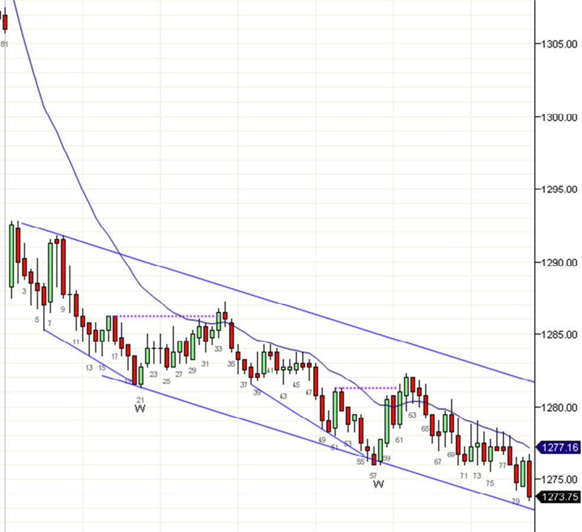
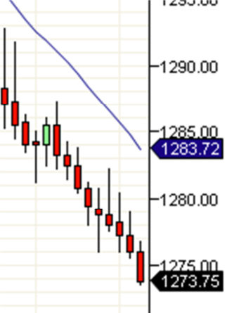
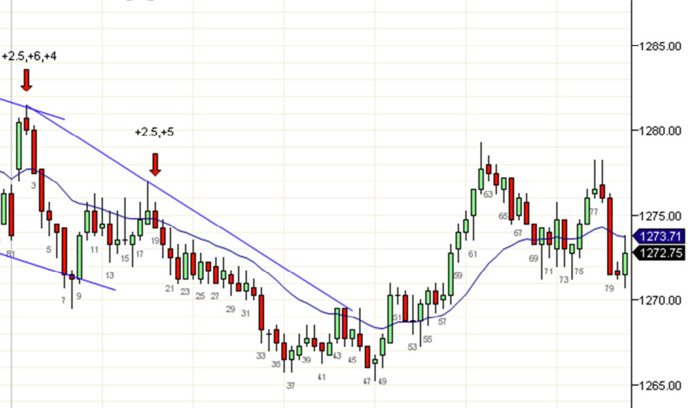
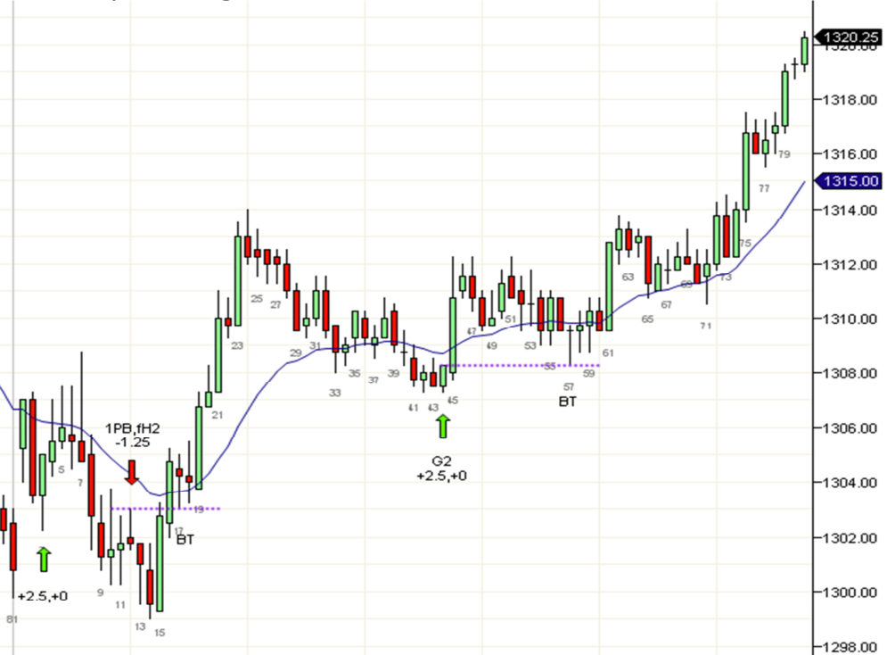
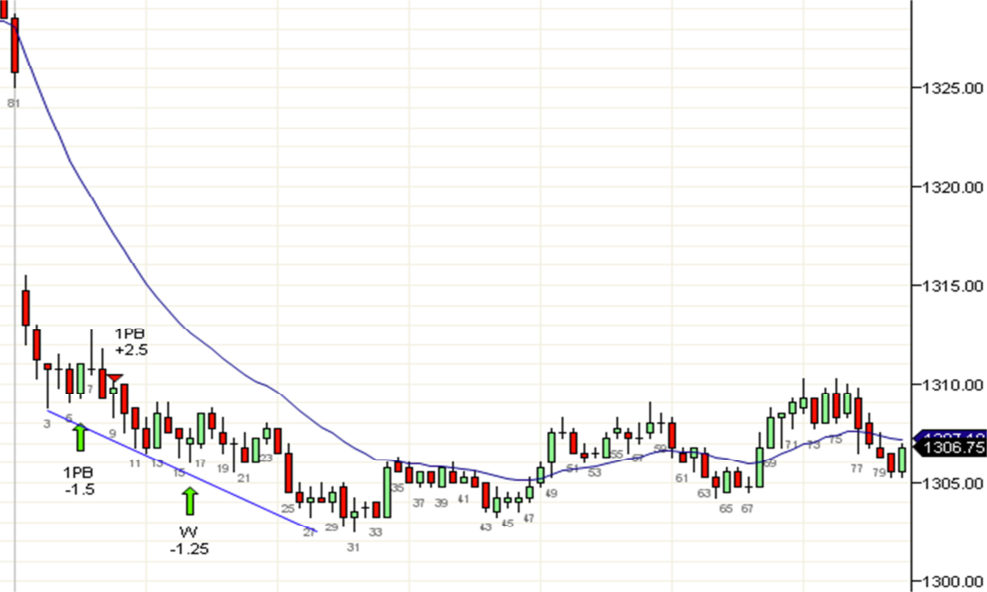
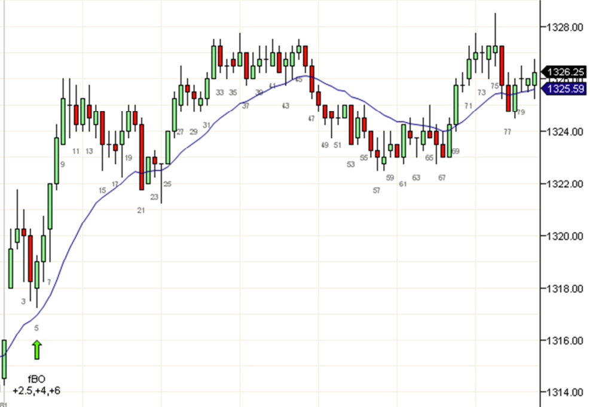
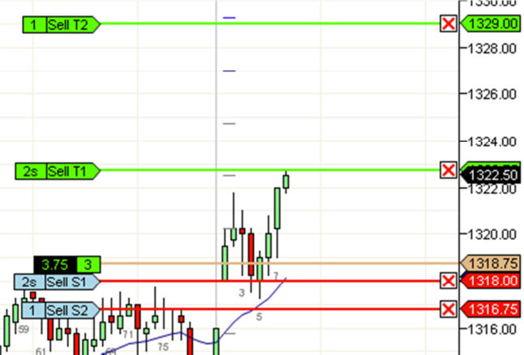
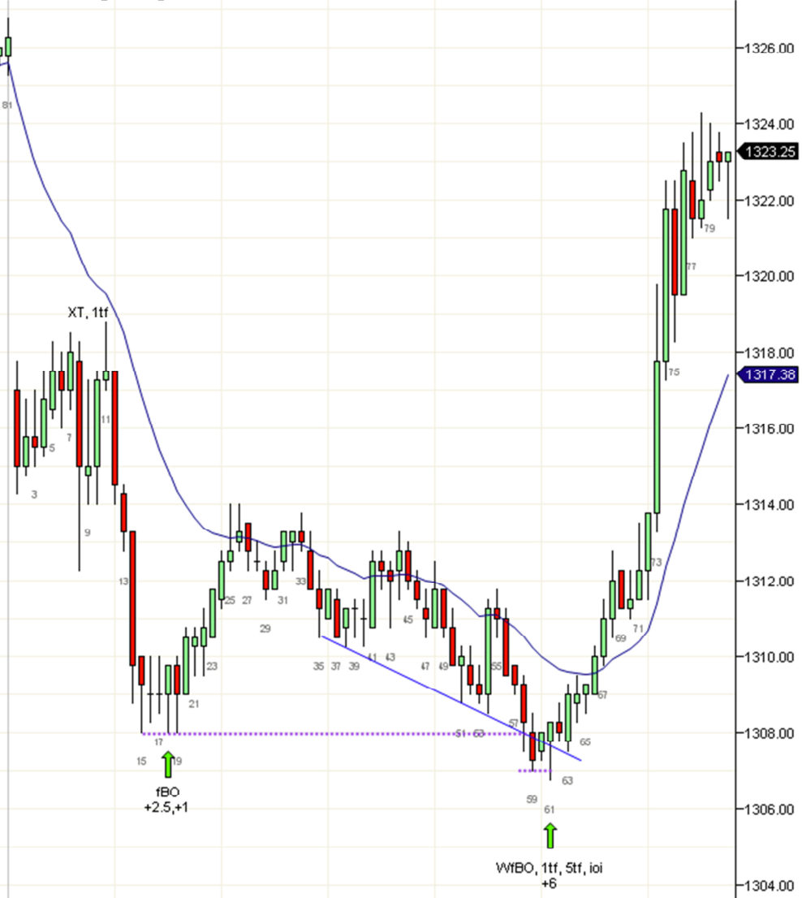

[← 上一章](25-2012年5月.md) · [目录](00-目录.md) · [下一章 →](27-2012年7月.md)

# 2012年6月

原书第 380–387 页

<!-- 原书第 380 页 -->

## 通道风险

2012年6月1日 星期五 · 原书第 380 页

斜率平缓、通道较宽的通道很难交易，主要原因是它们并不总是遵循许多关于趋势的价格行为规则。例如，空头趋势被定义为带有更低低点和更低高点的走势。这意味着当反趋势走势突破了一个波动点，趋势可能已经结束。斜率平缓的趋势通常会突破波动点并沿原趋势方向继续（b33, b61）。

第二次尝试可能会失败 (b31)，而第一次尝试则会成功 (b52,69)，止损需要大于 6 跳 (b63)。显而易见的楔形反转可能会失败 (b21,58)。价格通常在出现延续走势 (b17,52) 前不会触及趋势线或指数移动平均线，导致交易员错过很多入场机会。止损设置在波动点之外通常会被止损 (b33,61)，这使得即使在正确价位入场也很难进行波段交易。

虽然这一切看起来像是震荡，但在更高的时间周期上却是一个非常强劲的趋势。左侧的图表显示了当日的30分钟图。显然这是一个非常强烈的空头通道，并且全天只有一个多头K线。在5分钟图上看起来强劲的多头走势，在30分钟图上仅仅是上影线。

<!-- 原书第 381 页 -->

在正常图表中的趋势突破的波动点上方的走势，仅仅是对前期 K线的一次试探，并且有效地构成了一个1CBO类型的延续形态。

趋势线本身一直有效，并且在全天内从未被打破。通道将一直有效，直到反趋势走势导致持续的趋势线突破。

在这样的日子里入场交易的方式与其他任何日子都一样。最佳的入场点是向趋势线或指数移动平均线（b34, 63）的两次或三次腿部移动。由于逆势波段幅度巨大，您只需在您交易方向的第二次或第三次推（b49 或 b55）处离场，并等待新的建仓形态。关于浅宽通道最重要的一条规则是，在最浅的趋势线（b1- b9）被突破之前，永远不要进行逆势交易。

<!-- 原书第 382 页 -->

## 小缺口或无缺口

2012年6月4日 星期一 · 原书第 382 页

当前一天最后一个k线与当天第一个k线之间的缺口非常小（重叠或小于最近一个k线）时，您可以将当天的价格行为视为前一天价格行为的延伸，至少在第一个小时左右是这样。

因此，当昨日下行通道的趋势线上形成一个小反转k线时，即使是第一次尝试，只要信号k线不弱（十字星或重叠），通常也是一个可接受的交易。如果你将其作为建仓形态，你应该期望它能突破前一日的最后一个波段。

随着日期的推进，一个新的、更清晰的趋势线将形成（b2,18），并优先于前一天的走势。未来的交易应根据当前交易日的近期价格行为进行评估。

<!-- 原书第 383 页 -->

## 正确解读突破测试

2012年6月12日 星期二 · 原书第 383 页

价格行为可以被任意定义为一系列的突破和突破失败。有突破前一日和当日的k线、波段、高低点，突破趋势线以及突破像emas这样的流行指标值，这些统称为障碍。在趋势方向上的突破很可能成功，直到趋势被打破。在交易区间内的突破很可能失败，直到新的趋势诞生。这对任何障碍都是如此，但有些更容易看到，也比其他障碍更可靠。例如，在强劲上涨后（b15-23）出现的三推回撤（b24-44）尝试突破进入趋势（b45）。市场试图反转此次突破，但在老入场价（b57）处找到了买家。这种建仓形态被称为突破测试（BT）。突破波动点（如b17测试突破b12上方）也可能发生BT。这可能也是ema的BT。突破测试是少数几个可以考虑做多的十字星信号k线的地方之一，只要其收盘价接近入场价且不重叠（即，它可以被视为一个2BR）。预测BT的方法是注意任何强劲的突破k线，并在必要时标记其突破点。对于突破k线(s) b15,16，由于没有做多信号k线，只有一个突破点，即波动高点b12。对于突破k线b45, ，波动点b40H和信号k线b44H都是BT点。限价交易者可以简单地在此价格设置限价单入场，并设置3t或4t止损。止损入场交易者应在突破点触及但未跌破该k线上入场。错过突破点一两个跳是可以接受的，但不要回撤超过它。一旦趋势确立，将每次回撤都称为BT是没有意义的，因为趋势预计将继续，它只是一个普通的回撤，没有什么特别之处。也就是说，将b71 称为BT是没有意义的，因为它基本上只是趋势中的一个2L pb。

请注意，趋势可能在没有任何突破测试的情况下形成，因此突破测试不是趋势价格行为的必要条件。

<!-- 原书第 384 页 -->

## 通道风险

2012年6月25日 星期一 · 原书第 384 页

大幅跳空上涨或下跌通常不会导致陡峭的趋势，而是导致浅倾斜的通道。当然，所有的走势都可以包含在通用的平行趋势和趋势通道线中，并被称为通道，但就本帖而言，通道是一种特殊类型的价格行为，代表了一种非常难以交易的走势。

通道可以根据以下特征轻松区分于趋势：在通道中，大多数顺势k线会相互重叠。在趋势中，大多数k线不会重叠。比较从 b7 到 b12 的下降腿和从 b47 到 b50的上升腿。请注意，前者的k线几乎完全重叠。

通道中的大多数k线在一端或两端都有引线。强趋势应该由趋势k线构成，至少在趋势方向上是如此。请注意，在上升腿 b47050 和 b68-72上的强劲收盘。

通道极有可能触发固定止损和盈亏平衡止损。 b7下方的空单被触发，除非它们的止损足够大，至少有两点或更多，否则可能已被止损。 b14 和 b18 处的强信号k线触发了它们的盈亏平衡止损。这样的价格行为可能会使使用正常的交易管理风格难以抓住波段交易。

通道可能在最不可能的k线上反转。这使得通道的交易非常危险。例如，今天的通道在b31, 反转了，这是一个多头十字星，与之前的b9,16,27 并无太大不同。

交易通道的唯一方法是尽早入场，并在每个新的波动点（b14,18,23,28 做空b7 ）后面跟随。通道可能随时反转，并且通道会朝相反方向发展，这使得捕捉潜在的早期反转（例如在最初一两个小时内）可能成为一整天的波段交易。

<!-- 原书第 385 页 -->

## 估算目标的奇特旧诀窍

2012年6月27日 星期三 · 原书第 385 页

波段交易者需要执行的最具挑战性和最容易出错的任务之一是估算其目标。高估会迫使你在等待魔法数字达到的过程中放弃很多收益。低估要好一些，因为你可以随时寻找新的入场点。

<!-- 原书第 386 页 -->

对于强趋势日来说，这是一项相对简单的任务。在大多数强趋势日，你通常可以一直波段交易到收盘。

至少，你可以一直波段交易直到遇到持续的趋势线突破，然后在高点附近退出。

例如，今天我们从 b5开始出现了一个非常强劲的趋势上涨走势。即使没有画趋势线，明显的持续趋势线突破 b45-57 也是显而易见的。因此，交易者应该预期在高点附近退出（b63H）。

交易区间日则更难，你判断走势的能力变得更为重要，因为趋势突破很可能一直持续到触及另一端的收盘价。一个诀窍是利用观察：交易区间日的日内波幅通常与当天的第一根k线成比例。如果 b1 是 2 点，那么日内波幅可能预计为 10 点。因此，你可以简单地在日内波幅接近预期边界时退出。例如，今天的 b1 是 2。25 点。由于日内低点在 1317.25, ，你应该预期日内高点在 1317. 25 + 2。25*5 = 1328.50, ，这确实是当天的实际高点。

请注意，这只是一个指导原则，并非某种包治百病的灵丹妙药。非常大和非常小的第一根k线是这个规则的明显例外。即便如此，当您获得可观的利润并且您的波段止损距离很远时，您应该始终退出部分仓位。

<!-- 原书第 387 页 -->

## 选择W和WfBO的目标

2012年6月28日 星期四 · 原书第 387 页

楔形通常是最容易进行波段交易的建仓形态。这是因为W反转有一个可靠的目标。通常来说， W反转会试图反转整个楔形的走势。如果楔形在其中一腿就反转了走势，你可以预期在同一方向上出现额外的衡量性走势。

---

[← 上一章](25-2012年5月.md) · [目录](00-目录.md) · [下一章 →](27-2012年7月.md)
