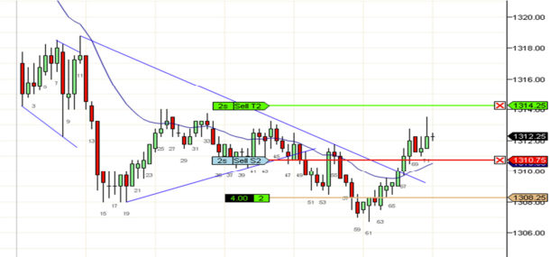
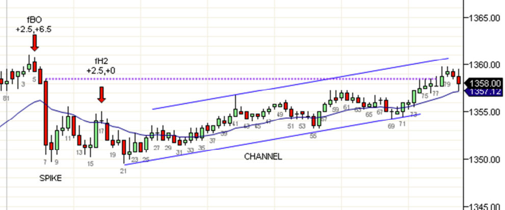
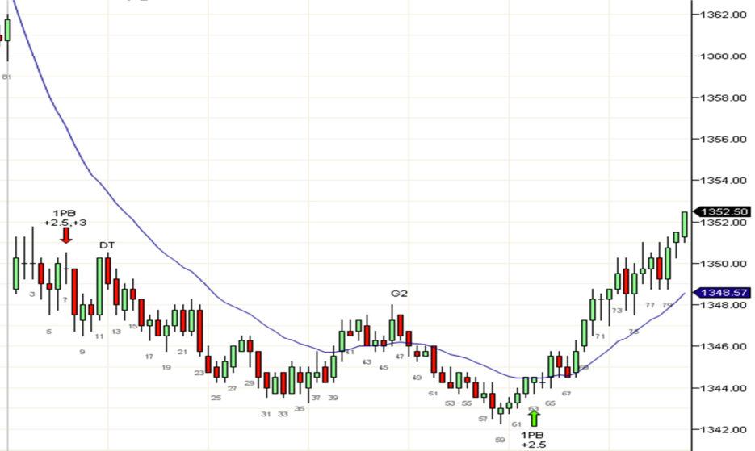
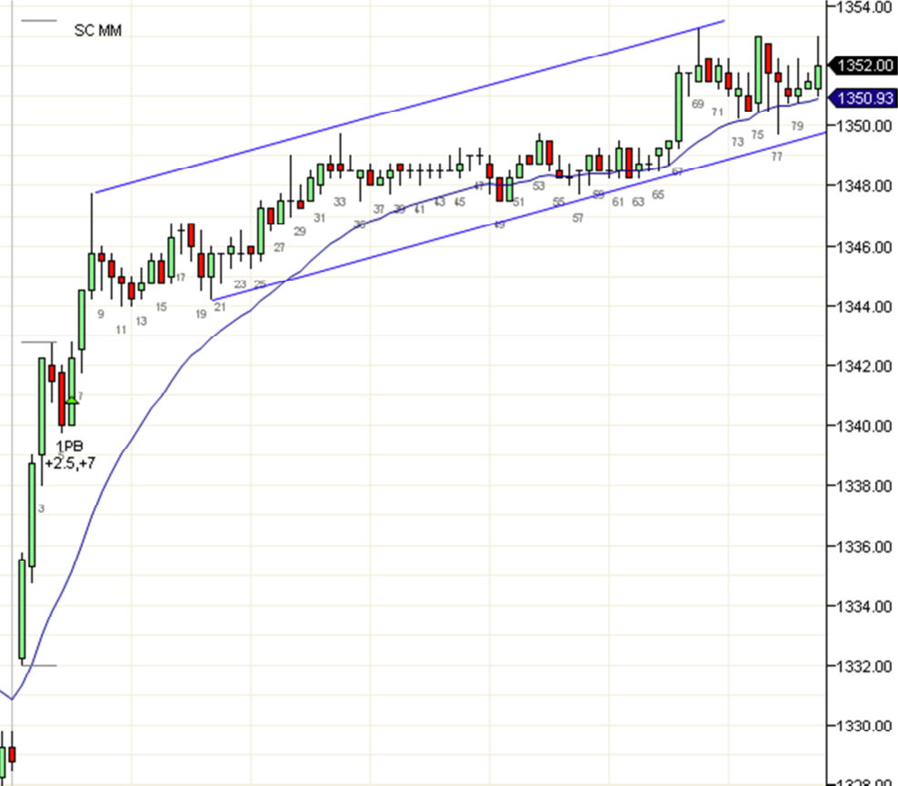
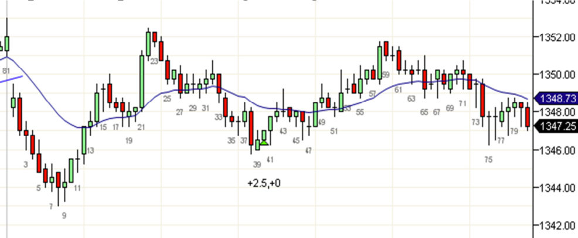
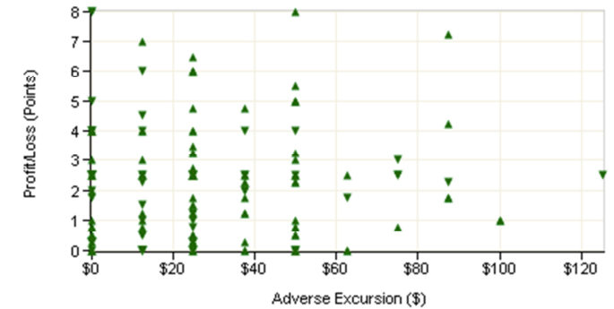
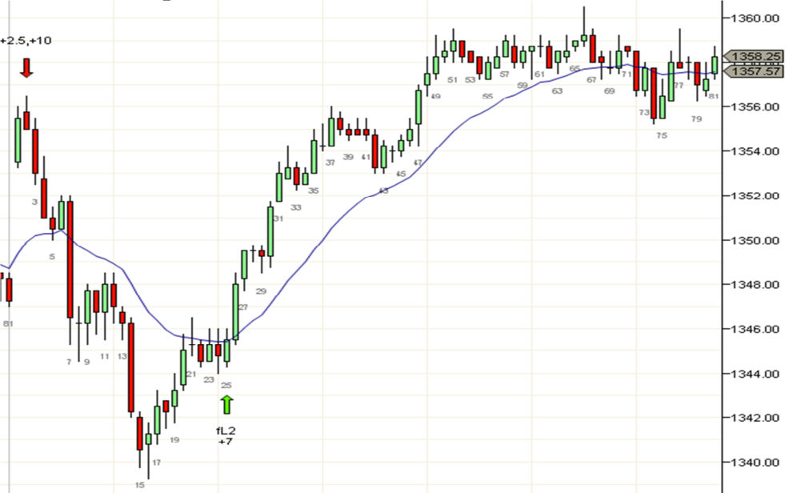
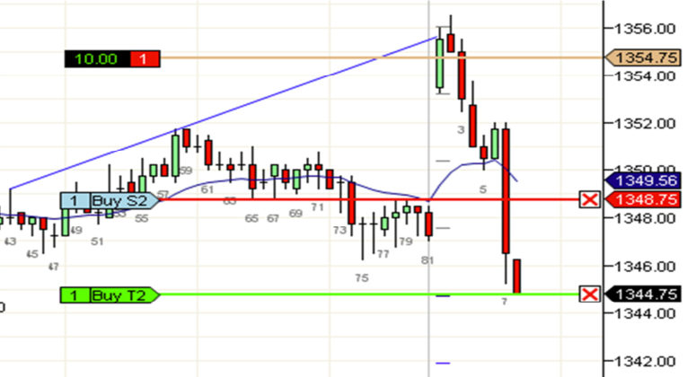
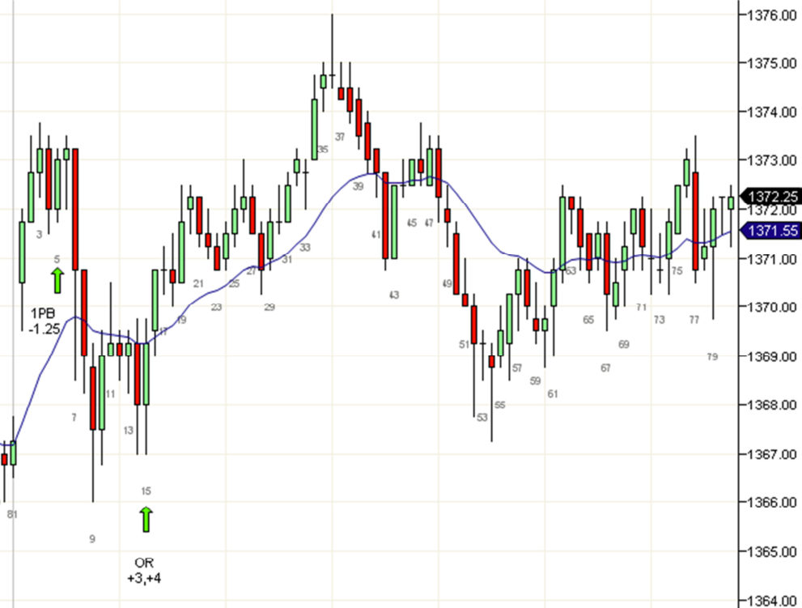

[← 上一章](26-2012年6月.md) · [目录](00-目录.md) · [下一章 →](28-2012年9月.md)

# 2012年7月

原书第 388–394 页

<!-- 原书第 388 页 -->

然而，如果W以多条腿，尤其是三条腿接近W走势的起点，通常明智的做法是退出并寻找新的交易。例如，W35,51,61 是一个极强的信号，应该会预计走势反转到b25 高点。因此，b27 的高点，甚至可能高出一两个跳点，都是合理的目标。由于上涨走势可能不止一条腿（两条空头K线b 62,69 构成一个mW）。明智的做法是退出。偶尔，比如今天，当走势足够强劲，以至于上涨走势基本上可以作为1 一条腿（b62 和b69 仅差1跳点）来继续上涨，达到W的额外幅度。

## 飙升和反转通道

2012年7月2日 星期一 · 原书第 388 页

强烈的飙升如果价格继续朝飙升方向移动，可以形成一个与飙升方向相同的通道。偶尔，比如今天，我们会得到一个与飙升方向相反的通道。

在一个强劲飙升的方向上的通道通常会达到整个飙升的衡量性走势。交易者今天预期通道在熊市方向，但遇到了更罕见的，可能是反转通道，这可能会让他们感到惊讶。有一个线索预示着可能出现反转通道：一个较小的，朝着相反方向的飙升（b9-11）。如果飙升之后是任何合理强度的，朝着相反方向的飙升，您应该警惕可能出现反转通道。

顺势通道经常（但不总是）会达到整个飙升的衡量性走势。因此，对于今天的10 点飙升，交易员可以预期通道将持续10 多点下跌。反转通道类似地会反转整个飙升，并且通常是第一次回撤（b32）或第一次深度或2 腿式回撤（b56）的一个良好波段。

<!-- 原书第 389 页 -->

## 通道类型

2012年7月6日 星期五 · 原书第 389 页

通道非常普遍，并且目前有利可图地交易它们是一个研究领域。总的来说，有三种类型的通道，从更高层次的视角来看，它们的交易方式相似，但具体细节有所不同。

交易区间通道 (TRC): TRC 是一个斜率平缓、范围宽阔（3+ 个波段点之间）的通道，由大k线组成（2+ 点）。从开盘到今天 b31 的价格走势是一个经典的 TRC。对大多数交易员来说，TRC 是最危险的价格行为形式。这是因为它们似乎总是在反转的边缘，而大多数反转尝试都失败了。新交易员可能会在今天的上午被多次套住，试图交易：fBO b5, 2L 反转 b9,强反转后的低高 b14, W b19。请注意，其中大部分k线相当不错，形态看起来也很清晰。TRC 会一次又一次地欺骗和挫败交易员。这些通道很难交易，因为所需的止损很大。

腿部通道 (LC): 腿部通道的斜率略陡，k线通常较小。然而，大多数k线是重叠的，并且有很多带引线的k线。从 b47-59 的价格走势是一个很好的例子。这些通道相对容易交易，因为所需的止损较小。只要在通道趋势线附近，你就可以在任何回撤或小k线之后入场。例如，b50, b55 但不是 b52 ，因为它偏离了趋势线。稍微试探前期k线会形成一个 1通道突破建仓形态 (1CBO)。通道的第一次突破方向是高概率失败，所以你应该在其预期失败的方向进行交易。你也可以逆势交易第一次反向趋势k线的收盘价（b54）。

趋势通道 (TC): 趋势通道实际上是一种带有极小k线的常规趋势走势。它们看起来会重叠，但每根k线只比前期k线低一两个跳，这意味着交易员会在前期k线收盘时积极入场。b59-b64 是一个很好的例子。这些可以像任何强趋势一样进行交易。在第一次回撤 (b63) 或第一次反向强劲收盘 (b67) 或走势方向上的第一个引线 ( 例如，如果b64有一个 1t 多头实体) 时入场。通道类型都相互关联。交易区间通道 (TRC) 是更高时间周期上的腿部通道 (LC)，而腿部通道是更高时间周期上的趋势通道 (TC)。反过来，趋势通道 (TC) 是更高级别时间周期上的常规趋势 (例如 b65-73)。因此，从最弱到最强的趋势强度依次为 TRC->LC->TC->趋势。当你看到价格行为从一种类型变为另一种类型时，这可能是一个预警，表明趋势可能像今天一样突破，或者当它以相反顺序移动时，它可能表明趋势即将结束并进入一个交易区间。

<!-- 原书第 390 页 -->

## 盈亏平衡赔率

2012年7月13日 星期五 · 原书第 390 页

你们中的一些人可能注意到我从 +2 刮头皮交易转向 +2。5。这代表着我的风险管理策略发生了转变，该策略此前一直在进行广泛的测试。此前，我发布了一个风险管理系统，交易员可以利用该系统在承担小额固定风险的同时，获得适度固定利润。

该系统之所以有效，是因为每次盈利都大于每次亏损，而盈亏平衡交易员仍应累积点数。然而，在某些日子，如今天，价格行为明显有利于波段交易你的头寸。

希望进行波段交易的交易者应使用以下风险管理策略。此策略在方法论上是中立的，即它应适用于任何类型的交易/入场系统。

- 初始止损为-5跳，用于全仓。
- 1第一个目标是+10跳，用于半仓。

在第一个目标位被突破或止损被触发之前，切勿调整止损价位。否则，您将失去数学上的优势。当第一个目标位被突破后，将止损价位移至入场价进行保本，然后让它继续运行。波段部分可以在任何高于入场价的价格退出，但您应该尽量获得至少 4 点。

<!-- 原书第 391 页 -->

在保本的情况下：

- 50% 的交易在未能触及第一个目标位的情况下被止损，但未完成成交。(10t 亏损)
- 50% 的交易触及第一个目标位后，价格回撤至盈亏平衡位止损。(10t 利润)

这意味着，即使你永远无法进行波段交易，只要你的胜率至少为 50%，你最差的情况就是盈亏平衡。

如果你的胜率能保持在 50% 以上，你的账户应该会缓慢积累盈利。你可以采取以下措施来保持 50% 以上的胜率：

- 在明显的趋势突破后才进行交易。
- 仅在趋势中的深度回撤时进行交易。
- 永远不要做反转交易。
- 在b24 和b60之间要极度谨慎。
- 避免不良信号k线（重叠、带引线、过大、错误颜色等）。

如果你的胜率低于50%，就停止交易任何其他标的，只交易明显的趋势，并首先达到50%以上。胜率低于50%意味着你做得非常非常错误。

## 止损和波段交易的短线交易大小

2012年7月16日 星期一 · 原书第 391 页

在我之前的帖子中，我讨论了一种优化止损大小的方法。通过对包括各种实验性交易在内的详尽的交易历史进行分析，我推断出我的最佳入场点在入场后回撤 4个跳或更少。这意味着对于大多数交易，我可能可以承受 5个跳的止损。

<!-- 原书第 392 页 -->

左侧的图表显示了超过 100 次盈利交易的最大不利波动幅度 (MAE)。(亏损交易无关紧要，因为它们的 MAE 总是交易被止损时的价格)。

此图表最显著的特征是，大多数交易都集中在前 5 列 (0个跳, 1个跳, 2个跳, 3个跳和 4个跳)。在触发后回撤超过 4个跳并最终盈利的入场点，其盈利概率低于 10%。其中只有 3 的交易能够获得超过 10个跳的利润。我最近没有做多少止损大于 2 点的交易，所以右侧的稀疏数据可能仅仅是因为数据不足。但很久以前，当我用价格行为止损（止损在k线之外）进行同样的分析时，我注意到一个类似的模式。

我专注于大的市场波动以及引领大市场波动的信号k线，它们在触发后回撤非常小。今天明显重要的转折及其回撤是 b8(4t), b23(2t), b40(0t) 和 b59(1t)。如果您注意到，它们触发后回撤非常小。对于波段交易，您只需要关注大的走势并忽略小的走势，即您的目标是买入像 b40 这样的k线并持有至 b59 ，而不是买入 b50, b54 的低点并在 +1 的利润处卖出。

因此，如果您想进行波段交易，但价格从您的入场价回撤超过 4t，这可能根本不是一个好的波段。下一步就是调整您的交易，以准确评估当天最大的市场转折，并且只选择那些建仓形态。

一旦有了固定止损大小，如果你想波段交易一半的合约，那么你的短线交易大小就是风险的两倍。（如果你想获得固定利润，任何大于你风险的值都可以接受）。这为我的交易风格提供了 5t 的固定止损和 10t 的短线交易目标。由于我的大部分入场最终都会变成大的走势，平均而言，我至少波段交易一半总是比较好的。

当然，上面的 5t/10t 是根据我个人的交易历史和我试图只交易主要波段的策略来确定的。你的情况可能会有所不同，你需要根据你自己的交易数据和策略来确定你的止损点和短线交易点位。

<!-- 原书第 393 页 -->

## 理想的价格行为

2012年7月17日 星期二 · 原书第 393 页

我曾提到宽通道带窄斜率是最危险的价格行为。相反，陡峭窄幅趋势，带有干净的k线且没有波段重叠，可能是最安全的价格行为，也是最盈利的。

干净的信号 k线（b2）导向大趋势入场k线（b3），并有良好的跟进（b4），浅回撤且不重叠前期波段（b6），这些都是非常干净轻松的一天的标志。在这样的日子里，很少有套牢。所有信号在强势时可能都会奏效。例如，b16 处的W反转或b25 处的fL2 at，虽然在大多数日子里肯定会引起怀疑，但尽管收盘较弱且有重叠，它们最终还是奏效了。直到午餐后价格行为最终变得震荡，之前的走势都干净明了。如果你遇到这样的日子，就抓住任何顺势信号，因为它很可能会成功。如果可能，至少将一份合约进行波段交易，以获得可观的利润。这样的日子很少见，所以要充分利用。

<!-- 原书第 394 页 -->

## fBO的风险

2012年7月19日 星期四 · 原书第 394 页

fBO交易需要最高水平的波段交易技巧，而刮头皮交易则需要最低的技巧。原因是fBO预计会提供两腿走势，但仅此而已。没有对目标的预期。也没有预期交易区间的另一端会被测试。

Since腿可能相当复杂并包含迷你腿，fBO走势的高点 ly subj取决于交易者的经验和判断。

例如，今天的fbo交易在b37 处预计会有两腿向下，并确实急剧下跌至b54。此时，交易者需要评估是否会再有一腿下跌至日内低点，或者在此处反转。

如果交易者正确预测价格会反转并做多 b54 或在 b60, 的低高（HL），那么在 b63, 时，问题就变成了：这个走势会在此结束，还是仅仅是更大趋势向下的一个小的回撤，并且可能导致又一次向下走势。

这种复杂性可以通过假设每两次反向操作交易者的头寸就迫使一次退出，来加以处理。例如，b 37 卖家将在 b54之上退出。b54 买家将在 b63 之下退出，依此类推。这样的策略需要交易区间足够宽才能盈利。交易区间需要大约是日内波幅的大小（8-10 点）。一个相反的策略是交易每一个 fBO 作为趋势，并在价格突破了波动点之外的止损时退出。这意味着 b54 买家将持有至他们位于 b74 之下的止损被 b79触及。这些都不是容易的，fBO 交易肯定需要一个短线交易目标，因为大波段的潜在幅度是未定义的。

---

[← 上一章](26-2012年6月.md) · [目录](00-目录.md) · [下一章 →](28-2012年9月.md)
