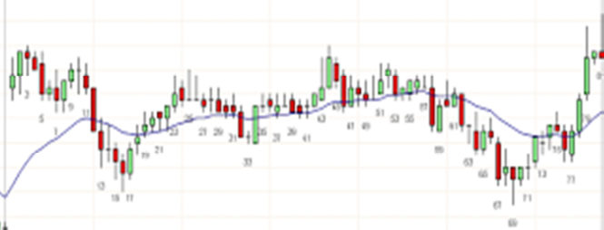
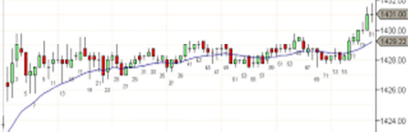
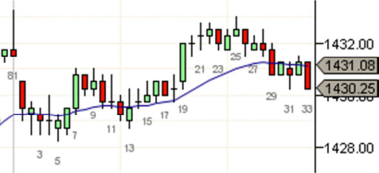
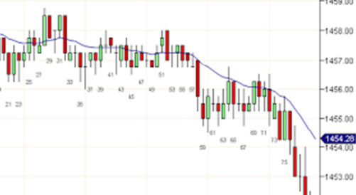
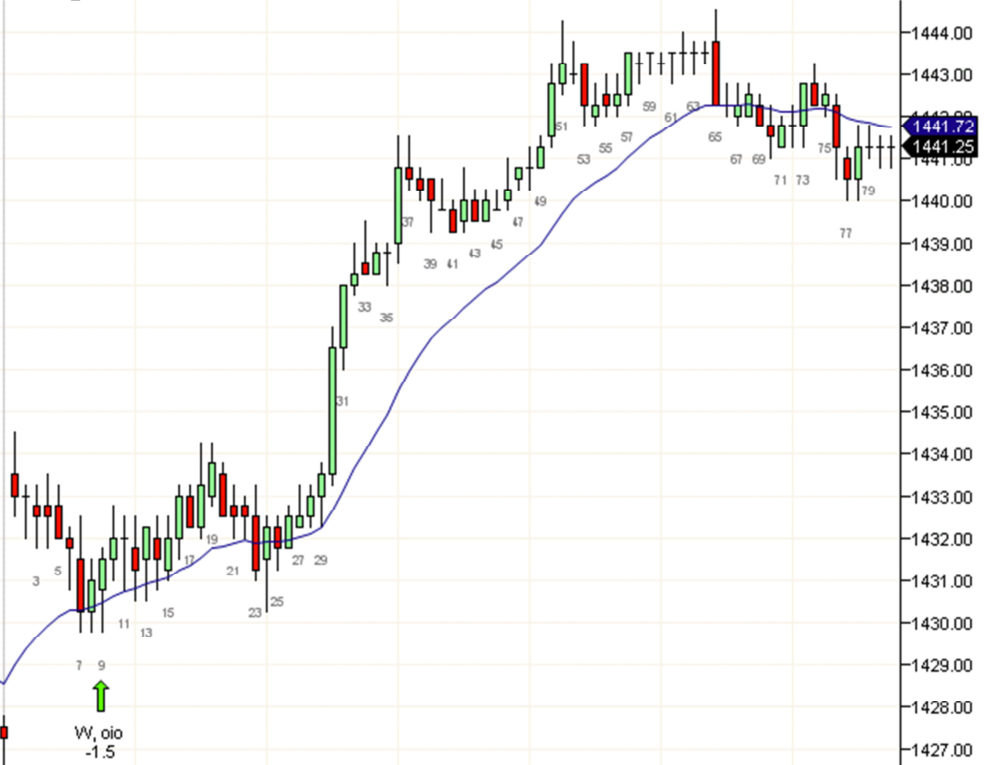

[← 上一章](27-2012年7月.md) · [目录](00-目录.md) · [下一章 →](29-2012年10月.md)

# 2012年9月

原书第 395–398 页

<!-- 原书第 395 页 -->

## 未来的道路

2012年9月22日 星期六 · 原书第 395 页

在过去的几个月里，我的发帖频率有所降低，但请放心，在我的小型研究团队的慷慨帮助下，我正在积极地致力于揭示交易的几个重要方面。

以下列出目前活跃的研究领域的一小部分：

交易通道：

在价格行为交易中最重要的课题之一是使用小的固定止损进行交易通道交易，而不诉诸于加仓或其他不良习惯。由于通道很常见，因此这是重要的研究重点。

预测不值得交易的窄幅震荡日：

有些日子行情波动极小，在波动范围只有四个点的震荡重叠的价格行为的日子里，交易是危险的。提早预测到这样的日子能让我们保持观望，跳过交易。

<!-- 原书第 396 页 -->

预测可能导致止损交易的震荡开盘：

开盘时看似潜在的建仓形态可能永远无法产生利润，并可能导致止损或者进入震荡区域。正确地检测出这一点能让你跳过交易，直到价格行为变得更适合交易。此图表显示的是FOMC日期的上午，该日期最终导致了大幅上涨。

预测突破：

价格行为中最困难的问题之一是预测哪一根k线将导致成功的突破。例如，在这张图表中，b57 空头交易导致了突破，而它之前的每一个信号都失败了。高概率预测突破能够使我们明智地入场进行盈利的波段交易。

此外，我还在研究如何通过尽早检测到交易失败，在盈亏平衡点或亏损几个跳的情况下退出亏损交易。建仓形态1Rev和1PB已被进一步细分为一小组不同的建仓形态，使交易者能够逐根k线地预测和交易它们。一旦这些建仓形态满足严格测试的要求，它们将在此以一系列博客文章的形式发布。

<!-- 原书第 397 页 -->

## 一次成功的交易的组成部分

2012年9月27日 星期四 · 原书第 397 页

交易者需要确定4 一个成功的交易的重要属性：

- 方向
- 概率
- 利润空间
- 止损

方向很明显。如果你站在错误的市场方向，你的刮头皮交易成功的机会很小，波段交易的机会为零。确定方向的一个简单方法是画一条趋势线，只在价格测试趋势线时进行交易。趋势线应该从走势的起点开始画。大多数情况下，这将是当日最低价或当日最高价，但有些日子，比如今天，走势的起点可能是另一个k线，比如 b24。经验丰富的交易员也能发现反转，例如在 b9 处的反转三推，并交易趋势的反转。新手交易员应该跳过反转，在成功反转后（b24）进行第一次合理的 the first reasonable pullback。

成功的概率需要更多的经验来判断。在大多数日子里，在确定市场处于趋势之后，你可以抓住每一次双腿式回撤，例如 b44，直到趋势被打破（持续的走势突破趋势线）。在强趋势的日子里，只要信号k线的入场侧没有长引线，你就可以抓住任何回撤和任何顺应趋势方向的微小信号k线。

<!-- 原书第 398 页 -->

利润空间需要相当多的经验来判断。在正常的趋势中，回撤至少会达到前一个极值的一跳，因此深回撤很可能提供足够的利润。然而，在强趋势和大幅度缺口开盘时，即使只有几跳也可能带来可观的利润。高波动性和清晰的形态是利润目标的朋友。铁丝网和微小k线是可怕的敌人，极大地干扰了利润目标估算。

止损大小可能是最难正确确定的。信号k线止损通常有效，但从风险回报比的角度来看可能过大。固定止损易于用于清晰的形态和强k线，但对于通道和重叠k线则非常困难。例如，尽管今天正确判断了日内低点，但我的止损比 1跳要小，导致交易亏损，错失了一个绝佳的波段交易建仓形态。

采用固定止损并持续关注市场方向（使用九个过渡）意味着你只在入场交易时考虑概率和利润目标。放弃浅回撤意味着你只需要关注概率，这归结为寻找一套清晰的形态和强信号k线。

您的决策过程所涉及的参数越少，您就会对自己的决策越有信心，这将有助于您成为一名成功的交易者。

---

[← 上一章](27-2012年7月.md) · [目录](00-目录.md) · [下一章 →](29-2012年10月.md)
