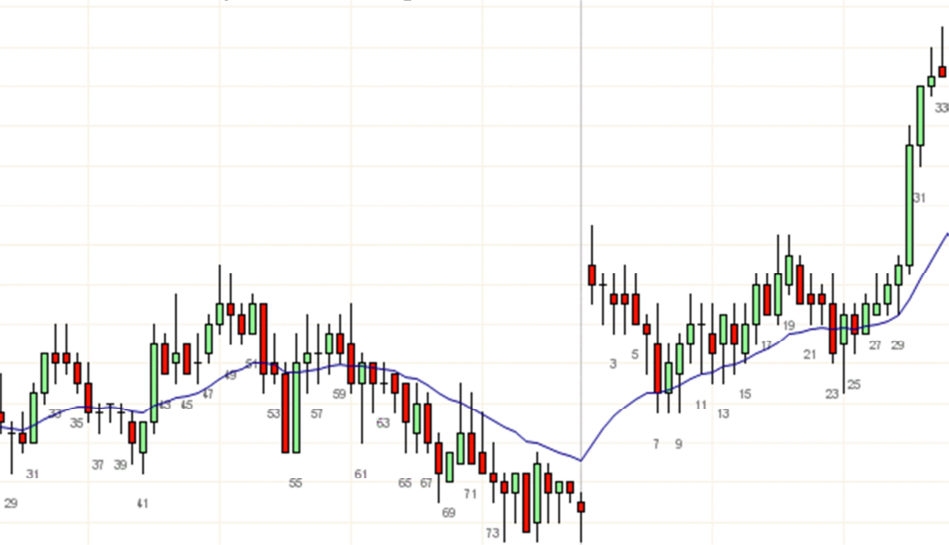
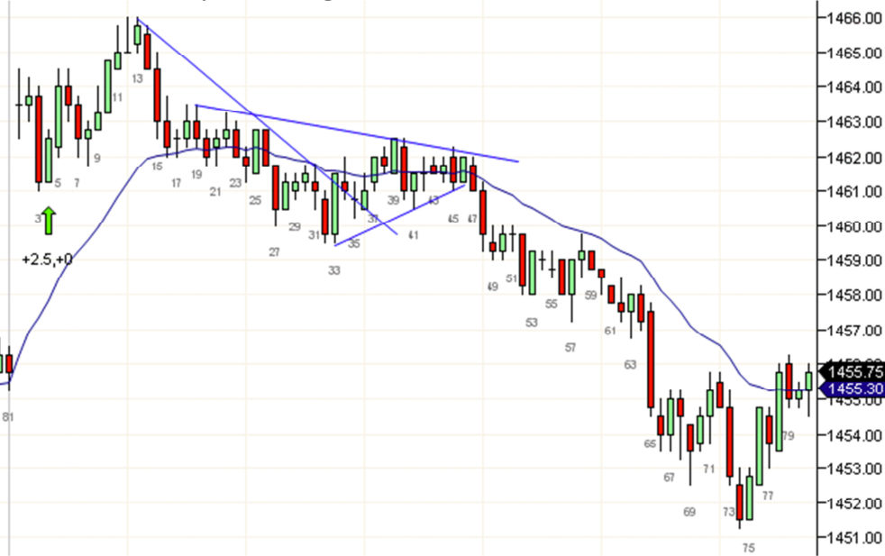
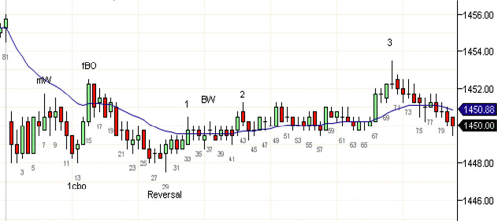
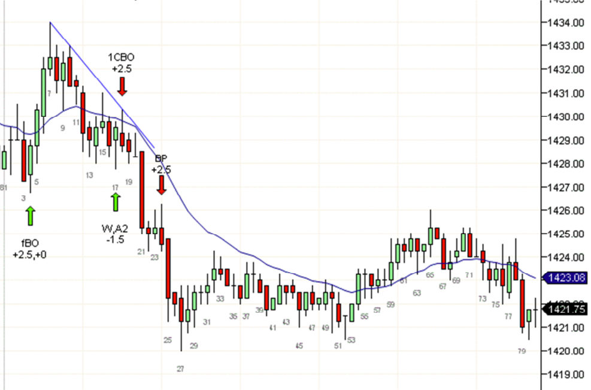
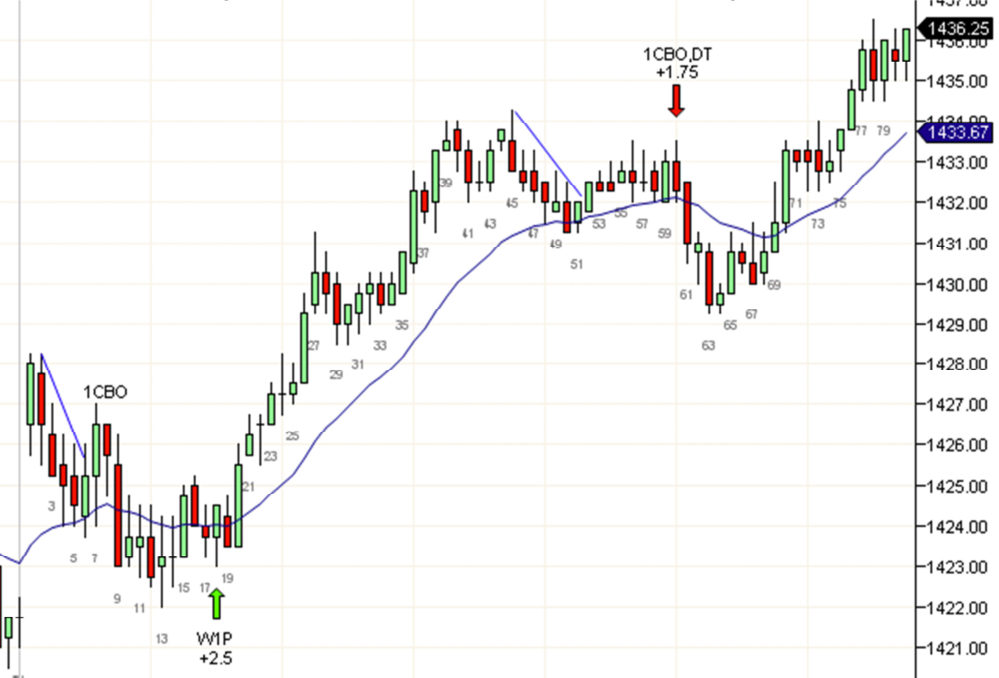
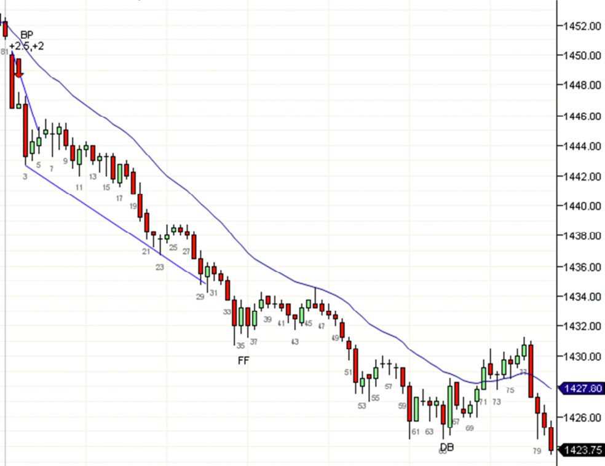
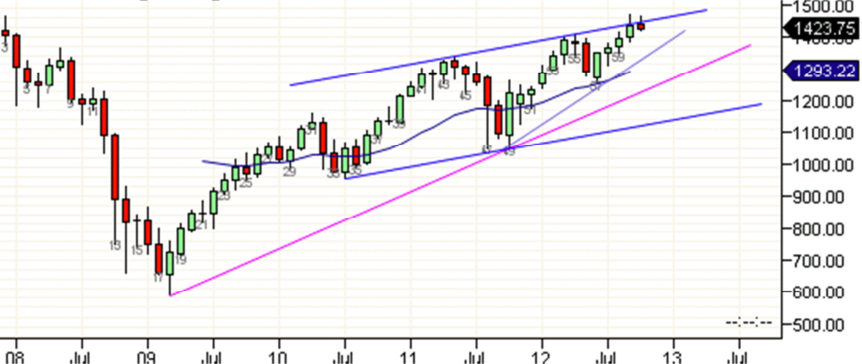

[← 上一章](28-2012年9月.md) · [目录](00-目录.md)

# 2012年10月

原书第 399–405 页

<!-- 原书第 399 页 -->

## 通道理论 I - 定义通道

2012年10月4日 星期四 · 原书第 399 页

通道是价格行为中高度重叠的区域，会在图表中向上或向下漂移。如果该区域不漂移，它将仅仅是铁丝网。通道很重要，因为与铁丝网不同，铁丝网只能进行几次跳跃或几个点的刮头皮交易，而通道确实会趋势，并且可以交易足够多的点数来证明入场交易的风险是值得的。目标是以固定的止损大小来交易通道，从而使潜在利润大于承担的风险，并具有较高的成功概率。

通道通常具有以下特征：

多K线重叠：一根K线被后面许多K线重叠是很常见的。例如，在右侧的这一天，b7 除了b1 和 b19 之外，都被每一根K线重叠，直到它最终突破通道。

引线：无论K线的颜色如何，你都可能遇到两边都有引线的K线。这些引线看起来像是趋势即将突破，但在K线中部观察时，K线最终会以相反的颜色收盘，导致K线中部做出错误的决定。切勿在K线中部做决定，尤其是在通道内。

交替的K线颜色：真正的通道具有交替的彩色K线，并夹杂一些十字星。没有相反颜色K线的通道是趋势通道（TC），实际上就是趋势。你可以交易顺势，在TC中的任何小K线收盘时进行交易，但在真正的通道中，如果你使用固定的止损，很可能会被止损。形成腿形的真正通道是腿形通道（LC）。有时通道非常宽，看起来像一个倾斜的交易区间。这些是交易区间通道（TRC）。

不可预测的行为：通道可能会反转 (b19)，可能突破 (b30)，可能会变成任何其他类型的价格行为，并且通常难以预测。

交易通道的主要目标是确定以下内容：

1. 起点：检测价格行为转化为通道并确定方向
2. 反转：通道可能反转方向，但仍保持为通道
3. 突破：通道突破形成陡峭的趋势走势。这是最重要的

<!-- 原书第 400 页 -->

即使是简单的通道检测也很有价值，因为它能让你避免陷入震荡，而检测通道内的突破和剧烈走势则能让你在希望交易通道时最大化利润。在接下来的几天里，我们将看到如何实现这些目标。

## 通道理论 II - 起点

2012年10月5日 星期五 · 原书第 400 页

一旦我们定义了通道，我们就可以应用它来检测价格行为何时显示出转变为通道的迹象。一般来说，当信号K线和入场K线质量较差时，即重叠且带引线的，我会关注通道形成。

由于在正常趋势中，信号K线和入场K线明显不重叠（b4,5 或b6,7 或b8,9），任何信号K线和入场K线的严重重叠都应该让你警惕。特别是如果入场K线和接下来的两条K线重叠了信号K线，那么你肯定已经进入了一个通道。因此，在b20, 这一天，你已经检测到了一个通道。通道的检测并不完整，直到通道方向也得以确定。这在实时操作中比较棘手，因为看起来像下降通道的走势可能仅仅完成了三条腿之类的结构要求，然后就改变了方向。通道方向通常是在你可以画出一条通道趋势线时确定的。最早的方向估算来自于两个低低（LL）和一个高低（LH）或两个高高（HH）和一个低高（HL）。因此，在 b24这一天，你会确认一个下降通道。有时看起来像通道的走势会迅速转变为三角形或扩张三角形，如果你过早入场，就会被套住。冲突的通道趋势线（如上所示）在通道的 nascent 阶段很常见。这是导致止损出局和发现自己处于市场错误一方的常见原因。虽然从启动点开始的趋势线（b13）通常是全局的最佳趋势线，但通道经常会测试从通道起点开始的趋势线（b19）。

永远不要陷入认为通道会在第一次尝试时就反转的想法，并交易新转的趋势线（b33-41）。这种交易很少成功。

<!-- 原书第 401 页 -->

一旦你进入了一个通道，你需要将你的交易切换到通道模式。在正常交易中不好的做法，如反转 k线，在通道中变得可行，而在正常交易中好的做法，如固定止损和在信号k线突破时入场，在通道中会失去其力量。你可以简单地等待价格行为突破通道模式，然后寻找入场点。当回撤不再重叠信号k线时（b47），你就可以在不害怕被止损的情况下安全地进行顺势入场（b59 s, b64s）。

## 通道理论III - 过渡

2012年10月8日 星期一 · 原书第 401 页

一旦我们检测到价格行为已进入通道，我们应该能够像常规价格行为一样追踪其过渡。在正常价格行为中您能看到的一切，在通道中也同样可以看到。

通道通常是楔形，大多数通道走势都可能在3 推动后结束。这并不容易解读，因为每一次推动都可能由复杂的腿和回撤组成。例如，今天的图表上，我们有一个W33,43,72 从b29 开始，其中每条腿都是由微小重叠的腿和延长的回撤组成，例如从b43 到b57的走势。

首次尝试的真实通道反转，例如在b29 处的反转，除非在重要支撑或阻力（b29处的LOD）处，否则很少见。

通道通常是非常微小的趋势，就像它们的更大的类似物一样，它们可以在没有真正反转的情况下结束。例如，在b33 处持续突破TL的走势打破了下降通道，价格水平移动等待突破。通道可能会尝试突破进入常规趋势（b14-15），并且经常成功地退出通道模式。

通道中的持续交易相当困难，通常不值得冒风险回报比。（这目前仍是一个研究领域，未来我们或许能够交易这些）。很大一部分问题在于无法预测通道的斜率。斜率陡峭的通道，例如 b18 处的下降通道，可能值得付出努力，但斜率极其平缓的通道，例如 b29 处的上升通道，交易者通常会因为等待利润达到而感到筋疲力尽。

一个更好的选择是尝试预测突破。例如，正确预测 b67 的突破将使我们能够精确入场以获得最佳结果并避免之前的尝试。一些通道突破幅度很大，其日交易区间比之前的交易区间扩大一倍以上。

<!-- 原书第 402 页 -->

## 通道理论 IV - 可交易通道

2012年10月12日 星期五 · 原书第 402 页

描述通道活动的一种方式是根据波动性来定义它们。虽然正常的平稳趋势具有高波段间波动性和低k线间波动性，但通道则相反。从视觉上看，这意味着通道中的每次波段交易仅比前一个波段交易多进行几个跳 (b36,40)，但回撤足够深，可能会触发止损。这意味着在通道中进行任何任意入场都会有更高的风险触发固定止损，即使它遵循了k线止损。

止损的风险与通道的斜率成反比，与k线幅度和重叠度成正比。例如，在b33 下降通道中的空头头寸被止损的风险，高于在b10下降通道中的空头头寸被止损的风险。

如果近期有大趋势k线，盈利概率会更高。任何紧随通道活动（b7-11）的大趋势k线（b12）都显示出能量和兴趣，此类趋势k线（b17）的失败或导致趋势突破的延续（b18）的几率都很高。

在没有大k线的情况下，通道活动极易受到随机漂移和反转（b27-79）的影响，进入大趋势的几率较低。

总而言之，可交易通道比其波段更陡峭，有近期的大趋势k线，并且k线更小。

<!-- 原书第 403 页 -->

## 通道理论 V - 首次通道突破通常会失败

2012年10月15日 星期一 · 原书第 403 页

趋势主体较小的通道，例如 b21-25 ，在更高时间周期显然构成了一个更大的趋势k线，而且你通常可以以止损设在该k线下方，在任何收盘强劲的小k线之上做多。这类通道被称为趋势通道 (TC)，而且通常是最容易交易的。特别是，收盘强劲的小趋势k线，如果触及了趋势线或微小趋势线，很可能在之后给出大趋势k线，并构成一个绝佳的波段交易入场点 (b34)。

另一方面，两端都有引线的k线，例如b2-5 和b45-49 ，应被视为倾斜的铁丝网或铁丝网通道（BWC）。这些应该像BW一样交易。首次反向突破通道很可能会失败，并可能被视为第二次下行（b60），除非它反向突破支撑位，例如ema或前一日收盘价（b8）。

A se首次尝试突破通常会成功（b15），并且在成功反转后出现HL al (b18，b68) 通常是最安全的入场点。

<!-- 原书第 404 页 -->

## 通道理论 VI - 通道永存

2012年10月19日 星期五 · 原书第 404 页

今天这种强劲飙升后的通道，应该会持续到永远。虽然通道确实会最终突破（例如今天b66-b77 的走势），但事实是通道会持续到永远，因为它们不断尝试反转并失败。通道的不确定性可能会让你解读出各种反转信号，如果你看它的方式不对。例如，b4-b7 是趋势线突破，然后测试b11 的低点和强劲反转k线吗？b30 是3次触碰和TCL OS，因此是W反转吗？b34-b37 是FF，因此是趋势的结束吗？b66 是DB吗？是的，它们都曾是潜在的反转，但市场却在收盘前创下新低。你必须认识到，通道中的每一个反转信号都是一个陷阱。习惯于在交易区间底部进行逆势交易的交易员，在今天这样的日子里会发现自己一直在买入，直到亏损。交易像这样的通道的诀窍是预期每次反转都会失败，并顺着通道的方向接受失败。所以，例如，虽然b13 由于重叠而难以入场，但b 18,26 是可接受的信号。b46 当然是一个到EMA的2L PB。b77 是G2（强劲走势后的深度PB）。你唯一可以真正进行反通道交易的时候，是在持续突破通道并出现低高（HL）之后。所以，如果 b77 的向下走势给出了一个2 或3L HL，你可能会将其视为又一个上升腿。不应该接受1L的走势，因为它可能会很快失败并导致2L的走势。如果你错过了入场点，只要离趋势线或EMA不太远，你通常可以在小趋势k线之外入场。例如，b19 和b29, b47, b50 是可以接受的入场点。但交易这种通道的最佳方式是，从早期入场点进行波段交易合约，并一直持有到收盘或出现明显反转。

<!-- 原书第 405 页 -->

## 预测长期走势

2012年10月20日 星期六 · 原书第 405 页

预测长期走势比成功地从中获利要容易。这没什么大不了的，因为长期预测往往是在事后才能显现。

上方的图表是ES 12-12 合约的月度图表，请注意，最后一个k线是未完成的十月k线（即我们处于k线中部）。

从结构上看，我们从2009 年3月到2010 年4月经历了一个飙升或趋势通道，然后进入了一个通道阶段。通道线用蓝色表示。目前，我们在第三次推升中试探性地突破了通道线。我们很可能至少会经历两次下跌推力。通常，下方趋势线（蓝色）是目标。最悲观的情况是，走势将测试近2010年7月通道的起点。

鉴于这是一张月度图表，如果这种情况突然发生，可能意味着大幅下跌，或者在未来一年左右出现持续的横盘下跌走势。一个稍微乐观的场景是，从启动点开始的品红色趋势线将充当支撑（尤其是在接近 2低低或 3低低时），并继续推动市场上涨。一个更乐观的场景是，陡峭的紫色趋势线结合指数移动平均线将阻止任何下跌走势，并继续上涨。

最乐观的场景是，上方通道线将无法抑制上涨走势，并带来与上次上涨走势等量的反弹。此类失败极为罕见，仅发生在大量剧烈上下波动之后。

鉴于我们在一个通道内有三次推力，并且最近没有发生任何剧烈的上下波动，我猜测我们将跌破品红色线，并可能测试通道趋势线。

这里的总结是，2012 十一月将有很多好的交易机会，十二月不太可能是一个死气沉沉的市场。

长期投资者可以对他们的股票头寸进行看跌期权操作，除非他们想平仓。这些看跌期权所得的收益可以在市场在长期支撑位反弹时用于增持同一股票头寸。

---

[← 上一章](28-2012年9月.md) · [目录](00-目录.md)
