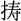
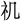

# 《齐白石年谱》序

《齐白石年谱》序

民国三十五年（一九四六）秋天，齐白石先生对我表示，要我试写他的传记。有一次他亲自到我家来，把一包传记材料交给我看。我很感谢他老人家这一番付托的意思，当时就答应了写传记的事。

那时我从外国回来，一时腾不出时间来做这件工作，到民国三十六年（一九四七）暑假中，我才有机会研究白石先生交来的这些材料：

 

（一）白石自状略（白石八十岁时自撰，有几个小不同的本子）

　　（甲）初稿本

　　（乙）初稿钞本

　　（丙）初稿修改后印本（《古今》半月刊第三十五期）

（二）《借山吟馆诗草》（自写影印本）

（三）《白石诗草》自叙

　　（甲）初稿本

　　（乙）改定本

（四）《三百石印斋纪事》（杂记稿本）一册

（五）《入蜀日记》残叶

（六）《齐璜母亲周太若身世》（白石自撰）

（七）《白石诗草》残稿本，这里面有随时杂记的事，共一册

（八）《借山图题词》（壬申抄本）一册

（九）《齐白石传》（未署名，似系王森然作，抄本）一册

（十）白石老人杂件（剪报，收函等等）一小包

 

我读了这些材料，很喜欢白石老人自己的文章。叙他的祖母，他的母亲，他的妻子的文字（那时我还没有看见他的《祭次男子仁文》都是很朴素真实的传记文字，朴实的真美最有力量，最能感动人。他叙述他童年生活的文字也有同样的感人力量。他没有受过中国文人学做文章的训练，他没有做过八股文，也没有做过古文骈文，所以他的散文记事，用的字，造的句，往往是旧式古文骈文的作者不敢做或不能做的！

试举几个例子。白石写他的《母亲周太君身世》，中有这一段：

 

田家供灶，常烧稻草，草中有未尽之谷粒，太君爱惜，以
 衣椎椎之，一日可得谷约一合，聚少成多，能换棉花。家园有麻。太君春纺夏绩，不歇机声。织成之布，先奉翁姑，余则夫妇自著。……

 

又有这一段：

 

太君年三十后，翁弃世，……从此家境奇穷。（太君）恨不见纯芝兄弟一日长成，身长七尺，立能反哺。……

 

前一段记椎谷粒，古文家也许写得到。后段“恨不见纯芝兄弟一日长成身长七尺”，古文家决不敢这样写。白石的传记文字里，这样大胆的真实描写最多。如他记民国七年在紫荆山下避兵乱的痛苦：

 

时值炎热，赤肤流汗，绿蚁苍蝇共食，野孤穴鼠为邻。如是一年，骨与枯柴同瘦，所有胜于枯柴者，尚多两目，惊怖四顾，目睛莹然而能动也。

 

又如他记民国八年他避兵乱北游时的心绪：

 

临行时之愁苦，家人外，为予垂泪者尚有春雨梨花。过黄河时乃幻想曰：“安得手有嬴氏赶山鞭，将一家草木同过此桥耶！”

 

这都是他独有的风趣，很有诗意，也很有画境。

我读完了白石先生交给我的这些材料，我就把一切有年月可考的记录分年编排，有时候也加上一点考订。当初我本想完全用白石先生自己的话作材料，所以我曾想题名作《齐白石自述编年》。编年的骨干当然是他八十岁时写的《白石自状略》。但我不久就发现了《自状略》引用时必须稍加考订。第一，因为《自状略》的本子不同，有初稿与修改稿的差别。第二，因为老年人记忆旧事，总不免有小错误，故我们应该在可能范围之内多寻参考印证的资料。第三，我最感觉奇怪的是《自状略》的年岁同白石其他记载的年岁，往往有两岁的差异！《自状略》是他八十岁写的，其时当民国二十九年（一九四〇）。从民国二十九年上推，他的生年应该是咸丰十一年辛酉（一八六一）。但我研究白石早年的记载，如《母亲周太君身世》等篇，白石是生在同治二年癸亥（一八六三）。我当时不敢亲自去问他老人家，只好托人去婉转探问他结婚时是和陈夫人同岁，还是比陈夫人小两岁。（白石《祭陈夫人》说，“同治十三年正月廿一日乃吾妻于归期也，是时吾妻年方十二。是年五月五日吾祖父寿终。”《自状略》说他自己十二岁时祖父死。故我要他替我解答这个编年上的矛盾。如果他和陈夫人同岁，他们都是同治二年生的了。）但我得到的只是一个含糊的答复，我就明白这里面大概有个小秘密，我只好把我的怀疑与考证都记在初稿的小注里，留待我的朋友黎劭西（锦熙）先生回来解答。

《齐白石自述编年》是我在民国三十六年八月写成的。我把一本清钞本送给白石老人自己审查批评。我的原稿留在我家里预备黎劭西回到北平时我要送给他看，请他添补改削。劭西回湖南去了，直到民国三十七年（一九四八）四月才回北平。他和白石老人，都是湘潭县人，两家又有六七十年的亲切交谊。所以我早就打定了主意，这部《白石年谱》必须得着劭西的批评订补。他回到北平不到两个月我就把我的原稿送给他，很诚恳的请求他同我合作，完成这件工作。

黎劭西先生费了半年的工夫，添补了很多的宝贵材料，差不多给我的原稿增加了一倍的篇幅。他的最大贡献，至少有四个方面。第一，他时常去访问白石老人和他的儿子子如先生，他的女儿阿梅女士，从他们的口头手头得着不少资料，可以订正我的错误，解答我的疑问，补充我的不足。最重要的是查得白石老人因为相信长沙舒贴上替他算的命，怕七十五岁有大灾难，自己用“瞒天过海法”把七十五岁改为七十七岁！这一点弄明白了，年谱的纪年才可以全部改正。白石老人变的戏法能够“瞒天”，终究瞒不过历史考证的方法！第二，劭西最熟悉湘潭一带的文物掌故，又熟悉白石老人做木匠时代的生活，故他不但替我注释了胡心园，陈少蕃，萧芗陔，文少可诸人的名号事迹，并且用了许多有趣味的资料，把那个“芝木匠”时代的生活写的很充实，很生动，使我明了当年湘潭一带的艺术文化背景，使我们知道天才的齐白石也受到了历史背景的许多帮助。第三，劭西对于绘画与刻印，都比我懂得多多，所以他能引用一些我不知道的文件来记叙白石在这两方面的经验与成就。特别是在学习刻印的经过，劭西的增补最可以补充我原稿的贫乏。第四，劭西有终身不间断的日记，他用了他的日记来帮助考定许多白石事迹的年月。他在自序里曾说他将来也许还可以从民国十三年以后的日记里寻出一点新材料来给《白石年谱》做“补遗”。我盼望他不要忘了这件补遗的工作。

劭西把他订补的《白石年谱》送给我看，那时已是民国三十七年（一九四八）十一月了。我又请我的朋友邓恭三（广铭）先生把全稿拿去细看一遍。邓先生是史学家，曾做过陈龙川，辛稼轩的传记。他和他的夫人，他的大女儿，都曾校读过我的《白石自述编年》初稿。恭三看了劭西订补本之后，来问我为什么不曾引用八卷本《白石诗草》的材料。我竟不知道白石自写影印的《借山吟馆诗草》一卷之外，还有一部八卷本《白石诗草》！劭西见我引用了《白石诗草自叙》，他猜想我必定已见了《白石诗草》全部，所以他没有覆检这八卷《诗草》。我请恭三放手做订补的工作。他不但充分引用《白石诗草》里的传记资料，他还查检了王闿运的《湘绮楼日记》，《湘绮楼全集》，和瞿鸿
 ，易顺甫，陈师曾，樊增祥诸人的遗集。他还没有做完这部分工作，我已离开北平了。在民国三十八年（一九四九）开始的几天，恭三夫妇和他们的大女儿可因分工合作，钞成这部《白石年谱》的定本，辽远的寄给我。

这本《白石年谱》大概不过三万字，是黎劭西，邓恭三和我三个人合作的成果。我们三个人都是爱敬白石老人的，我们很热诚的把这本小书献给他老人家。他在八十五岁时曾有诗句：

 

莫道长年亦多难，

太平看到眼中来。

 

我今天用这句诗预祝他九十岁的寿辰。

我们本想请徐悲鸿先生审查这部小书，并且要请他挑选白石老人各个时期的代表作品来作这本《年谱》的附录。眼看这是不可能的了。我很感谢汪亚尘夫人和顾一樵（毓琇）先生从他们收藏的白石作品里挑出一些最可爱的精品来给这书作附录。

 

三十八，二，九

