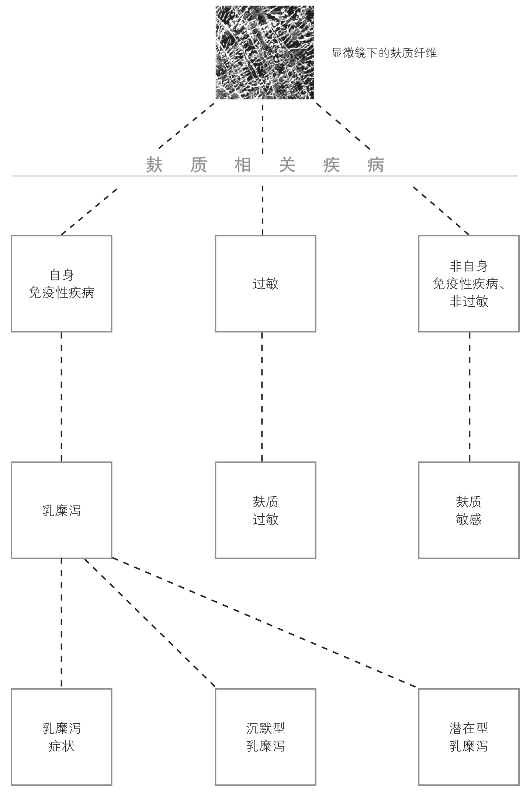

# 第二章 食物与自身免疫性疾病

  <h2 title="第二章 食物与自身免疫性疾病">第二章 
  食物与自身免疫性疾病</h2>
  
你知道自己吃的食物的分子可以左右体内细胞的行为吗？细胞要不要引发炎症？免疫细胞要不要保护你的身体免受感染？这种下指令、识别指令的过程正是营养基因组学的研究内容。营养基因组学这门学科揭示了饮食与健康的紧密关系。食物是一种信息，在细胞这一层级与身体进行交流，告诉身体该怎么做。有时候食物的功效跟药物的相当，甚至更好。大多数人不知道的是，处方药最多对50%～60%的人起作用。读到这里，你可能刚理解为什么一种药对一个人有效而对另一个人无效，有一个原因是显而易见的，那就是不同的人的生化体质和基因不同。同样，因为我们的生化体质和基因不同，所以我们对同一种食物的反应也不同。

  
本章旨在告诉你食物为何如此重要，你将知道是什么让你在生化体质上独一无二，我还会教你如何利用这些知识来制订属于自己的营养计划。我将对你的家族史及家族基因进行调查，并为你创建一份有益于你的生化体质和基因的食物清单。我会观察是哪些食物让你的身体出现了自身免疫反应，找出它们并将它们从你的饮食中去除。这一做法能够极大地改善患者的自身免疫状况和总体健康。例如，一位叫伊莉丝的患者，在将麸质从饮食中去除后，她的类风湿性关节炎被治愈了。你以后就会发现，我在诊治大多数患者时都采用了这一做法，因为这样做是有充分理由的。改变饮食几天后，伊莉丝的关节和肌肉疼痛消失。在她坚持无麸质饮食6个月后，我再次给她做检查，她的各项指标都回归正常（即体内不再有类风湿性关节炎抗体）。很明显，麸质是导致她患病的罪魁祸首，因为她只要吃了含麸质的食物，第二天早上就几乎寸步难行。

  
在大多数人眼中，食物只有好吃和不好吃之分。“我今天吃得很好”或者“我今天吃得不好”——你肯定听过或自己说过类似的话吧。许多人还认为，食物只会让人发胖或变瘦。这种认知与事实相去甚远。食物可不仅仅代表热量。你吃下去的食物对你的健康和每天的感受有极大的影响。此外，食物还对你体内的炎症反应有很大的影响。

  <h3 id="sigil_toc_id_15">什么是炎症？</h3>
  
我在书中多次提到炎症，因为我发现它与很多严重的疾病和症状密切相关。那么，什么是炎症？人体为什么会出现炎症？炎症对人体有什么益处吗？炎症反应的是人体内炎症因子（化学物质或信使）释放的过程，这些炎症因子会对人体产生刺激、在人体内形成肿胀。通常来说，炎症是有益的，它可以帮助身体对外来微生物或损伤做出反应。但如果该过程持续时间较长，或引起炎症的化学物质因含量过高而失去控制，炎症就会破坏细胞的正常功能，并导致身体组织受损。例如，炎症信使让你的脂肪细胞抓住脂肪不放，这可不太好，因为这样将妨碍你减肥或保持好身材。炎症信使还会损害血管壁，使你患动脉粥样硬化、心脏病和高血压的风险增大。此外，它们还会刺激免疫系统，使免疫细胞不断释放越来越多的化学物质。

  
因此，选择最适合自己独特生化体质的食物非常重要，不要吃会引起炎症的食物。如果按要求去做了，你的身体就会变得更好，你会更快乐，你的免疫系统也会更强大。体内的炎症变少后，关节痛、头痛等症状将减轻，烦人的胃痛也将消失。虽然本书的目的不是教人减肥，但你要知道，找到最适合自己的食物有助于将身体的新陈代谢维持在最佳状态。如此一来，减肥就顺带着实现了。

  <h3 id="sigil_toc_id_16">食疗</h3>
  
我们提倡食疗，即以食代药。食物对人体的作用不仅仅在于提供热量。例如，有人认为一种含100千卡热量的食物对身体的影响与热量相同的另一种食物一样。但是，同样是含100千卡热量，一个苹果和一块曲奇进入人体后所起的作用可大不相同。苹果所含的营养成分可以让人体细胞充满活力。苹果含有大量槲皮素——一种类黄酮，具有抗炎和抗过敏等功效。而曲奇含有大量糖和脂肪，它们会引发一系列炎症反应。如果你日常饮食的主要成分是糖，那么患病的风险将增大。苹果含有槲皮素，而曲奇含有会引发炎症的糖，现在让你选，你会选哪个？你可能早就知道答案了，但我希望你能明白我想表达的重点：你应该根据食物对细胞的影响来选择食物，而非只盯着热量。

  
我会在本章介绍以食代药的概念和它背后的理念，以及食物与自身免疫性疾病的关联。在接下来的两章中，我会帮你了解让你的身体独一无二的因素，并指导你为自己的免疫系统选择正确的食物。

  
我曾在前文提到伊莉丝这位患者，她将麸质从饮食中去除后，患病5年来第一次早上能毫无痛苦地起床。而每当她吃了含有麸质的食物后，等待她的就是剧痛和行动困难。显然，麸质对她的影响远甚于热量！她并不是个例，因为如今人们对麸质敏感和过敏的情况比以往任何时候都普遍，这里我似乎该给出统计数字来佐证自己的说法，但目前还没有一种公认的、用来检测个人对麸质的敏感程度的方法。不过，超市货架上的食品似乎可以作为证据，因为越来越多的商家将食品不含麸质作为卖点。事实上，据统计，2010年全球无麸质食品的销售额突破25亿美元（约174亿人民币）。<a id="noteBack_2" href="27-%E5%8F%82%E8%80%83%E6%96%87%E7%8C%AE.md#note_2">[1]</a>

  <h3 id="sigil_toc_id_17">会引起炎症反应的食物成分</h3>
  
食物中的许多成分会在人体内引起炎症。本章后面会介绍糖和脂肪对人体的影响，并对“食物敏感”（food sensitivities）进行解释。现在你要记住的是，食物中的每一种成分都可能引起免疫反应，不仅仅是麸质，虽然它对自身免疫性疾病而言最关键。在此我要提醒一句，问题不在于食物所含的热量。你的身体看到的、读到的以及会对之做出反应的是食物的细节，即食物提供的信息。我们说你对食物敏感时，其实是在说食物中的蛋白质正在向你的免疫系统提供信息。无论你的身体出现了什么症状，通常来说，将问题成分从饮食中去除，症状就会部分或全部得到缓解。我常遇到这样的情况，并且这是一个能证明吃（或不吃）某些食物能治病的完美证据。当然，食物还能为人体提供有益信息，告诉人体如何进行自我修复、如何维持最佳机能。

  
在第三章中，我将教你如何找出会引起身体反应的食物。这是治疗自身免疫性疾病的第一步。令人兴奋的是，你很容易就能迈出这一步，而这么做对你的健康和生活将产生巨大的影响。

  <h3 id="sigil_toc_id_18">吃饭不易</h3>
  
提起减肥，大家似乎有说不完的方法。有些方法很时髦、很吸引人的眼球，但并不奏效，有些却效果显著。面对这些方法时，你得有清醒的认识，那就是虽然照着做后你的体重可能减轻，但你体内的生化状况并不会改变，或者说你体内的炎症并不会减少。请不要误解我的意思——就减少患癌症、糖尿病、心脏病等慢性病的风险而言，减肥的确有益。还有一些减肥的做法对内脏有好处，即使这并不是人们的初衷。因此，如果你已经找到了适合自己的减肥方法，那就太棒了，你可以将我提供的知识和你现有的方法结合起来。

  
所有的减肥方法的成功之处，或者说它们的共同之处，在于让你对自己的饮食（和运动）保持警觉。这么做确实有好处，因为你将注意自己在吃些什么。大多数人吃东西时只是毫无意识地狼吞虎咽——喝大量苏打水，一边开会一边啃甜甜圈，在车里吃从快餐店买来的快餐。糟糕的是，你可能从没意识到自己正在这么做，就像得了健忘症一样，整天吃个不停。这不仅让你体重增加，还会导致你患病。一旦开始注意自己在吃什么，你就会意识到自己有这样的坏习惯——这是改变生活方式的开端。例如，你观察自己一整天，可能发现自己喝了太多含糖饮料，半夜吃了太多饼干，甚至将装面包的袋子翻了个底朝天。注意到自己的这些问题之后，你肯定会采取措施改变现状。有节制意识和进行正念饮食才是重点（我将在下一章介绍正念饮食）。

  
我在首次接触病人时，都会问他们前一天吃了什么。不管你信不信，在整个问诊过程中，这个问题通常是大多数人最难回答的！你也可以这样问问自己。你记得自己昨天吃了什么吗？两天前呢？事实证明，我所提供的所有治疗方案的第一步，都是对食物给予关注并制订有针对性的治疗方案。无论你为什么这么做，这么做都将让你受益。关注自己吃什么对减肥很重要，对你的自身免疫状况及健康来说更重要。

  <h3 id="sigil_toc_id_19">食物即信息</h3>
  
“食物即信息”是什么意思？正如前文所述，你吃的食物会告诉你体内的细胞如何通过改变酶在细胞内的作用方式来起特定作用。例如，糖对人体的影响远不只提供热量（或者说没有营养的空热量）那么简单。它能使血液中糖的水平迅速升高。这会令你精力充沛，但接着你就会感到精力不济。此外，在你摄入糖后，血液中增加的葡萄糖会附着在细胞上，使细胞从最深处（即细胞核）开始发生变化，进而激活你的基因以让它产生酶。而酶会导致细胞内的炎症加重。

  
你的每个细胞深处都有与生命有关的完整记录，那就是你的基因序列。大多数细胞包含你全部的基因。为方便理解，你可以将基因想象成一本有许多章节的书。在任何时候，仅有部分章节被阅读。因此，肝脏的细胞读的是有关肝脏的章节，舌头上的细胞读的是有关舌头的章节，心脏的细胞读的是有关心脏的章节。这些细胞对应的那部分基因被激活，这部分基因指导细胞活动，并维持其正常工作。当你还在母亲的子宫中时，基因这本书中一些章节的内容是确定的（比如一个细胞是分化成肝细胞还是心肌细胞）。但在整个生命过程中，这本书的很多章节的内容是不确定的，这些章节可能被阅读，也可能被一眼掠过。细胞对白藜芦醇的反应就是一个很好的例子。研究表明，在你吃了红葡萄或喝了红酒后，白藜芦醇会进入你的细胞并直达细胞核。在那里，白藜芦醇会激活所谓的“长寿基因”——该基因能通过酶让细胞活得更久。你可以将此基因想象成没有白藜芦醇就无法阅读的章节。

  
我之所以说“食物即信息”，是因为就激活免疫系统而言，食物作用强大，能使免疫系统更好地工作或使自身免疫状况得到改善。现在回到吃糖的例子，在糖与体内细胞表面结合后，一系列连锁反应便开始了。它使细胞中的酶发生变化，使细胞产生各种炎症因子。假如你每天早饭吃甜甜圈或者每天在咖啡里放两勺糖，时间长了，你就会生病；但假如你只是偶尔放纵一下，即使因此产生了炎症，炎症也会不知不觉地快速消失。

  
上述是营养基因组学研究的内容。营养基因组学极为重要，以至于相关领域的研究不胜枚举。你如果对营养基因组学的英文名“nutrigenomics”进行分解，就会发现它其实是一个经过精心构建的术语，意思是你吃的食物（nutri-，营养）将影响你细胞的基因表达（genomics，基因组学）。食物在人体内以这样的方式运作：食物影响那些被激活的基因，基因决定酶的活性，酶则决定细胞、组织或器官的功能。每次听到有人跟我说他的饮食习惯很好，因为他每天只吃热量100千卡的零食，我都会感到很沮丧。有些零食热量很低，确实有助于你控制体重，但它们含有糖和反式脂肪，会让你的细胞产生炎症，并导致体重增加。相反，如果你吃的是一把杏仁，这些坚果里的有益脂肪会减少细胞中的炎症（我们知道，炎症是一切慢性病，包括自身免疫性疾病的诱因）。

  
所有这些都是“人如其食”的论据。你吃的每一样东西都会被你的身体消化和吸收，然后进入血液，最终为细胞提供养分。这就是你体内每一个细胞都受你的饮食影响的原因。免疫细胞同样如此，这也是饮食对免疫功能障碍患者来说影响特别重大的原因。

  
•　•　•

  
本章接下来还要讲五部分内容。在前三部分中，我们将探讨你的饮食不该含有哪些成分，因为它们可能对你的免疫系统造成损害。在后两部分中，我们将讨论哪些食物成分对你真正有益；经科学研究证实，它们有助于改善人体免疫功能、帮助实现体内各系统平衡，对自身免疫性疾病患者来说尤其如此。

  <h3 id="sigil_toc_id_20">要戒掉的食物</h3>
  <h4>哪些食物成分引发了自身免疫问题？</h4>
  
每种食物都含有一定的蛋白质、碳水化合物、脂肪、维生素或矿物质。植物还含有被称为“植物营养素”的化合物，它们是细胞功能的强力刺激剂。除此之外，食物中还有一些不好的东西，比如霉菌、细菌、寄生虫、果蔬上的农药残留以及动物性食品中残留的抗生素和激素。这些食物毒素，我将在第十一章讨论。

  
在这里，我们来谈谈蛋白质，因为它对免疫系统非常重要。你吃的所有食物都含有这种营养物质。蛋白质在水果和蔬菜中含量低，在动物性食品（如肉类）中含量高。人体组织由蛋白质构成，因此你需要通过饮食摄入足够的蛋白质来为身体的持续修复提供原材料（蛋白质的日摄入量一般为每千克体重1 g）。

  
蛋白质由氨基酸组成。人体生长需要的氨基酸一共有20种，其中9种为必需氨基酸，因为这些氨基酸只能从食物中获得，人体不能合成。辨别蛋白质时，我们不仅可以看它由哪种氨基酸组成，还可以看它的三维结构。这是一个重要的概念，尤其是对免疫系统而言，因为免疫细胞会通过结构来识别它们遇到的所有氨基酸，从而判断其是敌是友。换句话说，你的免疫细胞一直在分析构成你身体组织的蛋白质和你吃的食物中的蛋白质。

  
不同的细菌和病毒表面的氨基酸模式不同，这些氨基酸模式就是它们的“标记”。你的免疫细胞通过读取细菌或病毒表面的标记来记住这些已知的异物，并时刻对它们保持警惕。有了这个监控系统，你的身体才能保持健康。你身体的各个组织也有标记，因为它们也都是由蛋白质（或者说氨基酸）构成的。正如你所了解的，免疫系统不应该攻击自身组织，而应该识别并攻击对人体有害的细菌、酵母菌、病毒及其他感染性病原体。当你的免疫系统开始攻击自身组织（误读标记），问题就出现了。重点是，氨基酸模式是免疫系统判断外来细胞和自身细胞的依据，免疫系统正是基于此才避免攻击自身组织的。食物也含有蛋白质，所以它们也有标记。如果你的免疫细胞不能识别它们，就可能发出警报。

  <h4>你对食物敏感吗？</h4>
  
一般情况下，你吃的食物在进入小肠时已经被消化得差不多了，小肠只是负责吸收营养成分。此时，食物已经被分解成非常小的颗粒，上面所说的“标记”也因被消化殆尽而难以辨认。这个时候身体并不会产生免疫反应。但是，如果此时食物仍然是大颗粒，那么免疫细胞依然能够识别它的标记（氨基酸）。这就是拥有良好的消化能力非常重要的原因，也是服用抗酸剂和质子泵抑制剂会增大你对食物敏感的风险的原因（关于这一点，我会在第八章详细解释）。只要你的肠道足够健康，它就会形成一道屏障，将免疫细胞和食物隔开。然而，如果这道屏障不再坚固，问题就随之而来了：带有异物标记的大食物颗粒从肠道渗透进去，并遇到肠道另一侧的免疫细胞。此时，免疫细胞会识别食物颗粒上的标记，并向身体发出信号，告诉它应该如何反应。食物颗粒通过脆弱的肠道屏障渗透出去，表明你患了肠漏症；这就是人们在任何年龄都可能出现免疫反应、过敏反应和食物敏感的原因。我会在第八章详细探讨这个问题。我在这里提到肠漏症，只是想讲清楚食物中的蛋白质是如何使免疫系统出问题的。

  
我们一般认为，食物可以通过多种机制引发全身炎症反应。首先，你可能对食物过敏，即你的免疫细胞对食物产生抗体。抗体共有4种类型，其中的2种对我们讨论的食物过敏来说最为重要。如果你去看过敏症专科，会被要求检查是否携带免疫球蛋白E（IgE）抗体，这种抗体会引起荨麻疹、舌头肿胀或呼吸困难。你的医生可能不会检测另一种抗体，即免疫球蛋白G（IgG）抗体，它与免疫复合物病有一定的关联。食物进入血液后，免疫系统产生抗体，抗体附着在食物上形成抗原—抗体复合物。这种复合物分子极大，会在组织中沉积，引起身体局部发炎和受损，进而导致免疫系统对该组织发起更大规模的攻击。人体关节很容易受免疫复合物沉积的影响，这是类风湿性关节炎的主要发病机制之一。

  
相关证据显示，所有自身免疫性疾病患者都患有肠漏症。因此，如果你患有自身免疫性疾病，那么很可能对你吃的食物产生免疫反应。别着急，我会帮你找出是哪些食物在作祟。你因为食物而不适，即对食物敏感，这是食物在你体内引发了炎症的缘故。虽然对食物敏感不代表你食物过敏，但你也不能对此掉以轻心。由于无法通过血液检测来判断患者是否对食物敏感，我会根据食物是否让患者感觉疲劳、全身浮肿、注意力难以集中、关节或肌肉疼痛以及出现消化问题，比如进食后反流、胀气、腹泻或便秘等进行判断。判断你是否对某类食物敏感的最简单的方法是，戒掉某类食物3周，之后将这类食物纳入饮食，在这个过程中密切注意自身的反应。我会在下一章告诉你具体怎么做。

  <h3 id="sigil_toc_id_21">细说麸质</h3>
  
虽然可能有多种食物成分让人体出现关节和肌肉疼痛、头痛、腹泻、胀气、疲劳、注意力难以集中等症状，但对自身免疫性疾病而言，最关键的成分是麸质。麸质是普通小麦、大麦、黑麦、卡姆小麦和斯佩尔特小麦中的一种蛋白质。天然燕麦不含麸质，不过市面上出售的燕麦食品很可能在加工过程中添加了麸质，除非其标签上明确说了不含麸质。大米、藜麦、荞麦和小米也都不含麸质。我们所说的麸质，实际上是蛋白质的复合物，主要包括小麦醇溶蛋白和谷蛋白。简单来说，小麦醇溶蛋白和谷蛋白进入人体后，在免疫系统眼中不过是有不同标记的蛋白质。

  
有人经常问我，为什么现在美国的麸质问题比以往任何时候都严重？为什么有那么多人摄入麸质后会有不良反应？首先，因为我们现在接触到的麸质比以前多得多；其次，现在大多数人的消化系统不太好，那些未被完全消化的麸质就会穿过肠黏膜进入血液，然后在体内流窜（我会在第八章详细讨论）。为什么我们现在摄入的麸质更多？正如我在第一章中所说的，自20世纪40年代以来，美国的小麦种植业使用转基因技术的情况越来越多。转基因小麦含有更多的麸质，因为人们认为这样会让小麦颗粒更加饱满。此外，正如我们所知道的，麸质是多种蛋白质的复合物，而转基因小麦中构成麸质的蛋白质结构更集中、“毒性”更强（更易引起敏感反应）。不过最重要的是，美国人平均每天吃3～4份小麦制品，相当于每天都在摄入大量麸质。

  
麸质是新事物吗？从某些方面来说，是的。在旧石器时代，人类是采猎者，这意味着那时候的人吃的是自己能够杀死或采集到的东西，包括动物、坚果、绿叶、种子和浆果。我们的身体也习惯这种饮食。农业开始普及后，人类仍然吃一些当季的东西，以及自己种植的谷物和其他农作物。后来，随着农业的发展，人类学会了加工和储存食物。这样，人一年四季都能大量食用小麦。那时候的人吃的是原始品种的小麦（单粒小麦和二粒小麦），它们的基因和麸质含量与我们今天吃的小麦的不同。我最近读了医学博士威廉·戴维斯写的一本名叫《小麦完全真相》（Wheat Belly）的书，他在书中生动、详细地介绍了小麦的发展史。戴维斯博士写道，小麦在1943年确实发生了变化，当时人们有意识地对小麦进行改造以提高亩产量。人们这么做的本意是消除饥饿，但事实证明这种做法错了。<a id="noteBack_3" href="27-%E5%8F%82%E8%80%83%E6%96%87%E7%8C%AE.md#note_3">[2]</a>我还想提醒大家的是，这种新型小麦是在人们开始食用更多的加工食品这一背景下出现的。接着，美国成为一个快餐国家，而如今的世界也俨然成为一个快餐世界。我们的身体无法适应我们一年365天、一天多次食用高麸质的小麦制品。研究已经清楚地表明，过度摄入食物蛋白会引起免疫反应。我认为，过度食用这种小麦制品是我们对麸质反应越来越大的原因。

  <h4>乳糜泻</h4>
  
作为一名医生，我需要了解最新研究成果，以便掌握有关自身免疫性疾病的最新论据。在相关文献中，麸质绝对是大家探讨的热点。许多研究认为麸质与多种疾病之间存在关联。

  
我们先谈谈乳糜泻。乳糜泻是一种与小肠有关的自身免疫性疾病，也是一种相当常见的疾病。在居民多有欧洲人血统的地方，比如欧洲、美洲和大洋洲，乳糜泻的发病率高达1%。在其他地方，比如中东和亚洲其他地区，乳糜泻的发病率也在增高，因为这些地方的饮食日益西化，人们吃的小麦制品比以前的人吃的多得多。乳糜泻患者有很强的遗传易感性，当基因与环境诱发因子接触时，他们就会发病。该病的诱因可能是麸质，特别是转基因小麦中超高含量的麸质。

  
在这种情况下，免疫细胞会攻击并破坏肠绒毛。肠绒毛是肠黏膜上的指状突起，我们可以将其形象地比喻成一层铺在肠道内的长绒地毯。肠绒毛很重要，因为它们可增加肠黏膜的表面积，使人体消化并吸收身体所需的全部营养。如果受到免疫细胞持续攻击，肠绒毛就会被破坏，肠黏膜会发炎并变平。这就好比地毯上的长绒掉光了，整条地毯变得光秃秃的。那么发生这种情况时，人们会有什么感觉呢？通常来说，对麸质敏感的人会出现一些消化道症状，比如腹泻和腹胀。此外，他们不能充分地吸收蛋白质、脂肪、维生素、矿物质等营养物质，因而可能出现贫血、疲劳、脱发等常见症状。如果患者是儿童，乳糜泻会导致他们发育迟缓。

  
临床医学认为，诊断是否真的患乳糜泻的唯一方法是做血液检测和小肠黏膜活检。做血液检测主要也是检查肠绒毛是否受损。但现在有研究表明，即便所有检测结果都正常，你也可能患潜在型乳糜泻，这意味着你的乳糜泻正在变严重。这种潜在的肠道疾病现在可能表现得不明显，但如果你一直摄入麸质，几年后症状就会全面暴发。

  
也有可能目前你没有出现乳糜泻的一般症状，但麸质已经让你身体的其他部位产生了反应。我们无法看到麸质对人体造成的所有影响，不过可以肯定的是，一个人肠道受损、患乳糜泻需要十来年的时间。因此，在患乳糜泻之前，你可能已经患有另一种自身免疫性疾病。这并不奇怪，因为自身免疫性甲状腺病、类风湿性关节炎和多发性硬化症都与乳糜泻存在关联。甲状腺、关节和神经系统受损，可能只是乳糜泻发病的前兆。事实上一些研究表明，对一些人来说，这些病症都是乳糜泻的一部分。<a id="noteBack_4" href="27-%E5%8F%82%E8%80%83%E6%96%87%E7%8C%AE.md#note_4">[3]</a>

  <h4>麸质敏感与乳糜泻</h4>
  
过去，人们一直认为乳糜泻是唯一由麸质引起的疾病。但在2010年，全球无麸质食品的销售额达25亿美元。从这个数字我们可以看出，不仅仅是乳糜泻患者在吃无麸质食品。这究竟是怎么回事？现在有一种较新的说法，叫麸质敏感。<a id="noteBack_5" href="27-%E5%8F%82%E8%80%83%E6%96%87%E7%8C%AE.md#note_5">[4]</a>从图1我们可以看出，麸质进入人体会引起不同的反应，除了患乳糜泻，麸质敏感也是其中的一种。

  
如果针对乳糜泻所做的检测结果均正常，而且你在进行无麸质饮食后症状消失，那就表明你对麸质敏感。目前医学界尚不清楚麸质敏感的机制，也没有找到检测方法，但一般认为麸质敏感是由一种不同于乳糜泻的免疫反应引起的。麸质敏感的症状通常包括腹痛、腹胀、腹泻、便秘、脑雾、疲劳、起湿疹或其他皮疹、头痛、关节痛、肌肉痛、四肢麻木、抑郁和贫血，小肠黏膜通常表现为正常或轻度异常。确定你是否对麸质敏感的最好的办法是进行无麸质饮食，看看症状是否消失（我会在下一章具体介绍）。我一直让患者这么做。每当我听到患者跟我说无麸质饮食起作用了，我都感到很惊讶。他们不仅说上述症状消失了，还说睡得更香、心情更好了，就连更年期症状（如潮热和夜汗）也得到了改善，就连最新科研报告都没提及的其他相关症状也有所减轻。我相信，食物成分，尤其是麸质，是引发或加剧包括自身免疫性疾病在内的所有慢性病的关键。虽然尚无证据表明对麸质敏感会诱发自身免疫性疾病或导致其恶化，但也不能排除这种可能。无麸质饮食是我所有治疗方案中必不可少的部分，我建议你也这么做。

  

    
    
图1

  

  <h4>麸质是如何引起免疫反应的？</h4>
  
假如你早餐吃了一个含麸质的可颂面包或贝果，并且你消化能力不佳、肠黏膜脆弱或患有肠漏症，那么未被消化的麸质颗粒很可能由你的肠道进入血液。在血液中，麸质颗粒会遇到免疫细胞并被识别为异物（详见第八章）。

  
正常情况下，麸质遇到免疫细胞时已经完全被消化，其分子不再完整。但如果大量麸质分子穿过肠黏膜并与免疫细胞相遇，免疫细胞就会发出警报。该警报会激活免疫细胞细胞核中的基因，于是免疫细胞开始“阅读”相应“章节”，并收到指示去攻击麸质分子。如果你继续吃含麸质的食物，免疫细胞将持续被激活，释放各种炎症因子以设法清除麸质。一般认为，麸质引起免疫反应的机制之一是，它与人体中很多组织的细胞非常相似，即它们拥有相似的氨基酸结构（或者说标记），所以免疫细胞在攻击麸质的同时，也会攻击小肠组织、甲状腺、神经系统（髓鞘）和关节，从而使它们受损（这一机制被称为分子拟态）。

  <h4>检测你对麸质的反应</h4>
  
一般认为，分子拟态是麸质引发自身免疫性疾病的机制之一：正是因为麸质的标记跟我们自身组织的标记相似，免疫系统才会出错。这一因标记混淆而造成免疫攻击的过程就是分子拟态，它是由抗体驱动的。针对这一机制，我们先要做的检测是AGA检测和ADGA检测结果检测。对乳糜泻患者来说，在肠道受损出现任何征兆之前，这两项检测的结果都可能呈阳性。我让所有来找我的人都做了这两项检测，结果发现很多人的结果呈阳性。你应该要求你的医生将它们作为你的首批检测项目。

  
数不清的人告诉我，胃肠科医生说他们可以摄入麸质，因为除了AGA检测，他们的其他检测结果都正常。听到这种说法，我真的很生气！显然，这些医生没有阅读相关文献，因为很多文献表明，AGA检测结果呈阳性是乳糜泻患者最早出现的征兆。在肠道受损之前，AGA可能已经在攻击你体内的其他组织了。如果这么跟我说的人已被确诊患有桥本甲状腺炎、Graves病、多发性硬化症或类风湿性关节炎，我会更恼火，因为这些自身免疫性疾病往往与乳糜泻有关联或代表他们处于乳糜泻前期。如果你的AGA或ADGA检测结果呈阳性，那就是在提醒你停止摄入麸质。

  
虽然找我医治的大部分患者的这两项检测的结果都不呈阳性，但我还是建议所有自身免疫性疾病患者戒麸质。现代医学尚未找到合适的检测方法，不意味着麸质不会对你的免疫系统造成破坏。有关麸质致病的证据非常多，这一点我在问诊时深有感触。况且，戒麸质对你而言没什么损失。阅读完下一章的内容，你可以照着做一做，看看不摄入麸质是否会令你的症状有所改善。

  <h3 id="sigil_toc_id_22">食物对免疫系统有害？</h3>
  
除了麸质，食物中还有其他会引起免疫系统反应的化合物。通常情况下，人体因食物而产生的反应是细微的、渐进的，并且这些反应往往出现在消化系统以外的地方，这使得你很难把自己身体的反应和某种特定的食物联系起来。换句话说，你虽然没有任何消化道症状，比如胀气或腹痛，但会表现出其他症状，比如关节痛或头痛。你甚至没有意识到这些症状与你吃的东西有关。如果你感到疲劳、精神难以集中，以及关节或肌肉疼痛或者不适，那很可能是你吃的食物在作祟。

  <h4>糖</h4>
  
麸质并非唯一对免疫系统造成潜在威胁的食物成分。在此，我要谈谈糖。糖是一种非常危险的碳水化合物。含精制糖的食品与炎症反应加重以及T细胞和B细胞功能受损有关。目前虽然还没有针对糖和自身免疫性疾病的关联的研究，但是对糖和免疫功能的研究颇多。<a id="noteBack_6" href="27-%E5%8F%82%E8%80%83%E6%96%87%E7%8C%AE.md#note_6">[5]</a>高升糖指数食物指那些会使血糖水平迅速升高的食物，比如用白糖和白面粉制作的食物。这种食物极不健康，心脏病、癌症、中风和糖尿病等都跟它脱不了关系。事实上，所有慢性病也都跟它有关。我们写本书的一个目的就是帮助你通过饮食来修复和平衡你的免疫系统。要做到这一点，你必须将任何用白面粉和白糖制作的食物，如面包、即食麦片、蛋糕、曲奇、糖果和饮料等从饮食中去除。即便如此，你还要注意食物中隐藏的糖。例如，市售的水果味酸奶和快餐店里的水果冰沙通常都添加了水果糖浆。具体的我会在下一章介绍，在这里你只要记住，要想修复自身免疫系统，就必须戒掉白面粉和白糖。

  <h4>脂肪</h4>
  
现在，我们来谈谈脂肪。我觉得脂肪是最容易被误解的营养物质。提到脂肪，大部分人分成两派：一派害怕脂肪，试图去掉饮食中的所有脂肪；一派则是典型的美式饮食者，日常饮食含大量有害脂肪（加工食品中的动物性饱和脂肪及反式脂肪）。其实，这两种做法都有失偏颇，因为如果你不摄入任何脂肪，势必无法从具有抗炎功效的优质脂肪中获益。含有优质脂肪的食物包括鱼类、亚麻籽、牛油果、椰子、坚果、种子和橄榄油等。如果你摄入太多有害脂肪，那么你体内将出现炎症，你的免疫功能也会紊乱。我在这里主要讨论的是有害脂肪。在下文中，我会重点介绍那些已被证实对自身免疫性疾病患者有益的食物。

  
牛肉和牛乳制品中的饱和脂肪是一种有害脂肪。牛被喂食了劣质饲料（主要是玉米）后，体内就会产生很多有害的饱和脂肪。而当你食用了这些牛的肉或乳制品后，其中的有害脂肪会让你体内的炎症加重。如果你想吃牛肉，最好选择用草或有机饲料喂养的牛的肉。吃草的牛的脂肪较健康，吃这些牛的肉与乳制品对你的健康有益。

  
许多加工食品使用了部分氢化植物油，而部分氢化植物油含有反式脂肪，这种油不是天然存在的，而是人类在实验室里合成的。人类发明部分氢化植物油的目的是延长植物油的保质期，并想以此取代黄油。黄油含有大量饱和脂肪，因而成为20世纪七八十年代心脏病发病率不断上升的罪魁祸首。实际上，反式脂肪的危害远大于黄油所含的饱和脂肪的危害。因此，将反式脂肪从饮食中去除是免疫系统修复计划的重要组成部分。

  <h3 id="sigil_toc_id_23">改善免疫系统的要素</h3>
  <h4>抗炎饮食</h4>
  
我建议我诊治的所有患者都食用有抗炎功效的食物。这不是什么饮食计划，而是一种生活方式。因为炎症是所有慢性病的诱因，所以无论你是已被确诊患某种疾病，还是仅仅想预防某种疾病，都应该多吃有助于减轻体内炎症的食物（抗炎食物）。当然，你还不可以吃那些会加重体内炎症的食物（增炎食物）。

  
你现在已经知道了，有选择地摄入脂肪非常重要。有害脂肪进入人体后，会产生一种名为花生四烯酸的分子，而花生四烯酸会产生一种名为类二十烷酸的炎症因子。德国的一项研究表明，使用鱼油治疗类风湿性关节炎的患者，如果同时进行抗炎饮食，病情就会得到显著改善，因为患者体内的花生四烯酸水平降低了。<a id="noteBack_7" href="27-%E5%8F%82%E8%80%83%E6%96%87%E7%8C%AE.md#note_7">[6]</a>如果服用鱼油补充剂后还吃会引起炎症的食物，你是无法痊愈的。这就好比汽车的油箱里已经加满了低辛烷值汽油，你还往里面加高辛烷值汽油，汽车引擎当然会堵塞。那该怎么办呢？用抗炎食物给身体加油，你的感觉会好得多。

  <h3 id="sigil_toc_id_24">有益的食物成分</h3>
  
你已经知道食物中的什么成分对自己有害了，接下来我们来谈谈什么成分对你有益。植物营养素是赋予水果和蔬菜色彩的化合物。你可能听说过叶黄素、番茄红素和白藜芦醇等。针对白藜芦醇的研究清楚地表明，它能激活细胞内的长寿基因，帮助细胞活得更久。许多关于食物和营养的研究可能对治疗自身免疫性疾病有帮助。到目前为止，已有证据表明，必需脂肪酸（优质脂肪）、维生素D、维生素A、锌、硒和绿茶都对人体有益。接下来，我还会简单介绍一下蘑菇提取物，它们常用来增强免疫力，我想让大家了解它们的使用方法。记住，本书的写作目的是修复你的免疫系统，只有这样你才能完全康复。我不会对所有有益于免疫系统健康的食物和补充剂进行详细介绍，而会把重点放在那些已经被证明能缓解免疫失衡和改善症状的食物和补充剂上。在这里，我将与你分享当前的研究成果；而在下一章中，我会告诉你该吃什么以及该吃多少，并对补充剂进行详细介绍。

  <h4>必需脂肪酸</h4>
  
我们接着讨论优质脂肪和有害脂肪的问题。其实关键在于，除了不摄入反式脂肪和减少摄入动物性饱和脂肪之外，还要增加优质脂肪的摄入。有些人认为“优质脂肪”这个词本身是自相矛盾的，但事实并非如此。优质脂肪含有必需脂肪酸，后者是人体无法合成的脂肪酸。因此，我们要吃含有必需脂肪酸的食物。你常听说的ω—3脂肪酸和ω—6脂肪酸就是必需脂肪酸。ω—3脂肪酸家族成员中的二十碳五烯酸（EPA）和二十二碳六烯酸（DHA）都是必需脂肪酸。它们是鱼油补充剂中的活性成分。γ—亚麻酸（GLA）是一种ω—6脂肪酸，对人体免疫系统非常重要，可在月见草、黑醋栗和琉璃苣油补充剂中找到。我会在下一章中详细介绍哪些食物含有这些营养物质。其实，必需脂肪酸的常见来源是鱼类（如野生鲑鱼和沙丁鱼）、坚果（如杏仁和核桃）、种子（如葵花子和南瓜子）以及绿叶蔬菜（如羽衣甘蓝和瑞士甜菜），而这些都是美国人日常饮食中缺乏的食物。另一种健康脂肪酸是牛油果、椰子和澄清黄油中的饱和脂肪酸。遗憾的是，这些食物在20世纪80年代的反肥胖浪潮中名声不太好，人们至今都对它们抱有成见。我发现一个有趣的现象，那就是慢性病的发病率从那时起就一直上升。我觉得这不是巧合。

  
脂肪影响免疫系统的方式主要有两种。脂肪酸是构成细胞膜的主要物质之一。一方面，如果你摄入大量ω—3脂肪酸和ω—6脂肪酸，细胞膜就会具有弹性和流动性，从而处于最佳状态。另一方面，如果你摄入大量动物性饱和脂肪和反式脂肪，它们会进入你的细胞膜并使其变硬，而这会严重影响细胞与信使之间的沟通。事实上，美国马萨诸塞大学医学中心的一项研究显示，类风湿性关节炎患者服用含有GLA的琉璃苣油补充剂后症状有所改善。结果表明，GLA在人体内可转化成名为二高—γ—亚麻酸（DGLA）的物质，这种物质能进入并作用于过度活跃的免疫细胞的细胞膜，从而降低免疫细胞的活性。<a id="noteBack_8" href="27-%E5%8F%82%E8%80%83%E6%96%87%E7%8C%AE.md#note_8">[7]</a>这意味着GLA对被过度刺激的免疫细胞有镇静作用。免疫细胞被过度刺激是所有自身免疫性疾病的共性，因此谨慎选择饮食中的脂肪非常重要。

  
脂肪影响免疫系统的第二种方式是，进入人体内的所有脂肪都会转化成名为前列腺素的重要分子。这种分子具有不同的类型，有些会加重而有些会减轻炎症。食用含有GLA的食物或服用GLA补充剂后，体内一种名为前列腺素E1（PGE1）的有益前列腺素的水平会升高，而PGE1被证明在类风湿性关节炎患者身上有很多神奇的功效，比如减轻炎症、减少循环免疫复合物、抑制过度活跃的T细胞等。此外，有研究显示，鱼油对类风湿性关节炎和系统性红斑狼疮患者均有抗炎效果，大多数患者在服用鱼油后症状和病情都有所减轻。<a id="noteBack_9" href="27-%E5%8F%82%E8%80%83%E6%96%87%E7%8C%AE.md#note_9">[8]</a>许多患者发现，他们即使减小用药剂量，也能控制住症状。因此，在饮食中加入这类含健康脂肪的食物很重要。我会在后面具体介绍这类食物和补充剂。

  <h4>维生素D</h4>
  
在自身免疫性疾病研究方面，维生素D是最受关注的营养物质之一。在研究多发性硬化症时，研究人员最先注意到的是，在日照不足的北纬地区这种病的发病率尤其高。人类皮肤中的维生素D原被紫外线照射后会合成维生素D，研究人员很快就发现了血液中维生素D水平低与多发性硬化症患病风险之间存在关联。事实上人们发现，维生素D水平低不仅与多发性硬化症有关，还与其他自身免疫性疾病，如类风湿性关节炎、系统性红斑狼疮、1型糖尿病、炎性肠病等有关。虽然目前还没有证据证明体内缺乏维生素D的人会患这些病，但维生素D水平低会增大患这些病的风险。自身免疫性疾病患者针对维生素D缺乏进行治疗后，病情会减轻并得到控制。美国俄亥俄州立大学的一项研究定期检测一组系统性红斑狼疮患者体内的维生素D水平，结果发现冬季维生素D水平往往会下降，而且患者更容易病情加重。<a id="noteBack_10" href="27-%E5%8F%82%E8%80%83%E6%96%87%E7%8C%AE.md#note_10">[9]</a>

  
虽然名称中有“维生素”这个词，但从功能上看，维生素D实际上也算是一种激素，而不是典型的维生素。这是因为维生素D具有激素的功能，能与人体内的许多细胞受体结合，改变细胞的功能。而典型的维生素本身不与细胞受体结合，而在酶反应中起辅助作用。维生素D的活性形式被称为胆钙化醇，即维生素D3。此外，一些植物还含有一种维生素D——麦角钙化醇，即维生素D2。人体很难将植物中的维生素D2转化为具有活性的维生素D3，这也是我一直建议相关患者补充维生素D3的原因。无论你是通过晒太阳合成维生素D3，还是直接服用维生素D3补充剂，维生素D3都会被输送到肝脏并在那里生成25—羟基维生素D。在进行血液检测时，你应该检测体内25—羟基维生素D的水平，这才是检测你体内维生素D水平最可靠的方式。25—羟基维生素D可转化为1,25—二羟基维生素D，后者是一种效力极强的激素，因为它能进入人体的细胞和细胞核去激活相应的基因序列，让细胞“翻阅”有关免疫系统的“章节”。

  <h4>维生素D与免疫系统</h4>
  
1,25—二羟基维生素D具有以下作用。<a id="noteBack_11" href="27-%E5%8F%82%E8%80%83%E6%96%87%E7%8C%AE.md#note_11">[10]</a>

  <ul>
    <li>与人体内的树突细胞和大脑中的星形胶质细胞结合。这些细胞处于人体免疫工作的第一线，遇到任何异物都会发出警报。1,25—二羟基维生素D能使它们对自身抗原的反应降低，即增强它们的耐受性，使其不轻易攻击人体组织。</li>
    <li>作用于T细胞，使其发展为最健康的调节性T细胞，而不发展为会引起自身免疫性疾病的辅助性T细胞Th1、Th2或Th17。</li>
    <li>直接抑制Th1。这表明1,25—二羟基维生素D能抑制那些活跃的杀伤性T细胞。记住，在自身免疫性疾病患者体内，杀伤性T细胞会以不均衡的方式增长，而1,25—二羟基维生素D能帮助它们恢复平衡。</li>
    <li>让被激活的B细胞少产生抗体，即调节自身免疫性疾病患者体内的另一种失衡状态。</li>
  </ul>
  
因此，如果你体内的25—羟基维生素D处于健康水平——以&gt;125 nmol/L（50 ng/ml）为宜，有些研究显示需要达到188 nmol/L（75 ng/ml）——它会帮助你调节T细胞，使T细胞对自身组织的耐受性变强，不会因被过度激活而失去控制。如果你身患自身免疫性疾病且体内维生素D水平很低，那么服用维生素D补充剂很有用，它有助于消灭你体内多余的杀伤性T细胞，并能防止产生更多的杀伤性T细胞，进而减轻因这些细胞引起的炎症。

  
那么，每天该摄入多少维生素D呢？研究表明，每天摄入4 000 IU（国际单位）的维生素D是安全的。你应该每3个月就让医生或其他专业人员检测一下你的维生素D水平。<a id="noteBack_12" href="27-%E5%8F%82%E8%80%83%E6%96%87%E7%8C%AE.md#note_12">[11]</a>一旦体内的维生素D水平达到理想水平（125～188 nmol/L），你就应该将摄入量减小至每天1 000～2 000 IU，并由医生对你血液中的维生素D水平进行监测以确定适合你的维持剂量。

  
需谨记的是，维生素A是一种抗氧化剂，能促进人体对维生素D的吸收，也有助于调节和维持免疫细胞的健康发育。

  <h4>硒和锌</h4>
  
硒和锌是两种重要的矿物质，有助于维持免疫系统正常运转。多项研究表明，缺硒可能引发自身免疫性甲状腺病，可能因为硒是甲状腺功能维持在最佳水平所必需的矿物质。硒是人体合成甲状腺激素和谷胱甘肽过氧化物酶不可缺少的元素。谷胱甘肽过氧化物酶具有重要的抗氧化作用，能够防止甲状腺滤泡受损。如果体内缺硒，甲状腺就无法分泌甲状腺激素，甲状腺细胞便会被自由基破坏（自由基是人体内正常生物化学反应的产物，每个细胞中都有。如果不将其灭活，它就会对人体造成损害）。一般认为，人体内出现自身免疫反应的一大原因是甲状腺细胞因受损而异于寻常，免疫系统发现后对其发起攻击，进而对人体造成更严重的伤害。

  
一项研究表明，人体每天摄入200 μg硒可以令引发桥本甲状腺炎的一种主要抗体减少。<a id="noteBack_13" href="27-%E5%8F%82%E8%80%83%E6%96%87%E7%8C%AE.md#note_13">[12]</a>缺硒与乳糜泻之间也有紧密的关联。乳糜泻患者对很多营养成分的吸收都不好，硒就是其中之一。有些患者先患上自身免疫性甲状腺病，之后才发现自己还患了乳糜泻。我将在下一章中详细讨论如何从饮食中获取硒元素，从而确保你不会因缺硒而增大患自身免疫性甲状腺病的风险。

  
虽然目前针对锌对自身免疫性疾病的影响的研究没有针对硒的多，但多发性硬化症的小鼠实验显示，锌对T细胞和病情有重要影响。锌是一种重要的微量元素，对促进免疫系统正常发育和维持免疫系统平衡起着至关重要的作用。缺锌会造成人体免疫系统受损，补锌则能够扭转这种局面。美国康涅狄格大学的一项研究表明，小鼠每天摄入30 μg锌可以减轻多发性硬化症的病情。<a id="noteBack_14" href="27-%E5%8F%82%E8%80%83%E6%96%87%E7%8C%AE.md#note_14">[13]</a>虽然这不意味着锌对人类同样有用，但我认为它有很大可能在自身免疫中扮演着重要的角色。那么为什么不想方设法让免疫系统处于最佳状态呢？我认为锌很重要，因此总是将它纳入我的治疗方案，况且患者很容易就能从食物（如芝麻酱、南瓜子、黑巧克力等）和高矿物质补充剂中获取锌。

  <h4>绿茶</h4>
  
绿茶中的有效成分是表没食子儿茶素没食子酸酯（EGCG），该物质近来颇受关注。有证据显示，EGCG在治疗及预防癌症、心血管疾病、肥胖症、神经退行性疾病等方面具有一定的作用。美国俄勒冈州立大学最近的一项研究表明，EGCG在增加调节性T细胞方面具有强大的作用。你现在应该已经知道，调节性T细胞对维持自身免疫耐受性至关重要。<a id="noteBack_15" href="27-%E5%8F%82%E8%80%83%E6%96%87%E7%8C%AE.md#note_15">[14]</a>,<a id="noteBack_16" href="27-%E5%8F%82%E8%80%83%E6%96%87%E7%8C%AE.md#note_16">[15]</a>尽管这项研究的对象是小鼠，但它表明，绿茶可能会以一种特殊的方式为自身免疫性疾病患者提供帮助。

  
 

  
通过阅读本章你已经知道，你吃进去的食物能为细胞提供信息，并告诉它们该如何行动。此外，你现在肯定已经明白，食物可以成为良药，前提是你吃的是抗炎食物（如含优质脂肪的食物）而不是增炎食物（如含精制糖和有害脂肪的食物），因为抗炎食物对你的免疫系统具有舒缓作用。接下来，我会针对“以食代药”进行详细阐述，让你知道自己对哪些食物敏感以及哪些食物对你有益。当然，我也会介绍一些对你的免疫系统有益的营养物质，这些营养物质可能源于食物，也可能需要你从补充剂中摄取（如果你愿意的话）。

