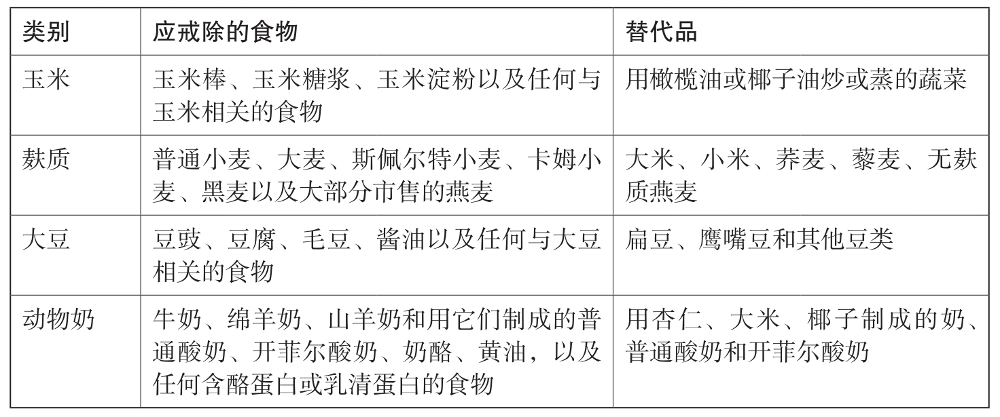
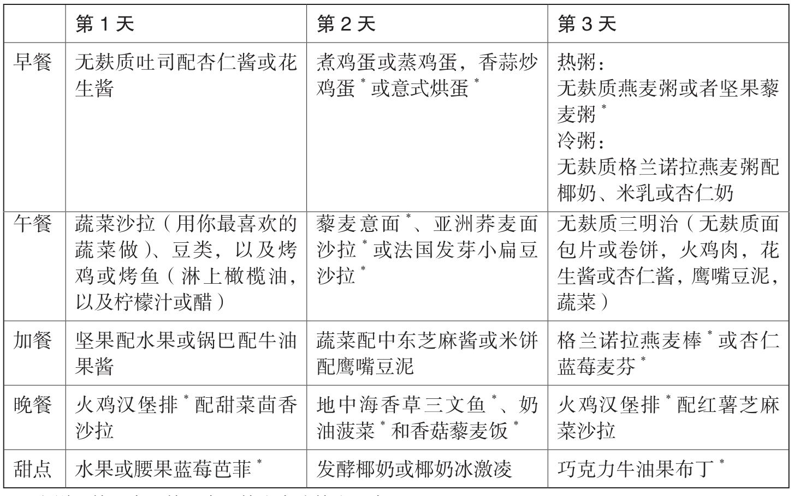
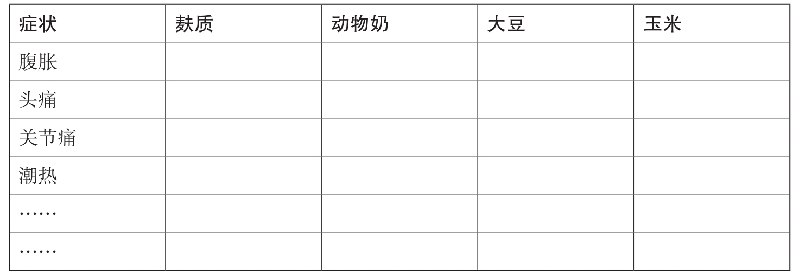
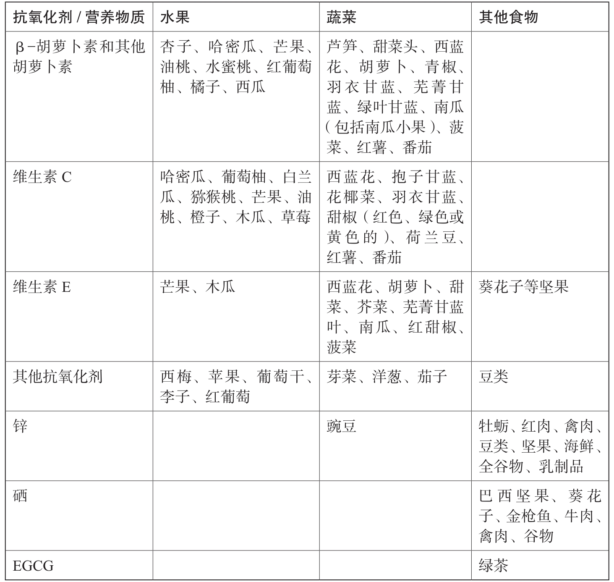
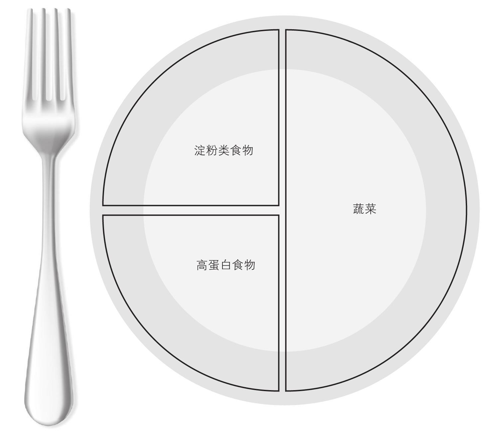
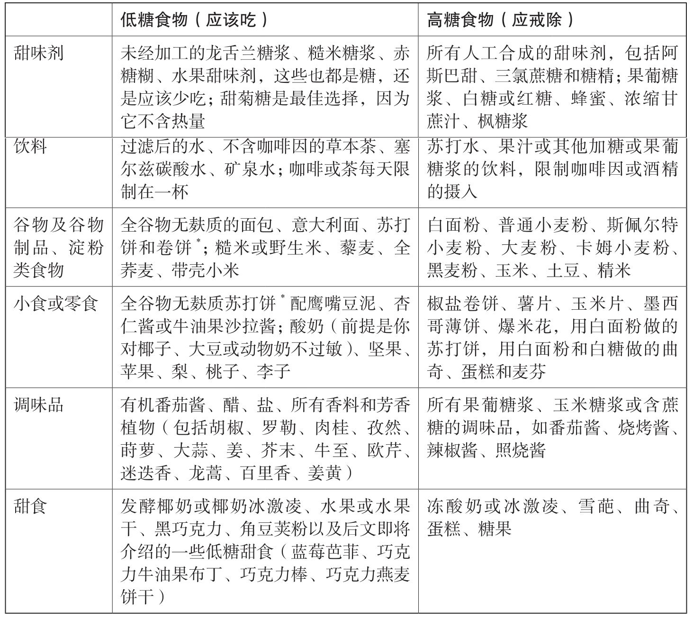
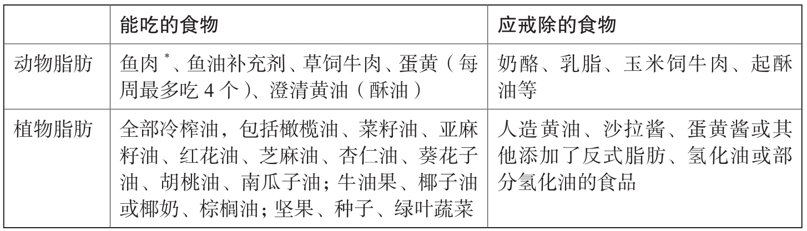

# 第三章 饮食自我评估手册

  <h2 title="第三章 饮食自我评估手册">第三章 
  饮食自我评估手册</h2>
  
埃米是一位48岁的白人女性，和大多数初次走进布卢姆康复中心的病人一样，她也抱着一大堆资料（病历和检查报告）。资料显示，她在过去的2年里找医生做过一系列检查。她的主诉症状包括痛经、月经不调且量多、睡眠障碍、潮热和极度焦虑——这些症状已折磨了她3年之久。除此之外，她没有其他病史。事实上，她之前一直很健康，这也是如今这些症状令她非常痛苦的原因之一。更令人沮丧的是，那些医生没有一个能准确找出她的问题所在，也不知道怎么做才能改善她的症状。一开始医生让她用黄体酮乳膏调经，但没什么效果，后来又让她服用避孕药。

  
埃米来我这里就诊时，还在服用避孕药。避孕药确实有一定的作用，但她因此增重了10磅（约4.5 kg），性欲更是骤降。第一次见面时，她希望我帮她停掉避孕药。事实上，我做的第一件事就是让她停止服用避孕药，这样她的症状才不会因服药而被掩盖，我也好观察她体内究竟发生了什么。她显然处于围绝经期，但除了雌激素和黄体酮水平的变化外，没人发现她身上还有哪些症状。

  
女性进入更年期时，体内的激素就像组了一支内分泌乐队。每一种激素都与其他激素相互作用，而只有保持各激素水平平衡，整个机体才能正常运作。我常发现，处于这个阶段的女性的甲状腺激素水平高低不一，有的还有肾上腺疲劳（详见第五章）的症状。我有一种感觉，那就是埃米体内的某种激素失调了，这也是她进入更年期后这么痛苦的原因。接下来，我给她做了甲状腺水平检测，并采集她的唾液做了肾上腺激素检测。结果显示她的肾上腺激素维持在正常水平，这让我大吃一惊；由甲状腺分泌的游离T3和游离T4的水平则高出正常值上限，这一点我倒一点儿也不觉得奇怪。此外，由大脑分泌的TSH水平略低。我在最初筛查时特别留意了抗甲状腺抗体，即桥本甲状腺炎的特异性抗体，我很高兴没有从埃米身上检测出这些抗体。然而，TSH水平较低以及游离T3和T4水平较高表明埃米的甲状腺过度活跃。有些医生可能认为这些结果是正常的，但直觉告诉我，应该继续检查她是否患有Graves病。果不其然，结果显示埃米的身体正在合成抗体以刺激甲状腺产生过多的激素，从而造成激素失衡。更具体地说，埃米的TSI检测结果呈阳性。这个结果出乎我的意料，但又令我振奋，因为至少现在我知道埃米到底身患何病，也知道该如何帮助她了。我不是唯一这么想的人，埃米也如释重负，她终于等来了答案。

  
在治疗过程中，我让埃米进行无麸质饮食，尽管她的两项乳糜泻检测结果均为阴性（这一点我在前一章详细讨论过）。为什么要这么做呢？因为我知道，自身免疫性甲状腺病患者更有可能患乳糜泻（反之亦然），即便现在的检测结果均为阴性。因此，我让埃米不要再摄入麸质。

  
此外，我还让埃米做了大便化验及重金属检测，目的是检测她体内的汞和铅含量（清除体内的这些毒素是我治疗自身免疫性疾病的第一步）。结果显示，埃米的大便中有寄生虫，体内的汞含量也略高。对症治疗后，她体内的Graves病抗体逐渐消失了，这都是无麸质饮食的功劳。更令人兴奋的是，戒掉麸质后，她的潮热、失眠和焦虑等症状都得到了改善，月经也更规律了。需要说明的是，我不确定是不是她体内较高水平的甲状腺激素干扰了雌激素，从而让她出现围绝经期症状，也不确定是不是摄入的麸质直接作用于她的大脑和体温调节中枢，从而让她出现潮热和其他症状。但不管怎样，采取相应的治疗措施之后，这些症状都得到了改善，我和埃米都很高兴。她的焦虑症状虽然得到了很大改善，但直到我解决了她体内的寄生虫问题，并让她服用了一些维生素，包括维生素B12、叶酸和S—腺苷甲硫氨酸补充剂，焦虑症状才彻底消失。我之所以让她补充这些营养物质，是因为它们都属于甲基供体，而甲基供体对维持大脑中与焦虑相关的化学通路非常重要。

  <h3 id="sigil_toc_id_25">食物与感觉</h3>
  
埃米的故事告诉了我们两点。第一，麸质是一种很复杂的蛋白质。你可能因为摄入麸质出现一些症状，而这些症状看上去与食物无关，比如焦虑和潮热。除非你不再摄入麸质，否则你真的不知道它会对你的身体产生什么影响。第二，戒掉麸质能改善你体内自身免疫性抗体的情况。要想了解自身免疫性抗体的情况，唯一的方法就是让医生或其他医护人员进行多次抗体检测。一般来说，第二次检测与第一次检测间隔6个月，并且在这6个月里你要进行无麸质饮食。即便你的身体没有出现明显的症状，你体内的抗体也可能发生变化。这就是我一再强调不要摄入麸质的原因，即使你感觉摄入麸质并没有让你不适。戒除麸质后，埃米的各项检测指标正常了，那些令她烦恼的症状也消失了。对她来说，下决心将无麸质饮食作为自己的生活方式并不难。

  
有专家认为且研究表明，所有自身免疫性疾病患者都患有肠漏症。我会在第八章对该问题进行深入探讨。但在这里我必须先说明，肠漏症会导致患者对食物敏感（这就是你一旦患上自身免疫性疾病，很可能对不止一种食物有反应的原因）。那么，食物过敏和食物敏感有什么区别呢？食物过敏能经血液检测及/或皮肤检测确认。但即使过敏检测结果显示你对某种食物不过敏，你在食用该食物后仍可能有反应，这就说明你对该食物敏感。食物敏感也与免疫反应有关。如果你对某种食物敏感，这种食物就会在你体内引起炎症，而如果你患有自身免疫性疾病，那就更加糟糕。然而，针对食物敏感，现代医学尚无检测方法。因此，我选择用另一种方法来确定你是否对某种食物敏感。我会在本章中教你如何检测自己对麸质、动物奶、玉米和大豆的敏感度，因为这些食物最容易出问题。你要记住一点，对某些食物敏感意味着你吃它们后感觉很糟，而不吃它们的话感觉很好。这些食物会引起各种症状，从消化系统的症状（如反流、进食后胀气、便秘或腹泻）到疲劳、注意力难以集中、头痛、关节痛或肌肉痛等等，不一而足。在第十二章中，我会教你如何制订完整的排毒计划，并检测你对其他食物的敏感度。

  
现在，让我们来看看你是否对麸质、动物奶、大豆或玉米敏感吧。我会教你如何利用你所学的知识制订个性化抗炎饮食计划，进而治疗你的自身免疫性疾病和解决其他免疫失衡问题。

  <h3 id="sigil_toc_id_26">自我评估</h3>
  <h4>食物敏感度测试</h4>
  
每个人的状况各有不同，我希望根据你独特的生化体质，为你制订个性化饮食计划。在整个生命过程中，你的健康状况是你的基因与环境相互作用的结果，而你的身体最大限度地暴露在你吃的食物中。此外，看看你的血亲是否患有自身免疫性疾病（如乳糜泻）或者对麸质很敏感，知道这一点对你也很重要，因为如果答案是肯定的，那么你出现相同问题的概率也较大。

  
我会在这里教你找到适合你的食物，我们称这种做法为“个性化营养”。为此我制订了一个“食物戒除与挑战”计划。之所以这么说，是因为你先要从饮食中去除一类食物，再重新纳入这类食物。这么做有助于你发现自己是否对麸质、动物奶、大豆或玉米敏感。我在前面已经说过，我选择这些食物是因为人们最容易对它们敏感。毫无疑问，我们吃的小麦、玉米和大豆大部分是转基因的，因此你的身体可能将它们的基因和蛋白质认作异物。此外，我们吃的很多东西可能与小麦、玉米和大豆有关，其中有些是你一眼就能发现的，比如意大利面、玉米片和玉米淀粉，有些则没那么容易辨明，比如大豆卵磷脂或酱油。造成你对它们敏感的另一个原因是，你吃了太多这样的东西，这会增大你产生免疫反应的概率。动物奶及其制品也不要食用，因为它们会让你出现鼻窦出血、排气、腹胀和黑眼圈等症状。其他可能让你敏感的食物包括鸡蛋、贝类、花生和茄科植物（如番茄、土豆、茄子和辣椒）。茄科植物含有一种物质，它会刺激人的关节，引起疼痛和炎症。现在先不要担心这些，我会在后文带你认清它们，而且我还会对其他食物进行检测。

  <h5>做好准备</h5>
  
现在，做好改变饮食的准备吧。记住，这种改变只需持续3周，而非一辈子。我先帮你回顾一下要从饮食中去除的食物，再教你如何用其他食物代替这些食物。现在你只是在做计划，请先参考一下下一章的食谱（这些食谱完全避开了麸质、动物奶、大豆以及玉米），再翻阅本章最后的“食物购买清单”，以便你准备好所有的食物。

  
设定日期。在日历上找出你能专心做这件事的3周时间。对这个计划而言，时间上的规划至关重要，因为你需要购买食材，还要准备其他东西。例如，当你饿了或者被同事邀请外出吃饭时，你可能需要带上事先准备好的主食和零食，以免吃到含麸质和动物奶（大多数快餐中都有）的食物。

  
记住，最初的两三天最难熬。随着时间的推移，你会越来越适应。而随着你的感觉越来越好，你将更有动力坚持下去。

  <h4>第一步：戒麸质、动物奶、玉米和大豆3周</h4>
  
很多患者常问我，为什么他们要同时戒这4类东西，一次戒一类是不是更好？但这项实验是这么做的：先戒这4类东西，等感觉身体好转后，再将它们纳入饮食；一次添加其中的一类，看身体是否会变糟。如果你一开始只戒其中的一类，就可能无法感觉身体好转，因为你可能仍在吃问题食物。而当你再次食用后，你也可能无法发觉身体变糟，因为你从来没有感觉身体好转过。因此，最好一次戒这4类东西，因为这样能增大因改变饮食而改善症状的概率，而且只有这样你才能在再次食用后对身体是否变糟有所察觉。

  
不过，如果你做不到一次戒这么多东西，可以先戒其中的两类：麸质和动物奶。戒掉这两类东西最难，因为它们是大多数人日常饮食的一部分。

  <h5>麸质</h5>
  
我们已经知道，麸质是普通小麦、大麦、卡姆小麦、黑麦和斯佩尔特小麦中的一种蛋白质。显然，面包、蛋糕、饼干、面食和麦片都含有麸质，而且麸质还隐藏在其他许多食物中。因此，你要查看食品配料表，查看是否有普通小麦、大麦、卡姆小麦、黑麦或斯佩尔特小麦。你知道酱油是用小麦做的吗？你知道啤酒是用大麦做的吗？或许你不知道，但你不是唯一不知道的人。我们不可能在此列出所有含麸质的食物，所以养成查看配料表的习惯很重要。例如市售的燕麦，只有包装上明确标明它不含麸质，你才可以食用。

  
藜麦、小米、荞麦和大米不含麸质。很多人对麸质敏感带来的好处是，你很容易就能买到用上面这些原料制成的面包、意大利面、苏打饼，甚至曲奇。有许多食品包装上明确标明“不含麸质”（我甚至看到一些商店开辟了无麸质食品区）。一些无麸质食品，比如无麸质面包和麦芬，会放在冷冻区而非传统的面包专柜或烘焙食品区售卖。这是因为它们不含化学防腐剂，更快就会变质，所以要被冷冻起来。此外，虽然我希望你们进行无麸质饮食，但这并不意味着所有包装上标明“无麸质”的食品都是健康的。例如，无麸质曲奇含糖，所以它们仍然不利于健康。从表1可知，戒除麸质其实很容易，市面上有很多无麸质食品供你选择。

  <h5>动物奶</h5>
  
本书所说的动物奶所指范围较广，包括牛奶、山羊奶和绵羊奶，以及用它们制成的所有乳制品，如普通酸奶、奶酪、开菲尔酸奶和黄油。初诊时，很多人说自己患有乳糖不耐症，因为他们吃了乳制品后会排气和腹胀。但是他们之所以会这样，并不是乳糖的错，而是两种蛋白质——酪蛋白和乳清蛋白的问题。很多人误以为是乳糖让他们感到不舒服。做了食物敏感度测试后，很多人意识到，除了乳糖不耐受，其他很多症状，包括慢性鼻塞、鼻窦炎、鼻后滴漏和耳部感染等都与动物奶有关。许多商家不停地向你灌输不喝牛奶会骨质疏松的观念，但我向你保证，事实绝非如此。天然食物（如芝麻、杏仁和羽衣甘蓝等深色绿叶菜）含有大量钙，因此你不用担心不吃动物奶会造成什么不良后果。

  
动物奶的替代品包括杏仁奶、米乳和椰奶，它们也能制成酸奶和奶酪。我最喜欢椰奶，因为它含有对肠胃和大脑都有益的优质脂肪。

  <h5>玉米</h5>
  
就在几十年以前，美国人种植玉米还只是为了自己食用。如今，玉米成为一种商品。我的意思是，玉米现在有了其他用途，如用来制作果葡糖浆。这种糖浆又被用于制作多种食品，因为它比糖甜，也比糖便宜。玉米还被用作牛饲料。而牛本该吃草。这么做会出什么问题呢？牛如果吃草长大，它们的肉就富含有利于人体健康的ω—3脂肪酸，我们吃了这种牛的肉后也会受益。但如果牛是吃玉米长大的，那它们的肉里便富含会引起炎症的饱和脂肪。我们吃了这样的牛肉后，体内也会出现炎症（我会在下文对优质脂肪和有害脂肪进行详细讨论）。

  
玉米已成为一种有价值的商品，农民希望尽可能地增大产量，因此选用转基因玉米种子。我不清楚是因为食用转基因玉米，还是因为我们在日常饮食中吃了太多的玉米（因为大多数美国人每天会多次食用玉米），才有这么多人对玉米敏感。所谓的对玉米敏感，是指一旦戒玉米，你就会感觉身体好转，而你再次吃玉米后会感觉身体变糟。我们会帮你确定你是否有这种情况。记住，你需要完全避开玉米，无论是玉米棒、玉米罐头、速冻玉米粒，还是爆米花。此外，你还要查看食品配料表，看有没有玉米淀粉、玉米糖浆、玉米糖浆固体、玉米粉或果葡糖浆等，总之要注意任何含有“玉米”字样的食品。

  <h5>大豆</h5>
  
之所以让你戒大豆，是因为我发现它总是让很多人消化不良和引起炎症。我如果头天吃了大豆，第二天手就会肿起来。除非是有机大豆且包装上有“非转基因”字样，否则大多数大豆是转基因大豆，而转基因食品对健康的影响一直是一个令人担忧的问题。此外，大豆是很多食品（尤其是包装食品）的食品添加剂来源。因此，你必须查看食品配料表，以防吃到含有大豆蛋白、大豆卵磷脂或豆油的食品。如果你有意识地在食品包装上寻找这些字眼，就会惊讶地发现原来那么多食品含有它们。查看食品配料表是一个非常重要的习惯。

  
我总是要求患者先戒大豆，再将它纳入饮食，以便确定大豆是不是令他们症状恶化的因素。关于大豆对甲状腺功能的影响，目前争议较大，也有人怀疑大豆和乳腺癌有关联。这个问题我在此就不细说了，因为它不在本书讨论的范围内。基于最新的科研成果，我认为，除非你在实施食物戒除与挑战计划时发现自己对大豆敏感，否则适量食用完全没问题。我所说的“适量”指每周吃1～3次大豆制品。如果你发现自己吃了大豆后没有任何症状，而且你想通过它均衡饮食，那么要注意大豆的种类。要吃有机的、非转基因的大豆制品，如用有机大豆制作的豆豉和豆腐，以及有机毛豆等。

  <h5>戒除与代替</h5>
  
表1和表2是我对上述内容的总结（当然，如果你对替代品中的某种食物敏感或过敏，就不要吃它）。

  

  
表1　应戒除的食物和替代品

  

  
表2　执行食物戒除计划期间的菜单——不用委屈嘴！

  <h4>第二步：再次食用，一次添加一类</h4>
  
你连续3周戒麸质、动物奶、玉米和大豆，就完成了食物戒除与挑战计划的第一步。之后，再次食用吧，即将前3周戒的东西重新纳入饮食，一次添加一类。在此期间，你需要知道相关食物对你有益还是有害，从而了解自己对某些食物的敏感度。表3是症状记录表，你可以用它来记录进展情况。记录前，想一想自己的健康状况和眼下存在的症状，即便这些症状看起来与食物毫无关系，然后把这些症状写在左边“症状”那一列（我已经列举了一些常见的症状，你接着写即可）。

  
记住，每次在饮食中添加一类东西，都要在表上记录相应的症状，可以用“无”“轻微”“中等”或“严重”等来描述你对这些食物的反应。这样做方便你回头查看。

  

  
表3　症状记录表

  
先吃哪一类东西不重要，我通常让患者先添加他们最想吃的那一类。再次食用后，要注意自己的身体反应，每天至少吃2次，并连吃2天。到了第3天，不要吃这类食物，继续观察自己的身体反应。如果你没有任何反应，就可以在第4天添加另一类食物了。但如果你出现了反应，比如头痛、起疹子、脑雾、疲劳、消化不良或其他症状，则把症状写在表3里，以防自己后来忘记。一旦确定某类食物对自己不利，就再次将其从饮食中去除。一般来说，去除之后，这类食物引起的反应应该会在一两天内消失。但对某些人来说，反应消失可能需要更长的时间。待反应完全消失后，就可以尝试添加另一类食物了。例如，你吃玉米后腹泻了，这意味着你对玉米敏感，因此应该把与玉米相关的食物从饮食中去除；等不再腹泻且肠道恢复正常后，你可以尝试添加下一类食物，此时你不能再吃与玉米相关的食物了。

  
确定自己是否对麸质敏感很重要。如果你摄入麸质后没有出现任何反应，且没有自身免疫性疾病，则说明你对它不敏感。但即使你没有出现任何反应，只要你患有自身免疫性疾病，就要戒麸质。

  
要有耐心，因为你需要2周左右的时间才能将此前戒的4类东西一一添加进来。

  
做完这两步后，你就应该清楚当你再次食用麸质、动物奶、玉米或大豆时，它们是否会在你体内引起免疫反应了。即使你发现自己对不止一类食物敏感，也没关系，这很正常。我就对麸质、动物奶、玉米和大豆都敏感。我在吃了含麸质的食物后，第二天就会头脑不清，就像宿醉未醒一样。我吃了动物奶后，会便秘和鼻塞。而如果我头天吃了玉米或大豆，第二天手就会肿起来。所有这些症状都是由炎症引起的——炎症对我身体的不同部位造成了影响。由于10多年来我饮食中95%的食物都与这些东西无关，当我再次吃它们后，不良反应比以前轻微，但仍然会出现。

  <h3 id="sigil_toc_id_27">治疗方案</h3>
  
一旦确定某些食物会导致身体出现不良反应，你就要将它们从饮食中去除，这样你的饮食对免疫系统来说就是最有益的了。这是治疗的第一步。本书中的所有治疗方案都分三个阶段。第一阶段调整饮食，因为有些人只接受调整饮食，而有些人只需要调整饮食。正如前文所述，改变饮食方式是功能医学防治疾病的基础。所有自身免疫性疾病患者都要接受第一阶段的治疗。治疗方案的三大阶段分别如下。

  
第一阶段：通过饮食保持免疫系统健康。在这一阶段，我们会对你的饮食做一些特殊的要求，从而改善你的免疫系统的健康状况。

  
第二阶段：通过其他方式保持免疫系统健康。在这一阶段，我将引进“正念饮食”的概念。我还会向你介绍一些基本的营养补充剂，以便你为保持免疫系统平衡和健康补充必需的营养。

  
第三阶段：找卫生保健人员开功能医学方案。如果没有卫生保健人员的帮助，改变饮食习惯是非常困难的。如果你想要做这样的改变但又力不从心，可以向专业人士寻求帮助。

  <h4>第一阶段：通过饮食保持免疫系统健康</h4>
  
对免疫系统健康有益的饮食是什么样的？答案是抗炎饮食。采用这种饮食方式需分四步进行。第一步，找出敏感的食物并戒掉它们。我们在“自我评估”（第46页）中已经对此进行了详细的讲解。第二步，吃富含抗氧化剂的食物（如水果和蔬菜）。第三步，留意自己吃的糖，多吃低糖食物（升糖指数低的食物）。第四步，重视优质脂肪的摄入，因为你摄入的脂肪决定了体内的炎症情况。接下来我会详细介绍每一步的做法，并提供一部分具有抗炎效果的食物的清单。

  <h5>第一步：找出敏感的食物，戒掉它们</h5>
  
现在你应该已经了解麸质、动物奶、玉米或大豆是否会在自己体内引起炎症反应了。如果它们中的某类会引发炎症，则必须将相应食物从饮食中去除，并坚持至少6个月。但请注意以下几点。

  <ul>
    <li>如果你做了乳糜泻的相应检测（AGA检测和ADGA检测），且检测结果呈阳性，那么你终身都不能摄入麸质。</li>
    <li>如果你没有患乳糜泻，但患有其他自身免疫性疾病且对麸质敏感，那么你现在必须完全戒除麸质，直到肠道完全修复、自身免疫性疾病完全治愈。之后，你要保证吃进去的95%的食物不含麸质，也就是说在正常工作和生活中100%不摄入麸质，只有在偶尔（比如一个月一次）外出吃饭或旅游时，你才能破一次例。破例之后记得回归无麸质饮食。</li>
  </ul>
  <h5>第二步：食用各色蔬菜</h5>
  
戒掉相应的食物之后，来为你的饮食增添些色彩吧。大多数人不能做到吃足量的水果和蔬菜，要知道它们富含将人体（包括免疫系统）维持在最佳状态所需的微量营养物质，如抗氧化剂、B族维生素和矿物质。

  
什么是抗氧化剂？和大多数人一样，你可能只听说过这个词，但并不清楚什么是抗氧化剂、抗氧化剂有什么作用。所以，我在此解释一下。人体每天都会产生一种叫自由基的物质，自由基是细胞在正常运转过程中释放到细胞内的带电分子，会损害人体组织。通常情况下，人体每天产生的自由基比较少，食物中的抗氧化剂就能够抑制其发生反应——抗氧化剂就像海绵，能够吸收体内的自由基。然而，如果你暴露在汞等重金属或杀虫剂等毒物中，这些有毒的化合物会在你体内产生很多自由基。这样，你就需要更多的抗氧化剂来“吸收”它们，以防它们对身体组织造成损伤。这种清理过程对保护DNA和人体组织免受损伤十分重要，因为这些损伤会引发自身免疫性疾病、癌症和慢性炎症。我们会在第十一章对因毒素引起的组织损伤和自身免疫性疾病进行详细讨论。

  
那么，如何解决人体内过多的自由基呢？大自然赋予我们的食物含有丰富的抗氧化剂，这些食物可以防止我们体内堆积过多的自由基。所以，你必须吃足量的这些食物来保护自身组织和细胞。其实做起来很容易，因为水果和蔬菜就富含抗氧化剂。

  
关于向饮食中添加高抗氧化剂食物的提示

  
可能的话，请选择有机水果和蔬菜。杀虫剂是用来防治害虫的化学物质。有机水果和蔬菜在生长过程中没被喷洒杀虫剂，它们必须合成大量的抗氧化剂来对抗害虫。因此，有机食品比传统食品具有更多的抗氧化剂。食用有机食品后，你就能获得其中的抗氧化剂。

  
我知道完全食用有机食品不太现实。如果你做不到这一点，我建议你访问美国环境工作组的网站（www.ewg.org），查看一份名为“Dirty Dozen”（最脏的12种蔬菜和水果）的名单，它上面列出了农药残留最多的一些水果和蔬菜。因此，如果你想吃这些水果和蔬菜，得吃有机的。此外，美国环境工作组还列了一份名为“Clean 15”（最干净的15种蔬菜和水果）的名单，里面列出的15种蔬菜和水果中的农药残留最少，因此你吃的时候不用确认它们是否是有机食品。这两份名单都很有用。

  
此外，我建议你使用果蔬清洗剂来清洗所有非有机水果和蔬菜，这么做有助于清除农药残留。大多数杂货店都有这种清洗剂售卖。

  
你可以按照以下建议在日常饮食中加入更多的富含抗氧化剂和矿物质的食物（表4），这些食物能使你的免疫系统保持强健，还能减轻你体内的炎症。

  <ul>
    <li>把水果当作每日甜点，将其用来制作早餐奶昔或者当加餐食物。</li>
    <li>每天至少吃一次用绿叶蔬菜做的沙拉，把这份沙拉作为主餐或配菜都可以（吃沙拉的同时，为了让你的一餐更完整，可以摄入足量的蛋白质和健康的脂肪；详见下文）。</li>
    <li>晚餐至少有一半是蔬菜（蒸熟或用橄榄油、椰子油炒熟）。大多数人的晚餐是高蛋白食物、谷物（如米饭、意大利面）或者淀粉类食物（如土豆），几乎没什么蔬菜。你要改变这种配比，让富含抗氧化剂的蔬菜成为晚餐的重点，具体参见图2。</li>
  </ul>
  

  
表4　富含抗氧化剂和有益于免疫系统的营养物质的食物

  

    
    
图2　保持免疫系统健康的食物配比情况

  

  <h5>第三步：低糖饮食</h5>
  
在医学界，低糖饮食被称为低升糖指数饮食。进行低糖饮食是降低血糖水平的第一步。血糖水平过高会引起炎症、损害免疫系统。每种食物都有一种叫升糖指数的衡量指标，这个指标衡量的是食物提升血糖水平的速度和程度。高糖饮食会让人体内的血糖水平迅速升高，进而增大患糖尿病、高血压和心血管疾病的风险。同时，血糖高还会让人疲倦、抑郁。

  
对自身免疫性疾病患者而言，血中的糖会刺激免疫细胞，令它们更快地释放炎症因子。炎症因子会在全身扩散，对人体造成刺激和伤害。不要吃那些会让血糖水平飙升的食物，而应该吃低糖食物。要做到这一点，首先要做的就是戒白面粉和精制糖，这是你迈向健康最重要的一步（你在实施自己的减肥计划时，可能已经这么做了）。

  
当心白色的食物

  
所有白面包、蛋糕、曲奇和其他大多数烘焙食品都是用白面粉做的，你要知道，白面粉中的大部分膳食纤维、维生素和矿物质都被去除了，这也是上述这些食物升糖指数都很高的原因。当我说你饮食中含糖太多时，我指的就是白面粉类食物，因为它们会在血液中转化成糖。可以用全谷物做的面包、麦芬和意大利面替代这些高升糖指数的食物。注意阅读包装上的营养成分表，食用那些每份至少含3 g膳食纤维的谷物类食物，因为膳食纤维有助于减缓人体对糖的吸收，从而降低食物的升糖指数。那么，怎么才能知道你吃的食物是用什么做的呢？这就要查看食品配料表了。如果看到配料里有面粉，可以在包装上找找有没有带“全”字的词，比如“全藜麦”“全荞麦”或“全麦”（这里只针对那些能吃小麦的人）。

  
选择谷物时，无论是用来做面包、苏打饼，还是用来做配菜，尽量别选小麦（含有麸质）和玉米。可以尝试其他选择，如藜麦、荞麦和小米。这些谷物味道不错，对健康也有好处。可以用糙米代替白米。下一章食谱中的主食就是用这些谷物做的，这样你能吃得更健康（味道也更丰富、更好）。

  
除了白面粉，白色的食物还有白糖。许多人因喝咖啡、苏打水、果汁，吃曲奇、蛋糕、糖果或其他甜食而导致糖的摄入量太多。此外，你可能不知道，酒是一种高糖饮品。

  
血液中的糖

  
含糖食物会向血液中释放大量葡萄糖。血糖水平升高时，你在前30分钟可能感觉良好，但在血糖水平骤降后会不可避免地觉得疲惫或能量不足。这种感觉促使你跑去摄入更多的糖，好让自己重新振作起来。这种循环是你觉得疲劳（和体重增加）的一个很大的原因。改掉这个不良的饮食习惯后，许多患者都感觉精力充沛，情绪甚至也有所改善（通常还能减掉一些体重）。

  
此外还要记住的是，高血糖会引起炎症，还会导致胰岛素紧急释放。胰岛素是一种激素，主要任务是告诉细胞吸收糖分，将其转化为能量，从而降低血糖水平。通常来说，这是一件好事，因为这是细胞获得营养的方式。但当太多的葡萄糖和胰岛素同时存在时，身体就会将多余的葡萄糖储存为脂肪。如果此时恰逢你面临很大的压力，会怎么样呢？你的应激激素会让身体在腹部产生脂肪，这是一种因代谢而产生的脂肪，会引起很多炎症（且难以消除）。你也知道，炎症与免疫系统有关。所以，如果你有自身免疫性疾病或免疫问题，摄入糖只会让你的情况变得更糟。

  
戒糖

  
从今天开始不吃甜食和白面粉类食物。需要注意的是，如果你之前每顿都摄入大量糖或者都吃面包、意大利面、土豆或精米饭，那么戒糖后你可能出现糖戒断反应。你可能对在这里使用“戒断”这个词感到奇怪，但事实就是这样，对一些人来说，糖确实是一种令他们上瘾的“毒品”。如果你就是这些人中的一个，在你将糖从饮食中去除后，你的身体可能出现一些强烈反应。一些患者在不摄入糖后的头几天开始头痛，甚至出现情绪剧烈波动的情况。别担心，所有症状或反应都会消失（通常需要1～3天），之后你会觉得头脑清明、情绪稳定，精力也更充沛。

  
另外，如何将饮食中的所有精制糖都去除呢？表5列出了一些高糖和低糖食物供你阅读。养成阅读营养成分表的习惯，不要吃每份含糖量超过15 g的食品。

  

  
表5　通过饮食控制血糖水平

  
* 食材详见后文“食物购买清单”。

  
下面是一些建议和技巧，它们能够帮你开始并坚持去除食物中的糖。

  <ul>
    <li>列出你希望自己能做到的所有改变。确定自己是一次性去除饮食中的所有白糖和白面粉，还是循序渐进地来。对一些人来说，循序渐进更容易一些；但对另一些人来说，一次性戒掉效果更好。这两种方法都可以。</li>
    <li>从表5中选择相关替代品，以便满足自己对甜食或零食的需求。此外，可以参考本书后文的食谱。</li>
    <li>定好开始的日期。</li>
    <li>提前列好菜单，选购食材，准备食物。比如，在周日准备好下一周的水果、蔬菜、糙米、藜麦等。每天晚上多做一些，这样第二天还能吃。</li>
    <li>不要让自己挨饿，提前准备好自己的正餐和零食。上班或外出，比如出去办事或开车远行时，带一些零食。</li>
    <li>如果你选择循序渐进地、而不是一次性地控制饮食，那么列一份清单，并订好计划。先为自己定一些容易实现的小目标。比如，“这周我要戒掉汽水；如果我做到了，那么下周我要把咖啡里的白糖换成甜菊糖”。</li>
    <li>如果你选择去除饮食中的所有白糖，也许你还要给自己定一个截止日期。如果你做到了，可以给自己一个大大的奖励——这是你应得的！毕竟将白糖和白面粉从饮食中完全去除非常难。</li>
  </ul>
  <h5>第四步：摄入大量优质脂肪</h5>
  
我在上一章已经解释了通过饮食摄入优质脂肪对免疫系统的重要性。优质脂肪含有必需脂肪酸，人体无法自己产生必需脂肪酸，而我们又需要这些脂肪酸来维持健康。必需脂肪酸包括我们常听到的ω—3脂肪酸和ω—6脂肪酸。正如前文所述，含有优质脂肪的食物包括鱼、坚果、种子和绿叶蔬菜。此外，饱和植物脂肪，如牛油果和椰子中的脂肪也是优质脂肪（表6）。

  
除了摄入大量优质脂肪，你还要戒掉有害脂肪。不要摄入反式脂肪（存在于部分氢化植物油中）和饱和动物脂肪（部分来源于牛肉和乳制品）。

  
植物油被部分氢化时会产生反式脂肪，它们通常存在于加工食品中。因此，要阅读所有食品盒、食品罐和包装上的营养成分表，寻找“反式脂肪”或“部分氢化”这样的字眼。如果食品含有这些成分，那就把它们放回货架吧，离它们远点儿！

  
正如前文所述，人工饲养的大多数牛吃的是不健康的玉米饲料，这会导致牛产生更多会致炎的饱和脂肪。当你吃它们的肉或奶时，其中所含的饱和脂肪会加重你体内的炎症。如果你想吃牛肉或牛奶，最好选择用草饲牛制作的有机食品，当然前提是你能买到（只有通过食物戒除与挑战计划证明动物奶对自己无害后，你才可以食用动物奶）。草饲牛的肉和奶含有更健康的脂肪，吃它们对你的身体健康有好处。

  

  
表6　通过饮食控制脂肪摄入情况

  
* 需注意的是，有些鱼体内汞含量很高。我会在第十一章对此进行详细阐述。你可以访问美国环境保护基金会网站（www.edf.org）查询对人体健康有益的鱼。

  
为什么脂肪如此重要？

  
人体所有的细胞膜都是由脂肪酸构成的，我们的身体每天都会制造数以百万计的新细胞。构造细胞的脂肪会影响细胞的功能。如果你的饮食中有很多反式脂肪和饱和动物脂肪，那么你的细胞膜和神经细胞中也会有很多这类的脂肪，这么一来它们将无法发挥最佳功能。比如说，我们的大脑60%是脂肪，这些细胞不断再生，但它们需要健康的脂肪作为原料。

  <h4>第二阶段：通过其他方式保持免疫系统健康</h4>
  <h5>正念饮食</h5>
  
我相信食物是最好的药物，所以我希望能教给你方法，让你选择适合自己的食物，以做到饮食健康。要做到这一点，除了知道要吃什么，你还要学会怎么吃。大多数人不太留意自己吃的东西。他们要么饥不择食，要么晚上回家后因为饥饿而狼吞虎咽。回想一下，你还记得昨天或前天吃了什么吗？味道怎么样？

  
问题在于，盲目进食意味着在食物的选择上欠考虑，尤其是那些高糖和高脂肪食物。此外，盲目进食的话，你将无法感受食物进入身体后产生的反应。食物是让你变迟钝了，还是更有精力了？你在咀嚼和把食物吞进肚子里的时候，感觉还好吗？你应该慢下来，仔细品尝、好好享受、消化和代谢你吃进去的食物。慢慢体会这么做的感觉，并在日常生活中加以练习。因此，你可以试着做正念饮食练习（来自美国身心医学中心，我做了一些改动）。

  
在开始做正念饮食练习前，先把下面“正念饮食练习”这段内容读给自己听，然后冥想，看看自己能否按照记忆中的指示去做。你也可以先把自己读的内容录下来，然后在练习时回放；这样一来，你就可以在自己的声音的引导下完成练习，自己也能够放松下来，因为你不用去记接下来该做什么了。很多手机和电脑都有录音功能，所以这很容易操作。

  
正念饮食练习

  
坐在一张舒适的椅子上，手边放一本笔记本或一张纸和一支笔。选择一种食物进行体验。准备一片或一口的分量，比如一颗葡萄或葡萄干、一块黑巧克力或者其他任何一小口口感和味道俱佳的食物。

  
如果事先没有录音，可以先阅读下文，然后闭上眼睛，凭记忆照着做。如果你已经录下来了，那么可以边听录音边练习。

  <ul>
    <li>把手放在膝盖上，闭上眼睛。花几分钟时间，通过呼吸引导自己集中注意力。用鼻子吸气，用嘴巴呼气。如果你走神了，那么慢慢地把注意力再次转到自己的呼吸上。</li>
    <li>大多数人在吃东西时不假思索，现在我们来尝试不同的吃法。请放轻松，并集中注意力，尽可能地只关注眼前的事。</li>
    <li>拿起你选的食物，想象成这是你第一次品尝和感受这种食物。</li>
    <li>睁开眼睛。它看起来像什么？它是什么形状的？它是什么颜色的？它是如何反射光的？</li>
    <li>观察这种食物，想一想它是从哪里来的。它长在何处？从原料变成食物，有多少人参与其中？我们应该感谢大自然的恩赐。</li>
    <li>再次闭上眼睛，用手感受这种食物。它的温度是多少？它的质地如何？它的密度呢？你也可以用鼻子闻闻它。你闻到了什么？你想吃吗？你觉得现在就把它吃下去怎么样？此时，你的身体对即将能吃它有什么感觉？</li>
    <li>现在把食物放入口中，感受手向嘴巴移动的过程。好好感受口中的食物。细细地嚼，把全部注意力集中到食物的味道和质地上。体会一下，你是否急着把它一口吞下去，好吃下一口或下一块。在真正咽下去前，请仔细体会自己的吞咽意图。</li>
    <li>将食物充分咀嚼后，你就可以咽下去了，仔细体会一下，你能感觉食物进入身体里多远的地方。</li>
    <li>等你无法感觉到食物后再睁开眼睛。</li>
    <li>你感受到了些什么？拿起笔记本或纸，把你感受到且不想忘记的所有东西都写下来。做这个练习能够唤起你对万千事物的感觉，包括你对自己和食物之间的关系的体会。你可以在任何时间用任何食物做这个练习。希望你吃饭时也能进行类似的冥想。</li>
  </ul>
  <h5>补充维生素和矿物质</h5>
  
免疫系统维持平衡需要大量的抗氧化剂、优质脂肪、维生素D、维生素A、硒和锌。如果你患有自身免疫性疾病，仅仅补充这些仍无法将疾病治愈。只有找到免疫问题的根源所在并加以解决才行，而这正是本书的终极目标。如果你体内这些营养物质（尤其是维生素D）的水平很低，那么你的病情将恶化，甚至影响康复。所以你必须将补充这些营养物质纳入治疗计划。接下来，我将介绍一些维持免疫系统健康与平衡所需的基本营养物质。

  
抗氧化剂

  
如果每天至少吃5次表4中的水果和蔬菜，你已经有了一个很好的开始。如果你没有这么做，我建议你多吃这些富含抗氧化剂的食物，因为它们能够保护免疫系统免受自由基伤害。我建议每个人，无论是否是自身免疫性疾病患者，都服用含有下列抗氧化剂的高品质复合维生素/复合矿物质补充剂（我会在下文详细解释）。

  
β—胡萝卜素。它是维生素A的前体，也就是说，你摄入或补充β—胡萝卜素后，身体会将它转化成维生素A。β—胡萝卜素是类胡萝卜素家族的一员。类胡萝卜素是黄色和橙色的水果和蔬菜以及深色绿叶蔬菜中的色素。如果你想服用类胡萝卜素补充剂，最好找一种含α—胡萝卜素、β—胡萝卜素、叶黄素和番茄红素的产品。判断复合维生素是否优质的一种方法是看它是否含有多种类胡萝卜素。β—胡萝卜素每天的剂量是5 000～15 000 IU。不要服用太多，那样的话你的手掌可能发黄；当你减少剂量后，手掌颜色将恢复。你还可以服用维生素A补充剂，但每天剂量不能超过5 000 IU。虽然目前对维生素A的研究结果不一致，但有研究表明，长期摄入高水平的维生素A对骨骼有害。

  
维生素C。它是一种很好的抗氧化剂，常被用作食品防腐剂。普通的维生素C（抗坏血酸）的味道很酸，会令你的胃不适，还会损伤牙釉质。所以不要服用维生素C泡腾颗粒，还是服用维生素C钙粉、维生素C胶囊或片剂比较好。优质的维生素C补充剂中还含有一种名为柑橘生物类黄酮的物质，这种物质和维生素C同源，能够帮助维生素C更好地发挥作用。一般来说，我建议含生物类黄酮的维生素C的起始剂量为每天1 000 mg。如果你患有自身免疫性疾病、体内毒素较多、体内有感染或患有其他慢性病，则要加大剂量——最好每天至少服用2 000 mg，以帮助免疫细胞对抗自由基。你可以一次性服下，也可以分两次服用，每次服1 000 mg。请购买加生物类黄酮的维生素C，随餐服用，但不要和复合维生素一起服用。

  
维生素E。这种维生素具有脂溶性（能溶解于脂肪），这意味着你要在吃含脂肪的食物时服用维生素E，同时也意味着它是保护人体所有脂肪（包括细胞膜和大脑）的头号抗氧化剂。维生素E还有一个好处，那就是可以防止胆固醇因受损而在动脉中形成斑块。不要服用合成维生素E，即dl—α—生育酚。如果维生素E补充剂中含有复合生育酚——d—α、d—β、d—γ和d—δ生育酚，则表明这是一种优质的维生素E补充剂。你可能看到过一些研究说维生素E对人体健康不利。但这些研究中用的是合成的dl—α—生育酚，得出的结论不可信。复合生育酚的服用剂量为每天200～400 IU。

  
硒。硒是一种对免疫系统很重要的微量元素。硒补充剂一般是胶囊，服用剂量为每天200 μg。如果你想用它来消除抗甲状腺抗体，那么我建议你每天摄入400 μg硒，并坚持3～6个月，直到多次血液化验均查不出抗体。这一点我会在第十四章详细讨论。你也可以通过吃巴西坚果来补硒，每颗巴西坚果大约含有100 μg硒。

  
必需脂肪酸

  
你可以服用两种必需脂肪酸补充剂。第一种是含有EPA和DHA的鱼油，第二种是GLA补充剂。这两种补充剂的优点我在前一章已经阐述过。你可以通过吃足量的坚果、种子、鱼和绿叶菜来获得这些营养。但如果你患有自身免疫性疾病，表明你体内有炎症，则必须同时服用补充剂。

  
鱼油。鱼油含有有益脂肪，如ω—3脂肪酸和ω—6脂肪酸。人体无法生成这类脂肪酸，但细胞膜最佳功能的发挥又离不开它们。我建议类风湿性关节炎或其他关节炎患者每天摄入EPA和DHA共3 000 mg。如果你只是为了维持免疫系统健康，可以将服用剂量定为每天1 000～2 000 mg。而如果你是素食主义者，则可以每天食用1 000～3 000 mg的亚麻籽油，但它的效果不如鱼油。

  
GLA。我也建议患者服用GLA补充剂，GLA是一种对免疫系统非常重要的ω—6脂肪酸。琉璃苣油、月见草油和黑醋栗籽油中均含有GLA。我建议类风湿性关节炎患者每天摄入450～500 mg的GLA；如果你只是为了维持免疫系统健康，可以将剂量调整为每天200～250 mg。

  
维生素D

  
维生素D是人体内重要的免疫调节剂，对治疗自身免疫性疾病来说非常重要。免疫调节剂指对免疫细胞有影响的营养物质、化学信使或激素。如果你想检测体内的维生素D水平，可以让医生检测你体内的25—羟基维生素D水平，其正常指标值应该大于125 nmol/L（50 ng/ml）。如果你不确定自己体内的维生素D水平如何，可以每天摄入2 000 IU的胆钙化醇或维生素D3。不要服用维生素D2（麦角钙化醇）补充剂，因为维生素D2在体内不能很好地转化成维生素D3。根据我的经验，维生素D3的每日维持剂量是2 000 IU；对大多数人来说，每天摄入这么多维生素D3不会大幅改变体内的维生素D水平。

  
如需提高体内的维生素D水平，可以每天摄入4 000～5 000 IU的维生素D3，3个月后再次检测。如果你体内维生素D的水平只有不到75 nmol/L（30 ng/ml），则要坚持服用维生素D3补充剂6个月，如此维生素D水平才能超过125 nmol/L。当然，每个人的情况不一样，这取决于很多因素，比如你吸收维生素D的速度。我可以保证的是，你可以长期大剂量地服用维生素D补充剂，不用担心安全问题。但是保险起见，不要在没有检测体内的维生素D水平的前提下大剂量地补充维生素D超过6个月。我不推荐一周服用50 000 IU维生素D的处方药，因为处方药里的维生素D其实是维生素D2。通过这种方式补充的维生素D，身体无法很好地代谢。

  
锌

  
锌是一种对免疫系统非常重要的矿物质。水果和蔬菜能提供的锌很少，所以如果你减少动物性食品的食用量，最好服用锌补充剂。我建议你每天服用锌补充剂15 mg。如果你是素食主义者或半素食主义者，可以将剂量调整为每天30 mg。一般而言，复合维生素/复合矿物质补充剂中含有锌。

  
EGCG

  
EGCG存在于绿茶中，具有很强的抗氧化作用，且有助于维持免疫系统平衡。我建议EGCG的日摄入量为250 mg，分1～2次摄入。你可以每天喝1～2次绿茶。绿茶中含有的其他一些化合物，如多酚，也具有抗氧化作用。

  
•　•　•

  
在这里，我还想提一下蘑菇提取物（比如灰树花提取物）和其他能增强免疫力的草本制剂（比如紫锥菊和黄芪）。有时，蘑菇提取物也被称为活性己糖相关化合物（AHCC）或β—葡聚糖。我经常用这些产品帮助慢性感染患者或易生病的人来增强免疫力。这些化合物能直接强化杀伤性T细胞，从而帮助人体对抗病毒。然而研究尚未表明这些药物对自身免疫性疾病患者有用，所以我不建议你用它们来修复免疫系统。对自身免疫性疾病患者的免疫系统，我们的目的不是刺激它，而是修复它、维持它的平衡。

  <h4>第三阶段：找卫生保健人员开功能医学方案</h4>
  
如果没有卫生保健人员的帮助，改变饮食习惯非常困难。如果你想要对自己的饮食做出改变但又力不从心，可以向专业人士寻求帮助。

  
受过食物戒除与挑战计划、抗炎饮食和低糖饮食等培训的卫生保健人员可以是医生、自然疗法师、脊椎指压治疗师、整骨疗师、护士、助理医生和受过功能医学培训的营养师。你可以登录www.functionalmedicine.org寻找这些人。目前，美国正在出台一套新的认证方案，很快将有一份经认证的从业人员名册面世。此外，你还可以访问各大功能医学实验室的网站，如美国功能医学及抗衰老诊断中心等，寻找经常使用它们服务的专业人员。这是一个寻找在功能医学方面有丰富的实践经验的专业人员的好办法。

  
你可以要求你的医生做以下检测。

  <ul>
    <li>25—羟基维生素D。</li>
    <li>胰岛素和糖化血红蛋白（HbA1c）。这两项检测意在让你知道自己是否吃了太多的糖、是否有患糖尿病的风险。</li>
    <li>高敏C反应蛋白和脂蛋白相关磷脂酶A2（Lp—PLA2）。这两项检测意在让你知道自己体内是否出现对心脏有影响的炎症。目前还没有针对人体内每一种炎症因子的检测，这些检测是一个很好的开端。</li>
    <li>ESR，这是检验你体内是否有炎症的另一个指标。</li>
    <li>血液中锌和硒的水平。医生可以检测锌和硒在血清中的含量。这种检测虽然不是最有用的，但也算一个不错的开端。红细胞水平检测更加实用，但只有功能医学实验室能做。</li>
  </ul>
  
你可以要求功能医学实验室做以下检测。

  <ul>
    <li>尿液氧化应激检测。该检测意在检查你是否需要摄入更多的抗氧化剂。</li>
    <li>ω—3脂肪酸指数。该检测意在检查你是否缺乏ω—3脂肪酸。详情请登录www.omegaquant.com。</li>
    <li>红细胞中锌和硒的含量。详情请登录www.metametrix.com。</li>
  </ul>
  <h4>食物购买清单</h4>
  
这份清单是布卢姆康复中心团队人员在烹饪总监马蒂·沃尔夫森的带领下拟定的，其中有我们最喜欢的食物。

  <h5>谷物/面粉类</h5>
  
伦德伯格（Lundberg）的有机短粒糙米、布朗香米、茉莉香米、寿司糙米、糙米意大利面、米糕

  
特克斯马蒂（Texmati）的全谷物和米糕

  
舒乐农场（Shiloh Farms）的藜麦、苋菜籽、小米、苔麸及其他不常见的谷物

  
禾丰（Harvest Grain）的藜麦、藜麦面条、藜麦片

  
伊甸园（Eden）的100%荞麦面条

  
鲍勃的红磨坊（Bob's Red Mill）的无麸质面粉和无麸质燕麦

  
亚洲厨房（Asian Kitchen）的米线和粉丝

  
乌迪健康食品（Udi's and Food for Life）的无麸质面包

  
玛丽饼干（Mary's Gone Crackers）的无麸质苏打饼

  
格鲁蒂诺（Glutino）的无麸质面包糠

  <h5>豆类</h5>
  
韦斯特布雷（Westbrae）的所有豆类罐头

  
伊甸园（Eden）的所有豆类罐头

  
布氏（Brad's）的所有豆类罐头

  
舒乐农场（Shiloh Farms）的有机干小扁豆等豆类

  <h5>油类</h5>
  
佐伊（Zoe）的特级初榨冷榨油

  
欧米茄营养（Omega Nutrition）的椰子油（特级初榨油、中性油）

  
全球丰（International Harvest）的椰子油

  
全营养（Spectrum）的普通芝麻油、香烤芝麻油、椰子油

  
纯正农业（Purity Farms）的澄清黄油

  <h5>果仁奶油（酱）类</h5>
  
回头客（Once Again）的所有果仁奶油（酱）

  
布氏（Brad's）的杏仁酱、花生酱、中东芝麻酱

  <h5>冻浆果类</h5>
  
卡斯卡迪亚农场（Cascadian Farms）的蓝莓、草莓、树莓、黑莓

  
伍德斯托克农场（Woodstock Farms）的蓝莓、草莓、树莓、黑莓

  <h5>醋、酱油类</h5>
  
布莱格家（Bragg's）的苹果醋、有机氨基酸酱油

  
全营养（Spectrum）的苹果醋

  
三印（San-J）的溜酱油、清酱油

  <h5>植物奶类</h5>
  
太平洋（Pacific）的有机香草奶、有机无糖米乳、杏仁奶、豆奶

  
理想（Rice Dream）的有机米乳、有机豆奶

  
全食365（Whole Foods 365）的有机米乳、有机杏仁奶

  
亚洲厨房（Asian Kitchen）的罐装椰奶

  
伊甸园豆奶（Edensoy）的有机豆奶

  <h5>海洋蔬菜类</h5>
  
伊甸园（Eden）的所有海洋蔬菜

  
缅因海岸（Maine Coast）的所有海洋蔬菜

  <h5>甜味剂类</h5>
  
伦德伯格（Lundberg）的糙米糖浆

  
玛德瓦（Madhava）的龙舌兰糖浆、椰子糖

  
健康（Wholesome）的黑糖

  <h5>蔬菜汤类</h5>
  
长发公主（Rapunzel）的清汤块

  
太平洋（Pacific）的有机蔬菜和鸡肉汤

