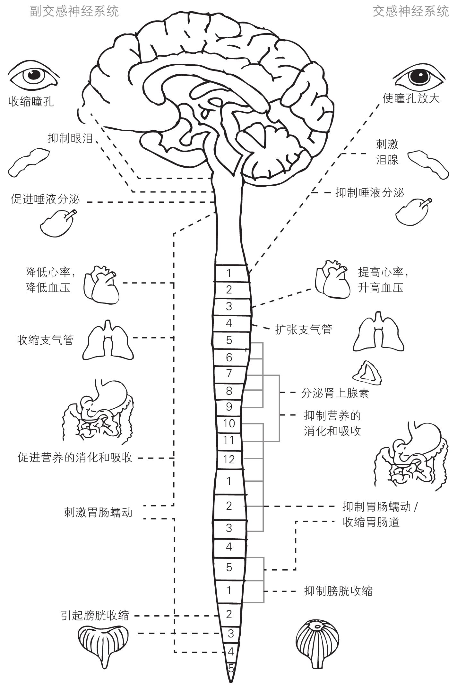
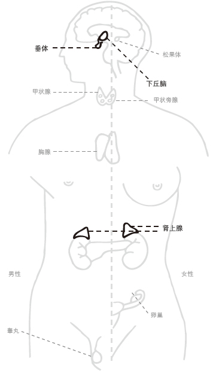
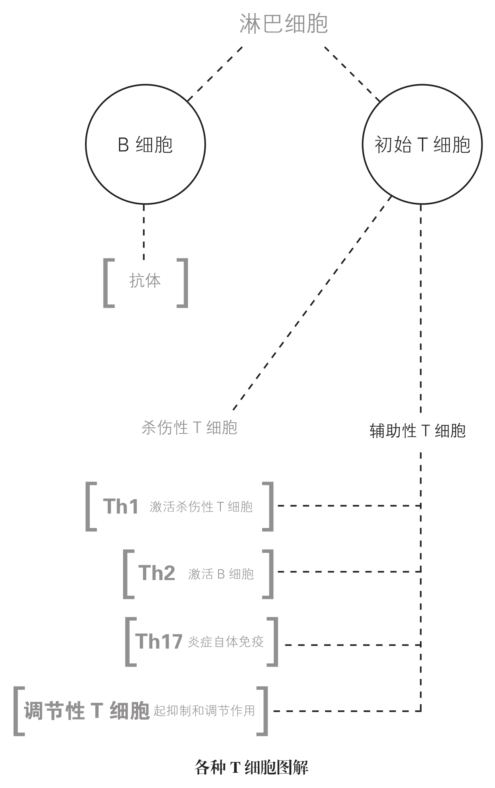

# 第五章 压力与自身免疫性疾病

  <h2 title="第五章 压力与自身免疫性疾病">第五章 
  压力与自身免疫性疾病</h2>
  
生活在这样一个忙碌的世界中，我们常将“压力”挂在嘴边。“我压力好大”与“我感到心力交瘁”，这两句话就像荣誉徽章一样，常被我们用来表明生活充实而忙碌。但压力不容轻视。虽然我们将压力视为一种情绪，但它远不止于此。压力会在人体内产生一系列生理反应，控制这些生理反应出现的频率与持续的时间对人的健康，尤其是对自身免疫性疾病患者的健康来说至关重要。要想弄清楚自身免疫性疾病与压力的关联，需要先了解一些有关压力的基本知识。压力是一种由压力源引起的反应。压力源可能是情绪上的，也可能是生理上的。重大的应激事件，包括亲人死亡、离婚或分手、遭受身体或精神虐待或创伤等，都是压力源。此外，还有一些隐形的压力源，包括睡眠不足、不正常用餐、长时间工作、过度运动、照顾他人却忽略自己等。即便是一些好事，比如结婚、找到梦想的工作或搬到一座新城市，也可能成为压力源。

  
有些人非常清楚自己承受的压力，几乎立刻就能注意到其在身体上（比如出现胃痛、头痛或心跳加速的现象）和情绪上（比如易怒、疲劳、嗜吃甜食或咸食）的影响。当然，我也遇到过许多大大咧咧的人，他们没有意识到自己的身体可能正在遭受折磨，也不知道自己的症状与压力有关。事实上，很多人已经习惯了压力，对压力浑然未觉。有些人甚至以此为乐。然而，尽管各人承受的压力大有不同，但所有压力源都会在人体内引发一系列惊人的反应，我们称之为应激反应。

  
需要谨记的是，我们都有感觉压力大的时候。我并不是要你生活在虚幻之中，或完全消除生活中的压力，因为这是不可能的。你能做的是控制你对压力的反应。你可以控制压力进入你的身体，以及它对你的神经系统和激素产生影响的方式；你也可以避免它削弱你的免疫系统，从而让你生病。

  <h3 id="sigil_toc_id_39">应激反应</h3>
  
你的身体对压力的反应主要有两种。第一种是神经系统的反应。第二种是激素的分泌，其中最重要的激素是皮质醇与肾上腺素，这两种激素都是由肾上腺分泌的。

  <h4>神经系统对压力的反应</h4>
  
为了让你更好地理解神经系统对压力的反应，我先介绍一些背景知识。人的大脑和脊髓组成中枢神经系统，其他神经则属于周围神经系统。周围神经系统主要由两部分构成：躯体神经系统和自主神经系统。躯体神经系统的神经与肌肉相连，这些神经是能被思维控制的。例如，你可以随意移动手，抬起腿，或向左、向右看。自主神经系统则控制着人体的一些自主活动，比如心跳、体温、血压、呼吸、消化等。

  
自主神经系统是人体机能的重要组成部分，它的开启和关闭本应维持在平衡状态。负责开启自主神经系统的开关叫交感神经系统，当你感到有压力时，交感神经将被激活。这是应激反应的一部分。负责关闭自主神经系统的开关叫副交感神经系统，它起刹车的作用，能帮助人放松下来，抑制应激反应。自主神经系统的作用路线是固定的，这意味着应激反应也是由大脑开始，通过神经向下传递，刺激不同的器官，包括胃、心脏、肾上腺以及T细胞发育和成熟所依赖的淋巴器官。这条通往免疫系统的固定路线对T细胞功能的发挥非常重要，详见图3。

  
当你感到有压力时，交感神经系统会启动或战或逃反应。其中一种常见的反应是心跳加速。出现这种反应的原因有两个。第一，交感神经直接刺激心脏。第二，肾上腺释放肾上腺素，导致心率加快。这种反应会影响参与或战或逃反应的所有器官。人体其实有应对之法：让副交感神经系统发挥作用，抑制或战或逃反应，帮助身体恢复平衡，这样一来不会造成身体负担过重。

  <h4>激素对压力的反应</h4>
  
人体对压力的第二种反应是通过大脑启动的一系列激素反应。这一连锁反应始于下丘脑和垂体，它们是大脑中控制激素系统的两大区域。下丘脑和垂体紧邻，人的情绪、思想和感知在这两个地方被转换成激素信号。垂体控制人的内分泌，其分泌的激素能够刺激人体内的所有内分泌器官（包括甲状腺、肾上腺、卵巢和睾丸等）分泌激素（详见图4）。发生应激反应时，下丘脑分泌促肾上腺皮质激素释放激素（CRH），接着垂体分泌促肾上腺皮质激素（ACTH），肾上腺紧接着分泌人体主要的应激激素——皮质醇。在医学界，这种下丘脑—垂体—肾上腺通路被称为下丘脑—垂体—肾上腺轴（HPA轴），应激反应据说能激活HPA轴。

  

    
    
图3　自主神经系统

  

  
尽管人体内存在多种应激激素，但皮质醇是其中效用最强的一种，它会对人体产生诸多重要影响。剧烈应激与急性应激会造成人体内皮质醇水平升高（详见下文“高皮质醇的影响”）。皮质醇会令你血糖水平升高，让你有足够的能量去“战斗或逃跑”。它还是人体内主要的抗炎激素，能够抑制免疫细胞，使身体为应对潜在的疾病做好准备。当你受伤时，免疫细胞造成的炎症将阻碍组织愈合。因此，通过抑制免疫细胞，皮质醇能够防止免疫系统过度活跃，避免免疫系统释放对组织愈合不利的分子。

  

    <h4>高皮质醇的影响</h4>
    
1. 食欲增强，胃口变好

    
2. 体内脂肪增加

    
3. 肌肉量减少

    
4. 骨密度减小

    
5. 焦虑加重

    
6. 抑郁加重

    
7. 情绪波动大（易怒）

    
8. 性欲减退

    
9. 免疫系统受损

    
10. 记忆力和学习能力下降

    
11. 经前综合征症状加重，如液体潴留、易怒

    
12. 月经周期改变

    
13. 更年期症状加重，如潮热、盗汗

  

  

    
    
图4　内分泌器官

  

  <h4>应激反应的表现</h4>
  
了解两种应激反应（交感神经系统的或战或逃反应和HPA轴的皮质醇反应）至关重要，因为它们对人体的免疫系统有直接影响。我先来说一说应激反应发生时人有什么感觉。你可能对应激事件做出急性反应，不过事件过去后，这种反应可能还在。例如，如果你和朋友或伴侣发生冲突，或者在照顾病重的孩子或父母，那么你可能感到心跳加速，晚上躺在床上因担心或焦虑而无法入睡，或者因肌肉紧张而背部、颈部疼痛；可能出现紧张性头痛或其他形式的头痛、胃痛、肠易激综合征的症状（比如腹泻及/或便秘）；还可能口眼干燥、手脚冰凉。如果这种应激反应持续很长时间，你将发现自己经常生病，因为你的免疫系统已经无法正常发挥作用。

  
体内皮质醇水平长期过高最常见的一种症状是腰围变大。研究表明，压力大的人更喜欢吃高糖和高脂肪的食物。<a id="noteBack_17" href="27-%E5%8F%82%E8%80%83%E6%96%87%E7%8C%AE.md#note_17">[1]</a>这些食物刺激人体分泌能够降血糖的胰岛素。高水平的胰岛素和皮质醇共同作用，会让脂肪在内脏周围堆积，导致腹部肥胖。腹部脂肪有时也被称为“内脏脂肪”，因为这些脂肪与体内其他脂肪在外观和行为上都不一样，除了让你的裤子穿不上外，还会在人体内引起大量炎症反应。此外，腹部脂肪很难消除。炎症是所有自身免疫性疾病以及心脏病、中风、癌症和其他疾病常见的潜在诱因。

  <h4>慢性应激与急性应激</h4>
  
与生活中的许多事情一样，压力也不是非黑即白。也就是说，并不是所有的压力都是不好的。启动或战或逃反应可能是一件好事，因为人体在这种反应下释放的激素能够帮你逃离攻击者、做好演讲、应对领导的谈话或成功在黑钻石滑道上滑雪。这些都是急性应激的例子。急性应激有始有终。如果你的应激系统一直处于活跃状态，就会出问题。这种情况被称为慢性应激。我曾经看过一部有关自然栖息地内斑马和狮子的纪录片。一匹斑马被一头狮子追逐，很明显这匹斑马在逃命时体内启动了或战或逃反应。当斑马最终狮口脱险后，它的身体开始剧烈地颤抖。但随后发生的一幕令人非常吃惊：这匹刚刚还在逃命的斑马开始在野地里静静地吃草，就像什么也没有发生过一样。它已经忘记刚才的濒死体验。我敢肯定，如果我们此时测量它体内的应激激素水平，结果一定是正常的。斑马有抑制应激反应的办法，身体不再做出应激反应后可以继续正常生活。

  
与斑马的应激系统一样，我们的应激系统也可以自行获得平衡。但与斑马不同的是，我们会记住狮子。因此，我们会反复思考，不断揭开创伤。无论是就现实场景还是就心理体会而言，我们在回顾某件事都与实际经历这件事并无不同，所以我们一直处于应激状态。事实上，大多数人把更多的时间花在戚戚于过去和汲汲于未来上，而不是活在当下。为保持身心健康，你必须学会一些技巧，让大脑不再纠结于某些想法，这样你的身体才不会因为皮质醇长期处于高水平而受损。让你生病且病情不见好转的，正是这些应激激素。在这里，我指的不仅仅是自身免疫性疾病。80%的慢性病（包括自身免疫性疾病、心脏病、中风和癌症）是由压力引发的。

  <h3 id="sigil_toc_id_40">肾上腺</h3>
  
我想多谈一谈肾上腺，因为它是最该为应激反应负责任的腺体。你肯定不是唯一不了解肾上腺的人。当我对患者提起肾上腺时，大多数人告诉我他们对人体内的这个重要器官一无所知。他们没有意识到，肾上腺及其分泌的激素对身体健康和免疫系统的正常运转非常重要。皮质醇是一种应激激素，很多人都听说过。至于皮质醇对身体的影响，大多数人并不了解。此外，除了来找我诊治的患者，还有很多人对肾上腺毫不重视。临床医学也忽视了这一块。为什么呢？因为临床医学注重于发现疾病，而且肾上腺疾病的表现非常极端。肾上腺疾病包括库欣综合征和艾迪生病。前者伴随着极高的皮质醇水平，通常是肿瘤引起的；后者是一种自身免疫性疾病，会损坏肾上腺，使其无法分泌激素。

  
但健康与生病并非两个极端，不是非黑即白的关系，一个人不是要么健康要么生病。相反，健康与生病之间存在一个很大的过渡空间，有很多灰色区域。当你处于这些灰色区域中时，可能只是某个器官没有正常运转，还在通往生病的路上。这就是你要观察自己肾上腺功能是否正常的重要原因，因为很多医生根本不会去考虑这个问题，他们也没有相应的检测工具。他们没有接受过相关培训，对肾上腺过度活跃或功能低下的症状了解有限。在这一章，我会告诉你肾上腺不健康的迹象，毕竟保持肾上腺健康是帮助你修复免疫系统的关键。

  
每个人都有两个肾上腺，它们分别位于左右肾脏的顶部。肾上腺外层的组织（肾上腺皮质）能够产生许多化合物。这些化合物有的是激素，有的是激素前体（激素前体是一种物质，它们不完全是激素，但能够转化为激素）。这些激素和激素前体包括以下几种。

  <ul>
    <li>醛固酮。这是一种有助于调节血压的激素。如果你体内的醛固酮过多，肾脏将会储存钠，从而导致血压升高（这是压力引发高血压的一种机制）。</li>
    <li>脱氢表雄酮（DHEA）。DHEA是肾上腺分泌的一种激素前体，有助于调节血糖和血脂、保护骨骼。在女性体内，肾上腺能利用DHEA产生睾酮和雌激素，这两种激素通常在卵巢中生成。女性绝经后，随着卵巢功能的衰退，此类激素开始由肾上腺接手，分泌增加。男性不太容易将DHEA转化为睾酮，但DHEA对男性的血脂、血糖和骨骼同样有直接影响。</li>
    <li>皮质醇。皮质醇是一种效力最强的应激激素，也是人体内的一种主要激素。如果体内没有皮质醇，人将死亡。</li>
  </ul>
  
人体做出应激反应时，有时会大量分泌上面提到的所有激素，有时仅大量分泌皮质醇，具体情况因人而异。但你要知道的最重要的一点是，当你感到紧张时，肾上腺会持续分泌高水平的皮质醇，直至压力消失，或者你能有效地管理压力，或者你的肾上腺筋疲力尽（肾上腺疲劳）。

  
如果你的身体一直处于或战或逃状态，我无法预测多久后你会出现肾上腺疲劳的情况，这取决于你是如何照顾自己的。如果你每晚至少睡7个小时（睡8个小时最好），饮食富含高蛋白食物和蔬菜且控制了白糖和白面粉的量，进行某种形式的放松练习，适度运动（不要太多，也不要太少），并减少毒素暴露，那么你的肾上腺将处于最轻松、最健康的状态（我会在第十一章对毒素进行深入讨论）。如果你这么做了，你的肾上腺将能更从容地承受外部压力与创伤。但如果你的肾上腺因为你不良的生活习惯而功能减退，当你在生活中突然面临新压力时，它将很容易疲劳。

  
通常来说，当肾上腺疲劳时，你体内的DHEA水平和睾酮水平也会下降。这是为什么呢？因为你的肾上腺正在忙着制造皮质醇。DHEA和睾酮不是主要激素（没有这些激素你可能生病，但不会死），所以肾上腺选择牺牲这些激素来维持皮质醇的水平。这是一个大问题，因为除了维持性欲外，DHEA和睾酮在维持肌肉量和骨密度、调节胆固醇和血糖水平方面也十分重要，而这些都是人体保持健康的关键。在进行血液检测时，DHEA水平低通常是我最先关注的问题，因为这表明受试者的肾上腺可能出了问题。

  
如果你在生活中压力不断，又没有照顾好自己，肾上腺将疲惫不堪，无法分泌足够的皮质醇或肾上腺素。当体内这两种关键的激素水平下降后，肾上腺将极度疲劳，通常还伴有关节或肌肉发炎的症状，比如关节或肌肉疼痛、肿胀或僵硬。这些症状在早晨尤其明显，因为此时你体内的皮质醇水平本该最高。这种状况会引起免疫系统的问题。研究表明，压力是造成自身免疫性疾病的一大诱因。应激反应不足的人（即皮质醇水平和由交感神经系统产生的一种神经递质——去甲肾上腺素水平较低的人）体内出现炎症的风险更大。如果没有对压力做出正确反应的能力，你的身体将无法控制免疫系统和炎症。

  
你可以按照这部分介绍的治疗方案和本书针对因饮食不当和慢性感染造成的压力问题、消化问题和毒素暴露问题提出的其他方案来恢复肾上腺的活力。这样做不仅有助于修复肾上腺的功能，还能改善免疫系统的状况。

  <h3 id="sigil_toc_id_41">压力对自身免疫性疾病的影响</h3>
  
本书中针对压力对免疫系统的影响的观点，大部分是基于最新科学研究以及当前医学界对自身免疫性疾病的发生与发展方式的理解提出的。别担心，我会尽量说得通俗易懂些。了解压力对免疫系统的影响有助于你将一些要点串联起来，从而了解压力是如何影响健康的，这样你才有动力做出改变。

  <h4>应激激素究竟起什么作用？</h4>
  
我们已经知道压力是什么了，也知道它是如何进入人体并影响人体激素水平和神经系统的。其实压力不仅会影响人的皮质醇水平，还会改变肾上腺素、睾酮、黄体酮和雌激素水平。压力一开始会让人体内所有激素的水平都上升，但如果压力长期存在，随着时间的推移，这些激素的水平会下降。影响激素水平是压力影响免疫系统的重要方式，因为所有激素都是所谓的免疫调节剂。“免疫调节剂”一词听上去有点儿深奥，其实就是通过改变免疫细胞的数量或改变其活力来使它们变弱或变强的物质。

  
如第二章所述，食物可以用作免疫调节剂，因为它们能对免疫系统造成影响。作为重要的应激激素，皮质醇和肾上腺素也是免疫调节剂。它们能极大地影响T细胞的发育与成熟，也能导致其失衡，从而影响人体健康甚至让人生病。还记得《金发姑娘与三只熊》的故事吗？金发姑娘不希望她的粥太热或太凉，不希望她的椅子太大或太小，不希望她的床太软或太硬。同样，我们不希望自己体内的免疫活动太频繁，因为这样会引起炎症反应，导致免疫系统攻击自身组织。当然，我们也不希望体内的免疫活动太少，因为这样容易感染。我们要的，是免疫活动不多不少。幸好人体是有弹性的，应激系统过度活跃或过度不活跃都能被治愈，并恢复平衡。我会告诉你该怎么做。

  
在此之前，我们先来回顾一下。我在第一章对免疫系统做了简单的介绍，我们来快速回忆一下，因为压力对免疫细胞的影响真的非常大。淋巴细胞是“细胞军团”中的主要“士兵”。但和任何一支军队中的情况一样，这些“士兵”的工作都不一样。它们被分成多个小组，每个小组承担不同的责任（图5）。免疫系统中的“士兵”分为以下几类。

  
• 攻击性细胞

  <ul>
    <li>杀伤性T细胞，又名细胞毒性T细胞。这些淋巴细胞作用的对象是细胞，会对任何进入人体的异物（如细菌、病毒、寄生虫或酵母菌）发起攻击。杀伤性T细胞不产生任何抗体。</li>
    <li>能够生成抗体的B细胞。B细胞被激活后能产生抗体，抗体会对异物发起攻击并将其摧毁。</li>
  </ul>
  
• 控制性细胞

  <ul>
    <li>辅助性T细胞。这些细胞能够使免疫系统对体内异物做出更快的反应，我常常将辅助性T细胞比作为汽车提供动力的汽油。辅助性T细胞有很多种，各自具有不同的功能。有一种辅助性T细胞可以激活杀伤性T细胞（用于参加“细胞之战”）；有一种则可以激活B细胞，让其产生抗体（记住，抗体好比子弹）；有些辅助性T细胞会引起破坏性炎症反应。</li>
    <li>调节性T细胞。这些细胞能够抑制或关闭免疫系统对异物的反应，所以我常常把它们比作汽车的刹车。调节性T细胞对自身免疫性疾病的防治非常重要。</li>
  </ul>
  
免疫系统健康时，身体产生的辅助性T细胞和调节性T细胞非常均衡。自身免疫性疾病患者体内的辅助性T细胞太多，而调节性T细胞太少。如果把自身免疫性疾病患者的免疫系统比作一辆车，那么这辆车汽油太多、动力太足而又无法刹车（调节性T细胞太少），只能不停地运转。

  
自身免疫性疾病患者面临的另一个问题是，体内的辅助性T细胞造成杀伤性T细胞与B细胞失衡。研究表明，在一些自身免疫性疾病患者体内，辅助性T细胞激活了太多的杀伤性T细胞（多出来的杀伤性T细胞会对自身组织造成直接伤害），或者太多的B细胞（B细胞产生很多抗体，这些抗体也会对自身组织造成伤害）。当杀伤性T细胞较强时，B细胞较弱，反之亦然。所以，如果你体内的抗体太多（Th2型免疫反应），则杀伤性T细胞将极少；而如果你体内的杀伤性T细胞太多（Th1型免疫反应），则抗体将极少。这种失衡是个大问题，会危及健康。我们要做的是梳理这种失衡的机制和原因，并找出对策。

  

    
    
图5　适应性免疫系统

  

  
此刻我们谈论的已是技术层面的问题，为更形象地说明问题，我们来举个例子。假如你被老板叫到办公室，说你被解雇了。这个消息令你手足无措、震惊不已。在几分钟之前，你还以为工作进展顺利——事实上就是非常顺利。但现在你的情绪突然陷入混乱，心理上产生压力。我该怎么向伴侣解释？我该怎么支付账单？我该怎么存退休金或孩子的教育基金？我还能找到别的工作吗？一连串的问题令你心跳加速、呼吸急促，血液在体内快速地循环——这些迹象表明你体内的或战或逃反应已经启动。因此，你的身体会立即释放肾上腺素和皮质醇，神经系统也会分泌一种名为去甲肾上腺素的神经递质。

  
在接下来的2～4小时里，压力还会增加你体内杀伤性T细胞的数量，但这只是暂时性的。几个小时后，如果压力还未消失，高水平的皮质醇和或战或逃交感神经活动会直接抑制杀伤性T细胞。美国芝加哥洛约拉大学开展的一项研究，致力于观察女性在接受针对乳腺癌的乳腺活检时的反应。该研究发现，患乳腺癌的坏消息会让她们体内杀伤性T细胞的活性下降。<a id="noteBack_18" href="27-%E5%8F%82%E8%80%83%E6%96%87%E7%8C%AE.md#note_18">[2]</a>我在前文已经说过，这会造成免疫失衡：当杀伤性T细胞被抑制时，B细胞开始产生更多的抗体。由于杀伤性T细胞是抗击病毒和细菌最重要的细胞，你对杀伤性T细胞被抑制最直观的感受，就是自己开始频繁地生病。

  
我们接着说突然被解雇的事情。由于你处于高压状态，交感神经系统被激活，体内生成大量肾上腺素和皮质醇。此时，作为你对抗感染的第一道防线，免疫细胞无法正常工作。这意味着，如果此时你和其他人遭受同样的感染，你将比其他人更难从中摆脱：你可能生病，而其他人可能病得没你重，甚至可能根本不会生病。在实践中，我常看到的另一个例子是EB病毒感染。感染EB病毒后，人会得单核细胞增多症。如果你的免疫系统因为承受压力而变得衰弱，EB病毒会被激活，从而让你感觉异常疲乏。保持免疫系统强健非常重要，因为只有这样你才能抑制那些潜伏在体内的病毒，不至于生病。

  <h3 id="sigil_toc_id_42">应激反应：皮质醇与自身免疫性疾病</h3>
  
免疫系统受到多种激素的影响，包括性激素（雌激素和睾酮）、褪黑激素、应激激素和维生素D（从功能上看，维生素D实际上是一种激素）。皮质醇是一种主要的应激激素，也是人体内效力最强的激素免疫调节剂。所以在提到压力时，我们重点谈论的激素就是皮质醇。

  
正如前文所述，人体免疫细胞部分是在淋巴组织中形成的，并储存在淋巴组织中。肺、骨髓、胸腺、脾、淋巴结和肠黏膜下都有淋巴组织。在这些淋巴组织中，未成熟的T细胞转化成特化的辅助性T细胞、杀伤性T细胞和调节性T细胞。只有这一步顺利进行，才能确保免疫系统健康。但研究表明，一些未成熟的T细胞也可能出现在这些器官中。这些造反细胞没有发育成上述3种T细胞中的任意一种，而是在本该攻击外来“入侵者”时攻击自身组织。<a id="noteBack_19" href="27-%E5%8F%82%E8%80%83%E6%96%87%E7%8C%AE.md#note_19">[3]</a>如果你还记得第一章的内容，就该知道，这是自身免疫性疾病发病的开端。

  
研究表明，在正常情况下，皮质醇会与这些造反细胞结合以起调节作用，即在造反细胞大量出现并对自身组织造成严重伤害前灭掉它们。但体内皮质醇水平过高或过低时，问题就出现了。如果体内皮质醇水平过高，所有杀伤性T细胞将受到抑制。这在短期内没什么问题，因为如果这些杀伤性T细胞被激活，会释放大量炎症因子。因此，皮质醇水平高可以减少体内因感染或损伤等引发的炎症。例如，如果你的腿在一场车祸中被压断，自身组织受到严重损伤。这对你的身体而言是巨大的压力源。因此，你体内所有的应激激素都被释放出来，身体因而启动或战或逃反应。高水平的皮质醇能够有效抑制炎症，所以伤口不会因为自体反应而恶化。一旦受伤初期的疼痛和压力消失，你体内的或战或逃反应随之关闭。接着皮质醇水平下降，副交感神经系统维持身体平衡，免疫系统开始工作，防止入侵皮肤的微生物造成感染。读到这里你可能已经发现了，最初的应激反应对人体是有益的。但如果这种应激反应持续时间太长，就可能造成严重的感染，从而妨碍你伤口愈合。因此，遇到生死攸关的大事时，人体正常的生理反应是：应激系统被激活，免疫系统退居二线，但免疫系统的这种被抑制的状态不会持续太长时间。

  
杀伤性T细胞活性下降后，可能出现两种情况。第一，如前文所述，人体被感染的风险更大。第二，由于杀伤性T细胞被抑制，身体会产生更多的抗体，而这一过程可能失控，造成抗体攻击自身组织，最终引发自身免疫性疾病，如系统性红斑狼疮。

  <h4>慢性压力与肾上腺疲劳</h4>
  
我接下来准备谈一谈人体内皮质醇水平过低的情况。随着时间的推移，慢性压力令肾上腺不堪重负。在这种情况下，皮质醇水平降低，肾上腺素等重要激素和去甲肾上腺素等神经递质的水平也一并降低。这对任何人，即便是身体健康的人来说都成问题。只不过对自身免疫性疾病患者来说，问题更严重。因为除了引起自身免疫反应，皮质醇水平低的话还会妨碍身体康复。如果没有足够的皮质醇来消灭你体内多余的杀伤性T细胞，它们将转而攻击自身组织。此外，皮质醇水平低还会造成人体内的杀伤性T细胞和抗体失衡。杀伤性T细胞能在全身引起炎症反应。因此，你体内的这种细胞越多，炎症越多，组织损伤也越严重。

  
发生这种情况时，你会有什么感觉呢？当皮质醇水平很低时，体内的杀伤性T细胞会增多，炎症随之增加，此时人体会出现一些非特异性症状，如肿胀、关节和肌肉僵硬或疼痛、全身疲乏等。如果你患的是器官特异性自身免疫性疾病，如类风湿性关节炎，那么主要症状可能是关节疼痛、肿胀甚至畸形。事实上，大多数自身免疫性疾病患者体内存在这种失衡的情况：过多的杀伤性T细胞转而攻击自身组织。这绝对会出问题，也是修复肾上腺和应激系统对自身免疫性疾病患者来说至关重要的原因。研究表明，肾上腺功能低下确实会让人患自身免疫性疾病，尤其是自身免疫性甲状腺病、类风湿性关节炎、系统性红斑狼疮和干燥综合征。

  
美国纽约西奈山医学院的一项重要研究重点关注Graves病患者。Graves病是一种因身体产生的抗体刺激甲状腺分泌高水平的甲状腺激素而引起的疾病。甲状腺激素在新陈代谢与精神调节等方面起至关重要的作用。但甲状腺激素必须维持在正常水平，一旦体内的甲状腺激素水平过高，人就会出现心悸、体重减轻、失眠等症状。这对心脏来说十分危险。在该研究中，一位71岁的女性体内的皮质醇水平极低。研究人员让她服用皮质醇药丸，剂量刚好就是她的肾上腺在健康状态下自然产生的皮质醇的量。一个月后，她的甲状腺激素水平恢复正常。两年后，她Graves病的症状完全消失。<a id="noteBack_20" href="27-%E5%8F%82%E8%80%83%E6%96%87%E7%8C%AE.md#note_20">[4]</a>虽然这只是个别案例，但它凸显了皮质醇和自身免疫性疾病之间的关联，以及修复肾上腺使其能产生更多皮质醇的重要性。在实践中，我很少给患者开皮质醇的处方药，而是让患者通过草本制剂和其他补充剂来滋养肾上腺，从而提升体内的皮质醇水平。

  <h4>你肾上腺疲劳了吗？</h4>
  
“感觉疲劳、没劲”是初次找我就诊的人最常抱怨的话。他们看过各种专家，希望找出自己精神不振的原因，并加以治疗来让自己好转。在始终没能找到缓解的方法后，他们开始上网自己寻找解决方案，试图了解这种名为肾上腺疲劳的病。然后，他们找到了我或其他功能医学/整合医学的医生，因为临床医学通常无法解决肾上腺疲劳的问题。

  
造成身体疲乏的原因有很多，肾上腺疲劳只是其中之一。如果你曾承受巨大的压力且没有好好照顾自己，我就会怀疑你全身疲乏是肾上腺疲劳的缘故。保持肾上腺健康有五大要点，包括晚上休息好、有规律地运动、每天做一些放松活动、吃天然食物（第二章）、减少毒素暴露（第十一章）。如果你常年处于高压之下、睡眠不佳、不运动、饮食含有大量糖和有害脂肪、不让自己的节奏慢下来放松放松，且体内毒素较多（可能来自鱼体内的汞、食物中的杀虫剂或其他环境化学物质，详见第十一章），那么你的肾上腺可能早已疲惫不堪。

  
在我看来，诊断你的肾上腺是否疲劳的第一条线索，就是你的压力和自我照顾的情况。接着我会了解你白天的精力情况。如果你早上醒来感觉很累、中午感觉精神最好、傍晚感觉精力不济需要小睡一会儿、晚上又精力充足，那么你这是肾上腺疲劳了。你感到疲倦的原因可能还有很多，比如摄入太多糖、营养不良、甲状腺激素水平过低、体内毒素过多以及受到慢性病毒感染等。但如果你的情况与我上面描述的相符，则表明肾上腺疲劳才是你疲惫不堪的症结所在。

  
我会在下一章提供自我评估的方法，教你如何为自己诊断。此外，我还会分享一些检测方法。

  <h4>其他重要的肾上腺激素</h4>
  
在结束有关肾上腺疲劳的讨论之前，我还想提一下DHEA。DHEA是肾上腺分泌的一种非常重要的激素前体。就其本身而言，DHEA已被证实有降低胆固醇、平衡血糖的作用。对女性而言，DHEA能在体内许多组织和器官，如在肾上腺中转化为睾酮。因此，虽然DHEA不同于睾酮之类的激素，但它能增强激素活力。

  
被DHEA激活的激素是雄激素，雄激素有助于强化骨骼和肌肉。这一点对老年人尤为重要，因为雄激素可以预防骨质疏松和肌肉流失。对女性来说，确保肾上腺健康并分泌足够的DHEA对维持睾酮水平也有好处。在这一点上男女有别，因为男性体内的睾酮都是由睾丸产生的。但男性仍然需要从肾上腺中获取DHEA。当人长期承受压力时，DHEA最先被耗尽，这甚至发生在皮质醇水平开始下降之前。慢性压力会造成人体内的睾酮水平下降，一来因为体内的DHEA水平下降了，二来因为压力激活了芳香化酶（芳香化酶能将睾酮转化为雌激素）。

  
人们发现，类风湿性关节炎和系统性红斑狼疮患者体内的DHEA和睾酮水平较低。这不是个好现象，因为DHEA能够抑制杀伤性T细胞分泌炎症因子，而睾酮已被证实能杀死已被激活的免疫细胞，防止其失控。为进一步验证这些结论，美国约翰霍普金斯医学院的研究人员连续3个月每天都让一组系统性红斑狼疮患者服用200 mg的DHEA。在实验结束后，所有患者的症状都有所改善，其中53%的患者已经能够减小泼尼松的服用剂量，症状最严重且服药量最大的患者取得的效果最显著。<a id="noteBack_21" href="27-%E5%8F%82%E8%80%83%E6%96%87%E7%8C%AE.md#note_21">[5]</a>

  
这并非唯一表明提高DHEA或睾酮水平对自身免疫性疾病患者有益的研究。荷兰乌德勒支大学医院的研究人员针对一组患类风湿性关节炎的女性进行了研究，结果发现她们在被确诊患类风湿性关节炎前后体内的DHEA水平较低。研究人员在让她们服用睾酮之后发现，所有患者的疼痛都减轻了，行动能力也都变强了。<a id="noteBack_22" href="27-%E5%8F%82%E8%80%83%E6%96%87%E7%8C%AE.md#note_22">[6]</a>不仅相关文献证明这种治疗方法有效，我在问诊过程中也目睹了这种疗法的效果。我通常会对患者的DHEA和睾酮水平进行评估。如果它们水平较低，我将教给患者压力管理的方法，并让他们服用相应的补充剂。应当谨记的是，即使你已经决定服用补充剂了，也要修复肾上腺及控制压力，这才是当务之急，因为这样做有助于维持体内的DHEA和睾酮水平。

  
那么，该如何应对生活中的压力呢？虽然你不能生活在虚幻中或者摆脱生活中的所有压力，但你必须学会有效地管理压力。你要了解压力是如何进入你的身体让你生病的。当身体感受到压力时，你要意识到它的存在，这样你才能通过深呼吸来放松自己，从而防止体内的应激反应持续存在。这样做有助于平衡你体内的各种应激激素。具体内容我将在下一章“自我评估”和“治疗方案”中介绍。

  <h4>压力与感染</h4>
  
关于感染是如何引发自身免疫性疾病的，我将在第十四章详细阐述。在这里我们要知道的是，压力和感染是如何像滚雪球一样衍变成自身免疫问题的。令人惊讶的是，你所患的每一种病毒性疾病都会在体内留下残余病毒，包括单纯疱疹病毒、水痘—带状疱疹病毒、肝炎病毒、EB病毒等等。当免疫系统被应激激素或神经递质抑制时，这些病毒都将被激活，使得免疫系统难以抵抗感染。这是怎么发生的呢？人们认为，巨大的压力将抑制细胞的免疫功能（你应该已经了解，抑制的是杀伤性T细胞），这使得病毒能够在人体组织中繁殖。因为有证据表明，很多自身免疫性疾病可能是由感染引起的。病毒在体内大量繁殖是压力引起自身免疫性疾病或令既有病情加重的另一个方式。如前文所述，这种压力可以是精神压力，也可以是由抽烟、喝酒和不良饮食等不健康的生活方式引起的严重的生理性压力。保持免疫系统强健有助于抑制体内的这些残余病毒。

  <h4>压力、消化道健康与免疫系统</h4>
  
本书中的消化道主要指胃肠系统，包括胃、小肠和大肠。我将在第三部分详细介绍消化道健康的重要性。但在此我想说的是，研究表明，压力会改变胃肠道的内部环境。

  
众多研究表明，各种压力会对肠道功能产生很大的影响。例如，压力与肠易激综合征和炎症性肠病等疾病之间存在明显关联。在这里我要探讨的是因压力造成的肠道环境变化的问题，因为这种变化会影响免疫系统。人的免疫系统70%位于消化道，这么一说你应该很容易就能理解为什么确保消化道健康如此重要。确保消化道健康有两种方法：第一种是确保消化道中有适量的有益菌；第二种是保证整个消化道黏膜的细胞是健康的，这些细胞构成一道屏障，决定什么物质能够进入血液。如果你的肠道中没有足够的有益菌，或者消化道黏膜功能较弱、易渗透，免疫系统就会受损。

  
研究表明，压力会减少肠道内有益菌（尤其是乳酸菌和双歧杆菌）的数量，还会促使小肠中的有害菌过度增殖。压力通过多种方式达成这一目的。压力能够直接抑制一种免疫分子——分泌型免疫球蛋白A，这种分子不但有助于维持有益菌健康和不断增殖，而且能抑制有害的细菌和酵母菌增殖。此外，研究表明，压力会使肾上腺素和去甲肾上腺素等物质释放到肠道中，进而造成肠道中的有害菌过度增殖。<a id="noteBack_23" href="27-%E5%8F%82%E8%80%83%E6%96%87%E7%8C%AE.md#note_23">[7]</a>压力还使消化道黏膜变得更易渗透，使有害菌与抗原（免疫系统读到的细菌的“标记”）渗入血液。<a id="noteBack_24" href="27-%E5%8F%82%E8%80%83%E6%96%87%E7%8C%AE.md#note_24">[8]</a>这道脆弱的屏障还令食物中的蛋白质等进入血液，刺激免疫系统，引起炎症反应，造成人体对食物过敏或敏感（肠漏症）。我在第二章已对此详细阐述过了，现在你应该了解慢性压力是如何让你对食物过敏或敏感的。

  <h3 id="sigil_toc_id_43">心身关联</h3>
  
我们已经探讨了压力可能对人体造成的伤害，现在我来告诉你如何管理生活中的压力。你应该学会让自己放松，从而抑制体内那些因慢性压力而产生的激素和神经递质，避免它们影响你的健康。这些激素和神经递质应该只在你需要它们的时候发挥作用，而在你不需要的时候，它们应随时待命。那么，怎么做才能放松下来呢？长期以来，人们一直认为自主神经系统是自主运行的。20世纪30年代初，汉斯·谢耶在对老鼠的应激反应机制进行细致研究后发现，应激反应及其对自主神经系统的影响还受到环境因素，包括饮食及生活条件的影响。<a id="noteBack_25" href="27-%E5%8F%82%E8%80%83%E6%96%87%E7%8C%AE.md#note_25">[9]</a>他的研究解除了我们关于“生活在喜马拉雅山洞里的僧侣如何通过冥想来调节体温”的疑惑。这些僧侣能够做到这一点，主要是因为冥想使血管放松、扩张，因此更多的血液流经他们的身体，让他们感到温暖。事实上，你也可以控制身体的机能，如血压、心率、体温和免疫系统。这可能让许多人大吃一惊，但却是事实。

  
这属于心身医学的研究领域，心身医学是整合医学的一个分支（功能医学也是整合医学的一个分支）。心身医学研究的是人的思想、感觉和情绪对身体健康的影响，以及身体健康对人的精神和情绪健康的影响。如果定期练习诸如冥想、引导式放松和引导式想象（又名“内观”）等能让你身心放松的技巧，将对你和你的健康产生极大的积极影响。进行身心放松练习有两大益处。第一，你的身体将学习一种不同的反应方式，不会激活有害激素，保持内部平衡，进而帮你防治慢性病，尤其是涉及免疫系统的疾病。第二，这些练习还可以帮你了解体内的压力，从而让你明白需要在生活中做出哪些改变，以及你所做的哪些事情可能对你造成伤害。心身医学提供的就是探索和恢复体内平衡的方法。

  
你可能很想知道身心放松技巧是不是很难学，我可以保证，答案是否定的。我已经将这些技巧传授给了各行各业的人。例如，我于2012年和心身医学中心的教员们一起去了海地，向灾后（2010年海地大地震后）压力极大的雅克梅勒居民传授身心放松的技巧。海地居民生活非常困苦，他们在日常生活中承受着我们很多人完全无法想象的压力。为了活下去，他们苦苦挣扎。参与这个培训项目的有130人。我有幸与其中十几位一起工作。培训课程共分8次教授，每次2小时。我在此期间教了他们一些技巧，如软腹式呼吸、引导式放松和想象。他们还做了一些绘画和写作练习，来更多地了解自己。他们对这些信息求之若渴，每天晚上都回家练习。

  
在我负责的小组内，人们的受教育水平各异。其中一些人是社区领导，其他人则是普通居民。尽管存在这样的差异，所有人都学会了降血压、缓解头痛及改善睡眠的技巧。此外，他们也意识到需要在生活中做出哪些改变，好让自己更快乐、不容易生气与沮丧。培训结束后，他们继续练习，寻找让他们保持身心及精神健康的方式。我去海地的本意是为了帮助雅克梅勒的受灾居民，但我没想到他们教给了我许多。我不仅被他们的热情、善良和感激之情深深地触动了，这段经历也让我意识到，人们对身心放松技巧的渴求，以及这种技巧任何人都能学会。我将在下文提供有关这些技巧的信息与练习方法，方便你在家学习。你也可以登录www.cmbm.org了解更多有关心身医学中心的信息，浏览该网站你还能找到它们在美国及全球其他国家和地区开展的项目，以及一些可能对你有用的资源。

  <h4>学习身心放松技巧的益处</h4>
  
事实证明，在学习身心放松技巧后，你的身上会发生一件不可思议的事情：从那时起你会觉得浑身舒坦。为什么会这样呢？因为你在为自己付出，你在照顾自己（而不仅仅是照顾他人），你对自身健康越来越关注。这么做能帮你走出绝望，让你充满力量，更好地掌控自己的人生。许多研究表明，即使不能平衡自主神经系统，把自己照顾好也有利于身体恢复。这些技巧的效用取决于神经系统对它们的反应。意识到你是唯一能够让自己恢复健康的人是你康复的基石。

  
另外，这些技巧为你提供了深入了解自己的好机会。通过写字、画画、运动、冥想和形象化练习，你可以意识到自己的负担和压力，并将其暴露出来，以便你采取措施做出改变。知识就是力量，当你去探索自己的身体及它应对周围各种压力的机制时，自我认知会引导你、肯定你。这是一件令人振奋的事，因为这表明你有能力改善自己的健康状况。

  
在下一章，我将帮你评估压力源，让你确定自己的一些症状是否与压力有关。而“治疗方案”中为你提供了一些可以在家里自行操作的练习，以及一些有用的外部资源。

  <h4>我的身心放松之路</h4>
  
我第一次参加心身医学中心的培训已经是许多年以前的事了，自那之后我便开始练习身心放松技巧并审视自己。那个时候我觉得不快乐，但找不出原因。我有3个孩子，他们都不到10岁。家里面临一些经济压力，但还在可控范围。我不知道为什么自己总觉得生活很灰暗。是我丈夫的缘故吗？（我们习惯于责怪最亲近的人，尤其是当你觉得一切都很糟糕时。）我该辞掉工作做全职妈妈吗？我无法确定。所以我找了治疗师，治疗了18个月，试图找出问题所在。

  
后来有一天，我收到了一本小册子，上面是一次为期9天的心身医学专业培训课程的介绍。此前，我从未离开过丈夫和孩子那么长时间。但我心里有个声音告诉我，我该这么做。

  
幸好我参加了那次培训，因为那是我一生中最大的转折点。我在上课期间遇到了医学博士詹姆斯·戈登。多年来，他与心身医学中心的其他教员一直致力于向卫生保健人员传授身心放松的技巧。在那9天里，我专注于学习动态和静态冥想的技巧、引导式想象、生物反馈以及运用绘画和写作提高自我意识的方法。我特别喜欢的是引导式想象和动态冥想。

  
在为期9天的培训中，我对自己的了解比接受治疗的那18个月的还深刻，真令人不可思议。我意识到我的苦恼源是自己，而不是他人。我需要找回自己，需要弄清楚我是谁、我想要做什么，我需要为自己找到通往幸福的道路，并确定自己希望做出哪些改变。我和治疗师分享了我的发现，他感到很惊讶。我结束了治疗，且自那以后再也没有去过那里。

  
我最终意识到，问题的症结在于我对自己所从事的事业不满意，临床医学无法给予我快乐。我需要找到一条更加宽阔的医学之路。这是我人生中最大的一次转变。至今，我仍在练习那些身心放松技巧。是这些技巧让我走上了功能医学和心身医学的道路。

  
在布卢姆康复中心，我们组了不少身心放松训练小组。我很高兴看到很多人在身体、思想、精神以及生活上像我一样发生了巨大的转变。看到患者身心各个方面都好转了，我生出了一种难以言喻的满足感。这是我走下去的动力，也是我写本书的原因。你也可以做到身心愉悦，我将教你如何做。

