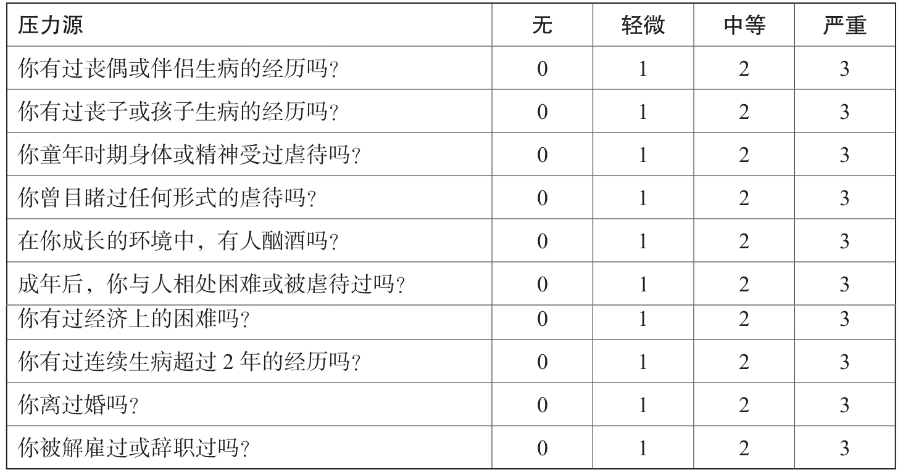
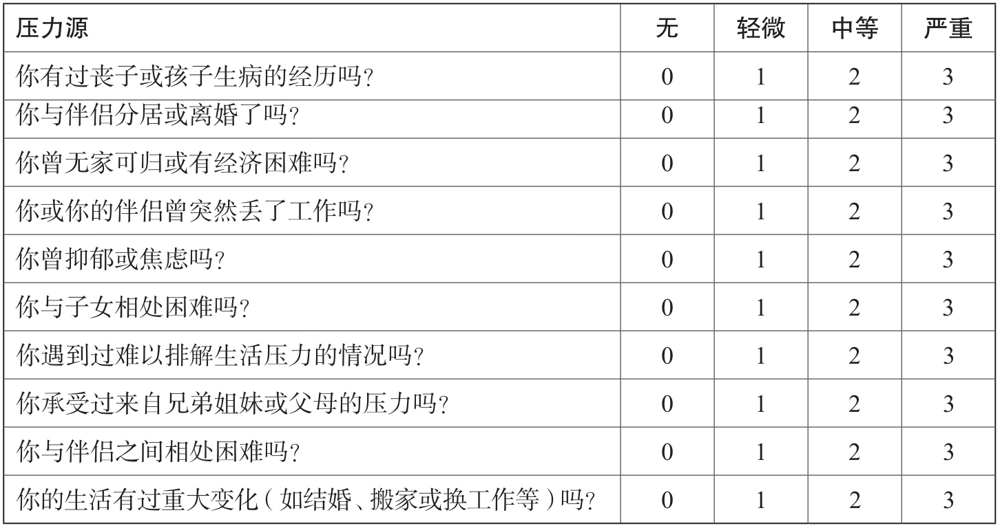
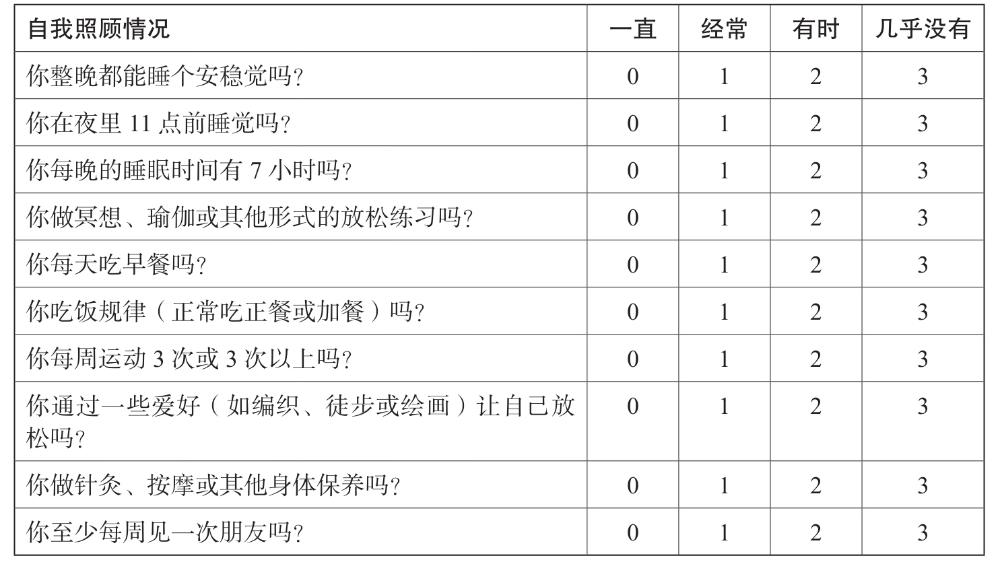
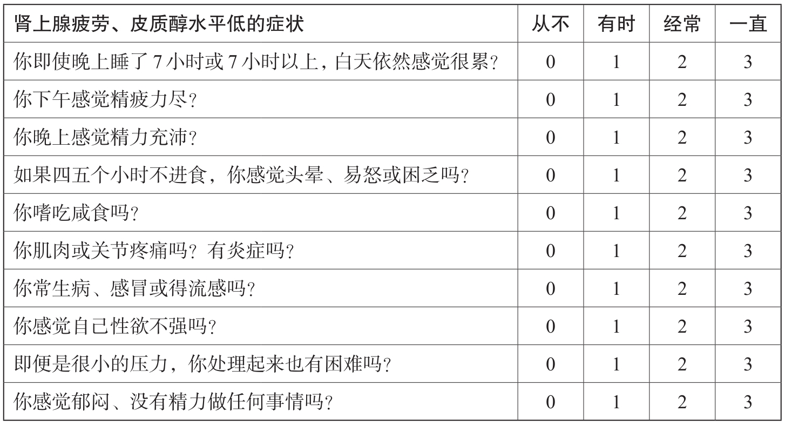
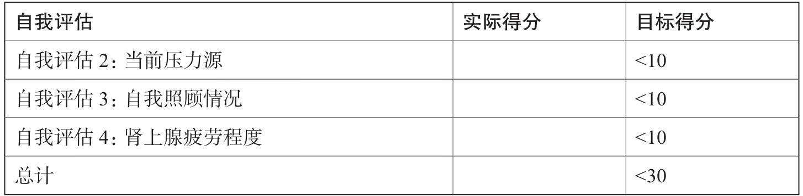
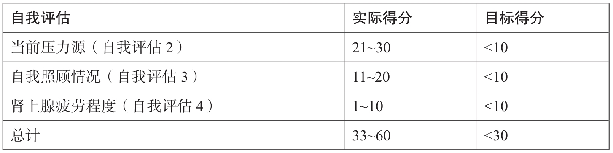
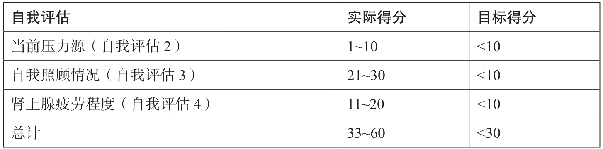
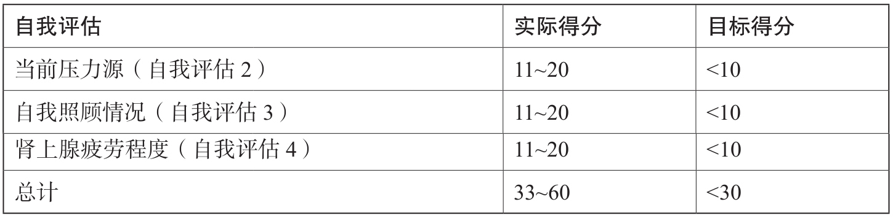

# 第六章 压力自我评估手册

  <h2 title="第六章 压力自我评估手册">第六章 
  压力自我评估手册</h2>
  
现在你已经知道，应激系统做出的反应就是身体对压力的生理反应，这个过程离不开应激激素与自主神经系统。应激系统能使免疫系统失衡，引发或加重自身免疫性疾病。你肯定不希望自己的应激系统一直处于兴奋不已或萎靡不振的状态。你所希望的是，它在你需要时起作用，而在你不需要时随时待命。大多数来我这里就诊的人肾上腺功能低下，体内的皮质醇与肾上腺素水平极低，因为他们一直生活在慢性压力之下。这种慢性压力不仅是生活压力，还有因生病造成的情绪和身体上的压力。或许你也有类似的感觉——总感觉特别累。我治疗的目的是修复你的应激系统，使其恢复弹性与灵活性。修复的第一步是确定其被破坏的程度。通过阅读本章“自我评估”部分的内容，你可以确定自己的应激系统受损的程度，也将知道如何修复它。

  
在这之前，我先讲一个故事。55岁的莫妮卡来我这里就诊时，一直感觉精疲力竭。在过去的7年中，她的体重每年都增加10磅（约4.5 kg）。在和我见面的4个月前，莫妮卡的医生确诊她患有类风湿性关节炎，并给她开了一堆处方药。她担心药有副作用，想看看有没有其他的治疗方法，于是找到了我。

  
莫妮卡有自身免疫性疾病史。她患有桥本甲状腺炎（和我一样）20年，还患有家族遗传病——白癜风15年。白癜风也是一种自身免疫性疾病，主要症状是皮肤色素脱失。这种病易辨认，当我看到莫妮卡手臂和脖子上的白斑时，不用她告诉我，我就知道她得了什么病。有意思的是，她说她的皮肤病其实“发生在一夜之间”，那时她刚在生活上经历了一次创伤。她称这次创伤为“重磅炸弹”，因为她在短短几周内失去了丈夫、房子和所有的钱。很明显，那时她的压力大到极点。几天之后，她就注意到自己的皮肤上出现了大片白斑。她姨妈和母亲也患有白癜风，所以她知道自己怎么了，因此也确信是压力诱发了白癜风。

  
她的压力源还不止这些。在随后的10年里，她生活拮据，一直处于忧愁与焦虑中。莫妮卡从未想过压力是导致她疾病缠身的一个重要原因。

  
她还有严重的食物反应和消化问题，比如胀气、反流。在吃下任何食物后，她都感觉自己像怀孕了6个月似的。很显然，除了压力和激素，她身上还有需要治疗的地方，但我还是先从评估她的压力着手，具体评估方法详见下文。等你做完评估，我会告诉你莫妮卡的评估情况、我的心得以及对她采用的治疗方法。

  <h3 id="sigil_toc_id_44">解析生活中的压力</h3>
  
或许你已经意识到，至少在某种程度上已经意识到，压力是造成你处境艰难的一大原因。或许你还知道它是如何让你患病的。回想一下你第一次生病的时候，是不是也与莫妮卡一样，压力缠身？虽然你也许不像她那样在一夜之间患病，但长期处于慢性压力之下身体确实会出问题。压力源不一定是坏事，搬家、结婚或提前晋升都可能成为压力源。希腊雅典大学医学院的一项研究发现，经历3次或3次以上应激事件的女性患者多发性硬化症的复发率更高。<a id="noteBack_26" href="27-%E5%8F%82%E8%80%83%E6%96%87%E7%8C%AE.md#note_26">[1]</a>这项研究提醒了我们，一次压力事件或一系列事件或变化，很可能是某些疾病的诱因。

  
其实有一点很明确，那就是为了平衡你的免疫系统，你要修复一切让它失衡的东西，包括学习管理压力，让自己的肾上腺、皮质醇水平和交感神经系统恢复正常。正如前文所述，目前已经有成千上万的人，甚至包括海地的居民学会了调控自己的压力。我知道你也可以。

  <h3 id="sigil_toc_id_45">自我评估</h3>
  
现在，你的应激系统处于什么状态？是过于活跃、维持平衡，还是疲惫不堪？接下来的内容将帮你找到答案。我还会教你处理评估结果的方法。在评估压力如何影响人体健康时，我一般关注以下几类问题，并进行综合考量：既往压力源、当前压力源、自我照顾情况和肾上腺疲劳程度。因此，我将自我评估分为4个部分。答完这4部分的问题后，请再进行综合评估，之后我会与你一同探讨评估结果。

  <h4>评估概述</h4>
  <h5>自我评估1：既往压力源</h5>
  
你过去是否受过重大创伤或者遇到过严重困难？这些经历是否现在还对你产生影响？

  
许多人由于家庭（或者由于家庭缺失）而承受过巨大的压力、受过重大创伤，其应激系统可能早已受损。了解既往压力源非常重要，因为它可能仍在影响你的应激系统。我住在纽约，发现许多人至今仍受9·11恐怖袭击的影响。最近找我就诊的一位女性，她的丈夫就死于那场灾难。10年过去了，她也已经再婚。她走进我办公室不到5分钟，我问了她一个问题，这个问题触及了她的这段往事，打开了她的心扉。她开始向我哭诉丧夫给她和孩子带来的创伤。显然，10年前的那场灾难仍让她难以忘怀。或许你也一样，受困于许久以前的情感或经历。

  
我们很容易就能想到，这位女性在过去的那段时期压力很大，但她没有意识到这种压抑情绪让她的应激系统一直处于活跃状态，进而让她疾病缠身。我见过很多能将情绪宣泄出来的人，但这并不意味着他们在回忆过去的创伤时不再难过，只不过他们善于表达自己、释放自己的情绪，而不是将情绪一直闷在心里。人的情绪如果无法得到宣泄，身体就会激活应激系统，进而产生压力。学习一些身心放松技巧，比如冥想，有助于你将负面情绪宣泄出去。

  <h5>自我评估2：当前压力源</h5>
  
你现在的生活如何？你是否承受着工作或人际交往方面的压力？你身边最近有人生病吗？你最近是否失去过亲人？

  
上面这些问题极为常见。每个人都经历过这样或那样的失去。大多数人认为失去是生活的一部分。但如果在失去亲人的同时，你还承受着巨大的工作压力或者与伴侣相处困难，你的应激系统可能已经难以正常工作。我敢肯定，你在看到评估结果时，一定会大吃一惊。我希望你在明白自己究竟承受着多大的压力后，能够释然。

  <h5>自我评估3：自我照顾情况</h5>
  
你好好照顾自己了吗？

  
通常我会在这部分询问患者生活的方方面面，包括睡眠、饮食、运动和压力管理（放松）等情况。如果你能很好地照顾自己，那么在这部分的得分可能较低，这是件好事。照顾好自己可以让你的应激系统充满弹性，从而防止自己因过去和现在承受的压力而生病。如果你在这部分的得分很高，也不要灰心——你可以改变现状，我会教你怎么做。

  <h5>自我评估4：肾上腺疲劳程度</h5>
  
你的身体已经受到压力的影响了吗？

  
有些人生活得非常艰辛，但他们竟然将事情处理得妥妥当当，并且没有因此而生病，对此我感到惊讶不已。如果你个性格随和，那么可能没那么容易受周围事物的影响。与那些容易紧张、难过和焦虑的人相比，你不易生病。但如果你是对压力非常敏感的人，一些小事也可能影响你的情绪。每个人的性格不同，经受的创伤、承受的压力也不同，所以你在做这部分的评估时，关键是思考自己当前的压力是什么。为更好地考量这一点，我会问一些有关你身体症状的问题，以便评估你应激系统的状态：是“过度活跃”“平衡”，还是“疲劳”。因此，仅了解你的压力源还不够，我还要知道你是一个怎样的人。

  <h4>评估表</h4>
  <h5>自我评估1：既往压力源</h5>
  
在这一部分，你要回忆一下自己两年前的生活（我会在下一部分评估你当前的压力源）。你有没有过表7列出的经历？对下面列出的每一项，如果你没有类似的经历，则圈出0；如果有，请根据所受压力的程度圈出相应的数字。

  

  
表7　既往压力评估表

  
将自己所圈的数字相加，然后将总分填在下方相应的横线上。

  
_____1～10分：既往压力处于轻微水平

  
_____11～20分：既往压力处于中等水平

  
_____21～30分：既往压力处于严重水平

  
 

  
莫妮卡这项评估的得分是21分。她在一个充满压力的困难家庭长大。离婚后，她更是多年无家可归。在过去的10年间，她一直处于极度疲惫的状态，这让她难以正常工作。此外，她还常常肌肉和关节疼痛。从这些信息我知道，她的应激系统在患病前的几年里就已经受损。换言之，过去的经历让她的免疫系统受损，从而让她更加容易生病。莫妮卡的得分在21～30分这个区间内，这表明她长期生活在重压之下。在最后一次重压让她的身体崩溃之前，她的免疫系统就已经失衡了。

  
如果你的得分在1～10分这个区间内，表明你的既往压力较小。换言之，虽然你现在出现了健康危机，但问题不是出在你过去的经历上。

  
如果你的得分在11～30分这个区间内，表明你的既往压力处于中等或严重水平。这意味着，你的应激系统因长期辛劳而功能低下的概率很大。

  <h5>自我评估2：当前压力源</h5>
  
回忆一下过去的两年里你经历了些什么。你有没有过表8列出的经历？对下面列出的每一项，如果你没有类似的经历，则圈出0；如果有，请根据所受压力的程度圈出相应的数字。

  

  
表8　当前压力评估表

  
将自己所圈的数字相加，然后将总分填在下方相应的横线上。

  
_____1～10分：当前压力处于轻微水平

  
_____11～20分：当前压力处于中等水平

  
_____21～30分：当前压力处于严重水平

  
 

  
莫妮卡这项评估的得分是14分。这表明她当前面对的外部压力比过去的小。但她的疾病仍然给她带来沉重压力，这让她难以承受。尽管她在离婚多年后嫁给了一个爱她、支持她的男人，他们现在的经济状况也很好，但她仍感到沮丧、焦虑。我想，正是因为她的生活趋于稳定，她才决定做出改变以让自己健康起来。

  
如果你的得分在1～10分这个区间内，这表明当前你面对的外部压力较小，也意味着你用我教的方法很容易就能让自己好起来。

  
如果你的得分在11～30分这个区间内，这表明你当前的压力处于中等或严重水平。你患病的很大可能是你的应激系统疲惫不堪。你的当务之急是找到一种健康的方式来排解体内的压力，然后检视自己的生活，设法让自己摆脱困境。这一点稍后我将详细讨论。

  <h5>自我评估3：自我照顾情况</h5>
  
在这一部分，我要评估的是你对自己的照顾情况以及你的生活方式。对于表9列出的每一个问题，圈出最能代表你当前生活状态的数字。

  

  
表9　自我照顾情况评估表

  
将自己所圈的数字相加，然后将总分填在下方相应的横线上。

  
_____1～10分：你将自己照顾得很好。

  
_____11～20分：你将自己照顾得不够好。

  
_____21～30分：你将自己照顾得很差，这有可能损害你的健康。

  
 

  
莫妮卡这项评估的得分是22分。当时，她的饮食很健康。但她一般过了半夜12点才睡觉，而且睡眠质量不高。她不做任何形式的放松练习，不去见朋友，不运动，也没有任何能帮自己放松的爱好。她想运动，但觉得太累，这也是我常遇到的问题。

  
要想肾上腺健康，你在这项评估中的得分必须小于10。你要回想一下自己的生活方式，找出有待改进的地方。我会提供一些指导方法，让你睡得更好。你得培养一个能让自己放松的爱好或做一些有助于自己放松的练习。但眼下最重要的是，你要意识到如果自己在这项评估中的得分很高，就需要更用心地照顾自己。只有把自己照顾好了，你才可能获得真正的健康。

  <h5>自我评估4：肾上腺疲劳程度</h5>
  
在这部分，我主要看看你有没有一些肾上腺疲劳的症状，从而帮你确定肾上腺是否疲劳。当你有压力时，体内的皮质醇水平会升高。如果你长期承受压力，你的肾上腺将疲劳，皮质醇和肾上腺素水平也将随之下降。其间，你的症状可能比较轻微，因为肾上腺刚疲劳或者体内的皮质醇水平仍然很高。如果你做完表10的评估后得分很高，那么你体内的皮质醇水平已经很低，且肾上腺疲惫不堪。了解自己的肾上腺状态很重要，因为只有肾上腺健康，你的免疫系统才能恢复。

  

  
表10　肾上腺疲劳程度评估表

  
将自己所圈的数字相加，然后将总分填在下方相应的横线上。

  
_____1～10分：肾上腺不疲劳。

  
_____11～20分：肾上腺中度疲劳。

  
_____21～30分：肾上腺极度疲劳。

  
 

  
莫妮卡做这项评估时，其中的9个问题她的得分都是3分，剩下的那个问题她的得分是1分，也就是说她总共得了28分。这表明她的肾上腺已极度疲劳，这一点在后来的检测中得到了证实（稍后我会详细说明）。如果你在这项评估中的得分很高，这说明你的肾上腺已经极度疲劳，请照着下面的治疗方案进行治疗。接下来，我会帮你整合所有的评估结果，以便你了解自己的状况。

  <h4>综合评估</h4>
  
你无法改变过去的经历，也无法改变过去所承受的压力。因此，我在进行综合评估时没有考量你既往压力的情况。综合评估更多关注的是你当前的情况。我在后面讲压力管理技巧时，会帮你将由既往压力引起的情绪宣泄出来。如果你既往压力很大，这一点对你来说十分重要。

  
现在，我们来看看你各部分的情况，以及适合你的治疗方案。请把你前面的得分填在表11中。

  

  
表11　综合评估

  
我们来看一下你的总分。

  
1. 如果你的总分低于30分，那么恭喜你，你的应激系统处于良好状态。

  
2. 如果你的总分高于60分，那么这意味着你的肾上腺极有可能已非常疲劳，你体内的压力源已失控，你要好好照顾自己。你的肾上腺疲惫不堪，你尝试修复它时，就好比向排水口大开的浴缸中注水一样。你的所有努力都会付之东流，因为你依然承受着巨大的压力，而且你还无法好好照顾自己。你要学会照顾自己，找到疏解压力的方法，只有这样才能把“排水口”堵上，这是你恢复健康的关键。此外，你还要完全按照下面的治疗方案去做。

  
3. 如果你的总分在30～60分这个区间内，那么我要进一步分析你在各部分的情况，从而了解问题出在哪里。

  
我将可能的结果分成不同的类型，希望能帮你确定自己治疗的重点。这些情况都是我每天问诊时会遇到的。如果你的情况符合类型Ⅰ，则要集中精力疏解压力。如果你的情况符合类型Ⅱ，则要将重点放在肾上腺疲劳的治疗上。如果你的情况符合类型Ⅲ，则要在自我照顾上下功夫。如果你的情况符合类型Ⅳ，则要同时关注压力源和自我照顾情况。

  
•　•　•

  
类型Ⅰ（表12）：你肾上腺状态良好，但所承受的压力太大，而且没有照顾好自己。

  

  
表12　类型Ⅰ

  
如果你的情况符合这一类型，那么你的应激系统已经疲惫不堪，因为你承受的压力太大了。好消息是，你的肾上腺还没有疲劳，但它的负担也在逐渐加重。坏消息是，你体内的皮质醇和肾上腺素水平很高，这对你的免疫系统不利，还会引起很多健康问题。因此，你治疗的重点应该放在减少生活中的压力源上，只有这样你才能避免肾上腺疲劳。

  
还以浴缸为例，你目前的身体就好比排水口大开的浴缸，但因为向浴缸注水的速度太快（皮质醇水平高），所以浴缸里的水一直是满的。这表明此时你肾上腺的功能仍然完好。但水龙头总有一天会停水，那时浴缸里的水就会排空。这需要多长时间呢？具体时间取决于你自我照顾和当前压力源的情况，以及你是否有肾上腺疲劳的迹象。你在这三项评估中的得分越高，上述情况发生得越快。

  
 

  
类型Ⅱ（表13）：你承受的压力较小，但肾上腺已经极度疲惫，而且你还没有把自己照顾好。

  

  
表13　类型Ⅱ

  
如果你的情况符合这个类型，那么意味着“浴缸”现在是空的，幸运的是“排水口”被堵上了。为什么“浴缸”里没有水？为什么你的肾上腺无法恢复活力？如果你去年才开始好好照顾自己和疏解压力，我想是因为你坚持的时间还不够长。你应该照着下面的治疗方案去做以恢复肾上腺的功能。或许，你的肾上腺只是需要一些支持。

  
压力并不是让你肾上腺疲劳的主要原因。你体内的其他系统，比如排毒系统或消化系统可能也出了问题。或许你吃下去的食物给身体带来压力，从而使肾上腺难以恢复甚至生病。请认真阅读本书，修复各系统，因为它们可能是肾上腺功能恢复的关键。

  
 

  
类型Ⅲ（表14）：你当前承受的压力很小，但你肾上腺疲劳的程度已达到中等水平。之所以会这样，是因为你没有照顾好自己，而你的生活方式正在损害你的应激系统。

  

  
表14　类型Ⅲ

  
记住，即使你未察觉压力或未感到有压力，你的肾上腺也可能疲劳。如果你不按照表9的内容来好好照顾自己，你的生活方式将伤害你的身体。为了改善自己的健康状况，你必须将自己照顾得更好。在接下来的治疗中，你要重点关注这一问题。

  
 

  
类型Ⅳ（表15）：从3项评估的结果来看，你在当前压力、自我照顾和肾上腺方面的问题都不严重，但也都不够理想，因为3项得分均介于11～20分之间。

  

  
表15　类型Ⅳ

  
自身情况符合这一类型的人，当前压力处于中等水平，在自我照顾方面做得不够好，肾上腺还在硬撑着工作。如果你符合上述情形，那么要小心了，因为这意味着你已经处于危险的边缘，只是身体还没有严重失衡，这让你误以为自己的应激系统仍然完好。你应该把精力集中在疏解当前压力和好好照顾自己上，因为如果做不到这两点，你将面临肾上腺疲劳的风险。

  <h3 id="sigil_toc_id_46">治疗方案</h3>
  
以下是治疗（并预防）肾上腺疲劳和平衡应激系统的方案，这些治疗方案是根据“综合评估”的4个类型制订的。如果你某一项评估的得分很高，那么要将更多的注意力放在相应的治疗上。

  
1. 管理生活压力。我在这部分会教你如何管理压力，包括减少外部压力源和学习压力管理方法。如果你综合评估的结果是类型Ⅰ或类型Ⅳ，你应该学习管理生活中的压力。如果你自我评估2的得分很高（21～30分），也要重点关注这个治疗方案。

  
2. 从各个方面改善自我照顾情况。我在这部分会帮你从睡眠、饮食和运动这3个方面改善自我照顾的情况。如果你综合评估的结果是上面4个类型中的任意一个，你就该照着这个方案做。显然，把自己照顾好对所有人来说都很重要。如果你自我评估3的得分很高（21～30分），也要重点关注这个治疗方案。

  
3. 治疗肾上腺疲劳。我会在这部分教你如何通过食物和药物来治疗肾上腺疲劳。如果你肾上腺疲劳了，这么做对你肾上腺的恢复至关重要。如果你综合评估的结果是类型Ⅱ、Ⅲ、Ⅳ，你应该照着这个方案做。如果你自我评估4的得分很高（21～30分），也要重点关注这个治疗方案。

  <h4>管理生活压力：对应自我评估2</h4>
  
如果你自我评估2（当前压力源评估）的得分高于10分，那么无论其他评估的得分如何，你都要设法让自己活得轻松些。意识觉醒是第一步。现在你已经做完了这项评估，也看到了自己的问题，应该对自己的压力情况有了更好的认识。在给予自己充分的同情和理解之后，你要做两件事。第一，检视自己的生活，看看有什么是你可以改变的。第二，如果有些情况你无法改变，那么保护好自己，避免自己因压力生病。我会在本章教给你保护自己的方法。

  
你可能觉得，改变自己的生活说起来容易、做起来很难。你是对的。我无法告诉你具体要做什么，但能帮你看清你的问题，让你认识到问题的严重性以及你的健康正在受到影响。接着，我将教你一些方法，让你知道你该怎么办。

  <h5>管理生活压力的方法</h5>
  
说实话，你可能需要一位教练、顾问、治疗师或类似的专业人士来协助或指导你完成在生活上要做的改变。我已经找到对我有所帮助的专业人士，也向许多患者，比如莫妮卡推荐了这些人。莫妮卡在跟我第一次见面时，就明确表示知道疾病给她带来了巨大的压力。她不用进一步了解压力和疾病的内在关联，只是需要学习放松技巧。

  
我教给她一种简单的技巧，叫软腹式呼吸，这是我从我的朋友兼导师、医学博士詹姆斯·戈登那里学来的。詹姆斯·戈登是美国乔治城大学医学院心身医学中心的创始人兼主任，也是精神病学与家庭医学临床教授。莫妮卡后来每天都在家练习软腹式呼吸。这是她得以康复的一大关键。

  
自行改变压力环境

  
你自己能做出哪些改变呢？又该如何改变呢？若想知道答案，最简单的办法是写日记。拿本日记本，将你的想法写下来。写日记很像自言自语，你如果能在比较安静、自己能潜心思考的时候写，那么可以通过挖掘内在的自我找到一些答案。你可以先想想生活中最大的压力源，找出你认为对自己压力水平和健康影响最大的事，只围绕这件事写。比如，莫妮卡工作压力很大，我让她将工作时的感受、为什么工作让她压力很大以及工作中的哪些细节让她不开心等全部写下来。

  
接着，列出所有可能改变压力源的方法。你能做些什么？要怎么做？将你的想法都写下来。莫妮卡疾病缠身、疲惫不堪，但工作需要她一整天都站着。于是，她得出结论：调到能坐着上班的岗位或者另找一份没那么吃力的工作。接下来她要做的第一件事就是与雇主谈话，她已经这么做了。通过写日记，莫妮卡不仅意识到工作是她最大的压力源，也知道该如何迈出改变的第一步。

  
你可以找一些简单的办法来放松身心，比如每天给自己留一点儿时间，泡泡澡，见见朋友，学学园艺，或者出去散个步。你也可以培养一个新爱好，比如编织或加入读书俱乐部。这些都是能让你获得平静、能让你的身心从应激系统的持续压力中放松下来的办法。你每天都要腾出时间来放空自己，让自己的身心得以放松。即使你还没有找到改变糟糕处境的办法，也可以为自己做一些积极的事。这种改变往往收效颇大，因为你在好好照顾自己，这本身就能赋予你能量、让你感觉更好。

  
通过他人改变压力环境

  
我认为我们都需要一位老师来帮助自己学习身心放松技巧，比如各种类型的冥想和引导式想象。但你不一定能找到或负担得起这样一位老师。因此，我建议你带一位“老师”回家。最好的办法是买一张相关的CD或一本带CD的专业书，也可以直接在网上下载或在线观看相关的视频。

  
接下来我会教给你一种我经常在办公室里做的呼吸练习，叫“软腹式呼吸”。我也把它教给了莫妮卡。你可以在起床10分钟后，吃午餐、在学校等孩子放学或者躺在床上无法入睡时练习。这个练习的一大好处就是，你在任何时候任何地方都可以做！

  
软腹式呼吸

  
这种练习是詹姆斯·戈登自创的，可以通过多种方式来让你放松。

  
1. 软腹式呼吸可以帮你扩张肺部，从而为大脑提供更多的氧气。此外，它还能够平复你的焦虑感，让你更加放松。

  
2. 在脑海中想象柔软的腹部，这样做有助于你放松。

  
3. 软腹式呼吸是一个简单的放松技巧，可以让你关闭交感神经系统，打开副交感神经系统，降低血压，减慢心率，进行深呼吸，从而让你平静下来。

  
4. 将注意力集中在柔软的腹部能让你的大脑摆脱持续的喧嚣和思考，得到休息，从而让你在白天能更好地集中精力。

  
你可以先阅读下面的内容，然后闭上眼睛边想边练习。你也可以先用手机或电脑把下面的内容录下来，然后边听边练习。

  <ul>
    <li>坐在椅子或床上，尽量坐直。调整好姿势后，闭上眼睛。如果感觉被衣服束缚住了，可以将其解开。</li>
    <li>（如果你选择边听录音边练习，现在开始播放录音。）深呼吸，用鼻子吸气，用嘴巴呼气，用鼻子吸气……用嘴巴呼气。</li>
    <li>现在，想象你的腹部是柔软的。虽然这样做会令你的肌肉放松，但也能让你加深呼吸，改善体内的氧气交换情况。吸气时，在脑海中对自己说“柔软的”；呼气时，对自己说“腹部”。“柔软的”……吸气……“腹部”……呼气……吸气时，腹部鼓起来；呼气时，腹部陷下去。“柔软的”……吸气，腹部鼓起来……“腹部”……呼气，腹部陷下去……</li>
    <li>就这样静坐着练习软腹式呼吸5分钟。</li>
  </ul>
  
如果你发现自己走神了，再次回到“‘柔软的’……‘腹部’……”上来。随着时间的推移和练习的不断推进，你走神的情况会越来越少。

  
做练习时，你可以将手放在腹部，感受它外鼓和内收的过程。腹部就像一台风箱，它舒张时，膈降到腹部，把氧气带进肺部。

  
这个练习每天可以做2～3次，每次做5分钟。不要在饭后立即做，否则你可能睡着。如果你入睡困难，也可以在睡前做，或者在写日记（第一阶段）前做。选择一个时间宽裕的时段练习。很快你就会发现，在压力大的时候做几次软腹式呼吸就能放松下来。

  
你还可以用其他引导式方法做练习，我在这里列出了一些渠道。

  <ul>
    <li>登录布卢姆康复中心的网站可以找到有关放松技巧的视频教程，你可以在家自学。</li>
    <li>登录心身医学中心的网站（www.cmbm.org），点击“压力管理的最佳套装”（Best of Stress Management Kit），来自学身心放松技巧。</li>
  </ul>
  
记住，方法再好，你不练习也没用。就像增肌一样，你只有运动才能变强壮。你每天都要练习（或者每周至少练习5天），并连续练习2个月。最初你可能觉得很辛苦，比如你的大脑似乎无法静下来，或者你在做想象练习时脑海中无法形成图像。这个时候，不要对自己太苛刻。不过也不要就此放弃，坚持一段时间后你会发现，身体和大脑开始有反应了，慢慢地你将感受到练习的好处。

  
在他人的帮助下改变生活方式

  
如果你还在生活中苦苦挣扎，无法做出任何改变，那么可能需要他人的帮助。社会工作者、治疗师、生活教练或医护人员都能帮你放松下来并让你有信心坚持下去。

  
如果你已经开始写日记，并在家里做了一些放松练习，但你还想学习新技巧，那么是时候请一位老师了。我从我堂姐那里学会了冥想，还上了冥想和静修课。我建议你先在住处附近找找，因为老师没准儿就住在你隔壁。

  
你可以上瑜伽课或太极课。这些课都以修心和冥想为主，上这些课有助于你平静下来、聆听自己内心的声音。

  
你也可以做按摩或针灸。我把这些做法称作心身疗法，因为它们都是从身体着手，来帮助人平复内心。有些人，尤其是那些容易焦虑和紧张的人，确实需要他人来帮助他们平复过于活跃的神经系统。安静和放松下来后，你可以超脱于日常生活的繁芜，聆听内心深处的渴望，走出困境。

  
你还可以上一些冥想课，很多瑜伽中心会提供这种课程；你也可以加入心身医学中心开办的身心放松团体班。加入身心放松团体班是一个不错的办法，这样你在学习放松技巧时能寻求他人的帮助。协助他人进行引导式想象的治疗师不在少数，你可以找找看。此外，有些受过心身医学中心培训的人也做个人咨询。你只要着手去找，肯定能找到能帮助自己的人，这就是所谓的“同步性”。所以，睁大眼睛在身边好好找找吧。

  <h4>改善自我照顾情况：对应自我评估3</h4>
  
好好照顾自己是一切保健的核心。据研究，把自己照顾好有助于预防疾病，对慢性病的治疗也非常重要。你这项评估的得分越高，就越要多关注这部分内容，因为你现在“浴缸排水口大开”。换句话说，你的肾上腺可能很快就会进入疲劳状态。你必须将自我评估3的得分控制在10分以下。我们先来回顾一下你在自我照顾方面的问题，看看我能否帮上忙。现在，你已经学习了身心放松技巧，我们来看看其他问题。

  <h5>睡眠</h5>
  
让自己晚上睡个好觉是照顾好自己的必修课，也是保持应激系统平衡的重要环节。

  
睡眠指南

  
你常半夜12点还不睡觉吗？事实上，人如果晚上10～11点睡觉，身体能得到最佳的休息，因为晚上10～12点是肾上腺为第二天补充能量的关键节点。因此，你首先要做的是制订新作息表。你还要问问自己为什么这么晚睡。我发现大多数人晚睡是因为他们在花了一整天照顾别人后，希望享受一会儿独处的时光。如果你也是这样想的，那么以后在早上为自己留出时间吧。如果晚睡是他人的缘故，比如是你的伴侣让你无法入睡，你可以直接跟他/她聊一聊，两个人一起想办法。如果你晚睡是因为觉得自己无法更早入睡，那么下列建议应该对你有帮助。

  <ul>
    <li>睡前4小时：不要再剧烈运动了。运动会让人体温升高、难以入睡。不过，每天早些时候有规律地运动有助于提高睡眠质量。如果你通常在睡前4小时吃一顿丰盛的晚餐，那么以后早点儿吃吧，以便食物在你睡前完全消化。不要再喝任何含咖啡因的饮料了，以防咖啡因干扰你的睡眠。不过有些人为了晚上能够睡着，从中午开始就不能再喝含咖啡因的饮料了。虽然咖啡因可能不会让你睡不着觉，但它可能让你睡眠中断。如果你处于更年期，并且经常半夜醒来，就更不能摄入咖啡因了。</li>
    <li>睡前3小时：如果你晚餐吃得很少，那么睡前3小时就要吃完。另外，不要再喝任何含酒精的饮料了。从表面上看，酒精好像更容易让人入睡，实际上它会让你晚上醒来好几次。少喝酒或完全戒酒对你肾上腺的恢复十分重要。如果你之前每天都喝酒，以后就只在周末喝一点儿吧。你也可以考虑连续2周滴酒不沾，看酒精是不是让你睡得不好的罪魁祸首。如果你中途醒来时出现潮热或盗汗症状，更要戒酒了。</li>
    <li>睡前1小时：关闭所有电子设备，包括电视、笔记本电脑、手机、平板电脑等。屏幕光和内容都会刺激人的大脑，让其一直处于活跃状态。每天晚上做一些舒缓的活动，比如泡个热水澡、听点儿舒缓的音乐、点一支香薰蜡烛或读一本内容健康向上的书，让自己放松一下。</li>
    <li>睡觉时间：每晚坚持在同一时间睡觉，周末也是如此，这样做有助于调节你的生物钟。出于同样的目的，早上坚持在同一时间起床（包括周末）也很重要。确保床铺舒适。标准床垫的寿命一般为10年。睡觉时，保持卧室凉爽、黑暗、安静。床只用于过性生活和睡觉。在床上看电视、看书都会加重你紧张和焦虑的情绪，从而令大脑处于清醒状态。</li>
    <li>放松入睡。进行冥想、渐进式放松、有意识的呼吸和引导式想象都有助于身体和大脑做好睡觉的准备。你也可以做软腹式呼吸练习，看能否放松入睡。</li>
  </ul>
  
如果上述方法对你都不奏效，你可以接受第二阶段的治疗。

  
如果你正在服用安眠药，须注意：先按照本书的“睡眠指南”去做，看看自己能否入睡，如果在30分钟内仍然无法入睡，则要像往常一样服用安眠药。如果你希望不再服用安眠药，请循序渐进地进行，你可以逐渐减小服药剂量或每隔一天服用一次。如果你对减小处方药的剂量有所顾虑，可以先向医生咨询。

  
服用补充剂

  
下面列出了一些我常推荐患者服用的补充剂，它们有助于你解决睡眠问题。记住，你可能要多尝试几种后才能找到最适合自己的补充剂。

  <ul>
    <li>茶氨酸补充剂。茶氨酸是一种从绿茶中提取的十分安全的化合物，它对因焦虑、心绪不宁而无法入睡的人尤其有效。我建议你睡前服用100 mg茶氨酸补充剂；如果你半夜醒来后难以入睡，也可以服用100 mg。我已经推荐患者服用这种补充剂很多年了，很少听说它让人清晨有宿醉感。</li>
    <li>西番莲与缬草的复合补充剂。西番莲与缬草这两种草药已经有数百年的使用史了，它们既能让人放松，又能助眠。</li>
    <li>5-羟基色氨酸（5-HTP）补充剂。5-HTP是血清素的前体。血清素是大脑分泌的化学物质，有助于调节人体的睡眠—觉醒周期。如果你正在服用抗抑郁的药物，请在服用这种补充剂前向医生咨询。我一般推荐患者睡前服用100 mg的5-HTP补充剂以让他们睡得更香。</li>
  </ul>
  
与处方药相比，这些补充剂的副作用（比如早晨困倦、头晕和头痛）更小。

  
你也可以选择做身心放松练习来助眠。在睡前30分钟写日记。首先，闭上眼睛，把精力集中在呼吸上，或者做软腹式呼吸练习。然后把所有想法写下来。我把这个做法叫“睡前思维卸载”，目的是避免半夜醒来。你也可以问自己一个问题（例如，我现在在想些什么？我现在感觉如何？），然后写下答案。大多数人觉得这种做法很管用。还有一些好书推荐给你，详见附录。

  
寻求专业人士的帮助

  
你可以找专业人士来帮你解决睡眠问题，以下是我的一些建议。

  <ul>
    <li>向功能医学的医生咨询。</li>
    <li>找熟悉营养补充剂的自然疗法师或脊椎指压治疗师为你提供指导。</li>
    <li>如果你正处于准更年期或更年期，夜里会因潮热而醒来，那么可以尝试针灸或顺势疗法，也可以求助于功能医学的医生，来将自己体内的激素调整到平衡状态。</li>
  </ul>
  
请继续阅读本书，以便修复身体的其他地方，因为饮食、消化问题或毒素过多会引起炎症，从而让你难以入睡。

  <h5>无压力进食</h5>
  
我在第二章中着重介绍了对免疫系统健康有益的食物，在第三章中介绍了正念饮食法，让你注意自己吃东西时的各种感觉。在这里我想强调的是，怎么吃和吃什么同样重要。

  
无压力进食指南

  <ul>
    <li>每天都吃早餐、午餐、加餐和晚餐。超过4小时不进食的话，你的应激系统就会被激活。如果你在早餐后超过4小时才能吃午餐，最好在上午吃点儿加餐。</li>
    <li>周末列好下一周要吃的所有食物，这样你就可以一次性买回所有的食材。</li>
    <li>如果你在户外工作，记得带上午餐和加餐，前一晚将这些准备好。</li>
    <li>在下午3点之前摄入一天所需的大部分热量。热量越足，火力越旺，所以早晨和中午是你新陈代谢的高峰期。白天不吃东西的人晚上常常很饿，什么都想吃，因为他们的身体缺乏营养。</li>
  </ul>
  
寻求专业人士的帮助

  
你可以向功能医学的医生、营养师或健康教练咨询，让他们帮你制订恰当的饮食计划。有时候，你觉得自己的计划非常完美，实际上仍有疏漏，所以最好寻求专业人士的帮助。

  <h5>运动</h5>
  
运动是一个非常宽泛的话题，在很大程度上超出本书的讨论范围。针对运动对各种疾病（包括自身免疫性疾病和癌症）的影响的研究很多，我在此就不一一列举了。运动除了对肾上腺有益外，对身体产生健康的T细胞也非常有益。运动还有助于堵上“浴缸”的“排水口”：这是改善自我照顾情况的一个重要措施。为让身体行动起来并保持活力，你必须制订一个运动计划。面对感觉极度疲劳的患者，我会先设法缓解他们的疲劳，待他们精力恢复后，再让他们运动。如果你也感觉很累，可以将运动放在治疗的最后一步，先照着本书的其他治疗方案做。不过你一定要记得，最终还是要运动！

  
自主运动

  
如果你体重超标，且不常运动，那么在开始运动之前，最好向初级卫生保健医生咨询。如果医生准许你运动，那么在天气（与你的膝盖）允许的情况下，先从去户外散步开始。我通常建议患者每周进行2小时的有氧运动。进行有氧运动时，你可能出现轻微的说话困难的情况。所以，如果你去散步，可以试着加快脚步，至少要让身体暖和起来并且呼吸有点儿急促。当然，这只是我们保持健康的最低运动标准。如果你想进一步改善健康状况，可以增加运动的强度与时间。

  
购买运动课程

  
如果你不满足于散步，可以尝试做一些上半身的负重运动来预防骨质疏松。虽然散步对心脏和臀部有益，但你还需要做一些其他运动来强化脊椎。你可以去健身房，练瑜伽或进行力量训练。你也可以购买视频，在线自主运动或者在线跟着教练运动。

  
找私人教练

  
我经常建议患者去健身房找私人教练或者请教练上门授课。教练会为你设计运动课程，你照着做即可。这样你就可以根据自身身体条件和健康状况有针对性地运动了。你也可以让物理治疗师为你设计居家运动课程。

  <h4>治疗肾上腺疲劳：对应自我评估4</h4>
  
如果你自我评估4的得分很高，说明你的肾上腺疲劳了。如果你的得分超过20分，说明你的肾上腺已经极度疲劳。要想修复免疫系统、治好自身免疫性疾病，得从治疗肾上腺疲劳着手。

  <h5>食疗</h5>
  
通常来说，只有你的血糖水平一整天都良好、没发生剧烈变化，才说明你的肾上腺处于最佳状态。那么，怎么稳定血糖水平呢？答案是去除饮食中的所有白面粉和白糖，吃全谷物和高纤维的烘焙食品，将无麸质谷物制品的日摄入量限制在每天1～2份（我在第三章已讨论过麸质对自身免疫性疾病的影响），不喝任何软饮料，也不在茶和咖啡里加白糖。

  
每一餐（包括加餐）都要摄入蛋白质，这样做有助于稳定血糖水平。我推荐你吃坚果、种子、非转基因大豆（适量）和其他豆类来摄入植物蛋白，吃有机鸡肉和草饲牛肉来摄入动物蛋白。肾上腺素是酪氨酸的衍生物，所以你要吃大量含酪氨酸的食物，以便为肾上腺素这种重要的能量激素提供支持。杏仁、乳制品、利马豆、南瓜和芝麻都含有酪氨酸。

  
虽然很多人在食用动物奶后会出现恶心、反流、排气、腹胀、鼻腔充血、鼻后滴漏、长粉刺和关节疼痛等症状，但如果你确定自己对动物奶不敏感（第三章的食物戒除与挑战计划），那么可以将有益于健康的有机酸奶纳入日常饮食。说实话，我发现90%的患者对动物奶敏感。其他很多食物含有大量钙，所以你不需要为了保持骨骼健康而食用动物奶。

  
此外，每餐都要摄入健康脂肪，比如吃牛油果、椰子、鱼、坚果或种子。皮质醇和其他肾上腺激素都是由胆固醇转化而来的，所以胆固醇水平过低不是什么好事。吃健康脂肪对改善炎症也有好处。牛油果还含有酪氨酸，这是我让你吃牛油果的另一个原因。

  
除了酪氨酸和健康脂肪外，你的肾上腺还离不开B族维生素，尤其是维生素B5（泛酸）和维生素B6。维生素B6是合成肾上腺素和人体维持很多重要的机能必不可少的维生素。需要注意的是，当食物被冷冻或做成罐头后，其中的维生素含量会急剧减少。如果把食物焯熟了吃或直接生吃，你能最大限度地摄入其中的维生素。维生素B5的最佳来源有褐菇、香菇、小牛肝、酸奶、鸡蛋、花椰菜、黄瓜、牛油果、芦笋、西蓝花、芹菜、芜菁甘蓝、番茄、红薯、绿叶甘蓝、甜菜和甜椒。

  
维生素B6的最佳来源有西葫芦、南瓜、甜椒、芜菁甘蓝叶、香菇、褐菇、菠菜、花椰菜、芥菜、卷心菜、芦笋、西蓝花、羽衣甘蓝、绿叶甘蓝、抱子甘蓝、绿豆、韭菜、番茄、大蒜、金枪鱼、鳕鱼、甜菜、小牛肝、火鸡和三文鱼。

  
下一章我会为你介绍10种用上述食材做的美味，敬请期待！

  <h5>服用补充剂</h5>
  
我将在这部分向你推荐一些补充剂。适应原是一类草本制剂，能够增强人体对物理、化学和生物压力的抵抗力，帮助人体适应不同的状况，并让人体发挥良好的机能。你可以将适应原看成应激激素、免疫系统、神经系统和心血管系统的营养平衡剂。以下是3种对肾上腺有益的适应原，它们可以分别制成补充剂，但市面上出售的大多数补充剂是它们的复合物。如果你购买的是复合补充剂，那么各种成分的含量可能低一些。我通常建议患者在早餐和午餐时各服一次。

  <ul>
    <li>刺五加（西伯利亚人参）或亚洲人参，原产于俄罗斯和中国，有维持肾上腺功能的功效。一般人参的日服用剂量为100～200 mg（其中4%～5%的成分是人参皂苷）。</li>
    <li>红景天，一种十分受欢迎的草药，也能增强肾上腺功能。一般红景天提取物的日服用剂量为100～200 mg（其中包含2%～3%的络塞维和0.8%～1.0%的红景天苷）。</li>
    <li>印度人参，在印度草药医学中已有数百年历史。如果单独服用，一般一天服用一次，一次剂量为500 mg。</li>
  </ul>
  
B族维生素补充剂也十分重要。你可以每天服用300～1 000 mg维生素B5补充剂和30～100 mg维生素B6补充剂。

  
对有炎症的人来说（尤其是关节痛和肌肉压痛的人），甘草补充剂非常有用。除非你患有高血压或你的医生有不同意见，否则甘草补充剂的日服用剂量不要超过500 mg。一开始，你可以每天服用50～100 mg。

  
DHEA补充剂也很重要，尤其是对自身免疫性疾病患者（如系统性红斑狼疮和干燥综合征患者）而言。必须在专业人士的指导下服用DHEA补充剂（详见下文）。具体的我将在第十四章阐述。

  <h5>寻求专业人士的帮助</h5>
  
如果你不知道该做什么，或者你的肾上腺已经极度疲劳，而你对此感到不知所措，觉得无法自行尝试上述方法，可以向专业人士，比如受过功能医学培训的内科医生、自然疗法师、脊椎指压治疗师或整骨疗师咨询。目前，美国正在出台一套新的认证方案，很快就会公布一份经认证的从业人员名单。此外，你还可以访问各大功能医学实验室，如美国功能医学及抗衰老诊断中心的网站，寻找经常使用它们的服务的专业人士。这是一个寻找在功能医学方面有丰富的实践经验的专业人士的好办法。

  
受过针灸、顺势疗法和自然疗法培训的从业人员（自然疗法师）都能为你治疗肾上腺疲劳。你可以将我介绍的方法与功能医学产品结合。如果你买不到相关的功能医学产品，也可以只使用这些方法。

  
你在接受上述专业人士的治疗时，请务必让他们帮你做以下检测。

  <ul>
    <li>唾液检测，评估肾上腺在24小时内的状态。记住，一次指标较高或较低不能说明问题。</li>
    <li>DHEA水平的血液检测。DHEA是肾上腺分泌的一种激素前体。它的水平随着人年龄的增长而下降，因此正常值因人而异。如果你不到60岁，且硫酸脱氢表雄酮（DHEA-S）的水平低于1.6 μmol/L（60 μg/dl），这表明你已有肾上腺疲劳的迹象。如果你按照本章的治疗方案做了，那么你的DHEA-S水平将慢慢上升。你也可以在卫生保健人员的指导下服用DHEA-S补充剂。一般来说，DHEA补充剂起始剂量为每天25 mg。</li>
    <li>睾酮水平的血液检测。我实验室里的女性与男性的睾酮水平分别在0.2～1.6 nmol/L（5～45 ng/dl）和6.9～27.8 nmol/L（200～800 ng/dl）之间。我发现，无论是男性还是女性，如果其睾酮水平处于上述范围较高的那半段时，他们自我感觉最好。女性可以在医生的指导下通过补充DHEA来提高睾酮水平，从而修复肾上腺；还可以在日常饮食中添加1～2汤匙的亚麻籽粉。亚麻籽能抑制人体内的一种酶，而这种酶会通过将睾酮转化为雌激素来降低睾酮水平。对男性来说，疏解压力和食用亚麻籽粉只是第一步。如果在读完本书并照着本书的治疗方案做了之后，你的睾酮水平仍未提高，可以让医生开外用的睾酮乳膏或凝胶。</li>
  </ul>

