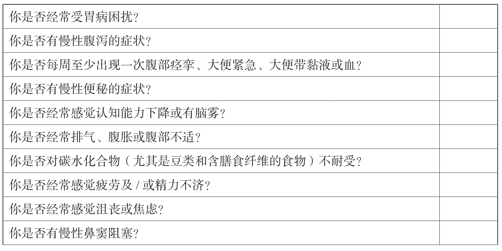
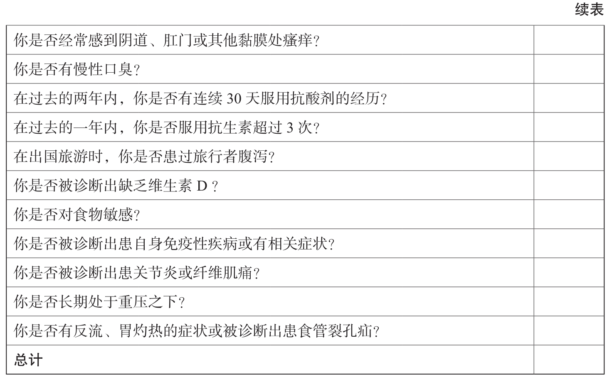
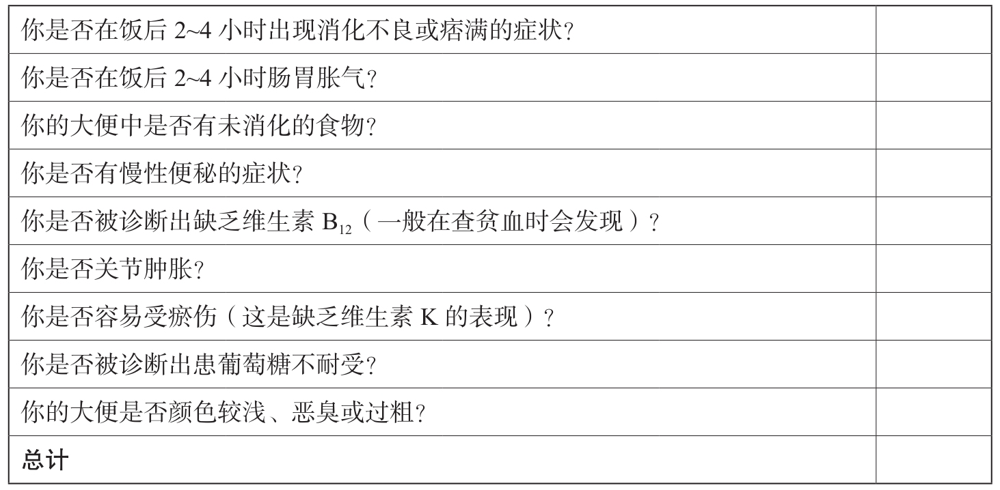
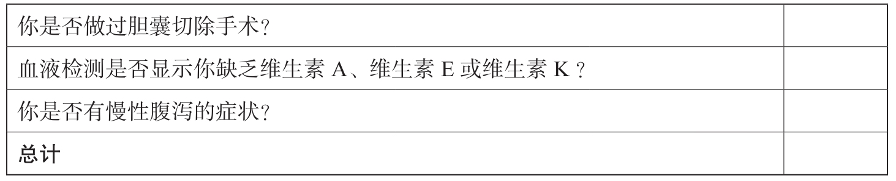
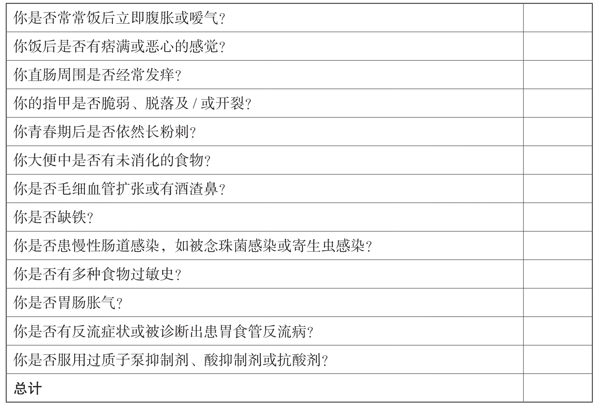
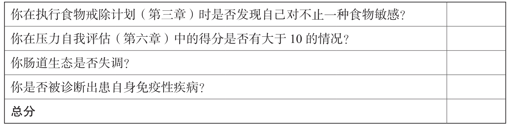

# 第九章 消化道自我评估手册

  <h2 title="第九章 消化道自我评估手册">第九章 
  消化道自我评估手册</h2>
  
正如前文所述，医学博士西德尼·贝克曾说：“如果你坐在了一枚大头钉上，那么先要做的不是治疗疼痛，而是找到大头钉并把它拔出来。”这正是我们为平衡你的免疫系统要做的事情：把影响你健康的“大头钉”一个个地找出来，并拔掉。我们已经在第二章中找到你饮食中的“大头钉”，在第五章中找到让你承受慢性压力的“大头钉”，现在我们将寻找并拔掉你消化道中的“大头钉”。

  
清除这些“大头钉”的第一步，即平衡消化道生态的第一步，是确定你体内是否受到某种刺激，这就要用到功能医学的知识了。在布卢姆康复中心，我在修复患者消化道时使用的方法是“三阶段修复计划”。接下来我将详细说明该计划的基本原则，你则要完成自我评估，并根据评估得分来选择最适合自己的治疗方案。

  <h3 id="sigil_toc_id_67">卡萝尔的故事</h3>
  
在这之前，我先介绍一位患者——卡萝尔。她58岁了，是一名教师，来我这里就诊前，她看了初级保健医生，因为她疲惫不堪、体重增加并且全身有些浮肿。这些还不是她的全部症状，在大多数情况下，她早晨醒来时手指僵硬、肿胀以及疼痛。

  
在看到血液检测结果后，初级保健医生诊断她患有类风湿性关节炎，这是一种自身免疫性疾病，表现为腕关节、手指、膝盖、脚、脚踝及其周围组织发炎。通常来说，治疗类风湿性关节炎要使用类固醇类药物或其他生物药物，因为这些药能抑制免疫系统。初级保健医生就是这么开处方的。更糟糕的是，这位医生还告诉她要终身服用这些药物。我对这位医生的话并不感到惊讶，因为我常从患者那里听到类似的说法。临床医学认为，类风湿性关节炎（以及其他许多自身免疫性疾病）只能控制，无法治愈。卡萝尔以前是一个乐观、精力充沛、做事讲效率的人，她不能接受自己变得喜怒无常、思想消极。她的病严重影响了她的生活质量。身高1.65 m的她体重大约增加了9 kg，这令她时常感到昏沉、沮丧。此外，她还对药物带来的严重的副作用，比如疲惫不堪、骨质疏松、脱发等忧心不已。在一位同事的建议下，她找到了我。她的这位同事几年前也曾来找我就诊。

  
当我在诊室与卡萝尔打招呼时，她缓缓站起来，脸上满是倦意，好像整个世界的重担都压在她肩上。与许多人一样，卡萝尔也是带着诊断结果、装满检测报告的文件夹及绝望的心情来到我这里的。为了帮助她，我知道我要跳出她的诊断结果和检测报告，更深入地了解她的症状和生活经历。经过长时间的问诊，我为她的消化道做了评估，这也是你要在本章做的事。评估结果显示，卡萝尔的许多症状由来已久，以至于她已经习惯了。事实上，在评估结果出来之前，她甚至都没有意识到这些症状，已经不记得没有这些症状时自己的生活是什么样子的了。卡萝尔进食后腹部严重胀痛，每天排软便三四次（接近腹泻），几乎每天都感觉很疲劳。她还发现自己半夜醒来会大口喘气——这是一种名为“睡眠呼吸暂停”的慢性睡眠障碍，她的睡眠总是被打断，以至于无法休息好。卡萝尔对快餐也有严重的反应，比如心悸和呼吸急促。但初级保健医生说她可以吃任何想吃的东西，因为她的食物过敏检测结果呈阴性。此外，卡萝尔曾长期频繁地服用过抗生素。

  
评估结果还显示，卡萝尔肠道菌群失衡，并患有肠漏症。为治疗她肠道菌群失衡的问题，我让她服用草本制剂来清除肠道中有害的细菌和酵母菌、服用益生菌补充剂来为肠道提供有益菌、服用谷氨酰胺粉来强化肠黏膜。我还让她在家执行食物戒除计划。你可以参照第十二章的内容来执行食物全面戒除计划，该计划主要针对的是引起人体免疫反应的常见诱因，比如麸质、动物奶、玉米、大豆、鸡蛋、花生、牛肉、贝类、咖啡因和酒精等。由于她患有关节炎，我还嘱咐她不要吃茄科食物（番茄、土豆、茄子和辣椒），因为这些蔬菜会引发关节炎。由于血液检测无法涵盖食物可能引起的所有反应（包括消化问题、关节炎、头痛等），我要用排除法（食物戒除计划）来确定让有些人出现慢性症状或让自身免疫性疾病患者病情加重的食物。这是评估食物敏感度的最经济的手段，更重要的是，大家在家就能轻松完成。

  
4周后，卡萝尔来复诊。在她开口之前，从她的肢体语言我就知道她恢复得不错。事实上，她对自己的变化欣喜若狂。她能穿上小两号的衣服了，腿和手指肿胀、疼痛的症状消失了。她整晚都睡得很安稳，半夜不会因为喘不过气而醒来，这让她觉得自己休息得更加充分了。此外，她腹部胀气的症状也消失了，并感到精力充沛。

  
这次，血液检测结果显示，她的类风湿性关节炎被治愈了，但她的ANA检测结果呈阳性。在做自身免疫性疾病（如系统性红斑狼疮、类风湿性关节炎、干燥综合征和硬皮病）筛查时，临床医生常将ANA检测作为首选项目。但ANA呈阳性不代表你患有自身免疫性疾病，只能说明你存在患病的可能，还要进一步检查。虽然卡萝尔的ANA检测结果呈阳性，且她关节疼痛、肿胀，但其他有关类风湿性关节炎的检测（即RF检测和抗CCP抗体检测）结果呈阴性。之前，初级保健医生对此的解释是她处于类风湿性关节炎的早期阶段，这些检测结果以后也会呈阳性。我告诉卡萝尔，如果不采取任何措施，这些结果几年后确实会呈阳性。但我的目标是和她一起努力，让她的ANA水平回归正常。此外，血液检测结果还显示她有轻微的桥本甲状腺炎。好在，我们的基础治疗针对的是所有自身免疫性疾病。所以，她的甲状腺问题也在我的治疗计划内。

  
在执行食物戒除计划之后，卡萝尔的大部分症状消失了。10年来，她第一次轻轻松松减掉了体重，这让她惊喜不已。但我对此并不感到惊讶，在戒除那些会引起炎症的食物后，减重是自然而然的事情。这是因为炎症会干扰脂肪代谢，从而使减肥变得更加困难。戒除这些食物后，炎症消失，减肥自然水到渠成。除了继续执行食物戒除计划外，卡萝尔还进行了为期3个月的肠漏症治疗。之后，她再次来复诊，和我交流了自己的感受，并且又做了一次甲状腺激素和抗体水平检测。

  
她的食物戒除计划和肠漏症治疗是同步进行的，所以很难确定哪种方案的效果更好。因此，我一般不让患者这样做。不过，因为我有切身体会并接受过相关培训，我知道免疫功能、肠道健康和饮食之间存在关联，所以我确信肠道健康和饮食健康都很重要。

  
无论你患的是哪种自身免疫性疾病，在治疗的第一年，我的目标是在不用药（尤其是西药）的前提下改善或完全消除所有症状。如果你已经在服药，我的目标是先让你减小用药剂量，慢慢地不再需要服药。虽然很多症状能够快速消除（卡萝尔只花了一个月时间），但从检测结果来看，改善病症则需要6～12个月的时间。卡萝尔ANA水平恢复正常就差不多花了1年时间。期间她还同步治疗甲状腺问题，3个月后，她桥本甲状腺炎的抗体水平就恢复了正常。虽然那时她的ANA检测结果仍然为阳性，但我们知道我们走在正确的道路上。

  
卡萝尔来我这里就诊1年后，减重20 kg，戒掉了麸质、动物奶、大豆、玉米和番茄，因为这些东西会让她关节肿胀、睡眠呼吸暂停、排气和腹胀。在这1年里，她的ANA水平几乎恢复正常，症状几乎全部消失。她变得精力充沛、心情愉快。这个结果给了她很大的信心，让她多年来第一次感觉这么好。又过了6个月，卡萝尔所有的指标都正常了。

  
我讲完了卡萝尔治病的整个过程，现在该你开启自己的健康之旅了。请先进行自我评估，之后我会引导你进行相应的治疗，迈出通往肠道健康的第一步。打起精神来，因为接下来的内容将让你的健康和生活发生巨大的变化！

  <h3 id="sigil_toc_id_68">自我评估</h3>
  
我主要从3个方面来评估肠道健康水平，即是否有肠道生态失调问题、消化问题以及是否患有肠漏症。在这里，我将就这3个问题对你进行评估，并为你提供治疗方案——三阶段修复计划。

  <h4>自我评估1：你是否有肠道生态失调问题？</h4>
  
如上文所述，肠道生态失调即肠道菌群失衡，是由有益菌缺乏而有害的细菌、酵母菌和寄生虫过度生长引起的。这项评估将帮你确定自己是否要修复肠道菌群。

  
对表16列出的问题，如果你给出的是肯定答案，请记1分。

  

  
表16　肠道生态评估表

  

  
得分情况说明

  
0～7分　恭喜你！这项评估的得分较低，说明你肠道中可能有大量有益菌，且没有有害的细菌、酵母菌、寄生虫或它们的数量很少。虽然分数低不代表你肠道生态完全没问题，但即使有问题，也是小问题。

  
8～14分　如果得分在这个范围内，表明你肠道生态轻微或中度失调。这意味着你体内有害的细菌、酵母菌或寄生虫过度生长。因此，只有肠道菌群平衡了，你才能好起来。

  
15～20分　如果得分在这个范围内，表明你肠道生态严重失调。我担心肠道菌群正在给你制造大麻烦。此外，你肠道内有害的细菌、酵母菌或寄生虫过度生长的情况非常严重。你只有足够用心和努力才能平衡肠道菌群、使肠道恢复健康。

  <h4>自我评估2：你有消化问题吗？</h4>
  
正如你所知，消化离不开胰酶、胆汁酸和胃酸，这项评估主要针对的就是这3个因素。食物必须被完全消化，否则未完全消化的食物颗粒会穿过受损的肠黏膜进入血液。消化不良除了会引起反流、排气和腹胀外，还会造成营养物质吸收不良。

  <h5>胰酶自测</h5>
  
胰酶是由胰腺分泌的，具有助消化的作用。食物离开胃之后，胰腺会分泌各种酶。这些酶能够分解脂肪（胰脂肪酶）、碳水化合物（胰淀粉酶）和蛋白质（胰蛋白酶）。如果胰腺无法正常分泌这些酶，你可能出现各种症状。

  
对表17列出的问题，如果你给出的是肯定答案，请记1分。

  

  
表17　胰酶评估表

  
得分情况说明

  
0～3分　不需要额外补充胰酶。

  
4分及4分以上　要额外补充胰酶。

  <h5>胆汁酸自测</h5>
  
胆汁由肝脏分泌，一部分被储存在胆囊里。当人摄入脂肪并在脂肪入胃后，胆囊会收到信息，然后收缩，将胆汁挤压到小肠上部，即十二指肠处，胃会将经过初步消化的食物排到这里。胆汁会将脂肪乳化，以便身体消化、吸收。胆汁不足将妨碍人体对脂肪和脂溶性维生素的吸收。

  
对表18列出的问题，如果你给出的是肯定答案，请记1分。

  

  
表18　胆汁酸评估表

  
得分情况说明

  
0～1分　你胆汁流量正常，无须服用营养补充剂。

  
2分或2分以上　你需要服用营养补充剂以帮助身体产生更多的胆汁。

  <h5>胃酸自测</h5>
  
对表19列出的问题，如果你给出的是肯定答案，请记1分。

  

  
表19　胃酸评估表

  
得分情况说明

  
0～4分　无须服用胃酸补充剂。

  
5分或5分以上　胃酸水平很低。你如果患有胃食管反流病，那么可能患胃酸过少症（一种胃酸和消化酶缺乏的病），也可能有肠道生态失调的问题。这些病症都会损害胃的机能，使得食物无法离开胃——食物不是顺着消化道而下，而是堵在胃里，后又反流到喉咙里。如果你这项评估的得分为5分或超过5分，就要针对胃酸过少症进行治疗，从而逆转食物的流向。

  
 

  
接下来只剩一项自我评估了，胜利在望！在你做完自我评估后，我将教你如何在消化道修复计划中补充胰酶、胆汁酸及/或胃酸。

  <h4>自我评估3：你是否患有肠漏症？</h4>
  
正如前文所述，肠漏症的发病机制是：肠黏膜受损，食物颗粒进入血液，从而引发全身免疫反应和炎症反应。

  
对表20列出的问题，如果你给出的是肯定答案，请记1分。

  

  
表20　肠漏症评估表

  
得分情况说明

  
0～1分　你可能未患肠漏症，因为你身上不具备这种病的诱因，如持续性重压和肠道生态失调。你也没有患与之相关的疾病，如食物敏感或自身免疫性疾病。

  
2分或2分以上　你很可能患有肠漏症。这意味着你的肠道无法正常工作，只有肠道恢复健康了，你的免疫系统才能康复。

  <h3 id="sigil_toc_id_69">治疗方案</h3>
  
现在是时候进行有针对性的治疗了。但在那之前，容我先详细阐述一下整个治疗方案。和自我评估一样，消化道治疗也分3部分进行：肠道生态失调治疗、消化问题治疗和肠漏症治疗。你不一定要采用这里的所有治疗方案，具体用哪个取决于你自我评估的情况。

  
每部分治疗方案又分为3个阶段。同样，根据自我评估的得分，决定自己从哪一阶段着手治疗。以下是3个阶段的具体介绍。

  <h5>第一阶段：食疗</h5>
  
有些症状，你只要在饮食上做一些改变就会消除，此外调控饮食还有助于改善免疫系统和消化系统的健康状况。所有人都要以此为起点开始治疗。如果你没有任何消化问题，且所有评估的结果都很好，你仍然要确保自己吃的食物都是健康的。好消息是，对某些人来说，仅控制饮食就能保持消化道健康。然而，如果你在上述自我评估中有一项得分很高，都要接着进行第二阶段的治疗。

  <h5>第二阶段：服用营养补充剂和草本制剂</h5>
  
在这一阶段，你要在调控饮食的基础上服用营养补充剂和草本制剂。大多数人做到这一步就能痊愈。但如果你的症状在服用营养补充剂和草本制剂后仍然存在，就要进行第三阶段的治疗。

  <h5>第三阶段：医学检测与功能医学评估</h5>
  
你需要通过进一步检测来找到体内令你不适的“大头钉”，并基于此进行相应的治疗。我会告诉你去哪里检测和治疗。

  <h4>肠道生态失调治疗</h4>
  <h5>自我评估结果</h5>
  
这里根据你在“自我评估1：你是否有肠道生态失调问题？”中的得分情况进行了详细的阐述，具体如下。

  
0～7分　恭喜你，你的肠道生态很健康。不过你每天都要补充益生菌，为消化道与免疫系统提供保护与支持；此外，还要接受第一阶段（食疗）的治疗，来提高消化道中有益菌的水平。有关益生菌的介绍详见下文。

  
8～14分　你肠道生态轻度或中度失调。为修复肠道、平衡肠道菌群，你要先接受第一阶段的治疗，然后在此基础上完成第二阶段为期4周的治疗。

  
15～20分　你肠道生态严重失调。为了修复肠道、平衡肠道菌群，你要先接受第一阶段的治疗，然后在此基础上完成第二阶段为期4周的治疗。

  <h5>第一阶段：通过食物平衡肠道菌群</h5>
  
在这一阶段，我们重点介绍一些有助于消化、能平衡肠道菌群和修复肠道的食物。

  
你要将白糖和白面粉从饮食中去除，也就是不能吃白面包、曲奇、蛋糕、冰激凌、糖果、苏打水、薯条、椒盐卷饼和苏打饼。酵母菌和许多有害的细菌嗜糖，因为糖能促进它们生长，而它们在发酵糖的过程中会释放毒素和气体。让这些坏蛋挨饿是你要做的第一件事。一开始戒糖时，有些人会出现情绪低落、轻度头痛和疲劳等症状，但这些症状通常不会持续超过2～3天。戒糖反应与排毒反应相似（详见第四部分）。

  
只吃全谷物面包和饼干。你要查看食品包装上的营养成分表中是否有“全谷物”3个字，或者食用的每份面包和饼干至少要含有3 g膳食纤维。如果你患有自身免疫性疾病，那么还要确保食用的全谷物食物不含麸质。无论你是否有肠道生态失调问题，都应该执行这个饮食方案，因为这样做有助于保持肠道菌群健康。此外，调控饮食还有助于你稳定体重、预防糖尿病和心脏病。

  
如果你有肠道生态失调问题，那么作为治疗的一部分，可以每天食用两次椰子油（如果可以，请选用有机非精炼椰子油），每次一汤匙。椰子油含有月桂酸和癸酸，这两种物质能够抑制病毒和酵母菌。所以，即使你结束治疗了，椰子油也是保持肠道健康的好选择。你可以在麦片粥里加椰子油，或者用它炒菜；也可以在无麸质格兰诺拉燕麦片或蔬果昔中加椰奶，或者在格兰诺拉燕麦片中撒一点儿椰子片（粉）。我最喜欢的是用椰奶制作的普通酸奶或开菲尔酸奶。虽然椰子热量很高，但人体能将这些热量快速代谢出去，所以将椰子（即一杯椰奶或几汤匙椰子油）作为均衡饮食的一部分不会让你增重。椰子油还含有中链甘油三酯，能增强肠道免疫功能。

  
无论你肠道生态是否失调，都要设法恢复或维持肠道内有益菌的水平，这一点很重要。这么做能够增加肠道内的有益菌，因此对肠道菌群失衡的人来说尤其重要。你要在饮食中添加益生元。益生元是一种不能被消化的植物成分，能够在肠道内发酵，产生能喂养有益菌的化合物。我常将益生元比作有益菌生长所需的肥料。含有益生元的食物包括豆类、大多数蔬菜和低糖水果（比如浆果、苹果和梨）。低聚果糖和菊粉也是益生元，它们是两种植物化合物。洋葱、蒜、大葱、黑麦、菊苣、蓝莓和香蕉含有低聚果糖，菊苣和洋蓟则含有菊粉。

  
确保自己每天摄入足量的膳食纤维，因为膳食纤维有助于维持身体的正常状态，帮助清除你体内的胆固醇和毒素。每天至少摄入30 g膳食纤维。有益菌喜欢膳食纤维。

  
你还要补充益生菌，即活菌，通过饮食摄入益生菌或者服用益生菌补充剂均可。每种益生菌补充剂中的菌株都是经过精心挑选的，且都是已知的、对人体肠道有益的细菌。你可以在超市里找到很多发酵食物，这些食物就含有一些活菌。你应该在饮食中适量添加发酵食物，比如泡菜、酸菜、康普茶、普通酸奶和开菲尔酸奶。我个人不喜欢乳制品（如用牛奶、山羊奶或绵羊奶制成的奶酪和酸奶），因为它们含有酪蛋白和乳清蛋白，会在许多人体内引发炎症。因此，我建议你食用乳制品的替代品，比如用椰奶制作的普通酸奶和开菲尔酸奶。如果你确实喜欢乳制品，请先执行食物戒除与挑战计划，确保自己对乳制品不敏感。

  
你还应该在饮食中添加下列活菌：乳酸菌（比如罗伊氏乳杆菌、干酪乳杆菌、鼠李糖乳杆菌或嗜酸乳杆菌）和双歧杆菌（比如婴儿双歧杆菌、乳双歧杆菌、长双歧杆菌、短双歧杆菌或两歧双歧杆菌）。通常来说，每4～6盎司（118～177 ml）酸奶含有10亿～30亿个乳酸菌和双歧杆菌，这是一个很好的组合。

  <h5>第二阶段：使用草本制剂和营养补充剂治疗</h5>
  
如果你自我评估1的得分为8分甚至更高，那么要清除体内有害的细菌、酵母菌和寄生虫，这一点很重要。我建议你服用以下草本制剂至少2～4周。如果你的症状很轻微，服用2周就够了；如果症状较严重，我建议你服用4周。如果你在服用草本制剂之后症状有所好转但尚未完全消失，那么继续服用2～4周，直到症状完全消失。这里列出的所有草本制剂都可以随餐服用或空腹服用，具体的视个人喜好而定。如果你有胃灼热的症状，请注意某些草本制剂（比如牛至制剂和百里香制剂）会刺激胃黏膜。

  
以下是我推荐的一些草本制剂。

  <ul>
    <li>牛至油胶囊或片剂，每天200 mg，分3次服用。</li>
    <li>百里香油胶囊或片剂，每天100～200 mg，分3次服用。</li>
    <li>青蒿素胶囊或片剂，每天1～3 mg，分3次服用。</li>
    <li>小檗碱胶囊或片剂，每天200～400 mg，分3次服用。</li>
    <li>葡萄柚籽萃取物胶囊或片剂，每天250～500 mg，分3次服用。</li>
    <li>大蒜胶囊或片剂，每天5 mg大蒜素，分3次服用。</li>
  </ul>
  
这些草本制剂能杀灭你消化道中有害的细菌和酵母菌。随着它们的死亡，你可能头痛、排气，腹胀可能更严重，还可能感觉非常疲劳，但这些症状几天后就会消失。如果你一直感到不适，可减小服药剂量，或停药一天后再服用。上述症状是一个信号，表明你体内有大量有害的细菌或酵母菌，你可能要以较小的剂量逐步将它们清除。

  
你还要服用益生菌和益生元补充剂来促进有益菌生长。正如前文所述，益生菌是有益菌，益生元则是帮助有益菌生长的“肥料”，它们对修复肠黏膜至关重要。我推荐你购买含有乳酸菌和双歧杆菌的复合补充剂，而不是只含有单一菌种的补充剂。

  
以下是我推荐的一些补充剂。

  <ul>
    <li>乳酸菌补充剂（含不同菌种），日摄入量为100亿～1 000亿个活菌。胶囊、片剂或粉末的均可，你可以随食物或饮料一起服用。</li>
    <li>双歧杆菌补充剂（含不同菌种），日摄入量为100亿～1 000亿个活菌。</li>
    <li>布拉氏酵母菌补充剂，每天500 mg。当你服用抗生素时，布拉氏酵母菌对保护有益菌特别有效。</li>
    <li>低聚果糖补充剂，每天500～5 000 mg，分1～3次服用。</li>
    <li>菊粉补充剂，每天500～5 000 mg，分1～3次服用。我建议你在服用治疗肠道生态失调的草本制剂之后再服用低聚果糖和菊粉补充剂，不要同时服用。</li>
    <li>阿拉伯半乳聚糖补充剂（提取自落叶松或相思树），每天500～5 000 mg。</li>
    <li>小分子柑橘果胶，每天3～5 g，分2～3次服用。</li>
  </ul>
  <h5>第三阶段：进一步检测、评估和治疗</h5>
  
如果你在接受第一阶段和第二阶段的治疗后仍未好转，接下来就要做粪便化验，以确定自己是否感染寄生虫或需要寻求临床医生的帮助。你可以通过以下两种方法寻找能帮助你的人。第一种方法是登录www.functionalmedicine.org，找一位懂功能医学的医生。该网站有一个“找医生”（FIND A PRACTITIONER）搜索区，你可以输入地址和你所在地的邮政编码，查找附近受过相关培训的医生。大多数医生能做粪便化验，也会看化验结果。不过最好在预约医生之前先详细询问他们粪便化验的相关情况。第二种方法是搜索能提供粪便化验服务的公司，以及能使用其服务的医生。

  <h4>消化问题治疗</h4>
  <h5>自我评估结果</h5>
  
我需要：

  
_____胰酶来促进消化。

  
_____胆汁酸来促进消化。

  
_____胃酸来促进消化。

  
如果你需要胰酶、胆汁酸或胃酸来促进消化，那么应该从第一阶段开始接受治疗。你可能通过调控饮食，即吃能促进消化的食物就能消除所有症状。我发现有些人希望自己只需要调控饮食，不想服用营养补充剂。如果你也这样想，请先接受第一阶段的治疗。但如果一个月后症状仍然没有改善，你就要接着进行第二阶段的治疗，尝试服用一些营养补充剂。

  

    
如果你有胃灼热或反流的症状，或者正在服用抗酸剂或质子泵抑制剂，又或者你觉得自己的胃受到了刺激，那么在治疗肠道生态失调的同时服用营养补充剂来改善胃部症状是个不错的主意。你可以服用单一补充剂，但我一般建议患者服用复合补充剂。以下是一些对胃有益的补充剂。

    <ul>
      <li>去甘草酸（DGL）补充剂，每天500～1 000 mg，分3～4次服用。咀嚼片、粉末和胶囊的均可，你可以空腹或在饭前20分钟服用。</li>
      <li>滑榆萃取物补充剂，每天2～4 g，分3次服用。胶囊和粉末的均可，你可以空腹或在饭前20分钟服用。</li>
      <li>芦荟萃取物补充剂，每天50～100 mg，分2～3次服用。你需要购买不含利泻成分的产品。市面上有胶囊、粉末或液体的产品售卖。</li>
    </ul>
  

  
有些人既无法坚持下去，也对一些有益的食物不感兴趣。如果你也这样，可以直接从第二阶段的治疗开始。请你尽量调控饮食，因为从长远来看，这么做能巩固治疗效果。

  <h5>第一阶段：食用对胰酶、胆汁酸和胃酸有益的食物</h5>
  
发酵食物，比如泡菜、酸菜和酸黄瓜含有能够促进消化的酶，且富含益生菌。所有未经加工的菜都含有消化酶。你也可以吃一些发芽蔬菜，因为它们含有大量酶。此外，你还可以吃一些酸奶（包括开菲尔酸奶）。我不喜欢乳制品，所以只要条件允许，我都坚持用植物奶来制作酸奶。青木瓜含有木瓜蛋白酶，菠萝含有菠萝蛋白酶。你可以在饭后吃这些水果来助消化。

  
你还需要吃一些能够促进肝脏分泌胆汁的食物，比如萝卜（马萝卜、红萝卜和白萝卜）、蒲公英、菊苣和其他苦味绿色蔬菜以及洋蓟。有助于维持胃酸水平的食物也很重要。虽然你不能直接摄入胃酸，但你可以促进胃分泌更多的盐酸，从而让胃环境的pH接近1.5。盐酸会激活消化酶，使其更好地工作。你可以通过调控饮食和在饭前服用补充剂来刺激胃酸分泌。你也可以在饭前喝一汤匙苹果醋或吃一颗梅子，尤其是在吃正餐前。

  
有些食物对消除其他消化道症状有帮助。缓和剂对受刺激或发炎的身体组织有舒缓作用。具有缓和作用的食物有琼脂（也用作布丁增稠剂）、杏仁、大麦、椰子油、无花果、亚麻籽、燕麦、秋葵、欧芹、车前草、石榴籽、李子、车前子、南瓜瓤、米汤、鼠尾草和木薯粉。葫芦巴、蜀葵根和滑榆也常用来泡茶。

  
如果你患有胃食管反流病，则应戒掉酒精、巧克力、柑橘类水果（包括相关果汁）、番茄、薄荷、洋葱、大蒜、高脂食物和碳酸饮料。在睡觉前3小时后不再进食。此外，你还要执行食物戒除与挑战计划，以防食用那些会令症状恶化的食物。上面列出的食物能够促进消化酶和胃酸的分泌，从而促进消化。

  <h5>第二阶段：服用有助于消化的营养补充剂</h5>
  
如果评估结果显示你体内的消化酶不足，或者你有胃灼热或反流的症状，且打算减小抗酸剂的剂量，那么可以服用下列补充剂中的任意一种，看症状能否好转。

  <ul>
    <li>胰酶补充剂（胰脂肪酶、胰淀粉酶和胰蛋白酶的混合制剂，以动物性脂肪酶的活性作为测定标准），每天随餐服用活性脂肪酶800～24 000美国药典单位（USP单位）。这个补充剂效果很好，通常是我推荐患者服用的首选补充剂，除非你是素食主义者或者偏爱植物酶补充剂。</li>
    <li>植物酶补充剂，有效成分一般来自曲霉，请每天随餐服用活性脂肪酶800～24 000 USP单位。如果你对植物酶过敏，建议改为服用胰酶补充剂。</li>
    <li>菠萝蛋白酶补充剂（主要含能分解蛋白质的蛋白酶），1 200～2 400 MCU（凝乳单位）/ml，每天随餐服用250～500 mg。</li>
    <li>木瓜蛋白酶补充剂（主要含能分解蛋白质的蛋白酶），50 000 USP单位/mg，每天随餐服用100～200 mg。</li>
  </ul>
  
如果你在自我评估时发现自己胆汁酸过少，或在服用基础的消化酶补充剂之后，脂肪消化方面的问题仍未得到解决，可以补充胆汁酸。

  <ul>
    <li>胆盐补充剂（牛胆汁，确切地说应该是动物胆汁；通常来说，你可以找到含牛胆汁的消化酶补充剂），每天随餐服用500～1 000 mg。</li>
    <li>牛磺酸补充剂，每天随餐服用500～1 000 mg。</li>
    <li>蒲公英根，每天2～4 g，分3次随餐服用；或者每天5 ml的1∶1蒲公英根萃取液，分3次随餐服用。</li>
  </ul>
  
如果自我评估结果显示你胃酸过少，则可以测试一下自己的胃酸水平是否真的偏低。在开始测试之前，务必确认自己没有服用抗酸剂、质子泵抑制剂或H2受体抑制剂，并且没有胃灼热的症状，即胃部或胸部没有任何发热或灼烧感。如果你原本有胃灼热的症状，但因为照着我们的治疗方案做后胃灼热的症状已经消失，则可以在胃灼热症状消失一个月后再测试自己的胃酸水平。如果你还没有结束第一阶段和第二阶段的治疗，则将这两个阶段的治疗做完再做测试。

  
在检测是否胃酸过少时，你需要服用盐酸甜菜碱（片剂的或胶囊的均可）。请选择每片或每粒含250～350 mg盐酸甜菜碱的补充剂，然后按照以下说明进行检测。

  <ul>
    <li>第1天：每餐服用1片（或1粒）。</li>
    <li>第2天：每餐服用2片（或2粒）。</li>
    <li>第3～8天：每天每餐多吃1片（或1粒），直到每次吃8片（或8粒）。但如果你胃部开始发热或不适，且通常出现在饭后，表明你的剂量已经达到上限。这种感觉可能在每餐吃2片、5片或8片之后出现，也可能根本不会出现。</li>
  </ul>
  
你一旦察觉身体不适，无论是感觉胃部发热还是不舒服，下一餐少服用1片（或1粒）。例如，如果你发现吃5片让你感觉胃不舒服，下一餐就吃4片。按该剂量继续服用，直到你再次感觉不适，然后下一餐再少服用1片。我知道一位患者先达到每次8片，后来很快就减到了每次四五片，并且就这样维持了一两个月。

  
这些意味着什么呢？在感觉胃部发热之前，你需要服用的盐酸甜菜碱补充剂越多，你胃酸过少或胃酸缺乏的症状就越严重。如果你胃酸极度缺乏，我建议你在接下来的6个月坚持每餐服用一两片盐酸甜菜碱补充剂（除非感觉胃部不适），好让你的消化道慢慢修复、胃酸再次流动起来。除了盐酸甜菜碱补充剂，你还可以服用下列补充剂来促进胃酸分泌。

  <ul>
    <li>姜补充剂，餐前服用500～2 000 mg。</li>
    <li>龙胆补充剂，餐前服用1～2 ml（1∶5的酊剂）。</li>
    <li>复方芦荟酊补充剂，餐前服用1～2 ml。</li>
  </ul>
  <h5>第三阶段：进一步检测、评估和治疗</h5>
  
如果你在接受第一阶段和第二阶段的治疗后仍未好转，接下来你就要做粪便化验，以确定自己是否感染寄生虫或需要寻求临床医生的帮助。你可以通过以下两种方法寻找能帮助你的人。第一种方法是登录www.functionalmedicine.org，找一位懂功能医学的医生。该网站有一个“找医生”（FIND A PRACTITIONER）搜索区，你可以输入地址和你所在地的邮政编码，查找附近受过相关培训的医生。大多数医生能做粪便化验，也会看化验结果。不过最好在预约医生之前先详细询问他们粪便化验的相关情况。第二种方法是搜索能提供粪便化验服务的公司，以及能使用其服务的医生。

  <h4>肠漏症治疗</h4>
  <h5>自我评估结果</h5>
  
你自我评估3的得分：_____

  
 

  
0～1分　你可能未患肠漏症，但我仍然建议你采取第一阶段的治疗方案，即通过调控饮食来为肠道提供支持。如果你希望强化自己的免疫系统，还要每天补充益生菌。

  
2分或2分以上　为治疗肠漏症，你应该进行第一阶段和第二阶段的治疗。在修复肠黏膜的3个月内，不要食用你在第三章食物戒除与挑战计划中发现的问题食物。有些食物你可能要在6个月甚至1年之后才能再次食用，以便给免疫系统留出修复时间。

  <h5>第一阶段：食用有益于肠黏膜的食物</h5>
  
我即将介绍的这些食物能够改善消化道，包括胃、小肠和大肠细胞的健康状况。第一种是澄清黄油。澄清黄油，顾名思义就是澄清的黄油，富含丁酸盐——一种短链脂肪酸，能够减少炎症，帮助平衡肠道免疫细胞。下一章我会教你用黄油制作澄清黄油的方法。即使对动物奶过敏，你也可以吃澄清黄油，因为澄清黄油中的蛋白质已经被除去了。凡是在烹饪时要用到黄油的时候，你都可以用澄清黄油来代替，比如做早餐麦片粥、无麸质意大利面或者煎蛋时。第二种是椰子油，因为它含有中链甘油三酯，而中链甘油三酯是细胞的养料。此外，中链甘油三酯还能抑制病毒和酵母菌生长。因为椰子油耐高温，所以大多数食物都可以用它来烹饪。你可以在麦片粥里添加椰子油，也可以用它炒菜。

  
此外，确保饮食中含有谷氨酰胺。谷氨酰胺是一种对治疗肠漏症至关重要的氨基酸，因为它是肠道细胞最重要的食物。所有动物蛋白，比如鸡肉、牛肉和乳制品中的动物蛋白都含有谷氨酰胺。此外，豆类、卷心菜、甜菜、菠菜、欧芹等蔬菜也含有谷氨酰胺。所以，你不应该只关注动物性食物。发酵食物中的有益菌也能为肠黏膜提供支持，因此在治疗肠漏症时，要把发酵食物纳入饮食。

  <h5>第二阶段：服用能治疗肠漏症的营养补充剂</h5>
  
修复肠道需要一定的时间，所以我建议你至少连续3个月服用营养补充剂。治疗肠漏症的补充剂有的是胶囊的，有的是粉末的。你需要制订个性化营养计划，远离那些问题食物。3个月后，你可以试着将这些食物重新纳入饮食，看自己是否已经对其产生耐受性。如果没有，再次将其从饮食中去除，并在接下来的3个月里继续修复肠黏膜，之后再次尝试，如此往复。但如果你患有自身免疫性疾病，最好戒掉麸质，即使它还没有给你带来任何不适（如果你也需要治疗肠道生态失调问题，那么在服用相关草本制剂的同时，治疗肠漏症）。你需要服用以下补充剂。

  <ul>
    <li>左旋谷氨酰胺粉，每天3 000 mg，分1～3次服用，用水送服。</li>
    <li>锌补充剂，每天15～30 mg。</li>
  </ul>
  
益生菌和益生元对肠漏症的治疗也很重要。肠道生态失调和肠漏症的治疗都离不开益生菌和益生元，因为有益菌（益生菌）和帮助它们生长的“肥料”（益生元）对维持肠黏膜的屏障功能至关重要。我推荐你服用含有多种乳酸菌和双歧杆菌的复合补充剂，而不是单一菌种的补充剂。

  
以下是我推荐的补充剂。

  <ul>
    <li>乳酸菌补充剂（含不同菌种），日摄入量为100亿～1 000亿个活菌。胶囊、片剂或粉末的均可，你可以随食物或饮料一起服用。</li>
    <li>双歧杆菌补充剂（含不同菌种），日摄入量为100亿～1 000亿个活菌。</li>
    <li>布拉氏酵母菌补充剂，每天500 mg。当你服用抗生素时，布拉氏酵母菌对保护有益菌特别有效。</li>
    <li>低聚果糖补充剂，每天500～5 000 mg，分1～3次服用。</li>
    <li>菊粉补充剂，每天500～5 000 mg，分1～3次服用。我建议你在服用治疗肠道生态失调的草本制剂之后再服用低聚果糖和菊粉补充剂，不要同时服用。</li>
    <li>阿拉伯半乳聚糖补充剂（提取自落叶松或相思树），每天500～5000 mg。</li>
    <li>小分子柑橘果胶，每天3～5 g，分2～3次服用。</li>
  </ul>
  <h5>第三阶段：进一步检测、评估和治疗</h5>
  
如果你在接受第一阶段和第二阶段的治疗后仍未好转，接下来就要做粪便化验，以确定自己是否感染寄生虫或需要寻求临床医生的帮助。你可以通过以下两种方法寻找能帮助你的人。第一种方法是登录www.functionalmedicine.org，找一位懂功能医学的医生。该网站有一个“找医生”（FIND A PRACTITIONER）搜索区，你可以输入地址和你所在地的邮政编码，查找附近受过相关培训的医生。大多数医生能做粪便化验，也会看化验结果。不过最好在预约医生之前先详细询问他们粪便化验的相关情况。第二种方法是搜索能提供粪便化验服务的公司，以及能使用其服务的医生。

  <h4>综合治疗</h4>
  
虽然本书介绍的四大部分的内容都很重要，但修复消化道是修复免疫系统和治疗自身免疫性疾病最关键的一步。读完本章的内容后，你可能已经发现，修复消化道可能是你自行治疗时最复杂的一个环节。因此，我在这里附上卡萝尔的治疗情况，希望你读了之后能将消化道修复方案的各个部分整合起来。

  
在我们讨论卡萝尔的情况之前，我想就你如何实施消化道修复方案提一些建议。在治疗每一个问题之前，先通过第一阶段的方法调控饮食。这意味着你要将平衡肠道菌群、促进消化和修复肠黏膜（治疗肠漏症）所需的所有食物纳入饮食。为此，你每次要选择一种新食物。如果你在吃了该食物后没有任何不适，可以再添加一种新食物。如果你还没有进行无麸质饮食，那么先戒麸质。在进行无麸质饮食2周后，或者当你准备好后，根据自我评估情况进行相应的治疗。

  
在我看来，你只要肠道生态失调，就会患肠漏症。我一般同时治疗这两种病。一般来说，解决肠道生态失调的问题一般需要一个月时间，之后你需要花好几个月来修复肠黏膜。

  
如果你还需要补充消化酶、胃酸或胆汁酸，可以先等等，在将肠道生态失调治愈后，再补充能促消化的营养补充剂或草本制剂。我之所以这样建议，是因为我认为最好一次只做一两件事情。这样，一旦你感觉变好或者变糟，就知道是什么引起的。如果你觉得自己可以同时服用治疗肠道生态失调、肠漏症和消化问题的营养补充剂，可以一开始就这么做。具体怎么做取决于你自己，我也是这么对卡萝尔说的。

  
卡萝尔第一次找我就诊时，根据她的症状，我诊断她肠道生态严重失调，且得了肠漏症。她饭后胀气十分严重，所以我还需要治疗她的消化问题。下面是我为卡萝尔制订的方案，用的营养补充剂和草本制剂也是我常让患者用的。

  
整个治疗为期4周。首先，我让她服用了“消化道净化草本制剂”，即小檗碱、黑胡桃和青蒿素的复合产品，这是我在布卢姆康复中心使用的配方之一。这种产品是胶囊，患者要早晚各服3粒，可随餐服用，也可以空腹服用。大多数人喜欢在早餐和晚餐时随餐服用。在开始服用一种新的补充剂时，要循序渐进，确保它不会引起肠道不适，如腹泻、恶心或腹痛。第一天，我让卡萝尔一天服2次、一次服1粒；第二天每次服2粒；从第三天开始每次足量服用，即一天服2次、一次服3粒。第四天，她开始加服牛至片剂，也是每天服2次、每次服1片，从服用牛至片剂的第三天开始每次足量服用（即一次服3片）。就这样，卡萝尔持续服用“消化道净化草本制剂”和牛至片剂4周。

  
当你按照治疗方案治疗时，草本制剂会杀灭你消化道中有害的细菌和酵母菌。但随着它们的死亡，你可能头痛，排气和腹胀的情况也可能更严重，还可能感觉非常疲劳，但这些症状几天后就会消失。不过，如果你一直感觉不适，可减小服药剂量，或停药一天后再服用。这些症状是一个信号，表明你体内有大量有害的细菌或酵母菌，你可能需要以较小的剂量逐步将它们清除。

  
卡萝尔在服用草本制剂治疗肠道生态失调的同时，还在睡前服用2粒菌群修护胶囊，其中含有乳酸菌、双歧杆菌和布拉氏酵母菌。我一般建议服用用于治疗肠道生态失调的草本制剂的患者在睡前服用这类修护剂，而不是两者同时服用，因为这些草本制剂不仅会杀灭我们希望清除的有害菌，菌群修护胶囊中的益生菌也会被杀灭。因此，你应该在服完这些草本制剂后，再服用菌群修护胶囊，可以早晚各服1粒，连续服用3个月。3个月之后，你可以把剂量降到每天1粒。

  
由于卡萝尔饭后会严重胀气，我从一开始便为她修复消化功能，让她服用足量的促消化药物，即胰酶、胆汁酸和甜菜碱的复合产品。我叮嘱她每餐都服用1片，且至少要连续服用3个月。

  
毫无疑问，卡萝尔患有严重的肠漏症。她关节和肌肉疼痛（是由多种食物造成的），患有好几种自身免疫性疾病，还有严重的消化问题。我从一开始就致力于修复她的肠黏膜，用的是最简易的方法，即让她服用左旋谷氨酰胺粉。服药时，卡萝尔用1茶匙浓缩药粉兑4盎司（约118 ml）水；每天服2次，空腹或饭前20分钟服用——这通常意味着早上起床后、晚上睡觉前或者晚饭前服用。如果你不喜欢粉末状药物，也可以服用左旋谷氨酰胺胃肠修复胶囊，每天服2次，每次服4粒，空腹或饭前20分钟服用。肠黏膜修复需要一定的时间，和卡萝尔一样，你至少要连续服用这些补充剂3个月。

