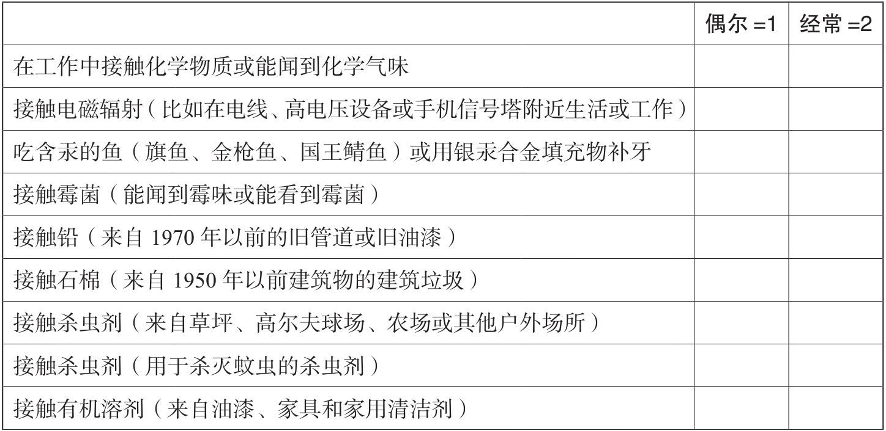
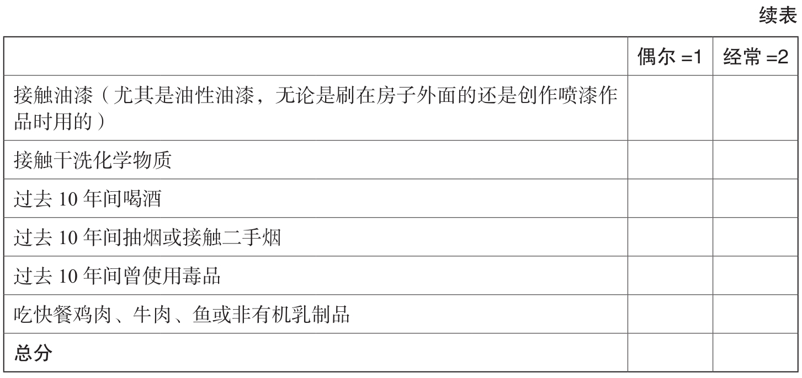
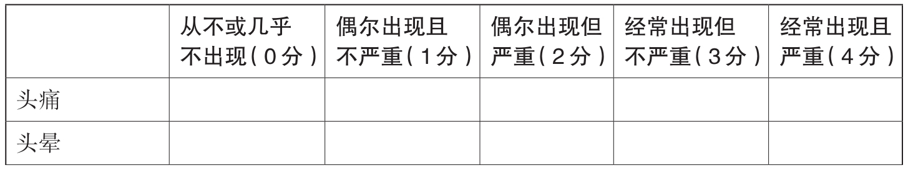
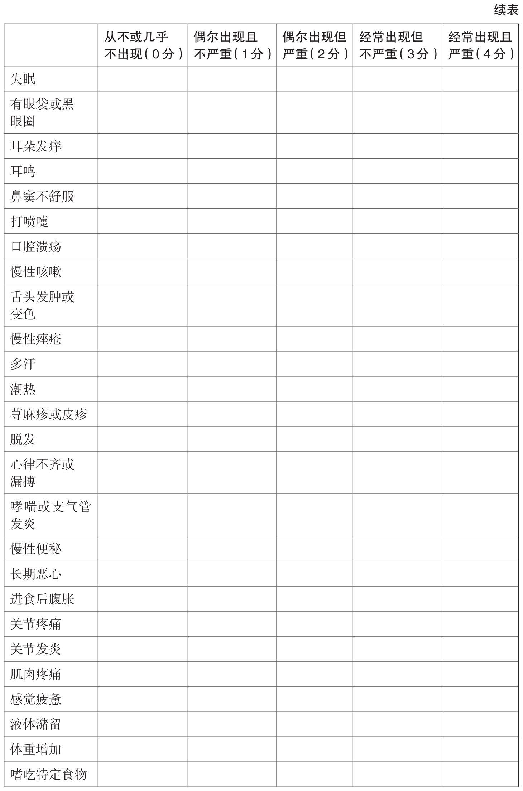
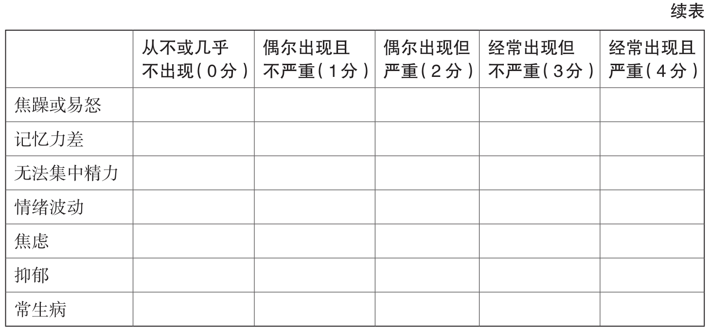
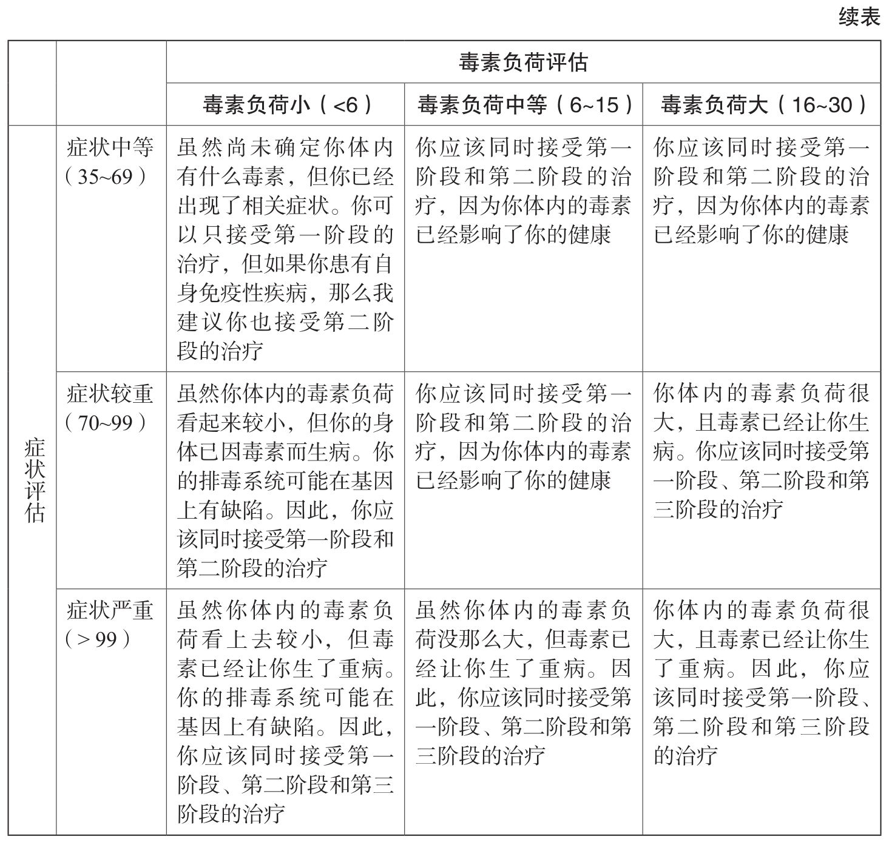
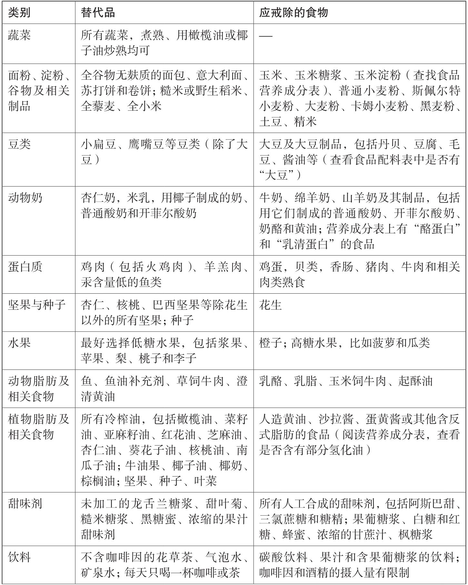
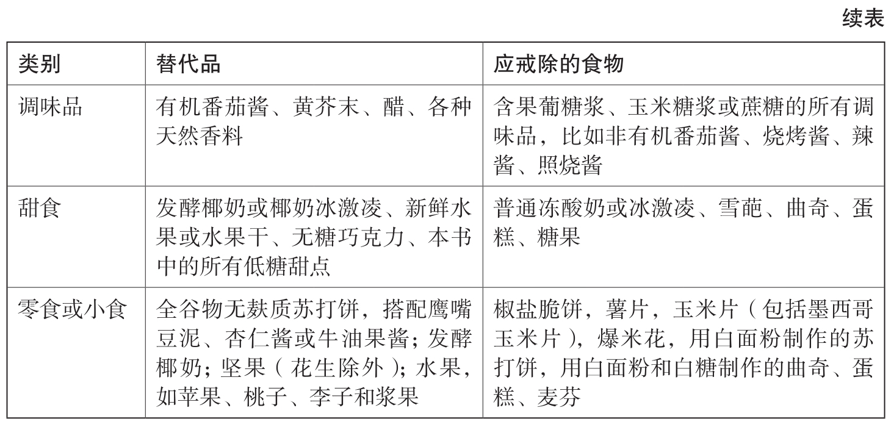
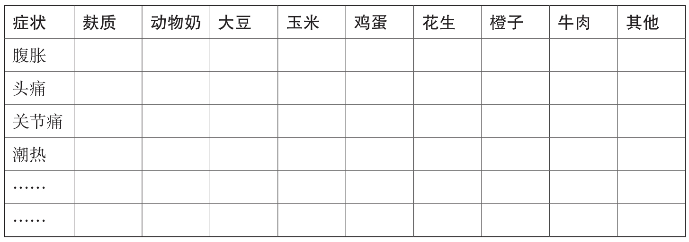

# 第十二章 肝脏自我评估手册

  <h2 title="第十二章 肝脏自我评估手册">第十二章 
  肝脏自我评估手册</h2>
  
史蒂夫，38岁，是两个孩子的父亲。2007年，他来找我就诊，说感觉左脚麻木、刺痛，这已经困扰了他7个月左右。在跑步机上跑步后，症状会更加严重。在这些症状最初出现时，史蒂夫去医院挂了急诊。神经科医生对他做了一番检查后，没有发现任何异常，建议史蒂夫做一下磁共振检查。于是，史蒂夫被送至另一位神经科医生那里做磁共振检查。拿到检查报告后，医生说他看起来像得了多发性硬化症。医生表示，史蒂夫大脑或脊髓有些地方的神经髓鞘脱落。神经髓鞘脱落是多发性硬化症的一个特征。但如果你只发作了一次、磁共振影像上只有一个病灶，是不能被确诊为多发性硬化症的。只有症状再次发作、磁共振影像上出现新病灶时，才能被确诊。因为当时是史蒂夫第一次发作，而且医生不知道磁共振影像的病灶是新出现的还是早已存在的，所以并没有确诊他患有多发性硬化症，而是告诉他可能患有这种令人衰弱的自身免疫性疾病，并让他回家观察是否再次出现这种症状。

  
可能患多发性硬化症的消息让史蒂夫担忧不已，他以前一直很健康，从事的是体力劳动，是一名建筑工人。可以想象，他听到自己可能患病的消息后的心情，这种病不仅会影响他的健康，更会毁了他的工作。他之所以来我这里就诊，有两个原因。第一，左脚一直麻木、刺痛，他担心症状会进一步恶化。第二，他听说了功能医学，想知道我能否让他的症状好转，从而避免患上自身免疫性疾病。

  
我第一次问诊时就注意到史蒂夫十分自律，为了健康他愿意做任何事情。他虽然很担心自己的诊断结果，但他的冷静与随和给我留下了深刻印象。在给他做了全面体检、仔细查看他之前的就诊资料、听了他的自诉之后，我发现关键是他比平时更加疲劳，左脚麻木、刺痛，尤其是在运动之后。除此之外，他身体相当健康，也很精壮。

  
你现在或许已经猜到了，我做的第一件事是让史蒂夫进行无麸质饮食。我请他改变摄入的脂肪，戒掉油炸食品和牛肉，多吃用橄榄油炒的白肉（鸡肉）和蔬菜。我还让他不要吃动物奶及其制品。此外，我还了解了他的压力及他处理压力的方式。在与他交谈一段时间并做了相应的评估之后，我发现他自我压力管理得很好。因此，我明白压力不是他生病的主要因素。这实际上不同寻常，因为大多数人压力很大，且无法好好地处理压力。

  
之后，我开始将关注重点放在他的消化道和肝脏上。为做到这一点，我让他做了粪便化验，检查他是否存在感染；还做了重金属检测，检查他体内的汞水平。由于他感到极度疲劳，作为评估的一部分，我还检测了他体内的甲状腺激素和睾酮水平，筛查他是否患有其他自身免疫性疾病（比如乳糜泻），看他是否有慢性感染，还检测了他体内多种维生素的水平。在询问史蒂夫的饮食习惯时，我发现他5年来每周至少吃一次金枪鱼寿司，且经常吃旗鱼。这两种鱼体内的汞含量都很高。所以，我担心他体内积聚了不少汞，是汞破坏了他的免疫系统和神经细胞。这也是我检测史蒂夫体内的汞水平的原因。

  
我在前文提到过几种重金属检测方法，其中一种是常规血液检测。但这种方法只能显示你当前的重金属暴露水平，因为重金属只能在血液中存在很短的时间，之后或者被肝脏和肾脏排出体外，或者从血液进入身体组织。而因为人体红细胞可存活三四个月，所以红细胞检测能显示你在这段时间内重金属的暴露水平。

  
虽然这两种检测方法对确定血液中的重金属水平有一定的帮助，但关键是要知道你身体组织中是否有重金属，身体组织才是重金属破坏的对象和自身免疫性疾病发病的场所。所以同对其他患者所做的一样，我使用了一种能够深入人体组织的方法来检测史蒂夫体内的重金属水平。你必须找医生、自然疗法师、执业护士等专业人士来做这类检测，基本上这类检测都需要你服用DMSA。DMSA可以进入人体组织，捕获汞和其他重金属，将它们带至肾脏，然后带进尿液，我们只要进行尿检就行了。

  
一个月后，史蒂夫回来做第二次检测。他当时兴奋极了，因为脚的麻木和刺痛症状已经有所减轻。是的，当他在跑步机上跑步或做其他运动时，脚仍有刺痛感，但已经没有之前那么严重了。对我来说，这也是一个不错的开始，还让我明白麸质确实对自身免疫性疾病患者有害。这次的检测结果也揭示了一些其他问题，比如他的甲状腺激素活性降低，而这正是他感到疲倦的原因；此外，他消化道感染了念珠菌（酵母菌），念珠菌会损害肠黏膜，释放有毒化合物，引起疲劳、脑雾，造成消化问题（比如便秘、排气和进食后腹胀），并引发免疫反应，让肢体远端（尤其是脑部）出现炎症。

  
正如我在第八章中所述的，消化道健康对自身免疫性疾病患者，尤其是多发性硬化症患者来说很重要。于是，我将注意力转移到他的消化道。我让他进行低糖饮食（目的是将酵母菌饿死，因为酵母菌嗜糖），并开了个处方，让他服用制霉菌素和草本制剂牛至，以杀灭消化道中的酵母菌。史蒂夫的维生素D水平为60 nmol/L（24 ng/ml），在美国当时规定的正常范围，即50～200 nmol/L（20～80 ng/ml）内。最近，维生素D的正常范围被修改为75～200 nmol/L（30～80 ng/ml），所以以当前的标准衡量的话，他体内的维生素D水平偏低。尽管很多临床医生对此不以为然，但多发性硬化症确实与维生素D缺乏有关。所以，我希望能将史蒂夫体内的维生素D水平提高至125 nmol/L（50 ng/ml）以上。于是，我让他每天服用5 000 IU的维生素D。针对他的甲状腺问题，我给他开了含维生素A、锌、硒和碘的甲状腺配方。

  
令我担心的是，史蒂夫的尿液检测显示其体内的汞浓度肌酐水平为15 μg/g肌酐，而正常值最高为3 μg/g肌酐。我怀疑史蒂夫的症状与汞有关，并且他磁共振影像上显示的损伤可能正是汞造成的。可以用多种方法去除人体内的汞，其中一种方法是螯合疗法，但我不建议你私下进行。不过，你可以通过在家实施排毒计划来强化肝脏功能，从而清除体内的毒素（包括重金属）。但对有些人来说，这么做还不够，他们还需要采取其他治疗方法，比如使用螯合疗法。我通常让患者花3个月的时间来让身体为螯合疗法做好准备，只有肝功能良好、肝脏可正常排毒，你才能将汞或其他重金属从身体组织中清除出去。此外，消化道也要处于最佳状态，所以要清除所有有害的细菌、酵母菌或寄生虫来修复消化道。

  
为清除史蒂夫体内的汞，并让他的排毒系统准备就绪，我让他服用了3个月的护肝草药制剂和维生素补充剂。我还在他的饮食中添加了大量深色绿叶蔬菜，如羽衣甘蓝、甜菜、绿叶甘蓝和菠菜，以及西蓝花、花椰菜、卷心菜、抱子甘蓝和白菜，以便改善他的排毒系统。

  
史蒂夫本该在3个月后来复诊，但他很忙，所以将复诊时间推迟了3个月。虽然他没有及时复诊，但他告诉我他一直在严格执行治疗计划。随后，他的检测结果也证实了这一点。史蒂夫的甲状腺功能得到了改善，体内的维生素D水平也上升至163 nmol/L（65 ng/ml）。但他还是很担心，因为上次就诊之后，他脚上的麻木和刺痛感并未减轻。正如前文所述，虽然他的脚不再出现持续性的麻木和刺痛的情况，但他在室外或跑步机上跑步时，这种症状又会出现。这表明史蒂夫体内仍有汞在搞破坏，因为汞会引发这些神经系统症状。虽然他为清除体内的汞服用了6个月的护肝补充剂，但症状仍没有消失。我决定采取更加积极的措施来将汞从他体内排出。于是，我开始对他实施螯合疗法：先让他连服3天的DMSA，接下来的11天停止服用DMSA，改服其他补充剂来补充他在前3天随汞一起排出的矿物质。就这样持续了3个月。接下来，在史蒂夫停止服用DMSA一个月后，重新检测其体内的汞水平。

  
他再次来复诊时，体内的汞浓度肌酐水平已由15 μg/g肌酐降至5.9 μg/g肌酐。听到这个消息，他高兴得无法自已，还没跨进我办公室就大声宣布他脚上的麻木和刺痛感已经消失了。我们都认为，清除他体内的汞才是他痊愈的原因。此外，我还认为他甲状腺受损也是汞引起的，因为将汞清除之后，他的甲状腺功能也有所改善（我也复查了他的甲状腺功能），精力也恢复了正常。

  
史蒂夫希望继续治疗，将他体内残余的汞也清除掉（他希望将体内的汞浓度肌酐水平降到3 μg/g肌酐或更低）。但这次我没有继续使用螯合疗法，而是让他服用一种草本制剂——重金属排毒片（Metalloclear）。我一般用这种补充剂治疗那些重金属轻微超标的人。患者在服用重金属排毒片一个月后，体内的金属硫蛋白水平会提高，而服用两三个月后，体内的重金属会被排出体外。它的效果没有螯合剂好，我通常在金属（汞、铅、镉、铝，以及类金属元素砷）中毒患者体内相关金属水平不高后用它进行治疗。

  
一年后，史蒂夫体内的汞浓度肌酐水平降至3 μg/g肌酐，已经恢复正常。至此，我已经和史蒂夫一起努力了两年。他的所有症状都已经消失，于是他去神经科医生那里，重新做了一次磁共振检查。检查结果非常好，没有出现新病灶，我们都松了一口气。这已是3年前的事情了。自那时起，史蒂夫的所有磁共振检查结果都正常，症状也已经完全消失。史蒂夫从未被确诊患有多发性硬化症，我相信他以后也不会。但我也相信，如果我没有让他进行无麸质饮食，没有清理并修复他的消化道，没有清除他体内的汞，他最终会患上多发性硬化症。现在，史蒂夫每年都会来我这里复查，确保身体各系统都处于最佳状态。

  <h3 id="sigil_toc_id_86">自我评估</h3>
  <h4>自我评估：你怎么知道自己需要排毒？</h4>
  
如果你体内有太多的毒素，并且这些毒素引发了诸多症状，那么你需要排毒。我诊治的大多数患者每天都接触杀虫剂、塑料或重金属等有毒物质，不管他们是否患有自身免疫性疾病。在细致了解患者的环境毒素暴露史、听他们讲述自己的症状后，我就可以诊断出他们体内的毒素是否超标。我设计了一份评估问卷，它可以帮助你确定自己是否需要排毒，从而免去你亲自来我办公室的麻烦。你可以根据评估结果确定自己是只需要调控饮食，还是需要服用补充剂。

  
评估毒素负荷的目的是了解你出生以来接触了多少环境毒素。如果你在这项评估中的得分很高，那么你的排毒系统已经并且可能继续承受巨大的毒素负荷。你的身体是否能够承受得了这些负荷，取决于你的基因和自我照顾情况（饮食、运动、睡眠、压力管理等）。如果你和大多数人一样，那么毒素可能已经从你的肝脏中溢出，刺激身体的其他细胞和组织，包括大脑、关节、肌肉、脂肪细胞和免疫细胞。事实上，你身体的每一个细胞都可能受到影响。

  
你怎么才能知道自己生病的原因是不是体内毒素负荷过大呢？这就是第二项评估（“症状评估”）要解决的问题了。这项评估将帮你确定自己当前的症状是否与体内毒素负荷情况有关。同时，这项评估的结果还能帮你确定自己要采用哪种排毒方式。也许你只需调控饮食，不过也可能还需要有针对性地服用补充剂来改善肝脏的排毒系统。

  <h5>毒素负荷评估</h5>
  
审视自己的工作或生活，看看自己是否有过以下毒素暴露经历（表21）。

  

  
表21　毒素负荷评估表

  

  
得分情况说明

  
小于6（毒素负荷小）　恭喜你，你生活或工作的环境非常洁净！

  
6～15（毒素负荷中等）　你接触了不少毒素。下一项评估的得分将决定你是否需要接受第二阶段的排毒治疗，或者是不是只需调控饮食。

  
16～30（毒素负荷大）　你体内的毒素负荷已经非常大，必须接受第二阶段的排毒治疗。

  <h5>症状评估</h5>
  
接下来，我们来看看你的症状。请根据你在过去30天的情况，对自己的症状做个评估（表22）。具体评分标准如下。

  
0——你没有或几乎没有这个症状。

  
1——这个症状偶尔出现，且影响不严重。

  
2——这个症状偶尔出现，但影响严重。

  
3——这个症状经常出现，但影响不严重。

  
4——这个症状经常出现，且影响严重。

  

  
表22　症状评估表

  

  

  
总分：_____

  
得分情况说明

  
症状较轻：&lt;35

  
症状中等：35～69

  
症状较重：70～99

  
症状严重：&gt;99

  <h5>综合评估</h5>
  
通过阅读下方表格（表23）中的内容，你可以确定自己的治疗方案：先找到表格中你在“症状评估”中的得分所对应的行，再确定你在“毒素负荷评估”中的得分所对应的列，从而找到适合自己的治疗方案。

  

  
表23　综合评估

  

  <h3 id="sigil_toc_id_87">治疗方案</h3>
  
如果你跟着本书一步步治疗，那么读到这里时，你已经为净化身体、维护肝脏做好了准备。阅读本书第一部分时，你吃了许多具有抗炎功效的食物，即将精制糖、白面粉制品、反式脂肪和动物性饱和脂肪从饮食中清除了。你吃了更多富含抗氧化剂和健康脂肪的食物，还了解了会引发炎症的食物，如含麸质食物、动物奶、大豆和玉米。

  
阅读本书第二部分时，你开始治疗自己的应激系统，让自己睡得更香，吃得更用心。你还知道要在白天摄入足够的蛋白质（不仅是动物蛋白，还包括植物蛋白），且不能漏餐。

  
阅读本书第三部分时，你采取了一些重要措施来清除消化道里的毒素，以平衡肠道菌群，并通过吃富含天然消化酶和益生菌的食物来修复肠道。这些措施不仅强化了你肠道的免疫力，还抑制了有害的细菌和酵母菌分泌毒素，减轻了肝脏的负担。你可能并没有意识到，自己在修复消化道时就已经开始排毒了。

  
那么，接下来你还要做什么呢？要做两件事。第一，要了解自己是否对其他食物敏感，即是否还有食物可能让你发炎、且可能被你的肝脏视为毒素。第二，要通过调控饮食和（如有必要）服用营养补充剂来帮助肝脏排毒。

  <h4>第一阶段：食疗</h4>
  <h5>食物全面戒除计划</h5>
  
每当患者听到我让他们实施食物全面戒除计划时，他们眼中都流露出抗拒的神情。别担心！你可以循序渐进地进行，况且很多食物在此之前已经被你从饮食中去除了。

  
这个计划为期3周，有双重原因。第一个原因是，你要找出除了麸质、动物奶、大豆和玉米（在第三章中我已经让你做过相关评估）之外，自己是否还对其他食物敏感。你如果在阅读第三章时没有做评估，那么现在应该尽全力一次性做完所有食物的评估。请制订个性化饮食计划，即找出并去除任何让你敏感的食物，从而减轻炎症。要知道，给免疫系统减压很重要。

  
我在这里介绍食物全面戒除计划的第二个原因是，肝脏需要处理你吃进去的所有食物。食物被消化之后，营养物质和毒素进入血液，而消化道（包括胃、小肠和大肠）的所有血管直通肝脏。接着，肝脏就得处理这些物质——找出毒素，并将脂肪和糖变成胆固醇。对肝脏来说，这些都是它每天要做的繁重工作。所以，实施食物全面戒除计划有助于给肝脏留出休息的时间，让它不必处理油腻的动物性食品、糖、酒精和加工食品，同时还为肝脏提供其正常运转所需的特殊营养物质。因此，即使你已经在阅读第三章时评估过自己对麸质、动物奶、大豆和玉米的敏感度，但无论结果如何，你都应该再次戒掉这些食物，从而完成这里的排毒计划。我的目标是在这一章带你冲过终点线。你就快做到了！

  
下表对食物全面戒除计划做了简要概括（表24）。正如我在第一部分所讲的，3周之后，你要将这些食物再次纳入饮食。现在，你要戒掉：

  <ul>
    <li>麸质、动物奶、大豆和玉米</li>
    <li>精制糖和有害脂肪</li>
    <li>鸡蛋，贝类，牛肉、猪肉、香肠和相关熟食</li>
    <li>花生</li>
    <li>橙子</li>
    <li>咖啡、咖啡因、酒精和巧克力</li>
  </ul>
  

  
表24　食物全面戒除计划

  

  
小建议

  
你如果想预防及治疗毒素相关疾病，得先判断自己暴露在什么毒素中，并加以清除。接着，你要为肝脏提供营养以协助肝脏代谢解毒。什么是代谢解毒？你可以理解为肝脏的新陈代谢。提高肝脏解毒的效率，可以更快地将毒素从体内清除。但在这之前，你要检查一番，采取措施清除环境中的致病因子，从而减少毒素暴露，确保周围的环境不会让自己生病。

  <ul>
    <li>使用你能够找到的最天然的清洁用品和家用产品。</li>
    <li>使用高效微粒空气过滤器。</li>
    <li>勿在室内或室外喷洒杀虫剂。</li>
    <li>使用不含合成香料、对羟基苯甲酸酯和邻苯二甲酸酯的化妆品或护肤品。</li>
    <li>食用有机水果、蔬菜和乳制品。</li>
    <li>选择有机肉类及鸡蛋。</li>
    <li>喝干净的水。水质因地区而异，但总体来说，过滤自来水是个不错的做法。</li>
    <li>编号为3、6、7的塑料容器（通常标在底部）会将塑料成分渗入其中的食品中，所以不要食用用这些容器装的食品。</li>
    <li>用微波炉加热食品时可使用玻璃器皿，不要使用塑料器皿。</li>
    <li>如果你有龋齿，告诉牙医不要使用汞合金填充物补牙。如有必要，找一位学过整合医学的牙医。</li>
  </ul>
  
准备工作

  
在排毒期间，你每天至少要喝6～8杯水，这么做有助于身体排出毒素。在最初的几天，你可能感觉有些疲劳、疼痛、头痛或头脑不清楚（脑雾），具体症状因体内的毒素水平而异。如果上述症状比较严重，说明你补充的营养还不够，最好每餐都摄入蛋白质。对体内毒素水平高的人来说，直到第二周脑雾情况才会有所改善。虽然适量运动（如散步、做瑜伽或进行短距离放松式的慢跑）有助于身体排毒，但要避免剧烈运动。你还要保证充足的睡眠，每晚至少要睡8小时，好让身体在进行超负荷的新陈代谢后获得应有的休息。如果你爱喝咖啡，我建议你在开始实施食物全面戒除计划之前逐渐减少咖啡的饮用量，以免因咖啡因戒断造成头痛。如果你经常吃糖，则需要在开始实施计划之前的几天逐步减少糖的食用量，直到完全戒掉。和咖啡因一样，糖也很容易让人上瘾，所以一下子戒掉糖会让人出现严重的头痛或其他戒断反应。

  
我建议你在开始这个计划前抽出一点儿时间准备食物。你需要确保有足够的食物制作每日奶昔。如果你白天不在家，记得带点儿小食或零食。除非事先做好准备，否则饿的时候你很难控制饮食，或者很难找到合适的东西吃。此外，我建议你制作绿蔬排毒汤（第十三章），一次多做一点儿，并将其分成小份冷冻起来，以便随时取用。排毒期间，这种汤你想喝多少都可以，因为它营养丰富，对肝脏有支持作用，还能填饱肚子。如果可能，尽量选择有机农产品和家禽肉，这一点对食物全面戒除计划来说尤为重要，因为它们在你的饮食中占了很大的比例，要知道非有机食品中的杀虫剂会给肝脏带来额外的负担。

  
即使你没有服用补充剂，进行排毒饮食、吃一些护肝的食物（详见下文）也足以让你感受到排毒的强大效果。虽然有时会出现上文提到的一些症状，但这意味着你正在慢慢好起来！

  
在实施排毒饮食计划3周后，你需要将之前戒掉的食物重新纳入饮食。

  <ul>
    <li>在将之前戒掉的食物重新纳入饮食时，一次添加一种食物。其间，一种食物得连吃2天，每天吃2次，注意体会自己的感受。第3天，不要吃这种食物，继续观察自己的感受。如果你发现自己没什么不良反应，第4天开始将另一种食物纳入饮食。</li>
    <li>如果你在吃某种食物后出现了一些不良反应，比如头痛、起疹子、脑雾、疲劳、消化不良或其他症状，则把相关症状写在下方的表格（表25）里，以防自己后面忘记。一旦确定某种食物对自己有害，你就要再次戒掉它。一般情况下，这些反应会在一两天内消失，不过有些人可能需要更长的时间。</li>
    <li>等反应消失后，接着尝试下一种食物。</li>
    <li>这里要提一下麸质。我已经在第三章中说过，确定自己是否对麸质有明显的反应很重要。如果你摄入麸质后没有出现反应，也没有自身免疫性疾病，那么可以在饮食中保留麸质。不过，即使你没有出现反应，只要你患有自身免疫性疾病，就要戒掉麸质。</li>
    <li>耐心一些，再过3周左右的时间，你就可以将之前戒掉的所有食物一一添加进来。</li>
    <li>在此期间，将自己的所有反应记录在下方的表格中。</li>
  </ul>
  

  
表25　症状记录表

  
恭喜你！现在你应该知道上表中的食物是否会在你体内引发免疫反应，从而让身体出现你熟悉的或新的症状。如果你发现自己对不止一种食物敏感，不要惊慌，这是很常见的现象。这些症状都是由身体不同部位的炎症引起的。那么，你要戒掉这些食物多久呢？我建议你至少坚持6个月。待消化道修复之后，你可以尝试把它们重新纳入饮食，一次添加一种。

  
如果你的乳糜泻抗体检测（包括AGA检测和ADGA检测）结果呈阳性，则你终身不能摄入麸质。如果你患有乳糜泻以外的自身免疫性疾病，也应该保证饮食中不含麸质，直到将疾病治愈，即所有症状都消失、检测结果也都正常。之后，你要确保所吃的95%的食物中不含麸质，这意味着你在日常生活中完全不能摄入麸质，只是在外出就餐或旅行时偶尔（每月最多一两次）破例。

  <h5>排毒饮食</h5>
  
我们生活在一个充满毒素的世界里——食物中的农药和激素、使用的有机溶剂、家中的霉菌、吃的鱼和喝的水中的重金属等，对人体来说都是毒素。肝脏是主要的排毒器官，所以人体的排毒能力取决于它的功能！肝脏排毒分两个阶段进行，食物、维生素和草本制剂在每个阶段都发挥着重要作用。

  
在排毒的第一个阶段，人体内的酶（统称为细胞色素P450酶系统）利用氧气和维生素（尤其是抗氧化剂）来转化有毒化合物、药物或类固醇激素（Ⅰ相反应）。之后，酶促使它们进入排毒的第二个阶段。在进入第二阶段之前，这些毒素已经变成了“中间代谢物”。此时是抗氧化剂发挥重要作用的时候，因为中间代谢产物含有大量自由基，除非它们进入第二阶段，否则会在肝脏内堆积并损害肝脏组织。进入第二阶段后，氨基酸和其他化合物作用于毒素，使它们更容易排出体外（通过尿液或粪便）。这一过程被称为结合反应（Ⅱ相反应），期间最重要的营养物质是维生素B12、叶酸和氨基酸。

  
能促进排毒的食物

  
食用水果和蔬菜对肝脏最有益，因为它们能为肝脏提供排毒急需的抗氧化剂、B族维生素和矿物质。它们还能促进Ⅰ相反应和Ⅱ相反应，这也是很多人说吃蔬菜和水果有助于预防癌症的原因。

  
以下蔬菜功效尤佳：十字花科蔬菜，比如西蓝花、抱子甘蓝、花椰菜、西洋菜和卷心菜。羽衣甘蓝、瑞士甜菜和绿叶甘蓝的功效也很好，是排毒强有力的助手；和其他十字花科蔬菜一样，它们在雌激素代谢方面也具有重要作用。此外，能促进肝脏排毒的食物还有大蒜、洋葱、浆果、大豆、绿茶、红茶以及迷迭香、罗勒、姜黄、孜然、黑胡椒和香菜等芳香植物或香料。

  
很多人问我是否可以制订一个为期3～7天的绿色饮品排毒计划。这个主意不错，绿色饮品确实可以作为排毒饮食的补充。但是，出于某些原因，只喝绿色饮品排毒是不够的。第一，绿色饮品并不一定是有机的，因此我担心你摄入大量杀虫剂而不自知。第二，虽然这些饮品能够为你的肝脏提供大量抗氧化剂，有助于增强Ⅰ相反应，但你会因此缺乏氨基酸，而氨基酸是蛋白质的重要组成部分。如果你在实施绿色饮品排毒计划时没有摄入某种形式的蛋白质，特别是在你体内毒素水平很高的情况下，虽然一开始你的肝脏能很好地处理毒素，但由于氨基酸供应不足，排毒过程将中断。那么，不摄入蛋白质人会有什么感觉呢？答案是糟糕的感觉！这就是许多人在实施这个计划之后的第二天或第三天感到头痛、疲劳、肌肉酸痛或头晕的原因——在缺乏必需营养的情况下，肝脏将不堪重负。

  
因此，无论你实施哪种排毒计划，都要补充植物蛋白（吃小扁豆、坚果、种子等）和动物蛋白（吃有机散养鸡肉等），你也可以喝蛋白粉（大米、南瓜子和蔬菜的混合粉）。此外，记住不能摄入大豆蛋白和乳清蛋白。

  <h4>第二阶段：实施药物排毒计划</h4>
  
虽然我们希望通过食物，包括绿色饮品来获得身体所需的所有营养，但对大多数人来说，这是不现实的，尤其是在他们体内毒素水平很高的情况下。在做完本章的自我评估后，你觉得自己是他们中的一员吗？如果你需要接受第二阶段的治疗，那么最好制订一个药物排毒计划。“药物排毒”是我经常说的一个词，其实就是通过服用营养补充剂来治疗肝脏疲劳。

  
以下是我的一些建议，这里提到的剂量均为日摄入量。你每天可能需要不止一次地服用补充剂（每次一粒或一片）才能达到所需剂量。

  
为了每天都能支援肝脏，你需要补充B族维生素，其中维生素B1、维生素B2和维生素B3各25～50 mg；维生素B5至少100 mg；维生素B6（5—磷酸吡哆醛）至少50 mg；维生素B12（甲钴胺）至少1 000 μg；叶酸（比如L—5—甲基四氢叶酸）800 μg；生物素400～1 000 μg。

  
你也要补充抗氧化剂。请每天服用维生素C 1 000～2 000 mg、维生素E（混合生育酚）200～400 mg、维生素A（视黄醇棕榈酸酯）1 000～5 000 IU、混合类胡萝卜素（包括β胡萝卜素）3 000～8 000 IU、硫辛酸200～600 mg以及EGCG 250～500 mg。

  
矿物质补充剂也很重要。请购买含15～30 mg锌、200 μg硒、250 μg锰、500 μg铜的复合维生素/矿物质补充剂。

  
此外，你还需要护肝和清除体内的重金属，为此你每天要补充100～400 mg牛奶蓟、400～600 mg N—乙酰半胱氨酸以及300～600 mg的硫辛酸。

  
能强化雌激素代谢的补充剂也必不可少。请每天补充100～150 mg吲哚—3—甲醇或100～150 mg二吲哚甲烷，分两次服用。

  
氨基酸是日常饮食的一个重要组成部分。建议你每餐都摄入蛋白质，可以是动物蛋白（来自有机散养鸡或火鸡、草饲牛、鱼等），也可以是植物蛋白（来自豆类、坚果和种子）。蛋白质的日摄入量为每千克体重1 g。所以，如果你的体重为60 kg，那么你每天要摄入60 g蛋白质。你可以通过阅读食材包装上的营养成分表来了解自己每餐蛋白质的摄入量。可以用以下算法计算你从一块鸡肉或鱼肉中摄取的蛋白质：1盎司（约28 g）肉类或鱼中含有7 g蛋白质。我通常建议患者将每日蛋白质分4次（吃早餐、午餐、下午点心和晚餐时）摄入。

  
除了要摄入足够的蛋白质外，你还要能很好地消化掉这些蛋白质，只有这样蛋白质才能被分解为氨基酸，从而被身体吸收和利用。因此，你必须拥有良好的消化能力，必要时要接受消化道方面的治疗，具体参见第九章。

  
如果你饭后立即出现反流、排气和腹胀的情况，且在饭后两小时仍有饱胀感，则需要强化消化道的功能。我建议你每餐摄入多种酶，以保证自己能获得所需的氨基酸，详情参见第九章。

  
如果你想要补充氨基酸，建议你服用氨基酸复合产品。你可以服用复合氨基酸的胶囊，也可以在做思慕雪或早餐奶昔时加入蛋白粉。甘氨酸是参与Ⅱ相反应的一种重要的氨基酸，请每天以服用复合氨基酸补充剂的形式补充1 500 mg的甘氨酸。如果你对排毒奶昔感兴趣，请选择用大米、豌豆或植物蛋白制作的奶昔。下面是我给你的一些具体建议。

  <h5>药物排毒与饮食排毒同步进行</h5>
  
在排毒的同时护肝。每天除了服用补充剂，你还可以吃排毒奶昔——用各种水果（橙子除外，它不利于排毒）、水、冰（可选）和两大匙蛋白粉制作。你也可将上述蛋白粉添加到蓝莓菠菜思慕雪中。

  
在吃排毒奶昔的同时，你还要服用抗氧化剂、B族维生素和草本制剂来平衡肝脏排毒系统中的各种酶。

  
即使你不喝排毒奶昔，只服用这些补充剂也能增强肝脏的排毒功能。

  <h4>第三阶段：找卫生保健人员开功能医学方案</h4>
  
如果你因环境患病，且体内的毒素负荷很大，那么很难自行实施排毒计划。如果你确信自己要做排毒，但对自己独立实施排毒计划没把握，那么可以向整合医学的医生寻求帮助。此外，如果你担心自己体内的汞和铅水平过高，或者想检测环境中的毒素，也可以向整合医学的医生（特别是功能医学的从业人员）寻求帮助。

  
医生、自然疗法师、脊椎指压治疗师、整骨疗师、护士、助理医生和受过功能医学培训的营养师，都可能受过排毒饮食和护肝方面的培训。目前，美国正在出台一套新的认证方案，很快就会公布一份经认证的从业人员名单。此外，你还可以访问各大功能医学实验室，如美国功能医学及抗衰老诊断中心的网站，寻找经常使用它们服务的专业人士。这是一个寻找在功能医学方面有丰富的实践经验的专业人士的好办法。如果你要做重金属检测，可以寻求功能医学的从业人员或自然疗法师的帮助。

