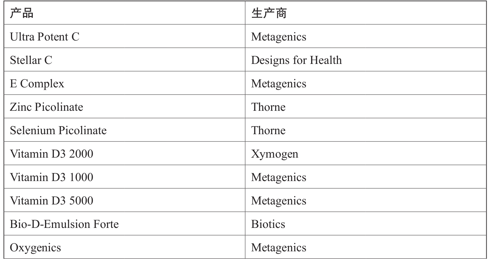
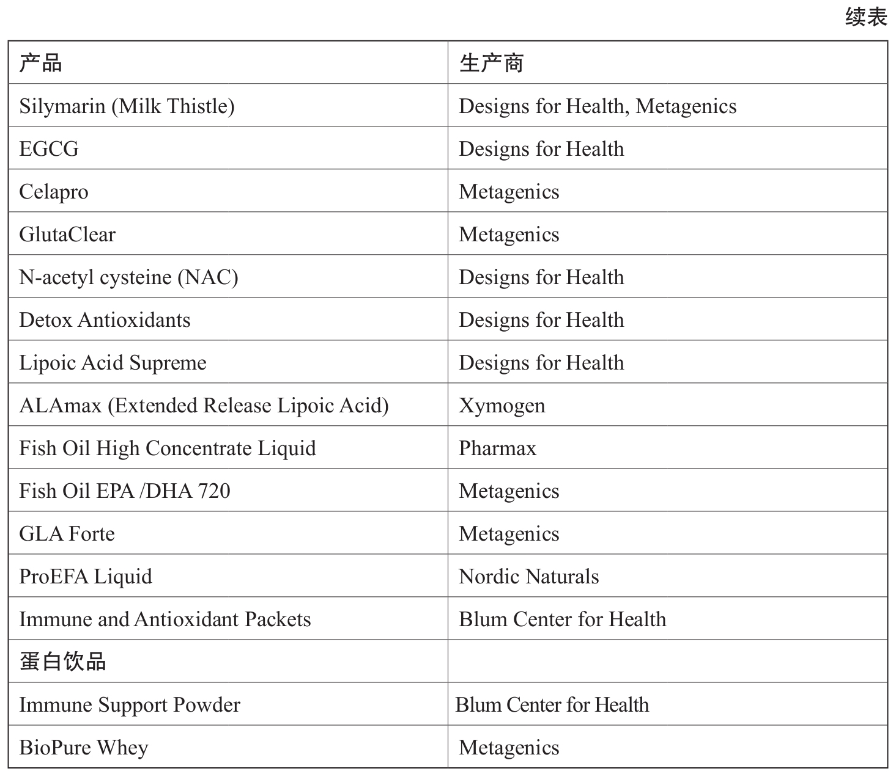
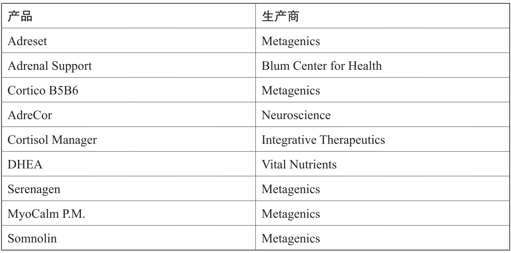
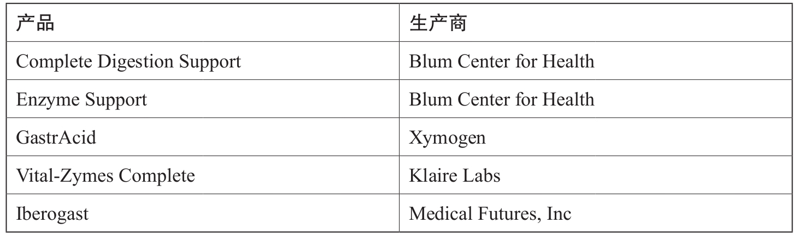
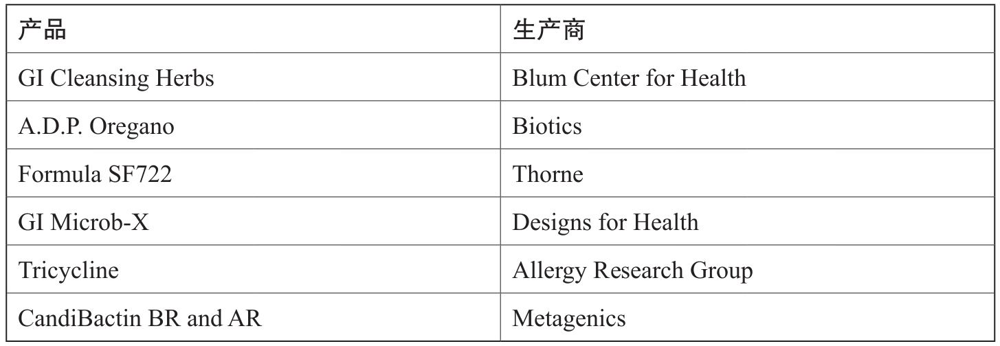
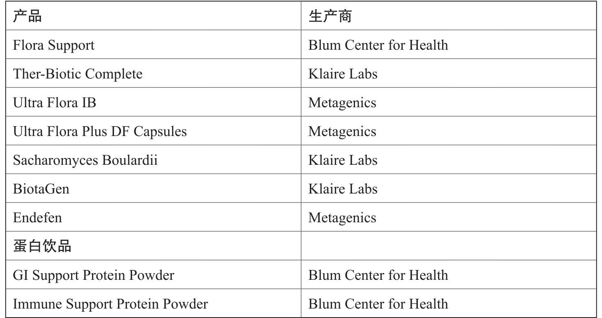
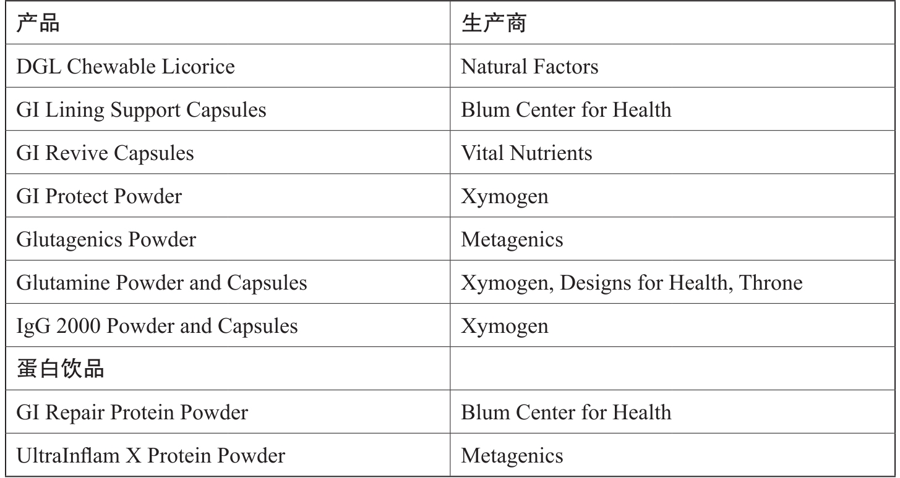
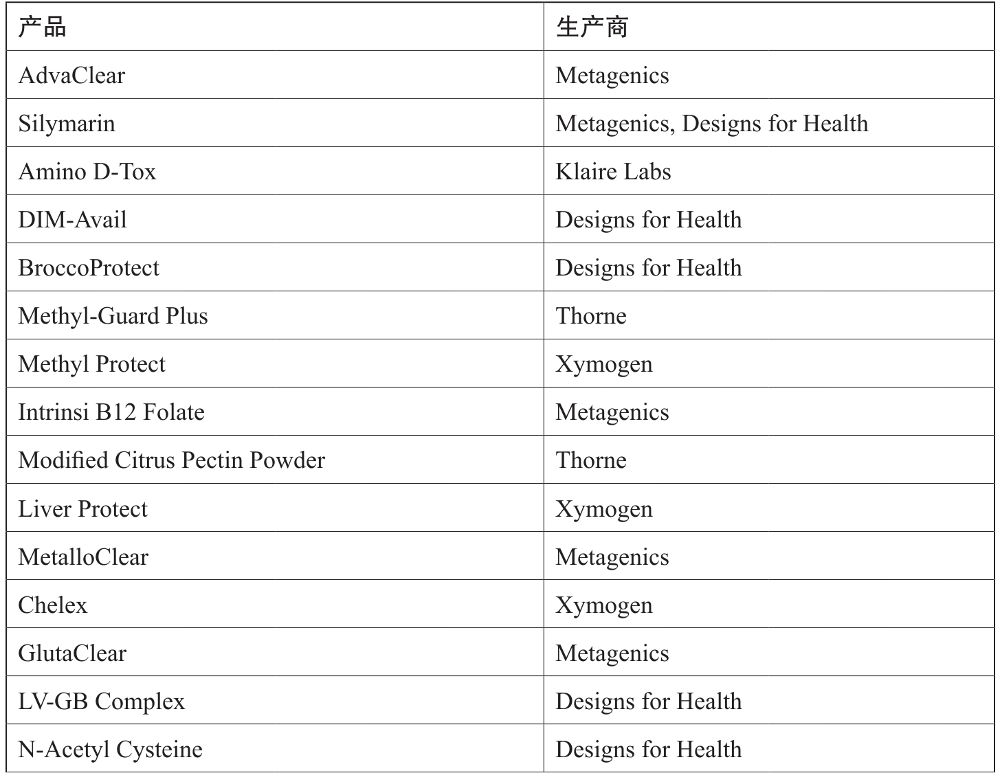
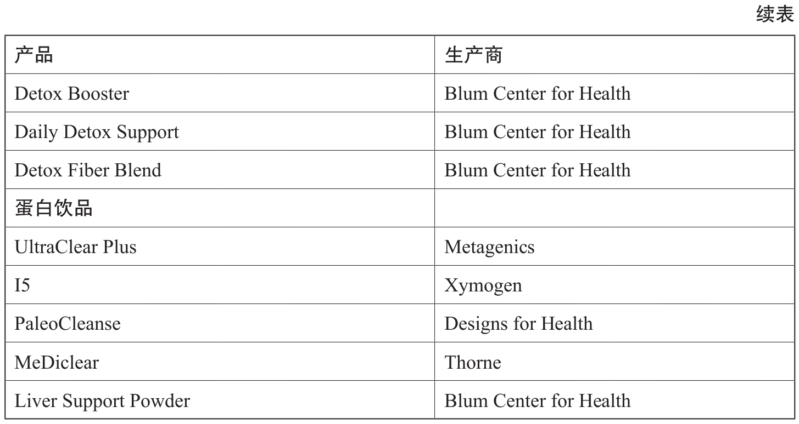

# 附录Ⅱ 营养补充剂和草本制剂

  <h1>附录Ⅱ　营养补充剂和草本制剂</h1>
  
以下是我在布卢姆康复中心给患者开的一些营养补充剂和草本制剂，它们可以帮助你修复免疫系统。下面的产品都是我比较熟悉的，因此推荐给你，虽然市面上还有一些不错的产品。<a id="b1" href="29-%E9%99%84%E5%BD%95%E2%85%A1%20%E8%90%A5%E5%85%BB%E8%A1%A5%E5%85%85%E5%89%82%E5%92%8C%E8%8D%89%E6%9C%AC%E5%88%B6%E5%89%82.md#a1">*</a>

  <h3>第二章　食物与自身免疫性疾病</h3>
  

  
抗氧化剂与免疫支持产品

  

  <h3>第五章　压力与自身免疫性疾病</h3>
  

  <h3>第九章　消化道自我评估手册</h3>
  

  
消化道修护补充剂

  

  
肠道生态失调补充剂

  

  
益生菌与益生元

  

  
肠黏膜修护补充剂

  <h3>第十二章　肝脏自我评估手册</h3>
  

  
排毒补充剂

  

  

  
<a id="a1" href="29-%E9%99%84%E5%BD%95%E2%85%A1%20%E8%90%A5%E5%85%BB%E8%A1%A5%E5%85%85%E5%89%82%E5%92%8C%E8%8D%89%E6%9C%AC%E5%88%B6%E5%89%82.md#b1">*</a>请遵医嘱服用。——编者注

