# 附录Ⅲ 健康饮食和购物清单

  <h1>附录Ⅲ　健康饮食和购物清单</h1>
  
人们常常会对应该吃些什么感到困扰。我们建议你在修复完免疫系统后，多注意自己的饮食。

  <h3>饮食小贴士</h3>
  <ul>
    <li>尽量不要吃加工食品，包括无麸质的加工食品。</li>
    <li>多喝汤，多吃沙拉和鸡肉。最明智的做法是多准备一些食物放在手边，以免饥饿难耐时吃一些不该吃的食物。</li>
    <li>善用剩余食物。</li>
    <li>少食多餐。虽然很多人按照本书的方案做后体重减轻了，但我们并不建议低热量饮食。</li>
    <li>维持血糖稳定很重要，外出时随身携带坚果零食包。</li>
    <li>如果你发现自己对一些食物敏感，即使这些食物有益于修复免疫系统，也请避免食用。</li>
    <li>多吃彩色蔬菜（每天5～7份）和水果（每天2～3份）。牢记这一建议，并尝试每天吃一种排毒蔬菜和含类胡萝卜素的蔬菜。</li>
    <li>吃没有喷洒农药的有机果蔬。</li>
    <li>吃不含激素和抗生素的家禽肉和草饲羔羊肉。</li>
    <li>如果你是素食主义者，请确保自己能从豆类和谷物，比如大米、藜麦、红苋菜、苔麸、小米和100%荞麦中获取足够的蛋白质。</li>
    <li>饮用大量纯净水来帮助身体排毒。</li>
  </ul>
  <h3>购物清单</h3>
  
我们建议你从下列购物清单中挑选食材，加粗标记的食材是非常好的排毒剂——建议你每天食用。

  

  
水果
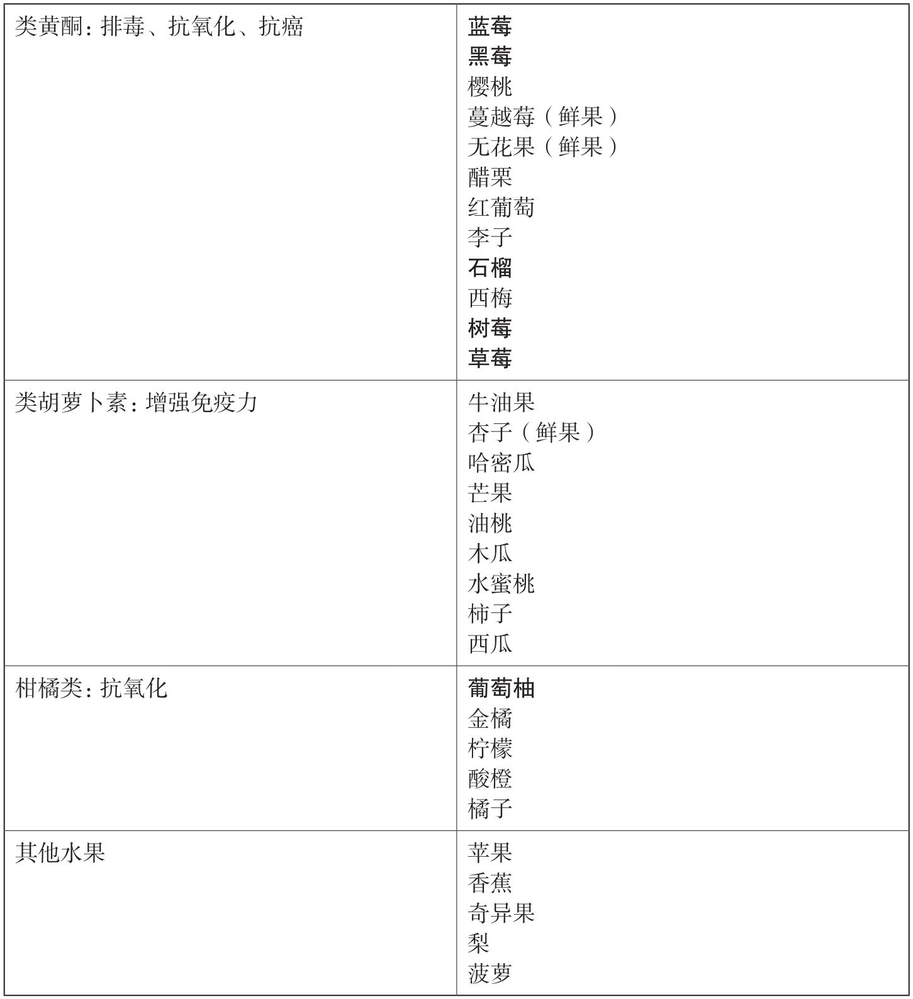

  

  
蔬菜
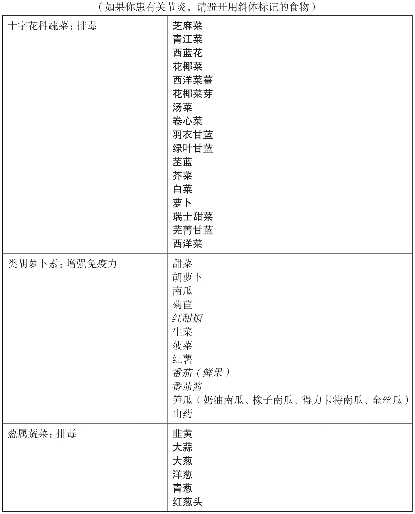

  

  
其他蔬菜
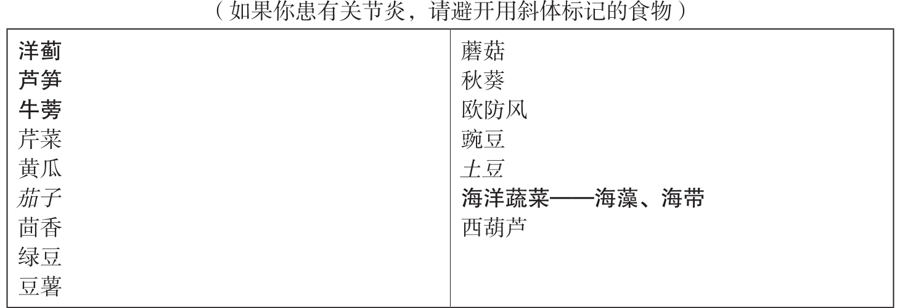

  

  
谷物类（无麸质）
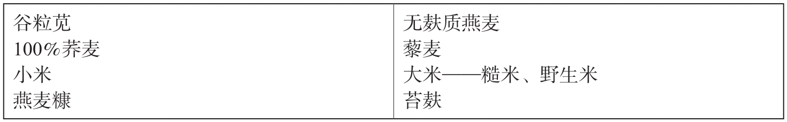

  

  
豆类
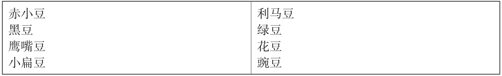

  

  
坚果和种子类
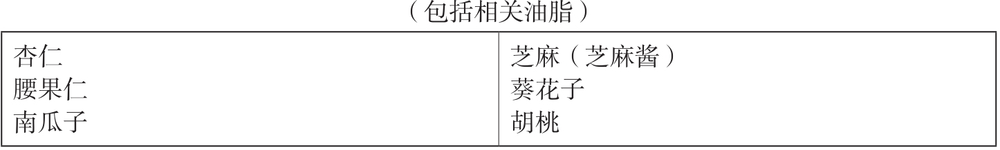

  

  
肉类和鱼类
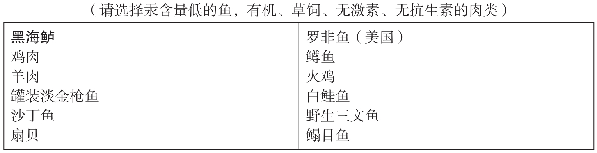

  

  
动物奶替代品
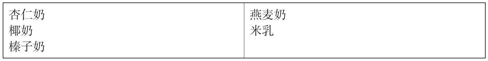

  

  
油脂（冷压）
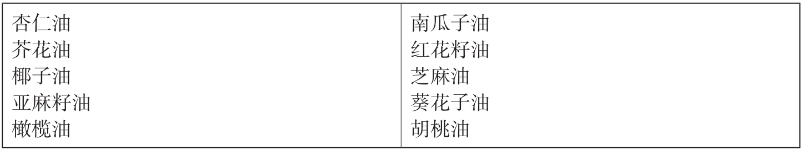

  

  
饮品
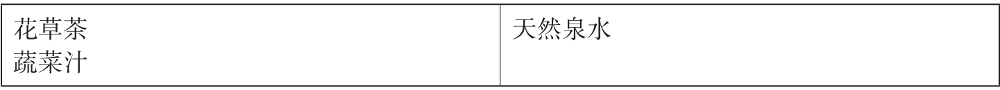

  

  
调味品或辅料
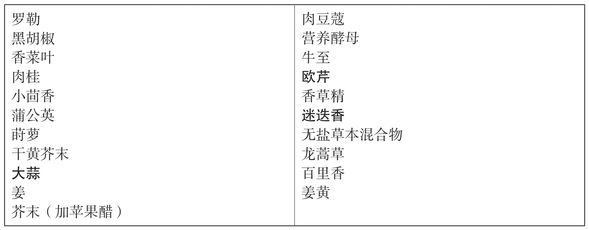

  

  
甜味剂（少量）
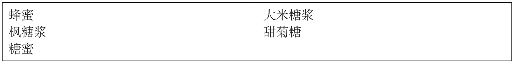

