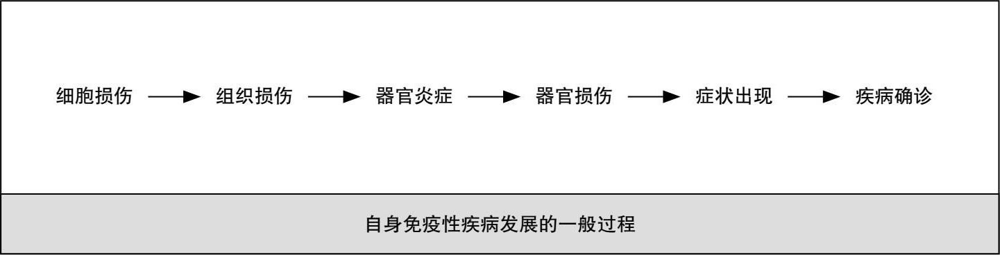
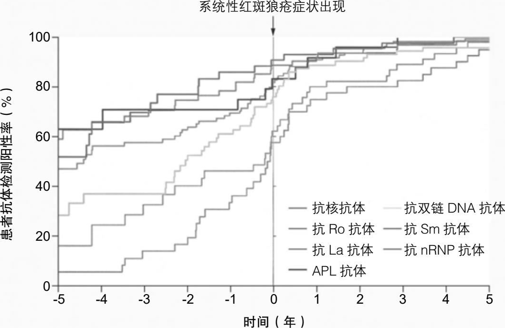
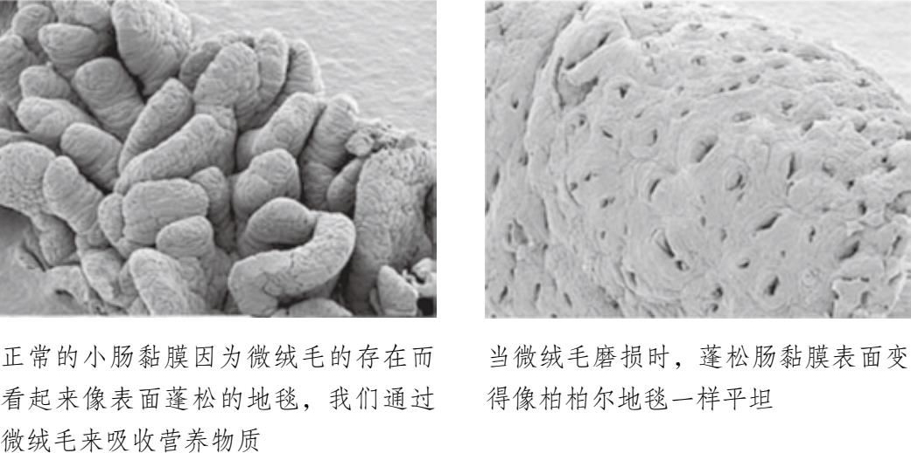

# 第一章 自身免疫性疾病发展谱

<h2><b>第</b><b>一</b><b>章</b></h2>

<h2><b>自</b><b>身</b><b>免</b><b>疫</b><b>性</b><b>疾</b><b>病</b><b>发</b><b>展</b><b>谱</b></h2>

	
本章我们将讨论疾病从何而来。请你回答这样一个问题：你是否认为有可能某天一觉醒来，突然发现自己患上了糖尿病、阿尔茨海默病或体重增加了10千克？不会的。科学家告诉我们：这些疾病都是在长达数十年的过程中逐步发展而来的。如果你宏观地看待疾病的发生发展过程，就会清晰地发现：有一种方法可以“防患于未然”（或者像科学家说的那样，阻止自身免疫性疾病的进展），能在较长时间内让你的身体保持健康，能缩短生命终结前受煎熬的身体残疾期。

	
我在防治乳糜泻和麸质敏感方面所做的工作使我成为这个领域的顶尖专家。乳糜泻作为一种自身免疫性疾病，其遗传学方面的易感因素以及诱发因素（小麦、黑麦和大麦中的麸质）和发病前的“最后一根稻草”（肠道通透性增加）都已被清晰描绘，因此这是一个很好的研究对象。我将在本章以及本书的其他部分中，把乳糜泻作为自身免疫性疾病的一个典型例子加以引用。

	
自身免疫性疾病发展谱是一种渐进的疾病状态，它从一端的充满活力的健康状态逐渐进展到另一端的退行性疾病。介于两者之间的是形式多样但相互关联的疾病不同阶段，发展趋势通常是朝着更多疾病的方向发展。这就是我们早在被诊断出自身免疫性疾病或者首发症状出现前就已经存在自身免疫损伤的原因。重复一次，在疾病发展谱的一端，是健康状态，称为良性自身免疫；在另一端，是疾病或临床上非健康的状态；在疾病发展谱的中间区域，是疾病进展的过程（损伤累积），称为致病性自身免疫。理解疾病发展谱的好处是我们可以有意识地改变我们身体状况的发展方向，远离疾病，回到充满活力的健康状态。这就是本书的写作目的。

	
健康状况的恶化程度可以用抗体水平来衡量。有的人可能在抗体水平轻微升高时即有明显的症状，而有的人即使抗体水平很高也可能没有任何症状。但是，这两种情况都会出现在疾病发展谱上，它们都会继续发展，直到被诊断为某种慢性或致命性疾病。所以说，不管你是否有症状，只要抗体水平升高，就会加速组织的退化。

	
当我们接触到任何环境诱发因素（如麸质、花生、霉菌等）时，免疫系统就会被激活。免疫系统在后台全天候地工作，而我们往往意识不到，这被称为正常免疫。如果损伤的程度（暴露量）加深，你可能会出现一些轻微的症状，比如流鼻涕、肌肉酸痛或脑雾。如果暴露程度持续加深，免疫系统就必须更积极地应对，这会导致炎症级联反应。过度的炎症反应会引起细胞损伤，持续的细胞损伤会引起组织损伤，持续的组织损伤会引起器官炎症，持续的器官炎症会导致症状加重以及针对该器官的抗体水平升高，而水平持续升高的抗体会导致器官损伤。此时，疾病就会被确诊。

	
自身免疫性疾病发展的一般过程如图1-1所示。

	

	
图1-1 自身免疫性疾病发展的一般过程

2003年，梅丽莎·阿巴克尔博士和她的同事在《新英格兰医学杂志》（<i>N</i><i>e</i><i>w</i><i> </i><i>E</i><i>n</i><i>g</i><i>l</i><i>a</i><i>n</i><i>d</i><i> </i><i>J</i><i>o</i><i>u</i><i>r</i><i>n</i><i>a</i><i>l</i><i> </i><i>o</i><i>f</i><i> </i><i>M</i><i>e</i><i>d</i><i>i</i><i>c</i><i>i</i><i>n</i><i>e</i>）上发表了一项具有里程碑意义的研究成果：他们记录的自身免疫性疾病发展谱。阿巴克尔博士研究了弗吉尼亚州医院系统的130名退伍军人的病史，这些退伍军人都患有系统性红斑狼疮，这是一种典型的自身免疫性疾病，会累及皮肤、关节和内脏
	<a id="noteref-7-174" href="#footnote-7-174">[1]</a>。服役期间，他们都做过多次血液检查。对于阿巴克尔博士的团队来说，非常幸运的是，自1978年以来，美国政府一直对血液样本进行保存。她申请检测了那些退伍军人发病之前留取的血液样本。

	
研究结果表明，这些退伍军人在发病前都有7种抗体水平升高。而且他们的抗体水平在逐年升高。直到达到一定水平，这时器官的损伤就严重到足以出现症状。这一阶段被称为早期致病性自身免疫。此时，患者们已经病得很严重了，需要去看医生了。

	
随着时间的推移，更多的细胞受到攻击、炎症加剧、症状加重。最后，他们被诊断患有系统性红斑狼疮。但是，他们中的每一个人都至少在5年前就存在系统性红斑狼疮的自身免疫性损伤了。在疾病的早期阶段，我们对轻微的细胞和组织损伤毫无察觉，直到出现明显的临床症状。

	
如果是你的话，你希望什么时候知道自己已身处自身免疫性疾病发展谱中？你会一直等到出现明显的症状时吗？或者你希望在身体的损伤尚未严重到需要治疗前就发现它？

	
在图1-2中，我们可以看到引起系统性红斑狼疮的7种抗体在首发症状出现前后的变化情况。我们发现，在系统性红斑狼疮相关症状出现前5年，患者中就已有18%的人抗Sm抗体升高，28%的人抗双链DNA抗体升高，48%的人抗核抗体升高（绿线），56%的人抗La抗体升高，59%的人抗Ro抗体升高，64%的人APL抗体升高。

	

	
图1-2 7种抗体在首发症状出现前后的变化情况

	
这说明，在患者出现明显的症状或疾病确诊前几年抗体水平就已经升高，而这些抗体会损伤靶组织。

	
症状的严重程度取决于你在自身免疫性疾病发展谱中的位置和组织损伤程度。症状的出现带来的“赠品”是，它会迫使你注意到问题的存在，并采取措施将其解决。这就给了你一个机会，让你在严重组织损伤出现之前，就能针对这些看似没有关联的症状采取一定的措施。你反复出现的那些症状，如疲劳、腹胀、记忆力减退等，可能正是免疫系统在提醒你有些东西失去了平衡。

	
然而，我们要清楚的是：出现症状并不代表问题刚刚发生，而是说明你的身体已无法进一步代偿。如果疾病之球继续滚动，问题会越来越多。

	
奇怪的是，慢性健康问题几乎被认为是正常生活的一部分，诸如疲劳、疼痛、抑郁、肥胖、失眠、焦虑等。这些症状虽然很常见，但它们的出现是不正常的。没有人应该与这些症状为伴，没有人应该接受它们，也没有人应该忽视它们。

忽视症状或者习惯性地用止痛药来对付它们是再糟糕不过的了。虽然偶尔服用阿司匹林、布洛芬或其他非甾体抗炎药（nonsteroidal anti-inflammatories，NSAID）甚至处方止痛药也没什么问题，但如果你长期服用这些药物，就会带来一些问题。高达65%的人在服用NSAID6个月后就会出现肠道炎症，这可导致关节炎
	<a id="noteref-7-162" href="#footnote-7-162">[2]</a>。NSAID会引起继发性自身免疫反应，我称之为继发损害，这一点我在后面会提到。

	
长期使用止痛药的第二个问题是，你始终没能去除引起疼痛的潜在原因。想象一下，你正在开车的时候，仪表板上有一个警示灯亮了，你会把车停下，在仪表板下面找到连接警示灯的电线，将其切断，然后继续开车上路吗？我猜你不会。我们都非常清楚，如果忽视严重的警报，汽车是不能坚持行驶太久的，甚至可能让我们处于危险之中。你认为这跟我们的身体有什么不同吗？但当我们服用止痛药而不去寻找引起疼痛的潜在原因时，我们就是在对身体做着那样的事情。

忽视或仅仅一味地控制症状会使潜在的不平衡状态造成更大的组织损伤。虽然这样做是非常“正常”的，但我们应该从根本上去除引起不适的原因，否则症状将持续恶化，直至通过服药也无法改善。例如，虽然抗生素可以有效治疗痤疮，但它们只能让症状短期缓解，并不能解决根源问题。而且，服用抗生素可能会带来许多长期副作用，如骨质损伤、瘢痕和自身免疫性肝炎
	<a id="noteref-7-164" href="#footnote-7-164">[3]</a>。

	
如果你想健康且充满活力，那就必须去解读身体试图告诉你的信息。身体的语言从不说谎，我们要学会如何理解身体在说什么，这就是本书的全部目标。一旦你明白免疫系统是如何被激活的，并理解它的语言，就能找到症状的出现原因。接下来，你要确定目前你在疾病发展谱上的位置，这能够让你尽早解决潜在的问题。然后，你可以通过简单的生活方式改变来扭转趋势，回到健康状态。

	
<b>仔</b><b>细</b><b>看</b><b>你</b><b>的</b><b>血</b><b>液</b><b>化</b><b>验</b><b>结</b><b>果</b>

	
当医生向你解释你的血液化验结果时，如果你发现在某个指标的旁边有一个“↑”或“↓”标记（这表示该指标的检测值高或低），而医生却告诉你，你的结果是正常的，你应当问一下医生这个指标的异常是常见的还是正常的。这可能会让你们就这个指标的检测值高或低的原因展开讨论。

	
<b>了</b><b>解</b><b>你</b><b>的</b><b>免</b><b>疫</b><b>系</b><b>统</b>

	
免疫系统可以让我们免受周围环境对机体的不利影响，但也正因如此，我们中的绝大多数人都在向自身免疫性疾病发展谱上危险的那端走去。而我们的目标是转而走向自身免疫性疾病发展谱的另一端，回到正常的免疫状态。

	
首先让我们了解一下免疫系统是如何工作的。免疫系统就像军队一样由不同的兵种组成，它们共同保护着你。我们可以把它们比作陆军、海军、空军、海军陆战队和海岸警卫队（医生称之为IgA、IgG、IgE、IgM和IgD，后面将详细介绍），每一个兵种都承担着不同的任务，为我们的健康保驾护航。

	
我们的体内有4种免疫系统，每一种都能产生上述5种抗体：最大的免疫系统位于肠道，人体70%～85%的免疫力来源于此；在肝脏中还有一种称为Kupffer细胞的免疫系统；第三个免疫系统是血液中的白细胞；最后一个位于大脑，由神经胶质细胞组成。

	
每个系统都独立工作，但都遵循着相同的规则并相互关联。每个免疫系统都由至少两部分构成：①细胞免疫系统，又称先天性免疫系统，它相当于手枪，可以向敌人发射化学子弹；②体液免疫系统。又称适应性免疫系统，相当于当你需要支援时被召唤的重型火炮。

	
面对入侵者时，无论是癌细胞、细菌、病毒、寄生虫、有害的食物蛋白和多肽，还是药物等化学物质，细胞免疫部队都会产生细胞因子，我称之为“第一反应者”的化学子弹。这些细胞因子能够识别并攻击它们认为具有威胁性的东西。细胞免疫系统可以产生许多类型的细胞因子，并根据威胁的不同决定派谁出战。例如，当我们通过接种疫苗来增强免疫系统时，对麻疹和腮腺炎我们分别进行疫苗接种；每一次接种，我们都是为了产生不同的细胞因子。如果细胞免疫不足以抵御入侵，机体就会调用“重型火炮”，这时体液免疫系统就会大显身手，它的士兵会向敌人发射导弹（抗体）。

	
这个复杂的生物系统昼夜不停地工作着，用其有限的能力保护我们的机体免受外部侵害。在如今的环境下，免疫系统必须非常努力地工作，并且常常是超负荷地工作。

	
这是因为我们的身体和我们几千年前的祖先完全一样，但是我们所面临的威胁却与他们完全不同。正如我的好友，血管生物学家马克·休斯敦博士所说：“面对无穷无尽的入侵，我们人体能做出的有效应对却是有限的。”我们祖先的免疫系统只需要应对为数不多的病毒、细菌和寄生虫，而我们现在的免疫系统还要应对超级细菌（对抗生素产生耐药性的细菌）、杂交和转基因食品、大量的有毒化学品（包括除草剂和杀虫剂），以及铅、汞、镉等重金属，这是社会发展的代价。之所以有人认为罗马文明终结于有毒的铅质水管，是因为人类的免疫系统不能抵御铅的侵害。因此，我们要保护好免疫系统。

	
<b>抗</b><b>体</b><b>是</b><b>免</b><b>疫</b><b>系</b><b>统</b><b>的</b><b>精</b><b>兵</b><b>强</b><b>将</b>

	
当细胞免疫系统不能通过炎症反应清除入侵者时，体液免疫系统就会被召唤前来打这场“战争”。后者会派出针对特定目标的训练有素的“刺客”——抗体。无论何时何地，当抗体发现入侵者时，它们便会发射“导弹”。如果你曾有过血液检测结果提示“抗体水平升高”或抗体标志旁有“↑”标记，则表示这些战士们正夜以继日地工作以清除其感知到的威胁物。不论你是否出现症状，抗体在清除入侵者的过程中导致的组织损伤都在不断增加。

	
每种体液免疫系统都有自己专属的抗体部队：IgA、IgG、IgE、IgM和IgD。IgM是“先头部队”。如果它不能完全清除威胁物，其他抗体部队就会被派出接管这一任务。如果某种食物被身体认定为威胁物，那么机体会随即派出IgA将其清除。当入侵者进入血液时，由IgG参与的全身性免疫应答就会被激活。虽然我们已知IgD的存在，但其功能仍不明确。

	
如果IgE反应被激活，会刺激机体释放组胺，但如果组胺过量则可能危及生命。例如，当机体对食物（如花生）过敏，或暴露于某些毒液（如被蜜蜂蜇伤）时，都会激活IgE反应。如果你或你的家人被诊断为过敏症，那么你可能已经熟悉刺激IgE反应的检查——皮肤点刺试验（确认是否有变态反应）。但事实上，皮肤点刺试验只是检测机体对某种食物是否过敏的方法之一。

	
如果你的孩子每次吃了很多奶酪后他的鼻腔就会充满黏液，医生会安排你去找过敏症专家接受IgE抗体检测。如果测试结果为阴性，那么你的孩子是否可以继续吃奶酪呢？专家可能会说，孩子未检测到IgE变态反应，是可以吃奶酪的。但是，我们还应该检测其他的抗体，因为虽然你的孩子没有针对乳制品的IgE变态反应，但可能会有来自其他抗体部队的反应。

	
在确定食物过敏方面，皮肤点刺试验并不全面。我们的免疫系统会针对某种食物做出许多反应，但皮肤点刺试验只能检测出其中的一种。如果医生没有采取更全面的检测方法，那么你的孩子可能会继续接触乳制品，这会使他仍然感到不适。

	
大脑可能会指示免疫系统任命一位负责人（将军），它的工作就是确保你在余生免受那些讨厌的食物的伤害。例如，你可能有“麸质将军”，它会指导免疫系统产生抗麸质抗体，并使你在接下来的日子里始终拥有再次产生这些抗体的能力。这些将军被称为“记忆B细胞”。当你的免疫系统将某种有害物质认定为威胁物后，记忆B细胞的任务就是保护你在将来的日子里免受其危害。

	
请记住，你的免疫系统就像军队，很多将军只是坐在那里无所事事。但一旦你接种了麻疹疫苗，就如同有一个入侵者进入你的体内，那么军队便开始进入战斗状态。大脑会下达指令以应对入侵者：“将军，请注意，你现在被任命为‘麻疹将军’。”“麻疹将军”会建立一套生产线，开始生产针对麻疹病毒的抗体。这些抗体顺血流而行，沿途寻找麻疹病毒，并将其消灭。

	
当因接种疫苗带来的麻疹病毒消失后，“麻疹将军”会说：“关闭生产线，我现在不需要那么多士兵了。”但是，因为“麻疹将军”是一种记忆B细胞，所以当你再一次接触麻疹病毒时，“麻疹将军”只需再次启动生产线即可，而不需要重建一条生产线。注射加强疫苗就是为了使生产线重新开启。在注射加强疫苗后几天机体就能产生足够的抗体来保护你。如果你初次去非洲旅行，你需要提前几个月接种黄热病和登革热疫苗。但如果你15年后再次去非洲，你只需在出发前2周注射一次加强疫苗即可。加强疫苗会唤醒“黄热病将军”和“登革热将军”，它们会重启生产线，生产抗体，从而达到保护你的目的。

	
为了保护你免受病菌或是麸质、乳制品的侵袭而产生的抗体在血液中巡逻，寻找病菌（或食物），这些都是它们在流水线训练中攻击的目标。在这些有害的病菌或食物被抗体消灭后，关闭生产抗体的流水线需要1～2个月的时间。而血液中已经产生的抗体寿命为2～3个月。因此，高水平的抗体会在血液中持续循环，发挥作用，有时在长时间接触入侵者（如麸质）后会造成附带损伤。

这意味着机体只需要接触一次入侵者就能激活一个特定的“将军”，并且这种保护性反应会持续很长时间。一旦你再次接触入侵者，保护机制被重新激活，抗体水平上升，免疫系统就会全力“保护”你。这就是为什么你不能接触麸质或其他你可能敏感的食物，哪怕只有“一点点”的原因。2001年，一篇重要的研究报告发表在《柳叶刀》（<i>L</i><i>a</i><i>n</i><i>c</i><i>e</i><i>t</i>）杂志上，该研究对乳糜泻患者进行了20余年的随访，记录了他们的饮食模式。研究发现，那些每月吃1次麸质食物的患者，即使他们并无不适，也会在之后出现严重问题。文中说到：“无麸质饮食定义为每月吃1次麸质食物，如果不能坚持无麸质饮食，死亡的相对风险将变为6倍
	<a id="noteref-7-282" href="#footnote-7-282">[4]</a>。”这样看来，似乎偶尔吃一次纸杯蛋糕也会让我们付出很高的代价。

	
如果你的抗体水平持续偏高，但没有症状，一些医生会忽略这一点，但这是一件非常严重的事情。例如，如果你针对甲状腺的抗体水平升高，但你没有明显的甲状腺功能异常，一些医生会认为这只是一个偶然发现而已。然而事实并非如此：这是你免疫系统发出的信号，说明你的身体存在问题。在疾病发生之前，免疫系统对于其感知到的威胁物所做出反应的最后一道信号就是抗体水平升高。抗体水平持续偏高会引起炎症和组织损伤。

当我们的细胞免疫系统（“第一反应者”）对于入侵者无能为力的时候，就会出现抗体水平的升高。仅仅是监测我们的生活方式，就会使我们的免疫系统疲惫不堪
	<a id="noteref-7-71" href="#footnote-7-71">[5]</a>。我们行驶在生命的高速公路上，车速慢时我们的传动装置在抗议，但即使我们加大马力也没能像我们想象中那样快速前进。如果你看起来压力过大或筋疲力尽，有的医生可能会建议你放慢节奏，但我认为这在当今社会是不现实的。他们所说的“减轻压力”和“放慢节奏”对我而言是一种逃避。我们不能降低对自我的要求，不管是照顾孩子、应对高峰时段的交通，还是在工作中保持最佳的成绩。我们根本不会放慢生活节奏，没有人会放慢节奏，而且坦率地说，你不应该这么做。

	
相反，我将教你如何改变驾驶方式，这样你就能花费更少的力气来提高车速。这样我们就可以燃烧更少的燃料，用高速挡快速前进，并支持我们的免疫系统。我相信充满激情地生活是我们与生俱来的权利，但我们不应该为此而让自己筋疲力尽。我人生信条的一部分来自乔治·萧伯纳的这首诗：

	
人生真正的快乐，

	
在于能对一个事业有所贡献，

	
而自己认识到这是个伟大的事业；

	
在于能成为宇宙间的一股力量，

	
而不是一块自私自利的行尸走肉，

	
成天埋怨世界没能叫他过得更快活些。

	
我的生命属于整个社会；

	
在有生之年，我会尽我所能地为整个社会工作，

	
这就是我的特殊荣幸。

	
对我来说，人生不是什么“短暂的烛光”，

	
而是一支由我此时此刻举着的火把，

	
我要把它燃烧得极其明亮，然后递交给后来的人们。

	
本书将教会你“换挡”的具体方法，这其实非常简单。当你吃的食物被免疫系统认定为威胁物时，新陈代谢的压力便会随之而来，并在你的薄弱环节上有所体现。通过吃正确的食物，你可以减少这种不必要的压力。通过本书的学习，你将知道哪些食物会让你不适、肥胖、疲劳或健忘，希望你能避免吃这些食物，这样你的身体状态就能达到你想要的水平。

	
<b>炎</b><b>症</b><b>是</b><b>免</b><b>疫</b><b>系</b><b>统</b><b>的</b><b>战</b><b>略</b><b>堡</b><b>垒</b>

	
炎症是免疫系统面对威胁时的自然反应。免疫系统产生的细胞因子和抗体会攻击入侵者，将其清除，并形成一道屏障，为你阻挡入侵物。这一屏障能增加血流量，将白细胞和抗体运送到机体需要的部位。在某些情况下，比如当你手上有一个小伤口时，这个屏障会让你产生灼热感和疼痛感。但在其他情况下，炎症是内在的，并不那么明显。例如会发展成为心脏病的动脉粥样硬化，这被认为是一种“睡眠状态”，你不知道它正在发生。如果你不进行高敏感性的血液测试，你甚至不知道炎症的存在。了解这两种类型的炎症是非常重要的，因为它是你识别身体中发生了什么的能力的基础，这样你才有机会采取措施停止或修复损伤。

	
炎症是免疫系统让我们保持健康的主要武器。炎症给我们的印象并不好，但事实是，出现炎症并非坏事。过度的炎症对你才是有害的。一旦入侵者被清除，你身体受到的损伤被修复（就像你手指上的伤口愈合一样），炎症屏障就会被移除。然而，如果威胁物仍然存在，炎症通常会持续存在。这可能发生在当炎症反应的火力不足以击败入侵者的时候，或者当我们持续暴露于威胁之下的时候，例如在我们不知道自己对某种食物敏感的情况下仍然在吃这种食物，这就如同火上浇油。

	
当炎症失去控制时，你可能会注意到一些轻微的症状，也许你会觉得这是自己在变老的表现。一开始，你可能觉得自己胖了一点，或者比平时累了一点。也许你比去年胖了1～2千克，裤子更紧了。但是，如果年复一年这样增重，持续10年，那你的裤子就要增加了一个或两个尺码了，并且腹部长出了“游泳圈”。腹部周围堆积的脂肪能产生17种激素，其中15种会引起炎症反应。脂肪堆积通常由不良的生活习惯造成，会导致体重增加和全身炎症反应。有一个简单的筛查检测可以确定你体内的脂肪含量是否已达到危险水平，即“身体成分分析”。

	
持续的慢性炎症可直接引起组织损伤，并最终导致器官功能障碍。过度的炎症级联反应是导致体重增加、疲劳、抑郁、慢性疼痛、焦虑、失眠和自身免疫性疾病的根本原因。几乎每一种退行性疾病都与过度的炎症有关，包括癌症、心脏病、糖尿病、系统性红斑狼疮、多发性硬化、帕金森病和阿尔茨海默病。科学研究已证实，动脉粥样硬化和癌症的启动和进展都和自身免疫有关。据估计，在美国有1/5的女性患有自身免疫性疾病，在男性中这一比例为1/7。

	
<b>炎</b><b>症</b><b>以</b><b>及</b><b>你</b><b>的</b><b>健</b><b>康</b><b>链</b><b>条</b><b>上</b><b>的</b><b>薄</b><b>弱</b><b>环</b><b>节</b>

	
炎症首先会在你健康链条中的薄弱环节上表现出症状。这个薄弱环节所在的位置取决于你的基因、你之前的经历（你的生活方式）以及你所处的环境。自身免疫性疾病发展谱中的症状可以有很多种，这取决于你的整体健康链条中的薄弱环节。例如，同样是对麸质敏感，有的人可能表现为大脑功能受损（例如头痛、记忆丧失或癫痫发作等），有的人可能表现为便秘，有的人可能表现为肝脏疾病。

	
过度的炎症会牵拉你的健康链条，而这个链条上的薄弱环节即是造成组织损伤的地方。如果薄弱环节位于甲状腺，你可能会容易感到寒冷或是很难减肥。如果薄弱环节位于肝脏，你会发现酒精对你的影响比以前更强了。如果你是女性，你可能会有更多的绝经后综合征表现。如果薄弱环节位于大脑，你可能会忘记一些简单的事情，比如你把钥匙放在哪里了，或者笼统地说记忆出了问题。如果薄弱环节位于肌肉，你可能会发现你没有以前那么强壮了，或者连爬楼梯都出现了困难。

	
在确诊之前，你可能要多次就诊，甚至求助于多位医生。据统计，乳糜泻患者在确诊前，通常平均需要就诊于5名医生，病程平均为11年。当症状已经影响你的日常生活时，炎症的组织损伤已经累积了很多年。这些症状最终可能会让你前去就诊，医生可能会专注于治疗炎症引起的症状（如关节疼痛、头痛、血糖升高等），而忽略了解决根本问题。无论牵拉你健康链条的原因是什么，如果不能得到解决，过度的炎症可能就会在你的下一个薄弱环节引起新的问题。在医学上，这被称为“共病”。

例如，糖化血红蛋白（HbA1c）是评价糖尿病药物治疗成功与否的一种血液标志物。糖尿病治疗的标准方案是加大药物剂量，直到HbA1c水平降至正常范围。如果你听从医生的建议并采取药物治疗，使得你的血糖稳定，那么你的实验室检查结果也会看起来不错（HbA1c正常），但是药物本身可能会使你罹患并发症的风险升高，如精神衰退或致死性心脏病发作，因为降糖药并不能解决导致血糖升高的潜在炎症，炎症仍会对你的血管和大脑造成损伤。很抱歉，但我必须告诉你，2型糖尿病患者的寿命较短，心血管疾病发病年龄较早，相较于一般人群更容易出现大脑退化（认知能力下降）。2011年发表在《新英格兰医学杂志》上的一篇关于糖尿病药物治疗的荟萃分析结果显示，与标准治疗相比，加大药物剂量使HbA1c降至正常范围可以将5年非致死性心脏病发生率降低21%。这听起来很不错，但是如果你研读一下全文，就会发现这样的治疗方案也会使患者的5年病死率升高19%以上
	<a id="noteref-7-403" href="#footnote-7-403">[6]</a>。

	
我非常赞同应用治疗症状的药物，但我们也必须治疗引起疾病的潜在炎症。成千上万的临床医生发现，就像你在本书中将要了解到的一样，通过增加清除炎症的治疗措施，你可以阻止一些退行性疾病的发生或发展，甚至在某些情况下还可以逆转一些退行性病变，如2型糖尿病和其他自身免疫性疾病。

	
<b>过</b><b>度</b><b>氧</b><b>化</b><b>应</b><b>激</b><b>导</b><b>致</b><b>炎</b><b>症</b><b>产</b><b>生</b>

	
绝大多数细胞内都有称为线粒体的小能量屋。线粒体会利用氧和产能营养素来生产我们需要的能量，以维持身体功能。在这个过程中，部分代谢废物产生了额外的自由基。这些自由基会破坏我们的细胞膜，当损伤累积到一定程度便会影响组织和器官的功能，然后症状开始出现。一般情况下，自由基可以被抗氧化维生素和多酚所中和，它们就像海绵一样，可以将自由基吸收。

	
我们可以从五颜六色的水果和蔬菜中得到这些维生素——这就是我在第七章中建议每天吃不同颜色的蔬菜的原因。每种颜色都对应不同种类的维生素、多酚和抗氧化剂，吃多种颜色的水果和蔬菜对你大有裨益。

	
如果我们的饮食中缺乏抗氧化剂，或者我们过度暴露于抗原，自由基就会堆积并产生氧化应激反应，从而破坏体内的各种细胞。其产生影响的部位则取决于你健康链条中的薄弱环节。氧化应激是导致炎症产生和细胞损伤的主要机制，进一步发展可引起组织损伤。当组织损伤积累到一定程度时，就会出现器官功能障碍，并最终导致器官疾病。往往到这时，你才会被确诊。

你知道吗？在乘坐飞机的时候，你会暴露在太阳耀斑的过度辐射之下，这会增加你的氧化应激负荷。当你从纽约飞往洛杉矶时，如果太阳耀斑非常强烈，这一趟你相当于接受了7次胸部X线检查的辐射量。女性空勤人员是激素失调和孕期并发症高发人群，其主要原因就在于过度地暴露于辐射之下，这也是飞行员是患白血病和淋巴瘤概率最高的职业之一的原因
	<a id="noteref-7-158" href="#footnote-7-158">[7]</a>。这些人每天都坐在铝制机舱里，暴露在辐射下，结果导致了过度的氧化应激。我建议所有的乘务员和飞行员服用5倍于普通人群需要的抗氧化维生素，他们需要大量的“海绵”来清除自由基。

	
我的导师杰弗里·布兰德博士是功能医学的联合创始人，他举过一个例子，可以帮助我们理解氧化应激。他说，要填满一个足球场，需要976000个捕鼠器。如果你将每个捕鼠器都竖起来并在里面塞一个白色的乒乓球，那么足球场看上去就完全是白色的——你所看到的都是乒乓球。如果你沿着球场边走，把一个乒乓球扔到球场上，它会碰到一个捕鼠器，这个捕鼠器会把它自己的球弹射出去：砰！现在空中有2个乒乓球，一个是你扔出去的，一个是捕鼠器刚刚弹出来的。这2个球又击中了2个捕鼠器：砰，砰！现在空中有4个乒乓球。砰！然后是8个，16个，等等：砰，砰，砰，砰，砰，砰，砰，砰。你引起了一个不断弹射乒乓球的级联反应，这一反应在第一个球被弹射出去后会持续很长时间。

	
就像上面这个例子一样，在最初的刺激物引起炎症后，氧化应激就像有生命一样，呈指数级增加。抗氧化剂就如同你的灭火器一样，而你的炎症反应已经超过了其能熄灭的临界线。如果你继续火上浇油，使机体产生更多的炎症反应（例如，继续食用你敏感的食物），那么氧化应激就会继续加剧炎症反应，进而导致更多的组织损伤、功能障碍，最终导致疾病。

下面的数据告诉我们，通过合理的饮食可以减轻过度氧化应激。2004年，一项发表在《英国医学杂志》（<i>B</i><i>r</i><i>i</i><i>t</i><i>i</i><i>s</i><i>h</i><i> </i><i>M</i><i>e</i><i>d</i><i>i</i><i>c</i><i>a</i><i>l</i><i> </i><i>J</i><i>o</i><i>u</i><i>r</i><i>n</i><i>a</i><i>l</i>）上的荟萃分析结果显示：当你选择健康的、富含抗氧化剂的饮食计划时（这样可以得到更多的“海绵”来清除自由基，减轻氧化应激），你的心血管疾病患病风险能降低75%，整体预期寿命会增加6.6年，在无心血管疾病的情况下预期寿命可增加9年。建议每天食用的食物包括冷水鱼、黑巧克力（是的，你没看错，每天吃黑巧克力）、大蒜、杏仁、红葡萄酒，以及水果和蔬菜
	<a id="noteref-7-240" href="#footnote-7-240">[8]</a>。记住，是每天。光吃胡萝卜是不够的，饮食要多样化，还要吃点西蓝花、紫甘蓝以及番茄或者红辣椒。

	
从本书第26页开始，我们将通过萨曼莎的故事，了解自身免疫性疾病发展谱中的每个成分是如何对她产生影响的。不幸的是，在她的故事中，这一部分仅仅是个开始。

	
<b>识</b><b>别</b><b>自</b><b>身</b><b>免</b><b>疫</b><b>性</b><b>疾</b><b>病</b>

	
自身免疫性疾病有80多种，自身免疫性病症更是多种多样。“疾病”和“病症”有着显而易见的区别。病症是机体功能障碍的结果，而当功能障碍进展为器官损伤时，就导致了自身免疫性疾病。如果你的体内产生了针对自身组织的抗体，那么每种抗体都会引起不同的病症。例如，有7种抗体与系统性红斑狼疮相关，它们中的每一种都可通过不同的机制引起功能障碍，这就是系统性红斑狼疮患者会有多个器官或多种组织受累的原因。

美国国立卫生研究院统计发现，尽管许多自身免疫性疾病非常罕见，但有约8%的美国人受其困扰，也就是说有2400万人
	<a id="noteref-7-55" href="#footnote-7-55">[9]</a>，比癌症（900万）和心脏病（2200万人）患者还要多。按照杰弗里·布兰德医生的说法，实际的数字可能比这高得多，因为这个数字只是确诊患者的数量。据估计，在美国至少有7200万人（约占人口总数的22%）患有自身免疫性疾病。请记住，总的来说，据估计在美国有1/5的女性患有自身免疫性疾病，在男性中这个比例是1/7。

患有自身免疫性疾病的人通常有不止一种疾病。例如，超过20%的乳糜泻患儿有轻度的心脏功能障碍
	<a id="noteref-7-45" href="#footnote-7-45">[10]</a>，他们乳糜泻的诊断已经明确，而心脏疾病还处于早期，没有症状。这意味着如果你有自身免疫性病症，你的健康链条中可能还有其他的薄弱环节，如果你不能让炎症的级联反应停止，那么无论这些薄弱环节在哪里，它们都会受到损伤。

	
常见的自身免疫性病症如下。

	
·脱发

	
·阿尔茨海默病

	
·肌萎缩侧索硬化

	
·糖尿病

	
·炎症性肠病（克罗恩病和结肠炎）

	
·多发性硬化

	
·肾脏疾病

	
·神经病变

	
·关节炎

	
·帕金森病

	
·银屑病

	
·类风湿关节炎

	
·甲状腺病

	
<b>萨</b><b>曼</b><b>莎</b><b>的</b><b>故</b><b>事</b>

<h1><b>第</b><b>一</b><b>部</b><b>分</b></h1>

	
萨曼莎是我的患者，也是我的同事兼好友，在世界知名的加利福尼亚大学洛杉矶分校风湿病研究中心里，她是最严重的系统性红斑狼疮患者之一。毫不夸张地说，萨曼莎曾在急诊室里两次死里逃生。由于必须进行积极的化疗和激素治疗，她患上了严重的骨质疏松症，导致后背中部多处骨折，身高减少了20厘米。最终萨曼莎战胜病魔，目前健康且充满活力。她的故事告诉我们：不仅要倾听身体传达给你的信息，还要有所行动。

	
在确诊系统性红斑狼疮前的15年，医生告诉萨曼莎，2周大便一次是“正常的”。早在她7岁的时候，她就有过严重的耳部感染、呼吸困难、极度疲劳。当妈妈提议一起出门做些事时，萨曼莎通常不太情愿，因为她总是很累而且感觉不舒服。但即使经常感觉很累，她也会打起精神跟妈妈一起去。

	
耳痛、过敏和疲劳的症状时好时坏，生活就这样继续着。而且她吃完饭就感觉不舒服。在青春期的时候，她患有难以控制的痤疮。13岁时，医生给她开了避孕药来控制月经量，但这些药物没能有效治疗她的痤疮。而后，皮肤科医生给她开了异维A酸。遗憾的是，这个药也没能消除痤疮反而让她情绪低落。

	
青春期时，萨曼莎认为：“我只需要克服身体上的这些不适，这没什么大不了的。医生说我是个健康的孩子，我可以参加派对，我会玩得很开心。我要享受生活。”因此，尽管她感觉很糟糕，但她试图过上正常的生活。20岁时，她的身高180厘米，她非常活跃，打网球、跳芭蕾，有时直到小腿抽筋才停。一天早上，她起得很早，当她准备站起来的时候却摔倒在地。萨曼莎发现她的腿肿了。她找到全科护士，护士让她停用异维A酸，因为异维A酸会导致腿抽筋。为了保险起见，护士让萨曼莎到医院做了腿部的血管超声检查。

	
检查发现萨曼莎的小腿的血管中有血栓，这意味着她需要服用抗凝药。结果不到2周的时间，她小腿上的血栓脱落并进入肺部，导致了肺栓塞。这非常严重，可能危及生命。医生认为血栓是由抗磷脂综合征引起的，这种疾病的特征在于血栓形成的风险增加，可导致脑卒中和不明原因的流产。这让萨曼莎被诊断为自身免疫性疾病。南加利福尼亚大学医疗中心的血液病专家告诉她：“你要终身服用华法林（一种抗凝药），否则会再次出现血栓，危及生命。”

	
那时，萨曼莎找到一位专门从事脊椎护理的按摩师。这一次萨曼莎也很幸运，这位按摩师建议她去找专攻功能医学的脊椎按摩师。

	
萨曼莎的经历很有代表性。她在很小的时候就处于自身免疫性疾病发展谱中，但是并没有人想到这一点。早在3岁时，她就患有严重的耳部感染。7岁的时候，她出现了胃痛、便秘。所有这些症状都是巨大的危险信号，告诉她免疫系统出了问题。她接受了常规医学的治疗，但从来没能解决根本问题。她的父母竭尽所能以及她积极的态度使她坚持下来，但最终各种各样的症状还是出现了，并造成了更严重的健康问题。

由美国自身免疫性相关疾病协会
	<a id="noteref-7-14" href="#footnote-7-14">[11]</a>提供的一份全面的疾病清单如下。我将其完整地展示给大家，以便你了解自身免疫性疾病发展谱上到底有多少种疾病和症状。

	
1.急性播散性脑脊髓炎

	
2.急性坏死性脑病

	
3.艾迪生病

	
4.无丙种球蛋白血症

	
5.斑秃

	
6.淀粉样变

	
7.强直性脊柱炎

	
8.抗肾小球基底膜性肾炎

	
9.抗磷脂综合征

	
10.自身免疫性血管性水肿

	
11.自身免疫性再生障碍性贫血

	
12.自身免疫性家族性自主神经异常

	
13.自身免疫性肝炎

	
14.自身免疫性高脂血症

	
15.自身免疫性免疫缺陷

	
16.自身免疫性内耳病

	
17.自身免疫性心肌炎

	
18.自身免疫性卵巢炎

	
19.自身免疫性胰腺炎

	
20.自身免疫性视网膜病变

	
21.自身免疫性血小板减少性紫癜

	
22.自身免疫性甲状腺病

	
23.自身免疫性荨麻疹

	
24.轴突和神经元神经病

	
25.巴洛病

	
26.白塞病

	
27.大疱性类天疱疮

	
28.心肌病

	
29.巨大淋巴结增生症

	
30.乳糜泻

	
31.美洲锥虫病

	
32.慢性疲劳综合征

	
33.慢性炎症性脱髓鞘性多发性神经病

	
34.慢性复发性多灶性骨髓炎

	
35.变应性肉芽肿性血管炎

	
36.瘢痕性类天疱疮

	
37.科干综合征

	
38.冷凝集素病

	
39.先天性心脏传导阻滞

	
40.柯萨奇病毒性心肌炎

	
41.CREST综合征

	
42.克罗恩病

	
43.脱髓鞘性神经病变

	
44.疱疹样皮炎

	
45.皮肌炎

	
46.视神经脊髓炎

	
47.盘状红斑狼疮

	
48.心肌梗死后综合征

	
49.子宫内膜异位症

	
50.嗜酸细胞性食管炎

	
51.嗜酸细胞性筋膜炎

	
52.结节性红斑

	
53.特发性混合性冷球蛋白血症

	
54.伊文思综合征

	
55.实验性变态反应性脑脊髓炎

	
56.纤维肌痛

	
57.纤维化性肺泡炎

	
58.巨细胞动脉炎

	
59.巨细胞心肌炎

	
60.肾小球肾炎

	
61.肺出血-肾炎综合征

	
62.肉芽肿性多血管炎

	
63.毒性弥漫性甲状腺肿

	
64.吉兰-巴雷综合征

	
65.桥本脑炎

	
66.桥本甲状腺炎

	
67.溶血性贫血

	
68.过敏性紫癜

	
69.妊娠疱疹

	
70.低丙种球蛋白血症

	
71.特发性肺纤维化

	
72.特发性血小板减少性紫癜

	
73.IgA肾病

	
74.IgG4相关性疾病

	
75.包涵体肌炎

	
76.间质性膀胱炎

	
77.幼年特发性关节炎

	
78.1型糖尿病

	
79.幼年型皮肌炎

	
80.黏膜皮肤淋巴结综合征

	
81.兰伯特-伊顿综合征

	
82.皮肤白细胞破碎性血管炎

	
83.扁平苔藓

	
84.外阴硬化萎缩性苔藓

	
85.结膜炎

	
86.线状IgA大疱性皮肤病

	
87.系统性红斑狼疮

	
88.莱姆病

	
89.梅尼埃病

	
90.显微镜下多血管炎

	
91.混合性结缔组织病

	
92.蚕蚀性角膜溃疡

	
93.急性痘疮样苔藓性糠疹

	
94.多发性硬化

	
95.重症肌无力

	
96.多发性肌炎

	
97.嗜睡症

	
98.白细胞减少和粒细胞缺乏症

	
99.瘢痕性类天疱疮

	
100.视神经炎

	
101.复发性风湿病

	
102.链球菌感染相关的小儿自身免疫性神经精神障碍

	
103.副肿瘤性小脑变性

	
104.阵发性睡眠性血红蛋白尿症

	
105.进行性面偏侧萎缩症

	
106.麻痹性臂丛神经炎

	
107.睫状体扁平部炎

	
108.天疱疮

	
109.周围神经病变

	
110.脑脊髓炎

	
111.恶性贫血

	
112.POEMS综合征

	
113.结节性多动脉炎

	
114.多腺体缺陷综合征

	
115.风湿性多肌痛

	
116.多发性肌炎

	
117.心包切开术后综合征

	
118.原发性胆汁性肝硬化

	
119.原发性硬化性胆管炎

	
120.自身免疫性孕酮性皮炎

	
121.银屑病

	
122.银屑病性关节炎

	
123.纯红细胞再生障碍性贫血

	
124.坏疽性脓皮病

	
125.雷诺病

	
126.反应性关节炎

	
127.反射性交感神经营养不良综合征

	
128.Reiter综合征

	
129.复发性多软骨炎

	
130.不安腿综合征

	
131.特发性腹膜后纤维化

	
132.风湿热

	
133.类风湿关节炎

	
134.结节病

	
135.原发性肾上腺皮质功能减退症

	
136.巩膜炎

	
137.硬皮病

	
138.干燥综合征

	
139.精子和睾丸相关的自身免疫性疾病

	
140.僵人综合征

	
141.亚急性感染性心内膜炎

	
142.视网膜耳蜗脑微血管病

	
143.交感性眼炎

	
144.大动脉炎

	
145.血栓性血小板减少性紫癜

	
146.疼痛性眼肌麻痹

	
147.急性脊髓炎

	
148.溃疡性结肠炎

	
149.未分化结缔组织病

	
150.葡萄膜炎

	
151.白癜风

	
<b>关</b><b>注</b><b>乳</b><b>糜</b><b>泻</b><b>和</b><b>非</b><b>乳</b><b>糜</b><b>泻</b><b>性</b><b>麸</b><b>质</b><b>敏</b><b>感</b>

	
乳糜泻是目前研究最多的自身免疫性疾病，也是唯一一种确定了环境诱因（小麦、黑麦或大麦中的麸质）的疾病。它是一种由麸质引起的慢性自身免疫反应，产生的自身抗体会攻击肠道和其他组织。肠道长6～7.5米，小肠黏膜表面附有微绒毛，这使肠壁看起来就像表面蓬松的地毯，微绒毛可以吸收营养物质；当这些微绒毛因为暴露于麸质中而产生磨损时，就会发生乳糜泻，肠道内表面变得像柏柏尔地毯（一种表面平坦的厚型毛毯）一样平坦，导致肠道不能很好地吸收营养（图1-3）。不管你实际摄入了多少营养物质，最终都会导致营养不良。乳糜泻患者经常感到恶心、疲倦和沮丧，也可能会饱受脑雾的困扰。芝加哥大学乳糜泻研究中心的科学家已经发现了超过300种与麸质敏感相关的症状和病症。在第四章中，你将接受一个简单的测试来确定你的症状是否与乳糜泻或非乳糜泻性麸质敏感有关。

	

	
图1-3 肠道黏膜微绒毛

	
经允许摘自Macmillan Publishers Ltd：The American Journal of Gastroentology，2004.

	
乳糜泻的治疗需要严格遵循终身无麸质饮食原则。这种疾病让我们知道，如果能识别环境中的诱因并将其清除，就可能停止自身免疫的攻击。然而，如果你再次接触诱因，攻击会立刻卷土重来。

	
麸质敏感是一种有别于乳糜泻的麸质反应，主要是由细胞免疫反应引起的。麸质敏感和乳糜泻之间最显著的区别在于麸质敏感不会导致肠道微绒毛的磨损。然而，与乳糜泻相比，麸质敏感会带来与其相同甚至更多的炎症反应。最新研究表明，麸质敏感人群在自身免疫性疾病发展谱上的概率比乳糜泻人群要高得多。接触麸质后，麸质敏感的人群会产生像乳糜泻一样的症状，还有焦虑、头痛、脑雾、慢性疲劳、体重增加、抑郁和周身不适。这些症状是自身免疫性疾病的一部分，如果不加以治疗，将会继续发展，直至产生我们一直谈论的那些严重的疾病：肥胖、阿尔茨海默病、糖尿病、心脏病，等等。更多的人有非乳糜泻性麸质敏感而不是乳糜泻，他们即使在无麸质饮食时表现也一样糟糕。

2009年发表在著名的《美国医学协会杂志》（<i>J</i><i>A</i><i>M</i><i>A</i>）上的一篇研究报告，首次明确了区分乳糜泻和麸质敏感的重要性。这项研究分析了351000例肠黏膜活检结果。研究人员发现，有46121例患者位于乳糜泻疾病发展谱上，其中29096例，17025例还处于早期（他们的小肠绒毛还未完全磨损）。在研究中还发现有13000人，他们的小肠绒毛并未受到磨损，血液检查也没有阳性发现，但是他们有麸质敏感以及炎症存在
	<a id="noteref-7-198" href="#footnote-7-198">[12]</a>。这是一项关于麸质敏感与死亡率相关性的大型研究。研究结果显示，乳糜泻使患者的早期死亡风险增加了39%，而麸质敏感引发的炎症使患者的早期死亡风险增加了72%。早期死亡风险最高的那组仅仅表现出了吸收不良的症状（如骨质疏松、贫血、疲劳）。由此可见，充分了解你在麸质敏感方面的风险是非常关键的一步，但很少有医生意识这一点到或对其进行研究。我现在告诉你这些事实，是因为你需要知道，倾听身体传递出来的信号并且重视健康是多么重要。

在胃肠专科医生接诊的患者中，肠易激综合征患者所占比例最高（20%）。2014年发表在《美国胃肠病学杂志》（<i>A</i><i>m</i><i>e</i><i>r</i><i>i</i><i>c</i><i>a</i><i>n</i><i> </i><i>J</i><i>o</i><i>u</i><i>r</i><i>n</i><i>a</i><i>l</i><i> </i><i>o</i><i>f</i><i> </i><i>G</i><i>a</i><i>s</i><i>t</i><i>r</i><i>o</i><i>e</i><i>n</i><i>t</i><i>e</i><i>r</i><i>o</i><i>l</i><i>o</i><i>g</i><i>y</i>）上的一篇研究报告给出了非乳糜泻性麸质敏感的发生率
	<a id="noteref-7-114" href="#footnote-7-114">[13]</a>。研究表明，肠易激综合征合并乳糜泻的发生率约为1%，而肠易激综合征合并非乳糜泻性麸质敏感的发生率高达30%。剩余的70%肠易激综合征患者虽然没有明确的麸质敏感表现，但当采用无麸质饮食时，大多数患者的症状就消失了。遗憾的是，大多数胃肠专科医生并没有将这些研究结论应用于他们的实践中。

	
大多数对麸质有反应但未患乳糜泻的患者被确认为麸质敏感，但更准确的说法应该是对小麦敏感。虽然引起乳糜泻患者免疫反应的蛋白质存在于小麦、黑麦和大麦中，但对小麦的非乳糜泻性敏感可能是对小麦中任何一种成分的反应。患者可能是对小麦中的小麦胚芽凝集素敏感，这种凝集素被普遍认为能引发血栓形成；患者也可能是对小麦中一种叫作FODMAP的碳水化合物敏感，它可以导致腹胀、便秘和腹泻；患者还可能是对小麦中一种属于苯二氮䓬类的化学物质敏感（是的，小麦中有抗焦虑处方药中所含的成分，这也是很多人觉得碳水化合物能起到安慰作用的原因之一）。因此，我们将非乳糜泻性小麦敏感作为一个总的概念，并将麸质敏感归入这一范畴。

	
世界著名的神经学家马里奥斯·哈德吉瓦西利乌（Marios Hadjivassiliou）博士研究了麸质对乳糜泻和非乳糜泻人群大脑的影响，他认为麸质敏感与自身免疫性疾病有关，而乳糜泻只是其中一种表现。他已经证明，麸质敏感本身就是一种系统性自身免疫性疾病。哈德吉瓦西利乌博士是谢菲尔德教学医院NHS基金会的神经学专家，该医院是世界上第一个专门研究乳糜泻和非乳糜泻性麸质相关疾病的神经学表现的机构。哈德吉瓦西利乌博士对麸质相关性共济失调（表现为丧失自如行走的能力）进行了研究。20世纪90年代，他在对一些患者无法解释的平衡和协调性问题进行研究后，首次提出上述理论。

2015年，由意大利政府认证的三家麸质相关疾病中心共同发布的一项研究报告表明，非乳糜泻性小麦敏感与乳糜泻一样可导致自身免疫性疾病的发生，其诱发自身免疫性疾病的概率与乳糜泻相同，在某些情况下甚至更高，其中桥本甲状腺炎最为常见。此外，更令人惊讶的是，非乳糜泻性小麦敏感患者体内的抗核抗体（ANA）水平比乳糜泻患者高一倍
	<a id="noteref-7-157" href="#footnote-7-157">[14]</a>。

	
这表明，非乳糜泻性小麦敏感并不是同类风湿关节炎或银屑病一样的独立的自身免疫性疾病，而是许多系统性自身免疫性疾病的诱因。虽然这并不意味着所有患有系统性自身免疫性疾病的人都对麸质敏感，但二者之间确实有非常显著的相关性。麸质敏感症状表现多样，其中一些症状可能与乳糜泻相似，甚至更严重。如果持续接触麸质，患者可能会沿着自身免疫性疾病发展谱的轨迹进一步发展，从仅仅对麸质敏感进展为真正自身免疫性疾病。

最近的一项研究发现，乳糜泻患者中抗核抗体水平升高的比例是24%，而在非乳糜泻性小麦敏感患者中这一比例是46%（是的，你没看错，几乎是乳糜泻患者的2倍）。抗核抗体会攻击患者体内的薄弱环节，如大脑、肾脏、肝脏、甲状腺等。乳糜泻患者相较于普通人群，患上其他自身免疫性疾病的概率要高10倍
	<a id="noteref-7-140" href="#footnote-7-140">[15]</a>。从上面的数据我们可以推测，非乳糜泻性小麦敏感人群比乳糜泻患者患其他自身免疫性疾病的概率还要高。

	
这项研究同时发现，50%～55%的非乳糜泻性小麦敏感患者携带有我们认为的“乳糜泻基因”，而乳糜泻患者携带这种基因的比例为93%～100%。这是否意味着这些基因实际上与更多种类的小麦敏感有关？我们至今还未发现NCWS与各种自身免疫性疾病的相关性。如果乳糜泻与超过300种自身免疫性病症相关，那么这些病症是否也与非乳糜泻性小麦敏感相关呢？只有时间和进一步的研究才能告诉我们。但现在可以肯定的是，对小麦的敏感性，无论是对麸质、小麦胚芽凝集素，还是对小麦的其他成分敏感，都会对身体带来严重的伤害，最终导致患自身免疫性疾病的风险增加。

	
在这里有必要说明一下，麸质相关疾病及乳糜泻的发病率升高并不意味着我们要倡导新的饮食风尚。但对小麦以及其他食物的敏感性，是真正的医学问题，因为它可以引起自身免疫性疾病。所以，尽管无麸质饮食可能成为一种时尚，但这并不是我的本意。我希望你能意识到麸质的问题，看看你的免疫系统是否对麸质敏感。

	
<b>麸</b><b>质</b><b>的</b><b>影</b><b>响</b><b>无</b><b>处</b><b>不</b><b>在</b>

	
根据芝加哥大学乳糜泻中心的研究，超过300种自身免疫性病症可能与麸质敏感有关。这些都可能是使你不适、肥胖、健忘或疲倦的原因。

以下以麸质敏感导致骨质疏松为例进行说明。如果你的肠道内壁因为乳糜泻的原因而平坦得如柏柏尔地毯，那么将无法吸收钙质，这样就会有发生骨质疏松症的风险。我并不是说所有骨质疏松患者都有乳糜泻，但我知道很多人都是如此，而且那些有乳糜泻的人应用标准的治疗骨质疏松的药物，如阿仑膦酸钠片，并不能达到预期的效果。其他研究者也这样认为。一篇发表在《内科医学档案》（<i>A</i><i>r</i><i>c</i><i>h</i><i>i</i><i>v</i><i>e</i><i>s</i><i> </i><i>o</i><i>f</i><i> </i><i>I</i><i>n</i><i>t</i><i>e</i><i>r</i><i>n</i><i>a</i><i>l</i><i> </i><i>M</i><i>e</i><i>d</i><i>i</i><i>c</i><i>i</i><i>n</i><i>e</i>）上的文章指出，乳糜泻在骨质疏松患者中的发病率很高，文章作者建议所有骨质疏松患者进行乳糜泻相关血液检测
	<a id="noteref-7-253" href="#footnote-7-253">[16]</a>。进行这些检测对骨质疏松症患者是有益的，因为双膦酸盐类药物只能促进骨骼发育，而对于乳糜泻相关的钙和其他营养物质的吸收并无作用。阿仑膦酸钠片可刺激骨骼内部的支架——骨基质的形成，但如果机体不能吸收钙、镁、维生素K、锶和硼这些物质，支架就不能支撑起任何东西。所以我们毫不惊讶，绝经后患骨质疏松症的妇女是否服用阿仑膦酸钠片对于骨折发生的概率并没有影响，因为这种药物并不能治疗她们的营养物质缺乏。

	
<b><i>接</i></b><b><i>下</i></b><b><i>来</i></b><b><i>的</i></b><b><i>内</i></b><b><i>容</i></b>

	
自身免疫性疾病的发生发展需要满足3个条件，即遗传易感性、环境暴露及肠道通透性增加。在下一章中，我们将详细讨论这3个条件。

	
请登录Glutenandautoimmunity.com，下载我的文章《麸质敏感和自身免疫性的难题——为什么检测结果常常是错误的》，以及一本指南《麸质的潜在来源》。

<aside id="footnote-7-174"><ol><li id="footnote-7-174"><a href="#noteref-7-174">[1]</a>M. R. ArbMuc.kRle et al., “Development of Autoantibodies before the Clinical Onset of Systemic Lupus Erythematosus,” New England Journal of Medicine 349, no. 16（Oct 16, 2003）：1526–33.</li></ol></aside>
	

<aside id="footnote-7-162"><ol><li id="footnote-7-162"><a href="#noteref-7-162">[2]</a>G. Davies et al., “Effects of Metronidazole and Misoprostol on Indomethacin- Induced Changes in Intestinal Permeability,” Digestive Diseases and Sciences 38, no. 3（Mar 1993）：417–25.</li></ol></aside>
	

<aside id="footnote-7-164"><ol><li id="footnote-7-164"><a href="#noteref-7-164">[3]</a>J. S. Strauss et al., “Guidelines of Care for Acne Vulgaris Management,” Journal of the American Academy of Dermatology 56, no. 4（Apr 2007）：651–63.</li></ol></aside>
	

<aside id="footnote-7-282"><ol><li id="footnote-7-282"><a href="#noteref-7-282">[4]</a>G. Corrao et al., “Mortality in Patients with Coeliac Disease and Their Relatives: A Cohort Study,” Lancet 358, no. 9279: 356–61.</li></ol></aside>
	

<aside id="footnote-7-71"><ol><li id="footnote-7-71"><a href="#noteref-7-71">[5]</a>S. Helms, “Celiac Disease and Gluten-Associated Diseases,” Alternative Medicine Review 10, no. 3（Sep 2005）：172–92.</li></ol></aside>
	

<aside id="footnote-7-403"><ol><li id="footnote-7-403"><a href="#noteref-7-403">[6]</a>ACCORD Study Group, “Long-Term Effects of Intensive Glucose Lowering on Cardiovascular Outcomes,” New England Journal of Medicine 364, no. 9（Mar 2011）：818– 28. doi: 10.1056/NEJMoa1006524.</li></ol></aside>
	

<aside id="footnote-7-158"><ol><li id="footnote-7-158"><a href="#noteref-7-158">[7]</a>M. Gundestrup and H. H. Storm, “Radiation-Induced Acute Myeloid Leukemia and Other Cancers in Commercial Jet Cockpit Crew: A Population-Based Cohort Study,” Lancet 354, no.9195（Dec 11, 1999）：2029–31.</li></ol></aside>
	

<aside id="footnote-7-240"><ol><li id="footnote-7-240"><a href="#noteref-7-240">[8]</a>O. H. Franco et al., “The Polymeal: A More Natural, Safer, and Probably Tastier（Than the Polypill）Strategy to Reduce Cardiovascular Disease by More Than 75%,” British Medical Journal 329, no. 7480（Dec 18, 2004）：1447–50.</li></ol></aside>
	

<aside id="footnote-7-55"><ol><li id="footnote-7-55"><a href="#noteref-7-55">[9]</a>NIH Autoimmune Diseases Coordinating Committee, Autoimmune Diseases Research Plan, 2006.</li></ol></aside>
	

<aside id="footnote-7-45"><ol><li id="footnote-7-45"><a href="#noteref-7-45">[10]</a>E. Lionetti et al., “Subclinic Cardiac Involvement in Paediatric Patients with Celiac Disease: A Novel Sign for a Case Finding Approach,” Journal of Biological Regulators and Homeostatic Agents 26, Suppl. 1（Jan–Mar 2012）：S63–68.</li></ol></aside>
	

<aside id="footnote-7-14"><ol><li id="footnote-7-14"><a href="#noteref-7-14">[11]</a>American Autoimmune Related Diseases Association, “List of Diseases: Autoimmune and Autoimmune-Related Diseases,” http://www.aarda.org /autoimmune-information/list-of-diseases/.</li></ol></aside>
	

<aside id="footnote-7-198"><ol><li id="footnote-7-198"><a href="#noteref-7-198">[12]</a>J. F. Ludvigsson et al., “Small-Intestinal Histopathology and Mortality Risk in Celiac Disease,”Journal of the American Medical Association 302, no. 11（Sep 16, 2009）：1171–78.</li></ol></aside>
	

<aside id="footnote-7-114"><ol><li id="footnote-7-114"><a href="#noteref-7-114">[13]</a>A. Carroccio et al., “Non-Celiac Wheat Sensitivity Diagnosed by Double-Blind Placebo-Controlled Challenge: Exploring a New Clinical Entity,” American Journal of Gastroenterology 107, no. 12（Dec 2012）：1898–906.</li></ol></aside>
	

<aside id="footnote-7-157"><ol><li id="footnote-7-157"><a href="#noteref-7-157">[14]</a>A. Carroccio et al., “High Proportions of People with Nonceliac Wheat Sensitivity Have Autoimmune Disease or Antinuclear Antibodies,” Gastroenterology 149, no. 3（Sep 2015）：596–603.</li></ol></aside>
	

<aside id="footnote-7-140"><ol><li id="footnote-7-140"><a href="#noteref-7-140">[15]</a>Helms, “Celiac Disease and Gluten-Associated Diseases.”</li></ol></aside>
	

<aside id="footnote-7-253"><ol><li id="footnote-7-253"><a href="#noteref-7-253">[16]</a>W. F. Stenson et al., “Increased Prevalence of Celiac Disease and Need for Routine Screening among Patients with Osteoporosis,” Archives of Internal Medicine 165, no. 4（Feb 28, 2005）：393–99.</li></ol></aside>
	

