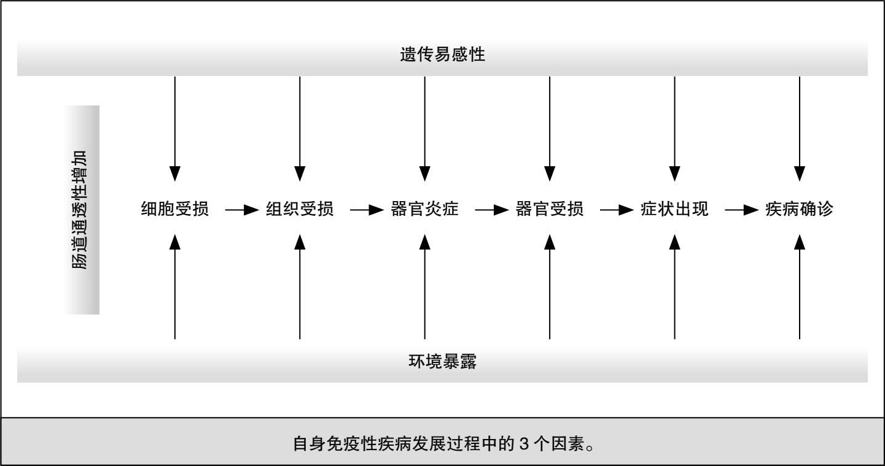
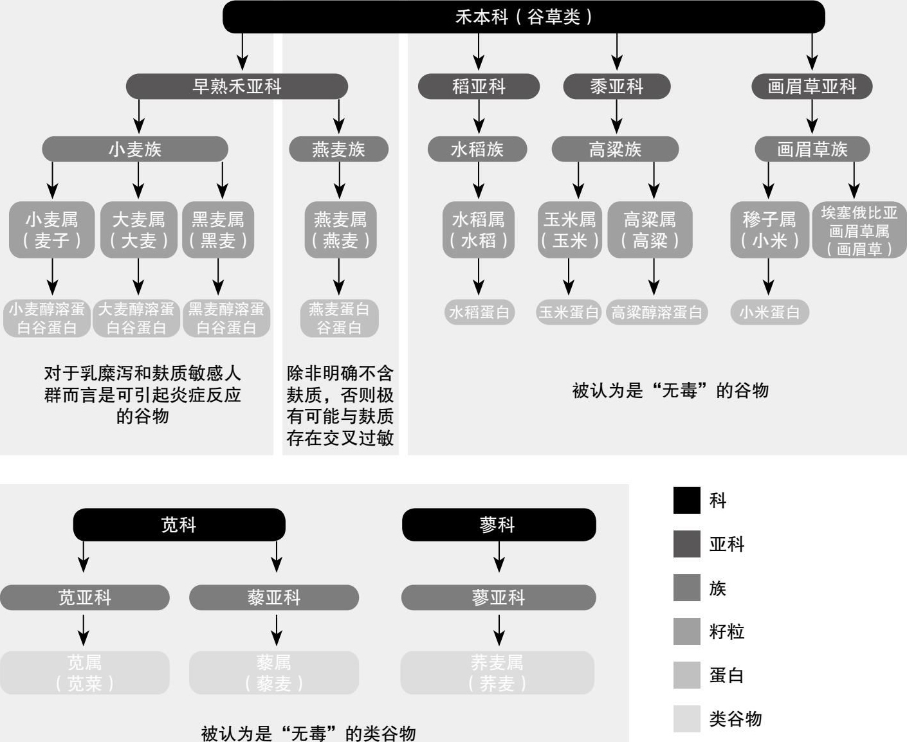
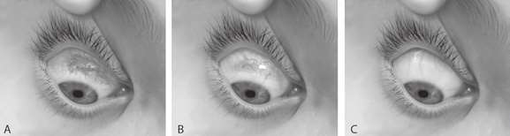
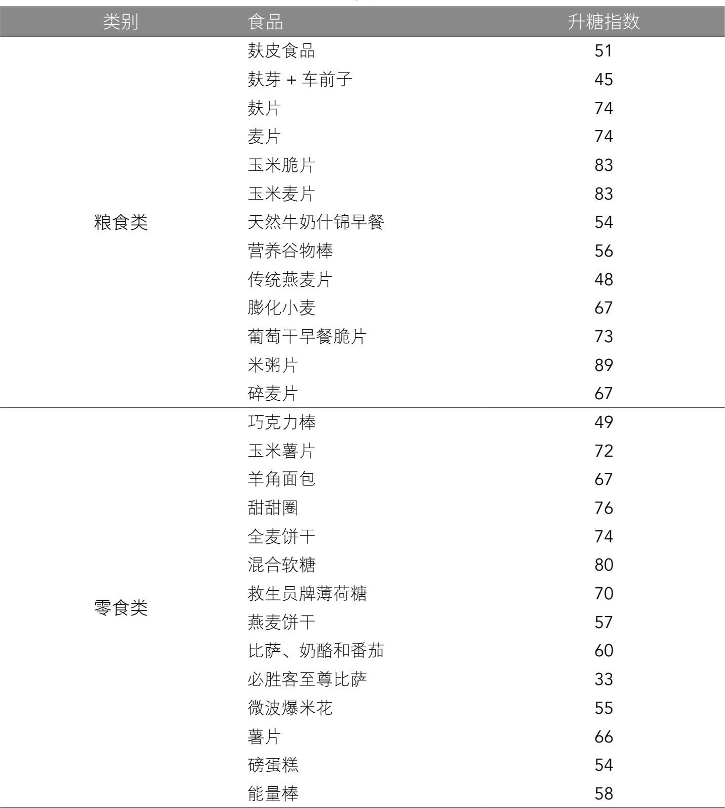
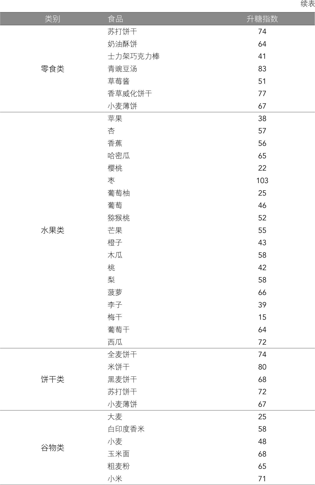
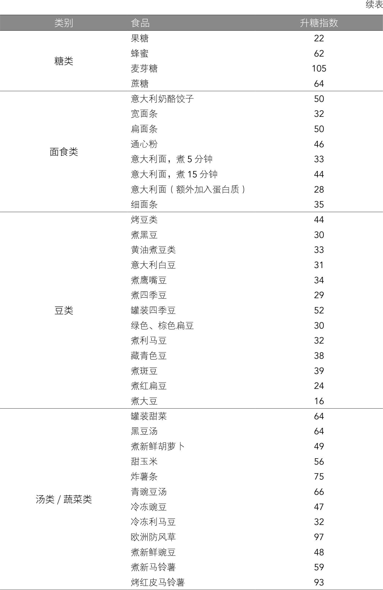
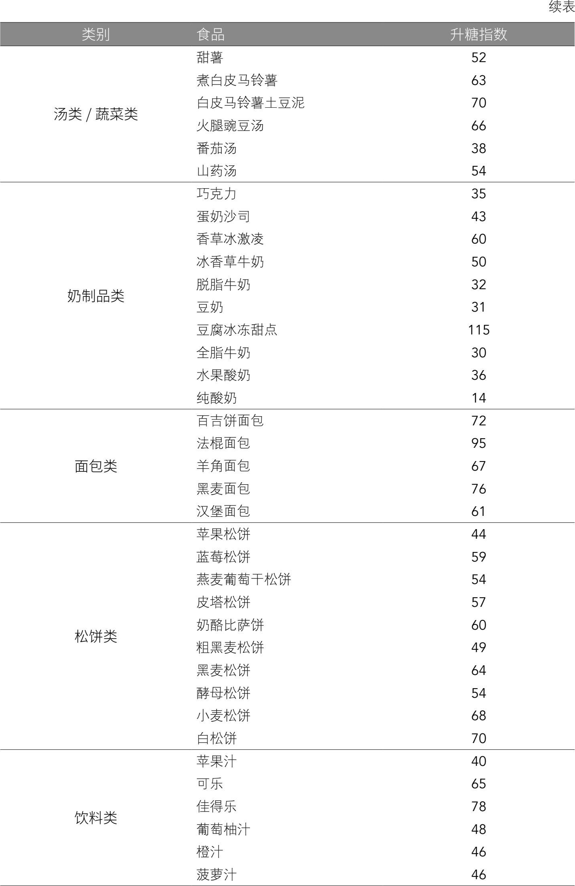
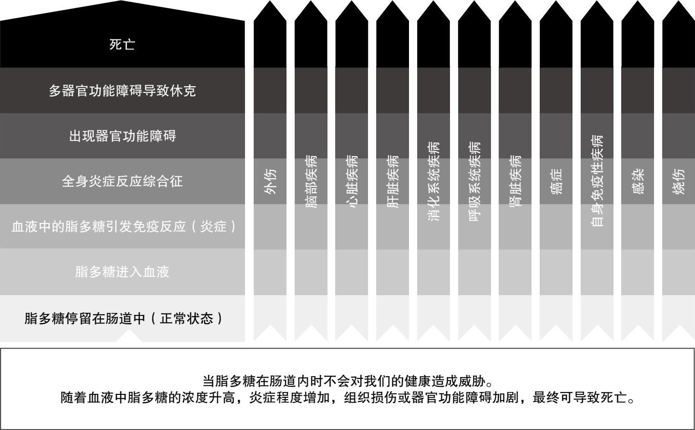

# 第二章 疾病之源 遗传易感性、环境暴露及肠道通透性增加

<h2><b>第</b><b>二</b><b>章</b></h2>

<h2><b>疾</b><b>病</b><b>之</b><b>源</b></h2>

<h2><b>遗</b><b>传</b><b>易</b><b>感</b><b>性</b><b>、</b><b>环</b><b>境</b><b>暴</b><b>露</b><b>及</b><b>肠</b><b>道</b><b>通</b><b>透</b><b>性</b><b>增</b><b>加</b></h2>

	
虽然几乎所有退行性疾病背后的机制都是炎症，但是我们并不会仅仅因为进食含麸质的食物、奶制品或其他任何我们敏感的食物而患上疾病，疾病是由过度的炎症反应引起的。请记住，炎症本身对你并不是有害的，它是我们的身体保护自身免受入侵者伤害的一种机制；过度的炎症反应才是有害的。

	
炎症持续存在，并像我们前面提到的乒乓球那样，如同拥有自己的生命（不断地砰、砰、砰，产生级联反应），从而引起自身免疫性疾病，必须存在以下3个因素：遗传易感性、环境暴露及肠道通透性增加。现已证明这3个因素是大多数自身免疫性疾病发生发展所必需的。只要你从疾病版图上取下这3个中的任意一个，你的身体状况就会好转。

在本章中，你将学习到如何识别这3个因素，并确定它们是否会对你产生影响。后续的章节将告诉你如何改善甚至清除那些你自己可以控制的因素，这样你就可以重置你的免疫反应并阻止自身免疫过程的发展了
	<a id="noteref-8-92" href="#footnote-8-92">[1]</a>。

	
虽然分子模拟尚未被广泛重视，但它确实是导致慢性炎症的关键原因之一。了解这种机制是如何工作的将会帮你认识到，即使是最低剂量的毒性暴露也可能对你的健康产生广泛而长期的负面影响。

	
<b>移</b><b>动</b><b>的</b><b>目</b><b>标</b><b>：</b><b>分</b><b>子</b><b>模</b><b>拟</b>

	
你需要了解两种类型的抗体：毒素抗体和自身抗体。我们在第一章中已给了解了毒素抗体。第二种抗体叫作自身抗体，即针对自身组织产生的抗体。

	
我们的体内每时每刻都在发生着细胞损伤。我们的细胞每7年就会更新一次。其中一些细胞更新速度很快，比如肠道内壁细胞每3～7天就更新一次；其他细胞更新速度会慢一些，比如骨骼细胞。身体会清除旧的受损细胞，以腾出空间供新细胞发育。

	
自身抗体的产生就是机体完成细胞更新的手段之一。免疫系统每天都要产生恰当数量的自身抗体，以清除特定的受损细胞。针对肺细胞、肾上腺细胞、髓鞘细胞、甲状腺细胞等都有不同的自身抗体。通过血液检测可以评估正在产生自身抗体的过程。当一切正常时，自身抗体水平会在正常范围内。这意味着你的自身抗体正在以适当的速度产生，也就是所谓的良性自身免疫。此时你非常健康。

	
现在，我们再回过头来讨论那些保护你的身体免受有毒物质侵害的抗体。当你暴露于毒素（有害的食物、霉菌、压力、激素、昆虫等）时，炎症循环开始于细胞免疫系统的激活，如果暴露程度超过它所能控制的范围，你的体液免疫系统就会接管这项任务。毒素抗体虽然功能强大，但不像自身抗体那样目标精确。想象一下，一个生化“终结者”在一辆移动的汽车中向车窗外疯狂地扫射，他可能会击中坏人，但也会可能伤及好人和建筑物。这就是所谓的免疫反应的附带损害。

	
附带损害可能带来炎症反应、氧化应激和组织受损。当器官组织受损时会导致器官功能障碍，进而会产生明显的症状。例如，当甲状腺组织受损时，会产生甲状腺功能紊乱，导致手足冰冷、体重无法减轻，或者早上醒来时想要再多睡20分钟。慢慢地你会感到疲劳、无精打采，最终前去就诊。大多数医生会检查甲状腺激素水平，如果结果正常，医生会把疲劳归咎于压力。但他们还应该检查你的抗甲状腺抗体水平。

我接下来要告诉你们的是大多数医生在学校里学不到的东西。准备好了吗？我要说的是：机体产生的抗体能够保护我们不受毒素侵害，但这些抗体工作时很容易出错，会破坏其他看起来很像毒素的分子。传染性病原体、食物等都有可能误导我们的免疫系统，因为它们在结构上与人体组织相似
	<a id="noteref-8-128" href="#footnote-8-128">[2]</a>。

	
为了简化问题，我们将麸质的蛋白质结构表示为“A-A-B-C-D”，每个字母代表不同的氨基酸。当麸质分子进入血液后，免疫系统开始产生抗麸质抗体。这些抗体随血液流动，寻找A-A-B-C-D结构，发现后即发射“导弹”。问题是，在血液流经的大脑表面或甲状腺的某个部分，也有类似的A-A-B-C-D结构。抗麸质抗体可以攻击任何具备A-A-B-C-D结构的物质，无论它存在于哪里。这种机制被称为“分子模拟”，它是由麸质引起的自身免疫级联反应的一种主要机制。分子模拟会诱发组织炎症反应，最终导致组织受损；如果分子模拟继续存在而不加以控制，将引起器官损害。这时机体开始产生自身抗体来清除受损的器官细胞。如果我们经常暴露于毒素中，抗体就会持续产生，那么这就是个问题了。如果是这样，器官会不断地受损，进而促进自身抗体的产生以清除受损的器官细胞，形成恶性循环。这时你不仅有症状出现，还启动了自身免疫机制（图2-1）。

	

	
图2-1 自身免疫性疾病发展的主要途径

	
A-A-B-C-D氨基酸链是我们大多数组织的常见组成部分。从肾脏到胆囊、肌肉、骨骼、大脑、心脏，甚至是眼结膜，人体任何部位都可能发生A-A-B-C-D的分子模拟。这就是麸质过敏的症状在任何部位都可以表现出来的原因，因为免疫系统在试图对抗麸质时错误地攻击了自身的组织。我们健康链条中的薄弱环节决定了组织受损最严重的部位所在，而薄弱环节在哪里则取决于你的基因以及你的生活方式。这是导致自身免疫性疾病的3个必要因素中的2个。

	
<b>影</b><b>响</b><b>因</b><b>素</b><b>1</b><b>：</b><b>遗</b><b>传</b><b>易</b><b>感</b><b>性</b>

	
如果你身处自身免疫性疾病发展谱中，那么我猜你的亲属中也有人在上面，只是他（她）可能与你所处的疾病发展阶段不同。我如此自信的原因是，遗传易感性是过度的炎症反应导致自身免疫性疾病所需的第一个因素。

	
遗传密码以不同的方式影响着你的健康。首先是最直接的方式：分子模拟导致免疫系统在识别抗原时出现错误，引起抗体水平升高和组织破坏。

	
免疫系统攻击自身组织的特定方式也取决于你独特的遗传倾向，也就是健康链条中的薄弱部位。在你的家族中，自身免疫性疾病的发展史似乎是一条直线（你的祖父和父亲都患有心脏病），或者看起来更像散点图（你的父亲患心脏病，你的妹妹有流产史，还有一个弟弟曾经发生脑卒中）。这两个例子都反映了自身免疫性疾病的遗传易感性。唯一的区别是，在散点图模型中，健康链条中的薄弱环节并不那么明确，至少一开始是这样。但是当你进行正确的测试时（在第五章中我们会对测试进行概述），你会发现这3个病症都属于抗磷脂综合征的范畴。

	
但是，并非家族中的每个人都在自身免疫性疾病发展谱上，原因有两方面——遗传易感性和你生活方式（包括饮食的选择、毒物的暴露、压力等）。虽然你们可能拥有相同的基因，但某些基因有的人表达了，而有的人则没有，这取决于生活方式。

	
如果你有某种自身免疫性疾病的遗传倾向，那么你体内很容易出现针对相关组织或器官的高水平抗体。例如，如果你的基因倾向于产生过多的IgE，你可能会发生食物过敏。对于有些人来说，慢性炎症可能导致脑卒中、心脏病、糖尿病、阿尔兹海默病或者癌症，因为他们有这些特定病症的易感基因。同样，还有的人可能会出现痤疮或其他皮肤问题。然而，重要的是，你要记住，基因很少直接导致疾病。基因可能会告诉你，“这是你健康链条上的薄弱环节，如果因为体内过度的炎症反应而把链条拉得太紧，链条就会在此处断裂。”当你对链条施加压力时就可能出现疾病，链条会在你的薄弱环节处断裂。如果你有乳糜泻的易感基因，那么如果其他发病的必需因素也同时出现的话——环境诱发因素被（麸质）激活，肠道通透性也增加——你就会很容易患上乳糜泻。虽然乳糜泻的易感基因是你的遗传密码的一部分，但如果没有另外的两个必需因素，你是不可能患上这个病的。这两个因素会影响你的表观遗传学。表观遗传学是一门研究我们的环境和生活方式是如何影响我们基因表达的学科。

	
表观遗传学是一个庞大而复杂的话题，但最基本的解释是：决定健康或疾病状态的是你的基因所在的环境，而不是基因本身。

	
举例来说，咖啡对你是有益的吗？这个问题的答案并不是非黑即白的。很多科学研究结果是相互矛盾的：有的研究表明咖啡是有益的，而有的研究则认为是有害的，会使你患心脏病的风险增加。为什么会这样呢？答案就是在表观遗传学。

	
我们都有一个<i>C</i><i>Y</i><i>P</i><i>1</i><i>A</i><i>2</i>基因，它的表达产物能帮助我们分解有毒化学物质。它有两种分型，1A和1F。我们都从父母那里继承了这两种分型中的一个。如果你继承的是1A，那么与喝咖啡相关的早发性心脏病的发生风险如下：

	
每天少于1杯咖啡——风险没有变化；

	
每天1杯咖啡——风险降低61%；

	
每天2～3杯咖啡——风险降低65%；

	
每天4杯咖啡——风险降低19%。

	
由此可见，对于有1A类型基因的人来说，每天喝1～3杯咖啡是比较有好处的。

	
如果你继承的是1F，那么与喝咖啡相关的早发性心脏病的发生风险如下：

	
每天少于1杯咖啡——风险没有变化；

	
每天1杯咖啡——风险增加112%；

	
每天2～3杯咖啡——风险增加143%；

	
每天4杯咖啡——风险增加307%。

基因不能决定你是否得病，它们只是决定了你健康链条中的薄弱环节
	<a id="noteref-8-30" href="#footnote-8-30">[3]</a>。如果你拉紧健康链条（例如，如果你有1F型<i>C</i><i>Y</i><i>P</i><i>1</i><i>A</i><i>2</i>基因，同时还喝咖啡），这个链条就会有断裂的风险（50岁之前心脏病发作）。

	
表观遗传学告诉我们，虽然基因会对我们的健康产生影响，但它们并不能决定我们的命运。如果同卵双胞胎在相同的环境中生活，随着年龄的增长，他们看上去还是一样的。但是如果他们各自的生活环境发生了改变，包括给予饮食不同、压力不同，其他生活方式也不同，那么这对双胞胎看起来就会不同，他们的健康状况也会不同。这些差异是由某种基因表达是否被激活造成的，这取决于以上这些外部因素。

即使在你的体内携带有增加自身免疫性疾病风险的基因，这些基因也不一定会导致疾病。例如，许多携带乳糜泻或非乳糜泻性小麦敏感基因的人终生都没有出现这些疾病的症状。而对于某些人来说，这些症状在出生后的第一年就会显现出来。有的人则会稍晚些出现症状。有的人进食含有麸质的食物很多年而没有任何症状，直到他们丧失了对麸质的耐受性，才激活基因，产生抗体（现在他们已经在疾病发展谱上了），导致疾病发展。研究人员发现，乳糜泻的发病率每15年左右会翻一番：20世纪70年代是1/500，20世纪80年代是1/250，21世纪是1/100
	<a id="noteref-8-256" href="#footnote-8-256">[4]</a>。

	
如果理解了疾病的发展机制，我们就有机会来改变疾病的走向，让我们的身体朝着更健康的方向前进。杰弗里·布兰德博士在他的著作《基因工程》（<i>G</i><i>e</i><i>n</i><i>e</i><i>t</i><i>i</i><i>c</i><i> </i><i>E</i><i>n</i><i>g</i><i>i</i><i>n</i><i>e</i><i>e</i><i>r</i><i>i</i><i>n</i><i>g</i>）的最后写道：

	
<b>归</b><b>根</b><b>结</b><b>底</b><b>，</b><b>对</b><b>你</b><b>的</b><b>健</b><b>康</b><b>、</b><b>活</b><b>力</b><b>和</b><b>功</b><b>能</b><b>影</b><b>响</b><b>最</b><b>大</b><b>的</b><b>不</b><b>是</b><b>为</b><b>你</b><b>看</b><b>过</b><b>病</b><b>的</b><b>医</b><b>生</b><b>，</b><b>也</b><b>不</b><b>是</b><b>你</b><b>吃</b><b>过</b><b>的</b><b>药</b><b>、</b><b>做</b><b>过</b><b>的</b><b>手</b><b>术</b><b>或</b><b>接</b><b>受</b><b>过</b><b>的</b><b>其</b><b>他</b><b>治</b><b>疗</b><b>，</b><b>而</b><b>是</b><b>你</b><b>做</b><b>出</b><b>的</b><b>关</b><b>于</b><b>饮</b><b>食</b><b>和</b><b>其</b><b>他</b><b>生</b><b>活</b><b>方</b><b>式</b><b>的</b><b>决</b><b>定</b><b>所</b><b>带</b><b>来</b><b>的</b><b>累</b><b>积</b><b>影</b><b>响</b><b>，</b><b>以</b><b>及</b><b>这</b><b>些</b><b>决</b><b>定</b><b>对</b><b>基</b><b>因</b><b>表</b><b>达</b><b>的</b><b>影</b><b>响</b><b>。</b>

	
生活方式决定了你激活的基因，决定了你是健康的还是病得很重，或者介于两者之间。基因检测可以确认你是否携带某种基因以及你的薄弱环节所在。

	
虽然我们无法改变自己的基因，但我们可以在参与自身免疫性疾病发病的另外两个因素上下功夫：肠道通透性增加和环境暴露。即使你有自身免疫性疾病的遗传易感性，也可以通过选择正确的生活方式来控制炎症（在第六章中讨论转变方案时，我们会对此进行详细的论述）。只有当遗传易感性和环境暴露同时发力时，才会使你在自身免疫性疾病发展谱上继续前进。

	
<b>影</b><b>响</b><b>因</b><b>素</b><b>2</b><b>：</b><b>环</b><b>境</b><b>暴</b><b>露</b>

	
当外来的抗原超过我们身体的应对极限，以至于身体不能轻松地说“哦，这是个不受欢迎的东西，但这没什么大不了的”时，就会导致过度的炎症反应，从而引起关节疼痛、体重增加、脑雾、疲惫以及许多其他情况。这些抗原就此进入自身免疫的循环，因为我们在第一章中讨论过的军队开始回应它们的入侵以保护我们自身。

	
不健康的抗原包括一些食物、霉菌、杀虫剂、防腐剂或添加剂，机体暴露于这些抗原下时产生的迹象有疲劳、注意力难以集中、疼痛、肌肉抽搐、皮疹、腹胀、慢性感冒或皮肤感染。高糖食品、乳制品和小麦对人体的毒性不亚于环境污染物。

	
身体会对某些食物产生免疫反应，导致食物过敏或食物敏感。食物过敏原可导致全身炎症反应，表现为皮疹、荨麻疹、鼻塞、流泪、呕吐、窒息、咳嗽、哮喘等。极端情况下，可能会引发机体内部炎症进而导致变态反应，这是一种严重的疾病，患者喉头水肿，呼吸困难。在美国，最常见的引起过敏的食物包括小麦、乳制品、玉米、花生、大豆、贝类、草莓和鸡蛋。

	
食物敏感看起来似乎与变态反应完全不同，但它们同样很难对付——它们都会引起过度的炎症反应。食物敏感通常表现为迟发反应：在进食敏感食物后的72小时内，身体可能都没有反应。这意味着你今天吃了某种食物后，可能3天后才出现反应。这种反应可以是轻微的胃痉挛、顽固的偏头痛，也可以是其它任何表现。

尽管你可能对几乎任何种类的食物产生敏感性，但含麸质的食物、乳制品和糖类通常是最常见的。如果一个人没能意识到食物敏感，继续进食这类食物，使过度的炎症逐渐累积，由此引起组织损伤，最终导致器官损伤，这样的时间越长，他（她）就越有可能患上自身免疫性疾病。遗憾的是，直到现在，相关测试仍不完善，所以很多人并不知道他们对哪种食物敏感。这就是那些对麸质敏感但仍在进食含麸质食物的人，患类风湿关节炎或桥本甲状腺炎等自身免疫性疾病的概率是普通人群10倍的原因
	<a id="noteref-8-220" href="#footnote-8-220">[5]</a>。

	
然而，一旦发现并避免食用引起问题的食物，免疫系统就会开始恢复，身体状况也会开始好转。我曾亲身见证，一旦从患者的饮食中去除那些相对不健康的食物，患者的健康状况就会发生巨大的变化。避免食用不健康的食物从而抑制炎症的级联反应，对不孕症、类风湿关节炎、银屑病、幼年特发性关节炎、偏头痛、癫痫发作等疾病都有帮助。

	
<b>不</b><b>是</b><b>所</b><b>有</b><b>麸</b><b>质</b><b>都</b><b>会</b><b>造</b><b>成</b><b>伤</b><b>害</b>

麸质是一类在许多谷物中都存在的蛋白质，这些谷物包括小麦、黑麦、大麦、大米、玉米、藜麦等。人类无法彻底消化的是小麦、黑麦和大麦中的“有毒”麸质。图2-2显示：小麦族的谷物含有“有毒”麸质；而其余的含麸质食物，除非你对它们是敏感的，否则都是可以安全食用的。例如，我们知道44%的乳糜泻患者对玉米敏感
	<a id="noteref-8-147" href="#footnote-8-147">[6]</a>。

	
美国农业部、美国食品和药物管理局、美国营养与饮食学会、美国心脏协会和美国糖尿病协会一致认为，我们的饮食应该以谷物为主。而且，全球饮食中有50%的热量来自小麦、玉米和大米。但我不同意这个建议。我的同事马克·海曼博士、大卫·珀尔穆特博士、威廉·戴维斯博士、杰弗里·布兰德博士、迪安娜·米尼奇博士、萨拉·戈特弗里德博士，以及世界各地成千上万的临床医生也强烈反对将谷物作为热量的主要来源。我个人认为，适度食用谷物对大多数人是有好处的，但过量食用谷物是造成当今全球肥胖症和糖尿病流行的一个重要原因。

现在我们来仔细讲一下小麦。由于人体内没有消化酶可以充分消化小麦、黑麦和大麦中的蛋白质，所以我们每次进食这些谷物时都会引起炎症反应和肠道通透性增加。我的朋友兼同事阿莱西奥·法萨诺博士在哈佛大学进行了一项研究，他在论文中指出：小麦中的麸质会导致我们每个人肠道的通透性增加。他的团队对4组人群进行了研究：近期确诊的乳糜泻患者（最近进食麸质）、缓解期的乳糜泻患者（至少12个月未进食麸质）、非乳糜泻性麸质敏感患者和对麸质不敏感的患者。法萨诺博士在他的研究报告中强调：“所有人在暴露于醇溶蛋白（一种不易消化的麸质蛋白）后，肠道通透性都会增加
	<a id="noteref-8-265" href="#footnote-8-265">[7]</a>。”

	

	
图2-2 “有毒”和“无毒”谷物

	
我们的身体会产生一种酶，它把蛋白质切割成一个个氨基酸。而麸质的分子组成使这个过程变得很困难。当这种酶酶试图分解麸质分子时，组成麸质的氨基酸序列无法被识别。这就意味着，对人类来说，麸质没有任何营养价值，我们只是把它吃进去然后将其排泄出去。即使你终生不进食麸质，也不会有不良反应。

	
麸质消化不良可能没有任何后果。绝大多数人进食麸质后没能将其消化，也没有任何症状。然而，有些人会出现症状，因为他们拥有前述3个因素中的第一个——遗传易感性。对他们来说，他们现在已经有了2个因素——与麸质相斥的基因以及接触麸质。对这些人来说，麸质对肠道和免疫系统都是强烈的刺激。对许多麸质敏感的人来说，他们的大脑似乎特别脆弱，会出现记忆力减退、注意力不集中、难以专心做一件事、疲劳等症状。

	
<b>莫</b><b>莉</b><b>的</b><b>故</b><b>事</b>

	
莫莉3岁时，她的父母发现她的右眼长了个肿瘤（图2-3A）。莫莉的病史提示莫莉母乳喂养过早停止、对婴儿食物不耐受以及腹胀。在莫莉2岁时，她的耳部曾经反复发生感染，并接受了抗生素治疗。她的体重和身高都远低于同年龄组儿童的正常值。

	
莫莉的肿瘤被诊断为卡波西肉瘤，这通常发生在艾滋病患者身上。虽然莫丽的HIV抗体测试呈阴性，但她的麸质抗体水平很高，乳糜泻相关的内镜检查证实存在肠黏膜微绒毛磨损。眼科医生建议对莫莉的眼睛进行活检，以明确肿瘤发生的原因，但莫莉的父母对此表示担忧，因为之前进行内镜检查时莫莉对全身麻醉有不良反应。他们希望可以等几个星期再活检。与此同时，他们开始让莫莉进行无麸质饮食。

	
2周后复诊时，莫莉眼睛上的肿瘤变小了（图2-3B）。连续坚持2个月无麸质饮食后，莫莉的肿瘤完全消失了（图2-3C）。

	
眼科医生对此感到震惊。在发表这个案例研究时，他们说：“总之，在我们的案例中，一位乳糜泻患者患上了一个非常不寻常的结膜肿瘤，但在接受无麸质饮食后肿瘤完全消失了。在无麸质饮食期间结膜病变的迅速消退，提示病变可能与乳糜泻以及自身免疫过程有关。”

	
显然，对这个小姑娘来说，她健康链条上的薄弱环节是眼睛。这很可能与遗传缺陷有关，而进食麸质则是环境诱因。麸质敏感的表现取决于你的基因（它决定了你健康链条上的薄弱环节）以及环境诱因。

	

	
图2-3 莫莉右眼肿瘤的变化（A～C）

	
麸质引发的问题似乎越来越严重，你可能已经注意到大量的食品制造商已经加入到无麸质的潮流中。多年来，谷物的麸质含量一直在增加。在过去的50年里，美国在小麦的商业化改良过程中通过杂交增加了其麸质含量，这使得如今的小麦更难以消化。因此，对于麸质敏感的人来说，坚持无麸质饮食绝对是有必要的。

	
医生会通过血液检查来判断你是否对麸质敏感。不过，你自己也可以通过饮食排除法来检测。方法是，在接下来的3周，你不吃任何含有麸质的食物，并评估自我感觉；然后重新进食含有麸质的食物，看看是否有反应。

	
<b>糖</b><b>类</b><b>带</b><b>来</b><b>的</b><b>麻</b><b>烦</b>

	
我们都知道，苏打水、甜点和点心中都含有糖，但你可能没有意识到，我们吃的每顿饭几乎也都含有糖。糖是两种主要的食品调味剂之一（另一种是盐）。此外，天然糖分是所有碳水化合物（包括谷物、水果和蔬菜）的基本组成部分。

	
食物中添加的糖由多种植物制成，这些植物将其作为一种储存能量的方式，就像我们把能量储存为脂肪一样。全世界每年生产约1.2亿吨精制糖，其中有70%来自甘蔗，30%来自甜菜。

	
自然界中的天然糖本身对你无害，但加工过的糖几乎没有什么健康益处，甚至没有什么营养价值。糖在其最自然的状态，如甘蔗中的糖，实际上是有一些营养价值的。在发展中国家，孩子们喜欢咀嚼甘蔗，他们都没有蛀牙。但是在美国，吃了很多含糖甜食的孩子最后会出现很多蛀牙。当儿童咀嚼甘蔗时，他们会摄取甘蔗这一植物中的维生素、矿物质、多酚、抗氧化剂以及蔗糖等物质。相反，我们的孩子们吃着加工食品里的精制糖。甜菜含有血红蛋白，众所周知，它是人类血液中用于携带氧气的蛋白质。然而，当甜菜经过加工后，生产出的产品中就没有血红蛋白了。不要愚蠢地认为红糖有益于健康，它只是添加了焦糖色素或糖蜜的精制糖而已。

	
如果你是一个“嗜糖者”，你可能已经意识到，每次身体渴望糖的时候，你可能就需要多吃一点来获得满足感。吃糖比吃甜水果更容易上瘾的原因在于糖被高度浓缩了。我喜欢吃不含麸质的罂粟籽糕点，每3～4个月就吃1个，但如果我要提取罂粟籽中的活性成分来享受这种味道，那就相当于在吃纯海洛因。吗啡是海洛因的副产品，海洛因是从罂粟中提取的。我最喜欢的电视节目之一《流言终结者》（<i>M</i><i>y</i><i>t</i><i>h</i><i>B</i><i>u</i><i>s</i><i>t</i><i>e</i><i>r</i><i>s</i>）曾证明，只需吃2个罂粟籽面包圈就足以使吗啡检测呈现阳性结果。白糖是甘蔗或甜菜的提取物，就像海洛因与罂粟籽的关系一样，吃白糖同样能令人上瘾。

	
摄入过量的加工过的糖，即摄入量超过身体能完全消化的量，是点燃全身炎症这把“火”的主要火引。在第一章中我讲到，我们需要通过免疫反应来清除衰老和受损的细胞，因此在我们的体内始终存在着炎症反应。糖是10种最容易引起炎症反应的食物之一，摄入过量的糖就如同火上浇油，它会把尚可控制的火苗变成熊熊燃烧的大火。高糖饮食也被认为是导致肥胖的主要诱因。

过量摄入糖分会抑制你的免疫系统，使免疫系统效率低下，尤其是当它必须对抗感染时。在摄入糖分后的大约10分钟后白细胞会受到抑制
	<a id="noteref-8-61" href="#footnote-8-61">[8]</a>。因此，举例来说，如果你感冒时吃了大量的糖，你的恢复时间会延长数天。

	
我们都听说过吃太多的糖会引发糖尿病。我们现在知道糖尿病有3种类型。1型糖尿病一直被认为是一种自身免疫性疾病，当抗体破坏了足够的胰岛细胞，使其不能产生足够的胰岛素时，就会发生这种疾病。2型糖尿病与长期过量摄入糖使得我们的糖调节系统功能衰竭有关。2型糖尿病患者在早期一般不需要额外补充胰岛素，他们需要的是帮助胰岛素从血液进入细胞的药物。2型糖尿病患者存在胰岛素抵抗，这是一种自身免疫机制。我们现在知道2型糖尿病的发病有很强的自身免疫色彩。胰岛素抵抗与一种特殊的IgG有关，这种抗体与炎症的增加相关，而炎症会产生过多的内脏脂肪组织。内脏脂肪组织堆积在腰间，如同一个轮胎，这是另一种自身免疫机制的结果。2005年，研究人员发现了第三种类型的糖尿病，称为“3型糖尿病”。3型糖尿病患者大脑中存在胰岛素抵抗，并可导致痴呆。研究人员正在试图将3型糖尿病与阿尔兹海默病关联起来。在后两种类型的糖尿病患者中，过量摄入糖分使得大脑和身体调控胰岛素水平的能力受损，患者体内有大量的胰岛素，只是没有被正确地使用。

	
在过量摄入糖分的多种后果中，下述这些是自身免疫性疾病带来的生理影响，与炎症反应增加和对免疫系统的负面影响有关。

● 糖会使你体内的矿物质代谢紊乱，可导致铬和铜缺乏，干扰钙和镁的吸收。这些矿物质，尤其是铬，是产生抗体所必需的
	<a id="noteref-8-55" href="#footnote-8-55">[9]</a>

● 糖为癌细胞提供营养，并与乳腺癌、卵巢癌、前列腺癌、直肠癌、胰腺癌、胆管癌、肺癌、胆囊癌和胃癌的进展相关。用于对抗这些肿瘤的抗体消耗使得我们的免疫系统精疲力竭
	<a id="noteref-8-80" href="#footnote-8-80">[10]</a>

● 糖会引起许多胃肠道问题，包括消化道酸性增加、消化不良、功能性肠病患者吸收不良，以及患自身免疫性疾病（如克罗恩病和溃疡性结肠炎）的风险增加
	<a id="noteref-8-70" href="#footnote-8-70">[11]</a>

● 糖会导致早衰。我们的机体需要更多的抗体来清除衰老的细胞
	<a id="noteref-8-29" href="#footnote-8-29">[12]</a>

● 糖可引起自身免疫性疾病，如关节炎、哮喘和多发性硬化
	<a id="noteref-8-27" href="#footnote-8-27">[13]</a>

● 糖可导致胰岛素敏感性降低，从而使胰岛素水平异常升高，最终引发糖尿病（这通常是一种自身免疫性疾病）
	<a id="noteref-8-50" href="#footnote-8-50">[14]</a>

● 糖可降低维生素E水平，进而开启自身免疫反应
	<a id="noteref-8-23" href="#footnote-8-23">[15]</a>

● 高糖摄入会使糖基化终产物（它可在人体内附着并破坏蛋白质）水平增高
	<a id="noteref-8-34" href="#footnote-8-34">[16]</a>

● 糖会引起食物过敏
	<a id="noteref-8-10" href="#footnote-8-10">[17]</a>

● 糖可导致妊娠期高血压疾病以及儿童湿疹
	<a id="noteref-8-20" href="#footnote-8-20">[18]</a>

● 糖可引起动脉粥样硬化和心脑血管疾病
	<a id="noteref-8-19" href="#footnote-8-19">[19]</a>

● 糖会破坏DNA的结构
	<a id="noteref-8-12" href="#footnote-8-12">[20]</a>

● 糖可改变蛋白质结构，导致蛋白质在体内的作用方式发生永久性变化
	<a id="noteref-8-32" href="#footnote-8-32">[21]</a>

● 糖可通过改变胶原蛋白的结构使皮肤老化
	<a id="noteref-8-20" href="#footnote-8-20">[22]</a>

● 糖可引起肺气肿
	<a id="noteref-8-9" href="#footnote-8-9">[23]</a>

● 糖会降低酶的功能
	<a id="noteref-8-10" href="#footnote-8-10">[24]</a>

● 帕金森病患者的糖摄入量较高
	<a id="noteref-8-15" href="#footnote-8-15">[25]</a>

● 糖可增加肾脏的体积，并导致肾脏病变，如肾结石的形成
	<a id="noteref-8-27" href="#footnote-8-27">[26]</a>

● 糖会损害胰腺及毛细血管内皮细胞
	<a id="noteref-8-17" href="#footnote-8-17">[27]</a>

● 糖可引起头痛，包括偏头痛
	<a id="noteref-8-14" href="#footnote-8-14">[28]</a>

● 糖会增加患痛风的风险
	<a id="noteref-8-12" href="#footnote-8-12">[29]</a>

● 糖会增加患阿尔茨海默病的风险
	<a id="noteref-8-16" href="#footnote-8-16">[30]</a>

● 高糖饮食会增加自由基和氧化应激
	<a id="noteref-8-17" href="#footnote-8-17">[31]</a>

● 糖使尿液电解质成分改变，不利于健康
	<a id="noteref-8-19" href="#footnote-8-19">[32]</a>

● 糖可使肾上腺功能下降
	<a id="noteref-8-12" href="#footnote-8-12">[33]</a>

● 糖可能诱发正常健康个体的异常代谢过程，并促进慢性退行性疾病发生
	<a id="noteref-8-33" href="#footnote-8-33">[34]</a>

● 高糖摄入可导致癫痫发作
	<a id="noteref-8-13" href="#footnote-8-13">[35]</a>

● 糖会导致肥胖人群血压升高
	<a id="noteref-8-14" href="#footnote-8-14">[36]</a>

● 糖可能诱导细胞死亡
	<a id="noteref-8-11" href="#footnote-8-11">[37]</a>

● 糖会导致牙龈疾病
	<a id="noteref-8-10" href="#footnote-8-10">[38]</a>

	
吃高糖食物时，起初血糖水平会上升，你会感觉体内能量爆发。如果糖分过快地进入血液，身体无法迅速适应，血糖值就会升高并达到峰值，然后开始迅速下降，此时你可能会感到疲倦、易怒、注意力不集中或出现脑雾。

	
我的目标之一就是让你离开这个血糖骤升骤降的“过山车”。远离那些加工过的糖，你的大脑和身体就有机会重回正常状态。你可能会发现在完成3周的转变方案后，许多情绪问题，如焦虑、抑郁和易怒就会消失。一旦你开始了3周的转变方案，你需要避免摄入任何形式的加工糖，并学会平衡全天的总糖摄入量。你可能听说过，第一次进行低糖饮食时会感到烦躁不安，但我向你保证，我已经考虑到了这一点，你将要采用的方案比其他简单的“低碳水化合物方案”更完善。我的转变方案会专注于保持血糖水平全天稳定，因此你不会有不良反应。

虽然代糖不会增加饮食中的热量，但从长远来看，它们也会带来严重的问题，就像吃过量的加工糖一样危险。例如，阿斯巴甜、糖精和三氯蔗糖都能显著升高血糖水平
	<a id="noteref-8-73" href="#footnote-8-73">[39]</a>，其发生机制是因为这些无热量的人造甜味剂改变了肠道菌群。我们将在第三章中详细讨论肠道和肠道菌群，但是现在我们需要明确血糖水平升高不仅会导致糖尿病，还会导致体重的过度增加
	<a id="noteref-8-158" href="#footnote-8-158">[40]</a>。

	
升糖指数可以将某种特定食物提高血糖的速度进行量化（表2-1）。使用纯葡萄糖作为这一指数的基数，其值为100，其他碳水化合物的升糖指数都是相对于葡萄糖而言的，这取决于它们进入血液的速度：指数越低，需要的时间越长，血糖就越能够保持稳定；指数越高，你就越有可能感受到如同过山车般的血糖水平骤升骤降。

	
高升糖指数食物（升糖指数＞60）包括冰激凌、面包、白薯、香蕉、葡萄干、薯片、酒精饮料和白米等。根据畅销书《麦肚》（<i>W</i><i>h</i><i>e</i><i>a</i><i>t</i><i> </i><i>B</i><i>e</i><i>l</i><i>l</i><i>y</i>）的作者威廉·戴维斯医生的说法，小麦产品的升糖指数在所有食物中是比较高的。低升糖指数食物（升糖指数＜45）被认为是更好的，其中包括大多数水果、蔬菜和豆类。

	
升糖指数无疑可以帮助你在食物方面做出更好的选择，它还指出了所谓的“健康选择”的一些差异。例如，全麦面包的升糖指数高达69，比士力架巧克力棒还高，后者含有花生，升糖指数只有41。

	
升糖指数的唯一缺点是，它只能反映单次进食后的情况。我的朋友，畅销书作家J.J.维珍在她的著作《J.J.维珍的糖类食谱》（<i>J</i><i>.</i><i>J</i><i>.</i><i> </i><i>V</i><i>i</i><i>r</i><i>g</i><i>i</i><i>n</i><i>'</i><i>s</i><i> </i><i>S</i><i>u</i><i>g</i><i>a</i><i>r</i><i> </i><i>I</i><i>m</i><i>p</i><i>a</i><i>c</i><i>t</i><i> </i><i>D</i><i>i</i><i>e</i><i>t</i>）中指出：与任何一种食物的升糖指数相比，你一天中摄入的所有糖的综合效果要重要得多。即使在一天中我们吃的各种食物中每种仅含有少量的糖分，但累积起来也会对你的健康产生巨大的影响。同我一样，她也建议不要摄入加工过的糖。虽然香槟油醋汁听起来很健康，但它确实很甜。如果将其加到沙拉上，你就在原本健康的膳食中添加了高升糖指数的糖。这本身不算什么问题，因为糖的量并不多，但如果你因还吃了小餐包、意大利面以及餐后甜点，那么总糖的摄入量对血糖调节系统的影响就比较大了。

	
表2-1 常见食物的升糖指数

	

	

	

	

	
如果你患有糖尿病，那么你应该已经知道你在处理过多的糖分方面存在问题。但如果你处于自身免疫性疾病发展谱中，你可能不会意识到糖分对健康的影响有那么大。稳态模型评估法是一种对血糖失衡很敏感的血液测试，在你患上糖尿病或出现其他血糖问题之前就会有阳性提示。你可以把腹部多余的脂肪归咎于过量的糖摄入，虽然糖不是导致腹围增加的唯一原因，但它可能是罪魁祸首。如果你的尿液很甜，也说明你摄入了过多的糖分。

	
<b>乳</b><b>制</b><b>品</b><b>也</b><b>存</b><b>在</b><b>问</b><b>题</b>

	
你在超市里看到的大多数乳制品都是精制的。为了延长乳制品的保质期，厂家做了两件事：巴氏灭菌和均质化。巴氏灭菌是将牛奶加热到一定的温度以杀死细菌的方法。但是在这个过程中，牛奶中的部分酶和维生素被破坏了。酸奶也不太可能含有其包装上标注的那么多有益菌，其原因之一就在于细菌无法在巴氏杀菌奶中大量繁殖。均质化过程使牛奶具有奶油般的稠度。它改变了乳脂的大小和形状，这会使其更容易吸收并在体内引起炎症。较小的乳脂分子还会附着在动脉壁上，然后身体通过产生一层胆固醇来保护这一区域，而胆固醇与心脏病有关。

	
在美国，许多大型奶牛场都会给奶牛注射激素，其中包括用于提高牛奶产量的转基因牛生长激素。而在欧洲和加拿大，由于担心这些激素会增加患雌激素相关癌症（如乳腺癌）的风险，因此被禁用。

最广为人知的乳制品敏感是乳糖不耐受。肠黏膜微绒毛可产生消化乳制品的酶——乳糖酶。当因为各种原因导致肠道内炎症增加时，比如麸质敏感者进食了麸质，乳糖酶的量就会急剧减少。这种酶的缺乏就导致了乳糖不耐受的产生。大约50%的乳糜泻患者同时存在乳糖不耐受，这可能就是即使他们接受无麸质饮食但症状却持续存在的原因
	<a id="noteref-8-150" href="#footnote-8-150">[41]</a>。如果在接受无麸质饮食的同时继续吃乳制品，他们将继续产生抗麸质抗体。这就是所谓的交叉反应。但是，如果他们能坚持1年无麸质饮食，炎症就会消退，乳糖酶的产量自然也会增加。在这种情况下，乳糖就可以被分解，乳糖不耐受的表现就会消失。

牛奶中80%的蛋白质以及人乳中20%～45%的蛋白质是酪蛋白。酪蛋白是一种难以消化的蛋白质，这就是健美运动员晚上睡觉前要喝酪蛋白奶昔的原因。酪蛋白在肠道内分解需要数小时，这使得肠道能够整夜为肌肉提供少量的氨基酸。免疫系统会以不同的方式对乳制品做出反应，这取决于机体将乳制品中的哪个成分视为刺激物。例如，酪蛋白类吗啡肽是一种不易消化的乳蛋白成分，这种成分可与大脑中的阿片类受体结合，与婴儿猝死综合征、食物过敏时组胺的释放、高脂肪食物摄入后的刺激以及多动症和自闭症的认知功能障碍有关
	<a id="noteref-8-239" href="#footnote-8-239">[42]</a>。当免疫系统将酪蛋白类吗啡肽视为异物时，就会产生相应的抗体。在一些乳类替代品（如米乳）中，会添加酪蛋白作为防腐剂。暴露于高水平的酪蛋白中可以引起针对炎症的免疫反应，类似于免疫系统对麸质的反应。

乳制品可导致多种自身免疫性症状和病症，并可能在自身免疫性疾病发展谱上把你向前推进。摄入乳制品与痤疮、桥本甲状腺炎、系统性红斑狼疮以及糖尿病相关。对于1型糖尿病高危婴儿（通过家族史判断），我们建议在宝宝1周岁前避免喂食任何牛奶制品，否则宝宝患1型糖尿病的风险会更高
	<a id="noteref-8-131" href="#footnote-8-131">[43]</a>。

	
在3周的转换方案中，除了含麸质食物和糖类，我建议你也不要进食乳制品，因为很多人都对乳制品不耐受。如果你能按照转变方案安全地在饮食中添加乳制品，可以选择那些明确标有“有机”且不含转基因牛生长激素的产品。

	
<b>脂</b><b>多</b><b>糖</b><b>：</b><b>沉</b><b>默</b><b>的</b><b>炎</b><b>症</b><b>触</b><b>发</b><b>者</b>

	
你能想象吗？在美国有一种疾病每年的致死人数比心血管疾病还要多，但你却从未听说过这个疾病。不同于我们前面讨论过的来源于食物的环境暴露，有一种毒素暴露已经存在于我们体内。脂多糖是细菌的组成部分，主要存在于肠道中。脂多糖分子最初存在于某些细菌的细胞壁中。当这些细菌被肠道内的有益菌消灭后，它们的残留物就会游离在肠道内。如果这些残留物仅仅停留在肠道中，通常不会引起什么问题。但如果脂多糖突破了肠道黏膜屏障，进入血液，就会出现问题。

	
内毒素是体内产生的毒素，脂多糖就是其中之一，但由于它非常常见，以至于许多学者甚至一些字典都将脂多糖与内毒素混为一谈。当你了解更多关于排毒以及在体内创造一个更健康的环境的相关内容时，你就会接触到“内毒素”这个词。不要被它所迷惑，这个词一般都是指高浓度的脂多糖。

	
高脂肪饮食（包括但不限于大量食用棕榈油和玉米油）可以促进脂多糖进入血液，确切地说，脂多糖是骑在这些高脂肪食物分子的背上进入血液的。血液中少量的脂多糖引发的炎症会促进一种叫作“脂联素”（抗肥胖激素）的抗炎激素的产生。然而，大量的脂多糖引发的炎症会超出身体的处理能力，接下来就是炎症级联反应。防止脂多糖积聚的方法之一就是进行饮食调控。

已知有两种主要的化合物会导致肠道通透性增加：麸质和脂多糖。当脂多糖进入血液后，它会四处游走。如果它沉积在大脑，就会引发大脑的炎症（这就是我母亲的死因：中毒性代谢性脑病）。如果它沉积在关节，就会引发关节炎症（关节炎或类风湿关节炎）
	<a id="noteref-8-114" href="#footnote-8-114">[44]</a>。没有任何器官或组织能免受脂多糖的影响，而且它与许多慢性症状有关。你的薄弱环节在哪里？请记住，你的身体从不撒谎，去倾听身体的语言吧！

少量的脂多糖可能会引起发热、对细菌感染的抵抗力下降以及白细胞减少。美国疾病控制与预防中心指出，大量的脂多糖会导致组织血流量减少，每年可导致175000～200000人死亡；同时美国CDC还指出，每年可能有50万人受其困扰，但并没有人谈论这个问题
	<a id="noteref-8-122" href="#footnote-8-122">[45]</a>。这是因为处理脂多糖毫无利润可言——没有药物可以解决这个问题。

	
脂多糖是自身免疫性疾病的诱因。当脂多糖停留在肠道中时，它不会对健康造成什么影响。但它一旦进入血液，就会引发炎症反应。正如你从图2-4中所看到的，脂多糖可以通过相同的机制对许多疾病过程产生不利影响。随着脂多糖水平的升高，炎症不断加重，症状逐渐明显。如果不加以控制，这将是致命的。在第五章中，你将学习如何检测目前的脂多糖水平，然后你将了解如何通过改变生活方式来阻止这一机制的发生。

	

	
图2-4 脂多糖是自身免疫性疾病的诱因

	
<b>南</b><b>希</b><b>的</b><b>故</b><b>事</b>

	
南希每次出门都要带一包纸巾。她患有慢性过敏症，但却始终搞不清楚自己对什么过敏。她也一直在与抑郁症做斗争，而且总是感到腹胀，尽管她并不认为自己存在消化方面的问题。一盒甜甜圈、一盒冰激凌、一碗面条所带来的诱惑对她来说往往难以抗拒，并且似乎这些东西能平息她的焦虑情绪。在公共场合，她通过穿着来隐藏她肥胖的体形。她甚至没有考虑过约会。尽管只有28岁，但她已经对异性失去了兴趣。

	
对于普通医生来说，南希是一个典型的抑郁症患者，需要应用处方抗抑郁药，可能还需要一些抗焦虑药，以及合适的减肥和锻炼计划。但对于南希这样的患者，大多数医生都忽略了一点，那就是她的抑郁、焦虑和体重增加实际上是引起慢性炎症的免疫反应的结果。像许多女性一样，南希的一系列症状都指向一个罪魁祸首——全身炎症级联反应。

	
当南希来到我的诊室时，我对她进行了抗体检测以明确她的问题根源。我发现导致她自身免疫反应的罪魁祸首是对麸质和乳制品敏感，以及血液中升高的脂多糖。这些分子激活了她的免疫系统。但是这些分子是如何进入她的血液的呢？答案是第三个条件：肠道通透性增加。

	
通过适当的检测和治疗、无麸质且无乳制品的饮食，以及针对肠道通透性增加的营养治疗，在6个月内，南希体内的抗脂多糖抗体水平下降了。随着炎症消退，她的症状在最初的2周内就开始减轻。6个月内，她的衣服尺码小了两号，复诊时充满活力。

	
<b>影</b><b>响</b><b>因</b><b>素</b><b>3</b><b>：</b><b>肠</b><b>道</b><b>通</b><b>透</b><b>性</b><b>增</b><b>加</b>

	
阿莱西奥·法萨诺博士说过：我们机体处于健康状态还是疾病状态是由我们本身（基因）和我们周围的环境共同决定的，而肠道正是这两个元素交汇的入口。

	
消化系统有两个密切相关的功能：一是消化食物，吸收其中的营养成分；二是将食物中的毒素或刺激物过滤掉，防止它们入血。如果肠道通透性增加（肠漏），某些未完全消化的物质和像脂多糖这样的毒素便会进入血液。究竟哪些物质可以“偷渡”入血，取决于肠漏的程度。

	
想要了解肠漏，你必须了解小肠的解剖结构和功能。这里是真正进行消化和吸收的地方。在小肠中，食物被分解成分子，它们或是继续在消化道内向前推进，或是通过小肠黏膜进入血液。肠黏膜上皮细胞层只有一层，它的功能就像粗纱布，只有小分子物质才能通过。小肠之所以那么长，其中一个原因就是，有些食物很难被分解成小到足以穿过这层粗纱布的颗粒。然而，当粗纱布因为炎症而被撕破时，大分子物质就会穿过粗纱布进入血液，而此时这些大分子物质还未被完全分解成可以被我们的机体利用的原料。

	
当这些大分子物质进入血液时，免疫系统会说：哇，这是什么？我不觉得这些大家伙可以用来制造新的骨细胞或肌肉细胞，最好还是把它们消灭掉。于是身体开始产生对抗这些大分子物质的抗体。如果这个大分子物质来自番茄，你现在就有了抗番茄抗体。如果是麸质，你就会产生抗麸质抗体。虽然免疫系统又一次为了保护你，但却在你的薄弱环节处造成了附带伤害。有人曾做过食物过敏测试，发现有15种食物都呈现阳性结果，他们说：“天哪，我吃的每样食物都让我过敏”。当然是这样。你的免疫系统正试图保护你，使你远离那些在被完全消化之前就进入血液的有毒大分子物质。

	
遗传易感性、环境暴露和肠道通透性增加，现在这3个因素都有了，你所面临的是引起自身免疫性疾病的炎症如潮水般涌来。在所有自身免疫性疾病的病例中，首先发生的似乎都是肠道通透性的增加。

	
阿莱西奥·法萨诺博士是马萨诸塞州综合医院儿童胃肠病科主任，他对每一位从哈佛医学院毕业的儿童胃肠病科医生进行了培训。他通过下面这个类比很好地描述了肠道通透性增加的发生机制：想象一下，城墙由一层细胞构成，修筑城墙是为了把敌人挡在外面，城墙上每隔几百米就设有一个检查站，人们可以在严密监控下从这里进出。在肠道中，这些检查站被称为“紧密连接”。当检查站正常工作时，就不会有敌人混进来。但是一旦检查站被破坏，不受控制的入侵者就会蜂拥而入。

	
当你不停地吃那些你不能消化的食物（比如含麸质的食物）时，你肠道内的炎症之火就会越烧越旺。这会使肠道内的有益菌减少，而有害菌则会增加，酵母菌也会过量。肠道内菌群环境的紊乱称为生态失调。这些细菌的变化导致食物在肠道中发酵而不是被消化，从而产生气体，引起腹胀。更糟糕的是，免疫系统会将新生细菌和酵母菌也视为入侵者，从而在消化道中引起新的炎症反应，进而导致组织损伤，结果肠黏膜上皮这层“粗纱布”被进一步撕破，通透性增加，血液中的免疫反应也增强，全身炎症加重，在你的薄弱环节处表现出更多的症状。

	
只要肠漏持续存在，你就会出现炎症和症状。低热、全身乏力和反复的腹痛是肠漏综合征的常见症状。在看似毫无诱因的情况下，你可能患上季节性过敏、皮疹，甚至类风湿关节炎、系统性红斑狼疮或桥本甲状腺炎等自身免疫性疾病。这些疾病发生之处，可能就是你的薄弱环节所在。

压力、麸质和过量的脂多糖已被证实可以导致肠漏。2015年发表在《营养》（<i>N</i><i>u</i><i>t</i><i>r</i><i>i</i><i>t</i><i>i</i><i>o</i><i>n</i>）杂志上的一篇研究报告指出，无论是否患有乳糜泻或是对麸质敏感，所有人在接触麸质时都会使肠道通透性增加
	<a id="noteref-8-95" href="#footnote-8-95">[46]</a>。普通人群在进食麸质5小时内会引发一过性的肠漏。但对于乳糜泻或对麸质敏感的人来说，在进食后的36小时内，损伤都无法自行修复。身体中生长最快的细胞就是这些肠道上皮细胞（你的“粗纱布”）。它们不断地自我修复，每3～7天就更新一次。当你早餐吃烤面包的时候，“粗纱布”被撕破，然后自我修复；午餐时你吃了三明治，“粗纱布”再次被撕破，然后自我修复；晚餐时你吃了意大利面，“粗纱布”又被撕破，然后自我修复。肠道黏膜上皮细胞的损伤与修复循环就这样周而复始，日复一日。在美国，小麦的平均消耗量是每人每年60千克，而我现在一点也不吃。要知道，你每吃一口小麦都是在撕扯着你的“粗纱布”，虽然它会自我修复，但终有一天，你的“粗纱布”会再也无法修复了。

	
发生了什么？为什么你的身体让你失望了？研究人员将这种现象称为“口腔耐受性丧失”。你的身体再也无法适应你所接触毒素的程度——无论是食物、有毒化学物质、重金属，还是压力。现在你有了致病性的肠道通透性，也就是肠漏，现在你的自身免疫系统开始影响你的薄弱环节。

	
好消息是，肠道通透性增加是完全可逆的。你不必再忍受肠漏的症状或由此引发的全身并发症。通过我的转变方案，你将远离最常见的环境暴露，这将减轻你肠道内的炎症并使你的肠道上皮细胞恢复正常。你可以通过修复肠漏来阻止自身免疫性疾病的发展。

	
<b>萨</b><b>曼</b><b>莎</b><b>的</b><b>故</b><b>事</b>

<h1><b>第</b><b>二</b><b>部</b><b>分</b></h1>

	
在上一章中，我介绍了我的患者萨曼莎。我第一次见到她是在她被诊断为抗磷脂综合征和系统性红斑狼疮后，其中系统性红斑狼疮的诊断比抗磷脂综合征的诊断晚了3年。在她31岁时我开始和她一起工作。我做的第一件事就是询问她的家族史。我特别想知道她是否存在自身免疫性疾病的遗传易感性。萨曼莎告诉我，虽然她的父母也有其他自身免疫性疾病的表现，但是她的家人中既没有血栓史，也没有系统性红斑狼疮史。事实上，她的父母都有与麸质相关的疾病表现，但他们的症状与萨曼莎不同。

	
对此我毫不惊讶，因为我知道每个人都有不同的薄弱环节，一种基因在同一家族各个成员中的表达也可能不同。这就是表观遗传学的故事，即环境如何触发基因的表达。虽然萨曼莎和她的父母存在相似的基因，但她的父母受到环境影响时与她的表现不同，这是因为当萨曼莎的基因打开时他们的基因已经关闭了，或是正相反，这使得基因表达的疾病以不同的方式呈现。还记得我之前举过的关于同卵双胞胎的例子吗？道理是一样的。

	
我询问萨曼莎的食物敏感情况。我发现她对多种食物敏感，其中麸质食物对身体的损害尤其严重。萨曼莎告诉我，在停止食用麸质食物之前，她有严重的便秘和腹胀（还记得吗，她小时候就被告知每2周排便一次是“正常的”）。从小开始，她每天吃的饭中几乎都含有麸质。在远离麸质食物后，她的体重下降了很多，她认为是“运动获益”，但实际上是“无麸质获益”。她还注意到，在无麸质饮食时精力更充沛，头脑也更清晰。但当她不小心接触到交叉污染的麸质时，就会出现影响她思维的症状。

	
我发现她已经不喝牛奶了，但她认为自己喝山羊奶或绵羊奶是正确的。通过适当的诊断性检测，我确定她对酪蛋白会产生全身炎症反应，而所有动物奶中都含有酪蛋白。停止喝奶后，她感觉更好了。

	
我建议萨曼莎不要吃糖，但她说，早在2012年她就已经把糖从饮食中剔除了。她告诉我，每次她吃任何含糖的东西，包括水果在内，2～3天后，尿路感染就会爆发。我告诉她，对于患有慢性酵母菌感染的人来说，这是很常见的。这种情况下，一份水果就可能引发症状。我建议她继续保持对食物选择的警惕性。

	
我还评估了她的肠道通透性。她告诉我她小时候经常发生胃痉挛，但从未被诊断为肠漏综合征。我向萨曼莎保证，当她远离所有动物奶后，胃痛就会减轻。山羊奶中的蛋白质大小是人乳中蛋白质的6倍，非常难以消化。虽然山羊奶不像牛奶那么难消化，但消化起来也是非常困难的，尤其是对敏感的人来说。

	
我还向萨曼莎保证，她的整体健康状况将会改善，因为她终于找到了一位了解自身免疫性疾病发展谱的医生。她过去得到的建议虽然出发点是好的，但并不适合她。请记住，最新的研究成果需要经过17年的时间才能应用到临床实践中。关于自身免疫性疾病发展谱的研究成果每天都在更新，但大多数医生根本没有时间去阅读学习。我的工作就是把研究成果传递给他们，并最终带给你们。这样，就像萨曼莎一样，你也能得到高水平的治疗。请记住，享受充满活力的健康是你与生俱来的权利。

	
<b><i>接</i></b><b><i>下</i></b><b><i>来</i></b><b><i>的</i></b><b><i>内</i></b><b><i>容</i></b>

	
肠道通透性增加是帮助我们了解为什么我们需要关注肠道健康以避免或逆转自身免疫反应的两个因素之一。第二个因素可以说同样重要，那就是我们体内微生物群落的状态，即我们肠道内的有益菌和有害菌的构成情况。在下一章中，我们将探索这个新的领域，看看你体内的微生物群落与你的外貌、感觉和思维方式之间有什么联系。

	
收听我的播客中关于麸质是如何与自身免疫产生关联的内容，或者观看我的网络幻灯片，请点击AutoimmunityPodcast.com.

<aside id="footnote-8-92"><ol><li id="footnote-8-92"><a href="#noteref-8-92">[1]</a>asanoAa. Fnd T. Shea-Donohue, “Mechanisms of Disease: The Role of Intestinal Barrier Function in the Pathogenesis of Gastrointestinal Autoimmune Diseases,” Nature Clinical Practice: Gastroenterology and Hepatology 2, no. 4（Sep 2005）：416–22.</li></ol></aside>
	

<aside id="footnote-8-128"><ol><li id="footnote-8-128"><a href="#noteref-8-128">[2]</a>M. F. Cusick, J. E. Libbey, and R. S. Fujinami, “Molecular Mimicry as a Mechanism of Autoimmune Disease,” Clinical Reviews in Allergy and Immunology 42, no. 1（Feb 2012）：102–11. doi: 10.1007/s12016-011-8293-8.</li></ol></aside>
	

<aside id="footnote-8-30"><ol><li id="footnote-8-30"><a href="#noteref-8-30">[3]</a>Ahmed El-Sohemy, “Coffee, CYP1A2 Genotype and Risk of Myocardial Infarction,” Genes and Nutrition 2, no. 1（Oct 2007）：155–56.</li></ol></aside>
	

<aside id="footnote-8-256"><ol><li id="footnote-8-256"><a href="#noteref-8-256">[4]</a>C. Catassi et al., “Natural History of Celiac Disease Autoimmunity in a USA Cohort Followed since 1974,” Annals of Medicine 42, no. 7（Oct 2010）：530–38.</li></ol></aside>
	

<aside id="footnote-8-220"><ol><li id="footnote-8-220"><a href="#noteref-8-220">[5]</a>P. H. Green et al., “Mechanisms Underlying Celiac Disease and Its Neurologic Manifestations,”Cellular and Molecular Life Sciences 62, no. 7–8（Apr 2005）：791–99.</li></ol></aside>
	

<aside id="footnote-8-147"><ol><li id="footnote-8-147"><a href="#noteref-8-147">[6]</a>I. W. Davidson et al., “Antibodies to Maize in Patients with Crohn's Disease, Ulcerative Colitis and Coeliac Disease,” Clinical and Experimental Immunology35, no. 1（Jan 1979）：147–48.</li></ol></aside>
	

<aside id="footnote-8-265"><ol><li id="footnote-8-265"><a href="#noteref-8-265">[7]</a>J. Hollon et al., “Effect of Gliadin on Permeability of Intestinal Biopsy Explants from Celiac Disease Patients and Patients with Non-Celiac Gluten Sensitivity,” Nutrients 7, no. 3（Feb 27, 2015）：1565–76. doi: 10.3390/nu7031565.</li></ol></aside>
	

<aside id="footnote-8-61"><ol><li id="footnote-8-61"><a href="#noteref-8-61">[8]</a>A. Sanchez et al., “Role of Sugars in Human Neutrophilic Phagocytosis,” American Journal of Clinical Nutrition 26, no. 11（Nov 1973）：1180–84. J. Bernstein et al., “Depression of Lymphocyte Transformation Following Oral Glucose Ingestion,” American Journal of Clinical Nutrition 30, no. 4（Apr 1977）：613. W. Ringsdorf Jr., E. Cheraskin, and R. Ramsay Jr., “Sucrose, Neutrophilic Phagocytosis and Resistance to Disease,” Dental Survey 52, no. 12（Dec 1976）：46–48.</li></ol></aside>
	

<aside id="footnote-8-55"><ol><li id="footnote-8-55"><a href="#noteref-8-55">[9]</a>F. Couzy et al., “Nutritional Implications of the Interactions between Minerals,” Progressive Food and Nutrition Science 17, no. 1（Jan–Feb 1933）：65–87. A. Kozlovsky et al., “Effects of Diets High in Simple Sugars on Urinary Chromium Losses,” Metabolism 35, no. 6（June 1986）：515–18. M. Fields et al., “Effect of Copper Deficiency on Metabolism and Mortality in Rats Fed Sucrose or Starch Diets,” Journal of Nutrition 113, no. 7（July 1, 1983）：1335–45. J. Lemann, “Evidence That Glucose Ingestion Inhibits Net Renal Tubular Reabsorption of Calcium and Magnesium,” Journal of Clinical Nutrition 70（1976）：236–45.</li></ol></aside>
	

<aside id="footnote-8-80"><ol><li id="footnote-8-80"><a href="#noteref-8-80">[10]</a>E. Takahashi, Tohoku University School of Medicine, Wholistic Health Digest 41（Oct 1982）：10. Patrick Quillin, “Cancer's Sweet Tooth,” Nutrition Science News Apr 2000. M. Rothkopf,“Fuel Utilization in Neoplastic Disease: Implications for the Use of Nutritional Support in Cancer Patients,” Nutrition 6, no. 4（July–Aug 1990）：14S–16S. D. Michaud, “Dietary Sugar, Glycemic Load, and Pancreatic Cancer Risk in a Prospective Study,” Journal of the National Cancer Institute 94, no. 17（Sep 4, 2002）：1293–300.</li></ol></aside>
	

<aside id="footnote-8-70"><ol><li id="footnote-8-70"><a href="#noteref-8-70">[11]</a>J. Cornée et al., “A Case-Control Study of Gastric Cancer and Nutritional Factors in Marseille, France,” European Journal of Epidemiology 11, no. 1（Feb 1995）：55–65.</li></ol></aside>
	

<aside id="footnote-8-29"><ol><li id="footnote-8-29"><a href="#noteref-8-29">[12]</a>A. T. Lee and A. Cerami, “The Role of Glycation in Aging,” Annals of the New York Academy of Science 663（Nov 21, 1992）：63–70.</li></ol></aside>
	

<aside id="footnote-8-27"><ol><li id="footnote-8-27"><a href="#noteref-8-27">[13]</a>L. Darlington, N. W. Ramsey, and J. R. Mansfield, “Placebo-Controlled, Blind Study of Dietary Manipulation Therapy in Rheumatoid Arthritis,” Lancet 1, no. 8475（Feb 1, 1986）：236–38. J. Cheng et al., “Preliminary Clinical Study on the Correlation between Allergic Rhinitis and Food Factors,” Journal of Clinical Otorhinolaryngology（China）16, no. 8（Aug 2002）：393–96.</li></ol></aside>
	

<aside id="footnote-8-50"><ol><li id="footnote-8-50"><a href="#noteref-8-50">[14]</a>S. Reiser et al., “Effects of Sugars on Indices on Glucose Tolerance in Humans,” American Journal of Clinical Nutrition 43, no. 1（Jan 1986）：151–59.</li></ol></aside>
	

<aside id="footnote-8-23"><ol><li id="footnote-8-23"><a href="#noteref-8-23">[15]</a>S. Ayres Jr and R. Mihan, “Is Vitamin E Involved in the Autoimmune Mechanism?” Cutis 21, no. 3（Mar 1978）：321–25.</li></ol></aside>
	

<aside id="footnote-8-34"><ol><li id="footnote-8-34"><a href="#noteref-8-34">[16]</a>A. Furth and J. Harding, “Why Sugar Is Bad for You,” New Scientist Sep 23, 1989, 44.</li></ol></aside>
	

<aside id="footnote-8-10"><ol><li id="footnote-8-10"><a href="#noteref-8-10">[17]</a>Nancy Appleton, Lick the Sugar Habit（New York: Avery Penguin Putnam, 1988）.</li></ol></aside>
	

<aside id="footnote-8-20"><ol><li id="footnote-8-20"><a href="#noteref-8-20">[18]</a>Thomas Cleave, The Saccharine Disease（New Canaan, CT: Keats Publishing, 1974）.</li></ol></aside>
	

<aside id="footnote-8-19"><ol><li id="footnote-8-19"><a href="#noteref-8-19">[19]</a>M. Tominaga et al., “Impaired Glucose Tolerance Is a Risk Factor for Cardiovascular Disease, but Not Impaired Fasting Glucose: The Funagata Diabetes Study,” Diabetes Care 22, no. 6（Jun 1999）：920–24.</li></ol></aside>
	

<aside id="footnote-8-12"><ol><li id="footnote-8-12"><a href="#noteref-8-12">[20]</a>A. T. Lee and A. Cerami, “Modifications of Proteins and Nucleic Acids by Reducing Sugars: Possible Role in Aging,” Handbook of the Biology of Aging（New York: Academic Press, 1990）.</li></ol></aside>
	

<aside id="footnote-8-32"><ol><li id="footnote-8-32"><a href="#noteref-8-32">[21]</a>V. M. Monnier, “Nonenzymatic Glycosylation, the Maillard Reaction and the Aging Process,”Journal of Gerontology 45, no. 4（Jul 1990）：105–10.</li></ol></aside>
	

<aside id="footnote-8-20"><ol><li id="footnote-8-20"><a href="#noteref-8-20">[22]</a>D. G. Dyer et al., “Accumulation of Maillard Reaction Products in Skin Collagen in Diabetes and Aging,” Journal of Clinical Investigation 93, no. 6（1993）：421–22.</li></ol></aside>
	

<aside id="footnote-8-9"><ol><li id="footnote-8-9"><a href="#noteref-8-9">[23]</a>Monnier, “Nonenzymatic Glycosylation.”</li></ol></aside>
	

<aside id="footnote-8-10"><ol><li id="footnote-8-10"><a href="#noteref-8-10">[24]</a>Appleton, Lick the Sugar Habit.</li></ol></aside>
	

<aside id="footnote-8-15"><ol><li id="footnote-8-15"><a href="#noteref-8-15">[25]</a>W. Hellenbrand et al., “Diet and Parkinson's Disease II: A Possible Role for the Past Intake of Specific Nutrients; Results from a Self-Administered Food-Frequency Questionnaire in a Case-Control Study,” Neurology 47, no. 3（Sep 1996）：644–50.</li></ol></aside>
	

<aside id="footnote-8-27"><ol><li id="footnote-8-27"><a href="#noteref-8-27">[26]</a>N. J. Blacklock, “Sucrose and Idiopathic Renal Stone,” Nutrition and Health 5, no. 1–2（1987）：9–17. G. C. Curhan et al., “Beverage Use and Risk for Kidney Stones in Women,” Annals of Internal Medicine 28, no. 7（Apr 1, 1998）：534–40.</li></ol></aside>
	

<aside id="footnote-8-17"><ol><li id="footnote-8-17"><a href="#noteref-8-17">[27]</a>F. S. Goulart, “Are You Sugar Smart?” American Fitness, Mar–Apr 1991, 34–38.</li></ol></aside>
	

<aside id="footnote-8-14"><ol><li id="footnote-8-14"><a href="#noteref-8-14">[28]</a>E. Grand, “Food Allergies and Migraine,” Lancet 1, no. 8123（May 5, 1979）：955–59.</li></ol></aside>
	

<aside id="footnote-8-12"><ol><li id="footnote-8-12"><a href="#noteref-8-12">[29]</a>John Yudkin, Sweet and Dangerous（New York: Bantam Books, 1974）, 129.</li></ol></aside>
	

<aside id="footnote-8-16"><ol><li id="footnote-8-16"><a href="#noteref-8-16">[30]</a>J. Frey, “Is There Sugar in the Alzheimer's Disease?” Annales de biologie clinique（Paris）59, no. 3（May–Jun 2001）：253–57.</li></ol></aside>
	

<aside id="footnote-8-17"><ol><li id="footnote-8-17"><a href="#noteref-8-17">[31]</a>A. Ceriello, “Oxidative Stress and Glycemic Regulation,” Metabolism 49, no. 2（Suppl 1; Feb 2000）：27–29.</li></ol></aside>
	

<aside id="footnote-8-19"><ol><li id="footnote-8-19"><a href="#noteref-8-19">[32]</a>Blacklock, “Sucrose and Idiopathic Renal Stone.”</li></ol></aside>
	

<aside id="footnote-8-12"><ol><li id="footnote-8-12"><a href="#noteref-8-12">[33]</a>F. Lechin et al., “Effects of an Oral Glucose Load on Plasma Neurotransmitters in Humans,”Neuropsychobiology 26, no. 1–2（1992）：4–11.</li></ol></aside>
	

<aside id="footnote-8-33"><ol><li id="footnote-8-33"><a href="#noteref-8-33">[34]</a>M. Fields, “Nutritional Factors Adversely Influencing the Glucose/Insulin System,” Journal of the American College of Nutrition 17, no. 4（Aug 1998）：317–21.</li></ol></aside>
	

<aside id="footnote-8-13"><ol><li id="footnote-8-13"><a href="#noteref-8-13">[35]</a>Patricia Murphy, “The Role of Sugar in Epileptic Seizures,” Townsend Letter for Doctors and Patients, May, 2001.</li></ol></aside>
	

<aside id="footnote-8-14"><ol><li id="footnote-8-14"><a href="#noteref-8-14">[36]</a>N. Stern and M. Tuck, Pathogenesis of Hypertension in Diabetes Mellitus. Diabetes Mellitus, a Fundamental and Clinical Test, 2nd ed.（Philadelphia: Lippincott Williams &amp; Wilkins, 2000）, 943–57.</li></ol></aside>
	

<aside id="footnote-8-11"><ol><li id="footnote-8-11"><a href="#noteref-8-11">[37]</a>D. Donnini et al., “Glucose May Induce Cell Death through a Free Radical– Mediated Mechanism,” Biochemical and Biophysical Research Communications 219, no. 2（Feb 15, 1996）：412–17.</li></ol></aside>
	

<aside id="footnote-8-10"><ol><li id="footnote-8-10"><a href="#noteref-8-10">[38]</a>W. Glinsmann, H. Irausquin, and Y. K. Park, “Evaluation of Health Aspects of Sugar Contained in Carbohydrate Sweeteners: Report of Sugars Task Force, 1986,” Journal of Nutrition 116（Suppl 11; Nov 1986）：S1–216. J. Yudkin and O. Eisa, “Dietary Sucrose and Oestradiol Concentration in Young Men,” Annals of Nutrition and Metabolism 32, no. 2（1988）：53–55.</li></ol></aside>
	

<aside id="footnote-8-73"><ol><li id="footnote-8-73"><a href="#noteref-8-73">[39]</a>T. Feehley and C. R. Nagler, “Health: The Weighty Costs of Non-Caloric Sweeteners,” Nature 514, no. 7521（Oct 9, 2014）：176–77. doi: 10.1038/nature13752.</li></ol></aside>

<aside id="footnote-8-158"><ol><li id="footnote-8-158"><a href="#noteref-8-158">[40]</a>Nicholas A. Bokulich and Martin J. Blaser, “A Bitter Aftertaste: Unintended Effects of Artificial Sweeteners on the Gut Microbiome,” Cell Metabolism 20, no. 5（Nov 4, 2014）：701–3.</li></ol></aside>
	

<aside id="footnote-8-150"><ol><li id="footnote-8-150"><a href="#noteref-8-150">[41]</a>G. Kristjánsson, P. Venge , and R. Hällgren, “Mucosal Reactivity to Cow's Milk Protein in Coeliac Disease,” Clinical and Experimental Immunology 147, no. 3（Mar 2007）：449–55.</li></ol></aside>
	

<aside id="footnote-8-239"><ol><li id="footnote-8-239"><a href="#noteref-8-239">[42]</a>J. Wasilewska et al., “The Exogenous Opioid Peptides and DPPIV Serum Activity in Infants with Apnoea Expressed as Apparent Life Threatening Events（ALTE）,” Neuropeptides 45, no. 3（Jun 2011）：189–95. doi:10.1016/j.npep.2011.01.005.</li></ol></aside>
	

<aside id="footnote-8-131"><ol><li id="footnote-8-131"><a href="#noteref-8-131">[43]</a>M. Knip et al., “Dietary Intervention in Infancy and Later Signs of Beta-Cell Autoimmunity,”New England Journal of Medicine 363, no. 20（Nov 11, 2010）：1900–8. doi: 10.1056/NEJMoa1004809.</li></ol></aside>
	

<aside id="footnote-8-114"><ol><li id="footnote-8-114"><a href="#noteref-8-114">[44]</a>A. Ebringer and T. Rashid, “Rheumatoid Arthritis Is Caused by Proteus: The Molecular Mimicry Theory and Karl Popper,” Frontiers in Bioscience（elite edition） 1（Jun 1, 2009）：577–86.</li></ol></aside>
	

<aside id="footnote-8-122"><ol><li id="footnote-8-122"><a href="#noteref-8-122">[45]</a>Michael H. Silverman and Marc J. Ostro, Bacterial Endotoxin in Human Disease（Berkeley, CA: XOMA, 1999）.</li></ol></aside>
	

<aside id="footnote-8-95"><ol><li id="footnote-8-95"><a href="#noteref-8-95">[46]</a>J. Hollon et al., “Effect of Gliadin on Permeability.”</li></ol></aside>
	

