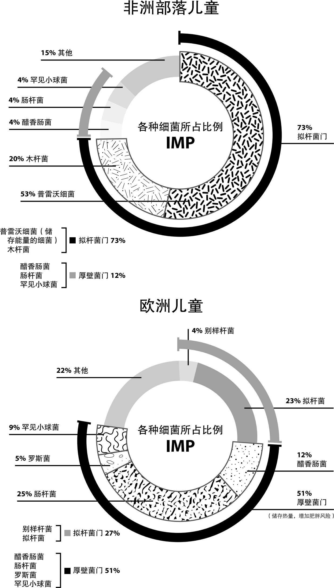
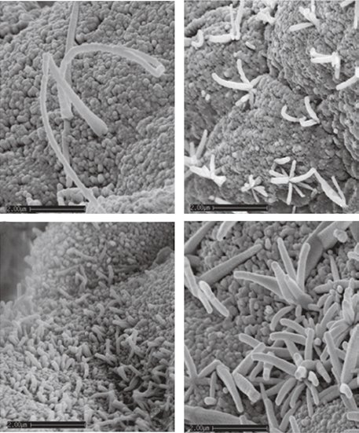

# 第三章 健康的微生物群落是绝对必要的

<h2><b>第</b><b>三</b><b>章</b></h2>

<h2><b>健</b><b>康</b><b>的</b><b>微</b><b>生</b><b>物</b><b>群</b><b>落</b><b>是</b><b>绝</b><b>对</b><b>必</b><b>要</b><b>的</b></h2>

	
想象你是一位备受尊敬的家庭医生。你从医的时间非常长，你看着那些你救治过的小孩长大成人，也看着他们的父母在变老。你曾治疗过各种疾病，所以你认为你对人体的方方面面都很了解。然而，有一天你参加了一个研讨会，突然间你得到了惊人的新信息：研究人员刚刚发现了人体中的一个新的器官，它控制着你健康的方方面面。

	
随着科学家们对微生物群落的了解越来越多，上述情形在全国各地的医疗机构中不断地发生着。微生物群落指的是生活在肠道中的细菌、酵母菌和病毒等微生物的总和。在过去的10年里，人们开始认识到，微生物群落是影响整体健康的一个重要因素。随着科学技术的进步，研究人员发现微生物群落不仅仅是消化食物的关键，还是整个身体的控制中心。这句话听起来令人难以置信，但朋友们，事实就是如此！

	
微生物群落与维生素的合成、新陈代谢和血糖的调节相关，并且可对基因的表达和脑化学产生影响。大脑向肠道发送的每一条信息都会收到9条从肠道反馈回大脑的信息。这些信息控制着大脑对压力所做出的反应、大脑激素的产生、大脑自身免疫系统的激活、新的脑细胞生长（神经发生）、新生细胞的学习适应能力（神经可塑性）以及其他功能。

	
微生物群落是当今医学研究中最热门的话题。2007年有396篇相关的新研究论文发表，2015年则有5512篇。5512个研究小组花了数月时间来研究这个主题，撰写论文，提交论文，然后发表。如果你现在在谷歌上搜索“微生物群落”（microbiome），你会找到19000多项最近的研究，并且每年都会有新的发现。例如，我们现在知道，每个人都拥有一个独一无二的微生物群落，其中包括数万亿细菌。肠道内的绝大多数微生物被认为是有益的。肠道内的细菌主要分为两大类：一种是拟杆菌门，这是寄居在我们体内的主要菌群；另一种是厚壁菌门，我们并不希望这类细菌的数量占主导地位。厚壁菌门细菌并不危险，但浓度过高则会压制拟杆菌门细菌，成为我们肠道内的主要细菌。这种微生物群落失衡会导致健康问题，比如会导致难治性肥胖症。

	
你体内的微生物群落重量可以多达2.25千克，这几乎是大脑重量的2倍，其中的每一个细菌都是由细胞和基因组成的生物体。请记住：人类的DNA包含大约23000个基因，而在微生物菌群中发现的基因是这个数目的100～150倍。正因为如此，许多专家开始认为微生物群落不只像身体里的一个额外的器官，而更像一个独立的生命体。我们开始思考：“我们究竟是体内存在大量细菌的人类，还是有着人类经历的细菌？”我们意识到，我们和我们体内的一个平行的文明共存，彼此互相帮助。

	
我们肠道中细菌细胞的数量比身体其他部位所有的细菌细胞加起来还要多10倍。我们之所以这样认为，是归因于我们肠道的形状。请记住，肠道是一根很长的管道，内有微绒毛。如果我们将肠道的所有微绒毛铺开，其表面积会有网球场那么大。我们确实需要这么大的表面积，因为许多工作都要在肠道内进行。细菌就分布在这个表面的每一寸土地之上，挤在微绒毛之间。

	
如果你是通过自然分娩出生的，那么你从你的母亲那里继承了你的微生物群落。在孕期的最后一个月里，母体的阴道中开始滋生大量的普雷沃细菌，在分娩时这种细菌会覆盖在婴儿体表。这些细菌将信息传递到婴儿的肠道，使其能够产生分解母乳的消化酶，使其能更好地吸收母乳。

如果你是通过剖宫产出生的，你出生后就会立即暴露在母亲皮肤上的以及产房空气里的大量外来细菌之中，而不是来自母亲的有益的普雷沃细菌，因此你的一生中患病的风险更高，也许智商会偏低
	<a id="noteref-9-86" href="#footnote-9-86">[1]</a>。在迄今为止一项最新、最大规模的研究中，回顾分析了经剖宫产分娩的750569名儿童的出生信息，研究发现，无论是由紧急剖宫产还是选择性剖宫产出生的儿童，患哮喘、喉炎和肠胃炎（肠道炎症）的风险都增加了。通过紧急剖宫产出生的儿童患溃疡性结肠炎和乳糜泻的风险增加，而经选择性剖宫产出生的儿童患下呼吸道感染和幼年特发性关节炎的风险增加。选择性剖宫产对哮喘发病风险的影响高于紧急剖宫产
	<a id="noteref-9-273" href="#footnote-9-273">[2]</a>。许多妇产科医生告诉我，当他们必须实施剖宫产时，他们会用类似于棉签的东西擦拭母体的阴道，然后再把它在新生儿的嘴里擦拭一下。他们试图在婴儿出生时尽可能地将一些保护性的“示范”微生物群（如普雷沃细菌）送入婴儿体内。虽然目前还没有针对这项技术进行长期研究，但我认为这项技术确实可以降低剖宫产婴儿未来患多种疾病的风险，包括自身免疫性疾病。诚然，如果从医学角度看当时剖宫产是必要的，那么保护婴儿和母亲的生命比担心未来潜在的健康风险更为重要。

	
我们全身70%的免疫系统存在于肠道中，而微生物群落是肠道免疫系统的基本组成部分。微生物群落是肠道免疫系统运作的调节器或者控制器。就像国民警卫队虽然是武装力量的一部分，但却以自己独特的方式发挥作用一样，微生物也是免疫系统的一部分，但以自己独特的方式发挥作用。

微生物群落也是由一系列细胞构成的，它们与肠道免疫细胞的功能是一致的，旨在促进健康；但当微生物群落失衡时，就会导致疾病的发生
	<a id="noteref-9-61" href="#footnote-9-61">[3]</a>。我们知道，每个人都有一个独一无二的微生物群落，它受到基因、环境和饮食选择的影响。位于同一肠壁上的肠道细菌和免疫细胞之间存在着密切的联系和信息交换。这是你用以控制入侵者的初始屏障。

你之前的生活经历对你肠道微生物群落的组成和多样性有着重要影响，就像它对免疫系统的影响一样
	<a id="noteref-9-44" href="#footnote-9-44">[4]</a>。虽然有的人可能会告诉你，衰老与机体功能低下和疾病有关，但事实并非如此。调整微生物群落可促进许多与退化相关的疾病发生好转，例如，动脉粥样硬化、结直肠癌、器官萎缩和严重感染等。

	
<b>当</b><b>发</b><b>生</b><b>微</b><b>生</b><b>物</b><b>群</b><b>落</b><b>失</b><b>衡</b><b>时</b>

早在几千年前，希波克拉底就说过：“所有的疾病都始于肠道”。我们现在能够证实他是多么正确。微生物群落既可以有助于形成健康的免疫反应，也可以使你容易罹患疾病
	<a id="noteref-9-76" href="#footnote-9-76">[5]</a>。当微生物群落缺乏养料状况欠佳时，有害的细菌和真菌会乘虚而入，使你更容易患上慢性病。当血液检测提示你处于自身免疫性疾病发展谱中时，这就意味着微生物群落失衡导致太多的致病菌（坏家伙）入侵，激活了炎症和肠道通透性增加的相关基因。

	
和我一样，阿莱西奥·法萨诺博士认为，引起自身免疫反应的主要原因就是微生物群落失衡。微生物群落失衡将增加我们患心脏病、癌症、脑卒中、阿尔茨海默病、糖尿病和其他危及生命的自身免疫性疾病的风险，也会导致抑郁、焦虑、记忆丧失、脑雾和情绪波动等。

	
基因不能预测疾病，但它们可以识别出你健康链条中可能出现疾病的薄弱环节。我们在上一章中已经讨论过表观遗传学，微生物群落的细菌基因正是通过表观遗传学影响我们自己的基因表达。例如，微生物群落中的细菌可以帮助我们消化食物中的氨基酸并将其转化为不同的大脑激素，即神经递质。神经递质控制着大脑运行速度、情绪及新陈代谢，这就将微生物群落与肥胖联系了起来：当限制热量摄入但仍旧无法减轻体重时，就需要检测是否存在特定类型的细菌。如果你认真地计算热量摄入或者努力地遵循特定的减肥计划但却没有得到你想要的结果，很可能是因为微生物群落中的有害菌阻碍了你的减肥计划。

	
微生物群落失衡会牵动我们的健康链条，使薄弱环节处发生断裂，并慢慢出现健康问题。这就是所谓的遗传易感性——并不是说你注定会患上这样或那样的疾病，而是说如果增加的炎症反应对链条的牵引力过大，那么你的遗传薄弱环节就会显现出来。更重要的是，微生物群落失衡导致的炎症反应会引起肠道通透性增加（肠漏），使食物大分子（如麸质）通过肠漏进入血液，从而引发针对该食物分子的免疫反应。即使饮食非常干净，异常的微生物群落也会引起炎症反应，并导致肠道通透性增加。这就是为什么有的人避免进食那些他们敏感的食物后不会马上感觉好一些的主要原因——他们的肠道中仍然持续存在着炎症级联反应，而这正是由微生物群落失衡引起的。微生物群落失衡是牵拉你健康链条的环境诱因。但是，当你改变你的饮食时，你的微生物群落在短短3天内就会开始发生变化。

	
表观遗传学控制着我们基因的表达方式，表观遗传表达的主要驱动因素就是微生物群落。微生物群落是我们每天面对的最大的“环境”。我觉得有趣的是，人类是地球上的主导物种，但人类的基因结构却是如此简单。举个例子，人类由大约23000个基因组成，而蠕虫则有90000个基因，所以蠕虫比人类要复杂得多。但人类的行为能力远比蠕虫成熟先进。

	
那么，我们的成熟先进从何而来呢？答案就是我们实际上由两组基因组成：一组是人类基因组，它是固定的、基本的，我们无法改变它；另一组来自微生物群落，它包含的基因数量是人类基因组的100～150倍，这也意味着微生物群落对我们日常功能的影响是人类基因组的100～150倍。

	
<b>认</b><b>识</b><b>皮</b><b>马</b><b>印</b><b>第</b><b>安</b><b>人</b>

	
皮马印第安人（下称“皮马人”）是美洲土著，他们一直生活在靠近墨西哥的美国西南部，他们引发了一个关于微生物群落及其对健康影响的有趣问题。这些土著已经在这个国家的干旱地区生活了数百年。如今当你开车经过这个地区时，仍然可以看到：沙漠里并没有什么能吃的东西，但是这些人幸存了下来。有一种对他们生存的解释被称为“节俭基因理论”：皮马人在进化过程中对食物的摄取效率变得非常高并且能够优化他们摄入的热量。皮马人能充分利用他们摄入食物中的热量，或者将其储存起来供以后使用。当没有足够的食物时，你要么适应这种情况并通过努力获取食物以存活下去，要么就会营养不良、身体虚弱，并且很难存活下来。那些存活下来的人，其后代具有父母强大的基因，而那些不能很好利用热量的人则无法适应恶劣的环境。

	
成功存活下来的皮马人和那些没有存活下来的皮马人的主要区别在于他们肠道内的微生物群落。他们的生存依赖于肠道微生物群落中厚壁菌门细菌数量的增加，这是一种可以将热量囤积起来的细菌。随着时间的推移，这些厚壁菌门细菌对皮马人的基因产生了影响，因此他们的后代体内也会有高水平的厚壁菌门细菌。在这个例子中，“节俭基因”其实存在于细菌的基因中，而非皮马人的基因中。

	
如今，皮马人的饮食不再与他们的祖先相同，而是标准的美国饮食：他们靠便利食品和垃圾食品生活，没有多少蔬菜，摄入大量的糖和有害脂肪，等等。其后果是：皮马人体内还在囤积着热量，到35岁时，他们当中有50%的人患有糖尿病，在这其中又有95%的人体重超标，且患心血管疾病、高血压及痴呆的风险很高。尽管食物已不再稀缺，但皮马人肠道内微生物群落中的节俭基因仍旧在传递着信息，使得他们能够更有效地储存热量。这就是皮马人的糖尿病发病率远高于美国的平均水平的原因。

	
<b>生</b><b>态</b><b>失</b><b>调</b><b>的</b><b>根</b><b>源</b>

	
当肠道中的有益菌和有害菌处于平衡状态时，这种状态称为共生。当微生物群落失衡时，称为生态失调，这是肠道及身体其他部位炎症的主要原因。生态失调由有益菌的缺乏或是有害菌的过度生长引起，其中有害菌包括非友好细菌、酵母菌（念珠菌）和原生生物。微生物群落的组成受环境的影响很大，尤其是饮食选择，因为这些细菌会吃掉我们的残渣剩饭。

我们大多数人体内的微生物群落都是不正常的，其原因在于低营养饮食和久坐不动的生活方式。你所吃的食物将会对你体内肠道菌群的类型及其行为产生巨大的影响。这反过来又会影响你对能量的利用和储存，也会决定你产生大脑激素的数量，进而控制你的情绪和行为，以及患病的风险。例如，含有麸质、酪蛋白（乳制品中的一种蛋白质）的食物以及玉米被认为具有内毒素样作用，可导致生态失调。更重要的是，在常规的西方饮食中，大约75%的食物对微生物群落的益处有限，甚至没有益处，尤其是对于下消化道的细菌。因为大部分食物是由精制碳水化合物组成的，且已经被上消化道吸收，致使最终到达大肠的部分只含有少量的矿物质、维生素以及维持菌群所需的其他营养物质
	<a id="noteref-9-303" href="#footnote-9-303">[6]</a>。

	
人体内的每一个细胞都会自我繁殖，我们的机体每7年就会更新一次。有些细胞繁殖速度很快，有些则很慢。体内生长繁殖最快的细胞存在于肠道黏膜。每3～7天，肠道黏膜上皮细胞就会彻底更新一次，新的细胞会迅速取代旧的细胞。这些细胞繁殖所需的“燃料”叫作丁酸。

	
丁酸是以植物纤维为食物的有益菌在消化过程中产生的副产品。如果你没有吃足够的蔬菜，或者你没有适合的微生物群落，你就不能生产足够的丁酸。这也是我们要吃各种蔬菜的一个非常重要的原因——为我们体内的有益菌提供所需的食物，并生成丁酸。

如果你体内没有足够的丁酸，细胞仍然会繁殖，但却如同在用稻草而不是砖块建造房子。每天仍旧会有新的细胞生成，但是新生的细胞将会很脆弱。适当数量的丁酸可以：①生成强壮、健康的结肠细胞，使其能更加正常地工作；②使肠道黏膜上皮细胞和肠道免疫细胞不再异常活跃，维持平静状态以“时刻准备着在需要时保护我们的机体”；③减少导致肥胖的主要诱因——炎症反应
	<a id="noteref-9-168" href="#footnote-9-168">[7]</a>。许多研究表明，体内缺乏丁酸与结肠癌的易感性有关。适量的丁酸可以预防这类癌症的发生。

	
还记得自身免疫性疾病发展的三大要素吗？其中包括肠道通透性增加。你的饮食在决定你是否有足够的丁酸方面起着重要的作用，而足量的丁酸有助于治疗肠道通透性增加，而肠道通透性增加正是自身免疫性疾病发展的“门户”。

自身免疫性疾病在西方国家尤其普遍，因为他们的饮食已经严重损害了他们肠道内的微生物群落。2010年，在意大利的一项研究中，研究人员将非洲部落儿童的粪便样本与生活在欧洲的儿童进行比较，发现两者之间存在巨大差异。非洲部落的孩子们仍然以他们祖先的方式进食，他们不会患上常见的自身免疫性疾病，如过敏、哮喘、湿疹、痤疮、类风湿关节炎、银屑病或多发性硬化等。造成两者之间巨大差异的原因在于微生物群落的不同。非洲部落儿童肠道内有益菌比例非常高，并且他们拥有一种欧洲儿童完全缺乏的有益菌。研究人员认为，非洲部落儿童肠道内的微生物群落在保护他们免受炎症侵害的同时，也使得他们可以最大限度地从植物纤维食物中摄取能量
	<a id="noteref-9-296" href="#footnote-9-296">[8]</a>。

	
从图2-5中我们可以看到，欧洲儿童肠道内储存热量的厚壁菌门数目较非洲部落儿童增加了4倍。非洲部落儿童具有较多的拟杆菌门细菌（健康菌群的重要组成部分），这些细菌使他们发生自身免疫性疾病的风险降低。因此，微生物群落的平衡是抵御疾病、保持身材和健康体魄的关键。

	
<b>生</b><b>态</b><b>失</b><b>调</b><b>的</b><b>症</b><b>状</b>

	
·餐后饱胀感

	
·闭经

	
·餐后嗳气、胃烧灼感

	
·慢性肠道感染

	
·慢性阴道炎

	
·非酒精性面颊及鼻部毛细血管扩张

	
·疲劳

	
·大便粘腻

	
·消化不良、腹泻、便秘

	
·铁缺乏

	
·服用营养素后恶心和腹泻

	
·青春期后痤疮或皮肤过敏（包括酒渣鼻）

	
·直肠瘙痒

	
·皮肤容易擦伤

	
·进食后出现全身反应

	
·粪便中含有未消化的食物

	
·指甲脆弱或断裂

	

	
图2-5 非洲部落儿童与欧洲儿童肠道内各种细菌所占比例的比较

	
<b>抗</b><b>生</b><b>素</b><b>与</b><b>生</b><b>态</b><b>失</b><b>调</b>

使用抗生素可引起生态失调。服用抗生素就像往你肠道内的菌群上扔炸弹：这类药物会破坏或击毁它所遇到的一切，包括有益菌和有害菌。随着时间的推移，有害菌会对抗生素产生抗药性并“繁荣发展”，使肠道内的环境失衡，引发全身性的炎症。在一项针对4373篇论文的荟萃分析中，研究人员指出，应用抗呼吸系统或泌尿系统感染的抗生素会使细菌对其产生耐药性，耐药性在治疗后1个月最为显著，但也可持续长达12个月
	<a id="noteref-9-191" href="#footnote-9-191">[9]</a>。因此，如果你反复出现耳部、鼻窦或肺部感染，这可能是由于细菌产生了耐药性。

	
抗生素能有效地治疗细菌感染，但是如果过度使用抗生素，可能会带来更多的问题，因为抗生素杀死了所有的细菌，无论是有益菌还是有害菌。

	
不幸的是，在过去的30年里，医学界和传统农业都在过度使用抗生素，这导致了肠道内有益菌的系统性损耗。人体内70%的免疫系统都存在于肠道中，我们抵御普通感冒、流感、病毒、癌细胞以及其他疾病的主要保护措施本应来自肠道中的有益菌。当有益菌因为抗生素的使用而逐渐减少时，炎症反应会增加，肠道通透性也会增加，我们感染和罹患疾病的风险就更高。

抗生素常常被用于治疗那些它们并不能治疗的疾病，例如，普通感冒或酵母菌感染。许多儿童耳部感染时应用抗生素治疗无效，原因就是14%～28%的耳部感染是由真菌或酵母菌引起的，而不是细菌
	<a id="noteref-9-89" href="#footnote-9-89">[10]</a>。

	
我们所有人都接触过抗生素，无论是否吃过处方药。农民用抗生素喷洒蔬菜，也给牛和鸡等动物喂抗生素以使它们更强壮。这些抗生素会残留在肉、蛋、蔬菜等当中。我们很难理解，本应保护我们健康的一些机构是如何允许在许多不必要的情况下滥用这些强力药物的。每次我们吃这些喷洒了抗生素的蔬菜时，就在炎症之火中浇上了汽油，这也是为什么所谓的健康食品对我们来说变得并不健康的另一个原因。

	
抗生素存在的另一个问题是它们会刺激细菌产生生物膜，这是细菌为了保护自己而产生的一种聚合物，这种聚合物可以阻止抗生素触及细菌。2013年，美国疾病控制与预防中心的一份报告显示，仅在美国每年就有超过23000人死于耐药菌感染。生物膜是产生超级细菌或者产生对抗生素具有耐药性细菌的主要原因。美国国立卫生研究院表示，如果一种细菌具有强大的生物膜，那么杀死该细菌所需要的抗生素剂量是标准剂量的100倍。人体内的有害菌存在的时间越长，生物膜形成的可能性就越大。

	
<b>保</b><b>罗</b><b>的</b><b>故</b><b>事</b>

	
我的朋友保罗在接受了牙科手术后，医生给他开具了抗生素，以免发生感染。不久之后，保罗发现他的健康状况出现了一些令人不快的变化。他开始常常感到腹胀，每4～6周就会患一次感冒，消除疲劳感的时间也越来越长。

	
保罗每况愈下的健康状况使他失去了锻炼的动力，他的体重增加了4.5千克。当他的关节开始持续疼痛时，他认为这是由于缺乏运动引起的。他每天最想做的事情就是待在家里看电视。当他连续2天都待在沙发上不愿离开时，他的妻子送他来到了我的诊室。

	
保罗告诉了我事情的经过，我意识到他疼痛的原因在于关节处的炎症，而这正是由抗生素引起的肠道通透性增加进而导致脂多糖沉积在关节处引起的。保罗没有意识到他所服用的抗生素在他的肠道内引发了生态失调，导致肠道通透性增加，最终脂多糖进入血液并沉积在他的薄弱环节——关节上。

	
经过检测，我们证实保罗体内的脂多糖水平显著提高。尽管保罗不认为他对乳制品或麸质过敏，我还是让他在3周内避免进食这两种食品，看看效果如何。令他惊讶的是，在坚持无麸质、无乳制品、无糖的饮食方案不到3周时，他的关节疼痛就已经减轻，并且他又能开始锻炼了。在6周后，他的体重减轻了。他告诉我：“奥布赖恩医生，我终于又找回了自己。当你让我倾听我的身体时，我明白你在说什么了。”

	
<b>压</b><b>力</b><b>与</b><b>生</b><b>态</b><b>失</b><b>调</b>

	
最后一点，生态失调也可能是由压力引起的，此处的“压力”既包括环境暴露（如环境污染、接触化学品、辐射以及低品质且缺乏营养的食物等），也包括日常生活中的压力（如应对不适感）。压力已经成为我们日常生活中的一部分，也难怪我们的微生物群落会一团糟。

	
汉斯·塞利博士首次提出了压力及其对身体的影响，他是匈牙利的一名内科医生，同时拥有有机化学博士学位。20世纪50年代，塞利博士首次提出：肾上腺是我们抵御压力的第一道防线。当我们面对心理或是生理压力时，肾上腺可以让我们以一种健康的方式做出应对。它们负责决定何时激活著名的“战斗、逃跑或恐惧”反应。

	
当时，塞利博士和其他科学家已经知道我们体内有两个不同的神经系统：交感神经系统和副交感神经系统。当你处于压力状态时，就会开始出现战斗、逃跑或恐惧反应，然后交感神经系统被激活。塞利博士指出，我们的身体和数万年前生活在非洲热带大草原上的我们的祖先是一样的，这意味着我们面对生活中的压力做出的反应跟我们的祖先也一样。举个例子：战斗、逃跑或恐惧反应的生理表现之一就是皮肤血流量减少。当我们的祖先处于紧张的状态时（例如狩猎、与动物搏斗时），交感神经系统占主导地位，皮肤的血流量减少。为什么会这样？因为这样我们就不会在战斗时流血过多。现在把时间快进到如今我们每天充满压力的生活中。当处于交感神经主导状态时（我们大部分时间都处于这种状态），我们皮肤的血流量就会减少。那么这一点是如何体现的？表现为痤疮、银屑病或白癜风。在交感神经支配的状态下，我们身体的每一个系统都可以做出类似的自救和保护反应。但我们不应该24小时全天候都保持这种状态。

	
我们的祖先面临巨大的压力，需要做出战斗、逃跑或恐惧反应的频率如何呢？并不是很频繁，他们只是偶尔会处于危险之中或需要高度警觉。那时他们生活在热带气候中，一年四季都只有有机食品，这就是我们对含有化学物质的食品及转基因食品会产生应激反应的原因。在冬天，我们的祖先并不需要外套来保暖，所以当我们感到寒冷时，就会施压于体内系统，激活肾上腺反应。

	
我们应该过一种相对平静的生活，尽可能地不要激活肾上腺反应。在一对肾上腺都非常健康的情况下，每个腺体的大小相当于一个核桃。如果我们一直都处于压力之中，我们的肾上腺会不会变得像心脏一样大呢？

	
现如今，我们承受着巨大的生活压力，身体几乎一直处于被交感神经支配的状态。在对因病去世的人进行尸检时，我们发现他们的肾上腺完全被过度使用，萎缩到花生的大小。然而，在对死于创伤（如车祸）但没有疾病的同年龄人群进行尸检时发现，他们的肾上腺有核桃那么大。只有花生那么大的萎缩的腺体，怎么能支撑我们疯狂的生活呢？并不能。由于巨大压力破坏了我们体内的应激反应系统，无论健康链条的薄弱环节位于何处，我们都会为此付出代价。

	
在塞利博士还是一名医学生时，他发现患有不同疾病的患者往往表现出相同的症状和体征。用他的话来说，他们“压力很大”。严重的肾上腺应激反应症状包括站立过快时头晕、即使在阴天也需要戴墨镜、脉率增加、呼吸急促以及反复发作的肌肉紧张等。

	
后来他发现了一般适应综合征，即身体对外界环境变化产生的一种反应。塞利博士是第一个指出压力可诱发激素水平发生波动的人。随着时间的推移，如果激素水平波动过度，便可引起身体的变化。他是第一个发现过度的压力会导致身体疲劳并引发疾病的人。对于“压力”，他的定义是，任何能激活交感神经系统反应的物质，无论是化学性、生理性还是情绪性的。

	
在1955年发表在医学期刊《科学》（<i>S</i><i>c</i><i>i</i><i>e</i><i>n</i><i>c</i><i>e</i>）上的一篇文章中，塞利博士谈到了压力导致的肾上腺负荷过重是如何对关节炎、脑卒中和心脏病产生影响的。他的研究是在小鼠身上进行的，他展示了通过反复增加压力来改变小鼠的生活环境是如何改变它们身体状况的。一只小鼠在实验室里正常生活。而另一只小鼠则不断地被放在仓鼠轮上，或者被扔进没过头顶的水里，游泳到筋疲力尽。研究结果发现：正常生活的小鼠，毛发非常漂亮；而处于压力中的小鼠看上去很瘦削，只有正常生活小鼠的一半大，并且早早就得病去世了。

	
塞利博士还明确了肾上腺功能变化的各个阶段。正常的肾上腺反应被称为交感优势。当战斗、逃跑或恐惧反应日复一日地发生时，我们的肾上腺会进入肾上腺疲劳状态。当战斗、逃跑或恐惧反应继续存在时，我们就会从肾上腺疲劳过渡到肾上腺衰竭。当战斗、逃跑或恐惧反应进一步持续存在时，我们就进入了肾上腺耗竭的状态，无法做出反应。此时，我们无法通过应激激素来疏解压力，这就会给我们的身体带来全力的打击。也就是说，当你的生活充满压力、肾上腺已经耗竭时，就需要其他的器官来应对每个特定的压力。对部分人来说，这项工作由甲状腺接管，但紧接着你又开始压榨你的甲状腺，尤其是当甲状腺是你健康链条中的薄弱环节时。如果你体内不能再产生足量可处理糖类的糖皮质激素时，那么就需要由血糖调节系统中的胰腺来收拾残局，胰腺就会通过分泌更多的胰岛素来应对压力。随着时间的推移，你会产生胰岛素抵抗，然后患上糖尿病，你也就此进入了自身免疫性疾病发展谱之中。

	
我们本应在副交感神经支配的状态下生活，但由于现如今的生活方式，交感神经系统一直处于主导地位。在日常生活中，我们一直处于紧张状态，以至于大多数人，尤其是那些被诊断为自身免疫性疾病的人，经历了从肾上腺疲劳到肾上腺衰竭再到肾上腺耗竭的过程。最后，压力对你的身体造成的损伤越来越大。如果你感到精疲力竭，这就是原因所在。如果一直没有恢复到副交感神经支配的状态，你就会变得非常容易患病，而所患疾病则取决于你健康链条的薄弱环节。

整体控制着我们机体对生活压力做出反应的器官是哪个？从上述讨论中你可能很快会想到是肾上腺。而直到5年前，医生才开始相信这一点。现在我们知道微生物群落是控制“微生物-肠-脑”轴的“中央计算机”
	<a id="noteref-9-94" href="#footnote-9-94">[11]</a>。微生物群落通过脊髓和血流将化学信号发送到大脑。这些信息指导下丘脑如何对感知到的压力做出反应。下丘脑告诉脑垂体，哪些应激源是要优先处理的，然后垂体会向各个器官发布指令，告知其需要分泌的激素。

	
举个例子：今天是4月14日（在美国，4月15日是联邦政府要求人们提交所得税申报表的截止日期），你还没有准备好你的纳税申报，你的胃里有一种下沉的感觉，醒来时发现自己汗流浃背。同时你可能会注意到，当你尝试着制订一个完成这项工作的方案时，你的脉率在加快。在你的体内，健康的微生物菌群开始起作用。它向下丘脑发送信息，下丘脑向脑垂体发送信息，脑垂体向肾上腺发出信息，以产生更多的糖皮质激素。你需要这些糖皮质激素，因为其含量的增加有助于提神，这样你可以有更多的脑力去熬夜完成你的纳税申报。当你在做纳税申报的时候，你会发现胃部的下沉感已经消失了。你的微生物菌群不再发出压力信息，因为你已经深受应激反应影响，并采取了适当的行动。

然而，如果你的微生物菌群失去了平衡，你醒来时伴随的焦虑感就不会消失，在你填写申报表时这种感觉甚至可能加剧。事实上，当你没有适合的微生物群落时，应激反应的严重程度要高出2.8倍，并会产生应激激素
	<a id="noteref-9-96" href="#footnote-9-96">[12]</a>。

	
你可以通过减轻压力来降低肠道通透性。正如我们在第二章中所了解到的，神经系统的激活增加了肠道的通透性。

	
应激激素使肠道通透性增加，肠道内的脂多糖就会穿过细胞壁进入血液循环，进而刺激更多的免疫细胞，这反过来又向大脑发出信息，产生更多的压力，激活免疫反应，产生更多的炎症。我们的身体被设计成可以像“劳斯莱斯”一样可以顺畅运行，但我们的生活方式却让它们如同“漫步者”一样缓慢行进。

	
所有医生都告诉患者要减少生活中的压力，但我们有孩子、有工作，不可能在一夜之间摆脱生活中的所有压力。如果计划得当，我们可以慢慢减少生活中的压力。然而，当我们调整生活中的压力时，我们还可以加强微生物群落，以便在有压力出现时，我们可以更好应对，迅速恢复。如果你能让你的身体更健康，你的身体就会让你更有效地管理你的压力。

	
举个例子，曾经我的睡眠不是很好，通常每晚只睡5个小时。从健康角度来看，我最关心的问题之一就是我的睡眠，因为我知道睡眠对细胞再生至关重要：当你睡觉的时候机体就会进行自我修复，所以如果你不睡觉，就无法很好地恢复。当我的微生物群落平衡后，我的睡眠状况改善了。我现在无须在生活方式上做出任何改变，就可以实实在在地睡上6～7个小时。因为我休息得更好，所以我的身体能更快地恢复，我就可以更好地处理日常生活中的压力。

	
<b>微</b><b>生</b><b>物</b><b>群</b><b>落</b><b>在</b><b>控</b><b>制</b><b>脂</b><b>多</b><b>糖</b><b>中</b><b>的</b><b>作</b><b>用</b>

	
微生物群落可以保护我们免受脂多糖的侵害，脂多糖对免疫系统的健康而言是有害的。在关于不健康的微生物群落可能对身体产生的各种影响中，脂多糖是被研究最多的，同时也是最具破坏性的。微生物群落的主要工作之一是控制脂多糖。当我们失去了微生物群落中有益菌的保护性优势时，产生的脂多糖量对身体来说是超负荷的，这就会引起炎症。

	
健康微生物群落的一个基本特征是它能产生抑菌素——一种能杀死有害菌的酶。当今的生活习惯或抗生素的使用所导致的肠道内微生物群落的生态失衡，引起了脂多糖的猖獗增加。现在你的肠道里如同一团乱麻，脂多糖穿透肠壁，引发全身炎症级联反应。那么我们该如何防止这种情况的发生呢？答案就是重建一个健康的微生物群落。

	
<b>建</b><b>立</b><b>一</b><b>个</b><b>健</b><b>康</b><b>的</b><b>微</b><b>生</b><b>物</b><b>群</b><b>落</b>

	
最近在一次采访中我被问到这样一个问题：“如果想要专注于保持健康，你最需要做的一件事是什么？”

	
我的建议是专注于建立一个更加健康的微生物群落。所有易于实现的小步骤叠加起来将会创造一个健康的微生物群落。没有什么比身体功能更重要的了，微生物群落有着绝对的控制权。没有什么比微生物群落更能影响你的组织和器官，它简直就是大魔法师。

幸运的是，微生物群落很容易重新达到平衡。只需调整一两天的饮食，就可以开始改变并减轻生态失调。最重要的是，避免吃你敏感的食物。当你对食物敏感时，免疫系统会在肠道中产生炎症级联反应。即使你吃的时候不觉得难受，但你所吃的每一口食物都可能对你的肠道菌群产生有害的影响。炎症级联反应杀死了有益菌，致病菌开始大量繁殖，使肠道环境失去平衡。例如，一项针对乳糜泻儿童的研究表明，39%的儿童肠道内存在异常的细菌生长，其中许多细菌从未在人类体内发现过（图3-6）。当停止进食含麸质的食物2年后，81%的孩子体内未知的细菌消失了
	<a id="noteref-9-254" href="#footnote-9-254">[13]</a>。这表明，当你把那些你会产生反应的食物（首先是麸质、乳制品和糖）从饮食中去掉，将会对你的微生物群落产生积极的影响。

	

	
图3-6 杆状细菌以前是人类所未知的，但经常在乳糜泻儿童体内发现

	
经允许摘自Macmillan Publishers Ltd: The American Journal of Gastroentology, 2004.

	
<b>方</b><b>法</b><b>1</b><b>：</b><b>选</b><b>择</b><b>有</b><b>助</b><b>于</b><b>健</b><b>康</b><b>菌</b><b>群</b><b>形</b><b>成</b><b>的</b><b>食</b><b>物</b>

	
有助于健康菌群形成的食物分为以下4类。

<b>1</b><b>.</b><b>富</b><b>含</b><b>多</b><b>酚</b><b>的</b><b>食</b><b>物</b><b>—</b><b>—</b><b>色</b><b>彩</b><b>丰</b><b>富</b><b>且</b><b>富</b><b>含</b><b>纤</b><b>维</b><b>的</b><b>水</b><b>果</b><b>和</b><b>蔬</b><b>菜</b>。多酚是在颜色鲜艳的水果和蔬菜中发现的微量元素，对微生物群落非常有益
	<a id="noteref-9-60" href="#footnote-9-60">[14]</a>。你可能听说过红葡萄酒中含有的白藜芦醇，以及黑巧克力或绿茶的益处。这些食物的诸多益处正是由多酚带来的。多酚含量高的那些水果和蔬菜通体都是深色的。虽然茄子的外皮颜色很深，但果肉是白色的，所以它并不是一种多酚含量高的食物。深色绿叶蔬菜，如菠菜或羽衣甘蓝，是最佳选择。

研究表明，多酚和微生物群落之间的干预是双向的：肠道微生物会影响多酚的吸收，而多酚则会影响细菌的生长，这些细菌可以使心血管疾病的发病率降低75%
	<a id="noteref-9-71" href="#footnote-9-71">[15]</a>。2003年，《英国医学杂志》（<i>B</i><i>r</i><i>i</i><i>t</i><i>i</i><i>s</i><i>h</i><i> </i><i>M</i><i>e</i><i>d</i><i>i</i><i>c</i><i>a</i><i>l</i><i> </i><i>J</i><i>o</i><i>u</i><i>r</i><i>n</i><i>a</i><i>l</i>）发表了一篇题为《一项可将心血管疾病减少80%以上的策略》的论文。这篇论文的作者们做了一项荟萃分析，汇总了不同药物的益处，最后得出结论：由1种可降低胆固醇的他汀类药物、3种降压药、1种婴儿用阿司匹林以及叶酸组成的“复合制剂”可以将心血管疾病的风险降低80%以上。这篇文章刊登在全国大多数报纸的头版。更有趣的是，作者们已经为这种复合制剂申请了专利。8个月后，又有一篇论文发表在《英国医学杂志》上，题为《复合饮食：一种更天然、更安全且可能更味美（与复合制剂相比）的方法，可将心血管疾病风险降低75%以上》。通过同样的逻辑分析，研究人员证明，每周吃4次冷水鱼，同时每天吃黑巧克力、大蒜、杏仁、蔬菜和红葡萄酒等富含多酚类食物，可以将患心血管疾病的风险降低75%。无心血管疾病的预期寿命在男性和女性中分别增加了9年和8.9年
	<a id="noteref-9-468" href="#footnote-9-468">[16]</a>。

在第七章，你将会得到关于在日常饮食中添加多酚的完整指导，包括富含绿色蔬菜以及爽脆且颜色鲜艳的十字花科蔬菜的沙拉。正是这些蔬菜中的不溶性膳食纤维使细菌茁壮成长，促使身体变得纤瘦而健康。其他富含多酚的食物也可以每天食用，但要适量，例如，新鲜的大蒜、新鲜的未加工杏仁和含70%或更多可可的黑巧克力。可可已被证明可以通过增加有益菌的相对丰度对微生物群落产生影响，使微生物群落更有利于健康
	<a id="noteref-9-189" href="#footnote-9-189">[17]</a>。更重要的是，人们认为巧克力可以改善肠道免疫状态，降低IgA
	<a id="noteref-9-220" href="#footnote-9-220">[18]</a>。

	
<b>来</b><b>吧</b><b>，</b><b>天</b><b>天</b><b>吃</b><b>巧</b><b>克</b><b>力</b>

	
每天吃一点黑巧克力可以增加多酚和益生元的摄入量。拿一块最好的黑巧克力（至少含70%的可可）放在舌头上或舌头下。别让它碰到你的牙齿。让它待在那里而不去咀嚼，这样它就可以在你的嘴里慢慢熔化。通过这种方式，你会满足你的味蕾，并将“这里有巧克力”的信息经口腔丘脑束（从口腔直达大脑的通道）传送到你的大脑。巧克力能刺激内啡肽和脑啡肽的产生。在刺激大脑中的愉悦感传感器方面，内啡肽和脑啡肽比吗啡强200倍。

	
每天吃一块巧克力，让它在嘴里熔化2分钟，你可能会很有满足感。如果你想要更多的满足感，那就再来一块，每人2块巧克力足矣。这样，你就可以每天都吃黑巧克力，而不会增加体重，也不会引起血糖失衡。

	
<b>2</b><b>.</b><b>正</b><b>确</b><b>的</b><b>碳</b><b>水</b><b>化</b><b>合</b><b>物</b>。避免加工过的碳水化合物，例如，薯片、薯条、面包、白米饭、曲奇、薄脆饼干、其他甜点和糖等。这些食物会使你的身体长期处于饥饿、新陈代谢受损以及储存脂肪的模式。这些食物还有增加肠道通透性的风险，并可能改变微生物群落组成，破坏有益菌和有害菌之间的平衡。

与之相反，吃正确的碳水化合物实际上可以通过增加有益菌来减轻体重。2006年，微生物学家赵立平博士在自己身上进行了一项实验，以复制在小鼠身上发现的肥胖和微生物群落之间的联系。当时，赵大夫体重超标，健康状况不佳。他采用的饮食包括全谷物（糙米）和两种传统中医药膳（山药和苦瓜）。山药和苦瓜都含有一种特殊的难以消化的碳水化合物（一种益生元，可以促进有益菌普氏粪杆菌的形成）。他监测了自己的体重变化以及微生物群落情况。2年后，通过体内有益菌的恢复，他总共减掉了19.8千克
	<a id="noteref-9-231" href="#footnote-9-231">[19]</a>。2016年，在伦敦国王学院双胞胎和遗传流行病学研究部门的一项研究中，发现吃同样的食物后产生的细菌（普氏粪杆菌）可显著降低人体脆弱程度
	<a id="noteref-9-299" href="#footnote-9-299">[20]</a>。人体脆弱程度是评估整体健康状况欠佳的一个有效指标，该指标描述了生理储备能力丧失和对抵抗压力能力降低的程度。

含有人工甜味剂的碳水化合物会促进肠道有害菌生长，导致肥胖。一项研究指出，糖精可以改变肠道中115种不同途径的功能，导致肥胖，其原因在于微生物群落可以控制人体的葡萄糖耐量。在消化过程中那些帮助消化糖精的细菌把能量转化为身体脂肪，并改变肠道菌群
	<a id="noteref-9-120" href="#footnote-9-120">[21]</a>。

	
<b>3</b><b>.</b><b>草</b><b>饲</b><b>红</b><b>肉</b><b>和</b><b>健</b><b>康</b><b>脂</b><b>肪</b>。当你食用健康脂肪（如牛油果、橄榄油、椰子油、坚果、鱼、散养家禽和草饲牛肉所提供的脂肪）时，我们没有发现脂筏转运（我们在第二章中讨论过）的证据，而脂多糖正是通过脂筏转运进入血液的。在第七章，你将了解到更多关于如何在我们的饮食方案中选择健康脂肪的内容。

	
<b>4</b><b>.</b><b>发</b><b>酵</b><b>食</b><b>品</b>。100年前，人们认为酸奶对健康是有益的，但却并不知道为什么。现在我们知道这是因为牛奶中的细菌发酵了：每当你喝酸奶的时候，你就会得到一些有益菌。然而，因为很多人对乳制品敏感，同时因为大多数零售商出售的巴氏杀菌酸奶到达你手中时，品质都已不保并且有益菌含量也很低，所以我们可以选择发酵蔬菜和饮品［如开菲尔（一种发酵牛奶）、KeVita（一种发酵椰汁）和康普茶（一种发酵茶）］，以促进肠道有益菌的生长。

	
发酵食品是指那些在其内或在其表面有细菌生长的食物，这些食物中的有益菌能够吸收多种毒素和重金属。古老的发酵方法可从食物中“解锁”营养物质，分解一些淀粉，并在你吃的每一口食物中添加有益的细菌和酶。发酵食品是比非处方益生菌更好的选择，可以提供更多种类、更多数量的有益菌。一份发酵食品相当于一整瓶高效益生菌。每天你只需要吃一点点发酵蔬菜，比如一勺德国酸菜或韩国泡菜，它们的原料都是白菜。你可以购买发酵的蔬菜，或者按照第十章的食谱自己进行制作。如果你在吃了发酵蔬菜后发现有排气或是腹胀情况，那么这就是生态失调（肠道异常细菌过多）的生物标志。这并不意味着发酵食品对你有害，而是说明你应该减少用量。在你的沙拉中加入沙拉酱的同时加1汤匙酸菜汁，这样味道就不那么强烈了。第2周时每天尝试加2汤匙。这是一个过渡的例子——你正在准确地评估身体目前的功能状况，并使其朝着更好的方向前进。

	
<b>方</b><b>法</b><b>2</b><b>：</b><b>选</b><b>择</b><b>益</b><b>生</b><b>菌</b>

	
益生菌是指肠道内的有益菌。对于一个健康的微生物群落来说，肠道中的大部分细菌应该是益生菌。益生菌的类型有成千上万种，每一种都根据它的属（例如乳酸菌）、种（例如鼠李糖）和菌株名称（通常是字母或数字的组合）来进行定义。

	
目前益生菌的使用仍处于初级阶段，尚不清楚如何使用它们来创造一个更健康的微生物群落。我们确实知道益生菌可以通过保持肠道环境健康使免疫功能平衡，减少炎症反应。它们可以作为营养素，增加肠道内的有益菌，减少有害菌。它们还可以治疗肠道通透性的增加。

	
益生菌在与高膳食纤维的饮食相结合时最有效，后者指每天摄入很多蔬菜的饮食。植物纤维对丁酸的生成至关重要，而丁酸是体内生成速度最快的细胞——肠道黏膜上皮细胞的原料。这是一个重要的概念，也是我不鼓励服用纤维营养素的原因，因为我从未见过有关纤维营养素可以增加丁酸含量的研究。正确的纤维可以作为一种养料，促进微生物群落中益生菌的生长和增殖。此外，由于益生菌与消化系统之间的相互作用，每一种菌株在特定的肠道环境中都有不同的表现。这意味着一种益生菌并不适用于所有人。为了找到最适合你的，可以选择广谱、高效的益生菌。“广谱”意味着它含有多种益生菌。你可以尝试不同的搭配来找到最适合你的。第五章中的测试结果可以指导你根据自己的不足进行益生菌的选择。

	
在购买益生菌时，请遵循国际益生菌和益生元科学协会的指导。他们建议你在包装上寻找以下关于益生菌成分的信息。

	
● 菌株

	
● 每份食物中有多少活微生物？产品什么时候到期？产品的包装应能保证保鲜期或保质期期间活菌的有效水平

	
● 建议用量

	
● 对于健康的益处

	
● 适合的储存条件

	
● 公司联系方式

	
<b>萨</b><b>曼</b><b>莎</b><b>的</b><b>故</b><b>事</b>

	
<b>第</b><b>三</b><b>部</b><b>分</b>

	
我的患者萨曼莎在青春期为治疗痤疮而接受的抗生素和其他药物，对她体内的微生物群落产生了直接的影响。后来，在治疗系统性红斑狼疮期间，激素和化疗药物把她的微生物群落推到了危险的边缘。当我遇到萨蔓莎的时候，她的压力很大，这也加剧了这个问题。除了食物敏感所造成的不适外，她还经常感到腹胀，这是肠道微生物群落失衡的直接结果。虽然她并不是真的超重，但她告诉我，她总是感觉自己很重，几乎是笨重。

	
我对萨曼莎实施了一项简单的计划，即在她的饮食中加入发酵食品。我告诉她并不需要食用很多，每天只需要一点点。对于发酵食品来说，太多就会过量，太少则毫无帮助。成人通常食用的起始量是每天1汤匙，可以交替着选择发酵食品：一天德国酸菜，一天韩国泡菜，一天味噌汤，等等。

	
萨曼莎对发酵食品反应良好。当我问她感觉如何时，她告诉我：“我每天午餐时吃半杯德国酸菜，它对我很有帮助，也很有营养，在某种程度上还能排毒。这让我能够慢慢地在我的饮食中添加我以前不能吃的食物。现在我的肠胃功能更加平衡了，我又可以吃某些水果而不再感到腹痛或腹胀了。我的朋友们发现我的身材失去了一些曲线，但我觉得更轻松了。”

	
我还建议萨曼莎配合服用益生元。益生元和益生菌有助于在肠道内创造一个碱性环境，以减少炎症反应。

	
<b>方</b><b>法</b><b>3</b><b>：</b><b>选</b><b>择</b><b>益</b><b>生</b><b>元</b>

	
即使是最好的饮食方案也可能会引起问题，例如，无麸质饮食就可能会引起生态失调。当你接受无麸质饮食时，就意味着你在饮食中去掉了许多有益菌生长所必需的碳水化合物。不含麸质的食物中不含健康的益生元，除非你用益生元来代替麸质，否则你实际上是在让自己的细菌挨饿。

益生元是食物中的一种成分，不能被人体消化，但可以被有益菌利用，帮助有益菌发挥作用。巧克力或可可被认为是富含多酚的益生元
	<a id="noteref-9-59" href="#footnote-9-59">[22]</a>。

	
<b><i>接</i></b><b><i>下</i></b><b><i>来</i></b><b><i>的</i></b><b><i>内</i></b><b><i>容</i></b>

	
既然你已经了解了影响免疫系统的各种因素，那么现在我们可以看一下你可能正在面临的健康问题了，即使它们可能还处在自身免疫性疾病发展谱的起始阶段。下一章有两个小测试——别担心，它们很有趣。我们的首要目标是明确你的体内正在发生什么，并且我们越早做到这一点越好。然后你将了解如何在诊断为疾病之前阻止损伤的发展。第四章中的测试对于你将如何取得最佳的治疗效果至关重要。

<aside id="footnote-9-86"><ol><li id="footnote-9-86"><a href="#noteref-9-86">[1]</a>SimJon-Areces, “UCP2 Induced by Natural Birth Regulates Neuronal Differentiation of the Hippocampus and Related Adult Behavior,” PLoS One 7, no. 8（2012）：e42911.</li></ol></aside>

<aside id="footnote-9-273"><ol><li id="footnote-9-273"><a href="#noteref-9-273">[2]</a>K. Kristensen and L. Henriksen, “Cesarean Section and Disease Associated with Immune Function,” Journal of Allergy and Clinical Immunology 137, no. 2（Feb 2016）：587–90.</li></ol></aside>
	

<aside id="footnote-9-61"><ol><li id="footnote-9-61"><a href="#noteref-9-61">[3]</a>J. R. Marchesi et al., “The Gut Microbiota and Host Health: A New Clinical Frontier,” Gut 65, no. 2（Feb 2016）：330–39.</li></ol></aside>
	

<aside id="footnote-9-44"><ol><li id="footnote-9-44"><a href="#noteref-9-44">[4]</a>H. J. Zapata and V. J. Quagliarello, “The Microbiota and Microbiome in Aging: Potential Implications in Health and Age-Related Diseases,” Journal of the American Geriatrics Society 63, no. 4（Apr 2015）：776–81.</li></ol></aside>
	

<aside id="footnote-9-76"><ol><li id="footnote-9-76"><a href="#noteref-9-76">[5]</a>J. L. Round and S. K. Mazmanian, “The Gut Microbiota Shapes Intestinal Immune Responses during Health and Disease,” Nature Reviews: Immunology 9, no. 5（May 2009）：313–23.</li></ol></aside>
	

<aside id="footnote-9-303"><ol><li id="footnote-9-303"><a href="#noteref-9-303">[6]</a>S. Bengmark, “Nutrition of the Critically Ill——A 21st-Century Perspective,” Nutrients 5, no. 1（2013）：162–207.</li></ol></aside>
	

<aside id="footnote-9-168"><ol><li id="footnote-9-168"><a href="#noteref-9-168">[7]</a>G. D. Hermes, E. G. Zoetendal, and H. Smidt, “Molecular Ecological Tools to Decipher the Role of Our Microbial Mass in Obesity,” Beneficial Microbes 6, no. 1（Mar 2015）：61–81.</li></ol></aside>
	

<aside id="footnote-9-296"><ol><li id="footnote-9-296"><a href="#noteref-9-296">[8]</a>C. De Filippo et al., “Impact of Diet in Shaping Gut Microbiota Revealed by a Comparative Study in Children from Europe and Rural Africa,” Proceedings of the National Academy of Sciences of the United States of America 107, no. 33（Aug 17, 2010）：14691–96.</li></ol></aside>
	

<aside id="footnote-9-191"><ol><li id="footnote-9-191"><a href="#noteref-9-191">[9]</a>C. Costelloe et al., “Effect of Antibiotic Prescribing in Primary Care on Antimicrobial Resistance in Individual Patients: Systematic Review and Meta- Analysis,” BMJ 340（May 18, 2010）：c2096. doi: 10.1136/bmj.c2096.</li></ol></aside>
	

<aside id="footnote-9-89"><ol><li id="footnote-9-89"><a href="#noteref-9-89">[10]</a>T. J. Martin, J. E. Kerschner, and V. A. Flanary, “Fungal Causes of Otitis Externa and Tympanostomy Tube Otorrhea,” International Journal of Pediatric Otorhinolaryngology 69, no.11（Nov 2005）：1503–8.</li></ol></aside>
	

<aside id="footnote-9-94"><ol><li id="footnote-9-94"><a href="#noteref-9-94">[11]</a>A. I. Petra et al., “Gut-Microbiota-Brain Axis and Its Effect on Neuropsychiatric Disorders with Suspected Immune Dysregulation,” Clinical Therapeutics 37, no. 5（May 1, 2015）：984–95. doi:10.1016/j.clinthera.2015.04.002.</li></ol></aside>
	

<aside id="footnote-9-96"><ol><li id="footnote-9-96"><a href="#noteref-9-96">[12]</a>N. Sudo, “Role of Microbiome in Regulating the HPA Axis and Its Relevance to Allergy,”Chemical Immunology and Allergy 98（2012）：163–75. doi: 10.1159/000336510.</li></ol></aside>
	

<aside id="footnote-9-254"><ol><li id="footnote-9-254"><a href="#noteref-9-254">[13]</a>G. Ou et al., “Proximal Small Intestinal Microbiota and Identification of Rod- Shaped Bacteria Associated with Childhood Celiac Disease,” American Journal of Gastroenterology 104, no. 12（Dec 2009）：3058–67. doi: 10.1038/ajg.2009.524.</li></ol></aside>
	

<aside id="footnote-9-60"><ol><li id="footnote-9-60"><a href="#noteref-9-60">[14]</a>N. Hayek, “Chocolate, Gut Microbiota, and Human Health,” Frontiers in Pharmacology4（Feb 7, 2013）：11. doi:10.3389/fphar.2013.00011.</li></ol></aside>
	

<aside id="footnote-9-71"><ol><li id="footnote-9-71"><a href="#noteref-9-71">[15]</a>A. Duda-Chodak, “The Inhibitory Effect of Polyphenols on Human Gut Microbiota,” Journal of Physiology and Pharmacology 63, no. 5（Oct 2012）：497–503.</li></ol></aside>

<aside id="footnote-9-468"><ol><li id="footnote-9-468"><a href="#noteref-9-468">[16]</a>O. H. Franco et al. “The Polymeal”（see chap. 1, n. 8）.</li></ol></aside>
	

<aside id="footnote-9-189"><ol><li id="footnote-9-189"><a href="#noteref-9-189">[17]</a>M. I. Queipo-Ortuno et al., “Influence of Red Wine Polyphenols and Ethanol on the Gut Microbiota Ecology and Biochemical Biomarkers,” American Journal of Clinical Nutrition 95, no. 6（Jun 2012）：1323–34. doi:10.3945/ajcn.111.027847.</li></ol></aside>

<aside id="footnote-9-220"><ol><li id="footnote-9-220"><a href="#noteref-9-220">[18]</a>M. Massot-Cladera et al., “Cocoa Modulatory Effect on Rat Faecal Microbiota and Colonic Crosstalk,” Archives of Biochemistry and Biophysics 527, no. 2（Nov 15, 2012）：105–12. doi:10.1016/j.abb.2012.05.015.</li></ol></aside>
	

<aside id="footnote-9-231"><ol><li id="footnote-9-231"><a href="#noteref-9-231">[19]</a>Mara Hvistendahl, “My Microbiome and Me,” Science 336, no. 6086（Jun 8, 2012）：1248–50.</li></ol></aside>

<aside id="footnote-9-299"><ol><li id="footnote-9-299"><a href="#noteref-9-299">[20]</a>M. Jackson et al., “Signatures of Early Frailty in the Gut Microbiota,” Genome Medicine 8, no.1（Jan 29, 2016）：8.</li></ol></aside>
	

<aside id="footnote-9-120"><ol><li id="footnote-9-120"><a href="#noteref-9-120">[21]</a>J. Suez et al., “Artificial Sweeteners Induce Glucose Intolerance by Altering the Gut Microbiota,” Nature 514, no. 7521（Oct 9, 2014）：181–86.</li></ol></aside>
	

<aside id="footnote-9-59"><ol><li id="footnote-9-59"><a href="#noteref-9-59">[22]</a>I. R. Redovnikovic et al., “Polyphenolic Content and Composition and Antioxidative Activity of Different Cocoa Liquors,” Czech Journal of Food Sciences 27, no. 5（2009）：330–37.</li></ol></aside>
	

