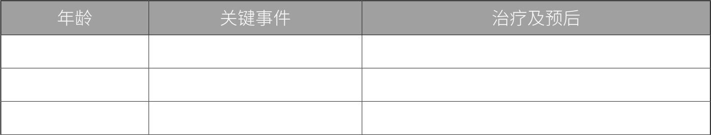
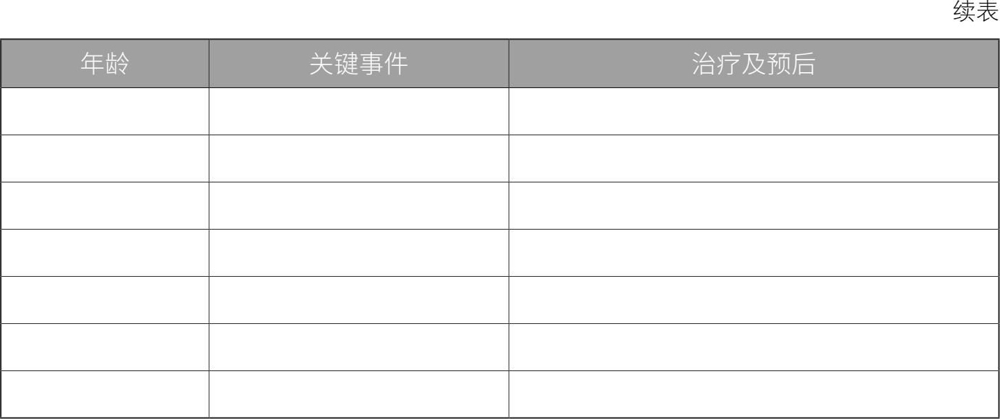
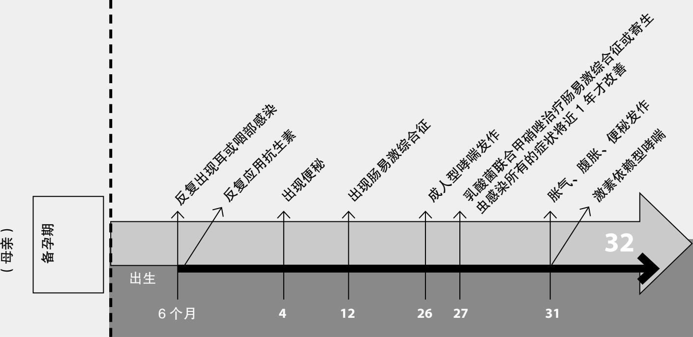
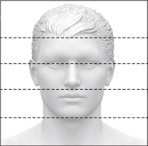
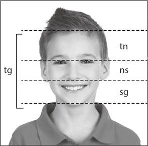
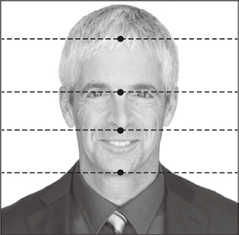

# 第四章 明确你在自身免疫性疾病发展谱中所处的位置

<h2><b>第</b><b>四</b><b>章</b></h2>

<h2><b>明</b><b>确</b><b>你</b><b>在</b><b>自</b><b>身</b><b>免</b><b>疫</b><b>性</b><b>疾</b><b>病</b><b>发</b><b>展</b><b>谱</b><b>中</b><b>所</b><b>处</b><b>的</b><b>位</b><b>置</b></h2>

	
想要明确你是否已经处于自身免疫性疾病发展谱上，以及是否正在形成肠漏，第一步要做的就是评估你当前的健康状况。我所推荐的评估方法是基于功能医学的。这一点很重要，因为并不是所有的健康评估都能起到同样的作用。

	
我认为功能医学方法是解决健康问题最全面的方式。功能医学通过系统导向的方法来研究疾病的根本原因，这意味着我们要评估你体内的每一个系统，明确其是否对健康问题产生影响。为此，我们努力在患者和医生之间建立一种全面的合作伙伴关系。通过这种方式，我们就可以同时治疗疾病的“标”和“本”。例如，我在功能医学研究院的工作就是教授肠道通透性增加（肠漏）的相关内容——它的成因、诱发因素以及解决方法。

	
功能医学从业者包括针灸师、心脏病学家、脊椎指压治疗师、心理学家、营养学家和内分泌学家等。无论你的医疗服务提供者最初的专业领域是什么，他们都可以接受功能医学方面的培训。这方面的培训将教会他们倾听患者的既往史和家族史，并寻找基因、环境和生活方式三种因素之间的相互作用，这些因素可能引起健康问题并导致复杂的慢性病。通过将以疾病为中心（治疗疾病的症状）转变为以患者为中心，功能医学针对的是患者整体，而不仅仅是一组孤立的症状。

	
功能医学和常规医学之间的差异正如同在乘坐飞机的不同阶段所看到的景色之间的差异。当你刚开始坐在飞机上的时候，你可能会看向窗外。你能看到的就是你旁边登机口的那架飞机，也可能会看到行李搬运工在把行李扔到传送带上。总之，你的视野是有限的，除了眼前的这些你看不到其他的。你有限的视野正代表了常规医学——专家和学者们有他们各自擅长的专业领域，比如心脏病学、儿科学、内科学、精神病学等。这些医生在观察他们的专业和领域时，看到的就是他们眼前的事物。

	
但是当飞机离开登机口时，你再从窗户往外看，就可以看到跑道了。也许现在是秋天，刚刚经过的跑道旁的树叶开始变黄。当飞机起飞的时候，你会注意到机场外面有一片你之前看不到的森林。哦，快看，还有一个湖泊，还有远处的天际线。当飞机爬升到空中时，你的视野不断扩大，你会看到更广阔的画面。最后，在巡航高度，你将拥有我所说的30000英尺的视野。现在你可以观察地形了。你对眼前的事物有了一个总体的了解。这就是功能医学：通过30000英尺高的视野观察患者当前的机体功能状况或是功能的欠缺，并找到问题的根源。

	
功能医学使我们能够以一种比常规医学更全面的方式来看待自身免疫。同样的症状可能源于许多不同的原因。例如，肠道通透性增加可能是由慢性便秘引起的，但为什么会出现慢性便秘呢？对某些人来说，便秘可能是由一个简单而明显的原因引起的，例如对食物敏感。对另一些人来说，他们过去可能受到过身体或情感上的折磨，体内持续不断地产生大量的应激激素，导致肠道紧张，从而引起长期便秘。然而对其他一些人来说，童年时期使用抗生素治疗复发性耳部感染的经历，可能导致了肠道微生物群落功能不良，即缺乏丁酸，导致结肠运动欠佳。如果我们用缓泻药治疗便秘，这在短期内是有效的，但导致便秘的根本原因仍然存在，并且随着时间的推移肠道中可能产生更严重的症状。

	
在自身免疫性疾病发展谱的另一端是疾病，这也可以从功能医学的角度来解释。如果你被诊断患有自身免疫性甲状腺病，比如桥本甲状腺炎，那么常规的治疗方法很可能包括应用甲状腺激素，以缓解甲状腺功能不良的症状。额外补充的激素确实可能对改善你的症状有帮助，但通常不会首先解决导致甲状腺功能障碍的根本原因。

	
功能医学可以从日常生活的角度解决你的健康问题，例如，从日常生活的角度分析导致你甲状腺出现问题甚至使甲状腺无法正常工作的原因。通过挖掘甲状腺问题背后的原因，我们可能会发现几种不同的导致甲状腺功能障碍的原因，并且每一种都是可以解决的。

● 麸质敏感。研究发现，被诊断患有自身免疫性桥本甲状腺炎的患者中有43%也对麸质敏感
	<a id="noteref-10-42" href="#footnote-10-42">[1]</a>。食用含有麸质的食物可能使自身免疫性疾病之火越燃越旺。一旦饮食中不再有麸质，你的甲状腺功能就可能会恢复，而不需要额外的激素治疗

● 对氯（甚至仅仅是饮用水中的微量氯）的敏感性。经过多年的氯积累后，不仅会显著影响甲状腺功能
	<a id="noteref-10-46" href="#footnote-10-46">[2]</a>，也会影响胎儿、婴儿、幼儿的大脑发育
	<a id="noteref-10-65" href="#footnote-10-65">[3]</a>。如果你发现自己对氯敏感，一些小小的生活方式调整就可以帮助你的甲状腺更好地工作，比如安装一个饮用水氯过滤器，或者在淋浴喷头上安装一个氯过滤器。在用热水淋浴时，我们会吸入水蒸气，此时氯就会直接通过肺进入血液

● 因核辐射，而暴露在少量131I中。在美国已经进行了1054次核试验（包括216次大气、水下和太空试验），这些实验无意中使许多1946年以后出生的美国人患桥本甲状腺炎以及最终患甲状腺癌的风险升高
	<a id="noteref-10-98" href="#footnote-10-98">[4]</a>。在苏联的切尔诺贝利也有过核辐射暴露，最近的核辐射暴露则是发生在日本的福岛。大气中少量的131I（核辐射性微尘）属于环境诱发因素，可以促使自身免疫性甲状腺病的发展。如果这是导致你出现健康问题的原因，那么排毒方案对你来说是有益的，可降低你体内升高的碘水平

	
<b>认</b><b>清</b><b>现</b><b>实</b><b>！</b>

	
当我问我的患者他们的感受时，大多数人会说：“还好。”然后我问：“你的精力怎么样？”他们仍然说：“还好。”然后我会问我最喜欢的问题：“如果10分是你认为你应该拥有的精力，5分是这个程度的一半，那么1～10分之间，你给自己打几分？先等一下，打分时要除外意志力的因素，你现在打几分？”

	
当我让他们去除意志力因素时，他们脸上的表情令人吃惊。他们脸上的微笑消失了，因为事实证明他们的得分通常是5分或更少。这并不是很好。拥有你认为你应该拥有的精力的一半是你需要认清的现实。此时你已经开始步入自身免疫性疾病发展谱了。

	
所以当你填写这一章的测试时，不要满足于“还好”。

	
了解各种疾病的病因有时会让人头大。这就是为什么作为一名患者，要对自己有一个宏观的认识，并且在你的医疗团队中应该有一位功能医学医生，他可以在特定领域为你提供帮助。你必须首先确定问题的根源，以便彻底解决问题，而不是暂时缓解症状。

	
<b>准</b><b>备</b><b>好</b><b>做</b><b>出</b><b>改</b><b>变</b><b>了</b><b>吗</b><b>？</b>

	
我知道做出改变不容易，但也不是不可能。我们的转变方案中生活方式的改变需要承诺和耐心。我们都想要变得更健康，我们也知道为了变得更健康必须得做些什么。你购买了这本书（谢谢你！），可能是因为你的生活中有些事情有点不对劲。请记住，改变是一个持续的过程。

	
20多年前，酗酒研究人员卡洛·C.迪克莱门特博士和詹姆斯·O.普罗查斯卡博士引入了一种模型，以帮助专业人士了解他们有成瘾问题的研究对象，并促使他们的研究对象做出改变。他们的模型并不是基于抽象的理论，而是基于对人们如何改变生活方式行为（尤其是吸烟、暴饮暴食和酗酒）的个体观察。功能医学医生也会使用这个模型，因为它与改变生活方式非常相关，可以促进健康。

	
在他们的著作《改变，为更好的自己》（<i>C</i><i>h</i><i>a</i><i>n</i><i>g</i><i>i</i><i>n</i><i>g</i><i> </i><i>f</i><i>o</i><i>r</i><i> </i><i>G</i><i>o</i><i>o</i><i>d</i>）中，迪克莱门特博士、普罗查斯卡博士和约翰·C.诺克罗斯博士描述了他们对1000多人进行研究后得出的结论，这些研究对象不需要心理治疗就能积极地、永久地改变自己的生活方式。他们发现，改变并不是取决于运气或意志力，而是一个可以由任何理解其工作原理的人成功实现的过程。一旦你确定了你所处的变化阶段，你就可以创造一种可以发生积极变化的氛围，保持动力，将挫折转化为进步，并使你新的有益的习惯成为你生活中永久的一部分。

	
做出改变的五个阶段如下。

	
● 无打算阶段。在这个阶段，人们甚至不会考虑改变自己的行为。他们还没有意识到他们的生活方式会影响他们的健康

	
● 打算转变阶段。在这个阶段，人们愿意考虑他们可能存在健康问题，此时有做出改变的愿望。然而，在此阶段，人们往往是非常矛盾的，他们在观望。如果一个人表现出了怀疑（“我不相信这个，但我愿意了解更多的信息”）而不是玩世不恭（“我不相信，这是不真的”），我可以判断他（她）最终会获得成功。思考让他们正在朝着正确的方向，即做出改变的方向前进，但这并不是一种承诺

	
● 准备转变阶段。在这个阶段，人们将在不久的将来做出认真的尝试，以改变他们的生活方式。他们已经准备好并承诺采取行动，因为他们已经获得了足够的信息（通过阅读本书以及完成本章中的测试），现在他们相信行为的改变可以改善他们的健康状况

	
● 行动阶段。在这个阶段，人们将计划付诸行动，通过转变方案改变他们的饮食习惯。几周后，他们开始看到效果，并感受到健康方面的积极变化

	
● 保持/巩固阶段。我总是告诉我的患者，人类在发现一些做法是正确的之后，却会又停止继续做下去，地球上人类是唯一会这样做的物种。改变需要随着时间的推移建立一种新的行为模式并坚持下去。当你感觉很棒的时候，你会忍不住想吃一块生日蛋糕或蓝莓松饼，这很正常。然而，当你吃了之后，我敢打赌你不会再感觉这么好了。搞砸了又回归旧的习惯，这是人之本性。之后我们感觉很糟，再次回到正轨，又会感觉好些了。当你一次又一次地摔倒了再爬起来之后，生日蛋糕的诱惑（“我就吃一口”）就会消失。在坚持了6个月的新生活方式后，研究人员发现，旧的生活习惯已不再会构成严重的危险或威胁

	
<b>“</b><b>准</b><b>备</b><b>做</b><b>出</b><b>改</b><b>变</b><b>”</b><b>的</b><b>测</b><b>试</b>

	
“准备做出改变”的测试（见下页）可以帮助确定你是否真的准备好了开始做出改变。这个测试可以让你评估你想要改善健康状况的渴望程度、接受度和承诺力度。

	
我们通常认为我们将尽一切努力保持健康，但事实上并非如此。你可能想要变得更健康，但却在前面提到的“打算转变阶段”停滞不前。要想在这个计划中取得成功，你的意愿需要与你的决心保持一致。如果你能积极地回答这些问题，你就知道你已经准备好做出改变了。如果你的答案显示出你并不情愿，你则需要探究是什么信念阻碍了你。

	
我的许多患者发现自己处于自身免疫性疾病发展谱时，他们就不再犹豫，而是坚定地加入了这个计划中。对我来说，当我发现我的大脑中有3种抗体的水平升高时我就不再犹豫了。虽然我非常惊讶，但我明白这些抗体水平的升高有可能导致多发性硬化、脑萎缩小脑变性。

	
请回答下面的问题，选择最接近你现在感受的答案。然后你就可以了解到，对于这些可以改善健康状况的最佳做法，你的常见反应是什么。

	
<b>“</b><b>准</b><b>备</b><b>做</b><b>出</b><b>改</b><b>变</b><b>”</b><b>的</b><b>测</b><b>试</b>

	
为了改善你的健康状况，你愿意做以下事情吗？

	
<b>在</b><b>饮</b><b>食</b><b>方</b><b>面</b><b>做</b><b>出</b><b>显</b><b>著</b><b>改</b><b>变</b>

	
_____非常愿意

	
_____比较愿意

	
_____都可以

	
_____不太愿意

	
_____根本不愿意

	
<b>每</b><b>天</b><b>服</b><b>用</b><b>营</b><b>养</b><b>素</b>

	
_____非常愿意

	
_____比较愿意

	
_____都可以

	
_____不太愿意

	
_____根本不愿意

	
<b>记</b><b>录</b><b>你</b><b>每</b><b>天</b><b>的</b><b>饮</b><b>食</b><b>情</b><b>况</b>

	
_____非常愿意

	
_____比较愿意

	
_____都可以

	
_____不太愿意

	
_____根本不愿意

	
<b>定</b><b>期</b><b>参</b><b>加</b><b>锻</b><b>炼</b>

	
_____非常愿意

	
_____比较愿意

	
_____都可以

	
_____不太愿意

	
_____根本不愿意

	
<b>改</b><b>变</b><b>你</b><b>的</b><b>生</b><b>活</b><b>方</b><b>式</b><b>—</b><b>—</b><b>例</b><b>如</b><b>工</b><b>作</b><b>要</b><b>求</b>

	
_____非常愿意

	
_____比较愿意

	
_____都可以

	
_____不太愿意

	
_____根本不愿意

	
<b>改</b><b>善</b><b>睡</b><b>眠</b><b>习</b><b>惯</b>

	
_____非常愿意

	
_____比较愿意

	
_____都可以

	
_____不太愿意

	
_____根本不愿意

	
<b>练</b><b>习</b><b>放</b><b>松</b><b>技</b><b>巧</b>

	
_____非常愿意

	
_____比较愿意

	
_____都可以

	
_____不太愿意

	
_____根本不愿意

	
<b>你</b><b>对</b><b>自</b><b>己</b><b>制</b><b>订</b><b>和</b><b>实</b><b>施</b><b>健</b><b>康</b><b>相</b><b>关</b><b>计</b><b>划</b><b>的</b><b>能</b><b>力</b><b>有</b><b>多</b><b>大</b><b>信</b><b>心</b><b>？</b>

	
_____很有信心

	
_____比较有信心

	
<b>你</b><b>生</b><b>活</b><b>中</b><b>的</b><b>重</b><b>要</b><b>人</b><b>物</b><b>对</b><b>你</b><b>做</b><b>出</b><b>这</b><b>些</b><b>改</b><b>变</b><b>的</b><b>支</b><b>持</b><b>程</b><b>度</b><b>如</b><b>何</b><b>？</b>

	
_____非常支持

	
_____比较支持

	
_____一般

	
_____不太支持

	
_____根本不支持

	
<b>你</b><b>是</b><b>否</b><b>处</b><b>于</b><b>自</b><b>身</b><b>免</b><b>疫</b><b>性</b><b>疾</b><b>病</b><b>发</b><b>展</b><b>谱</b><b>中</b>

	
自身免疫对机体的影响因人而异，这取决于你的健康链条上的薄弱环节在哪里。有超过300种疾病与自身免疫相关（见第一章），但是如果你处于自身免疫性疾病发展谱的早期阶段，你可能还没有任何症状。第88页的小测试重点提到了可以引起自身免疫级联反应最常见的炎症症状。在这个小测试中，你将解读自身的感受。你需要关注在健康方面出现的微小变化，因为它们通常是更严重的健康问题的警示信号。请记住，即使你的症状很轻微，你也可能已经处于自身免疫性疾病发展谱之中。例如，在阿尔茨海默病发展过程中的前20多年里，人们并没有“感觉到”疾病的存在。

	
我的朋友亚历克斯最近给我发了以下这封电子邮件，他完美地总结了他的“无打算阶段”，以及识别体内失衡的细微指标的重要性。

	
<b>奥</b><b>布</b><b>赖</b><b>恩</b><b>，</b><b>在</b><b>过</b><b>去</b><b>的</b><b>3</b><b>周</b><b>，</b><b>我</b><b>开</b><b>始</b><b>注</b><b>意</b><b>到</b><b>我</b><b>的</b><b>身</b><b>体</b><b>有</b><b>些</b><b>不</b><b>对</b><b>劲</b><b>，</b><b>并</b><b>且</b><b>出</b><b>现</b><b>了</b><b>胸</b><b>痛</b><b>。</b><b>每</b><b>年</b><b>体</b><b>检</b><b>我</b><b>和</b><b>医</b><b>生</b><b>都</b><b>在</b><b>推</b><b>测</b><b>我</b><b>的</b><b>问</b><b>题</b><b>是</b><b>出</b><b>在</b><b>肠</b><b>胃</b><b>还</b><b>是</b><b>心</b><b>脏</b><b>，</b><b>所</b><b>以</b><b>我</b><b>的</b><b>医</b><b>生</b><b>化</b><b>验</b><b>了</b><b>我</b><b>的</b><b>胆</b><b>固</b><b>醇</b><b>和</b><b>甘</b><b>油</b><b>三</b><b>酯</b><b>，</b><b>但</b><b>它</b><b>们</b><b>都</b><b>是</b><b>正</b><b>常</b><b>的</b><b>。</b><b>（</b><b>仅</b><b>供</b><b>参</b><b>考</b><b>，</b><b>在</b><b>致</b><b>命</b><b>性</b><b>心</b><b>脏</b><b>病</b><b>患</b><b>者</b><b>中</b><b>，</b><b>有</b><b>5</b><b>0</b><b>%</b><b>的</b><b>人</b><b>胆</b><b>固</b><b>醇</b><b>含</b><b>量</b><b>并</b><b>不</b><b>高</b><b>，</b><b>那</b><b>么</b><b>为</b><b>什</b><b>么</b><b>医</b><b>生</b><b>只</b><b>把</b><b>胆</b><b>固</b><b>醇</b><b>作</b><b>为</b><b>心</b><b>脏</b><b>病</b><b>高</b><b>风</b><b>险</b><b>的</b><b>标</b><b>志</b><b>物</b><b>呢</b><b>？</b><b>）</b>

	
<b>2</b><b>周</b><b>前</b><b>，</b><b>当</b><b>我</b><b>和</b><b>我</b><b>的</b><b>孩</b><b>子</b><b>们</b><b>在</b><b>拉</b><b>斯</b><b>维</b><b>加</b><b>斯</b><b>时</b><b>，</b><b>我</b><b>发</b><b>现</b><b>我</b><b>自</b><b>己</b><b>酒</b><b>店</b><b>走</b><b>到</b><b>汽</b><b>车</b><b>上</b><b>有</b><b>些</b><b>费</b><b>力</b><b>。</b><b>慢</b><b>慢</b><b>地</b><b>，</b><b>当</b><b>我</b><b>搬</b><b>运</b><b>行</b><b>李</b><b>的</b><b>时</b><b>候</b><b>，</b><b>胸</b><b>痛</b><b>开</b><b>始</b><b>了</b><b>，</b><b>我</b><b>不</b><b>得</b><b>不</b><b>坐</b><b>下</b><b>来</b><b>休</b><b>息</b><b>几</b><b>分</b><b>钟</b><b>。</b><b>在</b><b>周</b><b>末</b><b>，</b><b>我</b><b>确</b><b>保</b><b>自</b><b>己</b><b>的</b><b>活</b><b>动</b><b>范</b><b>围</b><b>小</b><b>一</b><b>些</b><b>，</b><b>尽</b><b>可</b><b>能</b><b>坐</b><b>着</b><b>。</b><b>当</b><b>周</b><b>末</b><b>结</b><b>束</b><b>的</b><b>时</b><b>候</b><b>，</b><b>我</b><b>在</b><b>搬</b><b>运</b><b>我</b><b>的</b><b>行</b><b>李</b><b>时</b><b>感</b><b>到</b><b>强</b><b>烈</b><b>的</b><b>胸</b><b>痛</b><b>。</b><b>我</b><b>不</b><b>得</b><b>不</b><b>坐</b><b>上</b><b>一</b><b>段</b><b>时</b><b>间</b><b>。</b>

	
<b>上</b><b>周</b><b>一</b><b>打</b><b>高</b><b>尔</b><b>夫</b><b>球</b><b>时</b><b>，</b><b>我</b><b>一</b><b>直</b><b>感</b><b>到</b><b>胸</b><b>痛</b><b>，</b><b>但</b><b>我</b><b>努</b><b>力</b><b>坚</b><b>持</b><b>打</b><b>了</b><b>一</b><b>段</b><b>时</b><b>间</b><b>，</b><b>并</b><b>且</b><b>打</b><b>得</b><b>很</b><b>好</b><b>。</b><b>我</b><b>一</b><b>直</b><b>认</b><b>为</b><b>是</b><b>肠</b><b>胃</b><b>出</b><b>了</b><b>问</b><b>题</b><b>。</b><b>但</b><b>是</b><b>接</b><b>下</b><b>来</b><b>在</b><b>上</b><b>周</b><b>日</b><b>的</b><b>晚</b><b>上</b><b>我</b><b>又</b><b>感</b><b>觉</b><b>有</b><b>点</b><b>不</b><b>舒</b><b>服</b><b>。</b><b>星</b><b>期</b><b>二</b><b>凌</b><b>晨</b><b>3</b><b>点</b><b>3</b><b>0</b><b>分</b><b>，</b><b>我</b><b>从</b><b>睡</b><b>眠</b><b>中</b><b>醒</b><b>来</b><b>，</b><b>胸</b><b>痛</b><b>得</b><b>很</b><b>厉</b><b>害</b><b>。</b><b>我</b><b>给</b><b>内</b><b>科</b><b>医</b><b>生</b><b>打</b><b>了</b><b>电</b><b>话</b><b>，</b><b>医</b><b>生</b><b>让</b><b>我</b><b>尽</b><b>快</b><b>赶</b><b>到</b><b>医</b><b>院</b><b>。</b><b>我</b><b>坐</b><b>上</b><b>车</b><b>，</b><b>一</b><b>路</b><b>闯</b><b>着</b><b>红</b><b>灯</b><b>，</b><b>大</b><b>约</b><b>5</b><b>分</b><b>钟</b><b>就</b><b>狂</b><b>奔</b><b>到</b><b>了</b><b>医</b><b>院</b><b>，</b><b>把</b><b>车</b><b>停</b><b>在</b><b>急</b><b>诊</b><b>门</b><b>口</b><b>，</b><b>请</b><b>求</b><b>马</b><b>上</b><b>就</b><b>诊</b><b>。</b>

	
<b>他</b><b>们</b><b>带</b><b>我</b><b>去</b><b>见</b><b>急</b><b>诊</b><b>医</b><b>生</b><b>，</b><b>医</b><b>生</b><b>给</b><b>了</b><b>我</b><b>一</b><b>个</b><b>贴</b><b>着</b><b>硝</b><b>化</b><b>甘</b><b>油</b><b>标</b><b>签</b><b>的</b><b>药</b><b>，</b><b>服</b><b>用</b><b>后</b><b>疼</b><b>痛</b><b>逐</b><b>渐</b><b>消</b><b>失</b><b>。</b><b>但</b><b>之</b><b>后</b><b>疼</b><b>痛</b><b>又</b><b>出</b><b>现</b><b>了</b><b>，</b><b>我</b><b>想</b><b>：</b><b>“</b><b>发</b><b>生</b><b>了</b><b>什</b><b>么</b><b>事</b><b>？</b><b>”</b><b>我</b><b>意</b><b>识</b><b>到</b><b>我</b><b>一</b><b>直</b><b>否</b><b>认</b><b>自</b><b>己</b><b>有</b><b>心</b><b>脏</b><b>问</b><b>题</b><b>。</b><b>“</b><b>我</b><b>不</b><b>可</b><b>能</b><b>有</b><b>心</b><b>脏</b><b>问</b><b>题</b><b>。</b><b>我</b><b>很</b><b>肯</b><b>定</b><b>。</b><b>”</b><b>然</b><b>后</b><b>他</b><b>们</b><b>给</b><b>我</b><b>用</b><b>了</b><b>另</b><b>一</b><b>种</b><b>药</b><b>物</b><b>，</b><b>是</b><b>抗</b><b>凝</b><b>的</b><b>，</b><b>然</b><b>后</b><b>把</b><b>我</b><b>送</b><b>进</b><b>了</b><b>病</b><b>房</b><b>。</b><b>他</b><b>们</b><b>安</b><b>排</b><b>我</b><b>做</b><b>血</b><b>管</b><b>造</b><b>影</b><b>。</b><b>当</b><b>我</b><b>感</b><b>觉</b><b>自</b><b>己</b><b>的</b><b>心</b><b>脏</b><b>要</b><b>跳</b><b>出</b><b>身</b><b>体</b><b>时</b><b>，</b><b>我</b><b>变</b><b>得</b><b>很</b><b>不</b><b>耐</b><b>烦</b><b>。</b><b>然</b><b>后</b><b>我</b><b>就</b><b>开</b><b>始</b><b>祷</b><b>告</b><b>，</b><b>臣</b><b>服</b><b>于</b><b>神</b><b>秘</b><b>力</b><b>量</b><b>，</b><b>并</b><b>一</b><b>遍</b><b>又</b><b>一</b><b>遍</b><b>地</b><b>重</b><b>复</b><b>着</b><b>我</b><b>的</b><b>祈</b><b>祷</b><b>。</b><b>当</b><b>他</b><b>们</b><b>把</b><b>我</b><b>推</b><b>进</b><b>手</b><b>术</b><b>室</b><b>时</b><b>，</b><b>我</b><b>听</b><b>到</b><b>了</b><b>身</b><b>后</b><b>传</b><b>来</b><b>安</b><b>德</b><b>烈</b><b>·</b><b>波</b><b>切</b><b>利</b><b>的</b><b>歌</b><b>声</b><b>。</b><b>搞</b><b>什</b><b>么</b><b>啊</b><b>！</b><b>！</b><b>不</b><b>知</b><b>怎</b><b>的</b><b>，</b><b>我</b><b>完</b><b>全</b><b>放</b><b>弃</b><b>了</b><b>，</b><b>如</b><b>果</b><b>我</b><b>死</b><b>了</b><b>，</b><b>那</b><b>就</b><b>是</b><b>上</b><b>天</b><b>注</b><b>定</b><b>的</b><b>，</b><b>就</b><b>这</b><b>样</b><b>吧</b><b>。</b>

	
<b>整</b><b>个</b><b>手</b><b>术</b><b>过</b><b>程</b><b>中</b><b>我</b><b>都</b><b>是</b><b>清</b><b>醒</b><b>的</b><b>。</b><b>1</b><b>个</b><b>小</b><b>时</b><b>后</b><b>，</b><b>医</b><b>生</b><b>告</b><b>诉</b><b>我</b><b>，</b><b>他</b><b>们</b><b>发</b><b>现</b><b>我</b><b>的</b><b>心</b><b>脏</b><b>有</b><b>一</b><b>条</b><b>主</b><b>要</b><b>的</b><b>动</b><b>脉</b><b>被</b><b>堵</b><b>塞</b><b>了</b><b>9</b><b>9</b><b>.</b><b>9</b><b>%</b><b>。</b><b>这</b><b>也</b><b>许</b><b>可</b><b>以</b><b>解</b><b>释</b><b>为</b><b>什</b><b>么</b><b>在</b><b>过</b><b>去</b><b>的</b><b>4</b><b>8</b><b>小</b><b>时</b><b>里</b><b>，</b><b>我</b><b>从</b><b>一</b><b>个</b><b>房</b><b>间</b><b>走</b><b>到</b><b>另</b><b>一</b><b>个</b><b>房</b><b>间</b><b>都</b><b>觉</b><b>得</b><b>很</b><b>困</b><b>难</b><b>。</b><b>他</b><b>们</b><b>通</b><b>过</b><b>血</b><b>管</b><b>成</b><b>形</b><b>术</b><b>植</b><b>入</b><b>支</b><b>架</b><b>，</b><b>以</b><b>使</b><b>动</b><b>脉</b><b>重</b><b>新</b><b>开</b><b>放</b><b>。</b><b>在</b><b>接</b><b>下</b><b>来</b><b>的</b><b>1</b><b>个</b><b>小</b><b>时</b><b>左</b><b>右</b><b>，</b><b>我</b><b>能</b><b>感</b><b>受</b><b>到</b><b>自</b><b>己</b><b>的</b><b>心</b><b>脏</b><b>，</b><b>并</b><b>且</b><b>在</b><b>想</b><b>：</b><b>“</b><b>他</b><b>们</b><b>做</b><b>得</b><b>对</b><b>吗</b><b>？</b><b>”</b>

	
<b>过</b><b>了</b><b>一</b><b>会</b><b>儿</b><b>，</b><b>我</b><b>开</b><b>始</b><b>感</b><b>觉</b><b>到</b><b>血</b><b>液</b><b>再</b><b>次</b><b>流</b><b>动</b><b>了</b><b>。</b><b>下</b><b>午</b><b>5</b><b>点</b><b>出</b><b>院</b><b>回</b><b>家</b><b>后</b><b>，</b><b>我</b><b>感</b><b>觉</b><b>自</b><b>己</b><b>好</b><b>多</b><b>了</b><b>，</b><b>好</b><b>像</b><b>血</b><b>液</b><b>把</b><b>我</b><b>的</b><b>身</b><b>体</b><b>里</b><b>一</b><b>个</b><b>狭</b><b>窄</b><b>的</b><b>地</b><b>方</b><b>冲</b><b>开</b><b>了</b><b>。</b>

	
<b>所</b><b>以</b><b>这</b><b>次</b><b>差</b><b>一</b><b>点</b><b>点</b><b>就</b><b>变</b><b>成</b><b>心</b><b>脏</b><b>病</b><b>发</b><b>作</b><b>了</b><b>，</b><b>他</b><b>们</b><b>称</b><b>之</b><b>为</b><b>“</b><b>心</b><b>脏</b><b>事</b><b>件</b><b>”</b><b>。</b><b>我</b><b>将</b><b>接</b><b>受</b><b>一</b><b>系</b><b>列</b><b>的</b><b>药</b><b>物</b><b>治</b><b>疗</b><b>，</b><b>其</b><b>中</b><b>一</b><b>些</b><b>可</b><b>能</b><b>需</b><b>要</b><b>长</b><b>期</b><b>服</b><b>用</b><b>。</b>

	
<b>我</b><b>现</b><b>在</b><b>需</b><b>要</b><b>重</b><b>新</b><b>评</b><b>估</b><b>我</b><b>的</b><b>健</b><b>康</b><b>生</b><b>活</b><b>，</b><b>并</b><b>感</b><b>激</b><b>我</b><b>所</b><b>拥</b><b>有</b><b>的</b><b>一</b><b>切</b><b>。</b><b>但</b><b>这</b><b>次</b><b>的</b><b>事</b><b>件</b><b>是</b><b>一</b><b>个</b><b>警</b><b>钟</b><b>，</b><b>似</b><b>乎</b><b>我</b><b>的</b><b>生</b><b>活</b><b>中</b><b>经</b><b>常</b><b>需</b><b>要</b><b>这</b><b>样</b><b>的</b><b>警</b><b>钟</b><b>。</b><b>我</b><b>一</b><b>直</b><b>在</b><b>想</b><b>，</b><b>我</b><b>无</b><b>数</b><b>次</b><b>觉</b><b>得</b><b>你</b><b>是</b><b>个</b><b>讨</b><b>厌</b><b>的</b><b>人</b><b>，</b><b>但</b><b>其</b><b>实</b><b>你</b><b>一</b><b>直</b><b>在</b><b>努</b><b>力</b><b>挽</b><b>救</b><b>我</b><b>的</b><b>生</b><b>命</b><b>。</b>

	
那么我想告诉亚历克斯什么呢？我试着教他识别当处于自身免疫性疾病发展谱时身体发出的微小信息，但由于他还是处于将信将疑的“无打算阶段”，他拒绝听我的，也不愿意听他的身体在说什么。如果他以前做过这些简单的测试，然后通过正确的检查来证实，他就会发现炎症正在拉扯着他的健康链条上的薄弱环节，即他的心脏血管。

	
下面这个全面且易懂的测试将告诉你：你的薄弱环节在哪里，以及你在自身免疫性疾病发展谱中的位置。这个测试来自功能医学研究院。这与我给患者所做的测试是一样的。请尽最大努力来回答这些问题。根据你最近几个月的感受，用这个量表对下列症状进行评分。

	
0 没有或几乎没有症状

	
1 偶尔有，症状并不严重

	
2 偶尔有，症状严重

	
3 经常有，症状不严重

	
4 经常有，症状严重

	
<b>医</b><b>学</b><b>症</b><b>状</b><b>测</b><b>试</b>

	
<b>头</b>

	
_____头痛

	
_____晕厥

	
_____头晕

	
_____失眠

	
_____<b>合</b><b>计</b><b>得</b><b>分</b>

	
<b>耳</b>

	
_____耳部痒感

	
_____耳痛，耳部感染

	
_____耳内流液

	
_____耳鸣，听力受损

	
_____<b>合</b><b>计</b><b>得</b><b>分</b>

	
<b>鼻</b>

	
_____鼻塞

	
_____鼻窦问题

	
_____花粉过敏

	
_____打喷嚏

	
_____鼻涕过多

	
_____<b>合</b><b>计</b><b>得</b><b>分</b>

	
<b>眼</b>

	
_____流泪或眼部痒感

	
_____眼睑肿胀、发红或黏腻感

	
_____眼袋或黑眼圈

	
_____视物模糊或视野狭窄（不包括近视或远视）

	
_____<b>合</b><b>计</b><b>得</b><b>分</b>

	
<b>肺</b>

	
_____胸闷

	
_____哮喘，支气管炎

	
_____呼吸急促

	
_____呼吸困难

	
_____<b>合</b><b>计</b><b>得</b><b>分</b>

	
<b>口</b><b>/</b><b>咽</b>

	
_____慢性咳嗽

	
_____干呕，经常需要清嗓子

	
_____喉咙痛，声音嘶哑，失声

	
_____舌头、牙龈、嘴唇肿胀或变色

	
_____口腔溃疡

	
_____<b>合</b><b>计</b><b>得</b><b>分</b>

	
<b>消</b><b>化</b><b>道</b>

	
_____恶心，呕吐

	
_____腹泻

	
_____便秘

	
_____饱胀感

	
_____打嗝，嗳气

	
_____胃灼热

	
_____肠/胃痛

	
_____<b>合</b><b>计</b><b>得</b><b>分</b>

	
<b>皮</b><b>肤</b>

	
_____痤疮

	
_____荨麻疹，皮肤干燥

	
_____脱发

	
_____潮红，潮热

	
_____多汗

	
_____<b>合</b><b>计</b><b>得</b><b>分</b>

	
<b>心</b><b>脏</b>

	
_____心律不齐或心脏漏搏

	
_____心动过速或心跳剧烈

	
_____胸痛

	
_____<b>合</b><b>计</b><b>得</b><b>分</b>

	
<b>体</b><b>重</b>

	
_____暴饮暴食

	
_____渴望特定食物

	
_____超重

	
_____强迫性进食

	
_____水潴留

	
_____体重过轻

	
_____<b>合</b><b>计</b><b>得</b><b>分</b>

	
<b>关</b><b>节</b><b>/</b><b>肌</b><b>肉</b>

	
_____关节疼痛

	
_____关节炎

	
_____僵硬或活动受限

	
_____肌肉疼痛

	
_____虚弱感或疲惫感

	
_____<b>合</b><b>计</b><b>得</b><b>分</b>

	
<b>精</b><b>力</b><b>/</b><b>活</b><b>力</b>

	
_____疲劳感/懈怠感

	
_____冷漠/嗜睡

	
_____多动

	
_____躁动不安

	
_____<b>合</b><b>计</b><b>得</b><b>分</b>

	
<b>思</b><b>维</b><b>/</b><b>精</b><b>神</b>

	
_____记忆力差

	
_____困惑/理解力差

	
_____注意力不集中

	
_____身体协调能力差

	
_____决策困难

	
_____口吃或结巴

	
_____言语不清

	
_____学习障碍

	
_____<b>合</b><b>计</b><b>得</b><b>分</b>

	
<b>情</b><b>绪</b>

	
_____情绪波动

	
_____焦虑，恐惧，紧张

	
_____愤怒，烦躁，有攻击性

	
_____抑郁

	
_____<b>合</b><b>计</b><b>得</b><b>分</b>

	
<b>其</b><b>他</b><b>方</b><b>面</b>

	
_____经常生病

	
_____尿频或尿急

	
_____生殖器瘙痒或阴道分泌物多

	
_____合计得分

	
_____<b>总</b><b>分</b>

	
<b>查</b><b>看</b><b>你</b><b>的</b><b>测</b><b>试</b><b>结</b><b>果</b>

	
计算测试中每个类别的得分，然后把这些分数加起来，得到一个最终得分。总分小于10分是最佳的，超过40分说明有明显的炎症在牵拉你的健康链条。得分最高的类别即可能是你健康链条中的薄弱环节。

	
<b>画</b><b>出</b><b>你</b><b>的</b><b>时</b><b>间</b><b>轴</b>

	
功能医学检查涵盖了你健康的每一个细节——你的出生情况，婴儿期、童年期和青年期的健康状况，疫苗接种史，发热史，抗生素使用史，等等。功能医学检查包括所有可能对今天的“你”产生影响的每件事情。当你研究如何阻止你体内正在发生的发病机制时，到目前为止你所经历过的一切是非常关键的信息，可能对于制订一个独特而理想的计划以逆转自身免疫性疾病发展谱非常有意义。

	
我会给我的每一位患者画出一个时间轴，这样我们就可以很容易地想象出患者体内失衡的发展过程。很多时候，一个有着自身免疫性疾病症状的成人来到我的诊室时，我们可以追溯到他很小的时候的第一个症状。了解你的时间轴可以让你明确自己在自身免疫性疾病发展谱上的位置，你会发现早期症状是如何随着时间的推移而逐渐发展的。当患者意识到这一切是如何联系在一起时，他们通常会瞠目结舌。他们目前的健康问题早在许多年前就开始出现了。

	
在我的诊室里，当患者做了本书中第88页所展示的医学症状测试后，他们会填写一份26页的问卷，此时我的诊疗工作才正式开始。问卷中的问题不仅涵盖了他们的既往史和现病史，也包括他们的家族史，因为遗传学是理解疾病的关键。患者会列出他们目前和过去的饮食、人际关系和情绪状态。然后我从问卷中提炼数据，创建一个时间轴。当我的患者看到他们的健康问题是如何在时间轴上显示出来的时候，他们就会明白他们的炎症症状是如何随着时间的推移而发展的，以及这些症状之间是如何相互联系的。向他们展示这个时间轴是赋予患者权利的最好方式之一，因为他们可以认识到，如果他们承诺改变生活方式，正如同我们后面在转变方案中将要讨论的，那么治愈疾病就是可能的。

	
你可以画出一个完整的时间轴，然后找到一个功能医学医生，他们知道如何针对你和你的时间轴做出处理。访问LivingMatrix.com/TheAutoImmuneFix获得更多信息，以便为你的家人画出属于自己的时间轴，并通过theDr.com找到一个功能医学医生。

	
<b>我</b><b>的</b><b>时</b><b>间</b><b>轴</b>

	
你可以根据表4-1列出的内容来画出自己的时间轴。首先，填写你从前面的医学症状测试中发现的症状。看看你是否能够确定症状是什么时候开始的，以及随着时间它们是如何变化的。然后，把注意力转移到任何慢性或反复出现的症状上，或者让你烦恼的小毛病上。通过医学症状测试所得的答案可以指引你去探索相应的健康问题。请努力回忆你最初、最细微的症状是何时发生的。

	
然后再回想一下你的青少年时期，将每一个重大或轻微的生理或心理的健康变化在时间轴上记录下来，同也记录下你每次应对健康问题所采取的措施。你也可以向你的亲戚打听一下，他们是否了解你母亲怀孕和分娩的情况。一些关键事件很快就会浮现在你的脑海中，比如耳部感染、反复发作的链球菌性咽炎或扁桃体切除。

	
如果表格中的空间不够，你可以把表格抄到本子上。

	
表4-1 记录关键事件

	

	

	
然后将这些信息转换成线性图，如图2-7所示。

	

	
图2-7 时间轴示例

	
经允许摘自Lisa Klancher K2Studios, LLC.

	
<b>诊</b><b>断</b><b>乳</b><b>糜</b><b>泻</b><b>与</b><b>非</b><b>乳</b><b>糜</b><b>泻</b><b>性</b><b>麸</b><b>质</b><b>（</b><b>小</b><b>麦</b><b>）</b><b>敏</b><b>感</b>

	
麸质是诱发炎症反应的主要原因，而炎症反应会增加肠道通透性并促进自身免疫性疾病发展谱的发展。近年来发表的重要研究清晰地指出，所有人在消化来自小麦、黑麦和大麦中的“有毒”麸质蛋白时都存在问题，无论吃的时候是否有症状。我们通常错误地认为，如果我们在吃的时候没有不舒服，那么我们吃这种食物就没什么问题。我们不会把早上醒来时发生的头痛、高血压、脑雾或学习时缺乏思考能力等这些问题与我们前一天吃的食物联系起来。但重要的是要意识到，食物敏感症状可能并不会在我们刚吃完食物后就那么明显，也可能并不会出现在我们的肠道中，而是可以出现在身体的任何部位。

	
从首次出现症状到明确诊断为乳糜泻所花费的时间平均是11年——因为这些症状可能非常轻微，也可能被认为是由其他疾病造成的。更糟糕的是，很多人一生都没能被确诊。直到不久前，做出乳糜泻完整诊断的唯一方法还是进行内镜检查，活检显示存在自身免疫性损伤才可确诊。现在我们有比以往更敏感的血液检测，我们将在下一章中进行讨论。

	
内镜下病变分级为Marsh Ⅰ、Marsh Ⅱ、Marsh Ⅲ（a、b、c）。

	
● Marsh Ⅰ——炎症增多。微绒毛仍然存在，但是肠道内充满炎症反应，而且在绒毛间充斥着很多细胞因子

	
● Marsh Ⅱ——绒毛受到磨损，基膜肿胀

	
● Marsh Ⅲ——绒毛完全被磨损，直至出现全绒毛萎缩，MarshⅢ包括3个阶段：①部分绒毛萎缩；②大部分绒毛萎缩，③全绒毛萎缩

	
还有很多人可能患有与麸质相关的疾病，症状与乳糜泻一样，但内镜检查却没有发现任何损伤。2009年，一个瑞典研究小组在《美国医学协会杂志》上发表了一项关于乳糜泻及其死亡率的研究，这是迄今为止在这方面最大规模的研究。研究人员回顾了350000份活检报告，发现有39000人被诊断患有乳糜泻，诊断依据是全绒毛萎缩。他们还发现有3700人，他们的血液中乳糜泻相关标志物升高，但没有绒毛萎缩。他们的抗体水平升高，但并没有阳性的活检结果。最后，他们又发现了13000人，他们的血液检测和内镜检查结果均为阴性，但是他们肠道内的炎症反应是增加的。

对所有这些人都进行了超过25年的随访后，研究人员发现，那些被确诊患有乳糜泻的人（无论他们是否遵循无麸质饮食）与没有乳糜泻的人相比，过早死亡的风险增加了39%。那些血液检测呈阳性但内镜检查结果呈阴性的人过早死亡的风险增加了35%。所以对于乳糜泻患者而言，已经出现了全绒毛萎缩还是只是血液检测阳性而没有绒毛萎缩，这真的重要吗？如果你关注的是过早死亡的风险，那么这并不重要，增加的百分比几乎是一样的。更重要的是，那些只存在肠道内炎症反应的人（即血液检测和内镜检查结果均为阴性）过早死亡的风险增加了72%
	<a id="noteref-10-248" href="#footnote-10-248">[5]</a>，几乎翻倍。这是一个非常重要的观点，但很少有医生知道。

	
很多医生会告诉他们的患者，如果他们的内镜检查结果提示已经恢复正常（没有绒毛萎缩），那么就可以吃小麦。然而，这项迄今为止规模最大的研究表明：即使内镜检查恢复正常，绒毛没有被磨损，但如果血液检测结果为阳性，过早死亡的风险还是增加了35%。因此，无论是否存在绒毛萎缩，我们都必须认真对待血液检测的阳性结果。

	
但是，为什么在内镜检查和血液检测结果都为阴性的情况下，过早死亡的风险会增加一倍呢？原因在于很少有医生会检测肠道的炎症情况——因此炎症之火愈演愈烈，导致肠道通透性增加，从而打开全身性炎症反应的闸门。你健康链条上的薄弱环节在哪里，损伤就在哪里开始产生。如果在大脑，你可能最终会患痴呆或阿尔茨海默病；如果在心脏，将来你可能会患心肌炎或充血性心力衰竭，或者像我的朋友亚历克斯一样，患有动脉粥样硬化；如果在肾脏呢？那么就是肾炎或复发性膀胱感染。

	
那么我们应该在什么时候采取行动，并开始尝试无麸质饮食呢？那么很显然，答案就是现在。

	
<b>家</b><b>庭</b><b>试</b><b>验</b><b>：</b><b>麸</b><b>质</b><b>相</b><b>关</b><b>疾</b><b>病</b><b>的</b><b>常</b><b>见</b><b>症</b><b>状</b><b>（</b><b>不</b><b>论</b><b>是</b><b>否</b><b>患</b><b>有</b><b>乳</b><b>糜</b><b>泻</b><b>）</b>

	
如果你现在有或者曾经有过下列症状中的任何一项，请与你的医生谈谈，并完善关于乳糜泻或与麸质相关疾病的全面检测（将它们添加到你的时间轴中）。

	
● 铁治疗无效的缺铁性贫血

	
● 骨密度问题，包括从骨量减少（轻度）到骨质疏松症（严重）

	
● 长期焦虑或抑郁

	
● 长期腹泻或便秘

	
● 长期疲劳

	
● 青春期延迟

	
● 成长迟缓或身材矮小

	
● 肝脏及胆管疾病（如转氨酶升高、脂肪肝、原发性硬化性胆管炎等）

	
● 关节疼痛

	
● 大便发白、恶臭

	
● 口腔溃疡

	
● 周围神经病变

	
● 反复出现腹胀和腹痛

	
● 被确诊为疱疹样皮炎的皮疹

	
● 腿部刺痛和麻木

	
● 牙齿变色或牙釉质脱落

	
● 不明原因的不孕症、复发性流产

	
● 不明原因的体重减轻

	
● 呕吐

如果你的前额过大，也是你需要做乳糜泻相关检查的另一个信号。研究表明，患有乳糜泻的成人中，有86%前额较大
	<a id="noteref-10-52" href="#footnote-10-52">[6]</a>。前额增大比上述任何一种常见症状更能提示乳糜泻可能。以下是研究人员对其重要性的论述。

<b>乳</b><b>糜</b><b>泻</b><b>患</b><b>者</b><b>的</b><b>头</b><b>面</b><b>部</b><b>形</b><b>态</b><b>显</b><b>示</b><b>出</b><b>头</b><b>面</b><b>部</b><b>生</b><b>长</b><b>模</b><b>式</b><b>的</b><b>改</b><b>变</b><b>。</b><b>这</b><b>种</b><b>改</b><b>变</b><b>应</b><b>当</b><b>属</b><b>于</b><b>乳</b><b>糜</b><b>泻</b><b>的</b><b>肠</b><b>外</b><b>表</b><b>现</b><b>。</b><b>它</b><b>与</b><b>贫</b><b>血</b><b>、</b><b>身</b><b>材</b><b>矮</b><b>小</b><b>等</b><b>其</b><b>他</b><b>体</b><b>征</b><b>和</b><b>症</b><b>状</b><b>发</b><b>生</b><b>的</b><b>概</b><b>率</b><b>近</b><b>似</b><b>，</b><b>比</b><b>复</b><b>发</b><b>性</b><b>阿</b><b>弗</b><b>他</b><b>口</b><b>炎</b><b>（</b><b>口</b><b>角</b><b>唇</b><b>疱</b><b>疹</b><b>）</b><b>、</b><b>复</b><b>发</b><b>性</b><b>流</b><b>产</b><b>、</b><b>牙</b><b>釉</b><b>质</b><b>发</b><b>育</b><b>不</b><b>全</b><b>等</b><b>体</b><b>征</b><b>更</b><b>能</b><b>提</b><b>示</b><b>乳</b><b>糜</b><b>泻</b><b>的</b><b>发</b><b>生</b>
	<a id="noteref-10-110" href="#footnote-10-110">[7]</a><b>。</b>

	
理想的人脸比例分为三等份（图2-8），前额应该占面部的上1/3。但你可以清楚地看到图2-9中的男孩前额的范围（从他眼睛的顶部到他的发际线）比另外两部分要大。

	

	
▲图2-8 理想的人脸比例

	
经允许摘自Lisa Klancher K2Studios, LLC.

	

	
图2-9 异常的人脸比例

	
tn-眼睛顶部到发际线的距离；ns-鼻子底部到眼睛顶部的距离；sg-下巴到鼻子底部的距离；tg-下巴到发际线的距离

	
经允许摘自Lisa Klancher K2Studios, LLC.

	
图2-10是我的照片。正如你所看到的，我的前额很大。前额是否过大可以通过一个简单的方法进行测量：你仅仅需要一个软尺。拍摄一张自己面部的照片，然后测量从下巴到鼻子底部之间的距离、鼻子到眼睛顶部的距离、眼睛顶部到发际线的距离。你可能会发现，就像我一样，你的前额也很大。

	

	
图2-10 奥布莱恩的面部照片

	
经允许摘自Lisa Klancher K2Studios，LLC.

	
<b><i>接</i></b><b><i>下</i></b><b><i>来</i></b><b><i>的</i></b><b><i>内</i></b><b><i>容</i></b>

	
当你明确自己在自身免疫性疾病发展谱中所处的位置时，下一章所列举的血液检测将会证实你的发现。然后开始实施转变方案。3周过后，你可以重新进行血液检测。对我的绝大多数患者来说，此时他们意识到自己感觉好多了。如果你仍然感觉到没有预想的效果好，那么请继续进行第2阶段，完成后再做一次血液检测。到这个时候，你应该能看到真正的改善，并能准确地指出哪些食物会让你感到健忘、不适、肥胖或疲倦。

	
只有日复一日选择正确的食物并且照顾好自己的身体，才能帮助你逆转自身免疫性疾病。但是如果你不去寻找自己健康问题的根源，你就永远不知道什么时候该行动。这就是这本书的任务，打开一个充满问题的新世界，找到健康问题的根本原因，而不是只是让医生“对症治疗”。

<aside id="footnote-10-42"><ol><li id="footnote-10-42"><a href="#noteref-10-42">[1]</a>ValeRntino et al., “Markers of Potential Coeliac Disease in Patients with Hashimoto's Thyroiditis,” European Journal of Endocrinology 146, no. 4（Apr 2002）：479–83.</li></ol></aside>
	

<aside id="footnote-10-46"><ol><li id="footnote-10-46"><a href="#noteref-10-46">[2]</a>J. P. Bercz et al., “Mechanistic Aspects of Ingested Chlorine Dioxide on Thyroid Function: Impact of Oxidants on Iodide Metabolism,” Environmental Health Perspectives 69（Nov 1986）：249–54.</li></ol></aside>

<aside id="footnote-10-65"><ol><li id="footnote-10-65"><a href="#noteref-10-65">[3]</a>V. M. Darras, “Endocrine Disrupting Polyhalogenated Organic Pollutants Interfere with Thyroid Hormone Signalling in the Developing Brain,” Cerebellum 7, no. 1（2008）：26–37.</li></ol></aside>
	

<aside id="footnote-10-98"><ol><li id="footnote-10-98"><a href="#noteref-10-98">[4]</a>US Department of Health and Human Services, Office on Women's Health, “Hashimoto's Disease, Frequently Asked Questions,” http://www.womenshealth.gov /publications/our-publications/fact-sheet/hashimoto-disease.pdf.</li></ol></aside>
	

<aside id="footnote-10-248"><ol><li id="footnote-10-248"><a href="#noteref-10-248">[5]</a>Jonas F. Ludvigsson et al., “Small-Intestinal Histopathology and Mortality Risk in Celiac Disease,” Journal of the American Medical Association 302, no. 11（Sep 16, 2009）：1171–78.</li></ol></aside>
	

<aside id="footnote-10-52"><ol><li id="footnote-10-52"><a href="#noteref-10-52">[6]</a>C. Zanchi et al., “Leonardo da Vinci Meets Celiac Disease,” Journal of Pediatric Gastroenterology and Nutrition 56, no. 2（Feb 2013）：206–10.</li></ol></aside>
	

<aside id="footnote-10-110"><ol><li id="footnote-10-110"><a href="#noteref-10-110">[7]</a>M. Finizio et al., “Large Forehead: A Novel Sign of Undiagnosed Coeliac Disease,” Digestive and Liver Disease 37, no. 9（Sep 2005）：659–64.</li></ol></aside>
	

