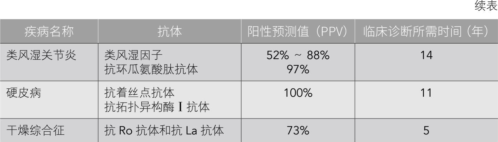
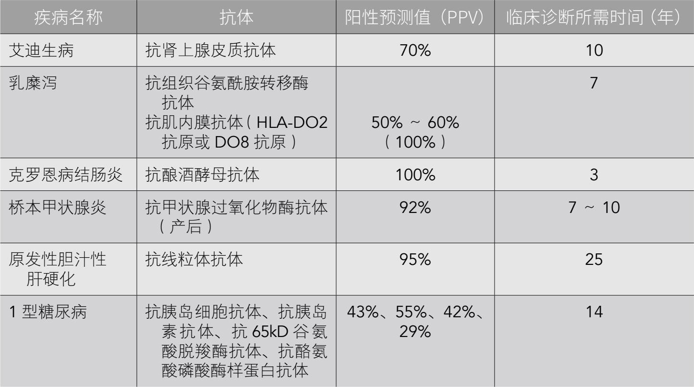
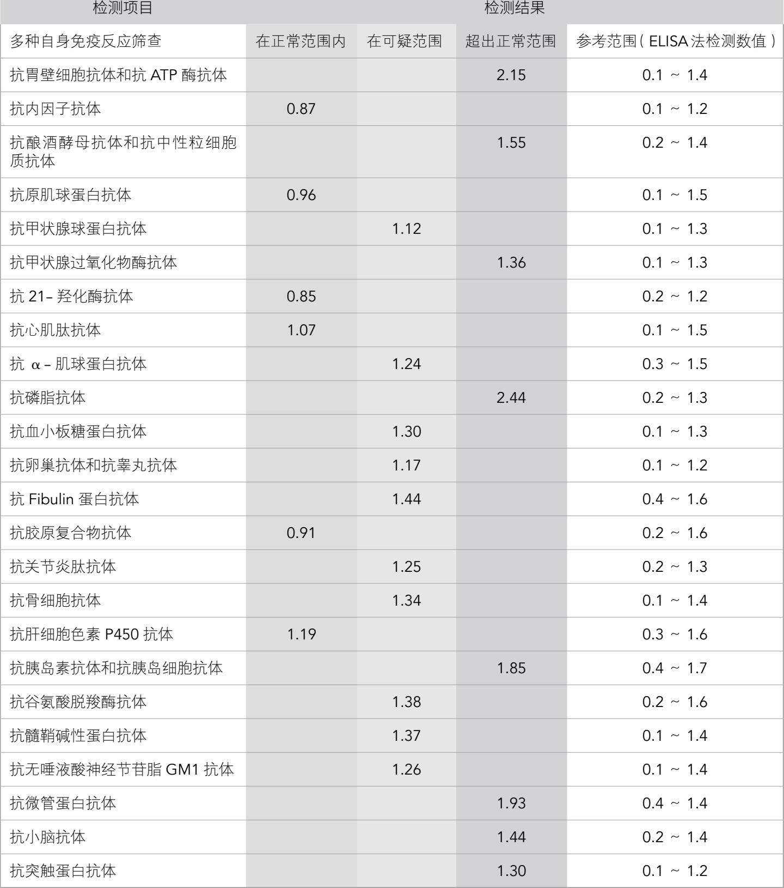
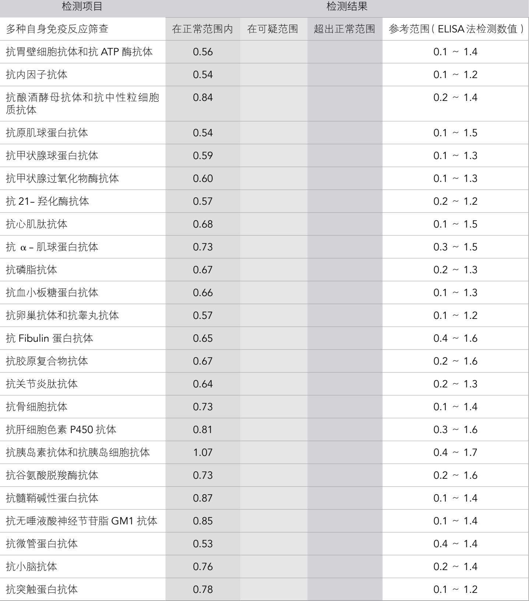

# 第五章 预测性自身免疫领域

<h2><b>第</b><b>五</b><b>章</b></h2>

<h2><b>预</b><b>测</b><b>性</b><b>自</b><b>身</b><b>免</b><b>疫</b><b>领</b><b>域</b></h2>

	
在上一章，我们了解了如何识别自己是否有自身免疫性疾病发展谱中的症状。但是，如果能在组织损伤累积到足以引发症状之前就发现问题，是不是更好呢？这就是预测性自身免疫的领域。在本章，你将学习如何检测影响免疫系统产生自身抗体的各种因素。

	
我坚信，要尽早发现自己体内正在“酝酿”着的问题。知识就是力量，尤其是当你把知识和行动结合起来的时候。随着科学的发展，我们已经可以早在自身免疫性疾病引起明显症状之前就将其识别。当我们能够确定我们体内正在发生失衡时，那么无论我们现在是否有症状，我们都有机会做出明智的决定：“我该怎么办？我能阻止这个过程吗？它可以被逆转吗？”这就是预测性自身免疫的价值所在。

	
据世界著名的自身免疫领域的医学专家、医学博士耶胡达·肖恩菲尔德教授介绍，自身免疫性疾病的潜伏期从短至几年到长达40年不等。这也就是说，患者在出现足够强烈的症状以促使其去就诊之前，会经历如此长的时间，而且通常需要多次就诊才能确诊。例如，患者平均需要忍受11年的痛苦，以及拜访5名不同的医生，才能得到正确的乳糜泻诊断。

自身免疫性疾病可以通过检测自身抗体水平来确定，自身抗体可以帮助医生在某种疾病尚在“酝酿”时就将其发现，也就是说，可以在组织损伤足以引发症状的数年之前将其发现。我将这些自身抗体视为未来的信使。2003年，梅丽莎·阿巴克尔博士的开创性研究（我在第一章中介绍过）表明，在确诊系统性红斑狼疮等自身免疫性疾病之前的数年，自身抗体通常就已经存在。此外，这些自身抗体的变化过程是可预测的，即使患者并无症状，但在发病前这些特异性自身抗体是逐渐积累的
	<a id="noteref-11-216" href="#footnote-11-216">[1]</a>。我们在第一章中转载的阿巴克尔博士的图表告诉我们：系统性红斑狼疮相关的自身抗体在发病几年前就已经存在了。

	
各种类型的抗体水平也被称为生物标志物，因为它们可以衡量身体的功能状况。医生已经使用生物标志物来预测许多疾病。例如，炎症的生物标志物（超敏C反应蛋白）相比于高胆固醇可以更准确地预测心脏疾病。这些检测佐证了为什么我们能确定你不会一觉醒来就突然患上心脏疾病或阿尔茨海默病：在疾病出现的数年之前，生物标志物就已经存在了。

	
当我们要判断自身免疫性疾病的早期阶段时，生物标志物检测为我们提供了阳性预测值（positive predictive value，PPV）。预测性自身免疫的生物标志物就如同你免疫系统仪表板上的温度计。有些汽车只有一盏热度指示灯，当引擎过热时才会亮起，而有一些汽车则有一个仪表盘，指针会缓慢地移向红色的区域。当你看到指针向红色区域移动时，这就提醒你要停下来检查引擎了。但是如果你的仪表盘上只有一盏热度指示灯，你就不会预先得到警告，直到引擎冒出浓烟你才会知道出现了问题。这些“浓烟”就是你的症状。

	
预测性自身免疫看起来似乎很神奇，但它并不是算命。实际上它并不能预测未来会是什么样子，但是它能识别你的健康趋势。你所选择的生活方式与你的遗传易感性相互作用，从而决定你的免疫系统是否被激活。例如，一项研究表明，如果你体内针对甲状腺的抗体水平升高，尤其是在产后，那么你在7年内患桥本甲状腺炎的阳性预测值为92%。现在你可能还没有出现甲状腺功能障碍的症状，但是如果你体内针对甲状腺的自身抗体检测结果为阳性，那么这些症状将来就会出现。

	
如果你肠道中的抗酿酒酵母抗体水平升高，那么你在3年内患克罗恩病的阳性预测值接近100%。获得了这些信息之后，你就有机会提前做点什么了。

	
在表5-1、5-2中，阳性预测值显示了你患上某种特定疾病的可能性。在“临床诊断所需时间（年）”一栏中，你可以看到从第一次发现升高的抗体到被诊断出某种特定的自身免疫性疾病所需的时间。

表5-1 系统性自身免疫性疾病举例
	<a id="noteref-11-17" href="#footnote-11-17">[2]</a>

	

	

表5-2 器官特异性自身免疫性疾病举例
	<a id="noteref-11-19" href="#footnote-11-19">[3]</a>

	

	
<b>密</b><b>切</b><b>关</b><b>注</b><b>你</b><b>的</b><b>薄</b><b>弱</b><b>环</b><b>节</b>

	
预测性自身免疫能让我们找到目前你健康链条中的薄弱环节。如果导致疾病和死亡的头号原因是免疫系统攻击你自己的身体，你难道不想知道你的免疫系统正在攻击什么吗？如果你想保持健康并预防疾病，不能完全依赖常规的医学检测，这种检测只能识别疾病——此时大多数医生会说，逆转疾病为时已晚。除非当自身免疫性疾病破坏了它所攻击的大部分组织或腺体，否则常规医学无法将其诊断。而在此时，你已经从自身免疫性疾病发展谱的前端发展到末端并患上自身免疫性疾病。正如马克·休斯敦博士所说：“你不能再仅仅依靠危险因素（如吸烟、超重等）来判断疾病，你必须衡量早期指标。”他指的就是表5-1、5-2中所列出的生物标志物（抗体）。

	
本章中所述的血液检测通常并不包含在每年例行体检时所做的检测中。然而，我相信它们是常规医学检测的重要补充，我相信每个人都应该进行一套基本的生物标志物检测，即使你目前没有出现症状。这是革命性、开创性的检测方案，可以消除数年甚至数十年的困惑和失望。

	
虽然并不是说必须要花钱完成实验室检测才能进行我的“3周转变方案”，但对于最终确认第四章中的测试结果来说，准确、科学的血液检测是一个很好的方法，并且可以最终确定你在自身免疫性疾病发展谱中所处的位置。你也可以通过持续监测自身抗体来追踪你的疾病进程。许多人认为，一旦他们的感觉好转了，他们的健康问题就会消失。在自身免疫的世界里，事实远非如此。虽然消除症状是首要目标，但即使症状被缓解，我们仍然可能“身处”疾病发展谱中。想要明确你体内的自身免疫级联反应是否已经停止，唯一的方法就是重新检测抗体。我们不应该认为，既然我们的症状得到了控制，那么我们就不必再听从医生建议了。多年来，我已经见到过很多次“意外”复发的情况，似乎不知从哪儿就冒出来了。原因就在于，当身体还没有完全愈合而一种刺激物（如麸质）重新进入体内时，炎症级联反应就又开始了。

一个经典的例子就是乳糜泻，尽管很多患者说他们感觉明显好转，但仅有8%的人能通过坚持无麸质饮食而痊愈。2009年发表在《营养药理学与治疗学》（<i>A</i><i>l</i><i>i</i><i>m</i><i>e</i><i>n</i><i>t</i><i>a</i><i>r</i><i>y</i><i> </i><i>P</i><i>h</i><i>a</i><i>r</i><i>m</i><i>a</i><i>c</i><i>o</i><i>l</i><i>o</i><i>g</i><i>y</i><i> </i><i>a</i><i>n</i><i>d</i><i> </i><i>T</i><i>h</i><i>e</i><i>r</i><i>a</i><i>p</i><i>e</i><i>u</i><i>t</i><i>i</i><i>c</i><i>s</i>）期刊上的一项研究表明，65%的乳糜泻患者感觉有好转，但仍然存在潜在的、过度的肠道炎症，造成肠道通透性增加，为其他自身免疫性疾病的发展打开了“门户”，尽管他们也遵循着无麸质饮食
	<a id="noteref-11-198" href="#footnote-11-198">[4]</a>。其余患者即使遵循无麸质饮食也没有痊愈（可能存在其他的需要解决的多种诱发因素）。因此，对于所有乳糜泻患者，建议重新对造成肠道通透性增加的生物标志物进行检测。如果不进行重新检测，你永远不知道你是否已完全康复。如果你的肠道通透性增加的状况没有得到逆转，对健康的损害将继续在你的薄弱环节或另一个薄弱环节上发生着。

	
<b>生</b><b>物</b><b>标</b><b>志</b><b>物</b><b>可</b><b>以</b><b>…</b><b>…</b>

	
·在症状出现前辅助医生的诊断

	
·预测特定器官的受累

	
·预测疾病的复发

	
·识别具有临床意义的疾病亚型

	
·预测并监测对治疗的反应

	
·描述器官或组织损伤

	
每一个曾与我交谈过的人，一旦理解了这个基本的前提，就会想知道自己健康链条上的薄弱环节在哪里。

	
<b>多</b><b>种</b><b>自</b><b>身</b><b>免</b><b>疫</b><b>反</b><b>应</b><b>的</b><b>筛</b><b>查</b>

	
阿里斯托·沃吉达尼博士是一名研究人员，专注于自身免疫，在探索如何利用免疫系统的生物标志物来明确健康链条中的薄弱环节、哪个环节正在被剧烈拉扯（抗体升高）以及如何监测治疗方案的进展方面，他是我的导师。沃吉达尼博士毕生致力于监测我们体内“武装力量”的行动。

	
在过去，针对自身抗体水平是否升高的血液检测每次只能检测1～2种抗体，而且检测成本非常高。沃吉达尼博士发明的检测方法，首次可以针对多种不同的组织（健康链条中的多个薄弱环节）做检测，而成本却大大降低了。但他的血液检测板专利也并没能覆盖所有的自身免疫性疾病，而是只针对24种最常见的疾病。

	
<b>马</b><b>克</b><b>的</b><b>故</b><b>事</b>

	
马克第一次来我这儿就诊时，他44岁。他的父亲在44岁时死于心脏病发作。他的两个哥哥也在40岁出头时死于严重的心脏病。当他的最后一个哥去世时，马克已经30多岁了，他的心脏病医生为了避免他可能发生的遗传命运，给他开了一种他汀类药物，尽管马克看起来很健康。

	
马克按照医生的指示，服用了10多年的药。当他来到我的诊室时，他的体脂含量为16%，很健康，并且告诉我他经常锻炼。马克说：“奥布赖恩医生，我自我感觉很好，我的医生也说我身体状况良好，但我听说了预测性自身免疫，我想做这些检测。”

	
我支持马克的决定，我们进行了血液检测。结果是，尽管马克服用了他汀类药物并坚持锻炼，但他仍然有3种针对心脏的抗体水平升高了。抗体水平升高会引起组织炎症反应。我告诉马克，检测结果显示他的心脏正在慢慢被免疫系统杀死。他汀类药物可以阻止肝脏产生额外的胆固醇，但不能阻止免疫系统攻击心脏而造成组织损伤。这可能是他的父亲和他的两个哥哥在40多岁时死于心脏病的原因：未被抑制的炎症反应拉扯着链条（在他们身上，薄弱环节是他们的心脏），直至断裂。

	
通过这些预测性抗体检测可以让我们探究他的免疫反应。同样的血样检测显示，他对小麦中的许多多肽都有较高的敏感性，而且他的肠道通透性增加。马克的遗传基因告诉我们他有心脏病史；而血液检测则告诉我们，他的“门户”是开放的，自身免疫对他全面“开火”，影响着他健康链条上的薄弱环节，也就是他的心脏。我立即让马克执行我的转变方案，包括无麸质、无乳制品、无糖饮食。我还建议他服用益生菌、益生元和营养素来治疗他的肠道。

	
1年后，马克回来复诊时，我们又做了一次血液检测。这一次，他所有的针对心脏的抗体水平都降到了正常范围。这意味着他的炎症已经消退，他的身体正在康复。马克对我说：“医生，你救了我的命。”

	
下文介绍的血液检测必须由具有资质的医疗人员开具。再次强调，无论你是否存在症状，它都可识别你是否已处于某种特定的自身免疫性疾病发展谱上，以及在你的免疫系统攻击机体组织的地方，自身免疫反应是否已经开始发生。

	
你的医生可能不熟悉这些检测。在我的网站（theDr.com/TheAutoimmunityFix）上，你可以下载相关信息，在与医生讨论这些内容时可以提供帮助。

	
下面是我们目前在筛查中最常用的抗体列表。再次强调，这不是一个完整的抗体列表，只是包含了一些最常见的。这些抗体可能会识别出那些不仅可以诱发症状、同时还会使你处于疾病发展谱中的因素。如果你已经被诊断出患有某种疾病，这个测试可以作为一个起始点，你可以在6个月或1年之后重新检测，看看你的治疗方案是否有效。如果自身抗体水平降低说明治疗有效。

	
<b>第</b><b>1</b><b>类</b><b>：</b><b>消</b><b>化</b><b>系</b><b>统</b>

	
<b>抗</b><b>胃</b><b>壁</b><b>细</b><b>胞</b><b>抗</b><b>体</b><b>和</b><b>抗</b><b>A</b><b>T</b><b>P</b><b>酶</b><b>抗</b><b>体</b>

胃中的壁细胞会产生盐酸（hydrochloric acid，HCl），这对于分解我们所吃的食物至关重要。随着年龄的增长，壁细胞常常不能生成足够的盐酸。抗胃壁细胞抗体水平升高时会引发炎症反应，从而导致细胞功能的减弱以及盐酸产生的减少。这是维生素B12缺乏最常见的原因，且可能引发自身免疫性胃炎或恶性贫血
	<a id="noteref-11-150" href="#footnote-11-150">[5]</a>。11%的乳糜泻患者已被证明具有较高水平的抗胃壁细胞抗体
	<a id="noteref-11-179" href="#footnote-11-179">[6]</a>。这就解释了为什么有些乳糜泻患者会有胃部疾病、蛋白质和维生素缺乏、其他与胃酸过少相关的症状以及神经系统问题。

这只是众多揭示胃酸缺乏影响自身免疫性疾病发展谱例子中的一个。多项研究显示，类风湿关节炎患者胃功能障碍（特别是胃酸和胃蛋白酶分泌减少）的发生率很高。这些报告提示，仅仅补充“缺失的”胃酸和胃蛋白酶，而不做任何其他改变，就可以使许多类风湿关节炎患者的症状得到显著改善
	<a id="noteref-11-130" href="#footnote-11-130">[7]</a>。

	
<b>胃</b><b>酸</b><b>过</b><b>少</b><b>的</b><b>相</b><b>关</b><b>疾</b><b>病</b>

	
·艾迪生病

	
·哮喘

	
·乳糜泻

	
·慢性自身免疫性疾病

	
·慢性荨麻疹

	
·疱疹样皮炎

	
·糖尿病

	
·湿疹

	
·胆囊疾病

	
·格雷夫斯病

	
·肝炎

	
·甲状腺功能亢进或减退

	
·系统性红斑狼疮

	
·重症肌无力

	
·骨质疏松症

	
·恶性贫血

	
·银屑病

	
·类风湿关节炎

	
·酒渣鼻

	
·干燥综合征

	
·甲状腺毒症

	
·白癜风

	
<b>胃</b><b>酸</b><b>缺</b><b>乏</b><b>常</b><b>见</b><b>的</b><b>症</b><b>状</b>

	
·痤疮

	
·餐后立即出现腹胀、嗳气、灼烧感和肠胃胀气

	
·慢性念珠菌感染

	
·面颊和鼻部血管扩张（非酒精性）

	
·消化不良、腹泻或便秘

	
·铁缺乏

	
·直肠周围瘙痒

	
·对多种食物过敏

	
·服用营养素后恶心

	
·粪便中有未消化的食物

	
·上消化道胀气

	
·指甲脆弱，易脱落和断裂

如果你怀疑你可能已经有消化系统症状，无论是轻微的还是较严重（如胃灼烧感或胃食管反流）的症状，请不要在没有经过胃酸检测的情况下使用标准的“胃酸抑制剂”。虽然我强烈支持在有明确需要时应使用药物，但如果只是为了看看这些药物是否会减轻你的症状，确实很危险。从长远来看，这类药物——质子泵抑制剂的副作用有很多。举几个例子：这类药物可使心脏病发作的风险增加34%（不伴有其他风险因素，比如高胆固醇
	<a id="noteref-11-192" href="#footnote-11-192">[8]</a>），18岁以下儿童患骨质疏松症的风险增加16%，18～29岁的年轻人患骨质疏松症的风险增加39%
	<a id="noteref-11-241" href="#footnote-11-241">[9]</a>。

	
通常情况下，当患者来找我们做功能医学检查时，已有医生给他们开出了针对“胃酸过多”的处方——质子泵抑制剂，但他们并没有接受过胃酸检测。在给这些患者服用伴有严重副作用的药物之前，医生并未安排相应的检测。质子泵抑制剂是世界上销量最高的10种药物之一，年销售额超过60亿美元。

	
最常见的质子泵抑制剂如下。

	
·雷贝拉唑

	
·埃索美拉唑

	
·兰索拉唑

	
·奥美拉唑

	
·泮托拉唑

	
·右兰索拉唑

	
如果你怀疑自己有消化系统问题，并且可能是由胃酸缺乏引起的，较为安全的做法是去找一名功能医学医生，他可以为你检测胃酸缺乏的生物标志物。如果目前无法做到这一点，可以尝试一下许多功能医学医生都在使用的方法，该方法可以使药物副作用风险降至最小，具体方法见下。

	
首先服用1粒350～750mg的盐酸甜菜碱胶囊，然后配合富含蛋白质的餐食。这些药物很容易在药店或健康食品店中买到。健康人这么做之后的正常反应是出现胃灼烧感。如果你没有这种感觉，则提示你体内没有过多的胃酸使消化系统“超负荷”工作，而且你可能存在胃酸缺乏，因此需要应用辅助消化剂。为了补足胃酸，你可以在开始时每餐配合服用2粒胶囊。如果2天后没有反应，将每餐的胶囊数量增加到3粒。继续每2天增加一次胶囊的数量，直至每餐最多服用8粒胶囊。这些剂量可能看起来很大，但是功能正常的胃确实会产生相当多的胃酸。一旦你出现胃痛、胃灼烧感或其他任何不适，那么就说明你服用的胶囊太多了，每餐减少1粒胶囊。之后如果仍然感到不适，停止服用胶囊并咨询你的专业医疗人员。当你感到胃痛、胃灼烧感或任何不舒服的症状时，你也可以在一杯水或牛奶中加入1茶匙小苏打，以中和胃酸。

	
无论剂量多少，只要你能忍受且没有症状出现，就继续在进食富含蛋白质的餐食时应用该剂量的胶囊。当餐量减少时，你可能需要较少的盐酸，那么你可以减少服用胶囊的数量。中度胃酸缺乏患者的症状通常可以迅速得到改善，并且出现对该剂量不耐受的早期迹象。在这种情况下，将剂量减少到症状水平以下，直到你不再需要额外的补充，这通常表明胃酸的分泌恢复正常了。而一般情况下，胃酸或胃蛋白酶过少的人通常不会经历如此迅速的改善，所以为了最大限度地吸收你所摄入的营养并从中获益，坚持补充胃酸是很重要的。

	
<b>抗</b><b>内</b><b>因</b><b>子</b><b>抗</b><b>体</b>

内因子对于维生素B12的吸收非常重要。如果你体内存在抗内因子抗体，你可能无法正常吸收维生素B12。来自弗雷明汉后代研究的数据显示，在26～83岁之间的人群中，40%的人体内血浆维生素B12水平处于较低的正常范围内
	<a id="noteref-11-106" href="#footnote-11-106">[10]</a>。维生素B12缺乏通常会引发麻木、老年人神经退化、类似阿尔茨海默病的记忆丧失以及萎缩性胃炎（可导致和胃酸缺乏和恶性贫）。

	
<b>抗</b><b>酿</b><b>酒</b><b>酵</b><b>母</b><b>抗</b><b>体</b><b>和</b><b>抗</b><b>中</b><b>性</b><b>粒</b><b>细</b><b>胞</b><b>胞</b><b>质</b><b>抗</b><b>体</b>

抗酿酒酵母抗体是克罗恩病明确的早期生物标志物，也是乳糜泻常见的生物标志物，大约7%的乳糜泻患者体内存在抗酿酒酵母抗体。抗酿酒酵母抗体似乎是麸质相关的，并且与严重的乳糜泻症状有关：当你从饮食中去除麸质时，抗酿酒酵母抗体通常就会恢复到正常水平
	<a id="noteref-11-119" href="#footnote-11-119">[11]</a>。这是消除了环境诱发因素使得自身免疫级联反应平息的一个典型例子。抗酿酒酵母抗体对于3年内发生克罗恩病具有高达100%的阳性预测值。这意味着如果你体内的抗酿酒酵母抗体水平升高，你很可能在3年内患上严重的肠道自身免疫性疾病——克罗恩病
	<a id="noteref-11-235" href="#footnote-11-235">[12]</a>。

抗中性粒细胞胞质抗体会攻击最常见的白细胞——中性粒细胞的内部。当这些抗体水平升高时，你的免疫系统就会受到损害。几年前，我们失去了一位伟大的演员——哈罗德·拉米斯，他在银幕上和现实生活中都有一颗金子般的心。他死于一种与该抗体相关的疾病——系统性血管炎。我希望在他患有自身免疫性疾病的那些年里我能接触到他，我真诚地相信功能医学的方法对于他来说是有价值的。这种抗体也与一种常见的炎症性肠病——溃疡性结肠炎有关
	<a id="noteref-11-201" href="#footnote-11-201">[13]</a>。

	
<b>抗</b><b>原</b><b>肌</b><b>球</b><b>蛋</b><b>白</b><b>抗</b><b>体</b>

假设你正在建造一座摩天大楼。如果你愿意的话，想象一下，钢梁构成了建筑的结构，也就是构成了我们体内的“肠道”。原肌球蛋白是细胞内部的骨架，被称为细胞骨架，它将细胞连接在一起，并帮助细胞维持形态。当抗原肌球蛋白抗体水平升高时，可能会影响体内的所有细胞。虽然抗原肌球蛋白抗体主要与肠道疾病有关（有95%的溃疡性结肠炎患者体内抗原肌球蛋白抗体升高），但它也会影响其他任何人体系统
	<a id="noteref-11-185" href="#footnote-11-185">[14]</a>。如果细胞失去了细胞骨架的支撑，它就无法正常工作。这可能就是抗原肌球蛋白抗体水平升高与癌症发展直接相关的原因。许多研究表明，在正在转化为癌细胞的细胞中，原肌球蛋白发生了特定的变化。这些结果都表明，在细胞转化过程中（正常细胞变为恶性细胞），原肌球蛋白的缺失是一个关键步骤
	<a id="noteref-11-320" href="#footnote-11-320">[15]</a>。

	
<b>第</b><b>2</b><b>类</b><b>：</b><b>甲</b><b>状</b><b>腺</b>

	
<b>抗</b><b>甲</b><b>状</b><b>腺</b><b>球</b><b>蛋</b><b>白</b><b>抗</b><b>体</b><b>和</b><b>抗</b><b>甲</b><b>状</b><b>腺</b><b>过</b><b>氧</b><b>化</b><b>物</b><b>酶</b><b>抗</b><b>体</b>

这两种不同的抗体与甲状腺和甲状腺自身免疫性疾病有关。在5种甲状腺自身免疫性疾病中它们是最常在患者体内出现的，也常出现于特发性黏液水肿、内分泌突眼和无症状性甲状腺炎患者体内
	<a id="noteref-11-85" href="#footnote-11-85">[16]</a>。甲状腺自身免疫性疾病是仅次于2型糖尿病和乳糜泻的第三大常见的自身免疫性疾病。

	
如果你不能减掉最后的5千克体重，或者感觉迟钝或有抑郁的症状，你的医生经常会检测你的甲状腺激素水平。即使你的激素水平在正常范围内，医生通常也会给你开甲状腺激素。虽然你可能会感觉症状好转一点，但你不会达到非常好的身体状态，因为这是错误的做法。大多数医生并不会去检测针对甲状腺的抗体，因为抗体水平的升高不会改变他们的治疗建议：他们仍然会开甲状腺激素，而不会去治疗升高的抗体。大多数医生都不知道通过功能医学的方法可以降低这些升高的抗体。

即使患者做了检测并发现针对甲状腺的抗体升高，但几乎每个医生都会说：“嗯，看起来你有一点自身免疫的问题，所以你应该服用一些甲状腺激素并进行监测。”可问题是，甲状腺激素与正在攻击你甲状腺的免疫系统毫无关系。这个治疗方案太陈旧了。这和20世纪60年代的处方是一样的，而现在他们还在这么做。一种更现代的方法是研究为什么你的免疫系统会攻击你的甲状腺——一种功能医学的方法。通过使用这种方法，医生可能会发现：如果你处于乳糜泻的疾病发展谱上，乳糜泻相关的抗体水平升高，你就很容易受到分子模拟反应的影响，并开始产生针对甲状腺的抗体
	<a id="noteref-11-257" href="#footnote-11-257">[17]</a>。这意味着你可能会因为对麸质敏感而患上自身免疫性甲状腺病。患有桥本甲状腺炎的患者可以通过从饮食中去除麸质来减少49%的甲状腺激素药物剂量（当然，这需要医生的许可）
	<a id="noteref-11-339" href="#footnote-11-339">[18]</a>。

	
我们所在的环境中有一些化学物质会干扰我们体内的甲状腺激素与甲状腺激素受体结合以及后续进入细胞的过程。如果甲状腺激素不能接触到受体结合位点，它就不能进入细胞内，你就会出现“功能性甲状腺功能减退”的症状。会有什么表现呢？你是否曾经因为怀疑自己的甲状腺功能减退而进行了血液检测，虽然结果提示是正常的，但医生还是给你开了甲状腺激素？等一下，你想，你的血液检测提示你体内有足够的甲状腺激素，但医生还是让你服用更多的甲状腺激素。为什么？医生也没有一个很好的解释，他可能会说：“呃，更多的甲状腺激素似乎能对你有所帮助。”但是，尽管额外的激素确实有助于缓解症状，但这些药物并不能解决功能障碍的潜在机制，这种失衡可能会持续下去。这种无法解决的功能障碍通常与环境中的化学物质有关。当接触到这些化学物质时，大多数人可以自然地将它们从体内清除；但有些人不能，对这些人来说，这些化学物质会在体内积聚。如果积累的化学物质可以与甲状腺激素受体结合，那么你体内的一部分甲状腺激素就无法与甲状腺激素受体结合，也就不能进入细胞内。因此，你会出现“功能性”甲状腺功能低下（甲状腺功能减退），虽然血液中甲状腺激素水平是正常的。

那么，哪些化学物质会干扰你体内的甲状腺激素受体呢？如果你正在酒店里乘坐电梯，当电梯门打开时，你是否能够马上知道这一层有个游泳池？你能闻到什么气味吗？氯是3种能干扰甲状腺激素受体功能的化学物质中最常见的一种。另外两种是溴和氟。如果电梯中其他的人没有像你一样闻到氯的味道，那说明你的身体可能对这种化学物质过于敏感——并且你的体内可能积累了更高水平的氯，这或许会干扰你的甲状腺激素受体功能。氯进入人体最常见的方式是淋浴——水蒸气通过我们的肺部进入血液。如果你安装一个氯过滤淋浴头，你就可能会在几个月内发现你的甲状腺功能得到改善。还有一个额外的好处是，你的头发看起来会更亮。在这个例子中，我们常常开具的处方——不进行深入研究就给予甲状腺激素——是美国作为一个国家在整体医疗质量上排名倒数第二的原因之一
	<a id="noteref-11-346" href="#footnote-11-346">[19]</a>。

	
<b>第</b><b>3</b><b>类</b><b>：</b><b>肾</b><b>上</b><b>腺</b>

	
<b>抗</b><b>2</b><b>1</b><b>-</b><b>羟</b><b>化</b><b>酶</b><b>抗</b><b>体</b>

	
抗21-羟化酶抗体与你的肾上腺有关。你承受的压力越大，肾上腺就越难以分泌应激激素。你可能会出现艾迪生病（一种自身免疫性肾上腺病）。你还可能会出现自身免疫性内分泌紊乱，也就是激素失衡。然后你体内开始产生针对不同激素的抗体，因此，你可能患上糖尿病、格雷夫斯病、桥本甲状腺炎和白癜风（皮肤色素脱失而出现白斑），这些都是由针对肾上腺的抗体升高所引起的。

	
<b>第</b><b>4</b><b>类</b><b>：</b><b>心</b><b>脏</b>

	
<b>抗</b><b>心</b><b>肌</b><b>肽</b><b>抗</b><b>体</b><b>和</b><b>抗</b><b>α</b><b>-</b><b>肌</b><b>球</b><b>蛋</b><b>白</b><b>抗</b><b>体</b>

	
心肌病、风湿性心脏病、重症肌无力、自身免疫性心肌炎以及急性风湿热都可能与抗心肌肽抗体和抗α-肌球蛋白抗体有关。我们曾在马克的故事中提到这些抗体。接受无麸质、无乳制品、无糖饮食后马克体内升高的抗体水平恢复了正常。

	
<b>抗</b><b>磷</b><b>脂</b><b>抗</b><b>体</b><b>和</b><b>抗</b><b>血</b><b>小</b><b>板</b><b>糖</b><b>蛋</b><b>白</b><b>抗</b><b>体</b>

	
这两种抗体与心血管功能障碍和内分泌功能障碍（激素失衡）有关。这些功能障碍可以表现为抗磷脂综合征，就像我的患者萨曼莎一样。抗磷脂抗体是复发性流产和妊娠期并发症最常见的危险因素。每个有流产家族史（包括母亲、姨母、姐妹等）的育龄期女性都应该在准备怀孕前做血液检测。如果你的抗磷脂抗体水平升高，你将有机会来扭转这种情况——通常只需要接受无麸质饮食即可。

	
凯西曾有过2次流产（分别是在30岁和31岁）经历，并且开始出现不明原因的昏倒的症状。住进医院后，正当她手足无措时，她很幸运地遇到了一位医生，这位医生对她进行了全面检查。检查结果提示她存在很多问题。

	
● 反复发作的缺铁性贫血。口服铁剂效果不佳，但静脉注射铁剂有效（这立即提示我们她的肠道出现了问题——她无法吸收营养）

	
● 胰酶升高

	
● 炎症标志物升高

	
● 抗核抗体水平升高（自身免疫反应发生的标志）

	
● 系统性红斑狼疮的生物标志物呈阳性

	
● B族维生素水平低下

	
● 针对甲状腺的抗体升高

	
● 导致流产风险升高的抗体（抗β2糖蛋白1抗体）升高

	
● 尿液中有血细胞及颗粒管型

	
由于她的各种症状提示对铁和B族维生素吸收不良，她接受了麸质敏感性检查。果不其然，她患有乳糜泻。此后她开始接受无麸质饮食，6个月之内，她所有的自身免疫相关的生物标志物就恢复正常了。24个月内，那些使她流产风险升高的异常标志物也恢复了正常。我们并没有采取其他的治疗措施，除了无麸质饮食和适当的监测。

	
抗磷脂抗体升高可以引起2型糖尿病或系统性红斑狼疮，同样，抗血小板糖蛋白抗体升高也可以引起自身免疫性血小板减少症、心血管疾病或冠状动脉疾病。如果你的心脏病专家建议你做心脏搭桥手术，那么首先去做这个血液检测是非常有必要的。在不解决潜在炎症的情况下治疗动脉阻塞是一种低效的治疗方案。

	
<b>第</b><b>5</b><b>类</b><b>：</b><b>生</b><b>殖</b><b>系</b><b>统</b>

	
<b>抗</b><b>卵</b><b>巢</b><b>抗</b><b>体</b><b>和</b><b>抗</b><b>睾</b><b>丸</b><b>抗</b><b>体</b>

	
性别特异性抗体会导致性腺功能减退、过早绝经、卵巢功能早衰及其他内分泌紊乱。

	
<b>第</b><b>6</b><b>类</b><b>：</b><b>骨</b><b>骼</b><b>肌</b><b>肉</b>

	
<b>抗</b><b>F</b><b>i</b><b>b</b><b>u</b><b>l</b><b>i</b><b>n</b><b>蛋</b><b>白</b><b>抗</b><b>体</b><b>、</b><b>抗</b><b>胶</b><b>原</b><b>复</b><b>合</b><b>物</b><b>抗</b><b>体</b><b>、</b><b>抗</b><b>关</b><b>节</b><b>炎</b><b>肽</b><b>抗</b><b>体</b>

	
这些抗体与胶原蛋白的形成，以及肌肉、肌腱、韧带和关节的状态有关。这些抗体的水平升高可导致系统性红斑狼疮、硬化症、骨关节炎或类风湿关节炎。这些抗体也与动脉粥样硬化有关，特别是抗Fibulin蛋白抗体会导致动脉粥样硬化。

	
<b>抗</b><b>骨</b><b>细</b><b>胞</b><b>抗</b><b>体</b>

抗骨细胞抗体是骨骼炎症的生物标志物，其水平升高可导致骨质疏松的发生
	<a id="noteref-11-33" href="#footnote-11-33">[20]</a>。

	
<b>第</b><b>7</b><b>类</b><b>：</b><b>肝</b><b>脏</b>

	
<b>肝</b><b>细</b><b>胞</b><b>色</b><b>素</b><b>P</b><b>4</b><b>5</b><b>0</b>

肝脏至少有350种不同的功能。当针对肝脏的抗体升高，肝脏产生炎症时，可使体内许多不同的系统均受到影响，导致糖尿病、乙型肝炎、慢性丙型肝炎、癌症、肾脏疾病、消化性溃疡、癫痫、充血性心力衰竭等许多疾病的发生
	<a id="noteref-11-101" href="#footnote-11-101">[21]</a>。

	
<b>第</b><b>8</b><b>类</b><b>：</b><b>胰</b><b>腺</b>

	
<b>抗</b><b>胰</b><b>岛</b><b>素</b><b>抗</b><b>体</b><b>和</b><b>抗</b><b>胰</b><b>岛</b><b>细</b><b>胞</b><b>抗</b><b>体</b>

	
医生常用这两种抗体来诊断1型糖尿病和不明原因的低血糖。在第二章，我们讨论了当婴儿属于1型糖尿病的高风险人群时，建议父母在婴儿出生后的第1年内避免喂养牛奶制品。因为如果对牛奶过敏，就很容易产生抗胰岛细胞抗体。

	
<b>第</b><b>9</b><b>类</b><b>：</b><b>大</b><b>脑</b>

	
<b>抗</b><b>谷</b><b>氨</b><b>酸</b><b>脱</b><b>羧</b><b>酶</b><b>抗</b><b>体</b>

	
抗谷氨酸脱羧酶抗体是针对大脑的抗体，也与乳糜泻、非乳糜泻性麸质敏感、1型糖尿病、僵人综合征、小脑性共济失调（平衡控制和肌肉运动出现问题）相关。当这种抗体升高时，也可引起失眠和焦虑，无麸质饮食已被证明对这两种病症有效。

	
<b>抗</b><b>髓</b><b>鞘</b><b>碱</b><b>性</b><b>蛋</b><b>白</b><b>抗</b><b>体</b>

	
这是与多发性硬化、自闭症、系统性红斑狼疮以及链球菌感染相关性儿童自身免疫性神经精神障碍（pediatric autoimmune neuropsychiatric disorders associated with Streptococcal infections，PANDAS）有关的针对大脑的抗体。在我的临床实践中，我对我的患者进行了一项非正式的研究。我对316名患者（年龄在2～90岁）的抗麸质抗体、抗乳制品抗体及针对大脑的抗体进行了检测，包括抗髓鞘碱性蛋白抗体。在抗乳制品抗体升高的患者中，有32%的人抗髓鞘碱性蛋白抗体也会升高。这是一个环境因素引发自身免疫反应的例子。

	
髓鞘是包裹你脑神经和体内其他神经的“保鲜膜”，它就像电线周围的保护性绝缘层。当抗髓鞘碱性蛋白抗体升高时，神经周围的保护层被破坏，通过这些保护层传递的信息就会间断。这就是多发性硬化出现的原因。除了治疗症状，你还必须集中精力阻止电线受损。

	
<b>抗</b><b>无</b><b>唾</b><b>液</b><b>酸</b><b>神</b><b>经</b><b>节</b><b>苷</b><b>脂</b><b>G</b><b>M</b><b>1</b><b>抗</b><b>体</b>

	
无唾液酸神经节苷脂细胞在体内许多不同的神经中起作用。这就是为什么许多症状都与抗无唾液酸神经节苷脂GM1抗体水平的升高有关。这些针对大脑的抗体会导致慢性炎性脱髓鞘性多神经病、脑卒中、颅脑外伤、吉兰-巴雷综合征、运动神经元疾病、阿尔茨海默病、多病灶运动神经病变、多发性硬化、重症肌无力、链球菌感染相关性儿童自身免疫性神经精神障碍、类风湿关节炎以及系统性红斑狼疮等多种疾病。

	
<b>抗</b><b>微</b><b>管</b><b>蛋</b><b>白</b><b>抗</b><b>体</b>

	
微管蛋白是一种结构蛋白，是细胞内部结构（微管）的重要组成部分。这种结构在许多神经功能中起着重要作用。抗微管蛋白抗体升高可见于酒精性肝病、脱髓鞘疾病、新近发作的1型糖尿病、格雷夫斯病、桥本甲状腺炎、链球菌感染相关性儿童自身免疫性神经精神障碍、类风湿关节炎以及毒素（包括汞等重金属）暴露。这又是一个环境因素（过度接触重金属）引发神经系统自身免疫性疾病的例子。

	
<b>抗</b><b>小</b><b>脑</b><b>抗</b><b>体</b>

	
小脑是脑部控制运动和平衡的部分。在小脑皮质内有一种叫作浦肯野细胞的大神经元。抗小脑抗体检测其实就是针对抗小脑浦肯野细胞抗体进行检测的。这种抗体与自闭症、乳糜泻、麸质相关性共济失调和副肿瘤性小脑退化综合征有关。

	
当人们上了年纪，有时在上下楼梯时感觉走不稳，其原因常常与此类抗体水平升高有关。并不是因为他们变老了，而是因为他们的小脑正在萎缩，这是由于抗小脑浦肯野细胞抗体水平升高，慢慢地杀死浦肯野细胞所致。我做过一项研究，在抗麸质抗体升高的患者中，有26%的人抗小脑浦肯野细胞抗体水平也会升高。对于这部分人来说，他们的小脑由于多年食用的一种食物而萎缩，而只是因为这种食物在食用时没有引起胃痛，所以他们就认为食用它（小麦）没有问题，但在小脑处，这种食物引发了免疫反应。这是一个分子模拟的例子：免疫系统在攻击麸质，在这种情况下，小脑组织看起来与麸质肽类似，所以小脑也会受到攻击。

	
有一天，我的患者山姆来就诊，他感到双脚走不稳。我们对他进行了检查，发现他对麸质过敏，磁共振成像显示脑部存在炎症，但他没有肠道症状。他的小脑在磁共振成像上看起来很正常，只是有些炎症。他拒绝按照建议在饮食中去除麸质。7年后，山姆又来复诊，但这一次他几乎走不动了。原因就是针对他健康链条薄弱环节处（小脑）的抗体在增加，不断杀死小脑细胞，导致小脑萎缩。这时他的病情再也无法得到控制或是扭转了。

	
<b>抗</b><b>突</b><b>触</b><b>蛋</b><b>白</b><b>抗</b><b>体</b>

	
突触蛋白是一种参与神经递质调节的大脑蛋白质，存在于中枢和外周神经系统的大部分神经元中。抗突触蛋白抗体会导致脱髓鞘疾病（如多发性硬化），以及身体各个部位的麻木感和刺痛感。抗突触蛋白抗体还会抑制神经递质的释放，导致系统性红斑狼疮、情绪障碍和抑郁。

	
<b>如</b><b>何</b><b>对</b><b>结</b><b>果</b><b>进</b><b>行</b><b>解</b><b>读</b>

	
杰瑞来我这儿就诊的时候才16岁。他曾看过很多医生，最近一次接诊的医生是一位内分泌科专家，就诊原因是杰瑞的身高长时间没有增加。他身高只有155厘米，而且他想加入学校的摔跤队。内分泌专家发现杰瑞患有乳糜泻，而且他有家族史：他的父亲患有乳糜泻，母亲对麸质敏感。确诊后，杰瑞全家立即开始遵循严格的无麸质饮食。

	
几个月后，杰瑞长高了9厘米，但随后他的身高增加突然停止了。血液检测显示，杰瑞的乳糜泻抗体仍然超过正常上限的15倍。就在那时，他来找我了，打算尝试功能医学的治疗方法。我们绘制了他的自身免疫检测结果图表，发现在杰瑞体内，不仅乳糜泻相关抗体升高，而且常见的24个组织抗体中有18个都升高了。这个检测结果告诉我们，尽管杰瑞看起来是个健康的年轻人，但他有多种自身免疫反应综合征。他的体内有18种不同的抗体在攻击他的组织且遍布全身，我知道他的健康之路会比较坎坷。

	
表5-3是杰瑞的第一次自身免疫检测结果。你看，有许多抗体结果都显示“超出正常范围”。这就解释了整个故事——因为他只有16岁，身体强壮，所以除了身高没有增加之外并没有任何其他明显的症状，但他将来会出现许多健康方面的问题。至于问题究竟会出现在甲状腺、心脏、大脑、肠道还是血糖方面，没有人能确定他的健康链条上哪一个薄弱环节会首先出现问题。

	
表5-3 杰瑞的第一次自身免疫检测结果

	

	
经过4年严格谨慎的治疗（包括加强微生物群落、遵循严格的无麸质饮食、防止最常见的交叉污染、寻找其他环境诱因），杰瑞的免疫系统终于平静下来，没有使用任何药物。最终他的血液检测结果显示他的健康状况很好，最重要的是，在他20岁时，他的身高达到了175厘米。表5-4是杰瑞的最后一次自身免疫检测结果，你可以看到他所有的生物标记物都在正常范围内。

	
表5-4 杰瑞的最后一次自身免疫检测结果

	

	
<b>把</b><b>这</b><b>本</b><b>书</b><b>拿</b><b>给</b><b>你</b><b>的</b><b>医</b><b>生</b><b>看</b>

	
我建议你立即做一次多种自身免疫反应筛查，如果你确实有健康问题，请遵循我的转变方案，并且应每年重新对抗体进行检测以追踪你的变化。如果你想让你的医生给你做这个检测，可能会有一些困难。医生可能会说：“不可能在一次检测中检查所有这些抗体。”向医生解释一下这是可以的，并把这本书拿给你的医生看。如果你的医生拒绝为你做这个测试，你可以在我的网站（theDr.com）上了解更多关于订购这个检测的信息。

	
我在美国功能医学研究院（网址：functionalmedicine.org）任教。如果想要在你所在的地区找到像我这样的合格的功能医学医生，请访问该网站进行查找。功能医学医生所提供的服务大多在医疗保险范围内。此外，功能医学认证培训对于指导此类治疗而言更为重要。

	
应对自身免疫性疾病的疗法往往能体现常规医学的局限性。内分泌科专家检查激素的分泌情况，风湿病学专家检查肌肉骨骼疾病（如关节炎），所有人都知道如何在自己的专业领域内应对自身免疫问题，但很少有人接受过全面的培训。

常规医学的医生通常只治疗症状，也很少把饮食当作解决方案。想象一下，你的孩子患有癫痫，你你带着孩子拜访了多位专家，但是通过药物仍然不能控制癫痫发作，这叫作耐药性癫痫。在患有耐药性癫痫的儿童中，有50%可以通过无麸质饮食让症状得到缓解。为什么我们的神经学专家不了解这种解决方案？这是因为这项研究结果没有发表在神经学杂志上，而是发表在一本全科医学杂志上
	<a id="noteref-11-173" href="#footnote-11-173">[22]</a>。

	
在当今这个时代，新的科学以指数级的速度发展，你的医生需要跟上发展的步伐。抗体检测这个方法的创新之处在于，我们正在通过检测各种抗体水平以判断炎症发生的部位。

	
通过适当的生活方式干预（无麸质饮食、减少环境暴露、减压、加强运动等），你不仅能感觉到明显的改善，抗体的水平也会降低。抗体水平的降低至少需要6个月的时间才会在血液检测中有所体现。这就是为什么你必须在开始干预后的6个月或1年之后再重新进行抗体检测。如果复查结果没有好转，这就意味着我们需要做更多的检测。就像剥洋葱一样，找到最重要的触发因素也需要时间。此外，你的症状不太可能完全消失。你也许可以通过应用强效药物来掩盖症状，但潜在的病理改变仍在继续。请不要误解我的意思：我认为缓解症状的药物有时对人体非常有帮助，但一味强调症状的缓解和消失并不可取。

	
<b>测</b><b>试</b><b>结</b><b>果</b><b>提</b><b>示</b><b>麸</b><b>质</b><b>敏</b><b>感</b><b>的</b><b>普</b><b>遍</b><b>性</b>

	
比尔去看医生，因为他感觉自己很难集中精神，且开始出现头痛。医生建议他应用处方量的酚麻美敏片（泰诺）来治疗头痛，然后他的就诊结束了。

	
比尔试了一下这种药物，但似乎并没有缓解他的症状，反而加重了他的头痛。医生也无能为力了，就建议比尔到一位神经学专家那里就诊，而神经学专家建议比尔使用一种药效更强的药物。这种药物使比尔的头痛得到了缓解，但也让比尔一直感到恶心。当他再次找到医生抱怨这一点时，神经学专家让他来到一个研究中心，在这里有很多像比尔这样的人，他们已经遭受了很长时间的折磨。跟比尔一样，他们也去看过其他医生，但似乎都没有什么效果。

该研究中心走在科研的最前列，知道在神经疾病病因不明的情况下应该检测麸质敏感性。为什么呢？在研究中心，当神经系统疾病的病因明确时，患者体内的抗麸质抗体升高的比例为5%；而在病因不明的患者中，抗麸质抗体升高的比例达到57%
	<a id="noteref-11-109" href="#footnote-11-109">[23]</a>。

	
像许多其他有着原因不明的神经系统症状的患者一样，比尔发现接受无麸质饮食后他的头痛消失了。我们知道，麸质是最常见的引起自身免疫反应的环境因素，所以我建议对所有存在原因不明的健康问题的人进行麸质敏感性检测以及肠道通透性检测。这些血液检测以及多种自身免疫反应筛查，都可以在一次抽血中完成。然后你就会知道接下来该怎么做了。理想情况下，在你开始遵循我的“3周计划”前你应该完成下列检测，并在之后每3～6个月复查一次。

	
<b>肠</b><b>道</b><b>抗</b><b>原</b><b>通</b><b>透</b><b>性</b><b>筛</b><b>查</b>

	
这个血液检测的目的在于了解你的肠漏程度如何，以及肠壁的损害有多严重。它还能提示脂多糖是否进入血液并引发炎症和慢性症状。对于衡量我们的计划是否成功来说，这是一个很好的后续测试。

	
<b>乳</b><b>糜</b><b>泻</b><b>基</b><b>因</b><b>检</b><b>测</b><b>并</b><b>不</b><b>准</b><b>确</b>

	
你可能听说过，可以通过基因检测来诊断乳糜泻，但事实并非如此。传统观点认为基因检测百分百可以诊断乳糜泻，原因是曾有研究表明，95%的乳糜泻患者携带<i>H</i><i>L</i><i>A</i><i>-</i><i>D</i><i>Q</i><i>2</i>基因，而另外5%的患者则携带有<i>H</i><i>L</i><i>A</i><i>-</i><i>D</i><i>Q</i><i>8</i>基因。然而，2013年在国际乳糜泻研讨会上发表的论文显示，多达7%的乳糜泻确诊患者（通过内镜检查）并没有携带这两种基因。此外，2010年发表在《国际变态反应与免疫学档案》（<i>I</i><i>n</i><i>t</i><i>e</i><i>r</i><i>n</i><i>a</i><i>t</i><i>i</i><i>o</i><i>n</i><i>a</i><i>l</i><i> </i><i>A</i><i>r</i><i>c</i><i>h</i><i>i</i><i>v</i><i>e</i><i>s</i><i> </i><i>o</i><i>f</i><i> </i><i>A</i><i>l</i><i>l</i><i>e</i><i>r</i><i>g</i><i>y</i><i> </i><i>a</i><i>n</i><i>d</i><i> </i><i>I</i><i>m</i><i>m</i><i>u</i><i>n</i><i>o</i><i>l</i><i>o</i><i>g</i><i>y</i>）上的一项研究表明，高达50%的非乳糜泻性麸质敏感患者携带<i>H</i><i>L</i><i>A</i><i>-</i><i>D</i><i>Q</i><i>2</i>或<i>H</i><i>L</i><i>A</i><i>-</i><i>D</i><i>Q</i><i>8</i>基因，因此，当基因检测呈现阳性时，患者可能并没有患乳糜泻。

	
随着越来越多相关论文的发表，我们发现我们过去所说的并不是真正的“乳糜泻基因”，而可能是“麸质基因”。这让我相信，一系列的病症都可能是由麸质引起的。

	
<b>卡</b><b>梅</b><b>伦</b><b>的</b><b>故</b><b>事</b>

	
我的朋友帕姆的儿子卡梅伦今年17岁，在他只有5岁的时候，作为食物过敏儿童的代表，登上了《国家地理》（<i>N</i><i>a</i><i>t</i><i>i</i><i>o</i><i>n</i><i>a</i><i>l</i><i> </i><i>G</i><i>e</i><i>o</i><i>g</i><i>r</i><i>a</i><i>p</i><i>h</i><i>i</i><i>c</i>）杂志的海报。在接受母乳喂养时，尽管他的体重在增加，但他无法添加辅食，他全身还长满了湿疹。当他还是一个婴儿时，他被诊断为对帕姆所有喜欢的食物高度过敏，这些食物包括鱼类、坚果、花生、芝麻、酱油和芥末。卡梅伦还对霉菌、花粉、干草、狗、猫、树和草过敏。医生只对他进行了IgE反应检测，但如果同时检测IgA、IgG和IgM，他们可能会发现，卡梅伦对麸质和乳制品也是敏感的。

	
在接下来的15年里，一位过敏症专家对卡梅伦进行了细心的监测治疗，卡梅伦最终克服了一些食物过敏，还接受了针对环境过敏原的免疫治疗（注射过敏原）。一旦远离那些使他过敏的食物，他的皮疹很快就消失了。

	
大约4年前，在卡梅伦13岁的时候，尽管他感觉很好，但在一位他最喜欢的教练的激励下，他开始采取无麸质和无乳制品饮食。但在今年夏天，正如同其他青春期的男孩一样，他开始吃非常多比萨。他的背上长满了痤疮。

	
当帕姆告诉我来龙去脉时，我认为卡梅伦的皮肤可能就是他健康链条的薄弱环节，他的痤疮可能与他最近大量吃比萨饼有关。幸运的是，卡梅伦听从了我的建议，不再吃比萨，而痤疮在不到1个月的时间里就都消失了。

	
我建议卡梅伦做预测性自身免疫检测。我向帕姆解释说，这项检测会精确地显示出卡梅伦健康链条上的薄弱环节在哪里。我也告诉帕姆，如果不加以控制，卡梅伦的大脑会出现怎样的表现，其原因在于，引发认知功能障碍的一个常见机制是对麸质和乳制品敏感。抗谷氨酰胺转移酶抗体是当自身免疫机制对皮肤产生影响时一种常常出现的生物标志物。从长远来看，对卡梅伦来说这项检测可以提供非常有用的信息，我们可以从中明确在他的体内是否存在针对大脑或其他组织的已经升高的抗体。如果确实存在，他可以通过更精细地控制饮食以真正减少炎症反应。在饮食控制1年之后，可以进行复查，确认他的抗体是否降到了正常水平。他需要终身遵循这种饮食方式吗？还记得我们在第一章讲过的记忆B细胞吗？唯一需要终身限制的食物是麸质。其他所有的食物卡梅伦都机会再次品尝到。他很幸运，如果将来他想再次摄入他以前敏感的食物，可以通过检测生物标志物来明确对这种食物是否仍然敏感。

	
<b>小</b><b>麦</b><b>/</b><b>麸</b><b>质</b><b>蛋</b><b>白</b><b>组</b><b>的</b><b>反</b><b>应</b><b>性</b><b>及</b><b>自</b><b>身</b><b>免</b><b>疫</b><b>性</b>

	
在美国，几乎所有的实验室都只检测一种不易消化的麸质，即α醇溶蛋白，有50%的乳糜泻患者体内的抗α醇溶蛋白抗体升高。这就意味着还有50%的患者该抗体并不升高。但如果乳糜泻是由麸质敏感引起的，那么这个测试怎么可能有50%的错误率呢？这是因为消化不良的麸质中含有许多成分，而α醇溶蛋白只是其中之一。研究表明，免疫系统可对至少62种不同的麸质肽产生反应。那么为什么所有的实验室只检测其中的一个呢？相信我，我也这样问过，但这个问题并没有答案。

	
而小麦/麸质蛋白组检测可以对10种麸质肽（不仅仅是α醇溶蛋白）的敏感性进行筛查。它还可以筛查乳糜泻常见的生物标志物——抗谷氨酰胺转移酶抗体。其他的乳糜泻检测只会筛查肠道的抗谷氨酰胺转移酶抗体，而小麦/麸质蛋白组检测还会筛查皮肤和神经系统的抗谷氨酰胺转移酶抗体。筛查抗谷氨酰胺转移酶抗体的意义在于，谷氨酰胺转移酶6是脑组织的主要组成部分，抗谷氨酰胺转移酶6抗体升高提示你的大脑正处于水深火热之中。这就是为什么我们现在认为阿尔茨海默病的发展是一个长达数十年的过程：大脑处于水深火热之中，多年来脑细胞一直在受到破坏，而除了脑雾或者偶尔头痛以外，你可能没有任何其他明显的症状。

	
<b><i>接</i></b><b><i>下</i></b><b><i>来</i></b><b><i>的</i></b><b><i>内</i></b><b><i>容</i></b>

	
现在你已经了解了检测项目，也确定了你在疾病发展谱上可能的位置，那就可以开始我们的转变方案了。在第六章中，你会明确地了解到在接下来的3周内你能达到的目标。如果你怀疑自己存在自身免疫方面的问题，那么即使你无法完成检测或者在等待最终检测结果的时候，也要遵循该方案。成千上万的人已经在实施这个方案，虽然他们中的大多数人也没有机会先进行检测。我希望这将是你迈向最佳治疗的第一步。

	
访问GetYourGutTested.com，观看一段有冲击力的视频，了解更多关于肠道健康以及肠道微生物的工作机制的信息。

<aside id="footnote-11-216"><ol><li id="footnote-11-216"><a href="#noteref-11-216">[1]</a>M.R. Arbuckle et al., “Development of Autoantibodies”（see chap. 1, n. 1）.</li></ol></aside>
	

<aside id="footnote-11-17"><ol><li id="footnote-11-17"><a href="#noteref-11-17">[2]</a>Y. Shoenfeld et al., “The Mosaic of Autoimmunity: Prediction, Autoantibodies, and Therapy in Autoimmune Disease—2008,” Israel Medical Association Journal 10, no. 1（Jan 2008）：13–19.</li></ol></aside>
	

<aside id="footnote-11-19"><ol><li id="footnote-11-19"><a href="#noteref-11-19">[3]</a>B. Lindberg et al., “Islet Autoantibodies in Cord Blood from Children Who Developed Type I（Insulin-Dependent）Diabetes Mellitus before 15 Years of Age,” Diabetologia 42, no. 2（Feb 1999）：181–87.</li></ol></aside>
	

<aside id="footnote-11-198"><ol><li id="footnote-11-198"><a href="#noteref-11-198">[4]</a>A. Lanzini et al., “Complete Recovery of Intestinal Mucosa Occurs Very Rarely in Adult Coeliac Patients despite Adherence to Gluten-Free Diet,” Alimentary Pharmacology and Therapeutics 29, no. 12（Jun 15, 2009）：1299–1308. doi: 10.1111/j.1365-2036.2009.03992.x.</li></ol></aside>
	

<aside id="footnote-11-150"><ol><li id="footnote-11-150"><a href="#noteref-11-150">[5]</a>A. Sugrue, A. Egan, and A. O’Regan, “A Woman with Macrocytic Anaemia and Confusion,”BMJ 349（Jul 8, 2014）：g4388.</li></ol></aside>

<aside id="footnote-11-179"><ol><li id="footnote-11-179"><a href="#noteref-11-179">[6]</a>R. Shaoul and A. Lerner, “Associated Autoantibodies in Celiac Disease,” Autoimmunity Reviews 6, no. 8（Sep 2007）：559–65.</li></ol></aside>
	

<aside id="footnote-11-130"><ol><li id="footnote-11-130"><a href="#noteref-11-130">[7]</a>J.V. Wright, “The Unexpected Culprits behind Rheumatoid Arthritis,” Nutrition and Healing, Dec. 18, 2008.</li></ol></aside>
	

<aside id="footnote-11-192"><ol><li id="footnote-11-192"><a href="#noteref-11-192">[8]</a>N. H. Shah et al., “Proton Pump Inhibitor Usage and the Risk of Myocardial Infarction in the General Population,” PLoS One 10, no. 6（Jun 10, 2015）：e0124653.</li></ol></aside>

<aside id="footnote-11-241"><ol><li id="footnote-11-241"><a href="#noteref-11-241">[9]</a>D. E. Freedberg et al., “Use of Proton Pump Inhibitors Is Associated with Fractures in Young Adults: A Population-Based Study,” Osteoporosis International 26, no. 10（Oct 2015）：2501–7.</li></ol></aside>
	

<aside id="footnote-11-106"><ol><li id="footnote-11-106"><a href="#noteref-11-106">[10]</a>K. Tucker, “Are you Vitamin B12 Deficient?” Agricultural Research 48, no. 8（Aug 2000）.</li></ol></aside>
	

<aside id="footnote-11-119"><ol><li id="footnote-11-119"><a href="#noteref-11-119">[11]</a>L. Viitasalo et al., “Early Microbial Markers of Celiac Disease,” Journal of Clinical Gastroenterology 48, no. 7（Aug 2014）：620–24.</li></ol></aside>

<aside id="footnote-11-235"><ol><li id="footnote-11-235"><a href="#noteref-11-235">[12]</a>B. Kaila, K. Orr, and C. N. Bernstein, “The Anti-Saccharomyces Cerevisiae Antibody Assay in a Province-Wide Practice: Accurate in Identifying Cases of Crohn's Disease and Predicting Inflammatory Disease,” Canadian Journal of Gastroenterology 19, no. 12（Dec 2005）：717–21.</li></ol></aside>
	

<aside id="footnote-11-201"><ol><li id="footnote-11-201"><a href="#noteref-11-201">[13]</a>E. Israeli et al., “Anti-Saccharomyces Cerevisiae and Antineutrophil Cytoplasmic Antibodies as Predictors of Inflammatory Bowel Disease,” Gut 54, no. 9（Sep 2005）：1232–36. doi:10.1136/gut.2004.060228.</li></ol></aside>
	

<aside id="footnote-11-185"><ol><li id="footnote-11-185"><a href="#noteref-11-185">[14]</a>K. M. Das et al., “Autoimmunity to Cytoskeletal Protein Tropomyosin: A Clue to the Pathogenetic Mechanism for Ulcerative Colitis,” Journal of Immunology 150, no. 6（Mar 15, 1993）：2487–93.</li></ol></aside>

<aside id="footnote-11-320"><ol><li id="footnote-11-320"><a href="#noteref-11-320">[15]</a>M. Hendricks and H. Weintraub, “Tropomyosin Is Decreased in Transformed Cells,”Proceedings of the National Academy of Sciences of the United States of America 78, no. 9（Sep 1981）：5633–37.</li></ol></aside>
	

<aside id="footnote-11-85"><ol><li id="footnote-11-85"><a href="#noteref-11-85">[16]</a>C. Betterle and R. Zanchetta, “Update on Autoimmune Polyendocrine Syndromes（APS）,” Acta Bio-Medica 74, no. 1（Apr 2003）：9–33.</li></ol></aside>
	

<aside id="footnote-11-257"><ol><li id="footnote-11-257"><a href="#noteref-11-257">[17]</a>L. H. Duntas, “Does Celiac Disease Trigger Autoimmune Thyroiditis?” Nature Reviews: Endocrinology 5, no. 4（Apr 2009）：190–91.</li></ol></aside>

<aside id="footnote-11-339"><ol><li id="footnote-11-339"><a href="#noteref-11-339">[18]</a>C. Virili et al., “Atypical Celiac Disease as Cause of Increased Need for Thyroxine: A Systematic Study,” Journal of Clinical Endocrinology and Metabolism 97, no. 3（Mar 2012）：E419–22.</li></ol></aside>
	

<aside id="footnote-11-346"><ol><li id="footnote-11-346"><a href="#noteref-11-346">[19]</a>C. J. Murray and J. Frenk, “Ranking 37th—Measuring the Performance of the US Health Care System,” New England Journal of Medicine 362, no. 2（Jan 14, 2010）：98–99. doi: 10.1056/NEJMp0910064. P. A. Muennig and S. A. Glied, “What Changes in Survival Rates Tell Us about US Health Care,” Health Affairs. 29, no. 11（Nov 2010）：2105–13. doi: 10.1377/hlthaf.2010.0073.</li></ol></aside>
	

<aside id="footnote-11-33"><ol><li id="footnote-11-33"><a href="#noteref-11-33">[20]</a>P. Lencel and D. Magne, “Inflammaging: The Driving Force in Osteoporosis?” Medical Hypotheses 76, no. 3（Mar 2011）：317–21. doi: 10.1016/j.mehy.2010.09.023.</li></ol></aside>
	

<aside id="footnote-11-101"><ol><li id="footnote-11-101"><a href="#noteref-11-101">[21]</a>P. Jepsen, “Comorbidity in Cirrhosis,” World Journal of Gastroenterology 20, no. 23（Jun 21, 2014）：7223–30.</li></ol></aside>
	

<aside id="footnote-11-173"><ol><li id="footnote-11-173"><a href="#noteref-11-173">[22]</a>G. Gobbi et al., “Coeliac Disease, Epilepsy, and Cerebral Calcifications: The Italian Working Group on Coeliac Disease and Epilepsy,” Lancet 340, no. 8817（Aug 22, 1992）：439–43.</li></ol></aside>
	

<aside id="footnote-11-109"><ol><li id="footnote-11-109"><a href="#noteref-11-109">[23]</a>M. Hadjivassiliou, R. A. Grünewald, and G. A. Davies-Jones, “Gluten Sensitivity as a Neurological Illness,” Journal of Neurology, Neurosurgery, and Psychiatry 72, no. 5（May 2002）：560–63.</li></ol></aside>
	

