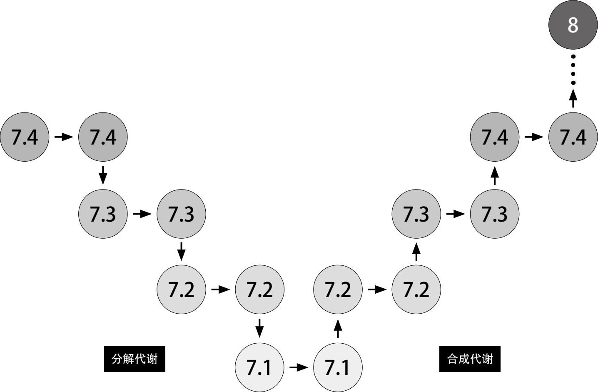
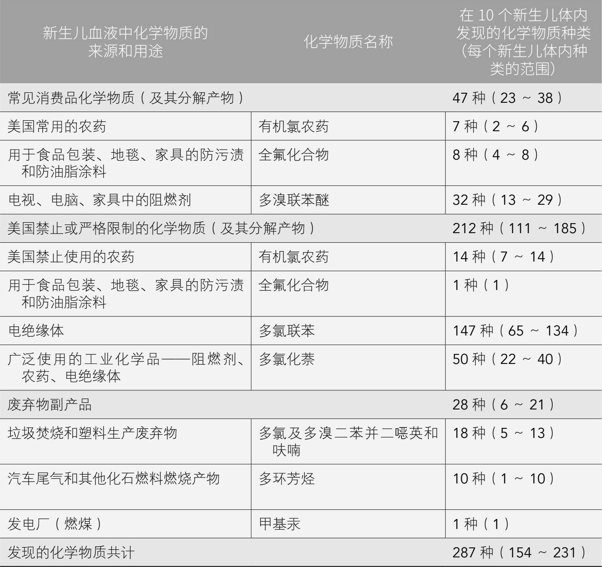

# 第六章 转变方案 你能达到的目标

<h2><b>第</b><b>六</b><b>章</b></h2>

<h2><b>转</b><b>变</b><b>方</b><b>案</b></h2>

<h2><b>你</b><b>能</b><b>达</b><b>到</b><b>的</b><b>目</b><b>标</b></h2>

	
我将我的计划称为转变方案，是因为你将转变为更好的健康状态。你已踏上旅程，在旅程中你将接触到新的食物、新的习惯和新的想法。转变是一个过程，无论我们是小步前进还是大步前进，我们都在不断进步。在此转变过程中，你的健康状态越来越好。你将会明白你对食物和生活方式的选择是如何影响你的思维方式和感受的。

	
首先你将开始一个为期3周的计划，我称之为第1阶段，此时你将遵循严格的无麸质、无乳制品、无糖饮食。在此期间，你将开始创造一个新的、健康的内部环境，你的身体功能将会变得“顺畅”，你也将会感觉更好。

	
最新的大脑科学研究正在关注神经发生的过程，在这个过程中，大脑不断生成新的细胞且这些细胞在我们的一生中都在不断生长。这一机制告诉我们，大部分情况下，改变我们的习惯或健康状况永远都不算晚。但“小部分情况”也是会发生的。还记得山姆吗，我们在第五章讲到过他。在拒绝无麸质饮食的7年中，他的小脑发生了退行性变化。磁共振成像显示，当第一次检测到抗大脑抗体升高时，他的小脑还是正常的。但7年后，他的小脑明显变小了。严重的退行性变化是很难逆转的。这就是为什么尽早识别出正在杀死机体组织的抗体是如此重要。在这一章中，你将学习如何训练你的身体，使它处于持续“治愈和修复”的状态。

	
你的血管就像一条交通繁忙的高速公路。我们的目标是确保在这条高速公路上没有交通堵塞或许多鲁莽的司机（自由基）。你希望在你的血管这条高速公路上，每个司机都负责任地驾驶，而不是造成混乱。而一旦出现混乱，你体内的“治愈和修复”机制就会被激活。

	
我们可以通过许多不同的方式来创造一个新的、健康的内部环境。例如，加强锻炼、提升大脑功能、减压、避免接触不必要的化学物质和毒素，以及改变我们的饮食习惯等。事实上，我们能做出的最大改变就是避免摄入那些伤害我们的食物，同时选择对我们有益的食物。当你开始远离你所敏感的食物时，你就停止了为自身免疫之火提供燃料。当这种情况发生时，火势就会平静下来。虽然一开始它可能不会完全消失，但当你停止往火里添加汽油时，炎症强度就会减弱，炎症级联反应也会减少。随着时间的推移，你的炎症生物标志物会降低到一个更正常的范围。这种变化可以通过简单的血液检测来量化，例如，超敏C反应蛋白检测、红细胞沉降率检测、白细胞分类检测等。

	
从细胞的角度来看，我们每7年就能拥有一个全新的身体，因为我们身体里的每一个细胞都在自我更新。有些细胞（比如我们的肠道黏膜上皮细胞）每3～7天就会更新一次。其他细胞则需要更长的时间。在我们体内，细胞再生的过程是时刻在进行的。当一个细胞更新时，它会复制出一个完全相同的自己。那么为什么我们不能自己复制出完美的皮肤细胞、脑细胞或者血管细胞呢？让我来告诉你答案。

	
假设你现在35岁，你的健康状况很好——虽然不像你22岁时那样，但也是很好了。在你20岁左右时，可能你会参加很多的聚会，但你并没有感觉到累，也没有什么不适。在年度体检时你的血液检测结果是“正常”——没有任何警报响起。如果10分是最佳状态，也许你的肝脏此时可以评7.6分。然而，你要记住，当一个细胞在更新的时候，它会复制一个完全相同的自己。所以一个功能评分为7.6分的细胞会复制另一个7.6分的细胞。你的细胞功能是由细胞周围的情况所决定的，你可以称之为“围—细胞”（这是我刚编造的一个新词，希望你能明白它的意思）。表观遗传学是指基因周围的环境决定了该基因是否被激活。围-细胞是细胞周围的环境，决定细胞如何实现功能及自我更新。因此，如果细胞周围的环境中充满了炎症反应，你的细胞就只能发挥7.6分的功能，而你复制的细胞也是7.6分，生命就这样继续下去。

	
但是，如果你继续同样的生活方式，也就是说继续摄入敏感食物，继续酗酒，或者继续吃垃圾食品，你的肝脏会承受更多的负担。很快你的肝脏功能评分会变为7.5分。当这个细胞更新时，新生的细胞也是7.5分。如果你接下来的生活方式和以前一样，甚至接触到更严重的炎症诱发因素，评分将变为7.4分，而这个细胞就会以7.4分继续更新。在同样的生活方式下，你的细胞功能继续降至7.3分，细胞以7.3分继续更新。年复一年，你的细胞功能评分越来越低，身体功能越来越差。这种衰老的过程我们称为“分解代谢”（图6-1）。

	
但是，一旦你按照书中所说的原则做出改变，创造出一个更健康的内部环境，你的肝功能就会得到改善。线粒体的损伤、氧化应激及细胞水平的炎症反应都会减少，体内的抗体也会恢复至正常范围。你的身体想要变得健康，所以它试图通过生成更健康的细胞来重建更健康的身体。只要你继续提供一个更健康的内部环境，你的细胞就能够复制出更新的、更健康的细胞。你的评分不再是7.3分，而是7.4分。细胞也是以7.4分继续更新。按照我们的方案，你的饮食更加平衡、营养更加丰富，然后你的细胞功能达到了7.5分。新生的细胞也是7.5分。当你继续进行这个方案，评分将变为7.6分。当这个细胞更新时，你就产生了7.6分的细胞。身体在几个月的时间里继续重建，并生成由“围—细胞”决定的功能更强的细胞。这种使机体变得更年轻、更健壮的过程我们称为“合成代谢”（图6-1）。

	
我的患者告诉我，几个月没有见的朋友会说：“哇，你看起来不一样了。你看起来很不错。”尽管他的朋友也说不出具体变化是什么。可能是我的患者肤色变好了，或者体重减轻了，或者核心能量提升了，所以他的眼中有了更多的生机和活力。原因就是，在他的内部环境里，正在复制生成更健康的细胞，正从分解代谢的状态转变为合成代谢的状态。

	

	
图6-1 人体内的分解代谢和合成代谢

<h2><b>你</b><b>能</b><b>达</b><b>到</b><b>的</b><b>目</b><b>标</b></h2>

	
在第1阶段中，你的身体会发生两个微妙但有利的变化：一是你体内的炎症反应将会减轻；二是将会重新形成一个更健康的微生物群落。

	
如果你像我的很多患者一样，那么在第1阶段开始3周后，就会注意到无论你开始的时候是怎样的状态，此时你的感觉开始变好了。当你遵从我所推荐的原则，远离最易引起炎症反应的食物，你将很快出现炎症的减轻。你接触过的麸质或其他环境毒素是否仍然存在于你的身体系统中并不重要，因为你的症状主要与炎症有关，而不是毒素。这就是为什么你可以很快就注意到自己的感觉发生了变化。体内的毒素会让你在变得更健康的道路上紧急刹车，但随着炎症反应的消退，你的身体自然会更容易将毒素排出。根据体内毒素的种类和水平，你在排出毒素时可能需要一些帮助。

在24小时内，你体内的微生物群落，即肠道中的细菌，将开始变得平衡
	<a id="noteref-13-32" href="#footnote-13-32">[1]</a>。当你的微生物群落重新平衡时，你的欲望会减少，能量会得到提升（如果之前能量降低的话），你的大脑激素会变得更加平衡，因此，你会产生一系列良好的感受。你的血压会稳定下来，睡眠会得到改善，动脉粥样硬化也开始逆转。基本上，你整体的身体状态和功能都会得到改善。你的身体现在有机会去解决那些你一直在应对的各种不平衡的问题。如果你成功地使全身炎症反应减少，你的体内就不会出现失衡问题，也可避免癌症。减少全身炎症反应的第一步，通常是停止往炎症之火上浇油。

	
所有这些改善将使你的健康状况变得更好。它们并不意味着疾病一定能被治愈，或者你的症状会完全消失。但是，你肯定会注意到症状正在减少，或者能看到体重下降或脑雾减少等。你不太可能在3周内痊愈（在上一章杰瑞的例子中我们了解到，他花了4年时间才完全恢复健康），但你会注意到身体功能变得更好了。我一直告诉我的患者，正是一个个小的胜利累积起来才换来了更好的健康状态。

	
虽然你可以在短短1天的时间里改变肠道的微生物群落，但完全消退炎症以及免疫系统停止攻击自身则需要更长的时间。请记住，即使你清除了入侵者，免疫系统仍然会在几个月内继续产生抗体。这意味着，虽然你可能会在短短3周内注意到你的健康状况开始好转，但是你的健康状况发生更大的变化可能需要3个月的时间。

	
在我的诊疗过程中，我总是把转变方案的第1阶段作为实践期。我发现第1阶段是了解你正在实施的方案是否有效的最佳时间。如果无效，那就意味着我们肯定忽略了一些东西，我们需要做出一些调整，例如，可能要去除其他潜在的刺激物。

	
改变需要时间。你可能无法每天都看到变化，因为每天正确选择食物以在你的细胞周围创造一个更健康的环境只能带来微小改变。但这个过程是累积的，很快你就会注意到身体功能变得更好了。

	
随后，在第2阶段中，你将在之前的基础上更进一步：你会发现远离那些很多人都敏感的其他食物是多么地容易。你将继续遵循无麸质、无乳制品、无糖饮食，同时你还要在你的饮食中撤除一种特定的食物，并评估自我感受。很多人发现好的习惯是相互促进的，虽然第2阶段需要做的事情更多，但却更容易坚持，因为你已经习惯了改变你的饮食和生活方式，你也看到了你在第1阶段取得的成果。你现在势如破竹！

	
最后，我们可以补充一些益生元和益生菌，它们既能治疗肠道疾病，又可以支持你的免疫系统。

	
<b>身</b><b>体</b><b>负</b><b>荷</b><b>的</b><b>概</b><b>念</b>

	
人体每天都会接触到有毒的物质，当接触到的有毒物质有限时，身体可以通过自身机制——肝脏、皮肤和消化系统的清除作用，将有毒物质从体内消除，所以毒素不会引起健康问题。但一旦有毒物质超过一定量时，这就意味着人体的排毒机制已经不堪重负，我们已经跨过了警戒线：身体负荷。此时，过量的有毒化学物质就无法被清除。

2005年，美国环境工作组进行的一项研究指出，2004年8～9月在美国医院出生的10名新生儿的脐带血中平均含有200种工业化学品和污染物（表6-1）。这些脐带血由红十字会收集，其中含有农药、广泛使用的工业化学品，以及煤炭、汽油和垃圾燃烧后的废弃物等污染物
	<a id="noteref-13-127" href="#footnote-13-127">[2]</a>。人在新生儿期并不能处理这么多的毒素，因此，当这些化学物质进入新生儿的血液后，会干扰新生儿的大脑发育和激素的产生。

	
有毒物质暴露的最大危害是它对大脑的影响。2014年，美国疾病控制与预防中心的自闭症与发育障碍监测网报道称，在美国大约每68个儿童中就有1个儿童患有自闭症谱系障碍。1980年我开始行医时，据报道，美国自闭症的患病率为万分之一。在20世纪90年代，患病率是1/2500，之后是1/1000，现在是1/68。化学物质过度暴露使人体的排毒系统不堪重负，这会不会是如今自闭症发病率如此之高的原因之一呢？是的，有可能。

	
表6-1 10名新生儿体内含有287种工业化学物质

	

	
<b>这</b><b>不</b><b>是</b><b>平</b><b>常</b><b>所</b><b>说</b><b>的</b><b>节</b><b>食</b><b>或</b><b>排</b><b>毒</b>

	
就在几年前，“排毒”成为了健康领域的新热点，常见的排毒方法包括禁食清肠、果汁清肠、卡宴辣椒和蜂蜜清肠，甚至还有香蕉清肠。自2000多年前的希波克拉底时代以来，人们一直在讨论清肠和排毒。人们认为通过这些方案可以将毒素排出体外，恢复机体平衡并达到更健康的状态。这是清理人体内部环境的一种有效途径。

	
如果一个排毒计划能让你顿悟并为你提供改变食物选择的指导，让你远离那些导致你体内毒素蓄积的食物，那么这个计划就有意义，或者说有长期价值。我个人每年至少做一次有针对性的排毒。有时有效，有时则没有效果。但是，即使是有效的排毒方案，有效时间也很短。一旦你结束了你的排毒过程，又回到了以前的习惯，所有为了创造一个更健康的内部环境所做的努力就会付诸东流。

	
我的转变方案并不是让你节食，当然也不是一次性的排毒。虽然在实施我的方案时常常会有体重的减轻，但我们的目标不是减肥。通过避免摄入你所敏感的食物，你的肝脏功能从7.8分变为7.9分再到8.0分，你会自然地将毒素排出体外，但这只是众多益处之一。你的大脑细胞、肝细胞、肾脏细胞、肌肉细胞、胆囊细胞、生殖系统细胞（是的，伙计们，你没看错），你身体里的每一个细胞、每一个组织在你转变为“合成代谢”状态的时候都开始获得更好的功能。当你得到你想要的结果时，你就不会再回到你原来的饮食方式。

	
正如我们每个人都是独一无二的个体一样，我们每个人都有自己的身体负荷。基因决定着每个人的排毒能力。当接触的有毒物质有限时，我们的身体可以将其清除。但如果你接触到了大量的化学物质，再加上每天暴露在敏感的食物中，你就更有可能发生有毒物质在体内蓄积，继而产生炎症反应。此时你体内的白色脂肪细胞就会增加，目的是储存你身体不能排出的毒素。你腹部的“游泳圈”就出现了。

	
如果你能改变你的饮食习惯，并远离引起免疫反应的食物，那么你的身体就有机会清除体内储存的毒素。

	
当我们体内的毒素超过身体负荷时，诸如食物敏感这样的小问题也可能会成为大问题。例如，你的身体本来应该能够处理接触到的霉菌或某些化学物质，但当你的排毒系统负荷过重时，毒素便无法被清除，所以你体内的炎症反应和白色脂肪细胞沉积都在增加。然而，当你从饮食中去除麸质、乳制品和糖时，你就减少了身体接触有毒物质的机会，你就能更好地将体内的毒素排出体外。如果有100个毒素进入你的体内，然后你消除了其中的80个，那么你的机体就可以更容易地应对另外20个。

	
这就是为什么有些人一旦身体完全康复后就可以重新吃乳制品或糖的原因。他们体内的免疫反应被完全重置，身体将不再把这些食物误认为入侵者。我经常能见到这种情况出现。

	
<b>关</b><b>于</b><b>你</b><b>的</b><b>体</b><b>重</b>

	
人们对节食减肥充满了质疑，认为它并没有科学依据。体重的增加与许多方面都息息相关——包括衰老、我们吃的食物、影响新陈代谢的激素变化、情绪压力和当前的健康状况等。减肥计划的初衷是好的，但往往会出现溜溜球效应，即体重反弹：你在2个月内减掉了5千克，但不到1年，你又恢复了原来的习惯，体重又增加回来了。转变方案则不同，因为我们的目标是减少炎症反应诱发因素，并建立一个更健康的微生物群落，而不是专注于减肥。我发现，在大多数情况下，人们很难减肥，因为他们吃的食物实际上对他们的身体有害。

	
如果你的免疫系统说“我们遇到了麻烦”，不管你对食物的态度如何，你的身体都在说“不”，并将产生炎症反应，而炎症反应本身就与肥胖有关。

食物直接影响着你肠道的微生物群落，而后者在24小时内就会发生改变，目前其被认为是阻碍减肥的“主要调节器”
	<a id="noteref-13-52" href="#footnote-13-52">[3]</a>。

	
体重增加和进食炎症性食物之间的关系很简单：你在选择食物时毒素（如麸质、乳制品、糖）暴露越多，你喂养的可增加体重的微生物群落就越多，身体产生的炎症反应也就越多，体重增加的就越多。当你日复一日地接触你的身体视为毒素的食物时，就会产生一系列的后果。

	
第一个不良后果，这些食物抑制了你的反应系统，并喂养了肠道中的“生存细菌”。几十年来不太理想的食物选择创造了一个有自己“意志”的微生物群落，它想要生存下去。如果你有一个囤积热量的微生物群落，它会向你的大脑发出化学信息，说：“我还想要……”不管什么食物（比如大量的有害脂肪、糖、过敏性食物，或简单加工过的碳水化合物），都能喂养这些肥胖细菌。

还记得我们在第三章介绍过的皮马人吗？当我们把美国皮马人的饮食与墨西哥北部基因相似的皮马人的饮食进行比较时（后者的饮食更传统，加工程度更低），美国皮马人的糖尿病发病率是墨西哥皮马人的5倍，尽管这两组人有相似的基因和储存热量的微生物群落。我们发现，美国皮马人有如此高的糖尿病发病率（50%的人在35岁之前患上2型糖尿病），其原因在于让大多数肠道细菌进食大量的了低质量、高热量的食物，而这些细菌本来是为了保障生存而储存所有热量的微生物群落。而墨西哥皮马人的饮食习惯仍和他们的祖先一样，虽然他们和美国皮马人有同样的微生物群落，但他们没有出现糖尿病的流行
	<a id="noteref-13-272" href="#footnote-13-272">[4]</a>。

	
第二个不良后果是过度的炎症反应。在这种情况下，脂肪细胞的储存能力加强，特别是白色脂肪，也就是腹部的“游泳圈”，而这很难仅仅通过节食来消除。白色脂肪对我们的生存很重要，但过多的白色脂肪就会带来问题。你不会仅仅因为摄入太多的热量而增加你的白色脂肪。作为一种保护机制，身体会产生过多的白色脂肪细胞让你所接触的毒素远离大脑。如果你无法通过肝脏、粪便、尿液和皮肤排出这些毒素，那么为了保护大脑，这些化学物质就会被储存在躯干内，并产生更多的白色脂肪细胞。过多的白色脂肪会产生更多的炎症反应，表现为液体潴留（水肿）。除了炎症反应外，水肿的另一个主要原因是加工过的食物中盐的含量增加，即使是“健康”食物，如即食麸皮和燕麦片、速溶热麦片、微波爆米花、饼干和椒盐脆饼等。

	
如果你脱掉袜子或内衣后，你的皮肤上有勒痕，可能是因为你的衣服太紧了；但对大多数人来说，这是轻度水肿的迹象。其他水肿表现还包括眼睛下方出现黑圈以及横纹（即丹尼线，并非皱纹）。

	
一旦身体产生了这些有毒的脂肪细胞并发生水肿，再消除它们就很难。毒素蓄积后机体可能会故意保留多余的脂肪或液体，以防止在将毒素排出体外的过程中再次暴露于同样的毒素中。换句话说，你的身体可能在保护你免受有毒物质的侵害，因为它将这些毒素隔离在血液循环之外，使毒素无法进入大脑，因而迫使你保持超重。当你通过减少炎症反应和饮用足够的水（每天每千克体重至少30毫升的水）来改善你的排毒功能时，你清除毒素的能力会加强。对于排出体内蓄积的毒素来说，这是最安全、最容易的方法。

当你不再摄入你所敏感的食物后，你的身体就能更专注于去除体内的潴留液体，燃烧存储毒素的脂肪。而且，因为你不再摄入高热量、低营养的食物，而是摄入营养丰富的食物，所以你可能会减掉一些体重。这就是为什么成千上万的人在60～90天内通过无麸质饮食减掉了7～13千克体重的原因之一
	<a id="noteref-13-134" href="#footnote-13-134">[5]</a>。

	
<b>揭</b><b>开</b><b>疾</b><b>病</b><b>的</b><b>面</b><b>纱</b>

	
正如你在第一章中所了解到的，有超过300种病症仅仅与麸质敏感有关，更不用说糖或乳制品了。能让你开始感觉更好的转变方案太多了。更重要的是，每个人健康链条上的薄弱环节有所不同，因此参与转变方案的结果因人而异。我相信，通过实施转变方案，几乎每个人都将受益，并在身体功能及自我感受方面看到积极的变化。不管你对麸质、乳制品或糖类是否敏感，它们都是会让你体内的毒素水平更接近你身体负荷的有毒食物。

	
我发现大多数人在短短的几天内就会注意到他们的健康状况有所改善。我的患者经常告诉我说，他们的皮肤开始变得更好，他们的季节性过敏症状也减轻了。虽然这些变化可能很细微，但基本上都能注意到。但是如果你再一次接触那些有毒物质，就像我们在第五章中提到过的男孩卡梅伦那样，你可能会受挫。当卡梅伦再次摄入乳制品和麸质时，才知道自己不能耐受这些，而此时他的痤疮爆发了。

	
你也许会发现你的一些症状消失了，但新的症状可能会出现。这是因为我们大多数人都有多个薄弱环节，而且处于自身免疫性疾病发展谱中的人很少只患有一种自身免疫性疾病（换句话说，他们有“共病”）。例如，如果你患有乳糜泻或伴有肠道相关症状的非乳糜泻性小麦敏感，通过从饮食中去除麸质，你的肠道疼痛可能会减轻，但你可能会突然发现你有便秘。原因在于，每当你进食含麸质的食物时，你的肠道免疫系统就会被激活，出现肠道痉挛（10分为满分，你的肠道功能评分为5.6分）。如果没有麸质，你的主要薄弱环节得到解决，肠道痉挛消失了，但是在你体内可能还有另一个薄弱环节同时被拉扯，只是这种症状并没有那么明显罢了（便秘评分为7分）。当解决肠道痉挛的问题后，现在你注意到了便秘。随着时间的推移，只要你坚持无麸质饮食，便秘问题也会得到解决（从7.0分提高到7.1分再到7.2分，等等）。

	
<b>萨</b><b>曼</b><b>莎</b><b>的</b><b>故</b><b>事</b>

	
<b>第</b><b>四</b><b>部</b><b>分</b>

	
还记得我的患者萨曼莎吗？她是加利福尼亚大学洛杉矶分校风湿性狼疮研究中心20年来见过的最严重的系统性红斑狼疮患者之一，由于自身免疫的原因，她的整体健康状况受到了严重的影响。与其他成千上万的患者一样，我让她开始了第1阶段的转变方案。她从饮食中去掉了小麦、乳制品和糖，1个月后她来复诊了。

	
萨曼莎的故事是一个很好的例子，说明自身免疫性疾病会损害身体的许多不同系统，导致功能失调。当治疗开始后，萨曼莎注意到她的精力增加了，但她仍然有一些身体上的不适。多年的损伤无法立即恢复，但愈合和功能的改善仍在继续。

	
我问她开始这个方案后感觉如何。她告诉我：“我一天比一天强壮。我所有受损的系统都在得到改善，有些系统比其他系统改善得更快些。有时我会便秘，但不像过去那么频繁了。有时我仍然感到疲劳，但也不像以前那么频繁了。我觉得我的甲状腺功能好多了，因为我已经很少感冒了。这个方案让我感觉越来越好了。”

	
在接下来继续转变方案的2年里，萨曼莎的身高增加了5厘米。最近，她告诉我：“我感觉我的整个身体正在恢复正常。”

	
我以前参加过很多马拉松比赛，一次跑42千米。老实说，当我越过终点线时，我感觉我的评分不像是10分，而感觉像是5.5分。我不能立即恢复原有的状态，而是过了几天才能恢复正常。尽管马拉松比赛没有耗费我的脑力，但我的大脑无法像往常一样工作。我的整个身体和大脑都需要休息和恢复。当你有食物敏感引发的全身炎症时，无论你是否意识到，你的很多系统都会受到影响。因此，你的肠道痉挛消失了，但是便秘出现了。

	
<b><i>接</i></b><b><i>下</i></b><b><i>来</i></b><b><i>的</i></b><b><i>内</i></b><b><i>容</i></b>

	
让我们先试一试吧。在下一章，你将确切地了解在第1阶段中能吃什么、不能吃什么。祝你好运：我知道你会做得很棒！

<aside id="footnote-13-32"><ol><li id="footnote-13-32"><a href="#noteref-13-32">[1]</a>P.J. Turnbaugh et al., “The Effect of Diet on the Human Gut Microbiome: A Metagenomic Analysis in Humanized Gnotobiotic Mice,” Science Translational Medicine 1, no. 6（Nov 11, 2009）：6ra14.</li></ol></aside>
	

<aside id="footnote-13-127"><ol><li id="footnote-13-127"><a href="#noteref-13-127">[2]</a>Environmental Working Group analysis of tests of 10 umbilical cord blood samples conducted by AXYS Analytical Services（Sydney, BC）and Flett Research Ltd.（Winnipeg, MB）.</li></ol></aside>
	

<aside id="footnote-13-52"><ol><li id="footnote-13-52"><a href="#noteref-13-52">[3]</a>L. Geurts et al., “Gut Microbiota Controls Adipose Tissue Expansion, Gut Barrier and Glucose Metabolism: Novel Insights into Molecular Targets and Interventions Using Prebiotics,”Beneficial Microbes 5, no. 1（Mar 2014）：3–17.</li></ol></aside>
	

<aside id="footnote-13-272"><ol><li id="footnote-13-272"><a href="#noteref-13-272">[4]</a>L. O. Schulz et al., “Effects of Traditional and Western Environments on Prevalence of Type 2 Diabetes in Pima Indians in Mexico and the US,” Diabetes Care 29, no. 8（Aug 2006）：1866–71.</li></ol></aside>
	

<aside id="footnote-13-134"><ol><li id="footnote-13-134"><a href="#noteref-13-134">[5]</a>William Davis, Wheat Belly: Lose the Wheat, Lose the Weight, and Find Your Path Back to Health（Emmaus, PA: Rodale, 2011）.</li></ol></aside>
	

