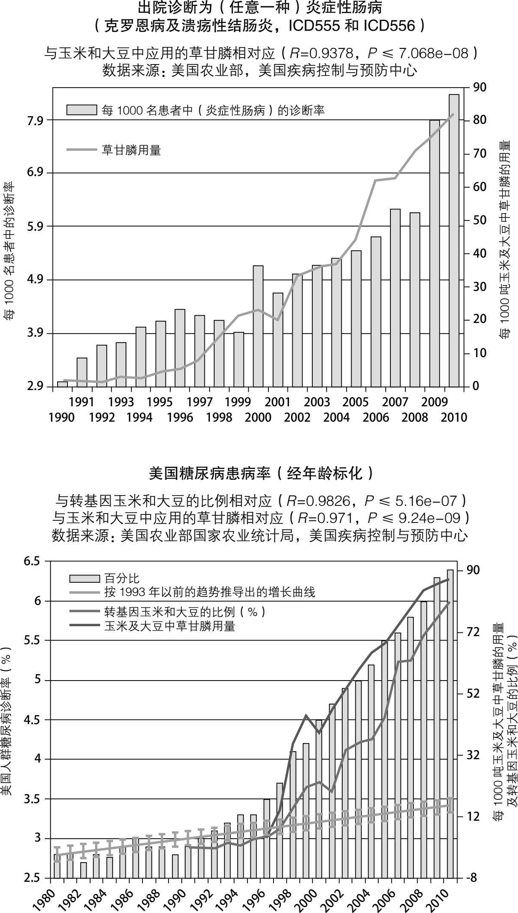
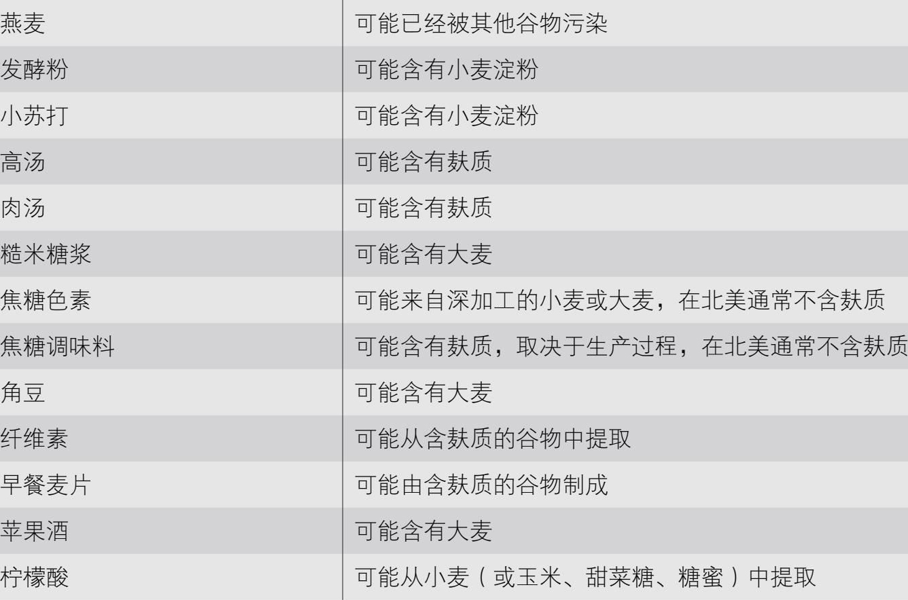
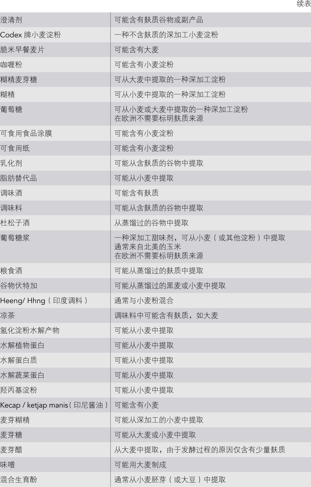
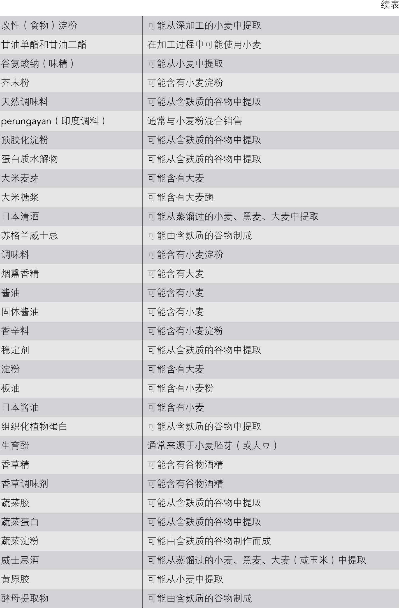
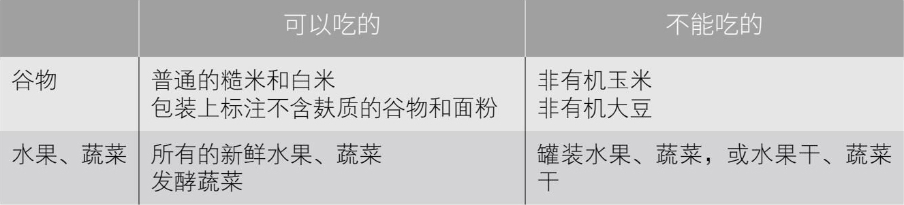
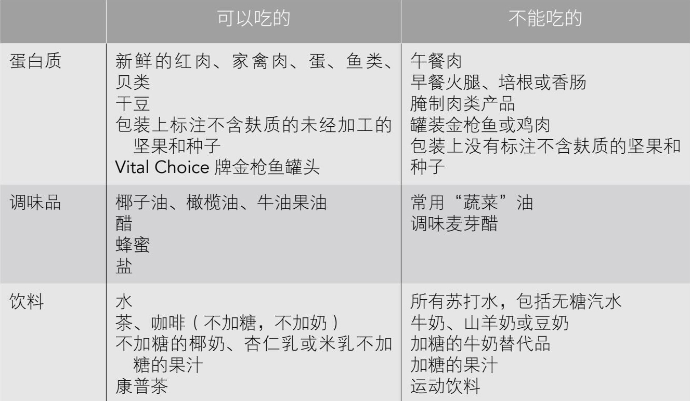

# 第七章 转变方案第1阶段 第1～3周

<h2><b>第</b><b>七</b><b>章</b></h2>

<h2><b>转</b><b>变</b><b>方</b><b>案</b><b>第</b><b>1</b><b>阶</b><b>段</b></h2>

<h2><b>第</b><b>1</b><b>～</b><b>3</b><b>周</b></h2>

	
当你把3种最常见的炎性食物——麸质、乳制品和糖——同时从饮食中去除时，你的消化系统和免疫系统都有机会平静下来、痊愈、重置。请记住，当你停止往火上浇油时，你仍然还有一堆火要处理。无论你在疾病发展谱上处于什么位置，除了减少炎症反应之外，我们还需要重建受损组织，这样我们才能创造一个更好、更健康的肠道环境，促进有益菌的生长，并治愈肠漏。

	
转变方案（包括第1阶段和第2阶段）是完全自身免疫饮食的第一步。完全自身免疫饮食旨在平息炎症反应并逆转自身免疫级联反应。完全自身免疫饮食是一种严格限制的饮食计划，可以消除所有潜在的诱发因素。但在临床上，我发现并不是每个人都需要完全自身免疫饮食。我发现，通过消除3种主要的诱发因素——麸质、乳制品和糖——80%以上的患者能感觉到明显好转，并开始逆转自身免疫级联反应。还有10%的人需要检测其他常见的食物敏感性，这就是第2阶段的内容。剩余10%的人需要严格限制的完全自身免疫饮食。我希望你在探索健康状况时小步前行，这样你就能继续吃你喜欢的食物而不影响你的健康。我还发现，我所限制的食物越少，尤其是在计划刚开始时，参与者的完成度就越好。

	
在转变方案第1阶段，我们开始了经典的排除饮食，即在特定的时间内从饮食中剔除特定的食物，并观察身体及自身感觉方面的变化。如果无法进行食品敏感性测试，那么排除饮食对于确定你对哪些食物具有敏感性来说是最好的方法。在接下来的3周内，我将帮助你完全不吃乳制品、麸质和糖。你会享用各种各样的水果和蔬菜，清洁的红肉、鱼类和家禽肉，以及健康脂肪，远离那些让你健忘、生病、肥胖和疲劳的有害食物。我们的目标很简单：去掉不好的东西（包括深加工的食物），添加有益的东西。

	
人们总是首先问我他们能吃什么。事实上，你有很多选择，并且你很快就会知道它们具体是什么，我已经列出了所有可以接受的选择。我不希望你们觉得这个方案存在限制性。实际上，你每天都可以从数百个选项中进行选择。等你尝试了一些食谱之后就会明白。

	
因为这个转变方案具有原始饮食风格，所以你会像古时候的人那样吃东西。你的食物中大部分都将是植物（蔬菜、水果、坚果、种子、香草和香料）和动物（红肉、鱼、家禽肉和蛋）。植物是健康的碳水化合物和微量营养素（维生素、矿物质、抗氧化剂和抗炎剂）的主要来源。生的坚果、种子，以及黄油和肉类可以提供优质的蛋白质和脂肪。除非你已经明确了对大米和玉米敏感，否则在第1阶段你也可以加入这些食物。

	
<b>转</b><b>基</b><b>因</b><b>食</b><b>品</b><b>一</b><b>言</b><b>难</b><b>尽</b>

当谈到食品供应的健康问题时，我最关心的问题之一就是转基因食品的流行。转基因食品的大规模商业化始于1994年。根据美国食品和药物管理局以及美国农业部的数据，目前至少有40种转基因植物品种，其中最常见的是大米、大豆和玉米，在美国的玉米种植中有89%被认为是转基因作物
	<a id="noteref-14-131" href="#footnote-14-131">[1]</a>。目前市场上有9种转基因食品作物：大豆、玉米、棉花籽（油）、油菜籽（油）、甜菜中的糖、西葫芦、黄南瓜、夏威夷木瓜和紫花苜蓿。转基因谷物用来喂养我们吃的动物，因此也影响乳制品、鸡蛋、牛肉、鸡肉、猪肉和其他动物产品。即使是最“天然”的加工食品，如番茄酱、冰激凌和花生酱，也会添加这些原料。一些香料、调味料和软饮料中也会添加转基因玉米或大豆（以玉米糖浆或人造甜味剂阿斯巴甜、葡萄糖、柠檬酸、色素如β-胡萝卜素和核黄素等形式）。事实上，80%以上的加工食品，如植物油和谷类早餐食品，都含有一些转基因成分。作为食品添加剂的大豆和玉米衍生物无处不在，使得几乎我们所有人都接触过转基因食品。

请注意，前面我们没有将小麦列为转基因作物但这并不意味着小麦是安全的。多年来，小麦通过自然育种技术进行杂交。然而，就像大多数转基因作物一样，它被“设计”成能够耐受一种叫“农达”的除草剂，农达的活性成分草甘膦现在已被归类为可能的人类致癌物
	<a id="noteref-14-117" href="#footnote-14-117">[2]</a>。在美国，大多数小麦作物在收割前几周就被喷洒了草甘膦除草剂，以将小麦植株杀死，因为一片死小麦更容易收割。因此，美国大部分小麦产品种都含有可能引起癌变的草甘膦。

动物研究表明，转基因食品可能会对免疫系统、肝脏和肾脏造成损害。草甘膦除草剂农达也被证明会改变肠道内的微生物群落，使肠道通透性增加。科学家们正在研究这种化学物质与肝脏解毒功能之间的相互作用，据说这是一个环境诱因扰乱体内平衡并引起自身免疫性疾病（包括胃肠道功能紊乱、肥胖、糖尿病、心脏病、抑郁症、自闭症、不育、癌症和阿尔茨海默病等）的“典例”
	<a id="noteref-14-169" href="#footnote-14-169">[3]</a>。

	
我知道这令人感到震惊且不安，但它有助于解释在过去30年里如此多疾病急剧增加的原因。图7-1体现了全世界对于转基因食品对我们健康的长期影响方面的关注。这只是一篇参考文章中描述的转基因食品的增加与特定疾病之间关系的许多情况中的两种。要了解更多信息，请阅读我参与撰写的13页权威报告：转基因食品能解释麸质敏感的爆发吗？（可以在我的网站theDr.com上找到）。

	
转基因食品的最可怕之处在于，消费者不知道他们是否摄入了转基因食品，因为在美国禁止使用转基因食品标签。尽管大多数发达国家认为转基因食品是不安全的，并且有64个国家要求转基因食品贴上标签，但在美国并没有要求标注或给予限制。避免摄入转基因食品的唯一方法是遵循以下3个简单的规则。

	
● 购买当地产品。避免摄入转基因食品最简单的方法是加入当地的食品合作社或社区支持农业组织，或在当地农贸市场购买那些生的、完整的、未经加工的食物

	
● 购买有机食品。经认证的有机产品不能含有转基因成分。其中包括农产品和肉类，因为如果牛吃了转基因饲料，就会改变它们肠道中的细菌，进而影响它们的肉和奶

	
● 在面粉、种子和坚果等单一成分包装商品上寻找“非转基因项目认证”或“美国农业部有机食品”标识。同时，还要确保这些食品有“无麸质”标签，以降低交叉污染的风险

	

	
图7-1 转基因食品的增加与特定疾病的关系

	
经允许摘自Nancy L. Swanson.

	
<b>享</b><b>用</b><b>你</b><b>最</b><b>喜</b><b>欢</b><b>的</b><b>新</b><b>鲜</b><b>食</b><b>物</b>

	
在第1阶段，你可以吃各种各样的水果、蔬菜和坚果，特别是新鲜的、时令的蔬果。我总是推荐新鲜的水果和蔬菜，但对很多人来说，这并不总是可行的。冷冻水果和蔬菜也是可以接受的，因为它们是在成熟的时候收获的，同样含有丰富的抗氧化剂和多酚。尽量选择有机产品，并且如果有可能的话，选购当地的品种。不要选择用糖或盐腌制的罐装水果或蔬菜。

	
众所周知，许多食物是天生的抗炎药，你可以每天在这些食物中进行选择。

	
● 肉桂（每日1/10茶匙是安全且有效的）

	
● 十字花科蔬菜（西蓝花、球芽甘蓝、菜花、卷心菜、白菜）含有硫代葡萄糖苷——一种强有效的多酚，有助于减轻肠道炎症反应

	
● 深色且含有高浓度多酚的水果，如浆果、樱桃和红葡萄

	
● 绿茶（每天1～3杯），它也是一种益生元

	
● ω-3脂肪酸，只能通过饮食获得，因为身体无法生成。它可以带给我们诸多好处，其中包括可以开启降低肠道炎症的基因。富含ω-3脂肪酸的食物包括草饲牛肉、冷水鱼、海鲜、黑胡桃、山核桃、松子、奇亚籽、亚麻籽、罗勒、牛至、丁香、马郁兰和龙蒿

	
● 欧芹

	
● 番茄汁（140克）

	
有一类叫作果聚糖的碳水化合物，它的作用就像肥料一样，可以支持我们肠道中的有益菌。最著名的果聚糖是菊粉，菊粉是一种天然的碳水化合物，存在于至少36000种植物中。菊粉还被认为是一种用于储备能量和调节抗寒性的益生元。菊粉含量最高的益生元是菊苣根（新奥尔良的读者看到这里会很高兴，因为在烹饪中加入菊苣根是当地的一种美食文化）。其他富含菊粉的植物包括小麦、甜菜、韭菜、芦笋、洋蓟、洋葱、大蒜、蒲公英根、香蕉和大蕉。

	
我们大多数人从小麦中获取超过70%的菊粉。当我们不再摄入小麦的时候，无论我们肠道中有多少有益菌（这些细菌一直依赖小麦作为主要的肥料来源），它们都开始挨饿。无麸质食物中菊粉的含量通常要低得多。因此，在我们努力修复肠道通透性时，我们创造了一个比以前更糟糕的微生物群落环境。这就是为什么我们一定要把富含菊粉的食物作为我们日常饮食的一部分。发酵食品有助于肠道保护菌群的生长和繁殖。请记住，人体内增长最快的细胞是肠道黏膜上皮细胞：每3～7天我们就会有一个全新的肠道内壁，我们需要丁酸来使其变得坚固。蔬菜，尤其是块根类蔬菜，含有不溶性膳食纤维，能够在肠道中产生丁酸。

	
<b>水</b><b>果</b>

	
在第1阶段，有很多种水果可以吃，但以下情况除外：①你对某种水果过敏或敏感；②你所吃的水果的量超过了你的血糖调节机制所能调控的个人阈值。

	
水果比蔬菜含糖量高，有些水果的升糖指数很高。“低升糖指数”水果（杏、李子、苹果、桃子、梨、樱桃和浆果）是不错的选择。其他水果虽然对健康大有裨益，但必须适量食用。举个例子，你听说过“生活中没人想要疯掉（No one wants to go bananas）”这句话吗？成熟的香蕉是一种健康的水果，它的升糖指数是51（这很好）。但是，如果我们每天都吃香蕉以及其他中或高升糖指数的食物，过多的糖最终会使我们体内的血糖水平像过山车一样，从而导致高焦虑状态（发疯，going bananas），并有可能引发糖尿病。

	
在第1阶段，优质的水果选择如下。

	
·巴西莓浆果

	
·苹果

	
·杏

	
·牛油果

	
·香蕉

	
·黑莓

	
·蔓越莓

	
·无花果

	
·枸杞

	
·醋栗

	
·葡萄柚

	
·番石榴

	
·白兰瓜

	
·黑树莓

	
·蓝莓

	
·博伊森莓（一种杂交草莓）

	
·哈密瓜

	
·樱桃

	
·椰子

	
·芒果

	
·油桃

	
·橄榄

	
·橙子

	
·木瓜

	
·百香果

	
·桃子

	
·越橘

	
·杜松子

	
·猕猴桃

	
·金橘

	
·柠檬

	
·青柠

	
·枇杷

	
·荔枝

	
·草莓

	
·梨

	
·柿子

	
·菠萝

	
·李子

	
·石榴

	
·柚子

	
·榅桲

	
·杨桃

	
·西瓜

	
<b>坚</b><b>果</b><b>和</b><b>种</b><b>子</b>

	
坚果和种子是极好的蛋白质来源，现在很多坚果和种子都被磨成面粉和黄油，可以用来代替传统的小麦粉和黄油（烤面包时用）。在第1阶段，除非已知对坚果和种子过敏或敏感，它们都是可以吃的。花生和椰子也是可以接受的，尽管从专业角度来说两者都不是坚果或种子：花生属于豆类，而椰子是一种水果。

	
然而，这并不是在邀请你去吃货架上的所有坚果。你必须仔细阅读食品成分和标签，避免吃含糖或乳制品以及没有标注“无麸质”的坚果。有机和无麸质的加工食品也可能会使用不健康的配料。

	
在第1阶段，优质的种子和坚果选择如下。

	
·杏仁

	
·澳大利亚坚果

	
·山毛榉

	
·黑胡桃

	
·巴西坚果

	
·灰胡桃

	
·亚麻籽

	
·榛子

	
·南瓜子

	
·红花

	
·腰果

	
·栗子

	
·奇亚籽

	
·中国杏仁

	
·板栗

	
·榛果

	
·开心果

	
·罂粟籽

	
·印度山毛榉

	
·可乐果

	
·芝麻

	
·向日葵

	
·核桃

	
·夏威夷果

	
·山核桃

	
·松子

	
<b>蔬</b><b>菜</b>

	
蔬菜有很多不同的做法，你可以生吃、清蒸、烤、炒，也可以作为小吃、配菜或主菜来享用。你的目标是购买你能找到的最高质量的蔬菜——有机的、当地的，以及从农场中新鲜收获的。

	
你每天吃的蔬菜越多越好，最好每餐都吃些蔬菜。我一直建议每天吃5种不同颜色的蔬菜。每一种颜色的蔬菜都可以提供不同的抗氧化剂和多酚，它们会激活不同的基因，让你保持健康和强壮。

	
我知道每餐都吃蔬菜是一种挑战，尤其是当你为孩子们做饭的时候。我的建议是，按照你孩子喜欢的方式准备蔬菜，这比他们不吃任何蔬菜更重要。争取尽可能少地加工蔬菜。

	
蔬菜的种类也很重要。山药的升糖指数是37，红薯是44，新土豆是57，白皮土豆泥是70，炸薯条是75，烤爱达荷土豆是85，即食土豆泥是86，煮红皮土豆是88。考虑到升糖指数在体重增加和肥胖的发展中所起的作用，我们总是想要选择升糖指数最低且孩子们爱吃的食物。

	
在第1阶段，除非你已知对某种蔬菜过敏或敏感，否则所有蔬菜是都可以食用的。唯一需要注意的是非有机大豆或玉米。在美国种植的大豆和玉米几乎都是转基因的，这本身就会导致肠道通透性增加。你需要仔细阅读食品标签，寻找有机食品，而有机食品通常是不含转基因成分的。

	
在第1阶段，优质的蔬菜选择如下。

	
·球洋蓟

	
·洋蓟心

	
·耶路撒冷洋蓟

	
·芝麻菜

	
·芦笋

	
·牛油果

	
·生菜

	
·蘑菇

	
·芥菜

	
·洋葱

	
·防风草

	
·豌豆

	
·豆类（所有品种）

	
·甜菜和甜菜叶

	
·白菜

	
·西蓝花

	
·球花甘蓝

	
·球芽甘蓝

	
·卷心菜

	
·胡萝卜

	
·菜花

	
·芹菜

	
·羽衣甘蓝

	
·玉米——只是有机玉米！

	
·黄瓜

	
·茄子

	
·茴香

	
·蕨类植物

	
·大蒜

	
·豆薯

	
·西葫芦

	
·辣椒（所有品种）

	
·土豆

	
·南瓜

	
·萝卜

	
·大黄

	
·长叶莴苣

	
·芜菁甘蓝

	
·海菜

	
·青葱

	
·大豆（毛豆、豆腐等）——只是有机大豆！

	
·菠菜

	
·南瓜

	
·甜豌豆

	
·红薯（地瓜）

	
·瑞士甜菜

	
·番茄

	
·萝卜和萝卜叶

	
·西洋菜

	
·韭菜

	
<b>动</b><b>物</b><b>蛋</b><b>白</b>

	
在选择蛋白质来源时，我们首先应避免选择谷物喂养的动物。最佳选择是草饲动物和放牧动物，你可以直接从当地农场购买；第二选择是有机食品。举个例子，草饲牛肉的ω-3脂肪酸含量是玉米喂养牛肉的4倍。

	
在选择蛋白质时，一个重要的概念是生物学效价，即从食物中吸收的蛋白质转化我们体内的蛋白质的比例。鸡蛋被称为“完美的食物”原因之一就是它们的生物学效价为100%。这意味着我们的身体可以利用鸡蛋中的所有蛋白质（只要我们对鸡蛋没有过敏或敏感）。牛奶的生物学效价为91%——这就是牛奶一直被认为是儿童健康选择的原因，因为蛋白质是身体生长的基础。然而，问题在于免疫系统可能将牛奶识别为一种毒素；我们很容易利用牛奶中的蛋白质，但我们不能喝牛奶。鱼的生物学效价为83%，酪蛋白（牛奶中的一种蛋白质，通常存在于蛋白粉中）的生物学效价为80%，牛肉的生物学效价为80%，大豆的生物学效价为74%，鸡肉的生物学效价为79%，小麦的生物学效价为54%，豆类的生物学效价低于50%。

	
这些数字表明，素食者很难获得足够可用的蛋白质。这就是素食者往往病情较严重的原因。素食者通常缺乏蛋白质。然而，欧洲食品信息委员会发现，当两种植物蛋白质在一餐中混合时，一种蛋白质中的氨基酸可以弥补另一种蛋白质中氨基酸的缺乏，从而使两者的组合具有更高的生物学效价。这就是为什么在许多不同的饮食文化中，都会将植物蛋白质混合在一起食用。墨西哥的豆类和玉米，日本的大豆和大米，印度的木豆和大米，都把豆类和谷物结合起来，提供了富含所有必需氨基酸的餐食。

	
如果可能的话，尽量避免食用工厂养殖的含有抗生素和激素的肉类和鱼类。最健康的选择是野生捕获的鱼，避免人工养殖鱼。鱼类具有很高的生物学效价，富含优质的脂肪，这些脂肪可以维持大脑最佳的生长和功能状态，并可降低患心血管疾病的风险。事实上，全世界的营养学家都认为，在你能摄入的所有维生素和矿物质中，来源于冷水鱼的高浓度的ω-3脂肪酸是最理想的。ω-3脂肪酸具有保护心血管的作用，可降低高胆固醇，是健康脑细胞的主要原料。

在一项研究中，科学家们对2吨人工养殖三文鱼和野生三文鱼进行了检测（检测多氯联苯、狄氏剂、毒杀芬、二噁英和有机氯农药）。根据美国环境保护署的说法，几乎所有在养殖三文鱼中发现的污染物都被认为是可能或很可能的人类致癌物
	<a id="noteref-14-106" href="#footnote-14-106">[4]</a>。人工养殖的三文鱼与野生三文鱼相比，前者ω-6脂肪酸的含量是后者的6倍。我们只需要一点ω-6脂肪酸，但并不需要太多。过量摄入ω-6脂肪酸可能引起冠状动脉疾病。研究表明，在人工养殖的三文鱼中，健康脂肪带给我们的心脏保护作用被削减掉了2/3
	<a id="noteref-14-225" href="#footnote-14-225">[5]</a>。

一项发表在《营养学杂志》（<i>J</i><i>o</i><i>u</i><i>r</i><i>n</i><i>a</i><i>l</i><i> </i><i>o</i><i>f</i><i> </i><i>N</i><i>u</i><i>t</i><i>r</i><i>i</i><i>t</i><i>i</i><i>o</i><i>n</i>）上的研究指出：对于儿童、育龄期女性、孕妇、哺乳期女性，如果存在诸如智力下降或其他认知和行为障碍的健康问题，可以选择污染最少的野生三文鱼或者其他来源的脂肪酸，以减少污染物的暴露
	<a id="noteref-14-121" href="#footnote-14-121">[6]</a>。再说一遍，请吃野生鱼类或者寻找其他的ω-3来源，避免食用人工养殖的鱼类。

	
几年前，我有幸遇到了兰迪·哈特内尔。兰迪是阿拉斯加的一名三文鱼渔民，他决定让全世界都能吃到最优质的海鲜。他召集了一群阿拉斯加的渔民，他们通过一家名为“野生海产品和有机食品的关键选择（网址：vitalchoice.com）”的公司出售他们捕获的海鲜。你真的能品尝出其中的差别。他们的罐装金枪鱼是最安全的，也是我见过的最好的，几乎没有汞污染——这是为孩子们准备无麸质金枪鱼三明治时的绝佳选择。

	
除非是你自己制作的，否则不要吃热狗、培根、香肠、肉干或午餐肉等加工过的肉类。这些食物通常含有糖（调味）、麸质（作为黏合剂）和防腐剂。

	
鸡蛋可以用于各种快餐和健康的膳食。选择那些标有“散养”或“有机的”鸡蛋。这些鸡蛋不仅更健康，而且味道更好，看起来也有点不同：蛋黄是橙色的，而不是纯黄色。

	
在第1阶段，红肉和家禽肉的优质蛋白质选择如下。

	
·牛肉

	
·野牛肉或水牛肉

	
·野猪肉

	
·鸡肉

	
·鸭肉

	
·鸡蛋（任何品种）

	
·鹅肉

	
·羊肉

	
·猪肉

	
·火鸡

	
·牛犊肉

	
·鹿肉

	
<b>关</b><b>于</b><b>鱼</b><b>类</b><b>的</b><b>真</b><b>相</b>

	
鱼富含脂肪，是一种非常有益的食物来源，但同时也是环境污染的另一个牺牲品。大多数科学家、美国环境保护署以及美国食品和药物管理局都一致认为，孕妇、备孕女性、哺乳期女性、婴幼儿在鱼类的选择和食用数量上都需要非常谨慎。有确切的证据表明，婴儿在子宫内暴露于汞（准确说是甲基汞）可导致大脑发育出现严重问题，并且这种危害在出生后仍会继续。进食汞含量较高鱼类的婴幼儿也会出现同样的大脑和神经发育问题。受到环境污染的鱼类和人工饲养的鱼类所含有的二英和多氯联苯也可能对婴幼儿和成人造成危害。

	
1988年，我5岁的儿子患上了耐药性贫血症，无法通过常规的方法进行治疗。我进行了大量的研究，发现汞中毒会导致该疾病。但我不明白我儿子体内的汞含量为什么会有这么高。我们住在一个条件很好的社区，他吃的食物总是质量最好的。但我还是对他进行了检测，果然，他体内的汞含量高得离谱。这些汞是从哪儿来的？早在1988年，早期的研究就表明金枪鱼的汞含量较高，而他每天都在幼儿园吃金枪鱼三明治！一旦远离了金枪鱼，并螯合了他体内的汞，他的耐药性贫血症就消失了。

美国国家资源保护委员会已经制定了“明智的海鲜购买指南”，其中详细列出了5种方法来确保你吃的鱼对你的健康有益、对环境有益。指导方法包括：购买小的鱼、购买本国的、多样化选择、选择当地的、并保持警惕
	<a id="noteref-14-96" href="#footnote-14-96">[7]</a>。下面是一些我认为有助于保护你和你的家人的一般规则。

	
一般来说，鱼类是很好的食物来源，特别是当你选择正确时。大多数流行病学研究已经证明，除了敏感人群不能耐受的少数物种外，进食鱼类所获的益处超过了潜在的风险。

	
尽可能选择你能找到的最优质的鱼类，选择那些被美国国家资源保护委员会认定为“汞含量最少”的鱼类。

	
<b>低</b><b>汞</b><b>含</b><b>量</b><b>：</b><b>这</b><b>些</b><b>鱼</b><b>类</b><b>可</b><b>以</b><b>经</b><b>常</b><b>吃</b>

	
凤尾鱼

	
鲳鱼

	
鲶鱼

	
蛤蜊

	
螃蟹（国内）

	
小龙虾

	
黄花鱼（大西洋）

	
比目鱼*

	
黑线鳕（大西洋）*

	
鳕鱼

	
鲱鱼

	
鲭鱼（北大西洋，chub鲭鱼）

	
鲻鱼

	
牡蛎

	
牙鳕

	
鲈鱼（海产）

	
欧洲鲽鱼

	
狭鳕鱼

	
三文鱼（罐装）**

	
三文鱼（新鲜的）**

	
沙丁鱼

	
扇贝*

	
美洲西鲱

	
虾*

	
鳎鱼（太平洋）

	
鱿鱼

	
罗非鱼

	
鳟鱼（淡水）

	
白鲑

	
<b>中</b><b>等</b><b>汞</b><b>含</b><b>量</b><b>：</b><b>每</b><b>月</b><b>食</b><b>用</b><b>次</b><b>数</b><b>不</b><b>多</b><b>于</b><b>6</b><b>次</b>

	
鲈鱼（条纹，黑色）

	
鲤鱼

	
鳕鱼（阿拉斯加）*

	
黄花鱼（白色，太平洋）

	
大比目鱼（大西洋）*

	
大比目鱼（太平洋）

	
银汉鱼

	
龙虾

	
鲯鳅鱼

	
安康鱼*

	
鲈鱼（淡水）

	
裸盖鱼

	
老板鱼*

	
鲷鱼*

	
金枪鱼（大块鱼罐头）

	
金枪鱼（飞鱼）*

	
石首鱼（海鳟鱼）

	
<b>高</b><b>汞</b><b>含</b><b>量</b><b>：</b><b>每</b><b>月</b><b>食</b><b>用</b><b>次</b><b>数</b><b>不</b><b>多</b><b>于</b><b>3</b><b>次</b>

	
青鱼

	
石斑鱼*

	
鲭鱼（西班牙，海湾）

	
海鲈鱼（智利）*

	
金枪鱼（长鳍金枪鱼罐头）

	
金枪鱼（黄鳍金枪鱼）*

	
<b>汞</b><b>含</b><b>量</b><b>最</b><b>高</b><b>：</b><b>避</b><b>免</b><b>进</b><b>食</b>

	
鲭鱼（国王鲭鱼）

	
枪鱼*

	
剑鱼*

	
胸棘鲷*

	
鲨鱼*

	
方头鱼*

	
金枪鱼（大眼金枪鱼，日语“金枪鱼”）*

	
*现状不容乐观！这些鱼类数量非常少，或者在捕捞时使环境受到了破坏。要了解更多信息，请访问蒙特利湾水族馆和萨芬娜中心（前蓝海研究院）的网站，这两个网站都为鱼类的选择或是需要避免的问题提供了基于环境因素的指导。

	
**人工养殖的三文鱼可能含有多氯联苯，这种化学物质会对健康造成严重的长期影响。

	
<b>健</b><b>康</b><b>脂</b><b>肪</b>

	
椰子及椰子制品已经成为“原始饮食”的代名词，这是有一定原因的。椰子油、椰子黄油、椰奶、椰奶油等都富含健康脂肪，椰奶油非常适合不含乳制品的食谱。由于椰奶中脂肪含量高，你可以在各种需要乳制品的食谱中用椰奶来代替乳制品。

	
加工程度最低的食用油会明确地标示为特级初榨油或冷榨油。购买那些装在防紫外线瓶子里的油，这种储存方式的油不会很快变质。用油烹饪时，一定要确保油温不要高到冒烟的程度。当油开始冒烟时，它们会被氧化并产生大量的自由基。所以你需要健康的油——有着更高的烟点。

	
在第1阶段，优质的油类选择如下。

	
·牛油果油

	
·椰子油

	
·酥油

	
·澳洲坚果油

	
·橄榄油

	
<b>烘</b><b>焙</b><b>用</b><b>面</b><b>粉</b>

	
当你适应了第1阶段之后，你可以自己制作无麸质面包和松饼，它们的味道和你以前吃的松饼一模一样，而且对你更有好处。下面的面粉可以用来制作无麸质饮食（除非你对它们过敏），前提是包装上清楚地标明“无麸质”，并且没有添加糖或乳制品成分。

	
·苋菜粉

	
·竹芋粉

	
·豆粉

	
·糙米粉

	
·荞麦粉

	
·玉米粉或玉米面

	
·小米粉

	
·车前草粉

	
·马铃薯粉和马铃薯淀粉

	
·藜麦粉

	
·红薯粉

	
·糯米粉

	
·木薯淀粉

	
<b>发</b><b>酵</b><b>食</b><b>品</b>

	
每天吃一勺发酵的食物会让你受益匪浅，这是重建和维持肠道健康的的最佳方法：发酵食物本身可以提供并产生益生菌，然后这些益生菌可以进入消化道。

	
在第十章中，根据食谱和说明，你会发现自己制作发酵蔬菜非常容易。我们在超市买的德国酸菜通常含有苯甲酸钠，这种化学物质会阻止食物发酵。在杂货店里可以买到真正发酵的，且不含糖或添加剂的发酵食品。你可以寻找一些我所喜欢的品牌，比如金矿天然食品（Gold Mine Natural Food）、农家文化（Farmhouse Culture）、迪维纳有机食品（Divina Organic）、伊甸园食品（Eden Foods）、野生卤水（Wildbrine）和泡沫（Bubbie）。

	
发酵食品应储存在密封容器中出售，密闭的储存方式可以使蔬菜发酵而不产生霉菌，而霉菌可引起人体产生组胺反应（包括皮疹、消化不良和炎症）。你也可以在杂货店购买新鲜的发酵食品。不错的选择如下。

	
·椰子酸乳酒

	
·自然发酵泡菜（不同于普通的腌菜，普通的腌菜是用可能含有麸质的麦芽醋制成的）

	
·韩国泡菜

	
·康普茶

	
·腌橄榄

	
·腌姜

	
·德国酸菜

	
<b>从</b><b>你</b><b>的</b><b>饮</b><b>食</b><b>中</b><b>去</b><b>除</b><b>麸</b><b>质</b>

	
转变方案的一个关键部分是完全无麸质。无麸质饮食需要避免含有麸质的谷物：主要是小麦、黑麦、大麦、斯佩尔特小麦和卡姆小麦。在这3周的时间里，你可以吃米饭或其他不含麸质的谷物，除非你知道你对它们敏感。也许医生告诉过你或者你自己已经发现了，你对大米、玉米甚至藜麦敏感，如果是这样的话，把这些谷物加到“不能吃”的列表中。

燕麦本身不含有毒的麸质。然而，当燕麦到达货架上时，它很可能已经因为交叉污染而含有麸质。可能因为燕麦生长的田地受到了污染（几年前农民可能在这片土地上种植了小麦），或者因为把燕麦运输到工厂的卡车在前一周运输了小麦并且在运输燕麦之前卡车没有被清洗，或者是因为加工工厂的同一条生产线既加工小麦又加工燕麦。在《新英格兰医学杂志》上发表的一项研究中，研究了来自3家公司（一家是有机食品公司；一家公司在制作燕麦时所用的设备仅用来处理燕麦，所以没有交叉污染的机会；还有一家是一个非常著名的大型制造商）的4种燕麦样品，结果发现在12份样品中只有2份中的麸质没有到达有毒的水平
	<a id="noteref-14-278" href="#footnote-14-278">[8]</a>。

	
开始无麸质饮食确实是个挑战，因为在饮食中小麦无处不在。例如，意大利面、快餐食品、谷类早餐食品、大多数面包、调味品、酱料、冷冻食品、加工肉类等当中都可能含有麸质。

	
我的朋友梅林达·丹尼斯是哈佛医学院贝斯以色列女执事医疗中心乳糜泻中心的营养协调员。她提醒我，用大量健康的蛋白质和富含纤维的蔬菜取代饮食中所去除的小麦是很重要的。我们都知道，如果完全不吃小麦，你就会失去大量的益生元纤维、B族维生素和铁。如果你转变为无麸质饮食，而没有特别注意补充那些可用于替代小麦的食物，就可能会导致营养缺乏和微生物群落失衡，甚至可能出现体重增加。

	
<b>完</b><b>全</b><b>避</b><b>免</b><b>这</b><b>些</b><b>食</b><b>物</b><b>，</b><b>除</b><b>非</b><b>标</b><b>明</b><b>是</b><b>无</b><b>麸</b><b>质</b><b>、</b><b>无</b><b>乳</b><b>制</b><b>品</b><b>和</b><b>无</b><b>糖</b><b>的</b>

	
食品制造商也纷纷跟风，推出了数百种无麸质食品，这些食物通常由高度精制的碳水化合物、糖和各种化学物质制成。这些无麸质食品通常和含有麸质的同类食物一样糟糕，只是原因不同。就像无脂食品一样，一旦制造商在食品中去除一种成分，他们就必须用其他有着类似味道、稠度或口感的成分来进行替代。无麸质产品通常含有大量的添加剂以增加味道。因此，尽管无麸质糕点听起来很诱人，但由于其含糖量高，我们还是要避免食用。以下这些在商店中出售的含麸质的食物是你应该避免的。

	
·啤酒

	
·块状浓缩汤

	
·面包

	
·蛋糕

	
·糖果

	
·麦片

	
·饼干

	
·右斯米

	
·油炸面包丁

	
·肉汁

	
·人造肉或人造海鲜

	
·未标记“无麸质”的燕麦

	
·意大利面

	
·派

	
·沙拉酱

	
·酱油

	
·薄脆饼干

	
<b>一</b><b>定</b><b>要</b><b>寻</b><b>找</b><b>无</b><b>麸</b><b>质</b><b>标</b><b>签</b>

实际上，大多数包装上注明无麸质的食品对你来说都是安全的。2014年，发表在《食品化学》（<i>F</i><i>o</i><i>o</i><i>d</i><i> </i><i>c</i><i>h</i><i>e</i><i>m</i><i>i</i><i>s</i><i>t</i><i>r</i><i>y</i>）期刊上的一项研究指出，3名来自美国食品和药物管理局的科学家证实，97.3%的无麸质食品的标记是正确的
	<a id="noteref-14-109" href="#footnote-14-109">[9]</a>。这意味着指导方针在食品行业起着作用，并且符合美国食品和药物管理局的要求。这听起来不错。但如果你患有乳糜泻，并且你吃了剩余的2.7%的含有有毒麸质的食物，你可能会出现免疫反应，而且你不明白为什么会这样，因为你一直在努力坚持无麸质饮食。

	
根据美国食品和药物管理局的要求，所有包装上标注无麸质的食品中麸质的含量必须低于百万分之20。然而，同样是在2014年的那项研究中，研究人员发现，在天然不含麸质的食物中（而不是那些标注不含麸质的食物），比如米粉（其成分仅有大米、盐和水），其中仍有24.7%含有有毒水平的麸质。这意味着，在你认为是安全的食物中，有1/4并不是安全的。这种无意中的暴露正是一些人即使严格遵循无麸质饮食也无法痊愈的主要原因。事实上，通过无麸质饮食，只有8%的乳糜泻患者能痊愈；还有65%的人肠绒毛得到恢复，但仍然存在导致肠道通透性增加的炎症。罪魁祸首可能就是这些无意中接触到的麸质，而每次接触都可能导致数月内抗体水平的升高，而这些抗体会在你的薄弱环节之处对组织造成损伤。

	
当一种产品被贴上无麸质的标签时，对其进行检测的设备仅仅检测了α醇溶蛋白。然而，在乳糜泻患者中，只有50%的患者体内的抗α醇溶蛋白抗体升高，其他乳糜泻患者则是对其他肽类产生反应。检测设备只对α醇溶蛋白进行了检测，因此，“无麸质”这一术语在业内并不恰当，准确的术语应该是“无α醇溶蛋白”。

	
基于以上所有的原因，我强烈建议你在第1阶段尽量避免食用加工食品，最好利用天然食材（如新鲜的蔬菜、水果和动物蛋白）自己准备食物。

	
<b>仔</b><b>细</b><b>审</b><b>查</b><b>食</b><b>物</b><b>中</b><b>的</b><b>成</b><b>分</b>

	
下面列出的食物中包含一些“狡猾”的成分，而人们常常会忽视这些“狡猾”的成分。所有这些成分都是“伪装”的小麦。

	
·阿比西尼亚硬小麦

	
·古斯米

	
·麦芽酒

	
·阿塔面粉

	
·大麦

	
·大麦酶

	
·大麦片

	
·大麦草

	
·去壳大麦

	
·大麦麦芽

	
·大麦麦芽提取物

	
·大麦麦芽调味料

	
·珍珠大麦

	
·啤酒

	
·漂白面粉

	
·麸皮

	
·面包屑

	
·面包粉

	
·面包糠

	
·啤酒酵母

	
·黑麦粉

	
·碾碎的谷物

	
·碾碎的干小麦

	
·谷壳

	
·谷物提取物

	
·奇尔顿

	
·密穗小麦

	
·大麦提取物

	
·水解小麦面筋

	
·水解小麦蛋白

	
·水解小麦淀粉

	
·卡姆小麦

	
·克卢斯基面食

	
·油炸面包丁

	
·斯卑尔脱小麦

	
·单麦胚油酰胺PEG-2磺基琥珀酸酯二钠

	
·硬质小麦

	
·食用涂膜

	
·食用薄膜

	
·食用淀粉

	
·双粒小麦（二粒小麦）

	
·强化漂白面粉

	
·强化漂白小麦粉

	
·强化面粉

	
·淀粉

	
·全麦淀粉

	
·法老小麦

	
·添加料

	
·面粉（通常是指小麦）

	
·含麸质小麦

	
·胚芽

	
·面筋

	
·麦谷蛋白

	
·粗面粉

	
·粮仓面粉

	
·硬小麦

	
·单粒小麦

	
·面包干

	
·黑麦

	
·黑麦粉

	
·黑麦属

	
·面筋

	
·自发面粉

	
·麦糁

	
·拉格啤酒

	
·粗粒小麦粉

	
·硬质小麦

	
·斯佩尔特小麦

	
·玛卡小麦

	
·发芽大麦

	
·麦达（印度小麦粉）

	
·发芽小麦

	
·麦芽

	
·钢磨面粉

	
·麦芽大麦粉

	
·石磨面粉

	
·麦芽乳

	
·烈性黑啤酒

	
·麦芽提取物

	
·高筋面粉

	
·麦芽调味料

	
·塔博勒沙拉/塔布雷沙拉

	
·麦芽糖浆

	
·照烧汁

	
·麦芽醋

	
·小麦与黑麦的杂交麦

	
·玛莎粉

	
·普通小麦

	
·无酵饼

	
·普通小麦胚芽（小麦）麦粉脂

	
·普通小麦胚芽

	
·东方小麦

	
·普通小麦胚芽油

	
·乌冬面

	
·米型意大利面

	
·未漂白的面粉

	
·意大利面

	
·perungayam（印度调料）

	
·波斯小麦

	
·波兰小麦

	
·活性小麦面筋

	
·油面酱

	
·圆锥小麦

	
·印度圆粒小麦

	
·小麦（阿比西尼亚硬质普通小麦）

	
·瓦维洛夫小麦

	
·提莫非维小麦

	
·小麦坚果

	
·小麦氨基酸

	
·小麦蛋白

	
·Atta小麦面粉（印度）

	
·小麦芽

	
·麦麸提取物

	
·小麦淀粉

	
·硬粒小麦

	
·全麦面粉

	
·小麦胚芽提取物

	
·全麦浆果

	
·小麦胚芽甘油酯

	
·全麦蒸粗麦粉

	
·小麦胚芽油

	
·全麦小麦粉

	
·小麦草

	
·全麦面食

	
·小麦片

	
<b>小</b><b>麦</b><b>草</b><b>汁</b><b>怎</b><b>么</b><b>样</b><b>？</b>

	
有很多关于小麦草汁疗效的文章。在我看来，对部分人来说，小麦草汁确实具有高抗氧化性和治愈性，这是不争的事实。但小麦草汁在第1阶段是安全的吗？答案是，不一定。

	
在小麦发芽的第17天，蛋白质合成的基因被激活，植物就会开始产生麸质蛋白和其他蛋白质。如果你在第11～14天之间收割了自己种的小麦草，那么对麸质敏感的人来说应该是安全的。但对于外面卖的小麦草汁，我们无法知道小麦草是什么时候收割的。所以，如果你想从小麦草汁中受益，自己种更安全。

	
<b>可</b><b>能</b><b>含</b><b>有</b><b>麸</b><b>质</b><b>的</b><b>烹</b><b>饪</b><b>食</b><b>材</b>

	
制造商在很多食材中加入了麸质，而你在使用这些食材进行无麸质饮食烹饪时并没有进行仔细辨认。你一定要购买在标签上明确标明“无麸质”的食材。避免那些含有许多不熟悉成分的食品，特别是如果它们含有以下成分时（表7-1）。

	
表7-1 可能含有麸质的食材

	

	

	

	
<b>如</b><b>何</b><b>实</b><b>现</b><b>无</b><b>乳</b><b>制</b><b>品</b><b>饮</b><b>食</b>

牛奶中蛋白质结构的大小是人乳中的8倍，这就是很多人很难消化牛奶的原因。山羊奶中蛋白质结构的大小是人乳中的6倍
	<a id="noteref-14-54" href="#footnote-14-54">[10]</a>，虽然没那么糟，但还是不容易消化。但是，有些种类的动物乳制品是可以接受的，如果你能找到它们。2007年，发表在《过敏与临床免疫学杂志》（<i>J</i><i>o</i><i>u</i><i>r</i><i>n</i><i>a</i><i>l</i><i> </i><i>o</i><i>f</i><i> </i><i>A</i><i>l</i><i>l</i><i>e</i><i>r</i><i>g</i><i>y</i><i> </i><i>a</i><i>n</i><i>d</i><i> </i><i>C</i><i>l</i><i>i</i><i>n</i><i>i</i><i>c</i><i>a</i><i>l</i><i> </i><i>I</i><i>m</i><i>m</i><i>u</i><i>n</i><i>o</i><i>l</i><i>o</i><i>g</i><i>y</i>）上的一项研究指出，如果某种动物乳汁中的蛋白质结构与人体组织的相似度超过62%，那么这种乳汁很有可能不会引起过敏
	<a id="noteref-14-221" href="#footnote-14-221">[11]</a>。这类乳制品确实存在。一些少数民族特色商店可以提供很好的牛奶替代品，例如，骆驼奶
	<a id="noteref-14-262" href="#footnote-14-262">[12]</a>、驯鹿奶
	<a id="noteref-14-267" href="#footnote-14-267">[13]</a>和驴奶
	<a id="noteref-14-271" href="#footnote-14-271">[14]</a>。

	
也有很多动物奶替代品。我不喜欢豆奶，即使是有机的。虽然有许多研究分析过大豆的利弊，但它的植物雌激素作用是毋庸置疑的。这些来自大豆的类雌激素样分子与我们体内的受体结合，可以起到较弱的雌激素作用。如果你缺乏雌激素，多吃大豆可能是件好事。但是如果你已有足够的或者过量的雌激素，多吃大豆对男性或女性来说可能都是件坏事。更重要的是，关于大豆益处的研究来自亚洲的研究机构，参与者食用的是全大豆制品。而在制作豆奶的过程中，主要的营养物质会流失，并且为了提高口感，还在其中添加了大麦麦芽（可能含有麸质）等甜味剂。

	
我最喜欢的牛奶替代品是椰奶，它富含月桂酸。月桂酸是一种有益于心脏健康的饱和脂肪酸，可以升高高密度脂蛋白胆固醇（“好”胆固醇）。你也可以尝试坚果乳或米乳，但要选择不加糖的品种。根据品种不同，风味牛奶每杯可含有12～20克（3～5茶匙）添加糖。标有“原味”的风味牛奶替代品实际上每杯含有6克（1.5茶匙）添加糖。

食品过敏原标签和消费者保护法要求，所有以牛奶为原料的包装食品必须在标签上注明“牛奶”字样。然而，你仍然需要仔细阅读产品上标签的全部内容，因为即使是在标注“非乳制品”的商品中，有时也会含有牛奶。许多非乳制品中含有酪蛋白（一种牛奶蛋白，在标签上会列出）。例如，一些品牌的金枪鱼罐头中就含有酪蛋白，一些加工过的肉类也可能含有酪蛋白（作为黏合剂），而接触酪蛋白与偏头痛有关
	<a id="noteref-14-182" href="#footnote-14-182">[15]</a>。据我观察，偏头痛患者在不吃麸质和乳制品之后，症状会有显著的改善，甚至在一两个月内偏头痛症状就完全消失了。

	
<b>小</b><b>心</b><b>“</b><b>不</b><b>含</b><b>奶</b><b>”</b><b>的</b><b>标</b><b>签</b>

	
根据犹太饮食法，标签上标注“不含奶”的产品是不含牛奶的。然而，一种食品如果只含有非常少量的牛奶蛋白（但这可能足以引起免疫反应），也可能被认为是不含奶的。因此，不要认为所有标注“不含奶”的产品在第1阶段都是安全的。

	
有时人们会把贝类浸在牛奶中以减少鱼腥味。许多餐馆在烤牛排上放黄油以增加风味。有些药物中含有牛奶蛋白，所以在开药时一定要询问药剂师，并在停药前与医生商量。

	
大多数人对乳制品中的脂肪分子并不敏感，而是对乳制品中的蛋白质敏感。你在餐馆里吃龙虾或蟹腿时，经常会配上酥油。酥油是去除所有蛋白质的黄油，这就是为什么对乳制品敏感的人来说酥油通常是可以接受的，也是我们在第1阶段可以吃酥油的原因。

	
避免食用含有牛奶或以下任何成分的食物。

	
·人造黄油调味品

	
·覆有面包屑和白色酱汁的菜肴

	
·烘焙食品

	
·黄油、黄油脂肪、无水黄油、黄油酸、黄油酯

	
·凝乳

	
·蛋奶

	
·双乙酰

	
·意大利冰激凌

	
·咖啡伴侣

	
·冰激凌

	
·乳清蛋白、乳清蛋白磷酸盐

	
·乳酸发酵剂和其他细菌发酵剂

	
·乳铁蛋白

	
·乳果糖

	
·巧克力牛奶

	
·软干酪

	
·奶油

	
·脱脂乳

	
·预拌蛋糕粉

	
·焦糖糖果

	
·酪蛋白

	
·酪蛋白酸盐

	
·酪蛋白水解物

	
·谷类食品

	
·奶酪

	
·口香糖

	
·乳糖

	
·人造黄油

	
·牛奶蛋白水解物

	
·乳酸链球菌肽

	
·牛轧糖

	
·布丁

	
·Recaldent牌口香糖

	
·凝乳酵素

	
·乳清

	
·沙拉酱

	
·冰冻果子露

	
·牛奶（各种形式的牛奶：浓缩、衍生奶、奶粉、炼乳、山羊奶、低脂、麦芽、乳脂、脱脂、粉末、蛋白、脱脂、固体、全脂）

	
·酸奶油，酸奶油固体

	
·酸奶油（液体和固体）

	
·塔格糖

	
·乳清蛋白水解物

	
<b>有</b><b>些</b><b>成</b><b>分</b><b>听</b><b>起</b><b>来</b><b>像</b><b>牛</b><b>奶</b><b>，</b><b>但</b><b>其</b><b>实</b><b>并</b><b>不</b><b>是</b>

	
以下成分不含牛奶蛋白，因此可以安全食用：

	
·乳酸钙

	
·硬脂酰乳酸钙

	
·可可脂

	
·塔塔粉

	
·乳酸（但乳酸发酵的培养基可能含牛奶）

	
·油性树脂

	
·乳酸钠

	
·硬脂酰乳酸钠

	
<b>如</b><b>何</b><b>实</b><b>现</b><b>无</b><b>糖</b><b>饮</b><b>食</b>

美国是一个“糖控”社会：74%的食品含有高热量或低热量的甜味剂，或者两者兼而有之。2013年在美国售卖的所有包装食品和饮料中，68%含有高热量的甜味剂，2%含有低热量的甜味剂
	<a id="noteref-14-87" href="#footnote-14-87">[16]</a>。马里兰综合健康大学营养和综合健康项目的学术主任莉兹·利普斯基博士告诉我，每个美国人平均每年会以蔗糖和高果糖玉米糖浆的形式进食58～65千克的糖。这比许多成人的体重还要重。当我深入研究这个话题时，我发现美国农业部的数据表明，每个美国人平均每年会消耗68千克的高热量甜味剂，这相当于每天超过0.18千克（或者说52茶匙）
	<a id="noteref-14-247" href="#footnote-14-247">[17]</a>！

	
由于大多数加工食品中都含有精制糖，而这些精制糖对人体是有害的，因此，在美国，肥胖症和糖尿病的发病率高得令人难以置信。

生甘蔗对健康有益，可以保护肝脏免受有毒物质的侵害、降低胆固醇以及稳定血糖
	<a id="noteref-14-36" href="#footnote-14-36">[18]</a>。当我们吃生甘蔗时可以得到许多抗氧化剂和类黄酮，但如果我们只从甘蔗中提取称之为糖的白色结晶粉末时，我们就失去了甘蔗植株能给我们的所有保护。

	
除了少数出于医疗方面考虑的情况，我们的饮食中需要一点糖。但是这些糖应该以它们在自然界中存在的形式出现，即复合碳水化合物。精制碳水化合物是癌细胞的食物。事实上，有一个癌症化学疗法的分支致力于降低糖进入癌细胞的能力。糖也会刺激肠道黏膜，引起大量炎症反应。过量的糖会导致我们体内“错误”种类的酵母菌滋生，并促进有害菌的过度生长（生态失调），所有这些都会增加肠道炎症反应，导致肠漏。

在第1阶段，你应避免所有的糖类，包括零热量的甜味剂，因为它们和糖一样有害。2014年，在《细胞代谢》（<i>C</i><i>e</i><i>l</i><i>l</i><i> </i><i>M</i><i>e</i><i>t</i><i>a</i><i>b</i><i>o</i><i>l</i><i>i</i><i>s</i><i>m</i>）期刊上发表的一项研究指出，人造甜味剂三氯蔗糖会显著促进肠道内囤积热量的细菌生长，这些细菌会导致体重增加，会杀死有益的肠道细菌，并阻止处方药物的吸收
	<a id="noteref-14-140" href="#footnote-14-140">[19]</a>。

	
糖和麸质一样难以从你的饮食中去除，因为它无处不在。为了避免摄入糖，你必须仔细阅读商品包装上的成分标签：即使是混合香料有时也会含有糖。几乎每一种快餐食品中都含有精制糖，这就是我强烈建议你使用第十章的食谱，并且在第1阶段只吃天然食物的另一个原因。

饮料是糖最大的隐藏来源之一。苏打水、果汁和牛奶替代品中都含有糖，所以我们必须避免它们。在一项针对7～11岁儿童的学校教育项目中，强调要多喝水而不是加糖饮料，这使得超重或肥胖儿童的数量在1年内减少了7.7%
	<a id="noteref-14-102" href="#footnote-14-102">[20]</a>。无糖汽水也好不到哪儿去，因为人工甜味剂会改变肠道细菌，导致肥胖。

	
酒精饮料本质上是液态的糖，即从小麦或糖中提取的碳水化合物。酒精，甚至是葡萄酒，都会损害肠道黏膜，导致肠道通透性增加（肠漏），并对肠道细菌产生不利影响。如果你正在在实施肠漏修复方案，完全避免饮酒是很重要的。我建议你在第1阶段不要吃肠道难以对付的东西，这样你的身体就会得到休息。之后你可以尝试一些无麸质的葡萄酒、啤酒和蒸馏酒，或者你可能意识到你并没有那么想喝酒。如果在第1阶段之后，你每天都喝一杯酒，然后你发现你的“良好感觉”消失了，那么你就应该重新评估那杯酒的重要性了。

	
注册营养师埃里卡·卡苏里是世界著名的阿门诊所的营养学主任，她让我对调整饮食的整个过程有了不同的看法。她告诉我一句话，我也传达给了我的患者：“不要去除，而是替换。”我们可以用自制的牛油果酱、沙拉酱或鹰嘴豆泥来代替含糖的蛋黄酱、番茄酱或烧烤酱。小的改变可以带来大的改善。因此，如果你想做一些无麸质烘焙，可以用生蜂蜜代替糖，当地的生蜂蜜是首选。生蜂蜜和精制蜂蜜不一样，生蜂蜜含有许多营养素，是一种天然食物。

	
<b>隐</b><b>藏</b><b>的</b><b>糖</b><b>的</b><b>来</b><b>源</b>

	
小心以下成分。

	
·龙舌兰糖浆

	
·纯天然甜味剂

	
·酒庄葡萄酒

	
·阿斯巴甜

	
·龙舌兰汁

	
·玉米淀粉

	
·甜菜糖

	
·红糖

	
·蔗糖

	
·甘蔗糖浆

	
·糊精

	
·右旋葡萄糖

	
·双糖

	
·蒸发甘蔗糖

	
·无花果糖浆

	
·过滤蜂蜜

	
·果糖

	
·浓缩果汁

	
·水果糖

	
·水果甜味剂

	
·半乳糖

	
·焦糖

	
·焦糖色素

	
·澄清葡萄汁

	
·浓缩果汁

	
·细砂糖

	
·玉米甜味剂

	
·玉米糖浆

	
·黑糖

	
·椰枣糖

	
·椰枣糖浆

	
·葡萄糖

	
·甘油

	
·砂糖

	
·葡萄糖

	
·瓜尔豆胶

	
·浓糖浆

	
·高果糖玉米糖浆

	
·氢化葡萄糖浆

	
·转化糖

	
·转化糖糖浆

	
·棕榈糖

	
·乳糖

	
·核糖

	
·大米麦芽糖

	
·大米糖浆

	
·糖精

	
·山梨糖醇

	
·高粱糖蜜

	
·高粱糖浆

	
·大豆

	
·三氯蔗糖

	
·黑红糖

	
·蔗糖

	
·甘蔗糖

	
·白糖

	
·木糖醇

	
·左旋糖

	
·黄糖

	
·轻糖

	
·轻糖浆

	
·轻糖

	
·清糖浆

	
·甘露醇

	
·改性食用淀粉

	
·单糖

	
·天然糖浆

	
·花蜜

	
·多糖

	
·糖粉

	
·葡萄糖浆

	
·粗糖

	
<b>注</b><b>意</b><b>戒</b><b>断</b><b>症</b><b>状</b>

	
人们偶尔会反馈说，在第1阶段的最初几天，他们会出现戒断症状，感觉疲倦、抑郁或恶心。有些人不想运动，有些人头痛（就像咖啡戒断症状一样）。对于那些在血液测试时发现谷啡肽（小麦中的一种多肽）或酪啡肽（乳制品中的一种多肽）水平升高的人来说尤其如此。这些不易消化的多肽可以刺激肠道和大脑中的阿片类受体。阿片类受体会刺激内啡肽和脑啡肽的产生，继而产生令人感觉良好的反应。还记得上次你和朋友一起开怀大笑的情景吗？你是否曾经有过捧腹大笑的经历？还记得那之后你感觉有多好吗？这是因为你的阿片类受体受到了刺激，你的血液循环中有更多的内啡肽。麸质和乳制品可以轻度刺激这些阿片类受体。就像瘾君子在停止吸毒时可能会出现戒断症状一样，麸质和乳制品戒断也可能会出现这种情况。我的朋友，《麦肚》（<i>W</i><i>h</i><i>e</i><i>a</i><i>t</i><i> </i><i>B</i><i>e</i><i>l</i><i>l</i><i>y</i>）的作者，医学博士威廉·戴维斯，甚至给这种现象起了个名字：小麦戒断。从饮食中去除乳制品或糖类也是如此。

	
如果你也出现了戒断症状，请不要感到惊讶。首先，这可能是你第一次不得不放弃一些你最喜欢的并让你感到舒适的食物。这些食物之所以让你感到舒适是因为它们富含糖分，尤其是精制碳水化合物，非常容易上瘾。其次，你的身体正在经历一场由醇溶蛋白-酪蛋白-糖引发的阿片戒断综合征。

	
面对戒断症状，我希望每个人都能坚持下去，并注意到他们的健康状况越来越好。

	
戴维斯博士认为，当停止食用小麦后，近40%的人可能会感觉很不舒服。你可能有一个朋友或家庭成员正在尝试无麸质饮食并且告诉你：“我已经3天没吃小麦了，我感觉糟透了！”这种反应可能很可怕。但请记住，身体并不是需要小麦，它只是渴望小麦。这只是身体渴望一种它已经习惯了的有毒物质。别担心，症状很快就会消失，你对糖和小麦的渴望也会逐渐消退，然后你会感觉越来越好！

	
减轻戒断症状的方法如下。

	
● 保证充足的水分。当你停止吃小麦、乳制品和糖类时，会产生利尿的效果。如果你在第1周体重减轻了，这其中有大约一半是过度炎症反应带来的水

	
● 在给食物调味时比平时多放一点盐。有些人在第1阶段会出现腿部抽筋，而少量的海盐可以预防这种情况。这很容易做到：每天多吃一点盐就行了（除非你的医生告诉你不能这样）。试着把盐直接放在舌头上。如果你的钠摄入量不足，并且也不相信“任何盐都是有害的”（这是彻头彻尾的谎言）这种说法，你可能会注意到它的味道真的很好，你会想要再来一点。身体语言从不撒谎。用不了多久，你就能分辨出你的身体发出的信息是想要弥补真正的营养不足（此时需要一点点盐），还是对毒素（如麸质）的渴望

	
● 保持冷静。不要在生活压力最大的时候开始这个方案，不要在你开始一份新工作或结束一段恋爱关系的当天就开始这种计划。在感觉舒服的时候开始这个新的方案可以减轻你的身体负担，并减少戒断症状

	
● 坚持运动。运动可以让你的注意力不再集中在戒断症状上，并以一种更健康的方式产生你想要的内啡肽

	
<b>关</b><b>于</b><b>第</b><b>1</b><b>阶</b><b>段</b><b>食</b><b>品</b><b>的</b><b>常</b><b>见</b><b>问</b><b>题</b>

	
以下是我从患者那里收集到的关于第1阶段和自身免疫饮食的一些最常见的问题。

	
<b>问</b><b>：</b><b>我</b><b>已</b><b>经</b><b>试</b><b>过</b><b>原</b><b>始</b><b>饮</b><b>食</b><b>，</b><b>原</b><b>始</b><b>饮</b><b>食</b><b>和</b><b>这</b><b>个</b><b>转</b><b>变</b><b>方</b><b>案</b><b>有</b><b>什</b><b>么</b><b>不</b><b>同</b><b>？</b>

	
答：尽管转变方案与原始饮食有一些相同的属性，但它是一种截然不同的方式。其中一个主要的区别是原始饮食严格限制所有谷物。在转变方案第1阶段，你可以吃大米和其他谷物，只是不能吃小麦、黑麦和大麦。

	
<b>问</b><b>：</b><b>我</b><b>一</b><b>点</b><b>小</b><b>麦</b><b>、</b><b>乳</b><b>制</b><b>品</b><b>或</b><b>糖</b><b>都</b><b>不</b><b>能</b><b>吃</b><b>吗</b><b>？</b>

	
答：这个问题的答案会让你不高兴，但还是要告诉你，绝对不能吃。在这个转变过程中，没有什么事情是“最好这样做”的。只需要一点点的麸质、糖或乳制品，就能使免疫系统出现红色警戒并引起炎症的肆虐。

	
我想分享一位患者的故事。一位34岁的女性被诊断为乳糜泻。血液检查显示乳糜泻和麸质敏感相关的血液标志物都极高，内镜检查显示她的肠道微绒毛完全被磨损了。她的健康史显示，她一直是班里最矮的女孩，也是最后一个出现月经初潮的女孩（所有这些都被医生归因为“发育不全”）。最近，她又出现了脱发、贫血、慢性疲劳和早发性骨质疏松症。她的医生让她进行无麸质饮食，但当她1年后回来复查时，她并没有感觉好转，而且她的血液检查和内镜检查结果都没有得到改善。医生问她是否坚持控制饮食，她回答说：“绝对控制了，我对吃的东西很讲究。”每个人都非常困惑，他们打算将她诊断为难治性口炎性腹泻，这意味着她的乳糜泻无法治愈，并且患致命性癌症的风险非常高。

	
最后，一位医生问她：“你是一个宗教徒吗？”结果，她实际上是一名穿着常服的修女。虽然她的饮食是无麸质的，但她仍然在吃圣餐饼，并且她拒绝放弃进食这种圣餐。

	
医生分析了圣餐饼的麸质含量。当他们把圣餐饼分成经典的一份一份后发现，每一份只含有1毫克麸质，大约相当于1/8指甲盖大小。仅仅这样少量的麸质就足以让她感到恶心和疲倦。

在研究人员不知情的情况下，主教让修女放弃了圣餐。18个月后，她回到诊所复诊，此时她的头发浓密，精力充沛，骨质疏松症也消失了。经过检查，医生发现她的肠道微绒毛完全愈合了，血液检查结果也是正常的
	<a id="noteref-14-95" href="#footnote-14-95">[21]</a>。

	
希望你们能明白我为什么如此坚持完全无麸质饮食，在这个方案中没有“作弊日”。

	
<b>问</b><b>：</b><b>我</b><b>怎</b><b>样</b><b>才</b><b>能</b><b>知</b><b>道</b><b>我</b><b>对</b><b>这</b><b>3</b><b>种</b><b>食</b><b>物</b><b>中</b><b>的</b><b>哪</b><b>一</b><b>种</b><b>过</b><b>敏</b><b>呢</b><b>？</b>

	
答：在第6周之后，你会重新引入其中一种食物的样品。在你的茶里放一包糖、喝一杯牛奶或者吃一把面包丁都是重新引入一种食物的好方法。一旦你清理了你的饮食，让你的身体开始像最初设计的那样去工作，或者让你的大脑像最初设计的那样去思考，此时当你再次接触你敏感的食物后，你可能会更快、更明显地感受到症状。

	
如果你能重新引入一种食物，并且没有出现任何症状，那么你对这种食物是不敏感的，很可能可以重新开始吃。然而，如果当你重新引入一种食物后，你的身体开始出现疲劳、疼痛、液体潴留（袜子勒痕）、鼻塞、皮疹或任何你之前有过的症状，那么你必须远离这种食物至少3～6个月，如果短于这个时间，你的免疫系统就会重新对这种特定的食物做出反应。

	
没有什么能比听到患者说“我接受了转变方案，感觉很棒。然后我吃了一块比萨，感觉糟糕透了！”更让我感到开心了。这时我会祝贺患者取得成功，并提醒他们，身体语言从来不说谎。现在他们学会了如何倾听自己的身体。你可能还会发现，一段时间后，你会与你的身体变得非常和谐，甚至一些轻微的功能失调都会被你注意到。你不会直到被某个症状击倒时才意识到你的身体开始对你说话了。

	
此处要特别说明一下：如果你还没有对麸质敏感性进行全面的血液检测（无论你是否患有乳糜泻），那么还不能判定你需要终身避免食用麸质。只有当你体内的抗麸质抗体水平升高时，你的记忆B细胞才会对麸质产生永久的记忆，这时你就会终身对麸质保持敏感。但如果你还没有做过检测，我们尚不能说你需要永远远离麸质。

	
<b>问</b><b>：</b><b>我</b><b>早</b><b>上</b><b>该</b><b>如</b><b>何</b><b>喝</b><b>咖</b><b>啡</b><b>？</b>

	
答：首先，我不希望你摄入过量的咖啡因，因为摄入过量咖啡因会导致肠道炎症、肠漏和细菌感染。我并不是让你完全放弃咖啡，但如果你整天都在喝咖啡，你的肠道黏膜就会受损。研究表明，每天喝1杯咖啡很少会引发什么问题，但超过1杯之后，炎症引起疾病的风险就会随着你喝的咖啡量的增加而逐渐增加。

	
其次，学会选择咖啡，因为一些品牌的速溶咖啡会被麸质污染。如果你不喜欢喝黑咖啡，可以加一点牛奶替代品，我个人比较喜欢原始森林【品牌】不加糖的有机椰奶油。如果你一定要使你的咖啡变得甜一些，可以尝试加一点生蜂蜜。

	
<b>问</b><b>：</b><b>如</b><b>果</b><b>我</b><b>一</b><b>直</b><b>感</b><b>到</b><b>饥</b><b>饿</b><b>怎</b><b>么</b><b>办</b><b>？</b>

	
答：首先，排除寄生虫；其次，关注食物的选择。在消化道中持续存在时间最长的食物是健康的脂肪——它们能持续存在数小时，并向血液中释放能量。一旦你开始每天摄入适宜的蛋白质、五颜六色的蔬菜水果以及健康的脂肪，你就会发现这个计划“让你感觉很满足”。第十章中介绍了很多饮食建议和简单的食谱，这样你就不会因为没有什么可以吃的东西而措手不及。因为你的选择都是健康的，所以如果你觉得饿了，你可以吃些零食。

	
在麸质峰会（theglutensummit.com）的一次访谈中，艾丽卡还教了我一个对付食欲的好办法。她告诉我：“当我在阿门诊所与那些饱受食欲困扰的患者打交道时，我会告诉他们在心里说：‘停一下，我为什么要吃东西？我吃东西是因为我很饿吗？或者我吃东西是因为我对某人或某事而感到愤怒吗？我孤独吗？我疲倦吗？’”

	
“如果你真的很饿，那就吃点蛋白质吧，而不是吃碳水化合物，因为蛋白质能给你能量，帮助你稳定血糖。如果你很愤怒，可以写日记。如果你感到孤独，打电话给朋友。如果你累了，打个盹。我们并不需要靠吃东西来满足我们身体里所有的感觉。

	
<b>问</b><b>：</b><b>我</b><b>觉</b><b>得</b><b>我</b><b>的</b><b>体</b><b>重</b><b>增</b><b>加</b><b>了</b><b>，</b><b>我</b><b>有</b><b>哪</b><b>儿</b><b>做</b><b>得</b><b>不</b><b>对</b><b>吗</b><b>？</b>

答：因为乳糜泻患者无法吸收营养物质，这些人往往更偏爱高脂肪饮食（他们渴望脂肪），并大量摄入甜品和软饮料（他们渴望能量），同时摄入的蔬菜、铁、钙和叶酸量比较低
	<a id="noteref-14-78" href="#footnote-14-78">[22]</a>。当你处于这个转变阶段的时候，你可能正感受着这些渴望，而用其他可以吃的食物代替你不能吃的食物是我们方案成功的关键。我会说：“牛油果万岁！”它将成为你最好的朋友。

	
你必须在数量和质量上做出正确的选择。例如，在过去，你会在上班的路上去咖啡店买一个普通的含麸质的蓝莓松饼，那么现在你知道你不能再继续这个习惯了。但如果你开始自己做无麸质松饼，或者在咖啡店看到无麸质松饼，你可能会尝试吃一个甚至两个，因为从规定上来说这些本应是可以吃的。遗憾的是，虽然这些松饼标注了不含麸质，但它们可能仍然是由某种形式的低营养白面粉制成的，所以从健康和营养密度的角度来说对你的价值比较小。这就是人们进食无麸质饮食时会增加体重的主要原因：他们把无麸质食品误认为是健康食品。

	
即使你不是乳糜泻患者，但因为你戒除了糖、小麦和乳制品，所以你的身体可能仍然渴望脂肪。听从你的身体，吃健康的脂肪是可以的，比如牛油果。脂肪对你没有坏处；坏脂肪才对你有害。要有良好的判断力，远离明显不健康的脂肪，比如油炸食品、电影院里用的人造奶油、人造黄油等。

	
<b>问</b><b>：</b><b>既</b><b>然</b><b>自</b><b>身</b><b>免</b><b>疫</b><b>存</b><b>在</b><b>遗</b><b>传</b><b>易</b><b>感</b><b>性</b><b>，</b><b>那</b><b>么</b><b>我</b><b>应</b><b>该</b><b>让</b><b>我</b><b>的</b><b>孩</b><b>子</b><b>也</b><b>遵</b><b>循</b><b>这</b><b>个</b><b>方</b><b>案</b><b>吗</b><b>？</b>

	
答：当然啦！越早清理自己的饮食越好。如果你的家人可以陪你一起，你就不必额外准备餐食了，你就能更好地实施计划了。

	
罗德尼·福特博士是一名儿科医生，也是消化科医生和过敏症专科医生，他一直让孩子们遵循第1阶段的饮食方案。在一次麸质峰会的访谈中他告诉我：“对于孩子们来说，不吃麸质并不是一件难事。来我诊所的孩子主要是易怒、昏昏欲睡、缺乏活力、睡眠不好的儿童。他们常有腹痛、胃酸反流、偏头痛和其他头痛、呕吐、腹泻、便秘、湿疹、皮疹等表现。有些儿童过于活跃，已经被诊断为注意缺陷障碍或儿童多动症。他们中的大多数进行乳糜泻检测时都呈阴性。但当我让他们吃无麸质饮食时，他们中的大多数都得到了好转。”

	
即使你孩子的症状和你的症状有很大不同，问题的根源可能仍然与麸质、乳制品或糖类有关。你和你的孩子可能有着不同的薄弱环节，所以你们的症状有差异，但是你们都可以通过遵循这个计划来逆转自身免疫的损害。

	
访问Dr.com/autoimmune，了解更多关于无麸质生活以及从自身免疫状态中恢复的内容。转变方案第1阶段备忘单见表7-1。

	
表7-1 转变方案备忘单：第1阶段

	

	

<aside id="footnote-14-131"><ol><li id="footnote-14-131"><a href="#noteref-14-131">[1]</a>USDA Economic Research Service, “Recent trends in GE Adoption,” http://www.ers.usda.gov/data-products/adoption-of-genetically-engineered-crops-in-the-us/ recent-trends-in-ge-adoption.aspx.</li></ol></aside>
	

<aside id="footnote-14-117"><ol><li id="footnote-14-117"><a href="#noteref-14-117">[2]</a>R. Mesnage et al., “Cytotoxicity on Human Cells of Cry1Ab and Cry1Ac Bt Insecticidal Toxins Alone or with a Glyphosate-Based Herbicide,” Journal of Applied Toxicology 33, no. 7（Jul 2013）：695–99.</li></ol></aside>
	

<aside id="footnote-14-169"><ol><li id="footnote-14-169"><a href="#noteref-14-169">[3]</a>Anthony Samsel and Stephanie Seneff, “Glyphosate's Suppression of Cytochrome P450 Enzymes and Amino Acid Biosynthesis by the Gut Microbiome: Pathways to Modern Diseases,”Entropy 15, no. 4（Apr 2013）：1416–63. doi:10.3390/e15041416.</li></ol></aside>
	

<aside id="footnote-14-106"><ol><li id="footnote-14-106"><a href="#noteref-14-106">[4]</a>R. A. Hites et al.,”Global Assessment of Organic Contaminants in Farmed Salmon,” Science 303, no. 5655（Jan 9, 2004）：226–29.</li></ol></aside>

<aside id="footnote-14-225"><ol><li id="footnote-14-225"><a href="#noteref-14-225">[5]</a>S. L. Seierstad et al., “Dietary Intake of Differently Fed Salmon: The Influence on Markers of Human Atherosclerosis,” European Journal of Clinical Investigation35, no. 1（Jan 2005）：52–59.</li></ol></aside>
	

<aside id="footnote-14-121"><ol><li id="footnote-14-121"><a href="#noteref-14-121">[6]</a>J. Foran et al., “Quantitative Analysis of the Benefits and Risks of Consuming Farmed and Wild Salmon,” Journal of Nutrition 135, no. 11（Nov 2005）：2639–43.</li></ol></aside>
	

<aside id="footnote-14-96"><ol><li id="footnote-14-96"><a href="#noteref-14-96">[7]</a>National Resources Defense Council, “The Smart Seafood Buying Guide,” August 25, 2015. https://www.nrdc.org/stories/smart-seafood-buying-guide.</li></ol></aside>
	

<aside id="footnote-14-278"><ol><li id="footnote-14-278"><a href="#noteref-14-278">[8]</a>T. Thompson, “Gluten Contamination of Commercial Oat Products in the United States,” New England Journal of Medicine 351, no. 19（Nov 4, 2004）：2021–22.</li></ol></aside>
	

<aside id="footnote-14-109"><ol><li id="footnote-14-109"><a href="#noteref-14-109">[9]</a>G. M. Sharma, M. Pereira, and K. M. Williams, “Gluten Detection in Foods Available in the United States—A Market Survey,” Food Chemistry 169（Feb 15, 2015）：120–26.</li></ol></aside>
	

<aside id="footnote-14-54"><ol><li id="footnote-14-54"><a href="#noteref-14-54">[10]</a>B. Bellioni-Businco et al., “Allergenicity of Goat's Milk in Children with Cow's Milk Allergy,”Journal of Allergy and Clinical Immunology 103, no. 6（Jun 1999）：1191–94.</li></ol></aside>

<aside id="footnote-14-221"><ol><li id="footnote-14-221"><a href="#noteref-14-221">[11]</a>J. Jenkins, H. Breiteneder, and E. N. Mills, “Evolutionary Distance from Human Homologs Reflects Allergenicity of Animal Food Proteins,” Journal of Allergy and Clinical Immunology 120, no. 6（Dec 2007）：1399–405.</li></ol></aside>

<aside id="footnote-14-262"><ol><li id="footnote-14-262"><a href="#noteref-14-262">[12]</a>P. Restani et al., “Cross-Reactivity between Milk Proteins from Different Animal Species,”Clinical and Experimental Allergy 29, no. 7（Jul 1999）：997–1004.</li></ol></aside>

<aside id="footnote-14-267"><ol><li id="footnote-14-267"><a href="#noteref-14-267">[13]</a>T.J. Suutari et al., “IgE Cross Reactivity between Reindeer and Bovine Milk Beta-Lactoglobulins in Cow's Milk Allergic Patients,” Journal of Investigational Allergology and Clinical Immunology 16, no. 5（2006）：296–302.</li></ol></aside>

<aside id="footnote-14-271"><ol><li id="footnote-14-271"><a href="#noteref-14-271">[14]</a>G. Iacono et al., “Use of Ass’ Milk in Multiple Food Allergy,” Journal of Pediatric Gastroenterology and Nutrition 14, no. 2（Feb 1992）：177–81.</li></ol></aside>
	

<aside id="footnote-14-182"><ol><li id="footnote-14-182"><a href="#noteref-14-182">[15]</a>A. V. Finkel, J. A. Yerry, and J. D. Mann, “Dietary Considerations in Migraine Management: Does a Consistent Diet Improve Migraine?” Current Pain and Headache Reports 17, no. 11（Nov 2013）：373. doi: 10.1007/s11916-013-0373-4.</li></ol></aside>
	

<aside id="footnote-14-87"><ol><li id="footnote-14-87"><a href="#noteref-14-87">[16]</a>B. M. Popkin and C. Hawkes, “Sweetening of the Global Diet, Particularly Beverages: Patterns, Trends, and Policy Responses,” Lancet Diabetes and Endocrinology 4, no. 2（Feb 2016）：174–86.</li></ol></aside>

<aside id="footnote-14-247"><ol><li id="footnote-14-247"><a href="#noteref-14-247">[17]</a>USDA, Profiling Food Consumption in America. http://www.usda.gov/factbook/chapter2.pdf.</li></ol></aside>
	

<aside id="footnote-14-36"><ol><li id="footnote-14-36"><a href="#noteref-14-36">[18]</a>A. Singh et al., “Phytochemical Profile of Sugarcane and Its Potential Health Aspects,”Pharmacognosy Reviews 9, no. 17（Jan–Jun 2015）：45–54.</li></ol></aside>
	

<aside id="footnote-14-140"><ol><li id="footnote-14-140"><a href="#noteref-14-140">[19]</a>Nicholas A. Bokulich and Martin J. Blaser, “A Bitter Aftertaste: Unintended Effects of Artificial Sweeteners on the Gut Microbiome,” Cell Metabolism 20, no. 5（Nov 4, 2014）：701–3.</li></ol></aside>
	

<aside id="footnote-14-102"><ol><li id="footnote-14-102"><a href="#noteref-14-102">[20]</a>J. James et al., “Preventing Childhood Obesity by Reducing Consumption of Carbonated Drinks: Cluster Randomised Controlled Trial,” BMJ 328, no. 7450（May 22, 2004）：1237. doi:10.1136/bmj.38077.458438.EE.</li></ol></aside>
	

<aside id="footnote-14-95"><ol><li id="footnote-14-95"><a href="#noteref-14-95">[21]</a>F. Biagi et al., “A Milligram of Gluten a Day Keeps the Mucosal Recovery Away: A Case Report,” Nutrition Reviews 62, no. 9（Sep 2004）：360–63.</li></ol></aside>
	

<aside id="footnote-14-78"><ol><li id="footnote-14-78"><a href="#noteref-14-78">[22]</a>Chiara Dall’asta et al., “Dietary Exposure to Fumonisins and Evaluation of Nutrient Intake in a Group of Adult Celiac Patients on a Gluten-Free Diet,” Molecular Nutrition and Food Research 56, no. 4（Apr 2012）：632–40.</li></ol></aside>
	

