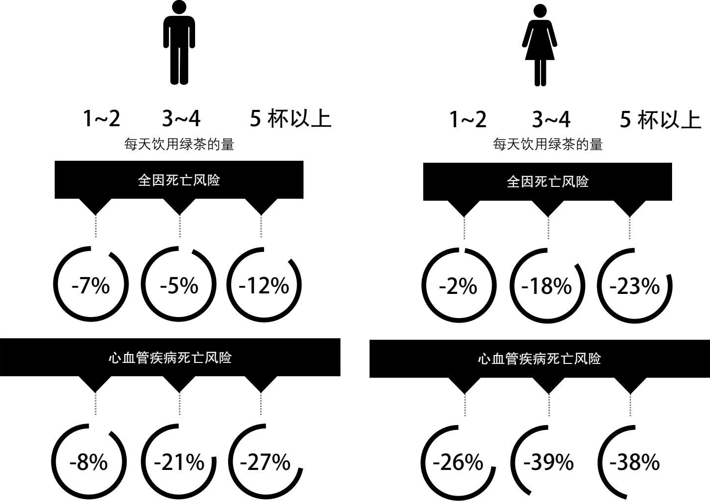
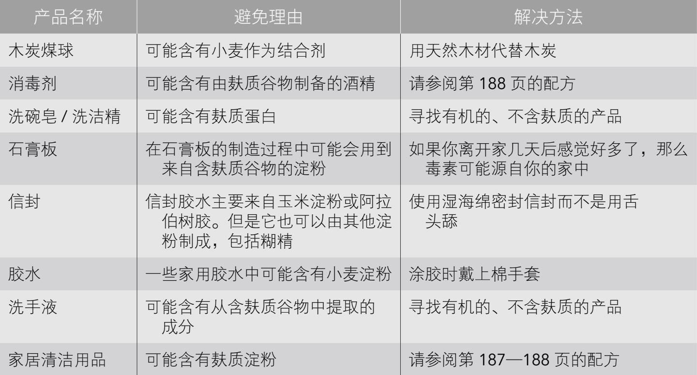
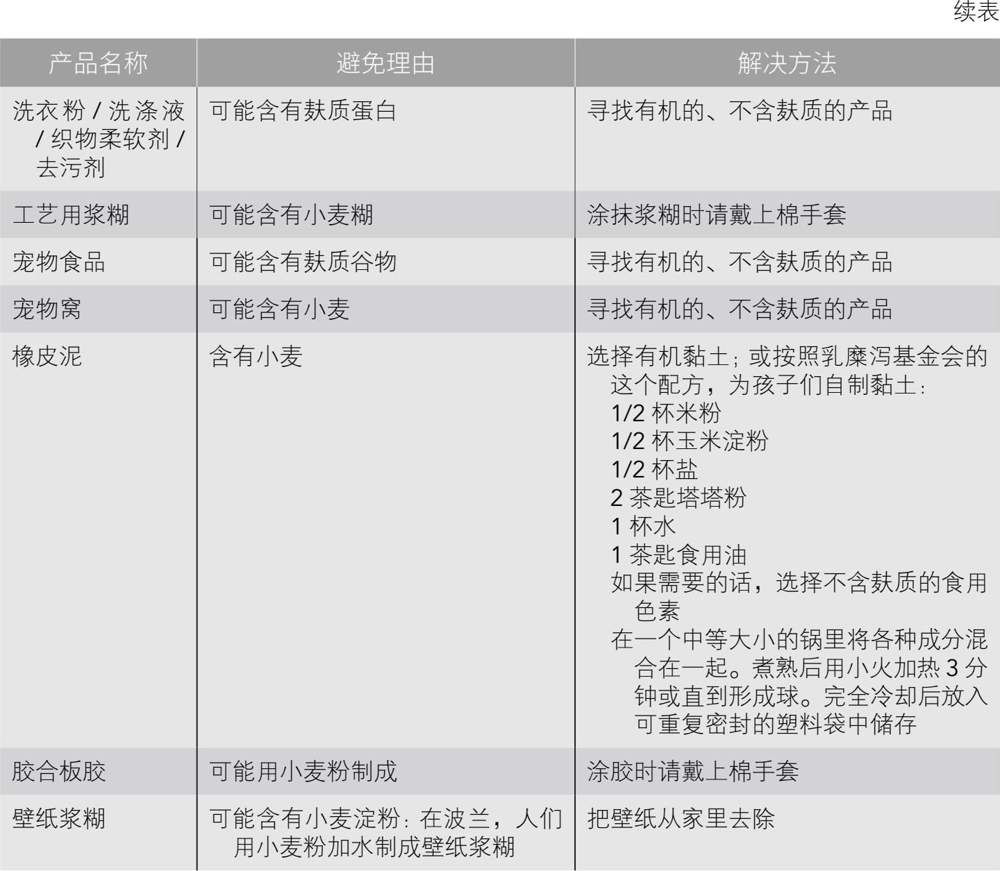

# 第八章 支持你的转变

<h2><b>第</b><b>八</b><b>章</b></h2>

<h2><b>支</b><b>持</b><b>你</b><b>的</b><b>转</b><b>变</b></h2>

转变方案的最终目标是减少全身炎症，尤其是肠道炎症，这将为治疗肠道通透性增加（肠漏）奠定基础。我们都知道，肠漏正是自身免疫性疾病发展的“门户”。发表在《自然临床实践：胃肠病学和肝病学》（<i>N</i><i>a</i><i>t</i><i>u</i><i>r</i><i>e</i><i> </i><i>C</i><i>l</i><i>i</i><i>n</i><i>i</i><i>c</i><i>a</i><i>l</i><i> </i><i>P</i><i>r</i><i>a</i><i>c</i><i>t</i><i>i</i><i>c</i><i>e</i><i>s</i><i>:</i><i> </i><i>G</i><i>a</i><i>s</i><i>t</i><i>r</i><i>o</i><i>e</i><i>n</i><i>t</i><i>e</i><i>r</i><i>o</i><i>l</i><i>o</i><i>g</i><i>y</i><i> </i><i>a</i><i>n</i><i>d</i><i> </i><i>H</i><i>e</i><i>p</i><i>a</i><i>t</i><i>o</i><i>l</i><i>o</i><i>g</i><i>y</i>）期刊上的一项研究指出，通过重建肠道屏障功能来阻止基因和环境诱发因素之间的相互作用，自身免疫过程就会被阻止
	<a id="noteref-15-203" href="#footnote-15-203">[1]</a>。”有毒细菌和大的食物分子进入体内是导致免疫保护反应并引起系统性炎症的原因，通过治疗肠漏，你可以尽可能地减少这种情况的发生。

	
除了选择适宜的食物之外，我们还有很多其他可以做的事情来帮助肠道进行修复，以提升整体健康水平。通过集中精力修复肠道环境，同时避免接触激活免疫系统的有毒物质（不要往火上浇油），我们将开始逆转疾病。肠道黏膜上皮细胞是体内增长速度最快的细胞，我们只需要3周的时间就能看到改善：一旦肠道开始愈合，你就开始恢复健康。最重要的是，这些都是改善你健康状况的最简单的方法。

	
你已经知道该吃什么了，下一步就是彻底扑灭炎症之火。即使你停止往火上浇汽油，你仍然有燃烧着的火需要熄灭。在本章中要讨论的营养物质将有助于减少炎症反应，然后通过支持肠道细胞再生来治愈肠道。

	
恰当的营养物质可以帮助你降低患自身免疫性疾病的风险，无论你处于疾病发展谱的哪个位置。尽管很多人体内的炎症之火正在熊熊燃烧，但他们都认为自己“感觉很好”，这是因为病症还没有破坏足够的组织来产生明显的症状。然而，一旦开始肠道治疗，即使那些目前没有明显症状的人也会感觉好很多。

	
我相信你肯定听说过，我们应该用抗氧化剂等营养物质来“增强”免疫系统——这并不完全正确。事实上，免疫平衡比免疫增强更为重要。如果你已经患有自身免疫性疾病，你不会想增强或抑制免疫系统，而是想要平衡免疫功能，这样免疫系统就可以保护你而不是产生过度的免疫反应。

	
当我们的免疫系统检测到威胁并激活炎症反应时，它会产生许多不同的化学子弹，这些化学子弹就是细胞因子，可以针对威胁发射火力。但问题是，临床上常用的抗炎药通常针对的是某种特定的细胞因子，如核因子-κB、肿瘤坏死因子等，这些药物完全阻止了细胞因子的产生。当这种情况发生时，我们就不再拥有足够的细胞因子来保护我们应对其他可能出现的威胁。相对应地，免疫系统的增援部队将通过其他的细胞因子产生更多的炎症反应。这就意味着，虽然药物会减少特定细胞因子产生的炎症反应，但过度的全身性炎症反应仍然可能（而且经常）发生。

	
如果你患有严重的疼痛或体内存在危及生命的自身免疫级联反应，那么治疗自身免疫性疾病的标准药物方法是完全抑制免疫系统。虽然这些处方药有特定的作用时间和作用位点，但长期使用这些药物往往会完全抑制免疫系统，最终导致免疫系统功能欠佳，从而无法保护你免受其他诱发因素或刺激物的影响。更糟糕的是，这些药物可能会对身体其他组织产生明显的不良反应。这就是那些短期有效的强力药物可能会有长期不良反应（比如癌症或者严重的细菌和真菌感染）的原因之一。我的建议一直都是：“继续使用医生之前开的药，因为它们有效。与此同时，看看我们是否能减少这些药物的剂量。”

	
<b>药</b><b>物</b><b>可</b><b>以</b><b>促</b><b>进</b><b>自</b><b>身</b><b>免</b><b>疫</b><b>性</b><b>疾</b><b>病</b><b>的</b><b>发</b><b>展</b>

	
一些药物实际上可以加速麸质敏感和自身免疫性疾病的发展。最严重的一类是抑制胃酸的药物，例如，非处方抑酸药（如氢氧化铝）、H2受体拮抗剂（包括雷尼替丁、西咪替丁和法莫替丁）、质子泵抑制剂（如奥美拉唑、兰索拉唑、埃索美拉唑、雷贝拉唑）以及长效的胃酸抑制剂，所有这些药物都能提高我们胃内的pH并减少胃酸，这使得出现食物不耐受和食物敏感的可能性增加了100倍以上。

	
我们胃中产生的胃酸是一种重要的消化酶，它可以分解食物并激活肠道内的许多信号。我们体内的胃酸储存在胃里。如果你把胃酸放在木桌上，它就会开始分解木头。但是同样的酸可以在你的胃里一整天都不会引起任何问题。当我们刺激胃中的黏液细胞时（如食物暴露、对咖啡敏感的人喝咖啡、饮用的汽水中含磷酸等），我们就会造成胃损伤（比如胃溃疡、胃灼热）。我们可以通过消除引起胃部炎症以及干扰黏液细胞产生及其功能的诱发因素，使得胃的功能得到平衡，而不是利用胃酸抑制剂进行治疗。

	
当我们抑制体内产生消化酶时，再加上肠道通透性增加导致的吸收不良，我们就不能从食物中获得足够多的维生素和矿物质。当医生向你推荐抑酸药、质子泵抑制剂或H2受体拮抗剂时，应该和医生好好聊一聊这个话题。

	
我们想要创造一个平衡的免疫系统，从而保持身体健康。但想要平衡过度活跃或功能欠佳的免疫系统，不能只靠吃药。我们必须避免导致这种失衡出现的诱发因素（如食物敏感、环境毒素等），这可能需要几个月的时间。但是，一旦你不断地通过每一个细节来平衡免疫系统，你的症状就会减少，你的活力就会恢复，你的睡眠就会改善，你也就能更好地应对日常生活中的挑战和压力。

	
<b>抗</b><b>炎</b><b>且</b><b>能</b><b>使</b><b>肠</b><b>道</b><b>痊</b><b>愈</b><b>的</b><b>营</b><b>养</b><b>物</b><b>质</b>

	
炎症的发展与一个高度协调的基因表达程序的激活有关，该程序包含1100多个基因。请记住，炎症对你没有坏处，过度的炎症才对你有害。为了应对过度的炎症反应，你需要关闭尽可能多的炎症激活因子，并开启尽可能多的抗炎激活因子，以调节你的炎症基因表达。这就是表观遗传学世界——我们在环境中的行为会影响我们的基因表达。

	
调节基因表达最安全的方法包括两方面。首先，也是最重要的，吃最优质的食物，最好是有机食品。其次，在饮食中适当补充营养素。维生素和矿物质等天然抗炎物质远不及抗炎药强大或危险。

	
天然抗炎物质以维生素、抗氧化剂、多酚和营养素的形式存在，例如绿茶中的表儿茶素没食子酸酯（epigallocatechin gallate，EGCG）、番茄中的番茄红素、姜黄中的姜黄素或是维生素C，这些天然抗炎物质通过抑制炎症基因或是激活抗炎基因的方式，激活与炎症级联反应相关的1100个基因中的一部分。天然抗炎物质并没有像药物那样完全阻断基因的表达。尽管它们的作用弱得多，但它们在有效应对过度炎症反应中起着非常重要的作用。

	
消除身体慢性炎症的最佳途径是采取多效转换方法（使用多种弱的天然抗炎物质）。通过许多安全的、天然的抗炎物质来激活多个基因并得到多种微弱的好处，你不仅可以减少过多的炎症，还可以开始愈合过程。你不可能只使用一种天然抗炎物质，就能像药物那样扑灭大火。

绿茶已经被证明可以通过调节基因来治疗肠道通透性增加
	<a id="noteref-15-25" href="#footnote-15-25">[2]</a>，保护肠道免受一种强大药物的伤害，这种药物可以抑制TNF（一种强大的抗炎物质）的产生
	<a id="noteref-15-68" href="#footnote-15-68">[3]</a>。绿茶还可以保护血管弹性
	<a id="noteref-15-81" href="#footnote-15-81">[4]</a>，保护我们的思维能力
	<a id="noteref-15-92" href="#footnote-15-92">[5]</a>，并通过保护肝脏来稳定血糖水平
	<a id="noteref-15-108" href="#footnote-15-108">[6]</a>。我可以一直讲下去。绿茶是一种有益的食物，因为它可以调节许多基因来产生抗炎作用。

2006年，发表在《美国医学协会杂志》的一篇文章指出，研究人员观察了饮用绿茶对心血管疾病死亡风险和全因死亡风险的影响（图8-1）。11年来，他们追踪了40530名年龄在40～79岁没有脑卒中、冠心病或癌症病史的成人。就全因死亡（死于癌症、心脏病、脑部疾病等）风险而言，如果男性每天喝1～2杯绿茶风险会降低7%，每天喝3～4杯风险会降低5%，每天喝5杯或5杯以上风险会降低12%；对于女性来说，每天喝1～2杯绿茶风险会降低2%，每天喝3～4杯风险会降低18%，每天喝5杯以上风险会降低23%。当研究人员专门关注死于心血管疾病的人群时，如果男性每天喝1～2杯绿茶，风险降低了8%，每天喝3～4杯风险减低了21%，每天喝5杯以上风险降低了27%；对于女性来说，每天喝1～2杯绿茶风险降低了26%，每天喝3～4杯风险降低了39%，每天喝5杯以上风险降低了38%
	<a id="noteref-15-376" href="#footnote-15-376">[7]</a>。这些都是引人注目的数字，但它们到底意味着什么呢？绿茶就是我们所有健康问题的答案吗？虽然我们还不确定，但我们确实知道它激活了许多基因以达到抗炎的效果。自从2006年读到这份研究报告以来，我一直在尝试每天喝一点绿茶。

	
通过多效转换方法来解决肠道通透性增加的问题将为你赢得比赛。还记得“复合饮食”吗？多效性是复合饮食的基础。饮食中的任何一种单独成分都不能将心脏病的风险降低75%，但所有成分（蔬菜、黑巧克力、杏仁、大蒜、鱼和红葡萄酒）共同产生的协同作用累积起来就会产生这种效果。

美国人每年摄入的营养素超过了600亿份，并且相关死亡率为零，这是一个出色的安全记录。最新的数据来自美国国家毒物数据系统的年度报告，该报告追踪了美国57个毒物中心的数据，显示维生素和矿物质营养素没有导致死亡发生
	<a id="noteref-15-104" href="#footnote-15-104">[8]</a>。

	

	
图8-1 绿茶对心血管疾病死亡风险和全因死亡风险的影响

	
有些反对者认为，营养是一个不受监管的领域，一些产品根本不包含标签上所标注的成分或达不到标签上所标注的剂量。这些控诉是有道理的。各行各业都有榨取利润的骗子，所以你要通过值得信赖的途径来获取营养素。你的医生可能知道哪些品牌质量最高、最安全。但在你问医生这个问题之前，你必须明确这个医生是适合你的。

	
先问一下你的医生学习过多少营养学课程，或者他们上一次参加营养学研讨会是什么时候。当我们在咨询营养素品牌的相关问题时，如果你询问的人没有参加过任何营养学课程，那这就是个尴尬的问题，他也没有资格在这方面给予你建议。几乎所有的医生都有自己的专业方向，这个专业是他们所热衷的领域，他们对这个领域非常了解。但如果他们对营养学没有热情，那么他们的医术也会一般。

例如，2010年发表在《学术医学》（<i>A</i><i>c</i><i>a</i><i>d</i><i>e</i><i>m</i><i>i</i><i>c</i><i> </i><i>M</i><i>e</i><i>d</i><i>i</i><i>c</i><i>i</i><i>n</i><i>e</i>）杂志上的一篇文章指出，在美国105所医学院校中，只有28所（27%）达到了美国国家科学院所规定的最低25小时的营养教育要求。而在2004年，104所学校中有40所（38%）做到了
	<a id="noteref-15-125" href="#footnote-15-125">[9]</a>。这告诉我们什么？首先，只有1/4的医生达到了美国国家科学院所规定的最低25小时的营养教育要求；其次，这种趋势正在朝着错误的方向发展。

	
在阅读了数百份研究报告后，我发现了22种不同的抗炎营养素，它们的协同作用可以减少炎症反应，修复肠道黏膜。

	
“麸质敏感支持胶囊”（Gluten Sensitivity Support Packs）是一个强大的组合，一共6粒药丸，包含22种不同的抗炎营养素。该胶囊可以促进健康组织的产生，而且它不含任何小麦或麸质。你可以在我的网站（theDr.com）上找到这种胶囊。

	
对于目前正在服用处方药的患者，也可以使用麸质敏感支持胶囊。我建议服用麸质敏感支持胶囊至少6个月，然后通过血液测试来确认异常的生物标志物是否恢复正常。

尽管通过转变方案，你很有可能马上就会感觉好一些，但是抗体产生的停止、炎症级联反应的平息、抗炎基因的激活以及愈合基因的激活是需要一些时间的。如果没有重新进行实验室检测，当你感觉症状明显减轻时，你就很容易认为自己“非常健康”。请记住，身体痊愈需要时间，所以至少要经过6个月～1年的时间，你才能在实验室检测结果中看到明显的改善
	<a id="noteref-15-160" href="#footnote-15-160">[10]</a>。

	
<b>关</b><b>注</b><b>关</b><b>键</b><b>性</b><b>营</b><b>养</b><b>素</b>

	
6种关键性营养素对逆转肠道通透性增加至关重要。在麸质敏感支持胶囊中包含了以下3种关键性营养素（维生素D、谷氨酰胺和鱼油）。其余3种（益生菌、肌肽锌和初乳）你也应该考虑额外补充。

	
<b>1</b><b>.</b><b>维</b><b>生</b><b>素</b><b>D</b>。维生素D对治疗肠道通透性增加有特殊的作用，它能监视肠道内“紧密连接”的功能。紧密连接就是肠道细胞之间的空隙，当你的肠道通透性增加时，大而未消化的分子就能通过紧密连接进入血液。连蛋白将我们肠道黏膜的上皮细胞紧紧地固定在一起，就像鞋带一样，大部分时间都被绑得紧紧的。通常的机制是，鞋带稍微松一点，让小分子从细胞之间滑入，在进入血液之前通过我们的免疫系统进行筛选和清除。这就是我们从食物中吸收维生素和矿物质的方法。然而，当鞋带完全解开后，较大的食物颗粒，也就是大分子，会从紧密连接处进入血液中，这被称为致病性肠道通透性增加。大分子不应该进入血液，一旦进入就会激活免疫系统，然后你就会产生针对这种大分子的抗体。如果是鸡肉中的大分子，你可能会对鸡肉过敏。如果是番茄的大分子，你可能会对番茄过敏。这就是为什么有些人做完一个完整的IgG检测板后，发现自己对20多种食物过敏，然后说：“哦，不，我对我吃的所有东西都过敏！”你当然会如此——你的免疫系统正在做它应该做的来保护你。一旦你逆转了肠道通透性增加，再做一次测试，你会发现你所敏感的食物会少很多。

维生素D在鞋带的系紧和解开过程中起着至关重要的作用。如果没有足够的维生素D，鞋带就不能绑得很紧，肠道通透性就会增加。这是为什么许多自身免疫性疾病更容易发生在远离赤道的国家——这些地区的人接触太阳的机会比较少，因此他们体内缺乏维生素D。我们也知道，在很多情况下维生素D可以阻止有害抗体的产生，而这些抗体往往与免疫介导的疾病（包括皮炎和哮喘）有关
	<a id="noteref-15-171" href="#footnote-15-171">[11]</a>。

	
<b>2</b><b>.</b><b>谷</b><b>氨</b><b>酰</b><b>胺</b>。谷氨酰胺是肠道黏膜上皮细胞（体内生长最快的细胞）的主要代谢燃料。此外，谷氨酰胺可以开启一些基因，让受损的肠道得以修复。谷氨酰胺已被成功地用于艾滋病患者和癌症患者，帮助他们的肠道更好地吸收营养，从而增加所需的体重。

	
然而，如果你有酵母菌感染史，一定要控制服用谷氨酰胺的数量，因为这种氨基酸可能会促进酵母菌的生长。谷氨酰胺也是免疫细胞的原料，免疫细胞可以在我们的肠道中产生健康的炎症。但是如果你已经存在炎症了，谷氨酰胺可能会增加炎症（很少发生，但是有这种可能）。这就是为什么我总是告诉我的患者：“少数人会对麸质敏感支持胶囊过敏，如果你服用麸质敏感支持胶囊期间觉得不舒服，请把其中的谷氨酰胺挑出来，同时继续服用其他药物来开启基因产生抗炎作用，几周后，再重新把谷氨酰胺加回去。”

	
<b>3</b><b>.</b><b>鱼</b><b>油</b>。鱼油非常有用，因为鱼油中含有ω-3脂肪酸，可以开启或关闭许多基因，从而产生抗炎作用。众所周知，因为鱼油可以调节身体许多不同部位的炎症基因，所以它还可以降低患心血管疾病（主要是脑卒中和急性心肌梗死）的风险，降低高血压，增强大脑功能。

	
鱼油中的主要成分是EPA和DHA。EPA具有抗炎特性，它能够开启肠道内的抗炎基因，关闭其他炎症基因。DHA对胎儿的大脑发育和2岁以内的视网膜发育起着重要作用。大约35%的脑细胞壁是由ω-3脂肪酸组成的。如果体内没有足够的这些健康脂肪来生成强壮的脑细胞，身体将会使用任何它能找到的原材料作为脂肪资源。如果你吃炸薯条或油炸食品，身体会将它们作为生成脑细胞的原材料。这些脂肪更厚、更黏稠，跨膜通道运输将更有难度。

	
举个例子，假如现在你在医生的诊室，你要提供尿的样本，你会去洗手间，把他们给你的容器装满，然后把容器放在墙上的转盘上。站在墙的另一边慵懒的护士会旋转转盘，这样你的样本会进入另一个房间。这就是你的脑细胞之间交流的方式——一个脑细胞产生的化学信使直接穿过脑细胞的细胞壁进入相邻的脑细胞。但是如果你的饮食中含有不健康的脂肪，你的转盘就会生锈，不能正常旋转，干扰了从一个脑细胞到另一个脑细胞之间的信息传递。所以当你补充富含ω-3的鱼油时，你可以使孩子的智商提高3%以上（这是相当可观的）。因为你的大脑会把细胞壁里的不健康脂肪排出，代之以健康脂肪，你的“懒护士”就会开始更好地工作。

ω-3脂肪酸只能通过饮食获得，因为人体不能产生。鱼类中富含ω-3脂肪酸，但由于很多鱼吃起来不安全，建议使用高质量的鱼油营养素（经过重金属和化学污染物的测试，结果提示是安全的）。高达3克的成人治疗剂量已被证明是非常有效和安全的
	<a id="noteref-15-112" href="#footnote-15-112">[12]</a>。我通常为我的患者开具以下处方。

	
治疗剂量：

	
13.5～33.9千克=每天至少1克（总ω-3脂肪酸）

	
34～56千克=每天至少2克（总ω-3脂肪酸）

	
56千克以上=每天至少3克（总ω-3脂肪酸）

<b>4</b><b>.</b><b>益</b><b>生</b><b>菌</b>。益生菌营养素就像发酵食物一样，通过引入有益菌来支持肠道微生物群落。微生物群落几乎对我们身体所有的功能都有直接影响，例如，将T4转化为T3，指导神经递质的产生，降低心血管危险因素（包括体重指数、腰围、血压和甘油三脂水平）
	<a id="noteref-15-115" href="#footnote-15-115">[13]</a>。随着对微生物的进一步研究，我相信会发现更好的益生菌服用方案。

	
30年前，我们知道让患者服用益生菌很重要，但是支持我们的科学数据是有限的。那时我们能给出的最好建议是：服用一些益生菌，越多越好。现如今，我们知道在微生物群落中有成千上万种有益菌，它们可以与益生菌产生积极的反应，但仍有许多尚未解决的问题，例如，大量使用1～2种益生菌和适量使用一些不同种类的益生菌，这两种方案哪个更好？从目前来看，适度使用一些不同种类的益生菌似乎比大剂量地使用1～2种益生菌更合理。

	
这就是我强烈建议你从全发酵食品中获取益生菌而不是从营养素中获取的原因之一。尽量尝试一些不同的发酵蔬菜，因为每一种蔬菜中都含有不同的有益菌。我还建议在食用发酵蔬菜的同时服用复合益生菌胶囊。这种胶囊中含有乳酸杆菌、双歧杆菌（它们是最常见的）、枯草芽孢杆菌（它会使双歧杆菌的数量增加5倍以上）和布拉酵母菌。

<b>5</b><b>.</b><b>肌</b><b>肽</b><b>锌</b>。锌有18种不同的类型，每种都有其特定的功能。肌肽锌一直被认为具有治疗胃肠道疾病的作用。众所周知，它能使新生细胞的增殖和迁移频率提高75%，从而治愈胃部的损伤，因此被用于治疗胃溃疡。最近的研究表明，在修复小肠损伤方面，它可以使新生细胞的增殖和迁移频率提高50%
	<a id="noteref-15-135" href="#footnote-15-135">[14]</a>。这一机制对治疗肠漏至关重要，因为肠漏引起的大部分损害发生在小肠。

肌肽锌还有助于逆转服用非甾体类抗炎药（如阿司匹林和布洛芬）引起的损害。1998年，一项具有里程碑意义的研究显示，每年至少有16000人死于非甾体类抗炎药，每年至少有100000人因服用非甾体类抗炎药而住院治疗，这震惊了世界
	<a id="noteref-15-111" href="#footnote-15-111">[15]</a>。众所周知，非甾体类抗炎药会增加肠道通透性，导致肠道黏膜发生糜烂、溃疡、出血，甚至引发肠穿孔和肠梗阻
	<a id="noteref-15-162" href="#footnote-15-162">[16]</a>。具有讽刺意味的是，这些被用来抗炎的药物竟然会导致肠道炎症损伤。由非甾体类抗炎药引起的死亡中有1/3与每日服用低剂量阿司匹林有关
	<a id="noteref-15-227" href="#footnote-15-227">[17]</a>。即使每天服用10毫克的阿司匹林也会导致胃溃疡
	<a id="noteref-15-251" href="#footnote-15-251">[18]</a>（而婴儿服用阿司匹林的剂量通常是81毫克）。

研究表明，44%的患者摄入的非甾体类抗炎药超过了推荐剂量
	<a id="noteref-15-28" href="#footnote-15-28">[19]</a>。如果你选择使用非甾体类抗炎药如阿司匹林，那么应同时服用一些肠道营养保护剂。如果我的患者正在服用非甾体类抗炎药，我建议他们每天服用1粒麸质敏感支持胶囊作为防护，如果体重在56千克以下，每天再同时服用1片肌肽锌（75毫克/片），如果体重在56千克以上，每天2次，每次1片。

	
<b>6</b><b>.</b><b>初</b><b>乳</b>。在分娩后第3～5天的母乳并不是乳汁，而是初乳。初乳含有新生儿预防疾病所需的抗体。与其相比，初乳能更好地调节基因，这也是全面改善肠道健康的最佳方法。初乳中还含有生长因子和激素，旨在关闭新生儿肠道内的紧密连接（在子宫中它们是全通透的）。在成人中，初乳可以启动相同的基因来修复肠道黏膜的损伤，恢复肠道完整性，关闭紧密连接，并调控肠道炎症基因。此外，初乳还能促进有益菌在肠道的重新定植。

	
在初乳中，大约1/4的固体是抗体（IgG、IgE、IgA、IgD），初乳中的IgG可以立即保护婴儿免受细菌、病毒、霉菌、真菌和寄生虫的侵害。对于成人来说，初乳同样可以保护他们免受这些入侵者的侵袭。初乳还可以激活修复微绒毛的基因，所以如果你是一名乳糜泻患者，初乳就可以使你被磨损的绒毛重新生长。安德鲁·基奇博士是世界著名的初乳专家，他在我的麸质峰会上说：“保健食品商店的货架上有很多都是可以帮助修复受损肠道的独立演奏者，但只有初乳能演奏整个交响曲。”

	
我们可以通过补充牛初乳来帮助治愈肠道。牛初乳和人初乳的结构完全相同。事实上，在所有哺乳动物中，初乳中起到免疫作用的部分——那些肽——是完全相同的。然而，市场上的初乳质量参差不齐。你可以寻找草饲牛的牛初乳，这些牛没有服用抗生素或牛生长激素。对于大多数成人来说，推荐剂量是每天1勺初乳粉。

	
尽管初乳可以被认为是一种乳制品，但其中的致敏蛋白含量很低，并且酪蛋白含量也极低。如果你对乳制品过敏，在服用这种营养素之前请先咨询你的医生。总之，你可以自己决定是否尝试初乳。

	
每当我遇见对乳制品过敏的患者时，我就会建议他服用初乳至少2个月，因为与其他营养素或药物相比，初乳能开启更多的基因来减少炎症、治愈肠道。与此同时，不要进食其他任何乳制品。如果你出现胀气、腹胀、腹痛等症状，那么停止食用初乳。在临床上，我发现在10个对乳制品敏感的患者中，有7～8个患者会从这个方案中获得益处。

	
<b>阅</b><b>读</b><b>所</b><b>有</b><b>营</b><b>养</b><b>素</b><b>和</b><b>药</b><b>物</b><b>的</b><b>标</b><b>签</b><b>：</b><b>避</b><b>免</b><b>这</b><b>些</b><b>成</b><b>分</b>

	
在营养素甚至是药物中，都可能存在少量的、隐藏的麸质、乳制品或糖。目前的标签规定并不要求必须在维生素或药物中标注含有麸质，所以我们应仔细阅读标签，寻找提示麸质污染的线索。营养素和药物通常是无麸质的，但麸质有可能作为黏合剂或其他非活性成分被添加在其中。当一种产品的标签中含有“淀粉”一词时，就需要确认其来源。尤其要注意麦芽糊精，这是一种通常从自玉米中提取的淀粉，但它也可以从小麦、土豆或大米中提取。

	
片剂和胶囊最有可能被麸质污染，因为它们通常含有赋形剂、吸收剂、保护剂、粘结剂、着色剂、润滑剂和膨胀剂等可能含有麸质的添加剂。虽然美国食品和药物管理局认为添加剂是非活性的，且对人类来说是安全的，但它们仍然可能是潜在的污染源。药剂师告诉我们，在第1阶段，有些药物是安全的，有些则不然。甘露醇或木糖醇被认为是安全的。尽管其中一些可能来自小麦，但这些都是糖醇，经过提炼后对大多数人来说都没有问题。药物中可能含有的其他安全添加剂包括二氧化钛、乳糖（除非你对乳糖敏感）、明胶、糊精和硬脂酸镁。

	
最好的办法就是向药剂师寻求帮助。药剂师可以查看药品说明书，告诉你药品里有什么成分，或者他们可以给你提供纸质材料，这样你就可以自己阅读药品的成分了。他们也可以上网查找资料，或教你如何联系药品制造商。

	
但要在营养素中找到隐藏的麸质来源并不容易，因为健康食品店的员工大多没有接受过营养产品的成分和添加剂方面的正式培训，他们可能也无法解答你的问题。如果你很幸运，有医生向你推荐营养素，那么医生就能像药剂师一样回答你的问题。如果他们不能回答有关成分方面的问题，他们也会有渠道找到答案。你可以放心，我所推荐的所有产品都经过了多次审查，非常安全。

	
要把你每一次接触到的营养素或药物都视为一种全新的产品。制药公司经常改变他们的配方，当涉及非活性成分时，仿制药不一定与原研药完全相同。非处方药也是如此。仔细阅读所有标签，避免以下这些成分。

	
·酒精

	
·α-生育酚

	
·α-生育三烯酚

	
·燕麦属

	
·燕麦

	
·大麦

	
·大麦β-葡聚糖

	
·大麦麸皮

	
·大麦草

	
·大麦叶

	
·大麦粉

	
·β-葡聚糖

	
·β-聚糖

	
·β-生育酚

	
·β-生育三烯酚

	
·啤酒酵母

	
·焦糖色素

	
·谷物纤维

	
·舍尼通（黑麦草）

	
·柠檬酸

	
·交联淀粉

	
·D-α-生育酚

	
·D-β-生育酚

	
·δ-生育三烯酚

	
·葡萄糖结合剂

	
·糊精麦芽糖

	
·D-γ-生育酚

	
·γ生育酚

	
·栽培二棱大麦

	
·麦芽糊精

	
·糊精（如果没有明确说明来源，通常是从玉米或马铃薯中提取，这是可以接受的；但有时会从小麦中提取）

	
·膳食纤维

	
·γ生育三烯酚

	
·大麦芽

	
·麦芽糖

	
·混合生育酚

	
·混合生育三烯酚

	
·改性淀粉

	
·燕麦β葡聚糖

	
·燕麦麸

	
·燕麦提取物

	
·燕麦纤维

	
·燕麦草

	
·预胶化改性淀粉

	
·预胶化淀粉

	
·黑麦草

	
·黑麦草花粉提取物

	
·黑麦

	
·羟基乙酸淀粉钠

	
·淀粉

	
·生育酚

	
·生育酚乙酸酯

	
·生育酚琥珀酸酯

	
·小麦

	
·维生素E

	
·麦麸

	
·小麦胚芽提取物

	
·小麦胚芽油

	
·小麦草

	
·小麦蛋白

	
·小麦淀粉

	
·野生燕麦

	
·黄原胶

	
·酵母

	
<b>避</b><b>免</b><b>无</b><b>意</b><b>中</b><b>的</b><b>食</b><b>物</b><b>暴</b><b>露</b>

	
无意中的食物暴露——误食麸质、乳制品、糖或任何你敏感的东西——是一个非常现实的问题，这会阻碍你通过转变方案取得成功。很多人即使在严格遵循无麸质饮食的情况下也会感觉到不舒服，其主要原因就是无意中的食物暴露，而不是作弊吃含麸质食品。我也有许多患者都在努力遵守无麸质饮食，但他们仍在遭受症状的折磨，因为他们进食了麸质，却常常不知道。这就是为什么我在最后一章列出了所有可能含有麸质的成分。然而，我们并不总是可以阅读配料成分表，尤其是当我们在外面吃饭的时候。

接触有毒的麸质（通常来自小麦、黑麦和大麦）会引起肠道通透性增加——这是每个人自身免疫性疾病发展的“门户”。美国人平均每年会吃60千克小麦。现在，我一点小麦也不吃。每吃一口小麦都会使肠道黏膜发生磨损。对有些人来说，磨损较轻，可以很容易治愈。但当磨损严重到了一定程度，它就无法愈合，如果你健康链条中的薄弱环节是你的肠道，你就会患上乳糜泻。这就是为什么乳糜泻患者的家人一开始接受检测时结果为阴性，但如果他们在7年后再次接受检测，他们可能患上了乳糜泻。他们的身体因接触麸质而产生的肠绒毛磨损再也无法愈合。事实是，只有一小部分乳糜泻患者能痊愈。2012年，发表在《美国胃肠病学杂志》上的一篇文章指出，即便是在遵循无麸质饮食12年后，仍有31%的研究对象的症状与最初相同：肠道存在过度炎症反应
	<a id="noteref-15-340" href="#footnote-15-340">[20]</a>。结果表明，只有8%的乳糜泻患者可以通过无麸质饮食痊愈，所以研究人员得出结论：“单靠无麸质饮食可能不足以完全控制某些患者的病情。”

更糟糕的是，患一种自身免疫性疾病会让你更容易患上其他的自身免疫性疾病。《美国胃肠病学杂志》中的另一项研究指出，调查了7600名采用无麸质饮食的乳糜泻患者，其中43%的患者仍然患有持续性的绒毛萎缩，即肠道绒毛磨损。对于这些人来说，发生肠道癌症的总体风险几乎是一般人群的3倍
	<a id="noteref-15-135" href="#footnote-15-135">[21]</a>。

	
对你来说，这可能意味着即使你的头痛消失了，或者经过3周时间，你的消化不良的症状缓解了，但潜在的炎症仍然存在。你可能仍然存在由无意中的食物暴露而引起的肠道通透性增加。因此，你不能认为症状缓解就代表我们计划的成功，并且又回到你原来的生活方式。你必须提高警惕，无麸质饮食是关键，但只是解决方案的一部分。除非你解决引起肠道通透性增加的其他所有原因，否则炎症仍然会存在。这就是为什么在症状消失后，需要通过血液检测来测定炎症的生物标志物，这是证明炎症不再引起肠道通透性增加的唯一方法。

	
为了实现痊愈，你必须保护自己免受隐藏麸质的影响。我们需要给身体补充额外的能量，而据我所知，最有效的方法就是在饮食中添加额外的消化酶。消化酶在胰腺和小肠中产生，可以把食物分解成营养物质，这样我们的身体就能吸收营养物质。你也可以补充额外的帮助消化麸质的消化酶，以更充分地消化无意中进食的麸质。这些酶可以保护你免受8种过敏原（小麦、乳制品、大豆、鸡蛋、坚果、鱼、大麻、豌豆）的伤害。

	
在每餐前都要服用帮助消化麸质的消化酶，以确保胃里没有未消化的麸质，除非你只吃了简单加工的熟食和蔬菜（因为麸质、乳制品或糖类经常被添加到汤、酱汁、调味料等的里面）。

	
虽然市场上有很多麸质消化酶，但我对它们的效果并不满意。多年来，我的一些患者并没有像预期的那样获得额外补充麸质消化酶的益处。研究表明，这些酶在实验室中起作用，但在临床实践中不一定起作用。我开始研究为什么这种方法不是完全有效的。研究人员花了11年的时间来开发一种酶来帮助更彻底、更快速地消化麸质。我们又花了2年的时间进行合作，找出了未知的因素，然后我们被震撼到了。

	
我们意识到，旨在保护我们自身的免疫系统的哨兵，在十二指肠（就是小肠与胃相连的地方）站岗，这个地方有树突状细胞和抗原递呈细胞（哨兵）。如果任何未能消化的蛋白质分子从胃里出来，哨兵就会发出警报，激活我们的防御机制。免疫系统的反应使得在我们吸收维生素和矿物质的地方产生大量的炎症。这就是为什么对食物有不良反应的人会在身体的许多不同部位出现症状——这取决于两件事：你的免疫系统如何反应，以及吸收不良导致了哪些营养缺乏。

	
请记住，一旦免疫系统启动，它就会在3～6个月的时间里处于活跃状态。我们意识到，当未能消化的蛋白质分子从胃里出来的时候警报就会被拉响。因此，在这些食物进入小肠之前，我们需要确保它们被完全消化。我们需要制造一种消化酶，在你吃下的食物从胃转移到小肠之前，将8种主要的食物过敏原在60～90分钟内完全消化掉。这种消化酶被称为E3高级加强型（E3 Advanced Plus），可以在我的网站（theDr.com）上找到。市场上其他的各种麸质消化酶也可能起作用，但它们需要3～4个小时才能消化掉麸质，这仍然会使得未能完全消化的蛋白质分子从胃里出来，从而激活站岗的哨兵，启动整个自身免疫级联反应。

	
E3高级加强型可以支持健康的肠道微生物群落，因为它们含有益生菌。这就为你的小肠创造了一个平衡的环境，这是营养素很难做到的。它们还含有特别挑选的益生菌，具有重新接种细菌和帮助消化麸质的双重效果。

	
你可以通过在日常饮食中加入各种发酵蔬菜和益生菌来达到类似的效果。

	
<b>阻</b><b>止</b><b>肠</b><b>漏</b><b>，</b><b>从</b><b>口</b><b>腔</b><b>做</b><b>起</b>

引起牙龈疾病的主要细菌是牙龈卟啉单胞菌，它会释放一种非常强的毒素，这种毒素会破坏肠道菌群，并引起肠漏。这些细菌会使口腔渗透性轻度增高，让细菌从口腔进入血液。现如今，研究人员正在将这些细菌与许多慢性病联系起来，例如，心脏病、痴呆、糖尿病和不育症。现在，口腔医生会在处理口腔问题前，先给那些存在心脏问题的患者开具抗生素，以防在口腔清洗时患者出现牙龈通透性增高，细菌进入血液。但我们已经知道抗生素本身可以破坏肠道菌群并导致肠道通透性增加
	<a id="noteref-15-215" href="#footnote-15-215">[22]</a>。

为了保持口腔卫生，除了刷牙和用牙线清洁牙齿外，你还可以每天用一点椰子油漱口，哪怕只有30秒。一项为期30天的研究发现，用椰子油漱口7天后，就会发现牙菌斑明显减少。研究人员还指出，此方法可以使牙龈的健康状况得到很大改善。随着研究的继续，这两项指标都在不断改善
	<a id="noteref-15-128" href="#footnote-15-128">[23]</a>。

	
我已经学会和椰子油做朋友。椰子油是一种对人体很有帮助的食用油，在常温下呈现固态。它是许多热带地区国家（包括印度）饮食中的主食，也被用于制作化妆品。椰子油含有中链甘油三酯，经证实具有抗炎和抗菌作用。同时它是一种天然的抗生素，富含益生菌。

	
<b>萨</b><b>曼</b><b>莎</b><b>的</b><b>故</b><b>事</b><b>，</b>

	
<b>第</b><b>五</b><b>部</b><b>分</b>

	
还记得我的患者萨曼莎吗？在服用Glutenza（一种复合营养素品牌）几个月后，她给我写了这封信，让我们来一同分享一下。

	
奥布赖恩医生，谢谢你改变了我的生活！作为加州大学洛杉矶分校医学中心20年来最严重的中枢神经系统狼疮性血管炎的病例，我活了下来。我同时还患有抗磷脂综合征，以及由于各种治疗药物所导致的其他病症。一次又一次接触隐藏的敏感食物使我的治疗过程一波三折。但现在，当我接触到隐藏的麸质、大豆、乳制品或玉米时，我不再会遇到这些挫折，也不会再经历2周的暴露症状；在受到一次攻击后，也不再需要4～6个月的时间来使身体排毒并平衡我的免疫系统！实际上我看到了一个更快速的免疫系统重建过程，并且我知道，你推荐的所有方案都能起作用的秘诀是，我可以避免接触未知的麸质了！

	
现在，我可以旅行，可以享受社交生活，并且仍然走在重建我的免疫系统和胃肠道的路上。感谢你创造了Glutenza！

	
我在浴室里放了一些椰子油，洗澡时会取一点漱口，然后把它吐出来。刚开始的时候，这种味道和口感有点难以适应。但现在我很期待它，因为漱过之后我的嘴里感觉很清新。

	
<b>有</b><b>毒</b><b>食</b><b>品</b><b>的</b><b>暴</b><b>露</b><b>在</b><b>最</b><b>不</b><b>可</b><b>能</b><b>的</b><b>地</b><b>方</b><b>发</b><b>生</b>

	
当我们竭尽全力让自己的身体从里到外保持“清洁（没有过敏的物质）”时，我们也必须检查我们所处的外部环境，做好外部暴露的防护。不幸的是，我们在使用日常用品的时候也会接触到其他隐藏的麸质。它可能在你的洗发水中、洗衣粉中，或任何你吸入的东西中。

麸质在商品中的作用是有科学依据的，并且有很好的记录
	<a id="noteref-15-25" href="#footnote-15-25">[24]</a>。记录中说，一些研究人员认为麸质分子不能穿透皮肤，而且他们认为，含麸质的日常用品，包括清洁剂、洗发水、口红，甚至眼部化妆品，都不能穿透皮肤或头皮，不会构成问题。然而，对一些人来说，麸质确实会造成问题。当我们闻到它们时，这些分子有可能通过呼吸系统进入我们的体内。食物毒素可以通过呼吸途径进入体内已经得到证实。当你使用这些含有麸质的产品时，你会吸入微小的颗粒，它们也可以激活免疫反应
	<a id="noteref-15-215" href="#footnote-15-215">[25]</a>。即使你没有出现症状，你体内的组织也会受到损害。

	
<b>化</b><b>妆</b><b>品</b><b>和</b><b>护</b><b>肤</b><b>品</b>

化妆品中含有的麸质蛋白对一些高度敏感的人来说是一个问题。2013年，在美国胃肠病学学会年度会议上，研究人员介绍了一位28岁的女性患者案例，她通过饮食调节成功地治愈了她的乳糜泻。然而，在使用了一种新的沐浴露后，她的手臂出现了发痒的水疱，并伴有胃胀和腹泻。一旦她停止使用这种沐浴露，她的症状就消失了。在2014年发表的一篇科学论文——《化妆品中的食物过敏原》（<i>F</i><i>o</i><i>o</i><i>d</i><i> </i><i>A</i><i>l</i><i>l</i><i>e</i><i>r</i><i>g</i><i>e</i><i>n</i><i> </i><i>i</i><i>n</i><i> </i><i>C</i><i>o</i><i>s</i><i>m</i><i>e</i><i>t</i><i>i</i><i>c</i><i>s</i>）中，作者对8项不同的研究进行了荟萃分析，共涉及1900多名患有严重小麦过敏症状的患者，但这些患者并没有食用小麦。最后作者发现是含有小麦蛋白的香皂引起了这种反应，一旦患者停止使用这种香皂，他们的症状就消失了
	<a id="noteref-15-307" href="#footnote-15-307">[26]</a>。

最常见的由护肤品引起的小麦过敏症状是荨麻疹。其他报告的小麦过敏症状症状还包括哮喘和特异性皮炎。特异性皮炎是一种慢性炎症性皮肤疾病，其症状包括严重瘙痒、皮肤干燥等。特异性皮炎的发病率在过去30年里急剧上升，特别是在城市地区，这突出了环境暴露（如化妆品）在诱发疾病中的普遍性作用
	<a id="noteref-15-137" href="#footnote-15-137">[27]</a>。

并不是只有小麦才会引起这方面的问题，它只是最常见的一种。例如，防晒霜——对防止晒伤、早期皮肤老化和皮肤癌至关重要——含有超过20种未经美国食品和药物管理局批准使用的化学物质。其中，二苯甲酮和二苯甲酰甲烷是防晒霜中最常见的会引起过敏性和光敏性接触性皮炎的化学物质
	<a id="noteref-15-130" href="#footnote-15-130">[28]</a>。

	
幸运的是，专业制造商已经制造出了一系列有机、无麸质、无乳制品、无糖的美容产品。安玛丽护肤品（annmariegianni.com）就是我的患者们赞不绝口的一家公司。

	
注意化妆品和护肤品中的以下成分，因为其中可能含有麸质。

	
·酒精

	
·异硬脂酰水解小麦蛋白

	
·曲霉菌/酵母菌/大麦种子发酵滤液

	
·氨基肽复合物

	
·异硬脂酰小麦氨基酸

	
·燕麦蒽酰胺

	
·燕麦麸皮

	
·燕麦

	
·燕麦麸皮提取物

	
·燕麦仁油

	
·燕麦粗粉提取物

	
·燕麦蛋白提取物

	
·大麦提取物

	
·大麦脂类

	
·柠檬酸

	
·椰油酰基水解小麦蛋白

	
·环糊精

	
·糊精

	
·单小麦胚油酰MEA磺基琥珀酸酯二钠

	
·麦胚油酰两性基二乙酸二钠

	
·麦胚油酸乙酯

	
·谷物酒精

	
·大麦芽提取物

	
·氢化小麦胚芽油

	
·水解麦芽提取物

	
·水解燕麦蛋白

	
·水解小麦谷蛋白

	
·水解小麦蛋白/PEG-20乙酸酯共聚物

	
·PEG-7乙酸酯

	
·PEG-7磷酸酯共聚物

	
·水解小麦淀粉

	
·羟丙基三甲基氯化铵水解小麦蛋白

	
·羟丙基三甲基氯化铵水解小麦蛋白/甲硅烷氧基硅酸盐

	
·乳酸

	
·月桂基二甲基铵羟丙基水解小麦

	
·燕麦仁粗粉

	
·燕麦仁蛋白

	
·燕麦肽

	
·燕麦淀粉

	
·大麦芽粉

	
·鲸蜡硬脂醇麦麸苷类

	
·椰油基二甲基铵羟丙基水解小麦蛋白

	
·胶态燕麦粉

	
·变性酒精

	
·糊精棕榈酸酯

	
·单小麦胚油酰胺PEG-2磺基琥珀酸酯二钠

	
·乙醇

	
·发酵谷物提取物

	
·栽培二棱大麦提取物

	
·大麦植物鞘氨醇提取物

	
·水解大麦蛋白

	
·水解燕麦粉

	
·水解黑麦植物胎座提取物

	
·水解小麦蛋白羟丙基聚硅氧烷

	
·水解小麦蛋白PG-丙基甲基硅烷二醇

	
·水解小麦蛋白PG-丙基硅烷三醇

	
·水解小麦蛋白/聚二甲基硅氧烷

	
·水解小麦蛋白/聚二甲基硅氧烷

	
·水解小麦蛋白/PVP交联聚合物

	
·羟丙基三甲基氯化铵玉米/小麦/大豆氨基酸类

	
·羟丙基三甲基氯化铵水解小麦淀粉

	
·乳酸杆菌/黑麦细粉发酵产物滤液

	
·月桂基二甲基铵羟丙基水解小麦淀粉

	
·燕麦氨基酸类蛋白

	
·燕麦β-葡聚糖

	
·燕麦麸皮提取物

	
·燕麦纤维

	
·燕麦仁提取物

	
·燕麦仁粗粉

	
·燕麦仁蛋白

	
·燕麦肽

	
·燕麦淀粉

	
·橄榄油酰基水解小麦蛋白

	
·PG-水解小麦蛋白

	
·椰油酰水解小麦蛋白钾

	
·橄榄油酰小麦蛋白钾

	
·棕榈酰水解燕麦蛋白钾

	
·十一碳烯酰基水解小麦蛋白钾

	
·丙基三甲基铵水解小麦蛋白

	
·季铵盐-79水解小麦蛋白

	
·黑麦籽提取物

	
·黑麦提取物

	
·黑麦籽细粉

	
·C8-16异烷基琥珀酰小麦蛋白磺酸钠

	
·椰油酰燕麦氨基酸钠

	
·月桂酰小麦氨基酸钠

	
·十一碳烯酰水解小麦蛋白钠/TEA盐

	
·大豆油基二甲基铵羟丙基水解小麦蛋白

	
·硬脂基二甲基

	
·生育酚

	
·生育酚/小麦多肽

	
·麦芽提取物

	
·燕麦麸皮

	
·燕麦提取物

	
·燕麦粉

	
·燕麦仁细粉

	
·燕麦仁油

	
·燕麦粗粉提取物

	
·燕麦蛋白提取物

	
·燕麦杆提取物

	
·棕榈酰水解小麦蛋白

	
·椰油酰水解燕麦蛋白钾

	
·月桂酰小麦氨基酸钾

	
·橄榄油酰小麦氨基酸钾

	
·棕榈酰水解小麦蛋白钾

	
·醇溶谷蛋白

	
·蛋白水解物

	
·黑麦提取物

	
·黑麦

	
·黑麦籽提取物

	
·黑麦籽提取物

	
·椰油酰水解小麦蛋白钠

	
·月桂酰燕麦氨基酸钠

	
·棕榈酰水解小麦蛋白钠

	
·小麦胚油酰两性基乙酸钠

	
·大豆油酰胺乙基二甲基铵羟丙基水解小麦蛋白

	
·废麦芽粕蜡

	
·硬脂酸羟丙基水解小麦蛋白

	
·硬脂酰羟丙基水解小麦蛋白

	
·醋酸生育酚

	
·三甲基甲硅烷基水解小麦蛋白

	
·PG-丙基甲基硅烷二醇交联聚合物

	
·小麦（Triticum vulgare）麸皮

	
·小麦（Triticum vulgare）麸皮脂质

	
·小麦（Triticum vulgare）胚芽提取物

	
·小麦（Triticum vulgare）叶提取物

	
·小麦（Triticum vulgare）籽提取物

	
·小麦

	
·小麦麸皮提取物

	
·小麦细粉脂质

	
·小麦胚芽油

	
·小麦胚芽细粉

	
·小麦谷蛋白

	
·小麦仁细粉

	
·小麦籽提取物

	
·小麦淀粉

	
·维生素E

	
·小麦麸皮

	
·小麦麸皮脂质

	
·小麦胚芽油脂酰胺丙基苄基二甲基氯化铵

	
·小麦胚芽油酰胺丙基二甲基胺

	
·小麦胚芽油酰胺丙基环氧丙基二甲基氯化铵

	
·小麦胚芽油酰胺丙基胺氧化物

	
·小麦胚芽提取物

	
·小麦胚芽油

	
·小麦胚芽油PEG-8酯类

	
·小麦胚芽粉

	
·小麦谷蛋白

	
·小麦水解物

	
·小麦（Triticum vulgare）

	
·小麦（Triticum vulgare）麸皮提取物

	
·小麦（Triticum vulgare）细粉脂质

	
·小麦（Triticum vulgare）胚芽油

	
·小麦（Triticum vulgare）肽

	
·小麦（Triticum vulgare）籽提取物

	
·小麦麸皮

	
·小麦麸皮脂质

	
·小麦胚芽提取物

	
·小麦胚芽油不皂化物

	
·小麦胚芽蛋白

	
·小麦谷蛋白提取物

	
·小麦蛋白

	
·小麦芽提取物

	
·十一碳烯酰基小麦氨基酸类

	
·小麦氨基酸

	
·小麦麸皮提取物

	
·小麦神经酰胺

	
·小麦胚芽油脂酰胺DEA

	
·小麦胚芽油酰胺丙基甜菜碱

	
·小麦细粉脂质

	
·小麦胚芽油酰胺丙基二甲基胺乳酸盐

	
·小麦胚芽油酰胺丙基乙基二甲基铵甲基硫酸盐

	
·小麦胚芽油酰胺丙基二甲基铵羟丙基

	
·小麦胚芽油甘油酯类

	
·小麦胚芽油/棕榈油氨基丙二醇酯类

	
·小麦胚芽油酸PEG-40丁基辛醇酯类

	
·小麦胚芽蛋白

	
·小麦谷蛋白提取物

	
·小麦肽

	
·小麦蛋白

	
·小麦鞘脂类

	
·黄原胶

	
·小麦蛋白水解物

	
·小麦淀粉

	
·酵母提取物

	
<b>日</b><b>常</b><b>用</b><b>品</b>

	
由于直接的炎症反应或间接的隐藏成分（如麸质），日常用品可能会诱发肠道通透性增加，并引起炎症。

	
症状可能明显，也可能不明显。对少数人来说，当他们接触到某种特定的产品或化学品时，就会发生较重的炎症反应。然而，对大多数人来说，炎症反应较轻，症状可能只是能量不足或者反复发作的关节疼痛。

	
解决这方面的问题面临的一个困难是，没有政府的监督。例如，美国环境保护署负责管理洗衣粉的标签标注，因此洗衣粉并不需要遵守美国食品和药物管理局规定的标签要求。美国环境保护署担心的是洗衣粉是否“环保”，而不是其中是否含有麸质，因此它不要求在日常用品的标签上列出所有的成分。

	
对于我们这些需要避免麸质或某些特定化学物质的人来说，买东西时要小心了，要在产品标签中寻找我们前面提到的成分列表。如果标签上面的成分列表中没有包含前面提到的那些成分，或者没有标签，但你认为你对该日常用品有反应，请立即停止使用，看看你的症状是否缓解。可能含有麸质的日常用品清单见表8-1。

	
表8-1 可能含有麸质的日常用品清单

	

	

	
一些制造商通过使用不释放有害气体或不含有麸质的天然成分来生产无毒清洁剂。我们也可以自己动手做，操作简单，成本也不贵。唯一的缺点是，我们通常需要做更多的体力活。

	
以下是我最喜欢的一些配方。

	
<b>清</b><b>洁</b><b>剂</b><b>—</b><b>—</b><b>在</b><b>喷</b><b>雾</b><b>瓶</b><b>中</b><b>混</b><b>合</b><b>并</b><b>使</b><b>用</b><b>：</b>

	
1杯水

	
1/4茶匙有机的、不含麸质的液体洗碗皂

	
1汤匙小苏打

	
1/2茶匙硼砂

	
<b>洗</b><b>涤</b><b>粉</b><b>—</b><b>—</b><b>在</b><b>一</b><b>个</b><b>带</b><b>有</b><b>多</b><b>孔</b><b>盖</b><b>的</b><b>罐</b><b>子</b><b>里</b><b>混</b><b>合</b><b>并</b><b>使</b><b>用</b><b>：</b>

	
1杯小苏打

	
10滴迷迭香精油

	
<b>消</b><b>毒</b><b>剂</b><b>—</b><b>—</b><b>在</b><b>喷</b><b>雾</b><b>瓶</b><b>中</b><b>混</b><b>合</b><b>并</b><b>使</b><b>用</b><b>：</b>

	
1杯水

	
2汤匙卡斯提尔香皂

	
1茶匙茶树油

	
8滴桉树精油

	
<b>玻</b><b>璃</b><b>清</b><b>洁</b><b>剂</b><b>—</b><b>—</b><b>在</b><b>一</b><b>个</b><b>喷</b><b>雾</b><b>瓶</b><b>中</b><b>混</b><b>合</b><b>并</b><b>使</b><b>用</b><b>：</b>

	
1杯水

	
1杯醋

	
10滴柠檬精油

	
<b>瓷</b><b>器</b><b>光</b><b>泽</b><b>剂</b><b>—</b><b>—</b><b>在</b><b>一</b><b>个</b><b>小</b><b>碗</b><b>里</b><b>混</b><b>合</b><b>并</b><b>使</b><b>用</b><b>：</b>

	
2汤匙塔塔粉

	
1/2杯过氧化氢

	
<b>木</b><b>地</b><b>板</b><b>清</b><b>洁</b><b>剂</b><b>—</b><b>—</b><b>在</b><b>一</b><b>个</b><b>大</b><b>桶</b><b>中</b><b>混</b><b>合</b><b>并</b><b>使</b><b>用</b><b>：</b>

	
3汤匙卡斯提尔香皂

	
1/2杯醋

	
1/2杯红茶

	
7½升水

	
<b>木</b><b>橱</b><b>柜</b><b>清</b><b>洁</b><b>剂</b><b>—</b><b>—</b><b>在</b><b>一</b><b>个</b><b>喷</b><b>射</b><b>瓶</b><b>中</b><b>混</b><b>合</b><b>使</b><b>用</b><b>：</b>

	
2杯水

	
2汤匙醋

	
1汤匙柠檬油

	
<b><i>接</i></b><b><i>下</i></b><b><i>来</i></b><b><i>的</i></b><b><i>内</i></b><b><i>容</i></b>

	
在第2阶段，我们将探讨除麸质、乳制品、糖类（这些都是可以轻易从饮食中去除的）之外的一些最常见的食物问题。当你对麸质的反应已经长达几年甚至几十年时，它会对肠道造成相当大的损害，并引发肠道对其他食物的反应。即使你在第1阶段之后感觉很好，我还是建议你试试第2阶段。你对自己的身体了解得越多，你的身体就会越好。

<aside id="footnote-15-203"><ol><li id="footnote-15-203"><a href="#noteref-15-203">[1]</a>A. Fasanoa and T. Shea-Donohue, “Mechanisms of Disease: The Role of Intestinal Barrier Function in the Pathogenesis of Gastrointestinal Autoimmune Diseases,” Nature Clinical Practices: Gastroenterology and Hepatology 2, no. 9（Sep 2005）：416–22.</li></ol></aside>
	

<aside id="footnote-15-25"><ol><li id="footnote-15-25"><a href="#noteref-15-25">[2]</a>J. L. Watson et al., “Green Tea Polyphenol（-）-Epigallocatechin Gallate Blocks Epithelial Barrier Dysfunction Provoked by IFN-Gamma but Not by IL-4,” American Journal of Physiology: Gastrointestinal and Liver Physiology 287, no. 5（Nov 2004）：G954–61.</li></ol></aside>

<aside id="footnote-15-68"><ol><li id="footnote-15-68"><a href="#noteref-15-68">[3]</a>S. D. Hsu et al., “Green Tea Polyphenols Reduce Autoimmune Symptoms in a Murine Model for Human Sjogren's Syndrome and Protect Human Salivary Acinar Cells from TNF-Alpha-Induced Cytotoxicity,” Autoimmunity 40, no. 2（Mar 2007）：138–47.</li></ol></aside>

<aside id="footnote-15-81"><ol><li id="footnote-15-81"><a href="#noteref-15-81">[4]</a>Jeong-a Kim et al., “Epigallocatechin Gallate, a Green Tea Polyphenol, Mediates NO-Dependent Vasodilation Using Signaling Pathways in Vascular Endothelium Requiring Reactive Oxygen Species and Fyn,” Journal of Biological Chemistry 282, no. 18（May 4, 2007）：13736–45.</li></ol></aside>

<aside id="footnote-15-92"><ol><li id="footnote-15-92"><a href="#noteref-15-92">[5]</a>S. Kuriyama et al., “Green Tea Consumption and Cognitive Function: A Cross- Sectional Study from the Tsurugaya Project,” American Journal of Clinical Nutrition 83, no. 2（Feb 2006）：355–61.</li></ol></aside>

<aside id="footnote-15-108"><ol><li id="footnote-15-108"><a href="#noteref-15-108">[6]</a>Q. Collins et al., “Epigallocatechin-3-Gallate（EGCG）, a Green Tea Polyphenol, Suppresses Hepatic Gluconeogenesis through 5-AMP-Activated Protein Kinase,” Journal of Biological Chemistry 282, no. 41（Oct 12, 2007）：30143–49.</li></ol></aside>
	

<aside id="footnote-15-376"><ol><li id="footnote-15-376"><a href="#noteref-15-376">[7]</a>S. Kuriyama et al., “Green Tea Consumption and Mortality due to Cardiovascular Disease, Cancer, and All Causes in Japan: The Ohsaki Study,” Journal of the American Medical Association 296, no. 10（Sep 13, 2006）：1255–65.</li></ol></aside>
	

<aside id="footnote-15-104"><ol><li id="footnote-15-104"><a href="#noteref-15-104">[8]</a>A. C. Bronstein et al., “Annual Report of the American Association of Poison Control Centers’ National Poison Data System（NPDS）：28th Annual Report,” Clinical Toxicology 49, no. 10（Dec 2010）：910–41.</li></ol></aside>
	

<aside id="footnote-15-125"><ol><li id="footnote-15-125"><a href="#noteref-15-125">[9]</a>K. M. Adams, M. Kohlmeier, and S. H. Zeisel, “Nutrition Education in US Medical Schools: Latest Update of a National Survey,” Academic Medicine 85, no. 9（Sep 2010）：1537–42.</li></ol></aside>
	

<aside id="footnote-15-160"><ol><li id="footnote-15-160"><a href="#noteref-15-160">[10]</a>B. Diosdado et al., “Neutrophil Recruitment and Barrier Impairment in Celiac Disease: A Genomic Study,” Clinical Gastroenterology and Hepatology 5, no. 5（May 2007）：574–81.</li></ol></aside>
	

<aside id="footnote-15-171"><ol><li id="footnote-15-171"><a href="#noteref-15-171">[11]</a>B. Muehleisen and R. L. Gallo, “Vitamin D in Allergic Disease: Shedding Light on a Complex Problem,” Journal of Allergy and Clinical Immunology 131, no. 2（Feb 2013）：324– 29. doi:10.1016/j.jaci.2012.12.1562.</li></ol></aside>
	

<aside id="footnote-15-112"><ol><li id="footnote-15-112"><a href="#noteref-15-112">[12]</a>J. O. Clarke and G. E. Mullin, “A Review of Complementary and Alternative Approaches to Immunomodulation,” Nutrition in Clinical Practice 23, no. 1（Feb 2008）：49–62.</li></ol></aside>
	

<aside id="footnote-15-115"><ol><li id="footnote-15-115"><a href="#noteref-15-115">[13]</a>Y. Wang et al., “High Molecular Weight Barley β-Glucan Alters Gut Microbiota toward Reduced Cardiovascular Disease Risk,” Frontiers in Microbiology 7（Feb 10, 2016）：129.</li></ol></aside>
	

<aside id="footnote-15-135"><ol><li id="footnote-15-135"><a href="#noteref-15-135">[14]</a>A. Mahmood et al., “Zinc Carnosine, a Health Food Supplement That Stabilises Small Bowel Integrity and Stimulates Gut Repair Processes,” Gut 56, no. 2（Feb 2007）：168–75.</li></ol></aside>
	

<aside id="footnote-15-111"><ol><li id="footnote-15-111"><a href="#noteref-15-111">[15]</a>M. R. Griffin, “Epidemiology of Nonsteroidal Anti-Inflammatory Drug- Associated Gastroduodenal Injury,” American Journal of Medicine 104, no. 3A（Mar 30, 1998）:23S–29S.</li></ol></aside>

<aside id="footnote-15-162"><ol><li id="footnote-15-162"><a href="#noteref-15-162">[16]</a>C. M. Wilcox et al., “Consensus Development Conference on the Use of Nonsteroidal Anti-Inflammatory Agents, including Cyclooxygenase-2 Enzyme Inhibitors and Aspirin,” Clinical Gastroenterology and Hepatology 4, no. 9（Sep 2006）：1082–89.</li></ol></aside>

<aside id="footnote-15-227"><ol><li id="footnote-15-227"><a href="#noteref-15-227">[17]</a>B. Cryer, “NSAID-Associated Deaths: The Rise and Fall of NSAID-Associated GI Mortality,”American Journal of Gastroenterology 100, no. 8（Aug 2005）：1694–95.</li></ol></aside>

<aside id="footnote-15-251"><ol><li id="footnote-15-251"><a href="#noteref-15-251">[18]</a>B. Cryer and M. Feldman, “Effects of Very Low Doses of Daily, Long-Term Aspirin Therapy on Gastric, Duodenal and Rectal Prostaglandins and on Mucosal Injury in Healthy Humans,”Gastroenterology 117, no. 1（Jul 1999）：17–25.</li></ol></aside>
	

<aside id="footnote-15-28"><ol><li id="footnote-15-28"><a href="#noteref-15-28">[19]</a>C.M. Wilcox, B. Cryer, and G. Triadafilopoulos, “Patterns of Use and Public Perception of Over-the-Counter Pain Relievers: Focus on Nonsteroidal Antiinflammatory Drugs,” Journal of Rheumatology 32, no. 11（Nov 2005）：2218–24.</li></ol></aside>
	

<aside id="footnote-15-340"><ol><li id="footnote-15-340"><a href="#noteref-15-340">[20]</a>Daniel A. Leffler et al., “A Randomized, Double-Blind Study of Larazotide Acetate to Prevent the Activation of Celiac Disease during Gluten Challenge,” American Journal of Gastroenterology 107, no. 10（Oct 2012）：1554–62.</li></ol></aside>
	

<aside id="footnote-15-135"><ol><li id="footnote-15-135"><a href="#noteref-15-135">[21]</a>Ilus Tuire et al., “Persistent Duodenal Intraepithelial Lymphocytosis despite a Long-Term Strict Gluten-Free Diet in Celiac Disease,” American Journal of Gastroenterology 107, no. 10（Oct 2012）：1563–69.</li></ol></aside>
	

<aside id="footnote-15-215"><ol><li id="footnote-15-215"><a href="#noteref-15-215">[22]</a>M. V. Tulstrup, “Antibiotic Treatment Affects Intestinal Permeability and Gut Microbial Composition in Wistar Rats Dependent on Antibiotic Class,” PLoS One10, no. 12（Dec 21,2015）：e0144854.</li></ol></aside>
	

<aside id="footnote-15-128"><ol><li id="footnote-15-128"><a href="#noteref-15-128">[23]</a>F.C. Peedikayil, P. Sreenivasan, and A. Narayanan, “Effect of Coconut Oil in Plaque Related Gingivitis—A Preliminary Report,” Nigerian Medical Journal 56, no. 2（Mar–Apr 2015）：143–47.</li></ol></aside>
	

<aside id="footnote-15-25"><ol><li id="footnote-15-25"><a href="#noteref-15-25">[24]</a>K. Scherf et al., “Wheat-Dependent Exercise-Induced Anaphylaxis,” Clinical and Experimental Allergy 46, no. 1（Jan 2016）：10–20.</li></ol></aside>

<aside id="footnote-15-215"><ol><li id="footnote-15-215"><a href="#noteref-15-215">[25]</a>T. Thompson and T. Grace, “Gluten in Cosmetics: Is There a Reason for Concern?” Journal of the Academy of Nutrition and Dietetics 112, no. 23（Sep 2012）：1316–23.</li></ol></aside>
	

<aside id="footnote-15-307"><ol><li id="footnote-15-307"><a href="#noteref-15-307">[26]</a>R. Teshima, “Food Allergen in Cosmetics,” Yakugaku Zasshi 134, no. 1（2014）：33–38.</li></ol></aside>
	

<aside id="footnote-15-137"><ol><li id="footnote-15-137"><a href="#noteref-15-137">[27]</a>K. Kwangmi, “Influences of Environmental Chemicals on Atopic Dermatitis,” Toxicological Research 31, no. 2（Jun 2015）：89–96.</li></ol></aside>
	

<aside id="footnote-15-130"><ol><li id="footnote-15-130"><a href="#noteref-15-130">[28]</a>A. R. Heurung, “Adverse Reactions to Sunscreen Agents: Epidemiology, Responsible Irritants and Allergens, Clinical Characteristics, and Management,” Dermatitis 25, no. 6（Nov–Dec 2014）：289–326.</li></ol></aside>
	

