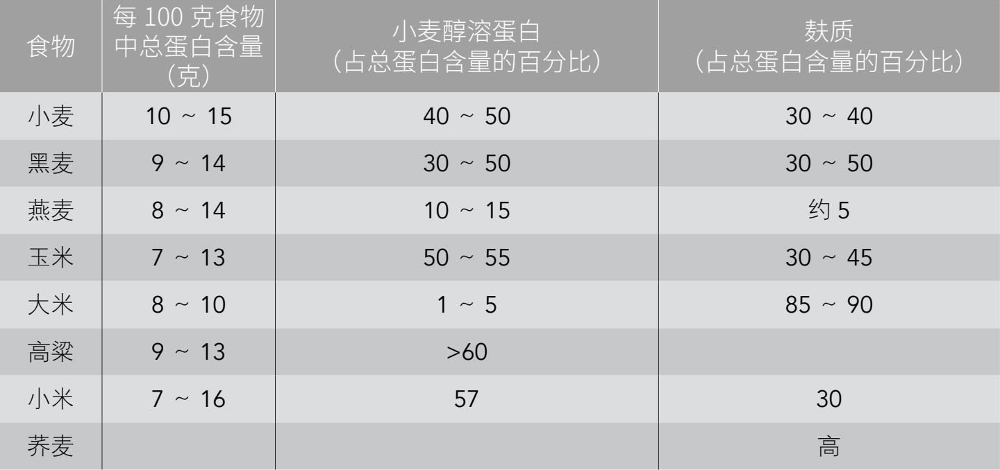
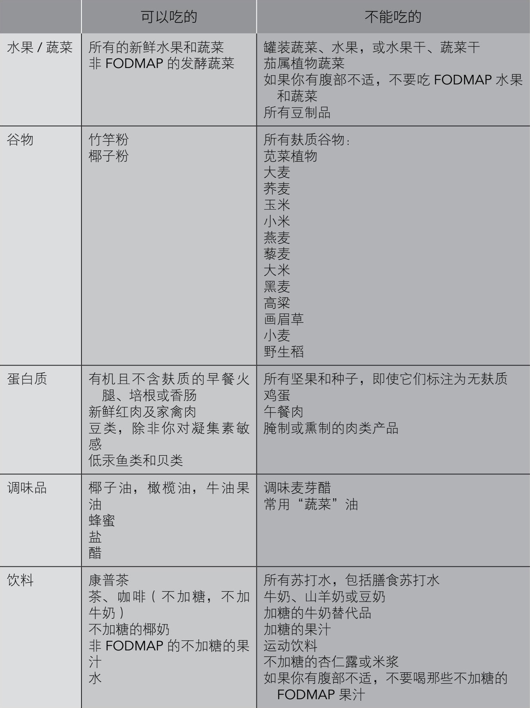

# 第九章 转变方案第2阶段 第4～6周

<h2><b>第</b><b>九</b><b>章</b></h2>

<h2><b>转</b><b>变</b><b>方</b><b>案</b><b>第</b><b>2</b><b>阶</b><b>段</b></h2>

<h2><b>第</b><b>4</b><b>～</b><b>6</b><b>周</b></h2>

	
如果你发现你的健康状况在第1阶段后有所改善，也许你就不想对你的饮食再做进一步的改变。很有可能仅仅通过去除糖类、乳制品和麸质，你就能在很大程度上减少炎症反应。与之前相比，你现在已经感觉好多了。如果是这样的话，你就走上正轨了。请继续前进——延续之前的方案即可，没有必要让转变方案变得更加复杂。

	
但是，如果你已经完成了为期3周的第1阶段治疗，却没有发现你的健康状况有明显的改变，那么很可能还存在其他的原因。这就是为什么我将第1阶段的治疗时间设定为3周：如果你在3周内没能步入正轨，说明其他类型的环境诱因可能正在助推着免疫反应。

	
在第2阶段中，我希望你们继续避免麸质、乳制品和糖类，即使它们不是引起你症状的主要原因，但它们仍然是高度炎性食物，我希望你能远离它们，直到我们能找到真正的诱因。当你严格遵守无麸质、无乳制品和无糖饮食时，我们可以通过做一个全面的食物敏感性测试或者从你的饮食中去除下一个最常见的刺激物来确定是否还有其他的因素在影响着你的健康。

	
对于身处自身免疫性疾病发展谱上的人来说，除了3种主要的致炎食物之外，某些特定食物同样令人担忧。在第二章中，我们了解到肠道通透性增加是发生自身免疫反应的三大要素之一。当某些未能完全消化的大分子食物残渣从肠道泄漏到血液中时，为了保护你，免疫系统会攻击这些大分子食物残渣并开始产生炎症级联反应。因此，你可能会对各种食物敏感或过敏，而这些食物大多数人都能轻易忍受，或者你以前也能忍受。

	
根据娜塔莎·坎贝尔—麦克布莱德博士的说法，这些食物敏感性可以表现为许多症状，例如，皮疹、慢性膀胱炎、头痛、记忆减退、血糖降低、从能量不足、哮喘发作等。这种反应可以是即刻的，也可以是延迟的：也就是说，它可以是立即发生的，也可以发生在进食2小时后，甚至2天后。这就是为什么有时候你几乎不可能把你的感觉和你吃的东西联系起来。在我的临床实践中，我发现，一些“不明原因的症状”通常与先前接触到的刺激物有关。每天你可能都不知道你到底在对什么发生反应。你也可能会同时对多种刺激物发生反应：可能是麸质、番茄，甚至是情绪压力都在推动炎症级联反应。从饮食中去掉麸质和番茄，你就能更好地应对情绪压力。

	
在第2阶段，我们将去除所有最可能引发炎症反应的食物，直到你感觉更好。与此同时，通过积极的营养方式促使肠道黏膜恢复，以便这些食物可以被很好地消化。然后，一旦肠道完全恢复，你也许就可以毫无困难地重新开始吃其中的一些食物。

	
<b>第</b><b>2</b><b>阶</b><b>段</b><b>：</b><b>要</b><b>避</b><b>免</b><b>的</b><b>食</b><b>物</b>

	
在接下来的3周，你需要探索其他的食物过敏原。在这段时间里，你将最终确定你吃的东西是否会让你生病、肥胖或疲倦。从避免最常见的食物过敏原开始是有道理的。多达800万的美国人（占人口总数的2.5%）存在食物过敏——这是一种IgE反应，可能会导致危及生命的过敏反应，也可能导致任何免疫相关的症状。

	
下面列举了最常见的食物过敏原。在第1阶段里，你已经避免食用牛奶和小麦了。在接下来的3周内，需要避免以下食物。

	
·牛奶

	
·花生

	
·树坚果（如核桃、山核桃、腰果）

	
·鸡蛋

	
·大豆

	
·小麦

	
在美国，数百万人对这些食物及其他食物敏感（IgG、IgA、IgM反应）。在临床上，我发现存在着不同程度的食物敏感。

	
·一级：麸质、乳制品、糖类

	
·二级：大豆、其他谷物、茄属植物蔬菜（如茄子、辣椒、土豆、番茄）

	
<b>大</b><b>豆</b>

大豆成为常见的刺激物有两个主要原因。第一，大豆几乎都是转基因的（除非标明是有机的）。根据美国农业部的数据，美国种植的大豆中有93%都是转基因的
	<a id="noteref-16-71" href="#footnote-16-71">[1]</a>。第二，大豆是八大过敏原之一。

	
在第1阶段，吃有机大豆是可以接受的，但在第2阶段，你需要避免进食所有的大豆产品。大豆是许多种加工食品的主要原料，经常出现在谷类食品、沙拉酱、肉类替代品、烘焙食品中，甚至也出现在无麸质食品中。阅读食品标签时要注意以下成分。

	
·毛豆

	
·单甘油二酯

	
·豆浆

	
·大豆分离蛋白

	
·酱油

	
·豆豉

	
·组织化大豆粉（textured soy flour，TSF）

	
·组织化植物蛋白（textured vegetable protein，TVP）

	
·味噌

	
·大豆卵磷脂

	
·大豆油

	
·大豆蛋白粉

	
·日本酱油

	
·豆腐

	
·组织化大豆蛋白（textured soy protein，TSP）

	
·维生素E（从大豆中提取）

	
<b>谷</b><b>物</b>

	
在第1阶段，我们只从饮食中去除了含有有毒麸质的谷物：小麦、黑麦和大麦。在第2阶段，你要去除所有的谷物。大部分自身免疫性疾病患者对谷物中的很多成分都很敏感。谷物中的FODMAP（稍后你将在本章中了解到）、非麸质蛋白、凝集素都是免疫反应的常见诱因。

更重要的是，单一成分的加工食品，常常由于污染而含有有毒麸质。2015年发表在《食品化学》期刊上的一项研究指出，大约24.7%的天然无麸质食品（比如大豆和燕麦）中都含有麸质
	<a id="noteref-16-85" href="#footnote-16-85">[2]</a>。

一些医生认为所有的麸质蛋白都是有毒的。有很多研究，包括2005年发表在著名期刊《胃肠道》（<i>G</i><i>u</i><i>t</i>）中的一项研究，都表明对麸质敏感的患者可能会对玉米和大米中的麸质产生反应
	<a id="noteref-16-84" href="#footnote-16-84">[3]</a>。在2012年完成的一项研究表明，玉米麸质中的一些蛋白质结构可以激活某种基因受体，这种基因受体与我们在乳糜泻患者身上观察到的是完全相同的
	<a id="noteref-16-153" href="#footnote-16-153">[4]</a>。

	
在第2阶段需要避免下列这些谷物，因为它们可能含有不同类别的麸质，或者可能被有毒的麸质污染。

	
·所有含有麸质的谷物

	
·荞麦

	
·小米

	
·藜麦

	
·高粱

	
·野生稻

	
·苋属植物

	
·玉米

	
·燕麦

	
·大米

	
·画眉草

	
每种谷物都有其特定的问题，下面我将对此进行讨论。这就是你要在第2阶段中避免所有谷物，然后每次重新引入一种的原因（前提是它们被明确地标记为“无麸质”）。各种谷物中麸质的含量见表9-1。

	
表9-1 各种谷物中麸质的含量

	

	
经允许摘自Alternative Medicine Review, vol. 10, no. 3, 2005：174.

	
<b>玉</b><b>米</b>

	
美国农业部的数据显示，美国种植的玉米中有88%是转基因的。由于分子模拟，有50%的乳糜泻患者对玉米存在交叉反应：玉米中的麸质蛋白和小麦中的麸质蛋白非常相似，免疫系统也可以对玉米中的麸质蛋白做出反应。

玉米的另一个问题在于在它上面生长的常见霉菌——伏马菌素。免疫系统会对伏马菌素做出反应。如果你遵循无麸质饮食，你吃的玉米的比例可能比一般人人更高，此时你就会不经意间暴露在霉菌毒性中。更糟糕的是，一项研究发现，在118种标注为无麸质的食物中，有105种发现了含量足以产生毒性的伏马菌素
	<a id="noteref-16-140" href="#footnote-16-140">[5]</a>。食用这些食物会使你的免疫系统保持高度警惕。

	
玉米也可以存在于以下食物中。

	
·发酵粉

	
·玉米粉

	
·玉米面

	
·玉米淀粉

	
·糊精

	
·食用淀粉

	
·粗玉米粉

	
·玉米粥

	
·玉米粉面团

	
·山梨醇

	
·植物蛋白

	
·黄原胶

	
·焦糖

	
·玉米麦芽

	
·玉米棒

	
·玉米饼

	
·葡萄糖

	
·冷冻玉米

	
·高果糖玉米糖浆

	
·糊精麦芽糖

	
·（玉米面等煮的）粥

	
·植物胶

	
·植物淀粉

	
<b>大</b><b>米</b>

	
信不信由你，在餐馆里，有时米饭中含有小麦粉。在我最近去过的7家日本餐馆中，有3家的米饭中加入了小麦粉。我总是让服务员问寿司师傅米饭是怎么做的，是否在米饭中加了面粉使其更黏。

	
虽然在家里煮的米饭很少会被麸质污染，但它确实含有一些麸质和凝集素，所以在第2阶段中我们要避免大米。

	
<b>藜</b><b>麦</b>

藜麦实际上并不是谷物，而是一种产自秘鲁的草。藜麦天然含有丰富的蛋白质，在注重食品健康的人当中很受欢迎，在美国也有种植。之所以能在美国种植藜麦，是因为农民们创造了一种新品种，这种新品种是与小麦等其他草类杂交而得的。2012年，发表在《美国临床营养学杂志》（<i>A</i><i>m</i><i>e</i><i>r</i><i>i</i><i>c</i><i>a</i><i>n</i><i> </i><i>J</i><i>o</i><i>u</i><i>r</i><i>n</i><i>a</i><i>l</i><i> </i><i>o</i><i>f</i><i> </i><i>C</i><i>l</i><i>i</i><i>n</i><i>i</i><i>c</i><i>a</i><i>l</i>）上的一项研究指出，15株藜麦中有4株的麸质含量足以产生毒性，而这些麸质来自植物本身，而不是来自生产过程中的交叉污染
	<a id="noteref-16-213" href="#footnote-16-213">[6]</a>。

	
<b>茄</b><b>属</b><b>植</b><b>物</b><b>蔬</b><b>菜</b>

	
茄属植物蔬菜是一个植物家族，包括茄子、辣椒、土豆、番茄和其他一些我们用来制作草药的开花植物。茄属植物中都含有一种叫作皂苷的化学物质，皂苷会增加肠道通透性和炎症反应。在第2阶段，你应该从饮食中去除以下食物，然后每次重新引入一种，以检验其中是否有导致炎症发生的食物。

	
·印度人参（一种草药）

	
·红辣椒粉

	
·咖喱粉

	
·枸杞

	
·辣酱

	
·墨西哥调味料

	
·土豆

	
·绿番茄

	
·番茄酱/番茄糊

	
·卡宴辣椒

	
·干辣椒粉

	
·茄子

	
·黄金莓

	
·瓶装番茄酱

	
·甜椒和辣椒

	
·塔可调味料

	
·番茄

	
<b>F</b><b>O</b><b>D</b><b>M</b><b>A</b><b>P</b>

	
FODMAP是碳水化合物的一个家族，存在于小麦和许多其他食物中。首字母缩略词“FODMAP”代表“可发酵的寡二糖单糖和多元醇”（fermentable oligo-dimonosaccharides and polyols）。FODMAP具有渗透性（这意味着它们会把水带进肠道），不能很好地被消化或吸收，当过量食用或肠道内微生物群落失衡时，它们可能会被肠道中的细菌发酵。过量的发酵会引起腹胀、腹痛、腹泻，有时还会引起便秘。如果你对FODMAP敏感，你很可能会存在上述腹部症状。如果你目前有腹部不适的症状，你应该考虑在第2阶段中去除FODMAP。这可能更具有挑战性，但会让你的感觉有很大的不同。如果你没有腹部不适的症状，你可以从下面的列表中选择无麸质的FODMAP食物。

	
<b>F</b><b>O</b><b>D</b><b>M</b><b>A</b><b>P</b><b>水</b><b>果</b>

	
·苹果

	
·牛油果

	
·博伊森莓

	
·无花果

	
·芒果

	
·桃子

	
·柿子

	
·石榴

	
·杏子

	
·黑莓

	
·樱桃

	
·葡萄柚

	
·油桃

	
·梨子

	
·李子

	
·西瓜

	
<b>F</b><b>O</b><b>D</b><b>M</b><b>A</b><b>P</b><b>干</b><b>果</b>

	
·蔓越莓干

	
·干枣

	
·葡萄干

	
·无核小葡萄干

	
·西梅干

	
<b>F</b><b>O</b><b>D</b><b>M</b><b>A</b><b>P</b><b>坚</b><b>果</b><b>和</b><b>种</b><b>子</b>

	
·杏仁粉

	
·腰果

	
·杏仁

	
·开心果

	
<b>F</b><b>O</b><b>D</b><b>M</b><b>A</b><b>P</b><b>蔬</b><b>菜</b>

	
·球洋蓟

	
·耶路撒冷洋蓟

	
·豆类

	
·冬南瓜（1/2杯或更多）

	
·洋蓟心

	
·芦笋

	
·甜菜

	
·皱叶甘蓝

	
·菜花

	
·冷冻豌豆

	
·韭菜

	
·洋葱和青葱

	
·甜豌豆

	
·芹菜

	
·大蒜

	
·蘑菇

	
·橙色小南瓜

	
·红薯和山药

	
<b>标</b><b>题</b><b>严</b><b>谨</b><b>的</b><b>重</b><b>要</b><b>性</b>

2013年，澳大利亚的一组研究人员试图确定那些自称对麸质敏感的人群是否真的对FODMAP敏感。他们的研究结果发表在《胃肠病学》（<i>G</i><i>a</i><i>s</i><i>t</i><i>r</i><i>o</i><i>e</i><i>n</i><i>t</i><i>e</i><i>r</i><i>o</i><i>l</i><i>o</i><i>g</i><i>y</i>）期刊上，标题为“在饮食中减少可发酵的、吸收不良的短链碳水化合物后，自称为非乳糜泻性麸质敏感的患者不会受到麸质的影响”
	<a id="noteref-16-139" href="#footnote-16-139">[7]</a>。该研究表明，除了麸质以外，小麦中还有其他成分会给人们带来问题，尤其是小麦和其他食物中的FODMAP。为了使研究结果更准确，同时为了寻找其他可能的原因或问题，研究人员排除了患有乳糜泻或抗麸质抗体升高的非乳糜泻性麸质敏感的人。但即使用了这种排除方法，仍然有8%的研究对象对麸质有反应。这项研究的题目“……不会受到麸质的影响”用词不当，标题应该是“……会受到麸质的轻微影响”。但是不管怎样，这篇论文很重要，因为它首先指出除了麸质以外，小麦中还有其他成分会引起与食物相关的症状：FODMAP可能就是问题所在。

	
因为这篇文章的标题具有误导性，英国的一位博主看了文章标题后开始写文章说，麸质敏感的说法肯定只是一时的狂热，因为科学研究表明“麸质不会产生影响”。其他博主也跟风撰写了博客文章和杂志文章。不幸的是，这些博主们并没有完整阅读这份研究报告，只是看到了标题。博主的文章试图证明无麸质饮食只是一时的狂热，对健康没有益处，但这是不正确的。博主在写作时只是为了引人注意而没有仔细做功课。在这本书中，我提供了许多最新的研究，只要阅读其中任意一项研究，他们就会清楚地发现，对某些人来说，非乳糜泻性麸质敏感是一个真实而危险的问题。

	
<b>影</b><b>响</b><b>你</b><b>健</b><b>康</b><b>的</b><b>食</b><b>物</b>

	
正如FODMAP与腹部症状有关一样，许多影响你健康的食物和特定症状有关。这里做一个简单的列举。

	
·如果你有关节疼痛，很可能你体内存在抗茄属植物蔬菜的抗体，你需要从饮食中去除这些蔬菜。

	
·如果你患有偏头痛，你应该考虑外源性凝集素敏感，并远离豆类。

	
·如果你存在皮肤问题，不要吃瓜类。

	
·如果你患有痤疮，从饮食中去除反式脂肪。

	
·如果你存在任何脑功能障碍的症状（如脑雾、自闭症），请避免食用谷氨酸（如味精），它是神经功能障碍的罪魁祸首。

	
<b>其</b><b>他</b><b>可</b><b>能</b><b>的</b><b>元</b><b>凶</b>

	
如果你在6周后仍然感觉不舒服（此时第1阶段和第2阶段都已经结束了），并且你在饮食方面做得非常棒，那么存在一个隐藏的诱发因素，这需要通过彻底的“调查医学”方法将其找出。在这一点上，我建议你找一位有资质的功能医学医生。你可能会发现你的炎症与肠道内微生物群落的严重失衡有关，以至于仅仅改变饮食是远远不够的。你也可能接触到了有毒的霉菌，或者体内存在念珠菌生长，或者感染了病毒，或者患有莱姆病。可以在我的网站上（theDr. com）找到这些常见的、与食物无关的诱因的相关信息。

	
例如，你所居住的房子或者你的办公场所可能存在有毒的霉菌，这可能会让你出现轻微的不适，也可能会对你的生活造成严重的干扰。

	
这里有一个很好的方法来验证你是否正在接触霉菌：当你离开家或者办公场所几天后再回去时，你是否觉得有必要打开窗户让房间通风？如果你认为有必要并且这样做了，很可能是因为有霉菌，并且其浓度已经高到你能识别出气味，而在以前，当你习惯了这种气味，你可能不会注意到它。像食物一样，霉菌的接触可能是持续且普遍的。

	
可以通过血液或尿液检测来诊断霉菌敏感。我还发现，对霉菌过敏或敏感的人，皮肤通常会有一种苍白的光泽。

	
<b>萨</b><b>曼</b><b>莎</b><b>的</b><b>故</b><b>事</b>

	
<b>第</b><b>六</b><b>部</b><b>分</b>

	
2012年，萨曼莎的健康状况开始好转。她完成了第1阶段和第2阶段的转变方案，非常注意自己的饮食。有一天，她来到我的办公室，我们回顾了她平常吃的食物。她告诉我她仍然不吃糖。“每次我吃糖之后，我都会得膀胱炎或感染酵母菌。不只是糖，水果也是如此。我知道我不能吃水果。我想要健康，我想要能够正常工作，为世界做出贡献。”

	
萨曼莎做得很对。吃那些明知道会使自己生病的东西有什么意义呢？我问她对葡萄酒是否有类似的反应。她告诉我：“我也不再喝酒了，每次我都要付出代价，最后只能使用抗生素。”

	
我建议她继续实施转变方案，她同意了。2013年，她带着灿烂的笑容回来了。“你不会相信的，”她说，“经过这一年的转变方案，我真的可以再吃水果了。我仍然不吃糖，但这不是问题，因为我从来也没有那么喜欢它。以前在工作时，我们偶尔会吃不含麸质及乳制品的纸杯蛋糕，但我总是会在2～3天后为这一行为买单，这曾经是我的免疫系统的常态。但是现在我已经清理了我的肠道，我开始尝试一些水果，发现大多数水果对我来说都不是问题了。慢慢地，我重新开始吃浆果，并且坚持了一段时间。”

	
萨曼莎的经历并不罕见：当她的肠道开始恢复健康，全身炎症反应减轻时，她就可以再次吃一些她过去喜欢的食物了。

	
转变方案第2阶段备忘单见表9-2。

	
表9-2 转变方案备忘单：第2阶段

	

<aside id="footnote-16-71"><ol><li id="footnote-16-71"><a href="#noteref-16-71">[1]</a>Margie Kelly, “Top 7 Genetically Modified Crops,” Huffpost Green（blog）, Oct 30, 2012, http://www.hufingtonpost.com/margie-kelly/genetically-modified-food_b_2039455.html.</li></ol></aside>
	

<aside id="footnote-16-85"><ol><li id="footnote-16-85"><a href="#noteref-16-85">[2]</a>G. M. Sharma, M. Pereira, and K. M. Williams, “Gluten Detection in Foods Available in the United States—A Market Survey,” Food Chemistry 169（Feb 15, 2015）：120–26.</li></ol></aside>
	

<aside id="footnote-16-84"><ol><li id="footnote-16-84"><a href="#noteref-16-84">[3]</a>G. Kristjánsson et al., “Gut Mucosal Granulocyte Activation Precedes Nitric Oxide Production: Studies in Coeliac Patients Challenged with Gluten and Corn,” Gut 54, no. 6（Jun 2005）：769–74. doi:10.1136/gut.2004.057174.</li></ol></aside>

<aside id="footnote-16-153"><ol><li id="footnote-16-153"><a href="#noteref-16-153">[4]</a>F. Cabrera-Chávez et al., “Maize Prolamins Resistant to Peptic-Tryptic Digestion Maintain Immune-Recognition by IgA from Some Celiac Disease Patients,” Plant Foods for Human Nutrition 67, no. 1（Mar 2012）：24, 30.</li></ol></aside>
	

<aside id="footnote-16-140"><ol><li id="footnote-16-140"><a href="#noteref-16-140">[5]</a>Chiara Dall’asta et al., “Dietary Exposure to Fumonisins and Evaluation of Nutrient Intake in a Group of Adult Celiac Patients on a Gluten-Free Diet,” Molecular Nutrition and Food Research 56, no. 4（Apr 2012）：632–40.</li></ol></aside>
	

<aside id="footnote-16-213"><ol><li id="footnote-16-213"><a href="#noteref-16-213">[6]</a>V. F. Zevallos et al., “Variable Activation of Immune Response by Quinoa（Chenopodium Quinoa Willd.）Prolamins in Celiac Disease,” American Journal of Clinical Nutrition 96, no. 2（Aug 2012）：337–44.</li></ol></aside>
	

<aside id="footnote-16-139"><ol><li id="footnote-16-139"><a href="#noteref-16-139">[7]</a>J. R. Biesiekierski et al., “No Effects of Gluten in Patients with Self-Reported Non- Celiac Gluten Sensitivity after Dietary Reduction of Fermentable, Poorly Absorbed, Short-Chain Carbohydrates,” Gastroenterology 145, no. 2（Aug 2013）：320–28.</li></ol></aside>
	

