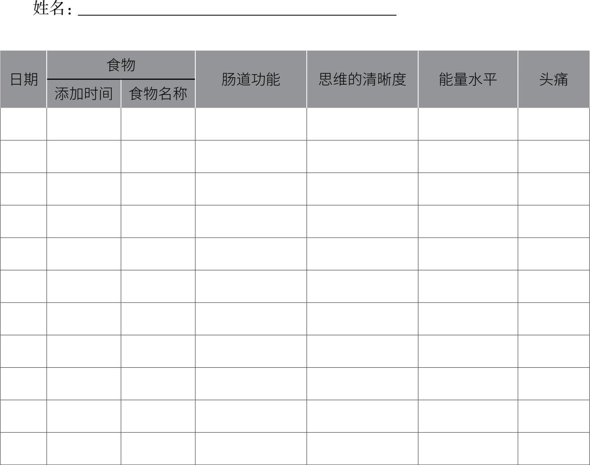

# 第十一章 第7周及以后 一生健康

<h2><b>第</b><b>十</b><b>一</b><b>章</b></h2>

<h2><b>第</b><b>7</b><b>周</b><b>及</b><b>以</b><b>后</b></h2>

<h2><b>一</b><b>生</b><b>健</b><b>康</b></h2>

	
到第7周，你感觉上可能会有很大改善，并且你知道你已经在正确的轨道上坚定地走向健康了。经过整整6周的无麸质、无乳制品、无糖饮食之后，你不再那么胖，也不再那么累了。你可能会注意到你的皮肤已经变好了一些，水肿也减轻了。这些迹象都表明你体内的炎症反应正在消退，你的免疫系统正在恢复更正常、更平衡的反应。

	
如果是这样，你现在可以进入转变方案的维持阶段。此时你可以通过每次重新引入一种食物（你一直在避免吃的食物）来增加你的食物种类，并确定你的身体对该种食物的反应。在第2阶段里你应避免的那些食物，现在你可以慢慢加回来，但仍要远离麸质、乳制品和糖。

	
<b>如</b><b>何</b><b>将</b><b>食</b><b>物</b><b>重</b><b>新</b><b>引</b><b>入</b><b>你</b><b>的</b><b>饮</b><b>食</b><b>中</b>

	
重新尝试你一直在避免的食物，目的是继续尽可能多地食用那些你喜欢的且经验证没有问题的食物。从每次重新引入一种食物开始，建议从茄属植物蔬菜开始，直到重新引入所有你喜欢的食物。例如，第1天在一餐中加入1个番茄。第2天，吃2次番茄，然后第3天吃3次。

	
重新引入食物需要耐心，所以慢慢来。这个过程可能需要几个星期，因为我们一次只能重新尝试一种食物。食物引起的反应在任何时候都可以发生，从刚刚吃下到进食后的72小时内。例如，如果你在重新引入番茄的3天内没有发生任何不适，就说明番茄对于你很可能是安全的。当然，如果任何食物引起了任何症状，这表明你的身体发出了一个明确的信息，那就是你对这种食物很敏感。使用238-239页的图表来记住你对哪些食物敏感，以便将来你可以继续避免它们。

	
许多人会出现新的症状，或者之前的某些症状变得更严重了。如果你也是这样，不要担心：这是完全正常的。当你清除身体某一部位的炎症时，就会同时使位于其他部位但程度较轻的症状暴露出来。这是你变得更强壮、更健康的信号。此时你的身体可以更快地识别毒素，并向你发出更清晰的信息。

	
当你慢慢地重新引入过去3周内所避免的食物时，你可以清楚地看到这些食物是否真的会引发生理或心理上的反应。如果重新引入某种食物后出现了症状，那么你可以再次进行第四章中的临床症状测试，从而重新判断你在自身免疫性疾病发展谱中的位置及你的薄弱环节。通常会表现出以下几个方面的变化。

	
·肠道功能

	
·思维的清晰度

	
·能量水平

	
·头痛

	
·关节或肌肉酸痛

	
·肾脏、膀胱、皮肤功能

	
·鼻塞和胸闷

	
在第4天，重新引入另一种茄属植物蔬菜（也许是白土豆），用同样的方式尝试3天。没有反应？在第7天用同样的方法继续吃另一种食物，以此类推。一旦茄属植物蔬菜被全部重新添加，再转向有机无麸质谷物，重复这个过程，直到把在第2阶段中应避免的食物都尝试一遍。

接下来，试着再加一点糖，但前提是你愿意——重新引入某种食物并不是强制性的。你应该少吃甜品，这样你就可以尽可能地远离有毒的糖。由于我们一生中摄入的糖分过多，与糖类相关的糖尿病是当今最紧迫的健康问题
	<a id="noteref-18-97" href="#footnote-18-97">[1]</a>。值得注意的是，在全世界3.86亿的糖尿病患者中，有超过46%的人尚未确诊。这个惊人的数字表明，有时我们对糖尿病的“感觉”还不足以严重到让我们去看医生。出于这个原因，我建议至少6个月后再重新引入精制糖。这将使你的血糖调节代谢途径对于偶尔接触到的糖有更强的耐受性。

	
当你认为你可以耐受一点糖的时候，你就可以重新引入酒精饮料。我建议我的患者从天然的无麸质饮料开始尝试，例如，龙舌兰酒、用苹果制成的无麸质苹果酒。如果在只喝了1杯无麸质饮料后，第2天早上起床时你就感觉昏昏沉沉，这可能说明现在就开始摄入哪怕是一点点糖分略高的东西都为时过早。如果是这样的话，请再等3周再试一次。

	
我建议你最后尝试乳制品。乳制品是一种非常常见的诱发因素，如果你对其产生反应，可能会让你的健康状况发生倒退。由于乳制品中的蛋白质分子大小是人乳的8倍，所以乳制品会引起许多不同的反应，如分泌过多的黏液。患有复发性耳部感染的儿童或患有慢性鼻窦炎的成人，会出现这样的情况：头部变成了一个充满黏液的人体培养皿。细菌在这种营养丰富、黑暗的、没有免疫系统的环境中茁壮成长。积聚的黏液中没有血液流经，因此没有白细胞可以进入杀死细菌。

	
<b>重</b><b>新</b><b>引</b><b>入</b><b>食</b><b>物</b><b>的</b><b>延</b><b>迟</b><b>反</b><b>应</b><b>表</b>

	

	

	
<b>排</b><b>除</b><b>饮</b><b>食</b><b>法</b><b>面</b><b>临</b><b>的</b><b>困</b><b>境</b>

	
在我职业生涯的大部分时间里，将食物重新引入到饮食中一直是我遇到的一个难题。重新引入食物的标准方法是：每次重新引入一种食物，然后注意你的感觉。这又被称为排除饮食法。从表面上看，这个逻辑是合理的。问题是，你身处自身免疫性疾病发展谱很多年，却可能没有明显的症状。例如，当我们体内的抗大脑抗体升高时，我们就无法“感觉”到体内的炎症，直到足够多的脑细胞受损，我们才会出现症状。如果你已经排除了那些有害的食物，并且摄取了可以修复肠道、平衡微生物群落的营养，你的身体就会像一辆精心调整过的跑车一样。当你把可疑的食物重新引入饮食中时，如果这种食物对你来说是敏感的，并且如果你很幸运的话，不论你的健康链条中薄弱的环节在哪里，你都可能会出现明显的症状。虽然这种方法对一部分人来说很有效，但从来没有人研究过有多少人在重新引入食物时没有出现症状，但他们体内的自身免疫反应实际上再次被激活了，抗体水平再次升高。这就是重新添加食物时存在的难题：除非你尝试这些食物，否则你永远不知道它们是否会影响你。然而，如果你吃了这些食物并且产生了问题，症状却可能在很长一段时间内都不会表现出来。

	
我所知道的唯一能长期保护你的策略是一个双管齐下的方法：第一，遵循排除饮食法，就像我刚才所说的那样，每次重新引入一种食物；第二，6个月后，如果你已经完成了食物的重新引入，并且感觉很好，那么再做一次血液检测以确定最主要的问题。如果检测结果提示抗体水平升高，那么就有证据表明，不管你“感觉如何”，组织损伤又开始了。通过我的这两步方法，就可以更好地确保不会在无意中重新激活免疫级联反应。

请记住，自身免疫性疾病发展的三要素是遗传易感性、环境诱因和肠道通透性增加。我们在重新引入食物的阶段检测了许多环境诱发因素——不仅仅是麸质。任何导致你产生不良反应的食物都会引起肠道通透性增加，不管你是否出现症状
	<a id="noteref-18-104" href="#footnote-18-104">[2]</a>。

	
<b>在</b><b>餐</b><b>馆</b><b>如</b><b>何</b><b>吃</b><b>饭</b>

	
由于我经常出差，所以经常需要在餐馆里吃饭。我不喜欢这样：我知道我在家准备的食物更安全，在外就餐充满了危险。大多情况下，餐饮服务人员，如服务员、餐厅经理，甚至是厨师，并不能很好地帮助客人应对食物敏感问题。但是多亏了辅助性消化酶的支持，我才没有那么紧张。

	
在餐馆工作的人通常是服务型的人，他们希望为顾客提供愉快的就餐体验。但遗憾的是，他们中的许多人并不知道无意暴露的危险性。最重要的是，一般来说，人们都很善良：他们不想跟服务员争吵，不想给别人添麻烦。但我很明白，保证健康胜过保持礼貌。

	
我强烈呼吁，每当你在餐厅就餐时，你应该表达你的具体需求，然后让服务员满足这些需求。不要害怕夸张：你需要引起别人的注意。在餐馆里，我会直视服务员的眼睛，并用友好但直接的语气说：“你好，我希望你能帮助我。我对麸质过敏，你能帮我确保我们桌上所有的食物都是无麸质的吗？”

	
大多数情况下，一个好的服务员会理解你的担心，并确保你桌上的食物对你来说都是安全的。我还发现，当你让服务员有参与感时（“你能帮我确保……”），会获得更多的保护，因为你结交了一个盟友。麸质暴露可能发生在食物准备阶段的任何地方。除了食谱中可能隐藏着麸质、乳制品或糖以外，还有一个严重的交叉污染的问题：当炒锅、平底锅和炊具在没有彻底清洗的情况下反复使用时也会引入麸质。因此，即使食谱中不含有麸质成分，但如果厨师使用同一块砧板切面包，用搅拌过普通面食的叉子来搅拌你的无麸质面食，或者用炸过虾的油来给你炸薯条时，你也会接触到麸质。记住，只需要1/8指甲盖大小的麸质就能激活你的保护性免疫炎症反应。好的服务员会提醒厨房工作人员在为食物敏感的人准备食物时只使用最干净的锅碗瓢盆。

	
如果我对服务员没有信心，我会找老板或经理。不要觉得你是在给员工制造麻烦，这是他们的工作——给你一次愉快的就餐经历，让你想要再去。让他们知道你需要什么，这么做会有助于你得到一个很棒的就餐体验。我会礼貌地对老板说：“我对麸质过敏，所以为了避免在你的餐厅发生需要急救的事件，你能确保我点的所有东西都是完全不含麸质的吗？”

	
我也会从菜单中选择我认为很简单就可以准备的食物。我完全不吃酱料，会要求仅用少许大蒜和橄榄油炒蛋白质或蔬菜。我喜欢去那些我有过良好体验的餐馆，因为那里的服务人员认识我并了解我的需求。当我出差的时候，我会去有着良好声誉的连锁餐厅。不过老实说，任何地方都可能发生无意中的接触。有一次，我和我的女朋友及好朋友在我最喜欢的一家连锁餐厅一起吃饭，我的朋友是一位功能医学胃肠病医生。尽管我们很明确地提出了我们的要求，但这家餐厅的服务人员还是给我们端上了一份含有麸质的开胃菜。我女朋友是个敏感的乳糜泻患者。很明显，即使我们3个人都明确地交代了我们对无麸质菜肴的需求，错误还是会发生。

	
还有一次，我和姐姐一起去了一家高档连锁餐厅，我很清楚地告诉服务员我们都对麸质敏感。服务员自信地说：“没问题。我们可以应对麸质敏感的问题。菜单上几乎每一道主菜都可以做成不含麸质的。”

	
听到这个消息，我们很激动。我和姐姐都点了一份简单的烤三文鱼，并配上米饭和绿色蔬菜。就在服务员点完餐要走之前，我说：“请务必告诉厨师，所有的食物都要做成无麸质的。”我说话的时候直视着他的眼睛。他回头看我的眼神显示出他很恼火，好像在说：“你这个白痴，我已经说过我们可以把所有的菜肴都做成不含麸质的了。”但他回答说：“好的，先生。”

	
然而，当食物端上来的时候，所有的东西都浸在一种无法辨认的酱汁里。我立刻让服务员查了一下是什么，果然，里面含有面粉（作为增稠剂）。这一次，服务员感到很尴尬，把饭菜端回了厨房，又端上来一份全新的菜。我叫来了经理，并告诉他我要把我的经历贴在我的脸书（美国的一个社交网络服务网站）上——我们跟服务员强调得有多清楚，而结果又是多么糟糕——成千上万的人会读到“你的餐厅”所犯的错误。他脸上的表情很震惊。然后我说：“这是我的名片，上面有我的个人邮箱地址。当你给我发送你和你的员工一起完成关于提供无麸质饮食的额外培训的照片和解释时，我会更新一条，标题是‘他们搞砸了，但现在他们正在竭尽全力把它做好。’”

	
多年来，我曾多次使用这种方法，在大多数情况下，经理都会给我反馈员工培训的最新情况。总之，提出你的意见对每个人来说都是双赢的。

	
<b>把</b><b>所</b><b>有</b><b>的</b><b>知</b><b>识</b><b>汇</b><b>总</b><b>到</b><b>一</b><b>起</b><b>，</b><b>以</b><b>宏</b><b>观</b><b>了</b><b>解</b>

	
在这本书中，你学习了如何识别你在自身免疫性疾病发展谱上的位置，并了解了自己是如何到达那里的。你还学会了如何通过避免吃那些让你生病的食物来停止在炎症之火上浇油。此外，你也学会了如何治愈肠道，这样你就可以重建受损的组织，并停止触发自身免疫级联反应。

	
你可能已经注意到，在讨论重新引入那些你之前一直避免的食物时，我没有提到麸质。这个决定是经过深思熟虑的，因为我们唯一确定不能再次重新引入的食物就是麸质。根据研究，麸质是会使我们身体产生记忆B细胞的唯一食物。这意味着一旦发生麸质过敏，你的免疫系统就会产生抗麸质抗体，它永远不会消失，所以你终身都会对麸质敏感。目前临床正在寻找一种“治愈”麸质敏感的方法，但截至本书撰写时，还没有一种方法被证实是有效的。

	
在我的诊室里，患者在开始接受无麸质饮食6～12个月后需要重新进行血液检测。检测的具体时间由患者的年龄、患者对转变方案的反应以及患者的总体健康状况决定。他们在自身免疫性疾病发展谱上走得越远，自身免疫和食物抗体恢复到正常水平所需的时间就越长。我们通过血液检测来观察免疫系统是否已经平静下来。

	
如果血液检测结果证实你体内的抗麸质抗体水平不再升高，你就会很自然地问：“医生，现在可以再吃麸质了吗？”不幸的是，答案是否定的。首先，即使血液检测结果正常，这也只是意味着你在过去几个月里没有受到攻击。抗体水平要在确认威胁消除的2～6个月后才会开始降低，所以要有耐心。

	
其次，免疫系统保持活跃的两个最常见的原因是作弊和无意中的暴露。我在第七章中分享的修女的故事告诉我们：仅仅每周摄入1/8指甲盖大小的麸质就让她一直生病。当她的主教命令她停止吃那一点点东西后，她就恢复了活力。因此，无论你在疾病发展谱上的什么位置，你都不能再吃麸质，即使是偶尔吃也不行。与麸质相关的疾病——也就是乳糜泻或非乳糜泻性麸质敏感——要求我们终身都保证100%的无麸质饮食。

2009年，发表在《消化药理学与治疗学》（<i>A</i><i>l</i><i>i</i><i>m</i><i>e</i><i>n</i><i>t</i><i>a</i><i>r</i><i>y</i><i> </i><i>P</i><i>h</i><i>a</i><i>r</i><i>m</i><i>a</i><i>c</i><i>o</i><i>l</i><i>o</i><i>g</i><i>y</i><i> </i><i>a</i><i>n</i><i>d</i><i> </i><i>T</i><i>h</i><i>e</i><i>r</i><i>a</i><i>p</i><i>e</i><i>u</i><i>t</i><i>i</i><i>c</i><i>s</i>）期刊上的一项研究指出，即使多年坚持无麸质饮食，仍有65%的乳糜泻患者的肠道存在炎症反应并导致肠道通透性增加
	<a id="noteref-18-115" href="#footnote-18-115">[3]</a>。你没看错。少数人能够痊愈（仅有8%），只是因为他们的肠道绒毛（微绒毛）和组织有机会痊愈罢了。对于大多数人来说，肠道通透性的增加仍然存在，原因有两个：一、无意中的接触使得炎症之火继续燃烧；二、因为肠道受到了严重的破坏，导致炎症之火无法停止，肠道无法自行愈合。

所以这意味着什么？就长期健康而言，这些研究结果令人感到沮丧。如果你患有乳糜泻或麸质敏感，你早逝的可能性，也就是标准死亡率（standard mortality ratio，SMR），比一般人群高，因为持续的肠道通透性增加会导致持续的炎症反应。以下是2001年一项具有里程碑意义的研究中的原文：“诊断延迟、表现形式和是否坚持无麸质饮食对死亡的影响最为显著……不坚持无麸质饮食（定义为每月吃1次麸质），使得死亡风险增加了6倍
	<a id="noteref-18-210" href="#footnote-18-210">[4]</a>。”简单地说，乳糜泻患者的标准死亡率是2∶1，而不管他们是否遵循无麸质饮食。这意味着如果我63岁并且患有乳糜泻，我的弟弟62岁且没有乳糜泻，那么我在63岁死于心脏病、癌症、阿尔茨海默病、糖尿病、脑卒中、帕金森病等疾病的概率是他63岁时的2倍。并且如果我已经患有另一种自身免疫性疾病，这个可能性还会增加。加上哮喘，标准死亡率是3∶1；加上肾病，标准死亡率是6∶1，加上肺结核，标准死亡率是5∶1；加上克罗恩病和结肠炎，标准死亡率是70.9∶1；加上桥本甲状腺炎，标准死亡率是64.5∶1。原因很简单：除非你使肠壁的微绒毛完全愈合，否则你并没有解决炎症问题。如果不解决炎症问题，自身免疫的连锁反应就会继续，即使你尽了最大的努力，你还是会在自身免疫性疾病发展谱上继续前行。2006年，一项令人震惊的研究指出，对麸质敏感但未患乳糜泻的人的死亡率甚至更高。研究人员说：“通过乳糜泻测试证实对麸质敏感的患者，他们的总体死亡率和患恶性肿瘤的死亡率都增加了
	<a id="noteref-18-631" href="#footnote-18-631">[5]</a>。”

	
不过，也有好消息。研究表明，对于那些坚持遵循无麸质饮食的人（这意味着他们正在努力坚持），他们的标准死亡率是0.5∶1；早逝的风险是平均值的一半，而不是2倍，因为他们真的在好好照顾自己。

	
我写这本书的目的是想要帮助你们理解，无麸质饮食不只是一个3周或是6周的计划。当你将麸质敏感性与肠道通透性增加、自身免疫性疾病联系起来时，你就会意识到无麸质饮食是一个终身指导原则。大多数自身免疫性疾病被称为“无声的杀手”，因为即使这些疾病在发展，你也也可能会感觉良好。当骨质疏松、贫血、维生素B缺乏发生时，你仍感觉很好。然而，这些都是与肠道炎症直接相关的吸收不良的情况，此时，你的机体无法吸收重要的营养物质，如钙、维生素B或镁。你不会感觉到吸收不良的症状，直到症状变得非常明显。升高的抗体是真正的“无声的杀手”，它会缓慢地使你的组织和器官功能减退，直至你开始出现症状。然后你才会被诊断出疾病：白癜风、类风湿关节炎、阿尔茨海默病，等等——这些病症会影响你的身体和大脑，不管你的薄弱环节在哪里。

	
如果你能在早期症状出现之前就发现疾病，并且学会如何停止往炎症之火中扔燃料，你就能扭转结局，并达到最佳的治疗效果。这不仅适用于你，对你的整个家庭来说也是如此。遗传易感性是自身免疫性疾病发展的三要素之一。如果你对麸质过敏，你的家人很可能也患有自身免疫性疾病——不管他们现在是否知道。你的健康以及他们的健康都掌握在你的手中。

	
在过去的10年里，我的每一次演讲，无论是对公众还是对资深的医生，我几乎都在结尾引用了我的导师杰弗里·布兰德博士的话，因为它很好地总结了我的观点。导师的原话如下。

	
<b>归</b><b>根</b><b>结</b><b>底</b><b>，</b><b>对</b><b>你</b><b>的</b><b>健</b><b>康</b><b>、</b><b>活</b><b>力</b><b>和</b><b>功</b><b>能</b><b>影</b><b>响</b><b>最</b><b>大</b><b>的</b><b>不</b><b>是</b><b>为</b><b>你</b><b>看</b><b>过</b><b>病</b><b>的</b><b>医</b><b>生</b><b>，</b><b>也</b><b>不</b><b>是</b><b>你</b><b>吃</b><b>过</b><b>的</b><b>药</b><b>物</b><b>、</b><b>做</b><b>过</b><b>的</b><b>手</b><b>术</b><b>或</b><b>接</b><b>受</b><b>过</b><b>的</b><b>其</b><b>他</b><b>治</b><b>疗</b><b>，</b><b>而</b><b>是</b><b>你</b><b>关</b><b>于</b><b>饮</b><b>食</b><b>和</b><b>其</b><b>他</b><b>生</b><b>活</b><b>方</b><b>式</b><b>方</b><b>面</b><b>的</b><b>决</b><b>定</b><b>所</b><b>带</b><b>来</b><b>的</b><b>累</b><b>积</b><b>影</b><b>响</b><b>，</b><b>以</b><b>及</b><b>这</b><b>些</b><b>决</b><b>定</b><b>对</b><b>基</b><b>因</b><b>表</b><b>达</b><b>的</b><b>影</b><b>响</b><b>。</b>

	
感谢阅读，愿你早日康复。

<aside id="footnote-18-97"><ol><li id="footnote-18-97"><a href="#noteref-18-97">[1]</a>P. Tiwari, “Recent Trends in Therapeutic Approaches for Diabetes Management: A Comprehensive Update,” Journal of Diabetes Research 2015（2015）：340838.</li></ol></aside>
	

<aside id="footnote-18-104"><ol><li id="footnote-18-104"><a href="#noteref-18-104">[2]</a>M. T. Ventura et al., “Intestinal Permeability in Patients with Adverse Reactions to Food,”Digestive and Liver Disease 38, no. 10（Oct 2006）：732–36.</li></ol></aside>
	

<aside id="footnote-18-115"><ol><li id="footnote-18-115"><a href="#noteref-18-115">[3]</a>A. Lanzini et al., “Complete Recovery of Intestinal Mucosa Occurs Very Rarely in Adult Coeliac Patients despite Adherence to Gluten-Free Diet,” Alimentary Pharmacology and Therapeutics 29, no. 12（Jun 15, 2009）：1299–308.</li></ol></aside>
	

<aside id="footnote-18-210"><ol><li id="footnote-18-210"><a href="#noteref-18-210">[4]</a>G. Corrao e.t al., “Mortality in Patients with Coeliac Disease and Their Relatives: A CohortStudy,” Lancet 358, no. 9279（Aug 4, 2001）：356–61.</li></ol></aside>

<aside id="footnote-18-631"><ol><li id="footnote-18-631"><a href="#noteref-18-631">[5]</a>L. A. Anderson et al., “Malignancy and Mortality in a Population-Based Cohort of Patients with Coeliac Disease or ‘Gluten Sensitivity,’” World Journal of Gastroenterology 13, no. 1（Jan 7,2007）：146–51.</li></ol></aside>
	

