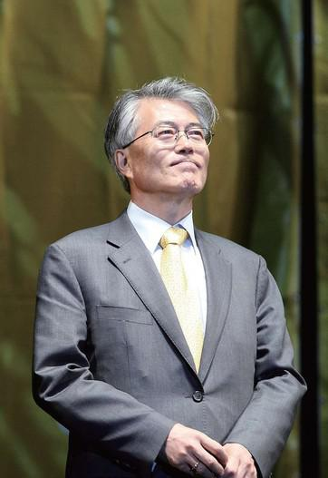

# 致中国读者 （代序）

<b>致中国读者 （代序）</b>

中国的读者们：

你们好！我是文在寅。

很高兴通过《命运》这本书与大家相遇！值得一提的是，《命运》的中文译本是我授权的第一个外文译本，这更让我觉得这本书的出版意义深远，令人快慰。

中国与韩国，山水相邻，有许多不同点，但也有很多相似的地方。几千年文化上的相连，让我们两国结下了不解之缘，难分难舍，这就好比人与人、邻居与邻居的相依相伴，彼此共同生活在一起。

越是亲近，越是觉得自己了解对方，可这也往往会造成彼此意想不到的误会与矛盾。所以，只有常走动，多对话，才能让彼此的关系保持健康成长，向前发展。

我知道有很多中国朋友都希望增进对韩国的了解，认识一个真正的韩国。我希望我这本书能起到这个作用，它好比是我向中国朋友发出的一封邀请函，又好比是一叶扁舟，穿行于中韩两国的友谊之河上。

《命运》中讲的是“人活着的故事”，“命运”让我与很多人的人生交织在一起，我们这些人，以及我们共同生活过的时代，就是这本书的主人公。

韩国的近现代史是一部充满挑战的历史。这段历史，不仅有殖民与分裂的耻辱，也有战争与贫困的痛苦，更有发展经济与追求民主的澎湃浪潮。历史浪潮的创造者是人，力挽狂澜的也是人。

前总统卢武铉就身处这些人之中。卢总统与我相逢于小小的支流，但我们一起蹚过了充满艰险的征途。如果泉水够深，即使遇上干旱也不会轻易干涸，终会与其他水流相逢，一路汇聚成大川、大江，向着大海奔流。对卢总统来说，大海就是他所向往的那个“人活着的世界”。如今，他离开了我们，留下了一个要奔向大海的深泉。

《命运》这本书就是从这口泉水中涌出来的浪花，展现在世人面前。

《命运》首次问世是2011年6月，当时一股有违历史发展的风刮得正盛，给韩国政治带来惊涛骇浪。我看到国民在希望与绝望之间艰难地寻求出路。我的书在当时就是想告诉读者们，大韩民国经历了一段多么不寻常的历史，我想唤醒他们内心的骄傲与自信，让他们能经受住时代的考验，继续奋勇向前。

卢总统与我就像那个时代的很多人一样，出身贫寒，起于微末，但是我们都相信历史终是前进的，相信正义是一定存在的。每一位韩国人心中都喷涌着清纯的泉水，我们想过上富裕的生活，却不想独善其身；我们渴望拥有自由，却不想独享自由。这样泉水般清纯的想法汇集到一起，就形成了一股历史的洪流，并绽放出耀眼的光芒。

中国与韩国都走过了惊心动魄的近代与现代，取得了举世瞩目的发展成就。就像奔流向海的江河终究要汇聚到一起，我们要创造一个和平与和谐发展的世界，这一共同挑战与课题正摆在我们两国面前。

我希望这本书能够为巩固中韩两国友谊，加深彼此互信，并一起挽手奔向我们共同向往的大海做出贡献。在此，我再次向中国读者转达韩国国民的美好问候。

谢谢！

文在寅

2017年11月
 
  
 

