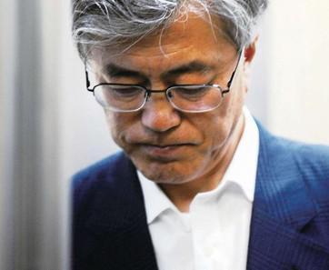

# 那天清晨

<b>那天清晨</b>

刺耳的电话铃突然响了，清晨的睡意顿时消失得无影无踪，“这个时间点，会是谁呢？”这么早打来的电话总是让人感到莫名的不安。

“室长，我是庆洙。”

“嗯，什么事？”

“请您现在就过来一趟吧。总统[注：卢武铉（1946—2009），律师，政治家，第16届韩国总统，1988年，当选韩国第13届国会议员，由此正式踏入政坛，2002年12月，以开放国民党侯选人身份，击败韩国大国家党候选人李会昌，成为总统，2003年2月25日正式宣誓就职。——译者注]出门散步，从山上摔下来了，好像是从猫头鹰岩上。原因我们还不清楚，现在警卫员正护送总统去医院，据说情况很严重。”

“什么，情况严重？你的意思是有生命危险？”

“准确情况我也不清楚。这是警卫员说的。到了医院应该就能清楚了。”

金庆洙是总统在峰下村[注：峰下村：卢武铉的家乡，他总统任期结束后选择回到家乡。——译者注]期间的秘书，他这么早给我打电话，直觉告诉我这一定是与总统有关的紧急事件，但我无论如何也想不到竟然是这么严重的事……

“你说总统清晨出去散步？他最近经常散步吗？”

“不是的，调查开始后，总统根本不可能出门散步，这次是隔了好久才出门的。”

这个情况我清楚。调查开始以后，总统就一直闭门不出，取消了一切外出活动，他很在意记者的照相机。总统为什么今天突然去烽火山散步了，竟然还从猫头鹰岩上摔了下来，情况还很严重？！

我努力压制着心中不祥的预感。

金庆洙说他先把总统送到就近的世英医院，确认要不要转到大医院之后再和我联系。我撂下电话马上做好了出门的准备，可金秘书一直没来电话，这回轮到我给金秘书打电话了。他说自己也一直没接到后续情况的电话，另一位秘书文龙旭已经赶到现场了，他只要一接到文秘书的消息就马上联系我。

我心急如焚，每一分每一秒的流逝都是煎熬。

过了许久，文秘书终于打来了电话。

“总统病危，伤势很严重。世英医院说他们没办法了，最好立刻转到大医院。我们正在去梁山釜山大学医院的路上。请您直接去那里吧。还有，我听警卫说总统好像是从猫头鹰岩上跳下来的。金庆洙和朴恩河两位秘书在总统的电脑里找到了遗书。”

“从猫头鹰岩上跳下来？怎么会……？”这个疑问在我的脑海盘旋，不祥之感再也压制不住了。

接电话时，妻子在旁边一脸紧张，不知所措，我什么都没说就出了家门。坐在车里，握着方向盘的手一直在颤抖，我不停地深呼吸，强挺着开车。

这是我一生中最为痛苦，煎熬的一天，2009年5月23日，那一天就是这样开始的。

釜山大学医院位于梁山，我从没去过，本来就心慌意乱还要看路标指示，好不容易才找到了地方。我都记不清自己是怎么到那里的。到了医院，文秘书出来接我，他表情惨淡，一副失魂落魄的样子。

总统被送到了特别病房，这里禁止闲杂人员出入，我必须亲眼看见他的情况，不知糟糕到什么地步！

我走进了病房，总统已经闭上了眼睛，那凄凉的情景实在难以用言语形容。

总统身上插着各种人工延长生命的装置，机器上还有信号。我脑中闪过一个念头：“还有希望！还不至于……”

医生们向我陈述了实情，信号只是因为心脏起搏器在起作用，只要机器一撤，信号马上就会消失。也许，医生从我的表情中看出我还存有“万一还有希望……”的幻想，于是，又做了更明确的解释：总统在到达医院之前就已经是医学上的死亡状态了，这与此前世英医院的结论一致。他们判断总统在事发现场就已当场身亡了。安装心脏起搏器只不过是为了安抚不想放弃的家属的情绪，也是为了给家人们留出时间，好做最后的决定……听到这些，我觉得天都塌下来了。

文秘书把从警卫员那里听来的事情经过向我做了转述，不久，金庆洙秘书带来了从总统电脑里打印出来的遗书。显然，这不是场意外，而是总统自己选择的有计划行动。我一言不发，头昏脑沉。

这时，主治医生和我说：

“夫人来了，请您转告她，总统已经没有生还希望了，我们需要她的同意，才能撤除人工延长生命装置。我们说这话不太方便，还是请室长您转述吧。”

听了这番话我回过神来：“是啊，我不能这么失魂落魄的，得考虑该干什么，接下来怎么办，我必须马上做出判断和决定。振作起来！冷静点！”

想到这里，我又犯了难：夫人马上就到，应该让她看到什么样的总统呢？我把我的顾虑告诉了医生，他们也有同感。医生们最终决定让夫人先等一会，他们立即为总统皮肤撕裂的地方进行缝合处理，把血迹擦拭干净。

夫人当时已经站不住了，得到医生的许可后，在别人的搀扶下与总统见了面。此时的总统就像什么也没发生过一样，干干净净的，脸上没有任何伤痕，表情也很温和。夫人看见了这情景完全缓不过神来，丈夫两三个小时前还跟自己在一起，现在却成了这样，她当然无法接受。

更让人痛苦的是向夫人说明情况。夫人来之前，只听说“总统从山上摔了下来，情况不太好”，后来又听说世英医院无能为力，转院去了梁山的釜山大学医院。她猜到了情况相当不好，仅此而已。

秘书们实在是难以如实汇报，我道出了实情——总统是自己从猫头鹰岩上跳下的。夫人对此难以置信，我给她看了遗书，夫人当时就瘫倒在地了。

下面的话要说出口就更艰难了：“现在，总统只是依靠人工生命起搏装置而已，在医学上，总统已经去世了，医生也认为没有生还希望了。现在我们除了撤掉人工装置，没有其他选择，夫人您拿个主意，就让总统安心走吧。”医生也表示了同意。

  在卢总统去世的发布会现场，我的表情是肃穆的，我感到一种可怕的寂静。 

看到夫人失声痛哭，我也坚持不住了，实在太痛心了。夫人一直在哭，刚好一点儿，又接着哭，过了许久才勉强打起精神，表示了同意，于是心脏起搏器被撤除了。

2009年5月23日，上午9时30分，他走了。

得让国民知道实情。和医生商量后，决定由我宣布总统去世的消息，以及去世的原因，然后再由医生团队进行医学说明。我只准备了短短几句演讲稿，就站在了众多媒体的面前。发布会现场挤满了记者，几百个闪光灯不停闪烁，现场气氛就像马上要爆炸一样，可我对此毫无知觉，即使环境如此嘈杂，我感到的只有可怕的寂静，一切的一切就像静止的画面。

“这是一件让人备受冲击又无比痛心的事，前任总统卢武铉于今日上午9时30分，在梁山市釜山大学医院逝世。各种情况表明，总统于今天上午5时45分左右外出，前往烽火山登山，于上午6时40分左右从烽火山岩石跳崖。当时总统身边有一名警卫员，事发后，警卫员立即将总统送往最近的医院，因病情危急又转至釜山大学医院，但最终总统于不久前，也就是9时30分不治身亡。总统为家人留下了简短的遗书。”

宣布如此严重和复杂的情况，我也就用了一分钟的时间。当时，我已经无话可说，记者们也没再追问什么问题。

现在我们得集中精力处理后事了，接下来该把总统安置在哪儿？我告诉峰下村那边迅速准备灵堂及香堂。

医院被挤得水泄不通，看着这些布满泪水的熟悉面孔，想必他们也和我一样，要花多久才能接受这个事实啊！蜂拥而至的还有执政党、在野党的政界人士，李明博总统的秘书室室长虽然上任后连招呼都没打过，此时也到了。悲伤的人们恨不得抱在一起痛哭，吊唁和问候混杂在一起。

而我只想一个人待着，哪怕几分钟也好。有人递了一杯茶过来，我盯着茶杯出神，突然想起与总统第一次见面时的情景。我第一次见他，与他聊天时面前也放着一杯茶。那一天的我们是那么年轻，那么耀眼……
 

