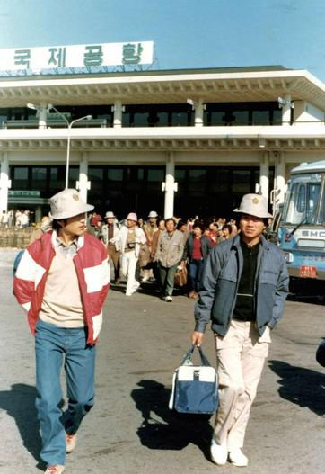

# 既像前辈，又像朋友

<b>既像前辈，又像朋友</b>

卢律师对我很好，其实我只是他的后辈，但他称我为“朋友”。之所以这么说是有缘故的，2002年他参加大选，我担任了釜山选区的对策本部部长，卢武铉在釜山本部成立大会上发表候选人演说，开头就这样讲——“人们不是经常说看他的朋友就知道他的为人吗？我不是‘卢武铉的朋友文在寅’，我是‘文在寅的朋友’——卢武铉！”他知道我不大喜欢当这个本部长，故意用这句话对我这个后辈表达感谢。实际上，他比我大六岁，司考届数也比我高五届，是真真正正的前辈。但就因为他的这句话，现在还有人管我叫“卢武铉的朋友”。

卢律师从一开始就非常尊重我，跟我说话一直用敬语。稍微不那么严格的敬语也是我进入青瓦台之后才听到的，此前他对我一直使用严格的敬语。我是经常管别人叫“大哥”的人，但对他，我从来不敢，而是一直恭恭敬敬地称为“前辈”。

他能这样尊重我并不简单，当时他既当过法官又当了好几年律师，在律师行业已经打下了一定的基础，积累了经验，而我还只是个刚刚从司法研修院出来的新手。他能与我在同样的条件下工作，把我当成合伙人看待，非常难能可贵。

律师合伙人之间最困难的就是原本秉性不同的两个人，做到完全信赖对方。比如说不管谁受理案件，都要分工合理，每个业务都有人分管，这就需要绝对的信任，如果做不到相互信任，就做不了合伙人。对我来说，他是前辈，我心里当然觉得他比我有能力。站在他的角度上，我只是个新人，他应该对我不放心才对，但是他在我处理案件时给予了绝对的信任。在合作过程中，如果遇上了比较重要的时局案件[注：时局案件：涉及政治局势的法律案件。——译者注]，我们经常一起做共同辩护人。我们根据各自的业务量决定谁来做主辩护，卢律师做的时候多些，我做的也不少。如果是我做，他对我所准备的辩护策略通常都很赞同，对于我所主张的诉讼方向等内容，也没有提出过一次质疑，这真是对我莫大的信赖与尊重！

现在回想起来，多亏了他，我才能如此顺利地开始我的律师生涯。我决定做律师时还犯愁，我一个人上哪里去弄启动资金呢，是他让我摆脱了这些困扰。

我和卢律师住在同一个小区。当然了，他很早就有了收入，买了大房子，我住的是交月租的小房间，但这丝毫不影响我们的交流，我们经常在一起谈心。我总去他家，还跟他一起回过他的老家峰下村，律师事务所全体人员一年有两次集体旅游，都是带家属的，非常人性化。卢律师不是很能喝酒的人，偶尔也会叫大家喝上两杯，一起度过愉快的时光。

事务所生意还算不错。那时整个法律界的从业人员不多，律师事务所的数量也不多。虽然我只是个刚从司法研修院出来的新人，也不是什么退休后待遇不变的高级专家，但是毕竟有律师的身份，就能受理案件了。从我的下一届开始，参加司法考试的人多了起来，律师人数也开始猛增了。开业那天，有位医生的夫人从报纸上剪下了律所的开业广告找上门来，她觉得我年轻又是刚刚开业，估计会比较努力，所以就来了。那是我受理的第一个案子，是个民事案件。

反过来，卢律师自从跟我合作，受理的案子反而比过去少了。此前他一直是釜山地区最年轻、最努力、最优秀的律师，他受理的案件多，胜诉率也高，因为与我合作经营律师事务所，他把此前一直是行业规则的“案件受理中介费”给取消了。

现在，“中介费”在律师法中被明令禁止了，当时则是习以为常的惯例。法院和检察院职员、管理员，以及警察等人如果给你介绍案子，通常要提受理费的20%作为回扣。后来这种行为逐渐渗透，甚至银行、企业法务部主动联系案件，也要提取中介费。卢律师想要独善其身，太难了。

  律师事务所全体人员一年有两次集体旅游，都是带家属的，非常人性化。 

自从与我合作后，他真的就把中介费取消了。他忠实地履行着我们第一次见面时所做的承诺，接待法官、检察官的惯例也是一样。那个年代，负责刑事案件的律师要时不时请主管刑事案件的法官吃吃饭、喝喝酒。到了审判的日子，进去听审的律师要请审判部门吃饭喝酒，这是惯例。法院周围有好多被称为“方席店”的高级饭店就是靠这个开张的。卢律师也曾是“方席店”的常客。然而，这种宴请也不再有了。

这种所有人都遵循的惯例，一个人想要打破是多么困难啊！即使在这种情况下，他依然坚持做到。我想他本来也正有此意，只是以我的到来为借口正式行动起来，他可能觉得我是搞学生运动出身，志向肯定是要做一名干净的律师。他觉得自己作为前辈得做出表率，不能在后辈面前丢脸。他确实是一位既有道德感又有意志力的人！

可这样一来，他接的案子明显减少了，本来他还在几家银行做律师顾问，这个业务也没了。因此跟他自己开事务所时相比，收入减少了很多，他却丝毫不介意。再后来，他做了人权律师，收入更是锐减，可以说他作为一名法律界的人，经济上宽裕的日子实际没过上几天。即使这样我们也很开心，起码维持律所正常运转还是没什么问题的。

当时的釜山虽说是韩国第二大城市，但律师并不多。登记在册的律师一共不超过100人。除掉只登记实际上并不活动的律师，能够站在法庭上辩护的律师不超过50人。我们只要用心，是可以建立诚实、努力的好口碑的。

法律界是比较保守的，口碑不管好坏，一旦形成就很难改变。幸亏我执业之初在釜山法律界留下了好形象，这对我后来的律师生涯有莫大的帮助。

在釜山律师界中，我们成为一大热点。两人都很年轻，经历也很特殊，这样的两个人经营釜山地区唯一的合伙人法律事务所，自然就成了大家关注的对象。这更督促我们要加倍小心、百分之百地努力。

除了处理案件，对于参加釜山律师界的活动我们也很积极。特别是卢律师，他对于为大家服务的事情总是很热心，他曾经三次担任釜山律师协会财务理事。不管年老的还是年轻的，律师们都很喜欢他。那时真是人生的大好时光啊！
 

