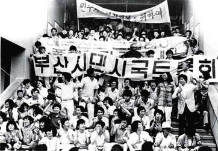

# 热情与原则

<b>热情与原则</b>

想当年的卢律师，真是热情如火啊！就像刚刚入教的信徒反而比信了很久的人更虔诚、更热情一样。一般说来，律师有律师的行为方式。我对自己的行为是设有底线的，“我是律师，这是我所能做到的底线”。不仅是我，所有人都是如此。但卢律师却不是这样，他没有为自己设限，只要是他认为正确的他就会去实践、去行动，后来进入政界的卢武铉也是如此。

公害问题研究所釜山支部一经成立，参与研究所活动的人立刻就成为情报机关的监视对象。情报科的刑警们在研究所办公室门前摆开了龙门阵，监视主要人物的活动，以及进出人员的动态，刑警们甚至还随时出入办公室。于是卢律师就在律师事务所腾出了一间办公室给研究所用。这一方面是对研究所活动的经济支持，另一方面也是为了阻止那些政府机关的人。那些人虽仍然常驻于办公室门口，但不敢再进来了。

不仅如此，卢律师还在律师事务所里设立了劳动法律咨询所。此前我们一直都是在发生劳动案件之后，为审判与法庭辩论提供服务，这也是一般律师的工作方式。但卢律师不满足于此，从劳动团体的创立，到团体的日常活动，他都要提供全方位的服务。

釜山民主市民协会成立那天，活动原计划分两部分进行，第一部分是演讲会，第二部分是创立大会。演讲会邀请的演讲人是赵甲济[注：赵甲济：曾任《月刊朝鲜》总编及社长，右倾、保守时事评论家。]，当时他是被《国际新闻》解职的著名记者，人们对他的评价还是不错的。警察对活动场所实施了“源头封锁”，从演讲会开始就不许任何人入场，所有人都在指责警察的非法封锁，但警察依然纹丝不动地坐在那里。卢律师气得干脆躺在了大马路上，一个人高喊口号。

由此，卢律师成了“过激律师”被人们传开了，也有人说他这样做有失律师的涵养。但他认为，面对警察的非法封锁，斯斯文文地抗议、装装样子根本不解决问题。为了这事，我们还专门对釜山市警察局局长（现在的釜山警察厅厅长）及直接负责的警察署署长提起了刑事诉讼。卢律师自己做了上诉人代表，但是这场官司连个像样的调查都没进行，就稀里糊涂地不了了之了。

后来，1987年，我们在纪念朴钟哲[注：朴钟哲：首尔大学学生，1987年1月在治安本部南营洞对共分室接受调查时死亡，警察最初解释为单纯性猝死。事件发生第五天，警察公开承认刑讯致死的事实，相关警察被逮捕。该事件成为1987年“六月抗争”的导火索。]遇害追悼会上被一起带走，情况也是这样。当时警察把我们抓走调查。我的态度是可以接受警方盘查，但坚持自己的行为是正当的。后来，我才得知卢律师干脆拒绝回答任何问题，连签字盖章也不同意。他坚持自己被抓走接受盘查本身就是不合法、不正当的，因此对警方的问题一律不予回答。这是我们第一次遇到这种情况，而且我们本身作为律师，不协助调查可不是件容易的事。但卢律师就是这样，对自己认定正确的事，就一定要坚持到底。

我认为这就是卢武铉后来踏入政界所奉行的原则。为了正义可以去选择哪怕对自己不利的道路，卢武铉的这种原则为很多人所熟知。不仅如此，他还有另一个原则，那就是实践正义时的彻底且不设限。简单地说，从政以后，他完全可以做他的国会议员，同时努力去实现他的正义——打破地域主义。但是他一定要用尽全力与地域主义来个正面对决，他就是这样的人，在这一点上我不如他。

随着民众对“第五共和国”的反抗日益激烈，各种集会、示威也逐渐频繁，每当有重要的集会、示威时，警察就会来到办公室阻止我们参加，这就是所谓的“办公室软禁”。那个时代允许对律师这样恣意妄为。所以，我们每次都要绞尽脑汁研究怎样才能把警察甩掉，有时我们干脆不去办公室，就算去了，也要想办法甩掉警察再出来。有时情报科的刑警甚至还会尾随我们去集会、示威的现场。

我的家也被搜查过，当时我们住在公寓里，刑警先是在保安室蹲守了两三天，后来拿到了正式的搜查令就闯了进来。搜查的理由是我家涉嫌窝藏了一名“五三仁川事件”[注：五三仁川事件：1986年5月3日，在野及学生运动势力一万余人发动大规模示威，提出制定国民宪法等要求，319人被逮捕，129人被拘留。]的相关人员。我确认后发现，警察之所以能实施搜查，唯一的举证材料就是一张写着“市民匿名电话举报”的警察报告，真是岂有此理！竟然给一位在职律师下达这样的搜查令！那个时代就是如此黑暗，警察局、检察院只要提出请求，法官就会下发搜查令。

随着工人意识的觉醒，劳动案件日益增多起来。相较于学生案件，我和卢律师更愿意受理劳动案件。在学生案件里，学生们的主张与逻辑都基本相同，劳动案件则不然，每个案件都承载了劳动者在生活中所遭遇的不同苦难。

那时制鞋业是釜山地区的主要产业，在鞋厂上班的女工处境非常艰难。各种加班费都算在一起，每个月也不过拿到六七万韩元的工资，而且还经常被拖欠。遭受侮辱人格、性骚扰也是家常便饭。很多女工为了争取生存权利要求厂方遵守劳动基本法，成立劳动团体，结果被集体解雇。很多人参加了具有自救性质的集体活动，却以妨碍业务罪被拘留。每次遇到这样的情况我们的内心都无比沉痛。虽然我们二人都是免费辩护，而且尽全力为他们抗争，但是大多数人仍得不到救助。

经历了这些案件后，卢律师干脆下决心专做劳动律师，为此还在律师事务所设立了劳动法律咨询所，当然这也有我们想要提升律所专业性的考量。

那时候《劳动法》的相关书籍大多观点保守，虽然里面也有很多当时的劳动案例，但对我们帮助不大。当时，辛仁羚教授提出了最进步、最符合实际的理论，她的论文集给了我们很大帮助。但是论文集的内容也是有限的，摆在我们面前的现实问题实在太多，逼着我们不得不自学。那个时代，法官、检察官也不懂《劳动法》，还在用民法的思维方式来处理案件。

另外，我们也意识到只为已经发生的案件做辩护，始终只是治标不治本。我们认为必须成立劳动团体，从工人的日常活动开始提供帮助，承担起这个重任的就是劳动法律咨询所。

卢律师对工作太过认真，以至于给新律师带来了心理负担。昌原地区过了很久才有劳动律师，可是很多人最后都干不下去，离开了。因为工人们动不动就拿这些新人跟卢律师作比较，“卢律师能免费辩护，还跟我们法庭上一起战斗，你就不行吗”？这给人的压力太大了。由此可见，做事太奋不顾身也不一定就是好事。

从1986年下半年开始，卢律师开始专心做人权律师的业务，普通案件一律不接。虽然他说只接时局案件，但是占大部分的是劳动案件。他不仅上法庭辩论，还经常去劳动团体为工人们做演讲，应邀参加工人活动。做了这么多，他每月从律所拿的工资一直也只有200万韩元。

1987年六月抗争之后，又爆发了劳动者大斗争[注：1987年劳动者大斗争：以1987年六月抗争为开端的民主化浪潮席卷了劳动界，点燃了全国8990多个劳动团体、200余万人参与的劳动者大斗争，全国的劳动者因不堪忍受低工资、劳动时间过长、劳动环境恶劣参加了抗争。这是在韩国劳动运动史上具有划时代意义的重要事件。]，釜山周围的蔚山、昌原、巨济成了韩国劳动运动的中心地。根据现行法律来看，这些都是非法罢工、有暴力倾向的大型罢工案件，这些绝大部分，或者说全部都是由我们来负责的。那个年代，这片土地上的劳动运动风起云涌，我们能够与历史同行，这不能不说是人生价值的实现。

  那个年代，这片土地上的劳动运动风起云涌，我们能够与历史同行，这不能不说是人生价值的实现。 
 

