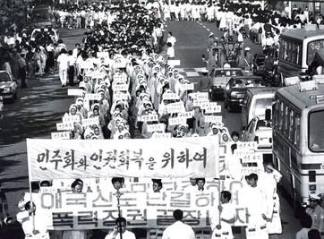

# 1987年六月抗争

<b>1987年六月抗争</b>

夜越深，离天亮就越近，独裁政权的高压亟待民主化黎明的到来。在釜山，这种征兆也零星可见，首先表现出来的就是民主化运动组织纷纷开始崭露头角。

20世纪80年代初，釜林事件与釜山美国文化院纵火事件将原本就不那么稳固的釜山民主化运动圈扼杀在了萌芽状态。但是随着当年被送进监狱的人大批出狱，他们扎根于许多团体，开始到处活动。于是，地基拓宽了，生机出现了。

1987年1月发生了首尔大学学生朴钟哲被刑讯致死事件。负责的警察发表了一个荒唐的解释：“调查人员‘当’敲了一下桌子问他话，他‘呃’了一声突然就倒地死了。”所有国民都愤怒了，釜山的气氛尤甚。牺牲者就是釜山人，他的父母也生活在釜山，就连“末七”都是在釜山祭奠的。可以说面对独裁政权的政治高压，釜山人的愤怒是最激烈的。

2月7日，朴钟哲国民追悼会准备委员会在全国多地同时举行了朴钟哲国民追悼会，卢律师与我都参加了准备委员会，而实际筹备“釜山地区国民追悼会”的正是釜民协。

我们将追悼会的地点定在了釜山市中心的大觉寺，但是警察提前把大觉寺围了个里三层外三层，封锁得比罐头还严实，根本不让人们靠近。警方还试图向进入的市民投掷催泪弹。围在大觉寺外边的大学生高喊着口号“还我钟哲!”，与警察对峙，但始终无法进入大觉寺。

我们不能就这么撤退！釜民协的人急忙在路边召开紧急会议，临时决定在南浦洞釜山剧场前面的马路上举行简易追悼会，秘密将人召集到那里。

在约定好的下午2点钟，市民、学生300多人聚集在一起，正式举行简易追悼会，人们高唱爱国歌曲与运动歌曲，发表谴责演说，卢律师当场朗诵了悼词。这是自1979年釜马民主抗争以来，第一次举行的街头时局集会，很快就聚集了大批市民，马路被堵得水泄不通。

警察过了很久才弄明白是怎么回事，包围了集会周边，与白骨团[注：白骨团：指20世纪80年代至90年代由便衣警察组成的警察队伍，头戴白色头盔，因此被称为“白骨团”。]一起强行进入。釜民协常委们纷纷挺身而出，保护那些因恐惧而发生动摇的市民与学生。他们挡在市民、学生与警察之间，在马路上坐下，开始静坐示威，卢律师与我也在其中。

紧接着，警察朝静坐的人群胡乱投掷催泪弹，我们躲也没处躲，只能在原地等着被击中。到处是浓烟，这时，警察闯了进来，突然把我们抬走，强行装进了“鸡笼车”[注：鸡笼车：玻璃窗外加装铁丝网的警用车的通俗叫法。]。因为催泪弹的原因，上了“鸡笼车”很久我们都睁不开眼睛，这样我们被抓到了釜山市警察局的对共分室。这天的简易追悼会组织得非常成功，即使我们被抓走之后，一万多人的游行示威也一直持续到了晚上。这一事件成为六月抗争事件的引爆剂。

警察将那天集会抓走的人进行了分类——律师、宗教人士、在野团体骨干、进步青年和学生，给不同领域的代表提出了逮捕令申请。律师行业被抓走的是当天在马路上静坐的金光日、卢律师与我三人，作为律师的代表，警察对卢武铉律师申请了逮捕令。

那时，卢律师已经成为釜山人权律师中最让警察头疼的人了，而且他被抓走之后，拒绝回答任何问题，这种不合作的态度可能让警察也感到束手无措。当时法律规定：不管是紧急拘留还是逮捕现行犯人，48小时之内如果没有批准逮捕令就必须释放。当时警察没有对金光日律师与我提出逮捕令申请，但还是对我们实施了拘留，而且48小时之后依旧不肯放人。

我们一直在计算着时间，到了48小时，我们就出来高喊“我们要回家”。他们就让特警挡住走廊，不让我们走开。我们喊着口号对峙了一会儿，无奈只能再回到房间里。过一会再出去喊口号，再对峙。这种情况大约每隔一个小时就重复一次。我们被带走的时间是2月7日下午2点30分左右，结果金光日与我在2月9日晚上6点才被释放，被拘留的时间远远超过了48小时。

我们一获得自由就开始担心卢律师的安全，连忙赶到了事务所。当时卢律师的逮捕令申请已经被驳回了，但据说检方再次申请了逮捕令。

逮捕令既然已经被驳回就应该立刻放人，但是，他们既不放人，又隐瞒被驳回申请的事实，反而再次申请逮捕令。得知这个情况我们气得火冒三丈，决定不能就这么干等着！

我们直接找到了专门负责此事的值班部长法官办公室，当时再次提出逮捕令申请的釜山地检公安部长也在那里。岂有此理！我故意高声抗议：“公安部长您为什么在这里？是不是要怂恿法官批准逮捕令？逮捕令已经被驳回，为什么还不放人？我会记住这个问题的！”我喊的声音很大，故意让所有人听到，公安部长的脸涨得通红，不知如何是好，只能落荒而逃。

正巧，当时大韩律师协会人权委员长柳宅馨律师与人权委员河炅喆律师，为了调查事件真相，也来到了法官办公室。他二人强调他们是大韩律师协会派来调查事件真相的，逮捕令既然已经被驳回，如果法官批准了检方的再次申请，协会不会坐视不管的。

经验丰富的柳宅馨律师还不失时机地吓唬那位法官，“现在大韩律协的会则修正案已经在理事会上决定，对于那些在时局案件处理中违背人权的法官、检察官，将来不予以进行律师登记”。其实就是告诫那名法官如果逮捕令批准不当，将来他不做法官的时候，很可能也当不了律师。事实上，大韩律协人权委员会内部确实有这种讨论，但是会则修正案还没有到理事会商定的阶段。

值班的部长法官思考了许久，干脆直接下班了！他说出去吃个饭，结果就一去不复返。我觉得这是个相当高明的处理方法！当时检方并没有正式处理再申请，是公安部长拿着逮捕令申请书当面去找法官的。因此，部长法官不做任何处理一走了之，检方也无话可说。在当时的时局案件中，像这样秘密申请逮捕令的行为非常盛行，但这一次他们却碰了钉子。

检方当时就炸了，乱成了一锅粥。对现任律师申请逮捕应该按照大检察厅公安部的要求，得到法务部长许可，但是没拿到法院的逮捕令就意味着釜山地检公安部要背上无能的骂名。

就在卢律师被扣留的这一夜，公安部长急得跟热锅上的蚂蚁似的，拿着逮捕令申请书辗转于几位部长法官的家。其他的部长法官当然更不可能接受了，都推脱道：“这应该是值班部长管的事，干吗来找我？”他甚至还去找了首席部长法官，也遭到了拒绝。最后他又去找法院院长，依然没用。

终于，卢律师于次日清晨被释放了。警察不能再继续扣押他了，只能无奈地放他回家，还一直跟踪到他家，在那里守了很久，直到他们得知逮捕令彻底没有可能了，才于凌晨撤回。

这个事件让卢律师一下子名震全国，各路媒体纷纷报道“一夜之间四次驳回逮捕令”，这次事件向世人展示了大韩民国的社会现状，也从侧面展示了当时釜山地区人们对当局的高涨抵抗情绪。

警察对卢律师等三位律师的非法拘禁不能就这么算了。釜山地方律师协会决心对此事提起刑事诉讼，但是最终还是不了了之。虽然逮捕令被驳回了，但是检方依然可以对卢律师实行不拘留起诉。因此，只要检方不进行不拘留起诉，律师协会也就不再进行追究。但是后来卢律师因“大宇造船事件”被拘留时，检方还是追加起诉了这次的事件。

时局正式朝着伟大的“六月抗争”直奔而去，全国上下掀起了民主化的浪潮。釜山的情况更是如火如荼，从1987年初开始，风起云涌的民主化风潮在釜山刮得格外凶猛。四一三护宪措施[注：四一三护宪措施：1987年4月13日，全斗焕为了拒绝国民提出的民主化要求，实施终止一切改宪讨论的措施，该措施的颁布适得其反，让国民的民主化热情更加高涨。在这一过程中，此前官方隐瞒朴哲焕刑讯致死事件的真相被揭露出来，触发了1987年的六月抗争。]出台后，民众的反抗变得更加激烈。知识分子阶层最先行动了起来，各种时局宣言喷涌而出，从大学教授逐渐扩散到其他知识分子团体。我记得釜山最先发表时局宣言的就是律师、牙医和药剂师。卢律师与我集合了24位釜山律师的签名，发表了《釜山律师时局宣言》，要求撤回护宪措施、改宪法为直选制，这一行为在釜山律师界史无前例。

一时间，釜山市内到处可见街头示威，市民的反映则非常友好。每当示威队伍高喊口号前进时，路边的市民就用掌声表示鼓励。商贩们也不顾对生意的影响，见到示威队伍还帮他们藏身。警察要上前抓捕示威者，路上的行人与商人就站出来批评警察，阻止他们抓人。很多人给示威队伍送来面包、饮料，看见发宣传单的，市民们当场募集资金，让他们拿去当作经费。

同年5月，在“釜民协”基础上又成立了“釜山国本”。“国本”是“争取民主宪法国民运动本部”的简称，是韩国建国以来民主化运动组织中首屈一指的超大型组织，囊括了所有民主化运动团体以及在野党团体。“釜山国本”也是如此。

其实“釜山国本”比首尔的“国本”成立时间还要早，是全国最先成立的。卢律师担任“釜山国本”的常任执行委员长。此前，人权律师的责任通常限定于为团体提供法律支持和资金支持，而常任执行委员长的职责则超出了这个范畴，需要走上街头领导集会与示威。这本不是律师应该做的，但卢律师自请出马。我也担任了常任执行委员一职。

1987年6月，釜山地区在“釜山国本”的指挥下，几乎每天都会爆发街头示威，示威人数比全国任何地方都多，情绪也更为高涨。每天市中心的示威都持续到深夜。卢律师总是跟示威队伍一起坚持到示威结束，还到处视察示威情况，然后去中部教会，总结当天的全部情况，再制定第二天的计划，最后才回家。看到示威规模日渐浩大，示威热情不断高涨，以及市民的积极响应，我们能感受到军部独裁政权正在走向崩溃。

这时传来消息：首尔的明洞教堂占领示威[注：明洞教堂占领示威：1987年6月10日，示威队伍在首尔举行大规模示威游行，被警察驱赶至明洞教堂，在孤立无援的情况下举行了6天5夜的占领示威。他们的抗争使首尔的六月抗争得以持续，但坚持了6天就自动解散了。]活动解散了，抗争态势转弱。首尔与其他地区的示威人数迅速减少，就此下去很可能又会不了了之。

但是釜山的情况则完全不同，这里的情绪反而还在高涨。此前，首尔明洞教堂在活动中起了核心作用，以卢律师为首的“釜山国本”指挥部协商决定将这个核心作用转移到釜山来。他们很快就得到了“实现正义祭司团”的协助，在釜山天主教中心组织了占领示威。后来，一直到六月抗争结束，釜山天主教中心一直都像此前的明洞教堂一样，成为抗争运动的核心。

更多的釜山市民也参与进来，示威时，从西面[注：西面：釜山的一个地名。——译者注]到釜山市政厅、KBS电视台的路口，主干道都被示威队伍占据了。这里仿佛成了“解放区”。釜山的坚持使得全国的示威状况愈演愈烈，让一度销声匿迹的首尔等地的活动声势又重新燃烧了起来。大家都觉得很有成就感。

  看到示威规模日渐浩大，示威热情不断高涨，以及市民的积极响应，我们能感受到军部独裁政权正在走向崩溃。 

大约是6月20日，有消息传来：釜山启动了卫戍令，即将投入军队。这个消息反而带给我们更多的力量，让我们觉得独裁政权已经被挤到了墙角，而釜山正手握对方的命运，这让我们信心倍增。卢律师和我都认为：“不能在这时候屈服，只要挺过了这道难关，就能获得胜利！”后来，事实证明，当年启动卫戍令和投入军队确有其事，出动的兵力都已经集结完毕，只是因为内部有人反对，没有实施而已。

于是就有了六二九宣言[注：六二九宣言：1987年，执政政府发表的一个涉及多方面改革措施的宣言，宣言包括下一届的总统竞选开始直选制。——译者注]的诞生，这份宣言其实已经意味着军部独裁政权投降了。当然也有很多人说“六二九宣言并不是结束，这只是一种欺骗手段，应当坚持到最后”！当时我们已经争取到了总统直选制改宪[注：直选制改宪：韩国于1987年修改宪法，宪法规定，韩国总统由韩国国民通过直接选举的方式选出，任期为5年，而且不能连任。——译者注]，如果要继续抗争下去实在太难了。在之后的直选制总统选举中，“两金”分裂[注：“两金”分裂：“两金”指的是当时在野党两位领导人金大中和金泳三，国民热切期盼他们能够在候选人选举过程中实现单一化，以实现民主势力的胜利，但他们各自为战，结果导致总统宝座被全斗焕的继承者卢泰愚抢走。]导致民主阵营未能取得总统竞选胜利，但那就不是市民的责任了。

六月抗争是一次依靠市民力量推翻军部独裁政权的伟大市民民主抗争。我一直认为，六月抗争应该成为我国民主化运动史上评价最高的运动。四一九事件[注：四一九事件：1960年，韩国总统李承晚执政时期，学生发动的民族革命运动。——译者注]或者光州抗争[注：光州抗争：1980年5月18—27日，发生在韩国光州，是一次由市民自发组织的民主运动。——译者注]具有太多的偶发性，或自然形成的因素。而六月抗争成立了“国本”这个从一开始就目标明确的联合斗争机构，在其指挥下有计划、有组织、始终一贯地开展运动，直至争取到直选制改宪，这一历程可能是我国民主化运动史上唯一的一次。

虽然六月抗争是一次全国性的民主化运动，但是我认为该运动的中心不是首尔，应该是釜山。釜山最早建立了“国本”，抗争期间也是釜山的运动热情最为高涨，还起到了点燃其他地区示威热情的作用。更关键的是，明洞教堂占领示威解散后，首尔等地的示威形势急转直下，多亏了釜山在天主教中心组织占领示威活动，以及更多市民展开的声势更为浩大的示威活动，才又点燃了抗争的火花。而这是引导抗争走向最后成功的原动力。

为此，我觉得在整理六月抗争的历史时，釜山的历史作用并没有得到应有的评价，对于这种以首尔为中心叙述历史的事实我感到很遗憾，不能不说这是以首尔为中心的思维方式的产物。

当然，釜山市民也得对此负责，三党合并[注：三党合并：1990年1月，由卢泰愚总统担任总裁的执政党民正党与两个在野党（金泳三任总裁的统一民主党，金钟泌任总裁的共和党）合并，组成民自党。当时的卢泰愚政府要改变“执政党弱小、在野党强大”的政治局面，秘密约定改宪法为内阁制，以此为条件实现三党合并，组成了庞大的执政党。]以后，釜山的市民意识趋于保守，对六月抗争的正确评价问题也不够重视。

在三党合并以前，釜山人充满了自豪感。从釜马抗争结束了维新独裁，到六月抗争埋葬了“第五共和国”，只要釜山站起来，历史就会改变。釜山拥有如此之高的市民意识，一直是传统的“在野党之都”。然而三党合并以后，釜山摇身一变成了“执政党之都”，直至今天都还是清一色的大国家党，着实让人扼腕叹息。

还有一点，当明洞教堂占领示威解散之后，其他地区的抗争热情也迅速下降，而釜山却以更加饱满的热情展开了示威，这一切的发生绝不是偶然的。“釜山国本”抗争指挥部一直都在密切关注全国示威形势的发展走向，对当时的情况变化保持着警惕意识。为了把这个减弱的势头在釜山扭转过来，指挥部通过在天主教中心组织占领示威活动，有组织地提升示威的强度。

我们的意图实现了，看到全国抗争的热情在即将熄灭之际又被重新燃起，我们在心里默念：“这是我们努力的！”当时我们产生了巨大的自豪感，以及胜利的喜悦感，现在想来一切仿佛还在昨天。

当时“釜山国本”抗争指挥部能够与市民一起扭转示威局势是有原因的，釜山与其他地方不同，釜山的律师、牧师、神父等指挥部成员直接走上街头领导了抗争。若非如此，示威强度怎么可能想提升就提升？卢律师站在抗争的中心，我就站在他的身边，这一场景真让人感到自豪！

即使这样，日后卢律师涉足政界时，首尔的民主运动圈都认为他并非来自运动的主流，而是来自支流。这又是以首尔为中心的思维方式，也是民主化运动阵营内部蔓延的学阀主义、精英主义的产物。在我看来，至少在“第五共和国”时期，像卢武铉律师这样奋不顾身、热情百倍地投身于斗争之中的，没有第二个人。
 

