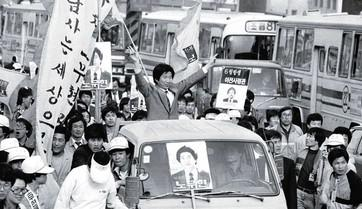

# 送卢律师去国会

<b>送卢律师去国会</b>

1988年4月，卢律师在第13届国会选举中当选国会议员。当年伊始，统一民主党总裁金泳三向他发出邀请，当时“两金”在大选中失败后，竞相聘请在野人士到自己麾下。

另一个被聘对象是金光日律师，他很早就下定了决心。卢律师没有自己拿主意，而是先找到在六月抗争中并肩作战的民主化运动人士们一起讨论。提出反对意见的也不少，釜山地区传统上就是搞民主化运动、市民运动的，很多人对进入政坛比较排斥。

当然持赞成意见的也很多，他们认为六月抗争所遇到的挫折，应努力用政治手段去实现。我是赞成派的。我感觉他自己还是想去的，而且我断定他要是参加竞选一定能被选上。卢律师个人没有什么野心，只是觉得当了国会议员就能更好地帮助劳动者。当时他的律师业务被暂停了，这一点也有些影响。对于卢律师参政这件事，最终赞成意见还是占了上风，他本人也就此下定了决心。

不论他自己还是支持他的人都充分意识到，这不是为了追求个人的功名，他是作为釜山民主化运动的代表被派去首尔的。因此，民主化运动阵营在选举中才积极配合，他们搞选举就像搞民主化运动一样。

参选的第一个问题就是选区的选择问题。从卢律师决心竞选国会议员那一刻起，所有人都认为他会把住了很久的釜山南区定为自己的选区。统一民主党也是这么想的，特意把釜山南区给他空了出来。当时在釜山，那里的现代化公寓最多，居民的民主意识也最高，搞选举实在是再好不过了。

但是卢律师没有选择那里，而是决定将与自己非亲非故的釜山东区作为自己的选区。当时许三守是新军部与“第五共和国”[注：新军部与“第五共和国”：新军部指的是朴正熙总统死后，发动军事政变掌握军部、夺取政权的军部势力。全斗焕、卢泰愚、郑镐溶等陆军士官学校毕业生以第11、12期生为中心组成军事组织——“一心会”为核心力量，他们将代总统崔圭夏赶下台，让全斗焕当上总统。由他们建立的政权就是“第五共和国”政权，该政权后因发动军事政变以及镇压光州民主抗争被判发动内乱罪。]的核心人物，也是该地区的民正党候选人，因此卢律师故意要在这里与他来个正面对决，他把这看成对“第五共和国”发起的审判。很多人都劝他不要这样，但他心意已决，丝毫不为所动。真不愧是卢武铉啊！

釜山民主化运动阵营决心联合起来一起帮助金光日、卢武铉两位律师参加选举，其实运动圈中大部分人都是想帮卢律师的。一呼百应是必然的，从“第五共和国”之初到六月抗争，卢律师一直都是釜山地区民主化运动的核心力量，所有人都是曾经接受过卢律师帮助的被告人，来帮忙是人之常情。尽管卢律师正式开展竞选活动前，运动圈里的西尼尔集团（Senior Group）已经决定支持金光日律师，因为他们与金光日律师有些渊源，但这边人数还是较少，因此我负责总管金律师的选举活动，卢律师的这次选举我没能直接帮忙。

那次选举活动中，卢律师使用的选举海报，我现在还记忆犹新。那是一张黑白照片，背景是釜山东区贫民区的板房，卢律师的形象很朴素，但是目光坚毅地站在那里。拍照用的就是运动圈的照相机，海报也是运动圈的印制企业负责印刷的。选举口号是“人活着的世界”，海报与口号实在太匹配了！让人印象如此深刻的竞选海报，此前我从没见过，之后我也没见过。卢律师做了国会议员之后，不能再用那个选举海报了，但是当年的竞选口号“人活着的世界”却一直沿用下来，甚至他当了总统，卸任之后，为人题词还经常用这句话。也许他觉得即便自己当了总统，距离“人活着的世界”还是很遥远，所以这个理想一直有效。

卢律师刚当选就成了国会听证会[注：国会听证会：1988年11月为调查“第五共和国”的腐败案件，国会发挥国政监查权而召开的一系列听证会。其中有为深挖“第五共和国”的腐败与政商勾结真相而召开的日海财团听证会，调查“一二·一二事变”的非法性、“光州民主化运动”的命令下达人及为调查事件真相而召开的光州民主化运动听证会，调查“裁并媒体及解雇媒体人”等政府控制言论行为的听证会。当时卢武铉任听证会委员，尖锐的质疑与直击要害的谴责使卢武铉一跃成为政坛新星。]的明星，让我们备感骄傲。虽然这一时刻备感光荣，但是挫折与痛苦也随之而来。每当我看到他遇到挫折、无比痛苦的样子，就后悔当初赞成他进入政界。每当身心俱疲的时候他也会开玩笑似的说：“是你们让我搞政治的，你们总得对我负责吧！”

  选举口号是“人活着的世界”，海报与口号实在太匹配了！让人印象如此深刻的竞选海报，此前我从没见过，之后我也没见过。 

其实，我也有那么两三次劝他重新做回律师。国会议员落选时，我也劝过他：“不是让您永远放弃政治，与其受苦受累地在国会外活动，不如重新做律师，一边搞人权律师活动和地区活动，一边打好地区根基。什么时候觉得可以放手一搏，再出来参加选举，这样不是也行吗？”但是政治这个东西，一旦涉足，就再也拔不出来了。

彻底远离政治的机会也不是没有。他放弃钟路[注：钟路：钟路区，是首尔特别市的中心地带。这个地区地域主义色彩不浓厚，是韩国地区传统的政治活动中心地带，有比较好的政治氛围，卢武铉当选的可能性较高。——译者注]选区，在釜山江西选区参加竞选，结果落选的时候，他对我说：“如果这次失败，就再也不搞政治了。”可虽然他落选了，却奇迹般地感动了国民，大家觉得他是讲原则的政治人，还落了一个“傻瓜卢武铉”的名头。他借此得以东山再起，最终登上了总统之位。可是，在经历了悲惨的命运后，我心中始终存有悔恨——还是应该从一开始就劝阻他踏入政界。
 

