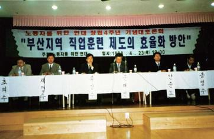

# 一个人留下

<b>一个人留下</b>

卢律师离开律所后，我留了下来，我要一个人处理此前我们二人共同承担的任务。此前都是卢律师承担主要责任，我在旁边帮忙就好，现在我得独自承担了。好在事务所的运营不成问题，因为卢律师很久以前就不再插手一般案件了，后来他的律师业务一度被迫暂停，一直都是我一个人打理律所业务。

在卢泰愚执政时期，时局案件、劳动案件还是层出不穷，釜山庆南地区的运动“中心”作用也一如既往。人们冲着人权律师的名声都愿意找上门，其中很多案件与时局并无关系，只是情况很可怜罢了。我还负责了集体信访案件，事情多得一个人根本吃不消，经常要带着公文包回家，准备审判材料，整理辩论书面材料，一直到凌晨。孩子们都觉得律师是3D[注：3D：Dirty脏，Difficult困难，Dangerous危险。——译者注]行业，即使这样，我也认为这是我的分内之事，总是以积极的心态投入工作。我一想到能够用自己擅长的知识去帮助别人，就感到无比幸福。

那时工作很多、很累，却是我生活中最为安定的一个阶段。我不敢说在每件事情上都做到了极致，但是感觉在个人与社会责任感之间找到了一个很好的平衡点。

就像卢律师带我入行一样，我也从司法研修院结业生中接收了一位又一位律师，给律所增加了人手。虽然我们律所不那么赚钱，但是新律师们都认可我们的价值取向，自愿帮我们分担责任。

也有些律师知道我们事务所几乎总揽了釜山、庆南地区的劳动案件，自己也想做劳动律师，就主动找上了门来。1995年时，我们所的律师已经有五位，到了律所发展的关键期，我们共同创立了综合律师事务所。现在的“釜山综合律师事务所”也是由我担任代表律师，卢律师从首尔回到釜山时也曾在这里担任专职律师，直到后来他当上总统，才不做律师了。现在“釜山综合律师事务所”不仅仅是“为了民主社会而生的律师组织”，而是每个人根据各自的兴趣，或做人权团体，或做市民运动团体，抑或做劳动运动团体，在各个领域各负其责，各司其职。

卢律师进入政界后，釜山地区的民主化运动阵营也进一步分化为市民运动、环境运动、劳动运动、民众运动等领域。市民运动和环境运动领域参与的人比较多，条件也好，因此我主要集中于劳动运动以及支援劳动团体活动方面。

釜山劳动问题研究所成立于1987年下半年，卢律师也一度参与其中，直到后来当上国会议员才离开。1989年4月釜山地区所有劳动咨询所被整合到一起，成立了釜山劳动团体协会，这个团体相当于1994年4月成立的“为了劳动者的联合”。

“为了劳动者的联合”汇聚了律师、牙医、韩医师、药剂师及其他医疗界人士，它的成立是为了支援劳动运动及劳动团体。现在它作为社团法人依然存在，以这些民主运动团体为途径，我把自己的工作重点放在了支援劳动团体的创立及其日常活动上。

六月抗争以后劳动运动呈现了井喷态势，到处都在探索成立劳动团体。但那时的劳动者对于劳动团体该如何设立，规章制度该怎么写，成立之后团体协议该怎么缔结、该写什么内容并不清楚，也没什么地方能够为他们提供系统性的咨询服务与帮助。“釜山劳动问题研究所”应运而生，承担起了这个责任，我们准备了成立劳动团体所必需的全部文件，在我们帮助下成立的劳动团体多达200余个。

釜山劳动团体协会与“为了劳动者的联合”都采用团体会员制。一旦成为团体会员，就会有律师担任劳动团体的顾问律师，有医疗人员为他们提供产业安全、保健咨询，同时还为劳动团体成员提供医疗费用优惠等服务。

“为了劳动者的联合”下面的劳动团体会员曾达到130个，没人追问这些劳动团体的上级是“韩国劳动团体总联盟”还是“民主劳动团体总联盟”。我为这些团体会员定期提供巡回法律咨询服务及干部教育服务。现在这两大联盟内部已经设有法律援助机构，甚至还有专职律师，大部分问题的解决已经不再需要外部支援了。他们已经有了自己的生命力。现在想来一切都恍如隔世。

  “为了劳动者的联合”汇聚了律师、牙医、韩医师、药剂师及其他医疗界人士，它的成立是为了支援劳动运动及劳动团体。现在它作为社团法人依然存在，以这些民主运动团体为途径，我把自己的工作重点放在了支援劳动团体的创立及其日常活动上。 
 

