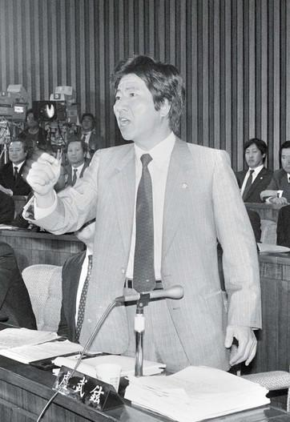

# 与地域主义做斗争

<b>与地域主义做斗争</b>

卢律师现在已经成了卢议员，去首尔后他很快就成了万众瞩目的焦点人物。他不仅是全国听证会上的明星，还是其他议政活动中初选议员的佼佼者。但是，真正将他锻炼成政治领导人的并非当选国会议员，而是他败选的经历。自从他反对三党合并后，一直以来为了追求心中的正义，经历了无数挫折与失败的洗礼，正是这些洗礼最终将他送到了总统候选人的队伍之中。

虽然国民对卢武铉的评价很高，说他“不惜损害自身利益”，是个“讲原则的政治人”。但现实中的他是无比痛苦的。

卢武铉在国会活动的时候，时而因经费不够联系我，我除了借点钱别的忙也帮不上。他做着自己认为有价值的事，而我干着自己觉得有意义的活。

卢武铉第一次跟我说要参加总统竞选是第15届总统选举时，当时李仁济不满意在野党的竞选活动，宣布退党、独立竞选，他就说：“绝不能容忍这种不遵守规则的行为！”他说自己要以在野党候选人身份出来竞选，当时所有人都反对。

我也反对。我觉得此时参与竞选为时尚早，如果把目标放在下届大选，多少还能考虑一下。虽然卢武铉当时“听证会明星”“讲原则”的形象很好，但“扔名牌”“辞职议员”的名声也给人们留下了格格不入的印象。如果此时他突然宣布竞选总统，很可能又会被看成是格格不入的莽撞行为。他接受了周围人的反对意见，但把这个想法放在了心中，踏踏实实地做起了准备工作，组织企划队伍，也开始努力学习。

2000年国会选举时，卢武铉来到釜山参选，当时心里也是存着这个计划的。我反对他为此离开议会选择釜山选区，我的意思是“如果您是为了竞选总统，现在来釜山根本没有什么用，反而会起副作用。釜山出身的YS[注：YS：韩国前总统金泳三名字的英文首字母缩写，这是一种亲切的称谓。]就快要结束总统任期了，这么短的时间内可能会再选釜山出身的人当总统吗？就算当选了十有八九也只是个地方诸侯。我觉得您在议会当选，摆脱了地域色彩对大选更为有利，那样还能利用您岭南出身的有利条件。朴灿钟不就是离开了釜山在首尔竞选国会议员，后来当了总统候选人吗？”我这么说也是不想再看到他经受败选的痛苦打击。

但是我依然拗不过他的固执，他一心要打破地域主义的牢笼。这个愿望太强烈了。1995年他参选釜山市长时，周围的人，以及参谋们都劝他以无党派身份出马，他却说那样做没有什么意义，最后也没听。

其实我觉得如果卢武铉在2000年的国会议员选举中成功当选了，他的总统选举之路可能就会往后推一推。可是偏偏造化弄人，他又一次落选了，但却因此收获了大量的支持与声援，这些支持与此前不一样，这些是集体性的，充满对他成为国家领导人的期待。这一次超越了单纯的支持，引领着他走向那条大道。

终于，2001年9月6日，卢武铉在釜山正式宣布将要竞选总统。

  他做着自己认为有价值的事，而我干着自己觉得有意义的活。 
 

