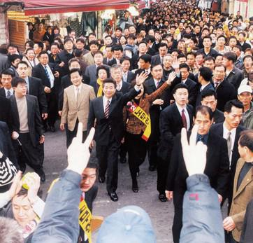
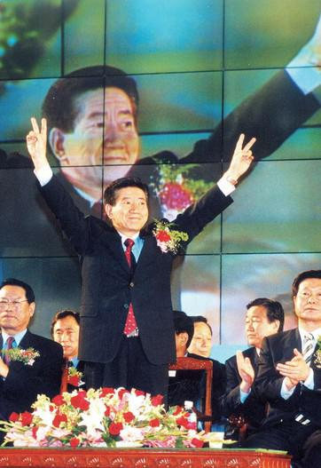

# 2002年的感动

<b>2002年的感动</b>

此后，卢候选人正式踏上了自己的大选之旅，但是他的道路却与众不同。周边的参谋们劝他应该培养组织，准备资金，可是他却召集了各领域的专家，组成学习小组，努力学习国政运营的相关知识。

卢候选人邀请外交安保、教育、福利、经济等各领域的年轻专家，听取报告，共同讨论。他一半以上的竞选活动日程都用于学习了，很多当年帮他学习的专家后来进了参与政府，也是杰出的人才，外交安保领域的李钟奭部长就是其中最具代表性的一位。卢候选人在竞选时所表现出的卓越的辩论能力与当选总统后展现出的非凡智慧就是通过那段时间的学习取得的。这样的竞选准备实在太有卢武铉特色了。

在民主党候选人国民竞选阶段，我负责了釜山与蔚山的国民竞选。当时是从登记的选举人中，根据既定选举人的人数，抽签决定选举人团。问题的关键是当民主党联系每一位登记过的选举人时，保证选举人员中有直接参加意图的人数尽可能高。简单说就是尽量确保忠诚度高的人越多越好。过去都是以职能团体为主，弄个名单或者随便弄些人来，而这次不行，我们尽了全力来确保有实际投票意愿和支持意愿的人越多越好。

在釜山、庆南地区，我们把能用的办法都用上了，联系了原来搞民主化运动时所积攒的人脉。我对蔚山地区最有信心，这里劳动圈的力量本来就很强劲，我与卢武铉长久以来又积攒了大量劳动圈人脉和支持，这些支持终于没有辜负我们的期望。在釜山，民主化运动阵营全体出动，卢候选人的母校釜山商业高中自不待言，当时所有民主党的人也都是非常善意的。在选举人团登记这一轮博弈中，我们赢得很漂亮。

感动的一幕在光州上演。后来我们才知道，光州以及其他地区底层社会的人们付出的努力丝毫不亚于我们，这才取得了最后的成功。最终卢武铉被确定为民主党大选候选人。然而，一切才刚刚开始。

组织各个地区的选举对策本部时，我担任了釜山选举对策本部部长。如果活动初期的较高支持率能维持下去的话，我本可以不当这个部长，估计卢候选人也不必非得邀请我，可当时情况非常不理想，我不得不负起这个责任。

卢武铉成为党内候选人后在地方选举中惨败，支持率下降。除此之外，民主党国会议员对候选人态度摇摆不定，使得支持率再次下降，党内有人主张更换候选人，有人退党，支持率持续下降……这是大选中最痛苦的一段时期。

我们身处釜山，想帮忙也伸不上手。我们只能与那些妄图把候选人拉下马的阴谋作战，组织活动守护候选人。当时的情况万分危急，我们向大学教授以及各类知识分子团体请求援助，釜山各个领域相继发出了支持宣言，继而发展到全国。为此我还经常往返于首尔与釜山之间。最终，卢候选人英姿飒爽地一步步突破重围，意志坚定，毫不动摇。胆量与毅力让他闯过了一道又一道难关。

事情的转机出现在他与郑梦准的候选人单一化[注：单一化：在总统竞选时，为了能够保证成功竞选，实力较弱的几个候选人共同推举一名实力较强者作为选举候选人的行为。成功后大家按照事先协商的方式共享竞选后的成果。——泽者注]上。当时卢候选人很是苦恼，我建议他必须跟郑梦准单一化，而且我认为单一化的最好方式就是进行民意调查。

当时为了单一化而搞民意调查是一种很冒险的行为。卢候选人本来就在民意调查中落后很多，为此民主党和首尔方面的人对进行民意调查表示了很大的忧虑。可是最终这个对自己明显不利的选择却增加了人们对他的好感。

真正令卢候选人烦恼的并非民意调查，而是另有其他。他担心的不是“那样做了我能赢吗，不行的话怎么办”？而是一旦他失败了，他能够真心诚意地去帮助郑梦准参加竞选吗？

他与郑梦准在本质上太不一样了，如果他失败了，就要把对方的选举当作自己的选举一样到处奔走，要下这个决心实在太难。但是他接受了——既然要单一化，那么自己一旦失败，帮助郑梦准就是义不容辞的责任。如果没做好这样的心理准备，那就干脆不要单一化。我相信如果当年失败的是卢候选人，他一定会像自己参加竞选一样为郑梦准四方奔走。在候选人单一化阶段，戏剧性的场面又一次上演了。

可是还有难关在等着他，比单一化更困难的挑战是郑梦准提出“联合政府”的主张，事实上就是要求卢候选人交出“一半的权力”，不仅如此，还要求必须落实在书面上。郑梦准所说的“一半”也不是随随便便的一半，他甚至指定了要分享内阁的哪些职位。如果不同意就一拍两散。

民主党内大部分人同意这样，他们说反正也是“政治约定”，将来可以根据情况随机应变。他们想说服卢候选人，或者说强迫他接受。太多的人都这么说，弄得他非常疲惫。他来询问我的意见。

我讲了曾经的“原则”，“我们走到今天，经历了无数难关，每次遇到困难的时候最正确的处理方法就是按原则办事，回往过去，我一直觉得讲原则是最好的选择。即使当时这个选择让人难以为继，事后总会发现那是正确的。我认为卢候选人的拒绝是正确的”。在他无比孤独的时候，得到了我的支持，他非常高兴。

选举到了最后关头。在投票前两天，釜山西面的十字路口聚集了无数市民，那可真是人山人海。这是最后一次在釜山进行的竞选活动。在市民雷鸣般的掌声中，卢候选人英姿勃勃地登上了演讲台。他的演讲紧扣心弦，与过去他参选国会议员和竞选釜山市长时都不一样，完全上了一个层次。不仅是口才，他对经营整个国家的宏观认知也不可同日而语。我能感受到卢候选人决心竞选总统后，经历了怎样的认真学习、苦苦思索。他的演讲完全可以说是精彩绝伦，以至于让人难以置信语言在政治演说中如此具有感染力！围观的市民完全沉浸在他的演讲中，连我也重新做回一名普通市民，与所有人一起沉醉，一起感动，一起疯狂。根据那天的情景来看，我们没有理由失败！

决定2002年大选命运的关键一天，不是大选的当天，而是大选的前一天！这样的选举胜况还会再重现吗？

就在选举前一天夜里，郑梦准突然宣布取消候选人单一化约定，撤回对卢候选人的支持。一时间全局震动，竞选氛围惨淡，一切好像马上就要崩盘一样。

首尔的几个主要人物全都劝卢武铉直接去找郑梦准。他们劝不动卢候选人，就给我打电话。前任议员金元基说：“我们怎么劝，卢候选人也不为所动，居然还睡觉！”大家想让我把他叫醒劝劝他。他最终还是去了，结果吃了个闭门羹。电视上他凄凉地转身回去的情景反而让支持者们出离愤怒了。

  在市民雷鸣般的掌声中，卢候选人英姿勃勃地登上了演讲台。他的演讲紧扣心弦，与过去他参选国会议员和竞选釜山市长时都不一样，完全上了一个层次。 

第二天，我们所能做的就是一个，鼓励大家去现场投票来提高投票率。釜山对策本部的电话小组本来在一天之前已经解散了，情急之下我们把人又重新找了回来。不仅是电话小组的人，对策本部所有人无一例外都拿起电话打给自己认识的人，鼓励对方去投票。我们以为只有我们这样做，后来发现很多国民也都在这样做。民心所向，我能感受得到。

选举对策本部办公室每到整点都要拿投票率与民调结果进行分析。通常上午去投票的都是年龄比较大的人士，我们落后是很自然的。到了上午11点左右，民调结果虽然还是落后但是出现了不一样的趋势——差距在明显缩小。过了下午一两点，已经有人判断我们会赢。首尔情况室的李光宰也做出了同样的判断。

下午的民意调查出现了彻底的逆转，我们有信心了。下午六点，对策本部所有人都坐在办公室电视前。最终的民意调查结果发布了，与预想的一样，我们取得了胜利！所有人都抱在一起欢呼，庆祝胜利，有人还高兴得哭出声来。我激动得心脏都要跳出来了，那一天是我一生中最高兴的日子之一。

当选的消息一经确认，人们都欢呼着涌上街头。釜山完全是一派节庆气息。大街上挤满了并肩前进的人群，他们拥抱彼此高呼万岁，或大声歌唱，或高喊口号来庆祝胜利，这天，我是多么想走进人群，跟人们一起庆祝啊！

我不禁产生了担忧，这么多人同时出来，会不会发生什么意外情况？我赶紧给釜山警察厅长打电话，请求他们的协助。即使这样我还不能放心，又到处去查看街上的情况。令人安心的是，市民都很遵守秩序，尽情享受这个胜利之夜。警察也很理解市民们的心情。有人认出了我，挤过来跟我一起庆祝，这是多么美妙的夜晚啊！

这里是我与卢律师一起顶着催泪弹走过的街道，我们也曾高喊民主的口号在这里倒下，现在这是一条洋溢着喜悦的街道，我多么希望这个瞬间能够永远持续下去。未来要经历的痛苦和难关，是当时的我们还无法想象的。

  当选的消息一经确认，人们都欢呼着涌上街头。釜山完全是一派节庆气息。大街上挤满了并肩前进的人群，他们拥抱彼此高呼万岁，或大声歌唱，或高喊口号来庆祝胜利，这天，我是多么想走进人群，跟人们一起庆祝啊！ 
 

