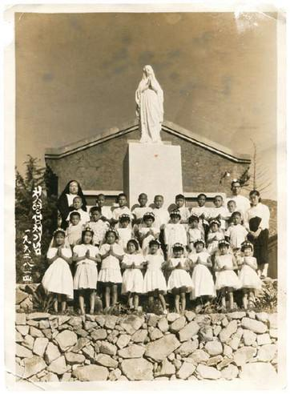

# 贫穷

<b>贫穷</b>

父亲在日本帝国主义殖民时期毕业于咸兴农业高中，当地的人都管它叫“咸兴农业”，这是与咸兴高等普通学校并驾齐驱的咸镜道地区的名校。据说当时周围人都叫我父亲“秀才”，当年把他养大的大伯母说：“考试之前也没怎么见他学习，结果别说家里，就是远近多少里寺也就他一个人考上了‘咸兴农业’。”毕业后父亲考上了公务员，当了咸兴市政府农业股长。

当时在北方做过公务员的人好像也有机会在南方做公务员，但是父亲因为在北方时的经历，已经下定决心再也不做公务员了。所以，他搬到釜山后就开始做生意。在我看来，我父亲并不适合做生意。他性格安静，又不会喝酒，做公务员或者教师其实是最符合他性格的。

父亲做的生意是从釜山的袜子工厂进货，然后卖给全罗南通地区的商贩。可是他做了几年生意，只攒了一堆未能收回的欠款。好多商贩都破产了，他也欠了很多债。但是他还得把进货的钱还上，为了还债，很长时间家里的日子过得都是磕磕绊绊。父亲总以为将来能拿到钱，收钱的票据都保管了好久，但是这一天始终没有到来。为此，父亲倒下了，再也没能站起来。人在他乡，无亲无故，无依无靠，后来父亲丧失了赚钱能力。他也没能走出贫穷。

父亲本来性格就安静，生意失败后更是整日无话。家庭的贫穷固然让我痛苦，但更痛苦的是战争让父亲失去了自己原本的人生道路。后来我被大学开除，进了监狱，从监狱出来后参军，退伍后依然未能恢复学籍，那是我人生中最灰暗的一段时间。父亲就是在那段时间里去世。他的生活原本就已经很不幸了，一天也没看见我有出息的日子，这让我无比愧疚。虽说我日后过得还不错，但是一切也无可挽回了，这让我遗恨终生。

父亲生意失败后，家庭的重担就都落在母亲一个人身上。可母亲几乎也没什么挣钱能力，只是勉强糊口而已。她虽然东一件、西一件地努力做了很多事，但都没挣到什么钱。母亲最开始把救援物资中的衣服拿到市场上卖，但我们住的村子本来就有一个小铺子，村里人都穷，人家也不多，母亲的生意当然好不了。她又开始送煤饼，想着如果能从有点规模的工厂进煤再卖，虽然累了点，但是应该能赚钱。结果也不是这样，她只能从小店里进，然后给附近的人家送上门而已，所以我们的生活始终就是勉强糊口。

即使这样，母亲也从未让父亲帮忙送煤。要是需要帮忙，她就会跟我或弟弟说，放学回家或者休息的时候，我们就帮忙拉送煤车，或者干脆用手拿着煤饼给人家送上门。送煤饼总是弄得浑身黑乎乎，我觉得很丢人。年幼的弟弟反而默默地帮母亲干了很多，不像我总是嘴里嘟嘟囔囔的，让母亲伤心。

有一次拉煤车上装满了煤，下坡时我在前面拉，母亲在后面抓着，结果母亲累得不行脱了手，我一个人扛不住车的重量撞到了路边，虽然我并没有受伤只是弄碎了一些煤，但母亲还是非常伤心。

那时不光我家穷，所有人家都很穷。当时影岛有很多从北方来的居民，我们住的山间道路周围，像我们这样的外来居民比本地居民还要多。

釜山龙头山公园下面的棚户区曾经发生过一场大火，整个棚户区全被烧毁了。后来又盖了几个收容灾民的村子，我们的村子就是其中之一，那里真是穷得叮当响。

经常有人说，北方来的人生活能力强，很多人都很成功。我看并非如此。在战争之前南下的很多人是因为不喜欢北方的政策，这些人大部分是上流阶层，把家产处理好了才来到南方，所以过得还不错。而开战之后为形势所迫南下的人就不是这样了，白手起家的普通人想要取得人生成功，绝非易事。大部分人到今天也未能摆脱贫穷。

因为贫民有很多，附近的教堂会提供救济粮，这些估计是美国无偿援助的剩余农产品，以玉米面为主，有时候也有全脂奶粉，这就解决了吃饭的问题。当时我上小学一二年级，每当发放配给粮的时候，一放学就得提着水桶去排队等配给粮。虽然我很讨厌这个活儿，但是这是长子应该干的。

有时候修女们管我叫“小不点”，给我手里塞糖或者水果。在我幼小的世界里，修女们穿着修女服的模样简直就是活生生的天使。出于对她们的感激之情，母亲首先入了天主教，我也在小学三年级时受了洗。地点就在影岛的新仙圣堂，后来我的婚礼也是在这里举行的。我母亲现在还去这个教堂，因为她信得虔诚，时间又久，还做过教区司牧评议会的女性副会长，以及教堂信用协同组织的理事。

学校也是一样穷。我上的南港小学本来就不大，突然涌入的人潮导致一个学年的学生人数猛增至1000多人，无奈之下只能用周围的棚子和铁皮屋顶搭建临时教室，被称为“假校舍”。我从入学一直到三年级，一直都是在这种假校舍里学习的。

教室地面没有任何整修，一下雨教室里就成了一片汪洋。每当此时，学校就停课让学生回家。

小学一年级中秋（1959年9月）时，有史以来规模最大的台风“萨拉”席卷了釜山地区。中秋假期过后我们上学一看，发现假校舍都被刮得无影无踪了。从那时起，我们就在原来上课的地方，席地而坐继续上课。没有书桌，就在脖子上挂一个画画的画板，把书和本子放在上面。因为根本没有屋顶，一下雨我们就只能停课回家，等六年级的学生毕业了，我们才能临时用上教室，同时重建假校舍。

台风“萨拉”来的时候，我家的屋顶也刮飞了，那时的情景到现在都历历在目。当时我家是土坯房，屋顶就是板子上面盖了层油毡纸。偏偏刮台风那天赶上父亲外出做生意，不在家。

强劲的大风吹进屋里，拼命晃动着木头做的厨房门，结果门松了，长石[注：长石：附着在木制家具或建筑物表面，用来保护结构和棱角的金属。]掉下来飞了。母亲和我使劲抓住门不让门被风吹开，姐姐也来帮忙，还是顶不住风的力量，我们刚一松手门“咣当”就被吹开，剩下的长石也飞走了，瞬间风就灌满了整个屋子，感觉整个房子都被风撑得膨胀起来。不知从什么时候起，感觉风好像要从上面喷出，随之整个屋顶一下子就飞走了，最后我们也不知道那个屋顶飞到哪里去了。

  在我幼小的世界里，修女们穿着修女服的模样简直就是活生生的天使。出于对她们的感激之情，母亲首先入了天主教，我也在小学三年级时受了洗。 

上小学时学校天天收钱，我记得一开始好像叫“月谢金”，后来改名叫“师亲会费”，六年级的时候又改名叫“期成会费”。很多孩子家里穷，交不起这笔钱，班主任就点名催他们交，有时让他们站起来，大声辱骂。要是还不交，老师就把学生从学校里撵出来，让他们回家拿钱。

一个班有80人，被撵回家的孩子足有20人。我家虽然也很穷，但是不管怎么说学费还是会给我准备出来的，只是经常要拖上几天，我也曾经跟别的孩子一起被撵回家过。

穷人的孩子早当家。被老师撵出来的孩子几乎没人真的回家。他们知道回家也解决不了问题，只会让大人们伤心难过。大伙干脆就一起去二松岛海边玩一会儿，等快放学的时候再回学校，跟老师说“家里没人”，或者解释“妈妈说以后会给的”。每个人都撒谎，假装回过家。

小学六年级时，有一次我被撵出来后，大家集体去漫画书店看漫画，没想到出来的时候在书店门口碰上了班主任。所有人都被揪回学校，结结实实挨了一顿揍。有的同学实在受不了干脆辍学，后来再次碰上了，才知道他们去鞋店或西服店之类的地方做了学徒。直到快毕业的时候我才知道，师亲会费也好，期成会费也罢，不是必须全体交齐的。我记得不太清楚，好像一个班级只要交上2/3就行，超过的就是老师的个人收入，所以老师们才会那么卖力地催学生交。

穷人家的孩子只有过年或者中秋才去一次澡堂。老师们每到卫生检查时就一下把上身都扒光，要是谁身上有泥，就当着全班同学的面让他难堪。我虽然一次都没经历过这样的事，但看着别的孩子被奚落，也总是产生被侮辱的感觉，还有随之而来的反抗心理。

小学到了该带饭的年级，大多数孩子都带不了饭，只能吃学校的伙食。给学校供应的粮食可能也是时多时少，有时给每人一整张玉米面饼，有时只给半张，有时候更少，干脆只是熬点玉米粥给学生吃。可学校没有准备碗。玉米面饼还好说，要是喝粥就成问题了。没饭盒的只能朝带饭盒的同学借饭盒盖儿，用盖儿盛粥喝。要是盖儿不够用，就两个人轮流用一个盖儿。我就这么干过，每次朝同学借饭盒盖的时候自尊心都很受伤，我心里总是想，“学校要是能给提供碗多好，实在不行让我们从家里带碗也行啊”。

因为自己有过这样的经历，我就很关注最近的免费伙食问题。参与政府时期首次开始为放假期间缺少食物的儿童供应食品。第一次放假结束后，从调查结果来看，接受率出乎意外地低。原因是政府在推行过程中没有考虑如何尽量避免伤害学生的自尊心，结果导致很多孩子宁可挨饿。由此可见，供餐固然重要，更重要的是要守护孩子们的自尊心。

由于贫穷，很多事情想做却做不了。只要是花钱的事，压根就不会跟父母提。我到现在都不会骑自行车，因为家里根本就没有过自行车。中学时，学校门前有自行车租赁点，很多孩子放学后去租车骑，我没钱，从来没有租过。

小时候孩子们都喜欢抽陀螺、打木棍儿、放风筝之类的游戏，我也因为没钱买工具只能自己在家动手做。其他孩子都是父亲或者哥哥给做，我父亲总是在外面做生意不在家，我只好自己动手。其实就算父亲在家也没什么用，他本来也不是手巧的人。

卷风筝线的线轴我也做过，我只能做“扁轴”，但是它的卷线速度远远比不上“圆轴”，后者需要木匠的手艺才行。我记得我无论如何也做不出来，为此每年都很遗憾。我也试着做了很多次滚铁圈的工具，可始终做不好滚铁圈的铁杆。

小学三年级还是四年级时，有一次我用菜刀削“打木棍”用的木棍，结果一不小心削到了左手食指，把指甲的三分之一给切掉了，当时疼得要命，还流了很多血。我当时害怕得不行，可是家里一个人也没有，只好自己用布头儿缠了缠，算是做了处理。后来我一直靠涂一种叫“啊嘎京叽”的红药水[注：红药水：Mercurochrome，红褐色，由有机水银化学合成物做成的杀菌消毒剂，亦名汞溴红、红汞。]扛了过来，也因为还能扛得住，到最后也没跟大人讲。要是换了现在，肯定要去医院缝上几针。

我是只要可以就自己解决，再苦再累也要自己先尝试着去解决，我觉得这种态度有助于培养一个人自立和独立的能力。这是贫穷送给我的礼物。

贫穷还送了我一件大礼。我的价值观中的一条——“钱这个东西，并不重要”，反而是贫穷让我产生的信念。这可能是一直让我安守贫困的自尊心起的作用吧。父母也是如此。他们在贫困的生活中抚养我们长大，却一直教导我们钱不是万能的。“虽然钱很重要，但不是最重要的。”这样的价值观对我的人生道路帮助很大。

父母对教育特别重视，虽然有时候会拖延几天，但是不管怎样都会把学费给我准备出来。即使这样，贫穷还是让我有点底气不足，老师提问的时候别的学生都争先恐后地举手，喊着“叫我，叫我”。我从来没举过手，除非老师问到我了，实在没办法才起来回答，我自己举手回答问题是从来没有的。当然了，家长也没特意来过学校。
 

