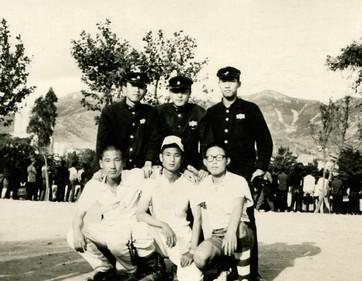
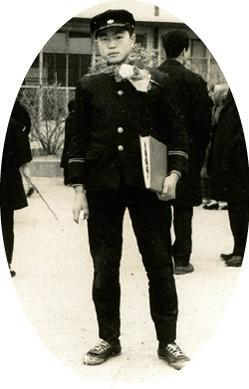

# 问题少年

<b>问题少年</b>

上小学时，我并不显眼，个子不高，身体瘦弱，性格内向，从来没引起过老师们的注意，也不记得课下与老师单独见过面。我们那地方穷，一个班有80多人，老师不可能一一给予特别的关注。

每到学期末或者学年末，老师就会发放成绩单。一直到五年级，老师一直都用“秀、优、美、良、可”来打分，我的成绩单上“秀”很少，大部分是“优”或“美”，有时候还有“良”。用“甲、乙、丙”标注的行为发展能力测评也大抵如此。我对成绩不怎么上心，父母看了成绩单也没批评过我。

那时上初中还是要考试的，所以上了六年级学校就放学很晚，几乎天天都有考试，还经常有模拟考试。就这样到了4月份的时候，我才第一次知道自己算是学习好的。

有一天，班主任找我谈话，夸我成绩非常好，告诉我如果去他家上课外辅导肯定能考上一流学校，让我回家把这话转达给大人。我才知道班里学习好的同学从五年级下学期就开始上班主任老师的课外辅导了，放学之后他们都到老师家里学习到很晚才回家。课外辅导的学费对我家来说根本就是不可能的，我就直接跟老师说家里没钱，回家以后，我也根本没提这件事。

那时的我很单纯，什么也没想，就一门心思努力学习了。升学考试是全科目考试，也包括音乐、美术、体育。体育是现场测试，音乐与美术都是笔试。我整个小学期间也没接受过用风琴之类的音乐教育，考试的时候我就唱着“咪梭哆咪梭，发拉拉，梭西来发，咪来哆……”，就像背诵朝鲜王位谱系“太祖、定宗、太宗、世宗、文宗、端宗、世祖”（太定太世文端世）那样。

体育考试的项目有跑步、跳远、投掷、引体向上等。我胳膊没力气，引体向上无论如何也做不了。朋友说喝醋能让骨头变软，就能做引体向上了。我信以为真，趁母亲不在家，去厨房拿起醋喝了一大口。那时的醋可不是现在这样的酿造食醋，而是冰醋酸[注：冰醋酸：食醋中发出酸性味道的酸，也叫乙酸（acetic acid）。乙酸含量达99%的酸叫作冰醋酸，未稀释的液体冰醋酸接触皮肤后能够溶化皮肤里的蛋白质，进入身体后损伤主要内脏器官，严重可导致死亡。]。那东西一入口，嘴里立刻就像是着了火一样。幸亏我当时吐出来没有咽下去，万一要是咽了下去，后果不堪设想。即使那样，我的嘴唇、口腔和食道都肿得老高，弄得几天都不能正常吃饭。难受是一方面，更痛苦的是觉得太丢脸了，好久都抬不起头来。后来，听说这事在后辈中传开，成了为了考试不要命的经典段子。

万幸的是，我最终考上了当时釜山地区最好的学校——庆南中学。我所在的小学能考上这个中学的学生没有几个，父母也是打心眼里高兴。这可能是我出生后最让他们高兴的事了。父亲特意带我去国际市场的校服店，为我量身定做了一套校服，当时父亲总是喜欢找咸镜道的人开的店铺。校服店老板知道我考上哪里之后，对我们表示了祝贺，当时父亲无比自豪的样子，现在我都记忆犹新。

考初中这道坎儿过了，考高中就轻松多了。

庆南中学位于市内的富人区，学生也大多来自富裕的家庭。第一天开学我就发现，很多人入学前就在校外的辅导班里学过英语了。在初中正式学英语之前，很多学生已经能够流利地读英文书了。走廊里贴着“Boys, be ambitious! ”之类的标语，我们穷人家的孩子还得花力气才能读出来，弄明白意思。所以，我从一开始就从心里比别人矮了一截，过去的小学里穷人家的孩子很多，而这里的氛围则完全不同。

玩的文化也完全不同，我的零花钱跟别的孩子比，是天壤之别，很难玩到一起去。第一次去了朋友家里，看见人家的房子、院子，还有家具，惊得我目瞪口呆，这些对我来说简直是太豪华、太奢侈了。更要命的是，同学家里干活的人管他一口一个“少爷”地叫着，看到这些，我就更是没了底气，变得畏手畏脚了。当时很多有钱人家里有被称为“食母”的家政服务人员，这让我第一次感受到了世界的不公平。

我在学校图书馆度过的时间越来越长，读书是我度过的最幸福的时光。喜欢读书这个习惯是受父亲熏陶，父亲出门做生意一走就是一个月，每次回来都一定会给我买小孩子读的图画书和儿童文学、伟人传记之类的书。《安徒生童话集》，姜小泉先生的儿童文学作品，还有为小孩子编写的《普鲁塔克名人传记》等，也有《没有家的孩子》等外国作家写的长篇儿童文学作品。这些教科书以外的书，读起来太有趣了！在爸爸买来新书之前，每一本我都要反复读上两三遍。

体会到了读书的乐趣后，我就对书变得如饥似渴了。因为父亲不做生意后再也不给我买书回来的缘故，每次新学期开始时，我不光读自己的书，比我大三岁的姐姐的书也都被我翻了一遍，把我能读的内容一口气读完，主要读国语、社会生活书里的“小故事”。后来进了初中，我才知道世界上居然有图书馆这样的地方！那里的书可真叫无穷无尽，碰到什么我就读什么，我完全沉醉在书的海洋中。记得初中二年级有三个月左右，我每天都在图书馆待到闭馆，帮管理员整理好椅子才回家。

一直到高中毕业，我只要一有时间就去学校图书馆，或者借书回家看。最开始是韩国小说，后来是外国小说，再后来就是各种各样的书，读的领域也越来越广。因为碰到什么就读什么，像《思想界》[注：《思想界》：20世纪50年代由在野人士白乐濬、张俊河两位先生个人出资创办的独立杂志，后来成为与李承晚、朴正熙政权对抗的政治势力的宣传阵地，在当时的知识分子与学生中具有超高人气。]这类具有启发意识的杂志，我很早就接触到了。情色小说读得也比较早。当时读书也没什么系统的计划或者目标，就是胡乱读。在初中、高中的六年里，我确实读了很多书，读书让我了解了世界，体察了人生，培养了社会意识。

记得初中读过金灿三教授的作品《不花钱的环球旅行记》，它在我的心中深深种下了一个环球旅行的梦。当然现在不做这个梦了，但是我在尼泊尔、印度徒步旅行过，还走过丝绸之路，也算是圆了当年的梦吧。

现在我还喜欢读书，或者说已经不再是简单的喜欢了，简直是中了活字印刷物的毒。我无论去哪里旅行都要随身携带书籍，因此每次行李都很沉重。就算休息的时候，手边没有书也会觉得心里空空的。

课外书看得太多，学习成绩自然就落下了。我觉得升学考试不怎么重要，只要学习成绩保持在中上等，我就心满意足了。就算是考试期间，父母看见我看课外书也不怎么管我。因为成绩一直还可以，所以他们相信我做的是我应该做的。

父母在初中、高中六年的时间里从来没有唠叨过我的学习，也没干涉过我，就是一直信任我，把一切交给我。这份自由并没有被我用到学习上，而是用到了“旁门左道”上。最后考大学时，我为自己的不努力付出了代价。但是通过读书，我的内心世界得以成长，社会意识得以产生，我认为用这来补偿那些代价，足矣。

我的社会意识的较早觉醒得益于我早期阅读的大量报纸。跟我饥渴读书的理由一样，我从很小就开始看父亲的报纸。

我很好奇报纸上面的内容。当时的报纸上还掺杂着很多汉字，最开始我只是挑没有汉字的连载小说之类，后来就逐渐看掺有汉字的报道。读来读去，通过上下文就能猜出汉字的意思，学会了常用汉字。父亲当时是《东亚日报》的固定读者，这份报纸作为在野党代表性刊物名气很大。我也是通过长期看这份报纸，培养了对社会的批判意识。现在这份报纸发生了太大的变化，我为此表示惋惜。作为一名多年前的老读者，我真心希望它能够找回当年的影子。

进入高中后，脑子里想的事多了，对社会的反抗心理也产生了。我上高三后开始抽烟、喝酒。我所在的庆南高中动辄就说自己是“汉江以南的第一高中”，有很强的自豪感。当年虽然也很重视高考，但跟今天不同。学习基本是让学生自己学，这也是由于每个大学的入学考试科目不一样。

首尔大学的入学科目是全科目，延世、高丽大学就只考主要科目，学生也不像现在这样，整天就只有学习一件事。我们搞社团活动，放假时就搞出门不带钱的旅行，有时候还去野营。高三时，很多学生都抽烟、喝酒，一般情况下学校就装不知道。我学会抽烟、喝酒后，就整天跟爱玩儿的孩子们在一起，喜欢上足球后，又跟踢球的学生走得很近。学习是一天不如一天，朋友倒是交了不少。

  父母在初中、高中六年的时间里从来没有唠叨过我的学习，也没干涉过我，就是一直信任我，把一切交给我。这份自由并没有被我用到学习上，而是用到了“旁门左道”上。最后考大学时，我为自己的不努力付出了代价。但是通过读书，我的内心世界得以成长，社会意识得以产生，我认为用这来补偿那些代价，足矣。 

后来，我在学校还受了处分。高三春游的时候，因为学校高考之前不再组织秋游，那一次就成了高中最后一次集体出游了。自由活动时，我跟朋友一起去附近的村子买酒回来喝，结果喝多了，搞得其中一个人醉得站都站不住。我们非常担心被发现，果不其然，集合的时候他在班主任面前醉得不省人事，无奈之下，我们只能实话实说。最后几个同学把他背去了医院，洗了胃后才清醒过来。该怎么处理我们几个，学校犹豫了好久，考虑到我们最后说了实话，没有隐瞒，只给那个喝多了的同学停学处分。

  

后来暑假快要结束时，我跟同学踢足球，比赛之后，我们在学校后山抽烟喝酒、放声高歌，被值班的教导主任给抓住了，结果学校给了我们所有人停学处分。初中、高中时我的外号是“问题少年”[注：问题少年：“文在寅”三个字的发音在韩国语里跟“问题人”相似。——译者注]，一开始是由于我名字，这两次事件后，我真的成了“问题少年”。

我父母很久都不知道这些事。他们可能也猜到我学会了抽烟喝酒，但总觉得我不会出什么大纰漏，就睁一只眼闭一只眼了。

我上高中时，大学生还不像今天这么多。上了高中就算是很有知识的了。今天，高中生在人们眼里还是个小孩，那个时候社会上已经把高中生当成人看待了。

四一九事件的传统还在，每当有重要的时局情况，高中生也一同参加游行示威。在我上高中二年级时，我们学校学生游行，反对三选改宪[注：三选改宪：1969年韩国总统朴正熙为谋求三选连任而进行的第六次改宪活动，为自己在1971年4月能够以合法身份参选第7任总统制造法律依据。]，还试图走出校门。当时警方动用了刚进口的“胡椒雾车”[注：胡椒雾车：专门用于镇压游行示威的警务用车，车上安装有气体发射装置，可以通过喷射催泪瓦斯强行解散示威队伍。]堵门，结果学生们没能走出校门，为此学校还停了很久的课。另外，我们从那一年年初开始实施校练[注：校练：过去对非军事专业的学生实行的军事教育训练，一般以高中生、大学生为主要训练对象。]。政府的目的是为了实现长期执政，把学校兵营化，更好地控制学生。很多人对此表示不满，校练考试时学生们故意集体交空白卷。这些经历都很好地培养了我们的社会意识与政治意识。

总之，那是一段既纯粹又美好的时光，庆南高中同期毕业的同学中很多人都很有出息。政治圈的同学有蔚山市长朴孟雨，大国家党最高委员徐秉洙，前任议员朴钟雄，前任议员崔喆国，瑞草区区长陈翼喆，等等；文化艺术界有建筑师承孝相，导演李润泽；相当多同学通过行政考试成为高官，在法律界工作的也不少，还有在大学教书的，当过大学校长的。不知不觉，高中毕业已经40年了，不久前，我们还搞了毕业40周年重返母校的活动。
 

