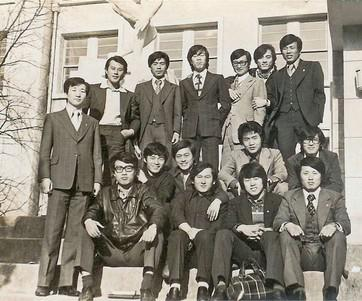

# 大学，抵抗

<b>大学，抵抗</b>

我本来是想进历史专业的，以前上学时我觉得历史最有趣，历史成绩也一直是最好的。现在我还是喜欢读历史书，刚开始做律师时我还曾经想过，等不用再辛苦工作挣钱的时候，我就去当个业余历史学家。所以考大学时我也想学历史专业。但是班主任和父母都反对，理由是我的成绩完全可以进法学院或者商学院。无奈之下，我只能改换方向，结果我为自己对高考的轻视态度付出了代价——我落榜了，重读之后才考上了第二批招生的庆熙大学法学院。我在学校附近找了寄宿房，开始了我的寄宿生活。

时局越来越黑暗。大学一年级时，朴正熙政权宣布十月维新，他不满足于通过三选改宪延长执政期，干脆就是要永远执政下去！就在宣布维新的前一天夜里，坦克开进了市内，第二天早晨每个大学里都进驻了坦克，宣布维新的同时又宣布无限期停课。大学生们不能去教室，只能选择聚在酒馆或者寄宿房里慨叹时局，宣泄心中的郁闷。

十月维新对法学院学生来说更是荒唐至极。维新宪法一经确立，此前的法典、教科书通通成了无用之物。“就这样，法律还能算是一门学问吗？”，“法学还是学问吗？”这样的怀疑拷问着每一个法学院的人。学生们甚至不愿意去上课。

新学期开始，校门重新被打开后，宪法教授的第一堂课让我记忆犹新。他是当时非常著名的宪法学者，以前讲义的教材就是他编写的，停课期间他又写了维新宪法的新书，当天的课程就用他的新书做教材。

100分钟的课堂里，他一眼也不看学生，一直是看着天花板讲课。不得已写了维新宪法的书，上维新宪法的课，他觉得无颜面对学生，就用这样的行为表达自己万分的羞愧。

那段时间的寄宿生活对培养我的社会意识起了最大的作用。日常生活没有任何管制，完全自由，大学生们又总是聚在一起彻夜讨论时局形势。我跟几位高中的前辈住在一起，大家来自不同的大学，因而可以互通各个学校抵抗运动的最新消息。有的消息来自批判现实的社会科学社团、农村运动社团，也有来自地下报纸的，我们还能接触到校内示威的消息以及示威时发的传单。我还跟着前辈去参观了当时学生运动最活跃的首尔大学文理学院和高丽大学的示威。

与那个时代无数大学生一样，李泳禧[注：李泳禧：媒体人出身，后任汉阳大学教授，进步知识分子的代表。他用大量著作揭露社会现实，打破所有的社会禁忌，是一位高度重视实践的知识分子。军事政权时期4次被解职、5次遭拘禁。2010年因病逝世，葬礼在民主社会场举办，长眠于五一八光州国立墓地。]先生对我的批判意识与社会意识觉醒产生了深远的影响。

在李泳禧先生的《转换时代的论理》出版之前，我就在《创作与批评》杂志上读过他的论文《越南战争》。我记得大学一二年级时看的是杂志上连载的论文第一、二部分，三年级时书才出版。第一次接触到李泳禧先生的论文真是太受冲击了，内容都是对越南战争的非正义性、帝国主义战争性质的探讨，还讨论了美国国内的反战运动，等等。结论就是超级大国美国绝不可能赢得这场战争。

我并非第一次听到这样的声音，我们在寄宿房里也曾偷偷议论过。但是李先生拿出了谁都无法否认的依据，解释得简单明了。他还提到我们国家一直无条件相信美国就是正义的，认为美国的主张就都是正确的，把与美国作对的国家都当成应被无情粉碎的邪恶势力，我们这一虚伪的认知被他无情地揭露了出来。我看了他的论文和书籍，深深觉得这才是我辈所应追求的知识分子的风骨。对于恐怖的现实他没有回避，而是选择了勇敢直视。他对真相穷追不舍，用任何人都无法否认的事实与这个世界对抗，就算刀架在脖子上，他也要向世人揭示真相，以暴露那些妄图掩盖真相的虚伪意识。

在南越败亡[注：南越败亡：在越南的南北分裂战争中，南越失败，由现在的越南实现统一。]后，李泳禧先生在《创作与批评》杂志上刊登了论文的第三部分，也是论文的最后一部分。应该这样说，他分三步写了自己的论文，在写作过程中发生了南越失败这件世界历史上的重要事件。不论是逻辑推理的展开，还是评价论证都做到了首尾彻底的一致。写第一、二部时根本没有人质疑美国会取得胜利，他就预告了美国的失败与南越的败亡。写第三部时，他只是再次确认自己的预言成真并做了总结。读他的文章，让我相信真理一定会取得最后的胜利！这让作为读者的我备感喜悦，这种喜悦感至今记忆犹新。

卢武铉也受了李泳禧先生很大的影响。卢律师投身人权律师事业的转折点就是当年受理“釜林事件”。当时，青年和学生们组织了一个学习小组，选用了几十本基础社会科学书籍和批判现实书籍作教材。这个小组被政府抓住了把柄，公诉的内容提到：“他们读这些书，赞扬并鼓励北朝鲜以及国外共产主义国家的活动”。卢律师为了更好地为他们辩护，把这几十本书全部读完了，其中就有李泳禧先生的著作《转换时代的论理》和《偶像与理性》。他作为律师，读这些书是为了辩护，自己却深受影响。此后卢律师开始更广泛地阅读社会科学书籍，“提高了觉悟”，而这一切的起点正是李泳禧先生。

当时庆熙大学的学生运动力量算是比较薄弱的。有些觉悟的学生都分散着，也没人组织学习小组之类，连个像样的社会科学社团都没有。1973年下半年，也就是我大学二年级时，全国正式开始了反对维新的斗争。以首尔大学文理学院的示威为起点，大学生示威活动很快就席卷了全国的大学。改宪请愿100万人签名运动，“紧急措施1号”“紧急措施4号”“民青学联事件”“人革党事件”，接二连三地爆发。即使这样，庆熙大学还是连一场像样的示威都没有。示威的意图偶尔有之，但缺乏领导示威的核心力量，始终迈不开步子。

大学三年级的秋天，学校爆发了占领示威，要求财团下台。以此为契机，我和一些意气相投的同学一起策划反对维新的示威。我所在的小组负责起草宣言，散发传单，然后把学生聚集到校内的“校是塔”前，接下来再由学生会副会长团负责引导示威。我们的计划是小组秘密做好示威准备工作，然后就销声匿迹。学生会副会长团由于职责所在，则必须站在前面。我们这么分工是为了避免遭到处分。

宣言由我来起草，没有别的原因，我们这群人中只有我一个人看过其他学校的示威宣言，只有我一个人知道宣言是怎么写的，当然这也是我生平第一次写示威宣言。

  大学三年级的秋天，学校爆发了占领示威，要求财团下台。以此为契机，我和一些意气相投的同学一起策划反对维新的示威。我所在的小组负责起草宣言，散发传单，然后把学生聚集到校内的“校是塔”前。 

我们当晚就在朋友家用油印机油印了大约4000份传单。第二天早晨趁人不注意，把这些传单全发到教室里去了。

到了约定的时间，“校是塔”前聚集了五六百名学生，现在该学生会副会长团负责接下来的工作了。但不知为什么，他们始终没出现。学生处的工作人员想要疏散学生，那时警察还不能进入学校。几位学生忍不住登上讲坛想要朗读宣言，但是被学生处的人给拉了下来——这样下去示威弄不好就会归于失败。

情急之下我上去开始朗读宣言。学生处的人又挤了过来，但是被学生们给挡住了。当时在下雨，把我手头的稿子给打湿了，但文章是出自我的手笔，朗读是不成问题的。然后我就引导着学生们走向校门，转眼之间，人数已经增至2000余名。

我们与警察隔着校门对峙，双方分别用催泪弹和石块开始了攻防战，这是我考上庆熙大学后第一次参加正式的示威。

我们在确认示威已经走上正轨后从学校逃了出来，销声匿迹地躲了几天。警察抓了示威现场几个带头的，但他们与示威准备活动毫无瓜葛，警察只好按拘留结了案。当年被抓走的学生吃了不少苦头，后来成为民主党国会议员的郑范九就是其中之一。当年他是政治外交系四年级毕业班的学生，还是总学生会的干部，因在现场带头被抓走。虽然刑事处罚只是拘留而已，但学校里给了无期停学的处分，导致他不能按时毕业，也没找到工作，吃了很多苦。不过从后来的成就看，这些当年吃的苦反而锻炼了他，把他塑造成了大人物。

警察对该事件的处理告一段落后，我和朋友们在学生科长的劝说下去警察局自首了，处罚结果也是拘留。学生科长说看我在雨中朗读那份淋湿了的宣言稿，就猜出宣言是我写的了。学校没给我们任何处分，从此我们一跃成为校内学生运动的核心人物。后来我们又从各个专科学院里找出有领导能力的学生，组建了一个覆盖全校的组织，同时组建社会科学社团，扩大基层力量。时局日益紧张，感觉随时都有可能爆炸，我们为接下来的一年做好了准备。
 

