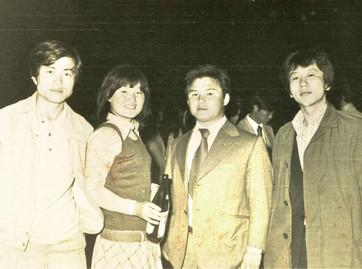

# 与妻子相遇

<b>与妻子相遇</b>

在看守所时，让我意外的是妻子来探视我。她和我在同一所学校，是音乐学院的学生，比我低两届。每年5月初为了迎接“法律日”，法学院都要举办庆祝活动“法律庆典”，我和她因为在活动中做过搭档而认识了。当时我三年级，她还是刚刚入学的一年级新生。第一次见面时我们在庆祝活动上玩得很开心，我也对她产生了好感。但是，后来我们就没有再见面。我当时没那个心思，在校内偶尔遇到了，也只是彼此交换个眼神而已。

1975年4月的示威让我们再续前缘。我觉得在非常学生总会讨论时局时，在自愿发言阶段一旦中断，很可能会冷场。为了不至于冷场，我们得提前找几个人，到时候站出来发言，而且我们认为总结时发言的人最好是女生。当时我一边等召开总会，一边四处物色发言的女生，正巧她就来到了露天广场。当时她与她们系的课代表一起，两人是非常要好的朋友。我就拜托她们两个帮忙，让她们其中一人做收尾发言。后来课代表站出来发言了，结束时只听她大喊一声“我们出去吧！”，然后就结束了非常学生总会，加入了前进队伍。为此她也遭到了拘留，学校也给了她停学处分。

在参加非常学生总会之后，我们朝着校门前进。结果，我被胡椒烟雾击中昏了过去，过了好久，我才苏醒过来，当时就感觉有人用湿手帕擦拭我的脸，我睁眼一看原来就是我妻子。她站在示威队伍里，一直担心着站在前面的我的安全。

后来，妻子来探视我了，我很意外。

她听说我被拘留了，非常担心，就直接来看我。她怀揣着一份叠起来的报纸，说是特意带来给我看的。原来那份报纸的体育版头条报道了我的母校庆南高中在全国棒球大赛还是什么比赛中拿了第一的消息。

  每年5月初为了迎接“法律日”，法学院都要举办庆祝活动“法律庆典”，我和她因为在活动中做过搭档而认识了。当时我三年级，她还是刚刚入学的一年级新生。第一次见面时我们在庆祝活动上玩得很开心，我也对她产生了好感。 

当时的高中棒球人气冲天，我出身的庆南高中又是一个把棒球作为代表性体育运动的学校，因此，那时我也特别喜欢棒球。我跟她一起搭档参加“法律庆典”时，在学年棒球对抗比赛中，我担任我们学年的组长拿了第一，她一直记着这件事，特意带来了报纸让我知道这个好消息，好高兴高兴。

我的天哪，就算我再喜欢棒球，现在人被关在看守所里，还哪有什么心思去关心棒球比赛？！

但是，我还是觉得她很可爱，在牢房里一想到她就总能笑出声来。

有了这件事，我被释放后就跟她走得更近了。可是我马上又要参军了。这一次，她又来军队探视我。我退伍后准备复习参加考试时，她又来我学习的地方探视。她总说我们二人的恋爱史就是一部“探视”史。我就告诉她，我之所以上庆熙大学，就是为了去认识她的。这的确是我的真心话。
 

