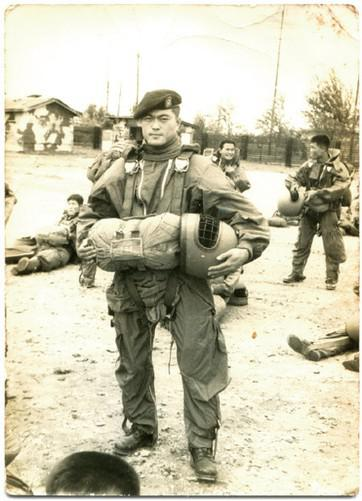
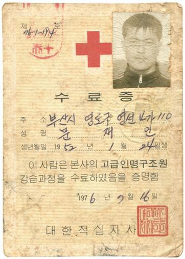
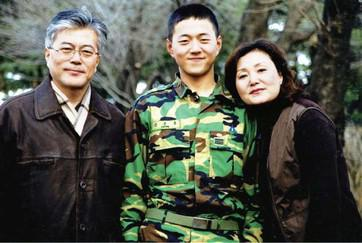
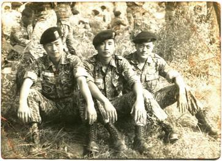

# 空降部队

<b>空降部队</b>

我被分配的地方是特战司令部下辖的第一空降特战旅团第三大队。我们要先接受为期四周的空降训练、六周的特战训练和两周的旅团转入训练，然后才会被分配到原队[注：原队：士兵“本来”所属部队。]。去了之后，第一件事就是让我们背官阶说明“旅团长准将全斗焕”“大队长中校张世东”。张世东大队长是我结束了后期的训练、回到原队时才调过来，所以没在一起工作过，他后来担任了全斗焕总统的警护室室长。我只听人说起过他，据说作为军人，大家对他的评价相当高。“第五共和国”时期，接替张世东、做了下一任青瓦台警护室室长的安贤泰，当时就是我们旁边大队的大队长。

特战训练时，我们训练的主要技能是爆破，因此我既是空降兵又是爆破兵。六周的特战训练结束时，特战司令官郑柄宙表彰我为“爆破课程最优秀士兵”。郑司令官后来在“一二·一二新军部军事政变”[注：一二·一二新军部军事政变：指1979年12月12日，全斗焕、卢泰愚等人率领军部内私人组织——“一心会”为中心的新军部势力发动的军事叛乱。事件的发动者全斗焕、卢泰愚事后接连担任总统，二人在位期间集权势力一直将该事件正当化。直至1993年初金泳三政府将其定性为“以下克上的军事政变”。]时抵抗到最后，被叛军枪杀，是一位称得上“标杆”的真正的军人。而成功发动那场军事政变，当上总统的正是当年的旅团长——全斗焕。我们背诵的官阶说明里的两位顶头上司，命运竟然是如此戏剧性地纠缠在一起。

其实爆破课程最优秀的表彰没什么大不了的。想要爆破某一设施时，先确定放在哪个部分、用什么样的炸药、用多少炸药。为了应对非正规战，还需要熟悉如何配制化学药品、制作自制炸药等，八成内容都跟学习能力有关。同期入伍的人中，我的“书包带”[注：书包带：受教育水平，求学经历。——译者注]是最长的，学好这些自然不在话下。我回到原队后，全斗焕旅团长还授予了我“生化训练最优秀士兵”的表彰。不管怎么说，这些表彰让刚刚进入部队的我理所当然地成了A级士兵。此间，还发生了旅团本部想要我，而大队不放人的事。

我上学的时候除了“全勤奖”没得过什么表彰，反而受过停学处分，进了大学还被开除学籍，遭到拘留。可到了部队，对于部队要求的技能，我完成得都很好。像射击、投掷手榴弹、战斗游泳等，虽然都是平生第一次接触，可我竟然做得都很好，连我自己都觉得很神奇。

辛苦的事只有一件，那就是武装长跑。空降部队的武装长跑与步兵不同，当时陆军的规定是“12公斤装备，10公里，61分钟内跑完”。空降部队号称精锐强军，要求“20公斤装备，10公里，57分钟内跑完”。起点放置了秤，在出发点和终点都要称重。在军营生活期间每周都有武装长跑，这一项最累人了。后来我们成了老兵，也掌握了一些“要领”：把空箱子塞进背包，让背包看起来鼓鼓的，只有将要出发和到达时往里面装满石头。只要挺过武装长跑，其他的训练项目就没什么问题了。

跳伞（空中降落）也是空降训练中痛苦的一环，但是训练之后，回到原队再跳伞时就觉得轻松了。比起在部队里干杂活，我更喜欢出去跳伞。空降训练的最后有四次跳伞训练。头两次是一般跳伞，第三次是夜间跳伞，第四次是武装跳伞。第一次跳伞的前一天，因为有可能出现事故，军队让我们提前给父母或亲人留下书信，连同自己的头发、指甲一起放进信封里。搭乘运输机之前，还有牧师为我们作祷告，而且他不仅为我们祈祷，还第一个跳下去，真是太帅了。

就在第一次跳伞时，同期训练兵有一个人出了事故，因降落伞未能打开，掉到地上摔死了。当时我已经结束了降落，到达了地面，因此目击了整个事故过程。我们在地上的人抬头看着他，一直高喊让他打开辅助降落伞，但是他还是没能打开辅助降落伞，惨剧就这样发生了。第二次跳伞时，有一位军官摔成了脑震荡，当场被送走。因为亲身经历了这些事故，我每次跳伞都很紧张，从运输机或者直升飞机往外跳的时候也很害怕。落地时确实也有很多人受伤，所以落地时也很紧张。

  当打开降落伞，漂浮在空中时，真的很令人陶醉。我实在太喜欢这种感觉了，所以不管有多紧张、多害怕，都愿意承受。我猜那些玩滑翔的人也是喜欢这种感觉，才心甘情愿地忍受背那么重的装备登高。 

但是，当打开降落伞，漂浮在空中时，真的很令人陶醉。我实在太喜欢这种感觉了，所以不管有多紧张、多害怕，都愿意承受。我猜那些玩滑翔的人也是喜欢这种感觉，才心甘情愿地忍受背那么重的装备登高。

这些都是以前军队的事，现在不知道有没有变化。那时我们也经常和美军一起进行“秃鹫演习”和“协作精神演习”。跳伞也一起跳过，看美军跳伞，觉得他们就像是在玩运动，很是放松。

美军运输机飞抵指定跳伞地点的5分钟前会有信号，这时才让大家背好降落伞。此前战士们在运输机内轻松等待就行。反观我们，上运输机之前就提前背好降落伞，接受安全检查，在运输机内也始终是正襟危坐，一个个屏气敛息，跟旁边的人话都不能说。在如此紧张的氛围中跳伞反而会发生更多的事故。

空降部队一年中有一半的时间在野外进行野营训练，野营训练的亮点就是千里行军，那是行军400公里以上的训练，通常是在智异山或者闻庆鸟岭之类的地方。先是一个月左右的野营训练，之后在9天之内，利用晚上的时间行走400公里以上山路，返回部队。帐篷、睡袋、干粮等把背包撑得满满的，每晚都要背着这么重的背包走40—50公里的山路，其辛苦程度可想而知。大家都说这是空降部队里最痛苦的训练。但是比起在军营里，我更喜欢野营训练，而且也喜欢走山路。就连让大家都苦不堪言的千里行军，我也喜欢。能看到没见过的大山大河，还有村庄，对我来说也是一种乐趣。

每年部队还要在海里进行为期两周的水中渗透训练。根据士兵的游泳水平，分成不同小组，从游泳初级到潜水训练，进行分阶段的训练。我是釜山出身，游泳还是会一点的。

第一年，我们就接受了救生员训练，我还拿到了大韩红十字会颁发的《高级救生员资格证》。资格证考试历时两天：第一天，按照救人情境的不同，实地演练动作要领；第二天，2海里，也就是3.2公里的远距离游泳，游泳方式可随意。这要是在外面想都别想，毕竟是在军队里，我坚持下来了。成功之后，我回头看自己游过的距离，心想要是让我自己游肯定坚持不下来。

  每年部队还要在海里进行为期两周的水中渗透训练。第一年，我们就接受了救生员训练，我还拿到了大韩红十字会颁发的《高级救生员资格证》。 

第二年是基础潜水训练。在背氧气瓶之前，训练我们抱着20公斤的沙袋，或者腰上缠12公斤铅腰带游泳之类的。虽然我也是平生第一次做这些，我还有点害怕，但是神奇的是，真的照样做了，也就喝点水而已，无论如何都能坚持下来。

还有一种训练叫战斗游泳。穿上军靴，绑上腰带，连枪都在肩上扛着，以轻装备的状态下水游泳。训练具体内容是我们穿戴好装备，乘坐橡皮艇进行渗透作战，探照灯一照过来就立刻把橡皮艇掀翻，以防被发现，等探照灯过去，再把橡皮艇翻过来坐上去。

妻子来探视过我几次。我被分配到第一空降旅之后，她第一次来看我，那次探视真是终生难忘。那个年代去军队探视的亲属，肯定都要把吃的东西备足，再穷的母亲也至少要带一只烧鸡来。可妻子不是这样，吃的东西一点也没有带，只给我抱来一大束满天星。就算她家里没有哥哥也不至于这样吧？真是个不食人间烟火的“小仙女”啊！

那时探视所附近没有卖东西的，我们俩隔着满天星说了一会儿话就各自回去了。我自己也觉得好笑，内务班的战友看我没拿吃的，而是拿着花回来都哄堂大笑。探视大韩民国部队的二等兵，不带吃的带着花去的，恐怕只有她一人吧？！后来我把满天星分给了好几个内务班，大家都很高兴，本来满天星保鲜时间也长，空降部队内务班有花可插，这可能也是史无前例的。

多年以后，儿子服兵役时我和妻子一起去探视他。当时我是青瓦台民政首席秘书官，探视时还想方设法没让部队上级认出我。也有人像过去一样带着吃的去，不过现在探视所直接就能点比萨或糖醋肉之类的外卖，所以空手去的人反而更多了。探视所的墙上就贴满了点餐电话号码。我们去的时候也只是准备了水果，按照他的意愿点了比萨吃。想起来真是恍如隔世啊！

我成为上等兵后，发生了“板门店斧头砍人事件”。为了反击，我方决定实施砍树作战计划，执行任务的命令就落在我们部队身上。这也就是进入备战时状态。砍树时朝鲜一旦出来制止，或者发生冲突，战争马上就会爆发。为了做好一切准备，我方选了部队内最精锐人员组成砍树小组，其余人员则被安排在外围，再外面的一层部署了前线师团。所幸朝鲜方面对我们的砍树行为视而不见，没做任何反击。我们平安完成了任务，后来部队还制作了嵌有被砍的白杨树木块的纪念品——国难胜利纪念章，给我们每人分了一个。

在营地，不搞外出野营训练时，我们也进行暴动镇压训练。第一空降旅团是陆军本部直属的首尔卫戍部队，所有将士官兵都配有最基本的装备——暴动镇压棒。训练过程中也会进行示范性训练。剧本是这样的：派一个假想的暴动小组去示威，然后让他们在空降部队的镇压下彻底溃败。为了方便区分，假想暴动小组穿运动服。“喂，文在寅！你示威过好几次吧？你做暴动组组长！”就这样，我成了暴动组组长。训练时士兵在枪上装上刺刀，队伍一边前进，一边跟着口令齐刷刷做出“刺”的动作，这个训练光是旁观也让人毛骨悚然。

  儿子服兵役时我和妻子一起去探视他。也有人像过去一样带着吃的去，不过现在探视所直接就能点比萨或糖醋肉之类的外卖，所以空手去的人反而更多了。想起来真是恍如隔世啊！ 

所幸我服役期间光是训练，从没真的出去镇压过暴动。我退役后“釜马民主抗争”[注：釜马民主抗争：也称釜马抗争，1979年10月以釜山、马山地区为中心，市民们举行的反对朴正熙维新的抗争活动，取釜山市、马山市两地名称的第一个字，称之为釜马抗争。朴正熙政权当时认为光靠警察无法镇压事态，于18日零点起宣布对釜山一带实施非常戒严，投入空降部队解散示威群众。]发生，去釜山镇压的就是我曾经服役的第一空降旅第三大队。曾经给我做过助手的那些后任兵当时就去了釜山，光州抗争时投入的镇压军是其他空降旅。虽然一二·一二军事政变不是镇压暴动，但是他们反抗郑柄宙司令官的命令，也成了叛军的主力部队。如果我服役的时间再长点，可能也会被调去做那些违背历史潮流、把枪口对准国民的事。

总之，我平安退役了。在空降部队服役，特别是跳伞时，腰、腿受伤的情况时有发生。和我一起转入空降部队的战友有好几个就是训练受伤后转去步兵部队的。我算是运气好的了。大家都开玩笑说我是天生的军队体质、空降部队体质，让我赖在那里别回来了。因为我在大学一直参加校练到三年级，因而比其他战友早三个月退役。当时后任兵们拿着暴动镇压棒来找我，说我从没有用“吧嗒”打过他们，让我打他们每人一棒，作为“纪念吧嗒”。我记不清楚了，好像每人打了一棒，也好像就那么一笑而过了。

提出退伍申请时我的身份是陆军兵长文兵长、空降兵长文兵长。战友们列队为我送行，目送我一直走到部队正门，妻子早已在门口等待多时了。1978年2月，距离我入伍大约31个月了。在这么长的时间里，妻子没有见异思迁，一直等着我，也算跟我一起入伍、一起退伍了。

不久前，有人把我在军队时的照片传到了网上，好像是当年的战友把照片给了我女儿，让她传上网的。我打听之后，隔了这么多年，跟战友通了电话。现在我也偶尔和空降部队的战友、后辈见面，聊当年的事，说的话题据说都是女人最讨厌的——军队生活，还有军队足球等。其实如果想写军队生活，一本书也写不完。

退伍后的一段时间我总是做“又回到部队”的梦。梦到的不是部队日常生活，在梦中我明明退伍了，可好像退伍被取消，又重新回到了部队，心情十分沮丧。后来才知道不光我这样，参过军的人大部分都会做这样的梦。大韩民国的男人是义务服役，对我们来说军队不就是这样吗？不管军队生活过得如何如何好，如何如何有意思，让你再去一次也肯定不干。

我认为军队的经历对我后来的生活有很大帮助。入伍之后很多事都是平生头一遭，真到做的时候发现也都能坚持下来。这将我培养成一个更为积极、乐观、向上的人。我做律师也好，在青瓦台工作也好，经历了很多“平生头一遭”。很多时候不仅是我个人没经历过，甚至是没有任何先例可循，只能依靠个人的判断，每当这时，我的良好心态都起了很大作用。

  

因为我经历过这些，所以我认为现在这种征兵制如果想继续维持的话，身体检查等级标准应该好好完善一下。也就是说除了身体条件不允许的人以外，让所有人都入伍是不是更好？当然这是有前提的，军队里也有很多岗位是对体力不做要求的，应该根据每个人的身体情况来分配能够胜任的岗位，这样也可以缩短服役时间，兵役腐败、特例问题也能够妥善解决，也更符合我国全民皆兵制的精神，兵役加分制之类的争议也就没什么必要了。
 

