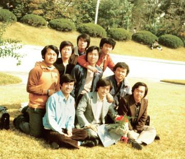

# 再次被拘

<b>再次被拘</b>

我终于再次回到了校园。随着18年军事独裁的结束，首尔迎来了“首尔之春”，校园里也是春意盎然。我们与学校谈了复学的条件，和校方见了几面，所有大学几乎都是在同一时间处理复学问题，恢复学籍是理所当然的，一次性达成了协议。表面看起来这是每个学校的自主决定，但协议内容其实别无二致。此前一直未能复学的1974年下半年到1979年之间被开除学籍的学生，在1980年春季新学期都一次性复学了。

复学的条件打破了常规。被开除的学生只要上到了1975年第一学期4月初，学校就承认这个学期已修，像我这样的四年级学生，只要再上一个学期就可以毕业了。不知道这样的处理方式是怎么协商的。

复学学期的学费也被免除了，托这个政策的福，我于1980年8月毕了业。当时是秋季学期毕业，也被称为“波斯菊毕业”，我没参加毕业典礼，也没有留下毕业照。就是几个朋友、后辈给我庆祝了一下，喝了杯烧酒，庆祝我上了9年的大学终于毕业。

庆熙大学1980年新学期刚一开始，就卷入了针对大家族财团的“学院民主化斗争”，汉阳大学、世宗大学等私立学校也紧随其后。学校采取的对策就是长期停课。

我时隔近五年才好不容易回到了校园，可因为这个运动，平均每门课只听了100分钟就结束了。停课期间，学校里每天都是学生示威，要求财团下台，要求学院民主化的呼声此起彼伏。1980年4月下旬，其他大学开始了“反独裁、要求实现民主化”的示威游行，庆熙大学里的示威也自然而然地转换了方向。

自从与校方开始协商复学事宜，我的司法考试复习就难以为继了，复学后变得更加困难。我想着司法考试只能期待下一次了，但我在上一年度通过了一期考试，还有资格参加二期考试，此前学了那么多，要是就此放弃实在太可惜，为此，在参加校内示威的过程中，我还是于1980年4月参加了第22届司法考试第二期的考试。考试前最重要的两三个月里我都没有学习，因此我也没报什么希望，就是想着为下次考试积累点经验，没想太多就上了考场。

  我于1980年8月大学毕业。当时是秋季学期毕业，被称为“波斯菊毕业”。 

庆熙大学的示威自从转到了“反独裁、要求实现民主化”的方向，我就一次没落地都参加了。因为在校生没有示威经验，我们这些复学生必须给他们传授示威的要领。警察一开始堵了几天学校正门，这时首尔几乎所有大学都开始示威，光化门等区域还接二连三地发生突发性示威，警察也就不堵校门了，转为集中在青瓦台、中央厅[注：中央厅：位于现在光化门正后方，过去的中央政府办公楼，日本殖民时期该建筑用于朝鲜总督府，光复后改名中央厅，作为政府办公楼使用，后被拆除。]、世宗路等市内主要地点防御。很快这几个主要地点之外的地方就成了“解放区”，学生的示威队伍所到之处没有受到任何阻拦。大学生们每天都集中在首尔站广场。

每天庆熙大学的学生首先在学校举行“出征仪式”，然后队伍前进至首尔站广场，参加大学生联合示威之后，再返回学校举行“解散仪式”。集结于首尔站的大学生越来越多，到5月15日时，几乎达到了20万人，这是抵抗新军部策划的延长军部独裁计划的最高潮。

这时，以首尔大学总学生会为首，各大学的总学生会会长团决定全面停止示威，为的是不给政府投入军队镇压制造借口。这就是所谓的“首尔站大回军”[注：首尔站大回军：1980年5月15日，连日来首尔站等地学生示威达到最高潮，当时学生运动指挥部为了不给军队介入制造借口，决定自行解散。]，真是太荒唐了！

几天前，就有传言说军队要介入，一些可靠的教授也给我提供了这个信息，而且说不能给军队介入制造借口。可是所有大学无一例外，复学生团体都认为就算军队介入，按照“置之死地而后生”的道理，学生们也应该迎接战斗。如果就此停止，军部延长独裁的意图势必会取得成功。

虽然复学生们多方努力，想要说服总学生会会长团，但是没有示威经验的他们一听说军队介入就害怕了。学生一旦解散，再召集就困难了。在如此紧要的关头，首尔的大学生转身躲开了，只留下了光州市民与戒严军队孤军作战。

我认为就是由于首尔地区大学生最后关头的背叛，导致了“五一八光州抗争”中光州市民付出了惨痛的代价。

新军部于5月17日24时开始把“非常戒严”[注：非常戒严：总统在战时、事变或由此导致的国家非常状态下，针对社会秩序极度混乱地区，根据军事必要或为了维持公共秩序而宣布的戒严令。]扩大到全国范围。那天，我和妻子一起去江华岛上岳父的农场玩。我和妻子当时已经谈了很久的恋爱，双方家里也都正式接受了我们的关系。岳父、岳母、我们俩、她姐姐，还有她姐姐的男朋友，一共六个人，去了江华岛附岛席毛岛的普门寺。当晚我们坐大巴返回农场，从大巴的收音机里得知从当晚零时起，戒严扩大到全国。

非常戒严前一年10月27日已经开始，覆盖了除济州岛以外的全国地区。现在连济州岛也包括进来了。首尔地区的状况应该没有什么变化，以当时的情况来看根本没有理由非得把济州岛也拉进来。

此前的非常戒严允许街头示威，也没有军队介入，我的直觉告诉我：从现在开始要正式投入军队了，也就是说非常戒严要动真格的了。我嘱咐妻子：“回去后我得马上躲一躲，就算出了什么情况，你也不要惊慌。”这是多么天真的想法！

大巴驶入了去往农场的匝道入口，就在我们一行到站下车时，突然不知从哪里冒出来五六个壮汉，把我们团团围住，还拿出了手枪。有人大喊道：“不许动！举手！你就是文在寅吧？”原来这些人是清凉里警察署情报科的刑警，为了抓我已经在这里等候多时了。

我说：“给我看逮捕令！”

对方说：“你还提什么逮捕令？！”然后给我出示了写有“戒严”两个大红字的所谓“戒严证”。这就是告诉我，在非常戒严时期逮捕令制度已经停止，不用再废话了。

我就在妻子一家人的注视下，戴上手铐，被车带走了。警察直接把我拉到清凉里警察署拘留所收监。

那段时间，我一直住在庆熙校内叫“奖学舍”的宿舍，据说我被捕的前一天晚上，军人们闯了进去，为了找我连女生宿舍都一一搜查了。发现我不在，刑警们当天早晨又闯入我妻子家，穿着皮鞋把家里翻了个底朝天，当时妻子正在读高中的妹妹独自在家里，这些人大声呵斥了她，从她口中得知我们去了江华岛农场。然后他们就在农场入口处，吃着面包等了我一整天。他们在我岳父、岳母面前，手上拿着枪，用手铐把我铐住带走，让我颜面尽失。我坐在离去的大巴里望着窗外，所有人都一言不发、茫然无措地站在那里。

让两位老人受到惊吓其实不是第一次了。空降部队退伍前最后一年，当时我已经是个老兵了，1977年10月下旬，妻子的毕业演奏会在庆熙大学音乐厅举行。当天不是节假日，不允许外出，我通过人事科的战友弄了个假外出证，壮着胆子跑了出来。一旦被发现，我可能会被关禁闭，但我做好了心理准备。我就穿着空降部队的迷彩军装，头戴黑色贝雷帽，走进了毕业演奏会现场。那是我第一次见她的父母。我后来才知道，她父母只听说我被大学开除学籍后进了部队，没想到竟然在女儿毕业演奏会现场见到一身戎装的我，心里着实一惊。

当时拘留我的名义是违反戒严布告令[注：戒严布告令：宣布戒严命令的同时，以戒严司令官名义大范围发出的法令或命令。]。后来才知道，同一时期很多人都因为这个被抓。当时因违反戒严布告令被拘留的人很快被移交给军事法庭了。但以我为首的庆熙大学生们却没有被移交军事法庭，而是继续以未决状态扣押，这是因为在5月15日——大学生最后一次聚集到首尔站广场的那天，南大门发生了悲剧。

那天，20多万学生集结在首尔站广场，警察也在南大门、市厅门前、世宗路、光化门、青瓦台的沿线上集中了全部的警力与火力，阻止学生越过南大门。学生在人数上占优势，他们纷纷掀起人行道的砖头，一边扔砖一边前进，但警察已经在南大门两侧布下了防御网，警察的防线也如铜墙铁壁一般。学生们以学校为单位，轮流进攻，但是谁也不能突破警察的防线。南大门左边路边原本就停靠着几辆没人的公共汽车，这时汽车又多了几辆。因为示威造成了道路堵塞，司机们看到进也不能进，退也不能退，就把公共汽车停在路边，自己走了。

一开始学生们尝试推着公共汽车，穿越警察的防线。但是，驾驶员座位上没人抓着方向盘，汽车不走直路，光靠学生们推，根本推不到警察防线那里。于是很自然就有人问：“有人会开车吗？”这时有一位身穿运动服的青年勇敢地站了出来，上车抓住方向盘发动了汽车。如果他慢慢地开车在前面带路，那么防线上的警察也只能给他让开一条路，跟在汽车后面的学生也就能突破警方的防线了，原本的计划是这样。但是他可能太紧张了，或者就是开车技术不熟练，他把公共汽车开得太快了。

汽车穿过防线后，学生还没跟上，防线就又重新闭合了。这样一来，公共汽车就孤军深入到警察中去了。我们为他捏了把汗，但是帮不上任何忙。我们心想他肯定被抓了，结果公共汽车没过多久又开了出来。从南大门的左边进入，又从右边出来了。公共汽车出来时，可能撞到了南大门右边面朝学生的警察队伍的队尾。当时我们完全不知道这个情况，只是看到那个青年平安出来就放心了。

当晚看了新闻才知道，公共汽车出来时撞上了警察队尾，导致警察1人死亡、4人受伤。此前还没有发生过游行示威导致警察死亡的事件，因此这件事在当时产生了很大的冲击。

这个事故成了反映学生示威过激性、暴力性、极端性的典型。当局宣布要组织特别搜查本部，务必把犯人找出来。当时的舆论为了渲染示威的暴力性，还报道说这个学生“强迫司机下车后自己把车开走了”。这完全不是事实。当时现场空着的公共汽车有20多辆，他完全没有必要那么做。

我既是违反戒严布告令的嫌疑人，又是该事件的目击者，于是成了特别搜查本部的调查对象。根据当时警察在附近高楼拍摄的取证照片来看，公共汽车突然闯入时庆熙大学的标语在最前头。因为当时学生是以学校为单位轮流发动进攻，突破警察的防线，根据照片情况可以判断，就在庆熙大学试图突破防线时，公共汽车突然闯入了。而且开车的人穿着运动服，庆熙大学的体育系很有名，因此警察首先调查开车人是不是庆熙大学的学生。另一个怀疑对象是韩国体育大学，因为当天韩国体育大学的学生都穿着运动服参加了示威。

特别搜查本部根据取证照片已经可以认定我不是开车的学生，但是怀疑开车人是庆熙大学的学生，于是对我穷追不舍：“你是复学生的代表，是那天示威的领导者，你至少应该知道那个人是谁吧？”但是我真的不知道他是谁，而且当时已经轮到别的大学了，庆熙大学的标语只不过是留在那里，没拿走罢了。

最后，我这个“目击者”也没给警方寻找开车学生帮上任何忙。特别搜查本部的搜查一直没有什么结果，所以他们就扣着我，过了20多天，也没把我提交军法会议，只做未决处理。事实上，这种状况反而救了我。
 

