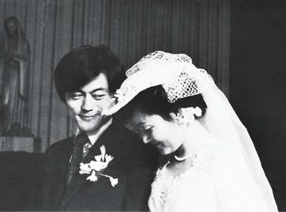

# 律师之路

<b>律师之路</b>

在司法研修院的日子波澜不惊。生僻的法律词句和判决书对我来说并不太难，我很快就熟悉了。虽然挣的钱不多，但是毕竟第一次实现了经济上的独立。我和妻子结婚了，有了第一个孩子。此时距离我们第一次相遇已经七年，总算结束了恋爱长跑，步入了婚姻殿堂。

当时研修院跟我同期的有律师朴元淳、大法官朴时焕、宪法法官宋斗焕、法务部长李贵男，前任检察总长候选人千成宽，新任大法官朴炳大，前任民政首席秘书朴正奎。进入政界的同期学员有赵培淑、朴殷秀、高承德、议员李翰成和前任议员咸承熙等。

研修院通过人数为141人，是选拔人数比较少的最后一届，因此我们之间的感情很深厚。当时从研修院出来后几乎全体都能做法官、检察官，因此司法研修院的教授也是把我们当成法官、检察官后辈来看待。

已经辞世的赵英来律师[注：赵英来律师：韩国人权律师的代表性人物，著有《全泰壹评传》，1990年去世。]也是我在研修院的同学，他本来比我高好几届，因“首尔大学学生内乱阴谋事件”被司法研修院开除了，到我们那一届时恢复了学籍，跟我们一起上了司法研修院。他对我的影响很大，当我法官录用被拒时，在他的帮助下我见了首尔几家著名律师所的法人。

1984—1985年，住在蔚山温山工业园区的很多居民患上了一种叫“温山病”[注：温山病：20世纪80年代初，韩国蔚州郡温山地区发生的公害病。]的公害病，赵律师联系我一起去温山工业园区进行流行病调查。我们提取了发病者的头发，委托有关机关做重金属检查，在赵律师的努力下，“温山病”最终成为社会关注热点。此前一直对此予以否认的当局最终也只好承认公害病的事实，将居民集体迁出了。这是在黑暗的军部统治下，居民集体罹患公害病事件第一次成为社会热点。

  我和妻子结婚了，有了第一个孩子。此时距离我们第一次相遇已经七年，总算结束了恋爱长跑，步入了婚姻殿堂。 

1987年大选时，赵律师组织了候选人单一化运动，当时多数在野人士对倾向于金大中[注：金大中（1924—2009）：别名忍冬草，全罗南道荷衣岛人。韩国政治家、社会活动家，第15届韩国总统，2000年成功实现朝韩首脑会谈，同年获得诺贝尔和平奖，被誉为“亚洲的曼德拉”。——译者注]候选人“批判性支持”[注：候选人单一化、批判性支持：1987年首次举行直选制总统选举，为了结束军事独裁，市民开展运动，要求当时在野的金大中、金泳三两位候选人单一化。当时另外一方认为金大中比金泳三更适合做民主化领导人，虽然对他也有所批判，但还是应该整合支持性的言论，因此持有“批判性支持”的立场。]的立场。在釜山地区，我与他立场一致。卢武铉律师当时没有特别明确的立场，他把主要精力都放在了监督选举公正性活动上。结果最后候选人也未能达成单一化，导致卢泰愚当选，令我们无比失望。不久后创立“民辩”[注：民辩：是“为了民主社会的辩护人组织”的简称，1988年由为民权、人权、时局事件做辩护的年轻律师组成的律师团体。]时，我们还在一起讨论过失败的缘由。

一开始，把民辩建设成全国性的组织是比较困难的，首尔民辩创立时，我在釜山创立了釜山、庆南民辩。佛教曹溪宗[注：曹溪宗：是现在韩国最大的佛教宗派，在韩国有2000多个寺庙，10000多名僧人，1000多万名信众。——译者注]年轻的改革派僧人们将“非常改革宗教团体”设立在梵鱼寺后，在赵律师的介绍下，我还为梵鱼寺做了三年左右的律师顾问。正因为有这一段缘分，釜山佛教人权委员会设立时，我也作为人权委员参与了，虽然我并非佛教徒。

赵律师是个出名的老烟枪，写文章时从来都是烟不离手。他那些著名的专栏文章、辩护文章都是在烟雾缭绕中写出来的。有一天，他来釜山，我们午饭一起吃生鱼片。一般的烟鬼，至少吃饭的时候是不抽烟的。可是他不同，吃饭聊天的同时，嘴里还要叼着烟。他的抽烟习惯也很特殊，一般先抽到一半就熄灭，过一会再把剩下的抽完。我看他一根接着一根抽得太多，很是担心，但劝他也不听。过了20多天，我就听说他得了肺癌，而且已经是晚期了。

我在司法研修院学习时，就想当一名法官，觉得法官比较适合我。学习如何根据模拟记录写判决书，我觉得很有意思。

法官实习是在首尔北部地方法院。这是我大学时代被拘留、接受审判的地方，来这里实习，我的感受自然与别人不同。实习时我还实地参与过审判。有时，和议庭法官们意见不一，无法拿出统一意见，有人会说“也听听实习法官的意见吧”，于是我也有了参与和议的机会。我还练习了根据真实案件记录写判决书。当时的支院长尹錧——也就是后来的大法院院长——他为每一位实习生一一修改他们所写的判决书，每次都要做出评价。他表扬过我几次，说“你会成为一名好法官的”。后来我没当上法官，他反过来又安慰我说：“你要是做了就知道了，法官不是什么好职业。做律师其实更好。”因为这样的缘分，后来参与政府时期发生大法官风波，他还做过协调工作。

检察官实习也是非常好的人生经历。地点同样是曾经拘留、调查过我的首尔北部地方检察厅。根据检察厅法，实习检察官可以被任命为检察职务代理，任命后就可以与检察官一起处理案件了。那时候北部地方检察厅给实习生安排了很多案件，当然都是情节相对较轻的案子。

我当了检察职务代理，处理案件时，大学时代好几次被当成嫌疑人接受调查的经历此时帮了大忙。第一次调查嫌疑人写调查书时，一直在我身边观察我的指导检察官连连发出感叹：“你好像很有经验嘛。”可能那些被调查的经历让我找到了熟悉的感觉，我在研修院时检察科目名列第一。但是我并不想当检察官，这并不是因为我认为检察官这个职业有什么不好。其实法官所做的事是比较消极、被动的，反而是检察官的职能更为积极、主动，可以树立社会正义，所以很多人觉得做检察官更好。但是我作为检察职务代理，在处理案件的过程中，发现检察官并不适合我的性格。

有一次，我受理了一个交通事故，事件发生在上溪洞。现今那里是高级住宅区了，但是当年那里还是一望无际的原野。当年那儿有几个砖厂，有一对年轻夫妇带着刚出生的孩子在砖厂里干活。因为没人看孩子，他们只能把孩子放在砖堆里面，妈妈不时去喂个奶，看一眼。

结果有一天惨剧发生了，卡车装满砖离开时，轧死了卡车底下的小孩。谁也没看见小孩是怎么爬到了卡车底下的。根据前后情况推测，孩子可能是自己从砖堆中爬出来了，当时大人们光忙着装车没顾得上看小孩，孩子就自己爬到了卡车下面。

小孩父母非常可怜，可被抓起来的司机也很可怜。逮捕令上说，他违反了“启动汽车前应该仔细观察车辆底部的注意事项”。这只是理论上的判断而已，实际情况中谁能想到会有这种情况发生呢？而且这个司机也是个可怜的年轻人，是孤儿出身，多亏了砖厂老板好心收留，他才能在那里找到开车的活。

处理案件时费了很多周折，最后才达成了协议——砖厂老板主动替司机承担了对孩子父母的赔偿金。我认为对司机即使不能做无罪处理，也至少应该简化处理。部长和副部长都面露难色，表示：“对于交通事故致人死亡案件，就算将来法院会释放，检方也应该起诉逮捕，这是这类案件处理的标准。”我找到支厅长，他接受了我的意见。后来部长和副部长都说：“简化处理也行，但是罚金的数目要多一些。”我还是坚持自己的意见，罚金尽可能减少，还允许他分期支付，然后把人放了。那时的环境对实习生还是持鼓励态度的，资深的检察官们也都尊重实习生的决定。

处理这个案子时，我就觉得我的性格不适合去做处罚的工作。处罚人时我总是有负担，心里不舒服。处理那些违反食品卫生法的案件也是同样，知道他们的所作所为确实应该被处罚，但是当事人的实际情况也都很可怜，要么是残疾人，要么是为了养家糊口，我总是很难下决心对他们进行处罚。我觉得我这个人心太软，不适合做检察官。

因为我有示威经历，最后还是没当上法官，而是走上了律师之路。当时没能当上法官的也不止我一个，司法研修院同期中，女性也有两个人。其中一个在整个研修院学员中排第三名，还因此拿了大韩律师协会会长奖。据说她父亲因违反《反共法》服过刑，是保护观察对象。当时已经取消了连坐罪[注：连坐罪：让跟罪犯有特定关系的人承担连带责任接受处罚的制度，是近代刑法出现以前的制度。法律虽然禁止，但过去独裁时期，思想犯家属或亲戚一旦在身份审查中被查出，不能录用为高级公务员等职务，这样的恶性事例很多。]，但她还是因为她父亲没当上法官。为此她和另一位女生一起做了检察官，二人成了有史以来最早的女检察官。

法院录用时，还排除了四位因罹患小儿麻痹身有残疾的同期学员，这受到了舆论界的强烈批评。三个月后，法院终于投降了，追加录用这四人为法官。可见当时法院的意识水平不过如此。

由此可见，我没能被录用为法官不是因为外部压力，而是法院——特别是当时的大法院，他们的思想意识完全跟不上时代，才做出了这个落后的决定，让我在无奈之下，只好走上了律师之路。然后我就在这个路口遇见了卢武铉律师。

让我成为律师的这一切，最终都是为了让我与卢武铉律师相遇而提前设定的程序而已，我觉得这都是命运的安排。
 

