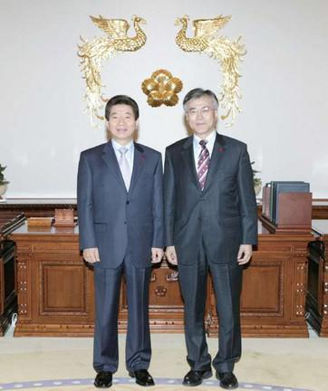

# 走向青瓦台

<b>走向青瓦台</b>

2002年大选胜利的余热久久不能冷却，在卢当选人政治意义上的家乡——釜山更是如此。选举结束后的一段时间里，各种祝贺的电话几乎都是由我来接的。很多人想和卢当选人直接联系或见面都未能如愿，于是就都来找我了。也有很多人是我应该主动打电话表示感谢的。

这也不完全是好事。世间人心大抵如此，真正需要感谢的人担心给我们增添负担，也知道我忙，干脆就没联系。反过来，有些人都不知道具体帮了什么忙，却跑来邀功，要求见面。向对方表达感谢时我得斟酌用词，还要区分对象。这让我有很大的心理负担，也感到很疲惫。卢当选人参加过的所有选举一直都是由李镐哲做总负责的，他总是说：“选举搞一次，负债好几年。”他说再也不想管理选举了，对此我也深有同感。

当选之后，卢当选人给我打了电话。当时正值年底，他说要请我吃饭，让我去首尔。我和妻子这才好不容易去首尔串了趟门。卢当选人、权夫人、我和我妻子，四个人见了面。饭店位于一个酒店的高层，从房间的窗户能直接看到北岳山和青瓦台。他说特意选了这个能看见青瓦台的房间，而且把方便看窗外景色的好位置让给我们夫妇。我是第一次这么遥望青瓦台。我们一边吃着精致的饭菜，一边说着祝贺的话，他们夫妇也对我们表示了感谢。

我们聊着选举过程中发生的各种事，轻松地回忆，聊得无拘无束，感觉很自在，对交接委员会[注：交接委员会：总统工作交接委员会的简称。选举后已经当选为总统的当选人，在正式就职之前为了处理新政府组建前的政权交接工作。这个委员会的设置就是为了辅佐总统当选人，处理总统工作交接的有关工作。]、政治方面的事提都没有提。他还说就任之前，想让孩子们都结婚。当时我就想，这还真是卢武铉的风格啊！

2003年1月13日，我与李镐哲一起又见了卢当选人。这次见面不知道怎么就被一个地方报纸给知道了，还做了报道。那是在社稷洞附近一家饭店，讨论的话题有点沉重，卢当选人首先开了口，想让我担任青瓦台民政首席秘书官[注：青瓦台民政首席秘书官：总统秘书室中的核心职位，负责掌握国民舆论动态、民心动向，监督公职人员、社会风气纪律等法律相关问题以及信访工作。同时负责管理总统亲信、高级公职人员的人事考核，下设民政秘书官、司正秘书官、公职纪律秘书官、法务秘书官。]。他说除了我没有更合适的人选了，也委任了工作给李镐哲，请他也出来帮忙。

我无法当场回答，请他给我几天时间考虑一下。李镐哲也是如此。卢当选人可能是看到我们俩都含含糊糊的，不是那么痛快，就说：“是你们让我搞政治的，还让我当上了总统，你们是不是也得负点责任啊？”

回到釜山，我考虑了一个星期左右。一直以来，我都顶着人权律师的帽子，唯一做的事情就是批判权力，对于处理国政和行政的经验，我是一点也不具备的。作为一个搞法律的人，我只知道法律，对于国家政务我无异于白面书生。政治的世界我不懂，参与都没参与过。虽然选举时我做了釜山选举对策本部部长，可我连民主党都没加入。对此卢当选人是一清二楚的，那他为什么还要让我做民政首席呢？如果做了民政首席，我该帮他做些什么，又该如何去帮他完成他想要的改革呢？我思考了很久。

当时民政首席室的首要任务就是打造一个不再高高在上的青瓦台。参与政府一直标榜“打倒权威主义”，民政首席室曾经就是高高在上的权力象征。国民政府组建时曾经取消了民政首席室，后来觉得不妥，只好又恢复了。但他们还是想要打造一个不那么高高在上的民政首席室，为此特地任命了当时韩信大学教授、民主化运动阵营的金圣在（后担任了文化观光部长，现为金大中纪念图书馆馆长）做民政首席秘书官。当时金圣在曾经邀请我出任民政秘书官。他认为我是法律人，而民政秘书官应该由法律人来担任，而且最好由并非检察官出身的人权律师来担任。但是我觉得与这个职位相比，我当时的工作更为重要，所以就推辞了。

  “我对政治一窍不通，对政务判断能力、职责之类的也不怎么清楚。但是办坚持原则的事情我还是可以的。如果您觉得就是要我起这个作用，那么请您用我吧。” 

国民政府在执政中期也切实感到检察系统管理的必要性和紧迫性，于是任命高级检察官出身的人做民政首席。这等于又回到了过去，甚至连民政秘书官也是由时任检察官的人来担任。因此，我们需要重新弘扬国民政府初期一度废除民政首席室的那种精神。

第二个紧要任务就是改革以检察院与国情院为首的权力机构。我们不是要制定一个特别法律，也不是创立一个从来没有过的制度。我们的目的是让国家权力机关不再是青瓦台实现其政权目的所利用的工具。

我们把这种改革看成让总统交出宪法与法律中所没有的“超越性权力”。只有这样才算打破权威主义体制，在政治上实现市民民主主义。

吃饭那天，卢当选人当天并没有提到这些。他正为韩国严重的低出生率而苦恼，还说了很多他当时的想法，这些都与我们二人无关。对于我，他只是说民政首席这个职位没有比我更合适的人选了，说得很简单，但其实平时我们也谈过很多国民政府依然存在权威主义，以及民政首席室改革的历史倒退问题，还有那些权力机构改革的遗憾之处，这些内容就算他不说，我也是非常清楚的。

此外，卢当选人所考虑的并不仅仅是我个人的信念问题。在权力面前，即使信念再坚定，十有八九也会被抛之脑后，这就是人性。民政首席室的工作内容决定了这个职位必须选法律出身的人，同时他的想法是找一个无法控制检察系统、非检察系统出身的人来做民政首席。再确切地说，他通过任命我担任这个职位，可以明确传递出一个信号：总统确实没有要控制检察系统的意图。

我既然猜出了卢当选人的意图，想要脱身就更难了。我自己也认为民政首席的工作要植根于法律的土壤，可以把它看成是法律活动的延伸。我当时还天真地想：两眼一闭就当这一两年“我死了”，干完之后，再回到我自己的工作岗位不就行了？

于是我联系了卢当选人对他说：“我对政治一窍不通，对政务判断能力、职责之类的也不怎么清楚。但是办坚持原则的事情我还是可以的。如果您觉得就是要我起这个作用，那么请您用我吧。”然后我又提了两个条件：“我就只做到民政首席。……请不要让我参与政治。”为什么提参与政治这件事呢？因为在2002年，卢当选人做候选人参加地方选举时，曾有人让我参选釜山市长，当时我感到了前所未有的压力。卢当选人听了我的话很高兴，表示了同意。

2003年1月23日，我来到交接委员会记者会见室，以内定民政首席的身份跟大家打了招呼，从而开始了我的工作。当务之急就是民政首席室的阵容配置。交接时，被内定的其他几位首席估计很难按自己的心意安排自己秘书室的人选。因为很多人都是跟卢当选人在一起很久了，是当选人直接起用的。以这些人为中心已经构成了一个庞大的阵容，首席们再按自己的想法从别处选人的余地就不大了。但是民政首席室似乎比较特殊，我的人事意见基本都得到了尊重。

民政秘书官很早就锁定了李镐哲，这也得到了他本人的同意。在组建队伍之前，我特意见了国民政府最后一任民政首席，向他咨询了很多问题。他说，民政首席室80%的工作都是面向检方的，因此民政首席与民政秘书官最好是检察系统出身。他还特别强调如果首席不是，那么民政秘书官也必须是检察系统出身的。还有，递呈总统的各种报告书中民政秘书官的是最要紧的，报告书的写作水平尤为重要。从这一点来看，由经过多方训练的检察官担任最合适。如果暂时没有合适的人选，可以从现任A级检察官中选择，将来再让他回到检察系统也行。我也见了国民政府时的民政秘书官，他的报告书写得很好，为此还被金大中总统表扬过很多次。他当年被选的时候就是检察官，组建参与政府时，他回到了检察系统。他的意见也大抵如此。

但是我没有听取他们的意见。因为我对民政首席的定位设想与他们不同。如果需要跟检方沟通，由我直接接触或者让司正秘书官去就行了。民政秘书官的工作则不一样，除了负责总务之外，还必须担当起全体秘书官的“纪律班长”一职。从这一点来看，李镐哲是当之无愧的不二人选。实际上参与政府时期总统秘书室一直能够在道德上保持紧张状态，很大程度上有赖于他的功劳。

其他的秘书官也是由法律人构成的，他们都是赞同卢总统和他的改革方向的。前法官朴范界被任命为第二民政秘书官，他对检察系统改革有坚定的信念，做过很多研究，而且一直大力推动“法务部的去检察化”。我也特意选拔了女性秘书官，康锦实部长推荐的黄德男律师被任命为法务秘书官，总体上负责青瓦台可能遇到的各种法律问题。

最头疼的要数公职纪律秘书官与司正秘书官。公职纪律秘书官要跟我们有默契，同时在做人事审核工作时，不管什么时候，都要做到“公是公，私是私”，始终保证要求严格。当时的民辩副会长，后来做了会长的李锡兑律师，长期作为人权律师活跃在法律界，他的身上有着典型的文人气质。他是那种不喜欢会选择回避，绝不会上前迎合的性格。我向他一次又一次解释了参与政府所要求的人事程序与过去是多么的不同，在这个程序中，人事审核是多么重要，几乎三顾茅庐才请到他做了公职纪律秘书官。

事实证明，这个选择无比正确，对于人事审核的结果，李锡兑有时连我这个民政首席都不事先通知，直接把人事审核报告书提交到人事推荐会议上，在会议前一天下午或当天早晨才向我报告。如果我太忙，没来得及看他的报告，那么我也经常在根本不知道审核结果的情况下去开人事推荐会议。只有在评判审核的标准根本没有或不十分明确的情况下，他才会找我商议。有时他还提交到民政首席室秘书官会议上听取大家的意见。他这么做的目的就是为了在人事审核中，最大限度地排除民政首席的影响。他树立了这样的原则，后来继任的公职纪律秘书官也就沿袭了下来。

只有司正秘书官——这个职位，我想要找一个跟我们毫无关系、完全不认识的人来担任。这个位置需要监督与总统有特殊关系的人、高级公职人员以及青瓦台的内部人员，它的职能非常重要。我觉得应该找一位跟当选人从理念倾向到人脉关系上都毫无瓜葛的人来出任，我相信只有这样，才能保证司正秘书官不被人情左右、严格公正地处理工作业务。基于这些考虑，我们找到了检察官出身、已退休多年的梁仁锡律师。我并不认识梁律师，我们通过各方打探，收集了很多关于他的评价。因为他曾经担任“服装行贿事件”[注：服装行贿事件：1999年新东亚集团会长涉嫌走私外汇，他的夫人为了救自己的丈夫，涉嫌以昂贵服装向高官夫人行贿。]的特检助理，我们也听取了时任特别检察官的崔炳模律师对他的评价。我亲自见了梁律师两次，好不容易才说服了他，但交接委员会内部反对的声音很大。特别是秘书室室长申溪轮强烈反对。他质问：“如此重要的岗位为什么不用我们自己的人？”这话有一定道理，最近我思来想去，觉得他的话也许是对的。“司正也应该由自己人来担任”这种想法可能更契合实际一些，但是，当时我觉得那样不行。我坚持自己的想法，反复说服他们，将这个想法贯彻下去。因此只有确定司正秘书官的人选时间有些迟了。

千辛万苦后，人员全部确定了下来。我觉得这是个梦之队，这个队伍支持了参与政府打破权威、改革权力机构的工作，维护了参与政府时期青瓦台的道德水准。

交接时有一件事让我难以接受，首席秘书官等内定人员为了新政府的组建从事了大量前期工作，但是却没有任何制度性的保障。以民政首席室为例，已经内定的首席与秘书官们要做大量人才选拔和人事审核的工作，以保证新政府上台时能组好内阁。这与政府上台后的正常工作完全没有区别，而且我们从交接时期就开始工作了，这分明就是国家的公务嘛。但是除交接委员会以外，其他政府部门的上台准备活动并没有实现制度化，因此也不支付报酬，办公室租赁费用等活动经费也是分文没有。比如我就得自己负担工作产生的费用。我实在难以理解国家都发展到这个程度了，国家的核心领域居然还存在这样的制度空白。

这种不合理现象在参与政府上台后依然持续着。以首席秘书官为首的青瓦台秘书室成员，分为政务职和别定职[注：政务职、别定职：政务职是中央政府副部长级以上公务员，别定职为其下面级别的职务，负责特定任务，是按照其他标准选拔的公务员。在青瓦台，首席以上全部为政务职，其下通常别定职与一般职位各占一半。]，在正式任命前必须经过身份调查。政府组建时就要一次性对全体人员进行身份调查，一直到2003年4月上旬，也就是新政府上台一个半月后，才可以得到正式任命。

问题是，正式任命以前，他们明明一直都在从事实际工作，却没有工资收入。这毫无道理可言，也是违反劳动法的。总统也没注意到这件事，我和总统说“应该给他们补发工资”，他只说：“没办法，就当是为了在青瓦台工作而投的资吧。”

无奈之下，我只能自掏腰包给民政首席室的别定职职员们发点交通费。后来在我的催促下，负责身份调查的警护室才把身份调查的时间大幅缩小为7天左右，但这也并非根本的解决之策。
 

