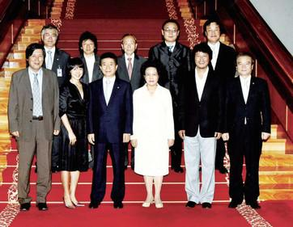

# 李沧东入阁：神来之笔

<b>李沧东入阁：神来之笔</b>

参与政府内阁人选的定夺也是不给人丝毫喘息之机。整个组阁过程本身就需要民政首席室的审核，事实上这正是我所面临的第一个挑战。特别是内阁中的社会领域，我参与了大部分的人事工作。有的是我直接向卢当选人说出我的意见，有的是按照卢当选人的指示，由我代替他出面对候选人进行劝说，还有的是卢当选人自己直接面试，我在旁边陪坐。

通过各种渠道交上来的推荐表和提案纷沓而至。上一届政府民政首席室将他们的推荐人选及审核资料一起送了过来，估计是录用人数的五倍左右。交接委员会设立了“国民参与提案中心”[注：国民参与提案中心：参与政府在交接时期，为了广泛收集国民的意见和提议以及人事推荐意见而设置的机构。]，干脆从那里接受推荐。交过来的资料也都由交接委员会分门别类地放好，然后再开人事会议，专门讨论这些经过筛选的候选人。

这个会议由交接委员会委员长，以及几位已经内定的秘书室室长、政务首席、民政首席、人事助理等共同参加，会上需要再把人选筛查一遍。这个小组就是日后青瓦台人事推荐委员会[注：人事推荐委员会：参与政府在青瓦台组成的高级公务人员人事推荐及审查组织。由秘书室室长任委员长，参加者为几位主要的首席秘书官。]（人推委）的前身。民政首席室内定小组要对这些人进行审核，将录用人数的两到三倍左右的审核结果送到人事会议上，向卢当选人汇报。当然有时卢当选人自己也会推荐各种各样的人选，嘱咐我们进行审核。

第一次组阁的最大特点就是打破常规。特别是社会领域，几乎都是破格选拔的。文民政府[注：文民政府：金泳三时期的韩国政府，执政时间为1993—1998年。——译者注]与国民政府时期，我亲眼看见有一两位有改革倾向的人士被选入内阁或青瓦台，但是他们受不了当时的大环境，后来还是退出了。所以我认为具有改革倾向的人应该掌控着内阁与青瓦台的大方向。卢当选人的想法也是如此。这种想法在社会领域是可行的，因为我们有人才储备，但是外交、安保、国防、经济等领域就不行了，我们在那些方面的人才储备比较薄弱。我对那些领域也不大了解，几乎没有什么贡献。

最大的破格选拔是法务部长康锦实。她的推荐人就是我。她做过法官，当时担任民辩副会长。卢当选人想要从女性中选拔优秀人才，我根据他的意思推荐了康律师。卢当选人只是在民辩活动时认识了她，但对她的了解并不深。

我一开始推荐她时，设想的职位并不是法务部长。按照此前女性部长一贯的选拔方式，我想也就是环境部长、保健福利部长。但是卢当选人仔细询问了她的情况之后，就说干脆让她做法务部长吧。我当时吓了一跳。虽然我们此前考虑过的法务部长候选人崔炳模律师因个人原因不可能出任了，但这个决定还是太惊人了。

于是我说：“先把环境部、保健福利部定下来之后，再考虑法务部怎么样？”但是卢当选人的想法与我不同，他就是要打破女性只能负责环境部、保健福利部、女性部和教育部的固有观念。他要把那些一直被看成是男性专属的职位，大胆地交给女性来做。他的女性观念很是超前。他觉得在我们的社会里，如果哪位女性的能力可以与男性相提并论，那么女性的表现一定更为优秀。

康锦实律师也确实精明干练，此前她一直不同意入阁，但说到让她做法务部长时，她就同意了。卢当选人也有些担心，所以直接见了康律师，我当时陪同。在我所参与的领域中，卢当选人直接面见部长人选，这是唯一的一次。当时卢当选人提到了法务部的去检察化与检察改革，不知道康律师是不是太过紧张，没有表现出平时的精明干练。我以为这次面试是为了帮助卢当选人做最终决定，但是他的目的似乎不止于此。他是为了把自己想要推动的法务部改革方向明确地告诉康律师。而且她一旦被任命，势必会引起检方和舆论的反对，他想给她打打气。

当时与康律师一起被提拔的还有朴珠贤律师。按年龄来说，朴律师应该是秘书官级或以下级别。但是卢当选人一心想要起用女性首席，就把她破格提拔为国民参与首席[注：国民参与首席：参与政府成立后，在交接委员会时期的国民参与提案中心的基础上扩大而成的组织机构。后更名为市民社会首席室，其作用也发生了变化。]。

虽然由于各种原因最终未能实现，卢当选人还想任命金明子女士为建设交通部部长，她担任过国民政府的最后一任环境部部长。与积极任命女性的意义一样，他想要打造一个“立足于环境创意上的建设性行政”的全新模式。当时新万金事业与京仁运河等问题引起了很大的社会矛盾，他一直想协调建设与环保的关系，才有了以上的构想。但后来和内定总理人选高建协商后，没能付诸实施。

卢当选人对女性的提拔还不止于此。在参与政府组建后，他还相继任命了最初的女性宪法法官、最早的几位女性大法官，一直发展到女国务总理。这些人事安排，我都参与了，感觉很有意义。我暂时离开青瓦台的那段时间里，还出现了最早的女性宪法法院院长候选人，最终由于大国家党的策略性反对而归于失败。韩国本可以涌现出最早的女性宪法机关负责人，这本可以为女性打开进入社会的新大门，可惜没有成功。

文化观光部部长任命了李沧东导演，这也是神来之笔。2002年大选时，卢当选人在文化艺术界获得了压倒性的支持。这种支持不止于文化艺术界内部，他们还不辞辛苦地努力将这种支持扩散到了普通国民之中。文化艺术界人士可以说是当选人的头号功臣。

当年法国任命安德烈·马尔罗[注：安德烈·马尔罗：20世纪中期法国代表小说家，曾担任戴高乐政府的文化部长。]为艺术部长，让全世界都觉得耳目一新，同样我觉得我们也应该从文化艺术界中挑选一位部长。卢当选人也正有这样的想法，就让文化艺术界来推荐。他们经过一番讨论，也没问本人愿不愿意就推荐了李沧东导演和黄芝雨诗人。我们咨询了本人意愿，黄芝雨诗人推辞了，他认为李沧东导演比自己更胜任这份工作。李沧东导演也推辞，说自己更想从事现场艺术活动。我们好几个人劝说了多次，他才最终同意。李沧东从总统手里接过委任状，第一天就职，他穿的都是休闲西服，后来干脆也不系领带，他的混搭风一时之间成了一大热点。

  我觉得我们应该从文化艺术界中挑选一位部长。卢当选人也正有这样的想法，就让文化艺术界来推荐。最终，李沧东导演从总统手里接过了委任状。 

李部长第一天上班的故事想起来就让人捧腹。就任第一天，不知道是没联系上，还是怎么回事，他上班之前，部长专车没到他家。李部长的想法很简单——不管是部长还是普通人，上班当然是自己去就行了。于是他就跟平常一样，开着自己的车出了家门，先去了总理办公室，跟国务总理通报了一声，而这段时间里，文化观光部就乱套了，副部长和企划室长带着部长专车，急匆匆赶到总理办公室所在的政府综合办公大楼接他。

他们请求李部长坐部长专车去文化观光部上任。李部长显然对这样的程序还不太熟，于是问道：“那我的车怎么办？”副部长和企划室长说：“我们一会儿把部长的车开到办公大楼。”再三劝他坐部长专车，可是李部长说：“我开我的车就行了嘛，有必要把事情搞得这么复杂吗？”说完就朝着自己的车走去，看着这个情景，副部长和企划室长也不知道应该如何是好。部长不坐专车，他们也不能坐，他俩坐部长的车也有点不好意思。按常理，他们应比部长先到，至少得一起到，可眼下又没有别的车了。对于他们的困境，李部长自然是毫不知情的，他对欲言又止的二人说：“上车吧，坐我的车一起去吧。”于是，三人就一起去了文化观光部。一出好戏上演了——部长做司机，副驾驶上坐着企划室长，后排坐着副部长。在文化观光部办公大楼前，记者们准备好了照相机，摆开了架势，打算记录下电影导演出身的文化观光部部长第一天上班的情景。车到了，记者们完全不知道此前的情况，在他们眼里，这一车人是多么妙趣横生啊！第二天，报纸上报道：新任文化部部长李沧东第一天上班，开着自己的圣达菲SUV（城市越野车），旁边还坐着企划室长——坐在后排的副部长比较有心机，看见了等候的记者，没有马上下车，也没被记者们捕捉到。

李部长也不搞什么就职仪式，一个人去每个办公室跟职员们打个招呼，就算正式就职了。比较讲究的人可能得对此啧啧咂舌，但在我们看来这却是彻底摆脱权威主义的一个自然过渡而已。

引起舆论轩然大波的部长人选是行政自治部部长金斗官。这完全是卢当选人的主意。金部长在地方上做过里长、郡守等基层行政长官，在各个地方都是政绩斐然。当选人将他任命为行政自治部的部长，想要从根本上改变中央集权的行政框架，大刀阔斧推动地方分权化。这是当选人的一个大胆构想。

在金斗官部长任职期间，行政自治部的业务能力与革新评估都位居首位，他这个部长做得很称职。但是大国家党没完没了地拿“里长出身的郡守”说事，对他百般嘲讽，最后还是以学生示威做借口在国会通过了对他的解职决议。这本来毫无道理可言，又是个没有什么约束力的政治协议，我当时希望他能够继续坚持下去。但是他不愿意因为自己使政局长期僵化，主动提出辞职。总统不得不接受了他的辞呈，这件事充分暴露了我国社会既得利益者的蛮横粗暴。

任命高泳耉为国情院院长，也出乎所有人的意料，因为他长期以来都是一位人权律师。卢当选人决心让国情院有脱胎换骨的变化，一开始想要选一位人权律师来担任院长。高律师是人权律师界的前辈，性格严谨且认真，这样的任命就等于提前布下了防御网——别说青瓦台了，就连总统自己都不能对国情院提出违法的指示或请求。我代替卢当选人约见了高律师，并向他提出了邀请，转达了当选人的意图，他欣然接受。

在青瓦台的首席和助理中，值得一提的是人事助理郑灿龙的任命。当时，为了防止人事权被独占，维持部门间的相互制约，保持基本的平衡，当选人确立了人事推荐与人事审核分离的原则。负责审核的人，也就是我，是岭南[注：岭南：韩国的一个地区，以大邱为中心的庆尚道。——译者注]出身，那么负责人事推荐的人事助理，最好由湖南[注：湖南：韩国的一个地区，以光州为中心的全罗道。——译者注]出身的人来担任。

湖南地区的人一致推荐顺天基督教青年会（简称“YMCA”）秘书长李学永和光州基督教青年会秘书长郑灿龙二人。虽然李学永也很合适，但是我们担心他的民主化运动经历很可能引来守旧媒体的攻击，于是我们决定任用郑灿龙。当年郑灿龙还在居昌高中做老师时当选人就认识他，对他很了解，两人算是旧相识。我说了我的想法，当选人听了很开心。就好像他提前就已经猜中了是郑灿龙一样。

在经济领域的部长任命中，信息通信部部长陈大济属于别具一格的人。当时美国驻韩工商会议所的会长杰夫瑞·琼斯是这个位置的舆论热点人物。韩国法律不允许外国人担任公务员，我们也没有把他列为讨论对象。但是经过这件事，我们有了一个共识，挑选部长应该用国际化的眼光。我们把陈大济定为候选人后，舆论又盯上了他双重国籍的儿子，指责他没有资格做候选人。此前舆论界还推荐外国人，现在他们又如此挑剔，也真让人无语。人事审核不应该用一把尺子去衡量所有部门的部长，在子女双重国籍的问题上，信息通信部的标准可以与国防部、法务部、教育部等部门有所差异。

我建议任用前任关税厅厅长李庸燮为参与政府首任国税厅厅长。他和我们没有什么交情，跟我也完全不认识。当时对于国税厅厅长人选，国税厅内部选出了两位很有希望的候选人，但是他们由于过度竞争，被双双排除在外。在这段时间里，我们已经内定了四大权力机构的部长，从地域安排上来看，国税厅厅长最好是湖南出身。

正好，李庸燮是湖南出身，综合个人业务评估和部门革新评估来看，他都是非常好的人选。我们也希望任用一位非国税厅出身的人，来改革国税厅的痼疾。我在人事会议上说了自己的想法，所有人都表示赞成，卢当选人也非常高兴。后来李厅长多次表示自己跟新政府的人没有任何交情，能被选中出任国税厅厅长，他自己都觉得很惊奇，因此对参与政府的人事任用评价很高。

李庸燮担任国税厅厅长期间，设立了税政改革委员会，任命朴元享为委员长，推出了“接待费用上限制”“高尔夫与娱乐场所接待费不予承认”等多项税务改革措施。总统对他的革新能力评价颇高，后来又委任他为青瓦台革新管理首席、行政自治部部长、建设交通部部长等。现在他还以国会议员的身份，从事一些专业领域的议政活动，我为此感到很欣慰。

我的推荐也有被拒绝的。对于青瓦台发言人的人选，我们这边没有什么准备。我推荐了当时MBC[注：MBC：韩国文化广播公司，成立于1961年，是韩国三大电视台之一。——译者注]著名女播音员朴映宣记者。一位非常了解舆论界的朋友向我推荐她，我也觉得她是记者出身，又是播音员，也最具有平衡感、提问意识和批判精神，同时形象也很好。但是我不太熟悉舆论界，我的推荐也没被接受。后来任用了其他女发言人，但是这位新发言人实在太不了解卢总统了。

过去的发言人只是发表他想发表的内容，但是我们不想这样。我们希望每天上午和下午的例行吹风会要包括对发表内容的背景说明，做有背景说明的开放式吹风会。可因为她对总统不熟悉，这份工作做得不太理想，这与她本人的能力无关。她付出了很多努力，遇到复杂情况，相应领域的首席还直接去春秋馆，帮她做背景说明，这些远远不够。新政府出台初期是极为重要的，可惜留下了遗憾。朴映宣记者后来以开放国民党议员的身份步入政坛，现在是民主党再选议员，干得有声有色，对她而言，当年没当上发言人似乎更好。

外交安保部却破格提拔的是首尔大学外交系教授尹永宽，他被任命为外交部部长。这个决定是卢当选人下的。尹教授在交接委员会里任外交统一安保分科的干事，在对美问题上他的态度很鲜明，主张摆脱对美的偏重外交，提倡均衡外交。

交接时，为了讨论朝核问题，卢当选人曾派遣特使团访美。在特使团中，尹永宽教授的表现最为突出，我也将这个情况汇报给了卢当选人。他在外交部部长和外交部助理两个职位中思考了很久，最终还是决定任命尹教授为部长。当时尹教授的同学还都是外交部局长级别，这个任命是冒很大风险的，可以说是尹教授一心想要改变外交政策的改革意志起了决定性作用。

但是，尹教授当上部长之后，似乎被外交部坚固的官僚壁垒束缚，未能展现出相应的改革风采。他掌控不了外交部官僚体系，对美外交姿态也几乎没什么建树。但内定部长时，我们担心的只是破格的问题。

卢当选人认为应该找一位偏安静的人，担任外交部助理以保持平衡。我将外交部高级官员筛了一遍后，推荐了驻联合国总部大使潘基文。卢当选人听取了外交安保部咨询小组的意见后，就决定内定他为外交助理。其实，潘基文在文民政府时期做过外交安保首席，国民政府时也做过外交部副部长，已经有两次副部长级别上的任命了。外交部助理也是副部长级。他的资历按说已经不止这个级别了，但是他还是接受了外交部助理的任命，而且后来还成为了外交部部长。再后来，在卢总统的大力支持下，他还做了联合国秘书长。他经历了从文民政府到参与政府的三届政府，最后还当上了联合国秘书长，可谓是官运亨通！

总之，他当上联合国秘书长的起点就是这个外交助理。后来他也经历过命运攸关的时刻，在他做外交部部长时发生了金善日被杀事件。在野党与敌对媒体强烈要求外交部部长引咎辞职。民政首席室调查后认为这件事不应该向外交部部长问责。他的两件大事我都参与了，看到他后来成了联合国秘书长，我也觉得很有成就感。

内阁的人事任命很多是破格提拔，导致我们的国务总理人事安排选择余地变小。卢当选人并不担心内阁成员组成，只是怕引来舆论界和大国家党的攻击，因此总理人选最好能起到一个安全保护板的作用。当时前任议员金元基等人的呼声很高，但卢当选人意外地选择了高建。内部有很多人反对。很多参谋都表示这与参与政府的定位太不匹配了。但是卢当选人说这出于选择权衡的考虑，如果总理人不选高建，那就只能减少破格提拔的人数。

国务总理的国务委员提名权[注：国务委员提名权：国务总理有权向总统提出与自己共同组成内阁的新任部长人选。]此前一直处于有名无实的状态，但是卢当选人从一开始就坚持确保国务总理的该项权力。这其实是在遵守宪法。因此卢当选人派人事助理郑灿龙把内定人名单送给了高建，还请他共同商议国务委员提名。高建对人事安排的破格提拔表示非常担忧。卢当选人向高建详细解释了自己的意图取得了他的同意，在部分国务委员的任命上，他也接受了高建的建议。国务调整室室长也是高建推荐的人。在我看来，确实存在一部分政治立场比较模糊的人成为参与政府第一届内阁的阁僚。

一般人都认为：为了实现分权型总统制和实权型总理制，国务总理的国务委员提名权应该得到切实的保障。卢当选人也对此坚信不疑，他认为既然这是宪法规定的，就理应遵守。不过，我觉得这个制度不仅不适合总统制，而且是个非常虚伪的制度。在总统制下，总统向国民传达了自己的政治立场，那么也理应按照总统的意愿来组成内阁。总理不是由国民选出来的，让总理参与国务委员提名并不合理。实际情况也是，除了联合政府，试问国务总理有可能坚持提名与总统不和的人选吗？

比如李明博政府，国务总理提名权这个词好像干脆消失了似的。就算保障了国务总理的提名权，在实际操作中，十有八九也会在部分国务委员的任命上，以所谓“分享”的形式体现总理的意图。这绝不是什么民主制度，我觉得，如果想要保持总理对内阁的统率，给总理国务委员解职建议权之类的就足够了。如果什么时候要对宪法进行全面修订，我觉得这个议题有必要讨论一下。

21世纪已经迎来了史无前例的光明，却还存有一处十分严重的制度空白。总统就职之前无法任命国务总理，因此也就无法任命国务委员。这导致新政府组建时，总理及国务委员还是上任政府的人。

幸运的是卢总统就职的第二天，也就是2003年2月26日下午，高建总理的任命动议案就被国会通过了。

27日，卢总统把委任状颁发给高建后，正式进行国务委员的任命程序，并在最短时间内完成了。即使这样，总统就职后还是有几天的空白期。万一政局混乱，国会没有及时通过国务总理的任命动议案，这个空白期就会更长。尤其是参与政府时期，国务委员人事听证程序实现了制度化，政府组建初期的空白就有可能长期化存在。

因此，为了下一届政府，我们修改了总统工作交接时的有关法律。新法律允许总统当选人指定国务总理及国务委员的候选人，之后再让他们履行人事听证程序。这样一来，总统就职时就可以任命国务总理与国务委员了。
 

