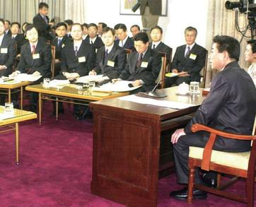

# “集团抗命”事件始末

<b>“集团抗命”事件始末</b>

卢总统的任职初期，我们的燃眉之急是解决与检方的矛盾。2003年3月6日，政府组建后，法务部就立刻决定了高级检察厅的人事安排，导致检察系统的集体反抗。舆论界把这次事件称为“检乱”“集团抗命”，于是引发了“总统与检察系统的对话”[注：总统与检察系统的对话：参与政府初期，检察官们一直反对进行检察改革，卢武铉总统与一般检察官进行了一次公开对话，全国电视台对这次对话进行了实况直播。]。

检察官集体对人事安排表示不满，这其实有点荒唐。当时检察系统有一个传统，如果有后辈的职位晋升超过前辈，那么所有的前辈就都得脱下制服辞职。同期检察官中，谁要是当了检察总长，剩下的同学也都得辞职。其实这个传统现在也还有。参与政府认为这种职业文化并不好，也不希望继续发展下去，觉得这种军队文化早应该废除，不符合参与政府的改革方向。

为了确保检察系统的政治中立性，我们认为有必要为他们的身份提供保障，这样一来检察官们就不用因政治而站队了。保障检察总长的正常任期也是这个目的。虽然新政府组建了，但是卢总统并没有要替换前任检察总长金珏泳的想法。金总长曾经向我打听过总统的想法，我告诉他：“总统绝对没有要换人的意思，您就安心干到任期结束吧。”

但是当时检察系统的高级干部满脑子都是被迫害意识，以为新政府会像过去的政府那样把他们都赶走。特别是被这次人事变动排除在外的人，他们持续煽动不满情绪，年轻检察官们本来也心存误解，于是就导致了集体反抗。他们对法务部部长康锦实的排斥也是导火索之一。

这种问题其实只要静待一段时间，由部长出面解决就可以了。但是总统不想这样，他要正面解决。他还想借此机会打开与年轻检察官们沟通的绿色通道。

总统这么做还有另外一层原因。参与政府刚刚组建，检察系统尚未集体表示对人事安排不满之前，在检察系统内部普通检察官会议上就已经提出过检察系统改革的建议，而且其中有很多想法与我们所设想的方向和精神都十分契合。

因此，总统想通过与年轻检察官们的这次座谈，化解大家对检察官人事安排的误会，就检察改革的方案来一次开诚布公的对话。总统的想法是在对话现场，对年轻检察官提出的建议，能够采纳就当场采纳，不能当场采纳的讨论后答复。总统希望嘱咐年轻检察官要坚守政治上的中立性，检察官内部要形成一种坚定的意志，要为此而付出努力，也希望向国民展现自己和年轻普通检察官共同探讨检察改革美好前景的画面，让这次对话成为自己与国民立下约定的契机，更希望这次谈话能够成为检察改革的推动力。

安排这次活动时我不在场，部长和青瓦台首席们开了讨论会。当时知律大师正为千圣山隧道问题第一次绝食抗议，我特地赶去釜山劝说她。总统在讨论会中途给我打来电话，问这个活动该怎么办。我说：“搞这个活动的确很好，但不能操之过急，最好事先认真调查。”可是，总统很快就发表了要与检察官们座谈的消息，还闪电般地定下了正式谈话的日期。

于是我们马上着手进行准备。我以为只要开始对话，大家听了总统解释，应该就能解开对人事安排问题的种种误会和不满了。剩下的时间来讨论检察改革议案。我们事前准备了检察改革方面的资料。总统还特意认真学习了。

结果当天的现场简直不忍直视。年轻检察官没完没了地揪着人事安排问题不放，问了一遍又一遍。对一个人提出的人事安排问题，总统已经解释清楚了，可下一位又会重复提类似问题。于是总统不得不把同样的话再说一遍。除了人事安排问题以外，没有人提出检察改革方面的问题，以至于总统不得不说大家“太有检察官特色了”！

其实我们在准备这个活动时，曾提前告诉法务部部长不要制止检察官发泄不满，让一线检察官提出此前讨论的检察改革方案，到时候可以围绕检察改革这个主题进行充分而热烈的讨论。结果到了现场，一切都不是我们所想象的那样。检察官们按照不同地域、不同集体选出了代表，每人都有自己负责提出的问题。但千篇一律的都是对人事安排的不满。好像有人事前指导过：在总统面前千万不要露怯，一定要把人事问题问个清楚才行。对于发言内容他们完全没有分工，每个人都只忠于自己所属的集体，于是同样的问题提了一遍又一遍。

  总统想通过与年轻检察官们的这次座谈，化解大家对检察官人事安排的误会，就检察改革的方案来一次开诚布公的对话。 

我真是佩服总统全程的自控力。虽然他也会生气，但是不像我们生气后就没法继续对话，总统即使生气了，也是尽最大努力平静下来，然后迅速回到对话中。我觉得心里有些苦涩，作为法律界的前辈我都替年轻的检察官们难过，他们怎么能这么傻呢？

现场持续着这种低智商的对话，氛围也别别扭扭。总统一直都努力把话题转到最想和大家交流的检察改革上，可是根本没机会。虽然后来有人说“总统力压群雄”“太有检察官特色了”之类的，但都于事无补。在国民看来，现场难免有些难堪，总统也对这次活动感到非常遗憾。总统和我们在活动之前，还抽空做了那么多检察改革的功课，结果是竹篮打水一场空。这次本来可以向国民展示检察改革的美好前景和可实现性，结果机会从我们手中溜走，太可惜了！

事后，我们还是按照计划正常推动检察系统改革。此前民辩、参与协会等社会团体所提出的改革方案几乎都得以实行了。当时总统与我觉得检察改革的出发点是确保检察系统的政治中立性，即从“政治检察”的约束中脱离出来。其实这与其说是制度问题，不如说是“文化的问题”，我们要将欲望关进牢笼里，让检察系统不再成为当权者为达到政治目的利用的工具，不必再看政权的“眼色”吃饭。

当然，我们不能指望一届政府就能改变现状，要让一种新“文化”扎根，至少要经历两三届政府。我们打算率先打下基础。

总统一有机会就直接或间接地表达这种意思，即使是重要案件，民政首席室也从不对检察机关下达任何指示。整个参与政府时期都彻底地贯彻和坚持了这个原则。就算检察机关调查大选资金来源，锋芒直指总统周围的人时，我们也全部允许，让检方能够公正地开展调查。虽然当时我们痛苦得像被人拿着刀子剜肉一般，但是确保了检察系统的中立性和独立性，我们希望检方能够将这种特性保持下去。

有件事值得一提，我上任时民政首席室与检方有一条热线。青瓦台有很多跟普通部门联系的公用电话线路，跟检方的专线却在民政首席室。我上任后就把这条线给掐断了。检方还为民政首席室提供过车辆，因为青瓦台公车不够用，过去一直都用检方提供的车。我把车也送回去了。虽然这些都微不足道，但是我觉得这些小事也会影响检察系统的中立性。

废除大检察厅中央调查部是确保检察系统脱离政治、保持中立的关键议题。讽刺的是正因为要求他们保持政治中立，我们反而不能插手。在检方走向政治化的道路上，起着决定作用的就是大检察厅中央调查部。大检察厅有刑事部、强力部、公安部等部门，都是指挥、监督地方检察厅和高级检察厅的，但只有中央调查部可以直接开展调查。因此特殊案件中政治案件就是由大检察厅中央调查部直接负责的，大检察厅就极具与政治倾向性。如果政治权力没有确保检方政治中立的坚定信念，就很难抵挡利用中央调查部的诱惑。大检察厅中央调查部在这个世界上是独一无二的存在。

日本调查政治案件时是由地方监察厅特殊部来负责，大检察厅并没有设立中央调查部这样的部门。日本东京地检特殊部从来不看政治权力的眼色。他们在彻底保持政治中立的同时，对大型权力腐败案件的调查战果累累，比我们的中央调查部名气大多了。只有彻底地保证政治中立才能震慑权力腐败行为，所以说废除中央调查部是检察改革的一项关键议题。

当时这一项议题没能成功通过，原因是就在我们正式讨论这个问题前，对大选资金的调查开始了，开展这项调查的正是中央调查部。总统和青瓦台都对调查给予了保障，不给检方任何暗示，让他们客观公正地进行调查。这个调查让国民对检方的信任度倍增。因此中央调查部废除论就被淡化了。在那种条件下，如果我们着手推动废除中央调查部，很可能给人们留下打击报复的印象。当时错过了那个时机，就再没能遇到下一个。我们费了那么大力气去守护检方的中立性和独立性，这结果真是太遗憾了！

可是，一进入李明博政府，他们瞬间都回到了过去。伴随着李明博政府上台而出现的倒退真是可叹又可悲。何止是可悲？！不控制检方、保障检方的政治中立和独立性的人是卢总统，而后来遭到检方有政治目的调查的也是卢总统，世上还有这么令人唏嘘的事吗？
 

