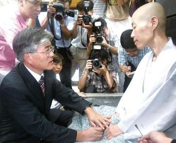

# 伴随一生的政治内疚

<b>伴随一生的政治内疚</b>

国家政策执行中长期存在一些未能解决的问题，这些问题在解决过程中很容易引起社会矛盾，我的另一项主要工作就是负责对这些社会矛盾进行整治。我需要仔细听取利害双方当事人、矛盾主体的意见，然后用合理的方式，通过对话与协商得出调整方案。

这些遗留问题之所以长期得不到解决，就是因为它们引发了非常深刻的社会矛盾。处理好这些是每届政府应该做的本职工作。但他们一日推一日，这届推下届。收回战时作战指挥权[注：收回战时作战指挥权：在朝鲜半岛紧急状况下指挥韩国军队作战的权力。目前平时作战指挥权归韩国独自所有，但紧急状况下则归韩美联合司令官所有。参与政府在2006年与美国就战时作战指挥权移交问题达成了协议，但2010年李明博政府又与美国政府协商将移交时间延长至2015年。]、龙山美军基地搬迁至平泽、放废场[注：放废场：放射性废弃物处理场的简称。能够完全回收放射性物质及其污染物，并对其进行安全管理的机构。]、赐牌山隧道[注：赐牌山隧道：赐牌山位于京畿道议政府市和杨州市长兴面之间，海拔552米。该隧道连接首尔外环高速松湫出口与议政府出口，在贯通过程中，遭到环境保护团体的反对。]、千圣山隧道[注：千圣山隧道：千圣山位于庆尚南道梁山市，海拔922米。该隧道是连接大邱与釜山的京釜高速铁路的一部分，环境保护团体反对该隧道贯通千圣山。]等问题都是这样，短则五年，长则十几年，都是久悬未决的老大难。

总统坚定地认为对这些问题不能回避，应尽最大的努力解决掉。定下的基调就是能多快解决就多快解决，在能够承受的范围内全都承担下来，这条原则是政权交接时就已经确立了的。因此参与政府一组建，就正式着手处理了。在解决过程中发生的矛盾管理、矛盾协调工作都交给了民政首席室。

对于赐牌山与千圣山的隧道问题，总统在竞选时曾承诺要重新讨论路线，于是我们组成了路线再讨论委员会。赞成与反对的双方都推荐了专家，在一起讨论既定路线和代替方案。结果赐牌山双方推荐的洞穴专家都坚持自己一方的观点，没有得出统一结论。千圣山隧道的再讨论委员会好不容易得出了一个结论，可是反对方又不接受。

其实，两条隧道的代替方案都不合适，根本找不到代替方案能够减少目前方案对环境的影响。除了这两处没有施工，线路其他的部分都已经施工了，根本没有多少选择的余地。我利用休息日自己开车去现场看了好几次。像赐牌山，我还特意登了上去，从山上往下俯视。赐牌山隧道入口已经立好了高架桥的桥墩，桥面大部分也已经安装到位了。由于重新讨论，工程已经中断了很久，因此一旦路线变更，撤除已经建好的公路、桥墩也不是一个小工程。

我只好向佛教界求助。佛教界搞环境运动的人也都承认路线变更的困难，当时我与曹溪宗总务院院长法长大师和佛教环境运动联合的水净大师多次讨论后，决定安排总统正式出面，向曹溪宗法传宗正大师[注：宗正大师：佛教宗教团体的最高精神领袖，是韩国佛教界，特别是大韩佛教曹溪宗宗教团体神圣性的象征。]提出协助请求。

2003年12月5日，总统亲自访问海印寺，见到了法传宗正大师，为未能遵守此前竞选时的承诺感到很抱歉，宗正大师也展现了高僧风范，接受了道歉，指示宗教团体协助国策工程。赐牌山隧道问题就此得以解决。

还剩下千圣山隧道问题。从政府组建开始，知律大师就通过绝食的方式领导反对运动。她不听从宗正大师的指示，也不理会宗教团体的方针，坚持不改变自己的立场。参与政府时期，她因为这个问题绝食了四次。一开始在釜山绝食，后来去青瓦台门前绝食，第四次绝食超过了100天，那次抗议她可真是命悬一线了。全社会都在担心她的安危，提心吊胆的，怕她有一丝闪失。她每次绝食抗议，我都前去劝说，但根本不起作用。

调节纠纷是政府要做的最重要的事件之一。就算政府对政策有着绝对的把握，如果有反对意见，也应该仔细倾听反对的声音，尽量说服对方。如果反对方是集体，就更应如此了。

可能由于参与政府所处的是权威主义解体时期，出现了很多影响面较大的社会矛盾问题。我觉得国家非常有必要建立一套系统，对这些纠纷进行合理的调节与仲裁。

  全社会都在担心知律大师的安危，提心吊胆的，生怕她有一丝闪失。她每次绝食抗议，我都前去劝说，但根本不起作用。 

放废场问题也是一个矛盾异常尖锐的问题。政府一开始对它不够重视，委托下面部门去处理，情况反而变得更棘手了。我们提出了补偿措施：对于申请修建放废场的地区给予补偿，提供3000亿韩元的地区支援经费，同时将质子加速器项目[注：质子加速器项目：通过加速质子的方式重新认识物质的特性与结构，是探索新物质的最尖端技术，可应用于超细技术、信息通信技术、宇宙技术、新材料开发等领域。]及韩国水力原子能[注：韩国水力原子能：2001年从韩国电力公司分离出的专门负责水力、原子能发电项目的国有企业。]（韩水院）总部搬迁至该地区。而且我觉得公路和各种社会间接资本以及设施投入后，可以发展当地经济，有助于提高居民的福利，是一个政府与地方双赢的方案。

全罗北道扶安郡提出了申请，后来我们才知道他们事先并未充分调查民意，主管部门未能发现这一点是个极大的失误。他们以为反正有巨额援助资金，肯定谁都想申请，他们想得太简单了。青瓦台对此并不知情，还以为找到了解决问题的突破口。产业资源部部长尹镇植亲自去了扶安郡，回来报告说当地反应良好，人们非常希望引进这个项目。他完全没看见那里的潜在矛盾。总统本来也正在发愁如何为全罗北道的经济注入新鲜活力，觉得这下好了，顿时喜形于色，紧接着就把事情定下来了。

结果形势出现了变化。扶安郡守的申请多少有些独断专行，他并没经过郡议会的决议，居民们的反对意愿非常强烈，韩水院在说服居民过程中也有很多不成熟的地方，再加上环境运动团体的反对浪潮，反抗与矛盾日渐扩大，无奈之下青瓦台只能出面解决。

其实，我曾经视察过扶安郡，产业资源部的报告虽然“没有问题”，但交到民政首席室的报告则不同，让我感觉事情有些不太寻常。我没有告诉任何人，也没取得任何协助，利用休息的时间，和妻子两人轮流开车，去实地考察了一番。到了那里，我就发现扶安真是个美丽的地方。一般自然环境很美的地方，当地居民对自己居住的环境就会有强烈的自豪感。因为他们知道自然馈赠的珍贵，所以守护环境的使命感也格外强烈。我切实地感到当地政府对当地这种情绪和要求的调查很不到位。

随着扶安居民的反对声势日渐浩大，政府只好通过增加补偿资金的力度来安抚民心。经过多轮讨论，最后决定扩建到扶安的道路等，对该地的间接性社会资本投资扩大到2亿韩元，但依然无法挽回已经被点燃了怒火的民心。结果扶安居民的反对活动大幅升级，近乎于民乱。很多居民在这一过程中受伤，甚至受到了刑事处罚。我们无奈之下接受了市民团体的仲裁，以居民投票的方式来决定结果。在扶安居民压倒性的反对之下，打算在扶安猬岛建设放废场的计划宣告失败。后来其他地区提出了申请，经过居民投票后，最终定在了庆州。这件事给扶安居民带来了巨大伤害，我为此一直很内疚。

在这个问题上我们算是交了一笔昂贵的学费，得到了很多教训。首先，对于有反对声音或潜在矛盾的情况，一定要事先化解反对意见及矛盾，至少将其最小化，然后才能够做出判断和决定。比如扶安这次事件，应该事先经过郡议会的同意。

郡守没有经过议会审议这道程序，独断专行地提出了申请，而我们发现之后，应该立即回到原点，重新定夺才对。但是当时政府一想到数千亿的支援经费，以及由此带来的社会间接资本投资，都将为对当地经济带来巨大帮助，就陷入了盲目乐观，在郡守未经郡议会同意独自提出申请被发现之后，还是一味地继续往前推进。

其次，以后还是得去现场实地考察。就算是同样的事情，放在不同地区，接受程度也会大不相同。其实，放废场储存的只是原子能发电厂的工作服、手套、长靴等中低端废弃物，稍微严重一点的是临时储存使用后的核燃料。这些东西的危险程度跟使用核燃料的原子能发电设施是无法相比的。像蔚珍、三陟、古里等已经有了原子能设施的地方，当地及周边居民对原子能发电已经习以为常，对放废场的警惕心就相对较低。反之，扶安对原子能发电比较陌生，并且有着极强的地区环境自豪感，在这样的地方哪怕提到放废场，人们都根本无法接受。我们的失误就是事先没能准确判断当地人民的情绪。

还要指出一点，那就是青瓦台与官僚阶层在工作中的“隔断”文化。无论涉及国家，还是社会，重大问题应该从一开始就跟几个部门共同协商，集思广益才比较好，但是他们不是这样做的。

放废场问题是国家十几年来一直未能解决的老大难问题。部门中的产业资源部、行政自治部、环境部、国政宣传处，青瓦台方面的政策办公室、民政首席室、宣传首席室等都应该从一开始就参与讨论，如果按照分工进行民调工作、宣传工作、环境团体协调工作等，情况可能会变得不一样。

但是当时的讨论范围只局限在产业资源部与政策室，一直到事态严重得无法解决了，才把参与讨论的范围扩大。民政首席室参与进来后，我发现当时负责宣传的产业资源部与韩水院的宣传能力，根本比不上那些搞反对运动的环境团体。当时居民们都误以为所谓临时储存使用后的核燃料，就意味着在这里对核废料进行二次处理。其实原子能发电设备中的中低端废弃物被移除后，就会腾出临时存储的空间，使用后的核燃料根本没有必要非得移走。在我们彻底放弃了扶安之后，寻找新场地时，我们一开始就宣传放废场只是“中低端放射线废弃物的处理设施”，而且明确标出“不储存使用后的核燃料”。

伊拉克派兵、韩美自贸协定的情况也是如此。这些也都是较为重大的行政举措，应该从最开始就让政务部门的参谋也参与讨论，但当时只是经过外交安保领域的专家讨论后就决定下来了。后来事态严重了，还得政务部门的参谋们收拾残局。

由青瓦台民政首席亲自出面与矛盾当事人见面，说服他们，这似乎是没有先例的。青瓦台内部也有人反对。我觉得即使不是我，这事也应该有人出面解决。社会上肯定有一些人，虽然不是什么社会名流，但他们很想就社会热点问题发表自己的看法。很遗憾这些声音没有传到我的耳朵里。如果这样的事多了，提倡交流的参与政府就不能算是提倡交流的政府了。我觉得我们应该走近并倾听那些受苦的人们，这也是民政首席的责任之一。我做市民社会首席时也是一样。我觉得不应该讲什么面子不面子，该做的就应该去做。

很多人都希望我们去见见他们，给他们送点慰问。可很遗憾，我总是被各种事情缠身，经常是有心无力。我听说西海海战牺牲官兵的家属生活上有困难，打算去看看，还跟总统说了，让总统直接去看他们。他们有的人确实生活很困难，我们还给安排了就业。

大宇建设已故社长南相国的家属也是这样。我一直想着要去看他们，结果还是没去成。一直到我从青瓦台出来也没去，真是太遗憾了。他们该多么怨恨我们啊，一想到这里，我就心情沉重。后来听说他女儿与我们这边首席秘书官赵己淑是校友，已经让她转达了我的内疚之情。
 

