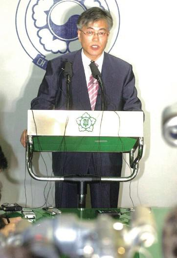

# 连环罢工事件

<b>连环罢工事件</b>

劳动事件原本是政策室下面劳动秘书官室的工作内容。但是总统按照职务职能做出了分工，劳动秘书官室的业务中的政策方面工作归政策室室长管理，劳动争议、劳动纠纷的应对归民政首席管理。我也觉得从这些业务的性质来看，由民政首席室负责比政策室更合适些，因为这些争议纠纷需要与各种劳动团体接触、跟踪事件进程，还要和检方、警方进行合作，这些都与民政首席室的业务更为接近，而且总统考虑到我做过长时间的劳动律师，对这方面的情况比较了解。

有了总统的指示，我在参与政府第一年就负责了全国教职员劳动组合（全教组）NEIS[注：NEIS：National Education Information System（国家教育行政信息系统）的首字母缩写，该系统连接全国小学、初中，市、道教育厅及下属机关和教育人力资源部，有助于共享教育方面的信息。]斗争、铁路罢工、货运协会罢工、朝兴银行罢工等大面积爆发的劳动事件。因此，舆论界给我起了个外号叫“首席之王”。

也有人批评我对非法罢工施行的是“棉棒政策”。老实说，民政首席室的业务本来就很多，再加上劳动事件，事情多得喘不过气来。不仅是我，民政首席室的工作人员也增加了不少工作量。这样一来，我们的工作难免会存在一些令人遗憾的地方。比如货运协会罢工事件，罢工的原因是运输费用过低，这是行业的结构性问题所导致的。过去货物运输费有一个基准费率制度，就是为了防止运费过低。但是国民政府初期取消了很多规章制度，原有的基准费率制就没了。再加上国际金融危机的影响，很多劳动者自行购买了运输车，导致运输车辆大量增加，过度竞争使运费大幅降低。再加上货物运输行业环节较多，使得货主所花的运费中20％—30％都成了运输代理商的手续费。根据我们所掌握的信息来看，所有这些因素导致运输司机实际所得的运费只是此前实行基准费率制时期的60%—70%。解决问题的关键在于从政策上重新确立基准费率制，改善多环节流程，减少运输车辆的数量。这些就不是民政首席室管辖的范围了。我把问题报告给总统，委托政策室及有关部门改进相关政策，很遗憾，后续工作不在我们管辖范围内。

货运协会罢工事件，政府的对策也有问题。货运司机们很早就向政府提出了问题，要求与政府进行对话，但所有部门都置之不理。主管部门——建设交通部认为这是劳动问题，推给劳动部。而劳动部认为他们的身份不是法律上规定的劳动者，也不是劳动团体，以此为由，也推说不归自己管辖。

当时货运司机们提出“停止物流，改变世界”的口号，为了实现他们的主张，他们还要中断釜山港的进出口业务。总统听了非常生气，指示我要以强硬姿态应对，让我们好好讨论一下是否可以投入军队的人力来缓解罢工造成的问题。当时总统正出访美国，他临行之前，以及在美国的时候每天都与我通电话，询问进展，再三指示我们讨论是否需要投入军队的人力。但是釜山港进出口物资的物流主要靠陆路、靠汽车运输，铁路运输所占比重不高，使用强硬措施并不可行。军队的挂车数量不多，就算投入所有军队人力，也只能在釜山港、集装箱场地运送集装箱而已。而且动员军队或其他人代替货运司机，驾驶停在公路上的汽车，这从法律角度来讲也是不可行的。如果想让它合法，只有一个办法，那就是由总统宣布实行紧急措施。当然，一旦釜山港陷入瘫痪，也只能这么做了。我们把这当作最后的一张底牌，与货运协会代表进行协商。

最终我们与货运司机们达成了协议。说是达成协议，其实是政府举手投降了。釜山港货物积压率持续上升，我们可回旋的余地只有一两天的时间，不得不妥协。货运司机所要求的事项，我们基本都接受了。能够立即执行的绝不耽误，需要时间的我们也承诺努力推动。货运司机们也正式注册了劳动组织，我们为他们打开了每年与运输业主、货主进行交涉的通道。货运协会打了一个大胜仗，极大地提升了其社会地位，也增加了很多新成员。

  货运司机们为了实现主张还要中断釜山港的进出口业务。总统听了非常生气，指示我要以强硬姿态应对，让我们好好讨论一下是否可以投入军队的人力来缓解罢工造成的问题。 

司机们可能太陶醉于这次成功的喜悦了，仅两三个月之后，他们又开始了第二次罢工。第一次罢工时，我们还能理解他们艰难的处境，但第二次罢工纯属无理取闹了。政府也不能总是温情脉脉。第一次罢工发生时政府几乎是束手无策，而到了第二次就不同了，我们的办法也多了起来。我们提前降低了釜山港的货物积压率，提高了应对能力。这次我们强硬地拿起了法律与原则的武器，不得不这样做我们也很遗憾。后来，货运协会的指挥人员遭到了拘禁，当初他们为了从根本上改善制度与政府建立的对话通道，现在也完全中断了。

铁路罢工也是如此。2003年4月，参与政府组建还不到两个月的时间，就开始了铁路总罢工。当时我了解的情况是，上届政府未能解决他们提出的“为被解雇者恢复职位”“终止民营化”等要求，于是他们就把解决的希望寄托在新政府身上。我一边顶着媒体“棉棒政策”的批评声音，一边最大限度地接受了他们的要求。可是两个月之后他们提出了反对公社化的主张，又开始了第二次罢工。这次我们就不得不动用公权力强硬对待了。很多人遭到拘留或解雇，这些人的复职问题到参与政府结束也没能得到解决。

参与政府初期，像这样政府与劳动界的冲突，即所谓“劳政关系”，大部分情况都是第一步就没走好。也许是劳动界对参与政府抱的希望比较大，一开始操之过急，野心太大；也许是劳动界的期待太高，参与政府无法承受。反正从结果上来看，我认为劳动领域并未推动改革，更多的是损伤了改革的力量。

当时为了NEIS问题，我见了很多全教组指导部的成员，他们的品格、态度和对工作的热情都是无可挑剔的，但是，参与政府面临的根本性教育改革课题堆积如山，而我还要处理NEIS这个本应该属于技术领域的问题。当时，我简直可以用“悲壮”这个词来形容，有人说我就像“中国东北广袤的平原上的的革命志士，风餐露宿，投身于抗日运动”。

在参与政府初期这么重要的时间里，可以说教育部、全教组都被这个问题束缚住了手脚，没能前进一步。我们投入了大量时间和精力，才解决了这个问题。第一次组阁时，我们顶着压力破格提拔的教育部部长根本没能施展自己的改革抱负，就辞职了。继任的自然是相对安稳的人。我觉得这种人员的变化也是参与政府的教育改革未能成功的原因之一。
 

