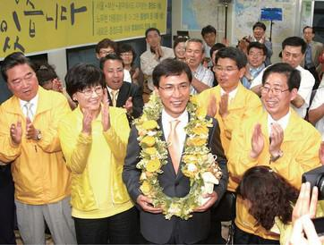

# 苦痛：大选资金调查事件

<b>苦痛：大选资金调查事件</b>

从青瓦台内部来说，最痛苦的事件就是那拉综合金融事件[注：那拉综合金融事件：那拉综合金融公司在国家投入2兆韩元国有资金救市后依然宣布破产。该事件指那拉综合金融大股东、前任宝城集团会长金浩准，在1999年破产之前，曾向安熙正与廉东渊提供游说资金。]与大选资金调查。从安熙正等总统身边的人开始，帮助总统赢得大选、执掌国政的功臣们都一个个被迫背上了十字架。总统公开表示同意接受调查。他说：“这是一个时代的选举陋习，是我们不得不承受的，但应该在我们这个时代里终结！”话虽如此，可实际情形就像有人拿刀剜自己的肉一般。但总统真的是说到做到，他公开对检方说：“不用太在意，请随便调查。”调查固然是要进行的，但可能因为总统的这个态度，调查还被提前了——反正这一切也是不可避免的。

当时检方的传唤过程真的是有问题。比如安熙正，一开始拘留申请被驳回了，后来下达了逮捕令，一直到收监为止的一个月的时间里，舆论一直在对他百般羞辱。何止是被羞辱，简直是“欲加之罪，何患无辞”。我们这些人在旁边看着都觉得无比痛心，更何况他本人呢。家属的痛苦程度更是撕心裂肺。到现在我都还清楚记得安熙正被检方传唤那天的情形。人们就好像看到百年不遇、人神共愤的罪犯终于被抓获一样，当事者被置于中间，无数记者在周围对他推来搡去，使他毫无尊严可言，简直到了令人发指的地步。在国民眼中他满身疮痍，就像犯下了滔天大罪。这样的人格侮辱还不止一次，持续了好几次。别说什么人格了，就连人权都丧失了。由于他的遭遇，后来检方在传唤主要嫌疑人时，增设了一些最起码的措施来保障人权。比如，检察厅办公大楼前一律不许记者采访，在大楼外面的摄影区域内才允许进行采访等。

这种措施一直延续至今，但这也并非根本的解决问题之道。嫌疑人在接受调查时仍然是无罪的，因此在这段时间没有理由让嫌疑人暴露在媒体面前，任由媒体践踏人权。不能用国民的知情权、媒体的采访自由等理由，给践踏人权披上正当化的外衣。我觉得至少在检方起诉前，应该保护嫌疑人不受舆论、采访的骚扰。

受到司法处理的人也都很可怜、很冤枉，这里以安熙正为最。就因为竞选过程中是他负责选举资金，再加上那拉综合金融案件，所以他总是成为众矢之的。为了不给总统增加负担，他甚至都不去青瓦台了。也有人建议他暂时出国待一阵子，但他表示虽然暂时不去青瓦台，但是事到临头还得直接面对。他说到做到，坚强面对，但现实实在太残酷了。有一些问题根本不是他的责任，他也都揽到了自己身上。

眼睁睁看着安熙正的家人也跟着蒙冤受难，作为民政首席，我却只能袖手旁观，连我都恨我自己。不仅是安熙正，一想到姜金源、廉东渊、郑大哲、李相洙、李在汀等人所遭受的苦难，我就感到无比愧疚。

总统竞选时，我担任了釜山选举对策本部长，我和他们能有什么区别呢？要说有区别，只是因为我找了专门的会计，自己没有直接碰过钱而已。实际上，这些遭受司法处理的人与我并没有根本的差别，也正因为如此，我更于心不安了。

所有人都为了守护总统而牺牲了自己。为了尊重总统的政治决心，帮他彻底涤清一个时代的陋规及残渣余孽，每个人都欣然背负起各自的十字架。我们要感谢他们，正是有了他们的牺牲，选举文化得以改变，选举革命才成为可能。

说起痛心，参与政府青瓦台第一任附属室长梁吉承事件也足以令人痛心疾首。他陪同总统去地方，参加归还青南台[注：青南台：指忠清北道清原郡大清坝附近约55万坪的总统专用别墅，被人们称为南方青瓦台，因此也叫青南台。从第五共和国时期开始，一直是总统专用别墅，但参与政府从2003年4月18日起将其归还给国民，这里成为国民的度假地。]的活动。在工作日程结束后，几个朋友请他去喝酒，却不知被谁给偷偷录了下来。立刻，这次聚会就被说成“国会选举前的私人组织聚会”“接受不恰当的请客、吃下人情债的聚会”。

  一周年纪念活动结束后，几位继承了总统遗志的朋友在地方选举中收获了丰硕的成果。其中，金斗官、安熙正、李光载三位的飞跃性发展让人不由得感慨万千。安熙正的名誉也得以恢复了，即使抛开公理正义，从个人角度，我也感到无比高兴。我想天堂里的卢总统也一定很欣慰。 

这个事件后来到8月份成了个大问题，当时我正在休暑假。我的暑假休得比别人晚，虽然有一个星期的假，但是我只打算休三天。我和妻子去庆尚北道闻庆市做了次短期旅行。我很喜欢这里，我们在凤岩寺住了一夜，当地没有手机信号。第二天我们从那里出来，刚到了有信号的地方，就接到一位记者的电话采访。我这才第一次听说了这件事。新闻报道里还批评我去休假和一天不接电话。

说实在的，梁吉承作为附属室长，有职责在身，去参加宴请确实有些不合适，但也不应该被批得太过分。如果说有不合适的地方，那就应该哪里不对批评哪里，但他还被扣上了各种“莫须有”的罪名。后来他主动请辞了。梁吉承也被传唤调查，在被推来搡去的过程里，遭受了十恶不赦的坏人都不会遭到的各种侮辱。舆论界甚至怀疑青瓦台故意包庇他。真是不可理喻！

舆论把这件事炒得沸沸扬扬，青瓦台内部第一次经历这样的事情，有人连事实关系都搞不清，看了媒体的报道也跟着埋怨他。我实在太气不过，就给青瓦台的工作人员发了封邮件，题目为《民政首席对包庇梁室长一事不当调查的意见》，把事件的前因后果讲清楚了。连青瓦台内部的同事都不知道他的冤屈，可见舆论报道是怎样枉顾事实地担当起裁判的角色了。后来调查结果和事情的前因后果虽然被澄清，但为他恢复名誉的努力却远远不够。
 

