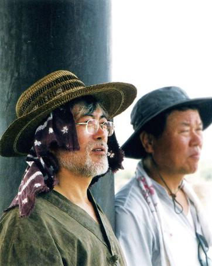

# 徒步喜马拉雅

<b>徒步喜马拉雅</b>

2004年2月28日，喜马拉雅。

我虽然从青瓦台出来了，但是接下来该干什么还没有计划好。我觉得暂时还不能做律师。在回归律师行业之前，我应该保持低调。一直以来，我十分向往尼泊尔、中国西藏，还有印度北部地区，我计划去徒步旅行，洗涤心灵的同时也能思考一下今后该干些什么。

我工作过的综合律师事务所有疗养年假制度，员工工作满10年可以休3个月，工作满20年可以休6个月。我工作满10年的时候，因为太忙没休假，后来到1997年我当律师将近15年的时候，才休了3个月。当时，我去了拉塔克和尼泊尔的珠峰南麓徒步旅行，那里是瑞典生态环境运动家海伦娜·贝里霍奇的著作——《远古的未来》一书的背景地，正赶上一位跟我年龄相仿的牧师也在休疗养年假，于是我们二人就拿着地图出发了，没有向导，也没有背夫，那次真是太好玩了！后来，一有时间我还想去徒步旅行，因此，平时一看到有关徒步旅行的资料，我都会收集起来。现在机会终于来了，上次去的是珠峰，这次我的目的地就定在安娜普尔纳[注：安娜普尔纳：位于尼泊尔北部喜马拉雅山脉中段的山峰。——译者注]。

隔了这么久再次来到尼泊尔，感觉这里变化很大。首都加德满都市内到处都有持枪军人在站岗、搜查，气氛很紧张。听说此前王宫里发生了枪击事件，国王与王子都死了，国王的弟弟继承了王位。前任国王实行的民主化政策出现了倒退，民心不稳。乘此机会，反政府武装活动逐渐频繁，所以首都市内才会有持枪军人警戒。

我们夫妻在尼泊尔期间，反政府武装向全体国民下达了总罢工的命令。除了首都加德满都以外，几乎地方上所有人都响应了总罢工令。除了军用车辆、救护车之外，只有写着“Only Tourist”字样、载有游客的车能够通行。总罢工虽然没有波及加德满都，但是听说地方上都不再给首都供应食品了，因此对首都的冲击也不小。听向导说，政府宣传说叛军对没有参加总罢工的人实施了报复行动，所以参与率看上去很高。事实上确实存在报复的情况，人们心中有恐惧也是事实。但是如果真的只是这样，那参加的地方范围实在是太大了。政府如果不能果断地推出民主化政策来笼络人心，我感觉王政确实岌岌可危。

安娜普尔纳徒步路线一般都是从尼泊尔第二大城市博克拉出发的。这里属于亚热带气候，海拔900米左右，四季温暖如春，有“费瓦”天然湖，湖周遍布酒店和旅游山庄，美不胜收。到了二三月份，酒店院子里的花草相继绽放，远方雪山环绕，充满异国情调，这如梦幻般的画面让人如痴如醉，哪还用去别的地方，光是在这里休息就已经很享受了。不久前去世的朴婉绪[注：朴婉绪（1931—2011）：当代韩国文坛女作家，主要作品有《裸木》《站着的女人》等。——译者注]先生十几年前曾经写过一篇有关尼泊尔的游记，叫作《亵渎》，当年我读了其中描写博克拉的文字后，一直对这里心生向往。

安娜普尔纳徒步路线原本是要一直走到海拔4700米高的大本营。1997年，我徒步登珠峰和拉塔克时，曾经到过海拔5900米的地方，这次我对海拔高度没有太大的野心，更想去大本营看看，但我对自己的体力没有自信。我们选择了布恩山路线，到达海拔3500米左右，然后在山间的村庄里游览。这个路线如果为期一周应该不困难，但我们压缩到了5天。我体力严重下降，疲惫不堪。

我们通过旅行社预约了向导和背夫。向导曾经在韩国工作过，经验丰富，而且韩语说得很好。因为当时天气寒冷，我们的行李很多，又是棉大衣，又是睡袋，就要找两位背夫，可我们到了徒步的出发地一看，只来了一位背夫。可能他想先看看我们的行李，然后再判断要不要再叫一个人。他说自己曾经给攀登喜马拉雅山脉的韩国登山队做过背夫，虽然他体格很小，但身体看起来却很结实。

  安娜普尔纳徒步路线一般都是从尼泊尔第二大城市博克拉开始的。这里属于亚热带气候，海拔900米左右，四季温暖如春，有“费瓦”天然湖，湖周遍布酒店和旅游山庄，美不胜收。 

他看了看我们的行李，说他自己一个人就足够了。向导说，根据尼泊尔劳动法，背夫的行李重量要限制在20公斤，但一般人都不遵守，背三四十公斤也大有人在。在他看来，我们两个人的行李合在一起，由他一个人背没有问题，把差价都给那个人，让他一个人背也好。确实，我们的行李都是棉大衣、睡袋之类的，体积不小，但并不太重。我说“好吧”。但我们两个人的行李合起来肯定超过了20公斤，别的不说，光行李的高度就快赶上背夫的个头了。就这样把东西都给他，我们空着手走山路，我心里有点不舒服。“不行，大韩民国的男人得要面子啊！”想到这里，我还是把一半左右的行李背在自己身上了。背包本来10公斤都不到，可是不知道为什么徒步时觉得奇重无比，但我总不能背到一半再还给他吧？更不能让妻子分担……我一直背到了最后，也累坏了。

背夫背的行李又高又重，可是人家毫无疲惫之色，只是一味地赶路，时不时他还要等步履缓慢的我们，经常等得不耐烦干脆先走了。我本来还替妻子的身体担心，但她却没什么问题，真正吃苦头的人倒是我，平时号称自己是登山爱好者，还吹嘘自己曾经到过海拔5900米，但这次的徒步对我来说简直就是苦行。不过想到喜马拉雅的景色，静美的山间村庄、夜空中的星星、清新的空气，一切都值了！

我还有一个大收获，这次安娜普尔纳徒步帮我把烟戒了！我从高中开始吸烟，本来在青瓦台时就应该戒掉，因为按规定，像青瓦台这样的公共建筑是禁烟的。我很早就经常跟总统在一起吸烟，后来觉得这样有点不礼貌，心里有了负担。可有时是总统让我吸，他会说：“文首席，给我一支烟。”直接到我这里拿烟，搞得我不得不跟他一起吸烟。总统的处境也好不到哪去，为了吸烟这件事没少听夫人的唠叨。我心里一直想着戒烟才是上策，但在青瓦台的时候到底还是没戒掉，别说是戒烟了，此前我一直是每天半盒，在青瓦台期间，每天一盒还不够。

后来，有件事让我意识到了戒烟的迫切性，那是我喜欢上潜水以后。

一开始我和妻子一起玩潜水，妻子的水下呼吸器几个月也没什么变化，我的就不行，呼吸管一两个月就变成黄黄的颜色。我这才知道，原来不仅是吸烟时，就连平时，我呼出的气体都有尼古丁。我这才真切地意识到，原来我无时无刻不在向这个世界呼出尼古丁。从那时起我就下定决心要戒烟，安娜普尔纳之行终于让我把烟给戒掉了。

我们一行汗流浃背地走在山路上，到了景色绝美的地方就歇歇脚，这时如果能抽上一支烟，那简直是吸烟的最高享受了——但我只能说“遗憾”了。这里空气如此纯净，在这里吞云吐雾让我有一种负罪感。徒步过程中我吃了很多苦头，有没有戒烟引起的不适感我也不清楚，反正徒步之后，我再也不吸烟了。

一提到喜马拉雅山脉，大家都对高原反应很好奇。专业登山人员到达海拔8000米会怎么样，我不知道，以我的经验来看，普通人能到达的高度，只要慢慢走都能适应。高原反应一般从海拔3000米开始有感觉，不管是坐飞机上去还是乘车上去，哪怕走着上去，只要上得快都会有反应。所以，我看给西方人写的徒步路线指南上都会注明一定要慢慢地走，路线的设定是名副其实的“喜马拉雅漫步”。

可是我们韩国人本来就喜欢登山，速度又快，能够去喜马拉雅徒步的人应该都没少登山。因此，专门为韩国登山客设计的徒步路线基本上都要比西方人的日程缩短一半，几乎可以说是“急行军”了。高原反应的症状有头疼、呕吐、腹泻等，视个人体质而不同，神奇的是，只要一下山马上就好。所以，如果产生了高原反应，就停下脚步适应一下，再不行就直接下山。可我们不是意志坚强的韩国人吗？即便痛苦，也得咬紧牙关继续坚持呀。特别是有些人意志坚强，又不愿意给同行人带来麻烦，更要坚持，最后高原反应严重到完全无法自己走路。我们刚刚进入安娜普尔纳当天，就有两名韩国人被直升机运送下山了。向导说韩国人总是喊“快点儿，快点儿”， “快点儿，快点儿”这话我也说了无数遍。

登山的时候能有更多的时间去享受大山该有多好！

1997年，我在珠峰徒步时也是这么想的，在珠峰，即使海拔5800米的地方也有专门为登山客准备的客栈，分布着山间村落。在这里，海拔4000米左右有个村子叫“那木齐”，那里的“那木齐巴扎”蜚声世界，“巴扎”就类似于我们的乡村五日集。我记得好像是每逢周三开放，生活在海拔更高和更低的村子里的人拿着土特产、食品、旅游纪念品等到这里来赶集，非常值得一看。来摆摊的都是住在山间村庄里的居民，他们把要卖的东西捆成体积超大的行李背到那里。他们背行李的方式也很有异国特色，不像我们用肩膀背，他们是把背带套到额头上在山间行走。很多西方人特意去赶这个集，有的甚至为此等上好几天，但我们韩国人只想往上走，碰上了就参观一下，碰不上一般就直接走了。我觉得旅行的目的不仅是徒步，对这类风土人情最好也抱有强烈的好奇心。

结束了安娜普尔纳的徒步旅行，我们去了博克拉的奇特旺国家公园，骑大象，观察鸟类。具体说来，就是骑着大象在公园的树林里观察犀牛等野生动物和各种亚热带鸟类的活动。我们还乘坐长长的独木舟沿江而下，观察江边的鳄鱼和鸟类。为了前往加德满都，我们需要到附近的机场，可正赶上叛军下达了总罢工令，连公共汽车都停止运行了，这样一来我们就没法去机场了。向导给我们找了辆吉普车，装了几个人去机场。司机在汽车前挡风玻璃上贴了个很明显的标志，上面写着大大的“Only Tourist”字样，意思是车上只有游客。在去机场的路上，除了救护车和军用车外，果然看不到其他车辆，偶尔有一些像我们坐的、写有“Only Tourist”字样的汽车映入眼帘。

一路上处处都能看到燃烧着的树木或废旧轮胎，还遇到岗哨盘问过往车辆，他们看起来都气势汹汹的。每次有人上前盘问，吉普车司机都得解释，最后到了距离机场差不多十几公里的地方，司机说：“前面我去不了了。”向导只好又找了个载客人力车，我们估摸坐了两个小时才到达了机场。
 

