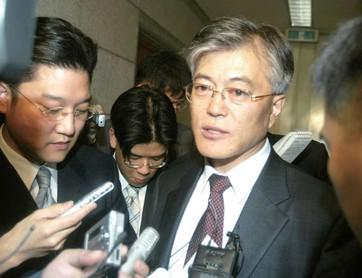
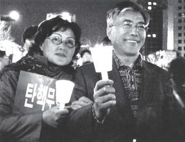

# 请你们重新让我做回总统

<b>请你们重新让我做回总统</b>

弹劾议案最终被国会通过了。总统委托我组织“弹劾事件总统方代理人团队”，全权负责法律上的应对工作。我随后组织了代理人团队。现在想来，当时我们真是组建了我们所能够组建的最强阵容。我们决心要找的代理人本身都应该保持立场中立，而且名声与实力要首屈一指。

到底什么样的人比较好，我和很多人讨论之后才确定下来，然后我一一找上门提出邀请，几乎所有人都痛快地接受了我的邀请。只有一位拒绝了，他说自己与宪法法院院长关系密切，容易引起误会，不太好，但是如果有需要在幕后提供帮助的，他将尽力帮忙。事实上，他也确实提了很多建议，帮了很多忙。我对所有人都无比感谢。

工作正式开始了。

首先，我得重新申请执业。我进入青瓦台后，律师的工作就处于暂停执业状态，我赶紧申请重新执业。自大宇造船事件之后，我与卢武铉律师第二次成了辩护律师与委托人的关系。因为我不是首尔的律师，在首尔也没有办公室，就在瑞草洞临时找了个办公室。跟我一起做弹劾代理人的其他几位都是法律界名声显赫的大律师，法律上的能力都非常突出。我们本来也很熟悉，配合得非常默契。每个人对这个团队的人员构成都很满意，第一次开会就充满了自信和使命感。我们都坚定地相信：只要依法办事，就一定会取得胜利。多数党就是靠人数一时得势，从法律上讲，这次弹劾根本就说不通。简直可以说是多数党违背民意的一场政变，这是民主宪政的危机。如果这件事得不到解决，那韩国宪政的未来将暗淡无光。

我们做了职务分工，柳铉锡律师担任首席律师，韩胜宪律师自请当总负责人，其余几位按照各自论点分别负责不同领域，他们按照这种方式分配进行研究、写作，以及发表。

我们对法庭辩论也进行了分工。每次庭审，对要发言的代理人的人数和顺序、发言的内容、突发情况的应对等非常详细的信息，我们都是一起讨论后再上庭。

在民辩方面，我们选出了因实力出众、工作认真而广受好评的赵庸焕、白承宪两位律师，他们没有以代理人的身份上法庭，而是在法理研究与工作后勤方面给予了全身心的帮助。他们二位在团队正式启动之前，就对弹劾审判制度进行了研究，同时确立了我们这一方的法律对策的框架。金善洙律师也帮了不少忙。不过，他们觉得民辩所属律师以代理人的身份正式出面不太合适，因此没有正面出现。

  我作为代理人团队的干事，负责一些具体业务和宣传工作。舆论战地也很重要，但这可是个苦差事。每次我踏入宪法法院都要站在摄影记者面前，对我们当天上庭的立场和争论焦点进行说明。 

我作为代理人团队的干事，负责一些具体业务和宣传工作。舆论战地也很重要，但这可是个苦差事。每次我踏入宪法法院都要站在摄影记者面前，对我们当天上庭的立场和争论焦点进行说明。庭审结束出来时，又要总结当天的审判，发表意见。虽然现场都会设置采访区域，但由于记者太多，我在现场还是会忙得晕头转向，闪光灯乱闪，我根本看不清记者。站在摄影记者面前，我才切实感受到这件事有多辛苦。我以前没做过这个，觉得很不适应。我只是个弹劾代理人，就要站在摄影区域面对记者，那如果被检方传唤，以嫌疑人身份上庭前站在摄影区域得多么难受？说什么舆论自由、国民知情权，强迫一个不愿意站在摄影记者面前的人接受采访，谁有这样的权力？在这种情况下，我觉得我们的社会更应该尊重他人的名誉。

另一方面，我还努力让以宪法学者为首的法律学者与法律专家发出反对弹劾的声音。宪法法院不可避免会沾染上政治色彩，我这么做是为了让专家的声音占据舆论的主导地位。也有很多人自发组织起来，以联名上书的形式，或者以学会的名义，发表反对弹劾的声明。在最重要的宪法学界里，首尔法律大学的安庆焕教授起到了核心作用，年轻学者绝大部分也都站在了我们这一边。

  弹劾审判过程中，我会经常到反对弹劾的烛光集会现场。我也想以一名普通市民的身份为烛光集会贡献一份力量。想到弹劾审判的政治性与宪法法官的保守倾向，我觉得有必要在舆论上占据压倒性地位。 

弹劾审判过程中，我会经常到反对弹劾的烛光集会现场。我也想以一名普通市民的身份为烛光集会贡献一份力量。想到弹劾审判的政治性与宪法法官的保守倾向，我觉得有必要在舆论上占据压倒性地位，这件事的重要性一点也不亚于法庭辩论。一想到“民意就是宪法”这句话，我就把参加烛光集会看作为法庭辩论所做的准备工作。连日来，汹涌的烛光集会人群将市厅前面的道路挤得水泄不通，集会很是庄严。这让我想起了和总统一起参加过的六月抗争。也有人把反弹劾烛光集会示威说成是“第二次六月抗争”。媒体报道了我去参加烛光示威的照片，照片里我和妻子并肩而立，我觉得这也是尽了自己的一份绵薄之力。有家网络媒体还报道了我的感想：何为宪法？它是高高在上、遥不可及的吗？不是。它是国民对民主主义所持有的最普遍、最朴素的理想，宪法就是将这个理想具体表现出来而已。因此，对于宪法的解释终归还是要从普通国民的民主主义意识与法律意识出发。这要反映到宪法中去。这么多市民走上街头，用烛光示威的方式表达对弹劾的反对，难道不是已经为弹劾审判指明方向了吗？

在准备庭审过程中，总统与几位代理人曾经见过一次面。总统为了表达谢意特意安排了这次见面。其实，关于庭审的准备也不用刻意多说什么，就说了说总统是否有必要亲自出席的问题，对方申请要求总统直接出庭，总统说没什么不能去的，决定要去。这虽然会对我们有所帮助，但是我们觉得根本没那个必要。后来，宪法法院也没有接受对方的请求。总统过了那么久近乎幽禁的生活，想必身心俱疲，但他依然不失幽默感。愉快的谈话结束后，我对总统说：“最后，总统还有什么要嘱咐代理人团队的吗？”总统突然站起来，说：“请你们让我重新做回总统！”这本来是个让人心情沉重的话题，结果一行人都笑着离开了。

弹劾审判还在进行中，2004年4月15日，第17届国会议员选举如期而至。我在选举收官阶段才到釜山等几个选区帮了帮忙，结果开放国民党占了全体299个议席中的152个，成为了国会过半数的政党，民主劳动党在按比例代表[注：比例代表：韩国从第17届国会议员选举开始实行的制度，投票人投票时对自己支持的候选人与政党分别投票。获胜候选人即为地区代表，各政党按所得票比例分配国会中的比例代表席位。目前韩国国会300席中地区代表为246席，比例代表为54席。——译者注]选举中也赢得了8席，以全体10席的成绩一举成为国会第三大政党。如果不是选举最后阶段郑东泳议长的“老人发言”[注：老人发言：国会议员选举过程中，郑东泳为了鼓励年轻人投票，表示“老人不去投票在家里休息也没关系，因为他们是不能够决定未来的。但年轻人是可以决定未来的，必须去投票”。此言一出，大众哗然。开放国民党因弹劾风波在国会选举中本来势如破竹，但以此事件为转折点支持率开始下滑。——译者注]引起了一些不快，开放国民党还会占据更多的议席，成为过半数的压倒性政党。一般人都推测，岭南地区至少还能再拿到几个议席。总体来说，这个结果就是民心对弹劾的审判，我认为这次国会选举的结果为宪法法院的弹劾裁决定下了基调。

5月14日，宪法法院的审判结果终于出来了——弹劾请求被驳回。我与连日来一同并肩奋战的几位代理人激动地拥抱在一起，分享胜利的喜悦。记者问我有什么感想，我说：“高兴得无以言表。我希望这能够成为一个契机，让我们的政治文化再上一个新台阶，实现国民的团结合作。宪法法院对弹劾理由中的一部分予以了认可，我们应该尊重宪法法院的决定，谦虚地接受意见。这个决定大体上和我们的预想很接近，我认为国民用法律途径表现出了健康的心态。”

但令人伤心的是，担任首席律师的柳铉锡律师在完成最后辩护后晕倒了，最后也没能醒过来，于2004年5月25日辞世。他一生致力于人权律师事业，最后在弹劾法庭上点燃了最美的焰火。宪法法院的结果出来当天，代理人团队就去了他的病房，打算告诉他这个好消息，但是他已经处于昏迷状态，我们只能把好消息告诉给了他的亲属。我作为市民社会首席前往参加了他的葬礼，也带去了总统的沉痛悼念。
 

