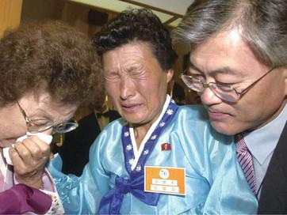

# 接任市民社会首席

<b>接任市民社会首席</b>

弹劾审判结束三天后，我又回到了青瓦台。这次我的身份是市民社会首席，总统非常诚恳地邀请我出任这个职位。青瓦台进行了改组，把现存的国民参与首席室扩大为市民社会首席室。总统说，首席这个职位就是为我准备的，让我必须担任。其实这并非事实。改组部门，扩大现有国民参与首席室的权限，是为了与市民社会团体更密切地联系。但既然总统把话都说到这个份儿上了，我也不能拂袖而去。

总统改组市民社会首席室，由我担任首席职位，是有原因的。参与政府的组建是市民社会团体的力量，卢总统的当选与其说依靠的是自己所属的民主党，不如说依靠了身后广大市民社会团体的力量。但是，在伊拉克派兵问题、扶安问题、新万金问题、平泽美军基地搬迁问题等事件之后，总统与市民社会团体的关系遭到了严重破坏。很多人对我们感到了失望，有的人甚至与我们背道而驰了。

但是，烛光示威活动让市民社会团体重新团结起来，还将总统从弹劾中拯救回来，4月15日的国会选举又将开放国民党打造成了多数党。现在正是与市民社会团体重新携手的最好时机。当时，正好有一个流行词叫“Governance”（协治），我们梦想着能够与市民社会实现Governance，总统也让青瓦台的参谋们阅读Governance方面的书籍。

因为我在釜山地区长期参加过市民社会活动，做民政首席时与首尔方面的市民社会有关人士也有过来往，所以总统认为，第一任市民社会首席由我担任最合适。为了不辜负他的期望，我也尽了最大的努力。我把重要的社会矛盾按照不同的秘书官室进行分工，让青瓦台直接关注。为了实现国家级矛盾调节的系统化，我让“可持续发展委员会”担负起矛盾调解机构的功能。而且为了实现矛盾调解的法制化，我们还推动了矛盾管理基本法的制定。不仅是“可持续发展委员会”，还有“国家能源委员会”等国家政策讨论机构，也增加了市民社会的参与度。

回首过去，发现我们的努力还远远不够，但方向是正确的。我们朝着福利国家前进的同时，又要防止政府变得过大，我们的方法就是将此前政府所执行的一部分功能让渡于民间。这也是培育市民社会健康成长的方向和道路。

但是，因为业务内容的不确定，市民社会首席室的工作与别的首席室不同，根据责任人的不同、工作方法的不同，也会有很大的差异。这些问题如何解决还有待于进一步探索。

我做市民社会首席时，印象最深的就是母亲参加离散家属见面会。2004年7月，母亲被选中参加了在金刚山举办的离散家属见面会，终于见到了阔别已久的亲妹妹。母亲家中有六个子女，母亲是大姐，现在唯一健在的骨肉血亲就是这位最小的妹妹了。母亲从卢泰愚政府时期就开始申请参加离散家属见面会，但一直未被选中。实际上，这次参会也并非是母亲被选中了，而是她身在朝鲜的妹妹被选中了，而且是在我离开青瓦台的那段时间被选中的，只不过活动的举行是在我当上市民社会首席之后。我也去了金刚山，见证了母亲与小姨见面的喜悦。小姨知道我在青瓦台工作，还问了我的职务是什么，我当然老老实实地回答是市民社会首席，但无论我如何解释，她都搞不清楚这个市民社会首席是干什么的。

  我做市民社会首席时，印象最深的就是母亲参加离散家属见面会。2004年7月，母亲被选中参加了在金刚山举办的离散家属见面会，终于见到了阔别已久的亲妹妹。母亲家中有六个子女，母亲是大姐，现在唯一健在的骨肉血亲就是这位最小的妹妹了。 

还有件事是我永远无法忘记的，那就是李基俊[注：李基俊：2005年1月就任韩国教育副总理兼教育人力资源部部长，但因其担任首尔大学校长时在校外兼职理事、过度使用办公费用、儿子双重国籍等问题，遭到了舆论的批评，就职仅两天就辞职了。]教育副总理人事波动。这是参与政府人事工作中最大的失败。他身上的问题在审核过程中并非无人知晓，但还是没有做“不合格”处理！偏偏决定人事安排的那次人事推荐会我没有参加。我在青瓦台时，每周都会参加人事推荐会，只有一次缺席，就是那一次。我觉得人事推荐会是最重要的会议，此前从不缺席，但那天地方上有重要事情，我亲自去了，回来时错过了会议。如果我早知道回不来，肯定会把会议时间推迟。而且，如果我是专门负责人事审查的民政首席，估计人们也会等我回来再开会，正因为我是市民社会首席，我不在场，会议也照常进行了，结果就出了问题。

如果我参加了那次会议，我一定会反对的，因为这不符合我的标准，而且我记得李基俊的问题在首尔大学时就存在了，当时就遭到了舆论的批评。他的问题但凡有人指出来，一定会引起在场人的共鸣。但因为他是秘书室室长熟悉的人，可以说是秘书室室长推荐的，所有人都觉得没什么大不了的，就那么过去了。就因为这件事，秘书室室长、民政首席、人事首席、宣传首席，还有我，人事委员会全体都提出了辞职。最后，以民政首席与人事首席的离开结束了这场风波，但我们所有人终究都没能做好工作，还连累了总统。

不过，参与政府的人事推荐与审核系统还是值得我们骄傲的。推荐与审核分离，开会讨论做出决定，在这个系统里各方相互牵制，而最重要的是，总统对系统极为尊重的态度。

如果万事总是看总统的意思，系统马上就会变成无用之物。卢总统自始至终都非常尊重这个系统。我们考虑人事变动时，总统有时会让我们重点讨论一下某个人选，有时也会对某人给予高度评价。在总统身边工作久了，自然就能了解总统用人的想法。我们也尽可能揣摩总统的想法，尽力挑选总统喜欢或者评价较高的人进入备选名单。

但我们在人事审核以及对审核的评估中都绝无例外，即便是总统直接指示让我们讨论的人选也一样。有的人是总统平时对其就有想法，我们会故意放入备选名单中，但如果其评估结果比较差，或审核中出现了问题，也会被排除在外。我们将排除的理由报告给总统后，总统也都能接受，一次都没有坚持自己的意见。我觉得这才是参与政府人事系统能够正常运转的关键。
 

