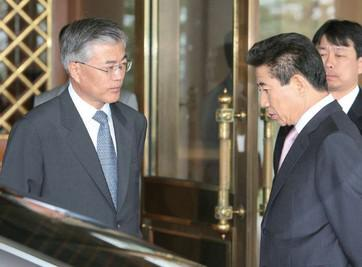

# “大联政”：总统的苦恼

<b>“大联政”：总统的苦恼</b>

2005年1月，我又换了工作，重新回到了民政首席室。政府成立的时间一长，初期那种紧张感自然就会降低，氛围也会变得轻松一些。就在这时发生了李基俊教育副总理人事波动事件，结果导致民政首席与人事首席引咎辞职。总统觉得我们应该找回当初的雄心壮志，重新狠抓工作纪律，于是我再次承担起了这项重任。

就在我第二次担任民政首席的这段时间里，参与政府发生了一件最让人痛心的事——总统的大联政提案。

总统发起提案，表示要与大国家党搞联政，考虑将内阁构成权让给大国家党。虽然总统这么做是为了进行选举制度改革，以打破地域主义的局限，但这个提议震惊了我们这一派的支持者，因为是他们经历了烛光示威反对弹劾，将开放国民党打造成了国会多数党。为此，整个市民社会团体阵营弥漫着失望的情绪。在湖南地区，人们干脆就说这是对湖南的背叛。以我为首的所有的参谋都反对这件事。虽然我们也站出来再三强调总统是真心实意的，对总统的决定表示拥护，但并没有什么作用。我们自己都不能说服自己，当然也说服不了别人。

后来总统也承认，这是参与政府时期最大的一个败笔。

事实上，大联政提案起初并非在总统的计划之中。当时，为了在平时讨论国家重大问题时，执政党、政府、青瓦台的意见能够达成一致，每周五晚上，我们都会在总理府召开以总理为核心的党、政、青要员八人晚餐会。党方面，由党议长与国会代表出席，政府方面由郑东泳、金槿泰、千正培、丁世均几位部长中的两三位出席，青瓦台方面则由秘书室室长、政策室长和我出席。这个会议虽然名叫“八人会议”，但是成员并不固定，有时会增加党政策委员会议长等一两位。特殊情况下，总统也会毫无征兆地突然参加这个会议，然后跟大家说：“咱们见个面吧。”

2005年6月底，我们开会时，总统突然来了，先说了一些无关痛痒的话，后来说到了大联政。当然，他的目的是进行选举制度改革，以打破地域主义的限制。其实，总统以前也说过类似的话，但现在情况有所不同。以前执政党是议席少得可怜的少数党，多少还可以理解，而此时，执政党已经是多数党，再提出这个就叫人费解了。第二次补选中虽然失去了一些议席，没能过半数，但如果与民主劳动党携手，还是可以过半数的。总统的一席话让所有人的心里都不大舒服。因为事发突然，事前谁也没讨论过，大家都默不作声，只是听总统讲。总统临行前留下一句话：“也不是马上就要这么做，我就是让大家想一想。”总统一走，所有人都如临大敌。李海瓒总理对所有参加会议人员都嘱咐道：“千万不能走漏风声，大家就当没有这回事，谁也不要出去乱说。”

但是没过多久，某报纸就将这件事作为特别报道刊登了出来。我们推测应该是政党方面的人泄露出来的。看了报道后，我和青瓦台所有参谋们都一致建议总统解释一下，说目前还只是处于构想阶段，以此来掩盖过去。但是总统给党员们发了一封公开信，公开提出了“联政”这一提案。就是因为参谋们反对，总统才亲自写了公开信，并上传到了个人主页。于是，事情变得一发不可收。

  大部分情况下，总统如果有了什么构想，会跟身边的人说，听取他们的意见后，再反复琢磨自己的想法。在这个过程中，他会对自己的想法进行梳理、修正，甚至是收回。 

大部分情况下，总统如果有了什么构想，会和身边的人说，听取他们的意见后，再反复琢磨自己的想法。在这个过程中，他会对自己的想法进行梳理、修正，甚至是收回。因此，如果是不了解总统讲话方式的人，很可能刚一听到总统的话，就误以为他已经打定主意了，那天的晚餐会就属于这种情况。实际上总统还没有梳理好自己的想法，只是开了个头而已。后来，我听总统说，当时开放国民党没能达到过半数议席，再次成了“朝小野大”[注：朝小野大：执政党弱小，在野党强大。——译者注]的局面，再加上大国家党又提出了要辞退国防部部长尹光雄的议案，他把当时的政治状况想象得太严重了。其实，如果就那样下去，总统十有八九会收回自己的想法，即使他不收回，跟参谋们商量之后，也会对政治状况有一个更准确的判断。那样他的想法也许就会发生改变。再退一万步说，就算他不改变想法，也会选择一个更合适的时机，以更有条理的内容、更完整的形式，展示出他的构想。但是因为意外泄露，总统的真诚受到了质疑。政党的反应与媒体的情形让整个社会都无法进行正常的讨论，就算联政提案部分有问题，进行选举制度改革以打破地域主义这部分至少应该被保留下来，那样，多少还能让这个提案有些意义，但这一点也没做到。

其实，总统将旨在打破地域主义的选举制度改革与联政联系在一起并非首次。2002年12月26日，当选后不久，卢当选人就参加了民主党中央选举对策委员会当值者研修会，并发言道：“为了打破地域对立，就算是把总统的权力减少一半，我觉得也应该在某些方面做出让步。”他在政治圈内提议，协商选举制度以打破地域主义。2003年1月18日，当选人在电视采访中表示：“任何地区都不能允许一个政党占据70%—80%的权力，我要打破地域主义，像法国那样，让过半数的政治势力来决定总理人选。”

2003年4月2日，总统就职后第一次进行国会施政演说，在以上言论的基础上，又进一步说了下面的话：

“地域主义必须克服掉。如果任由地域主义这样发展下去，我们的政治一步也不可能前进。我希望从明年的国会选举开始，执政党能与在野党达成协议，修改选举法，不能再让特定政党占据特定地区2/3以上的议席。我的这一提案如果能够在明年的第17届国会选举中实现，我将把组成内阁的权限让渡于占据过半数议席的政党及政治组织。这样就等于把总统权力的一半甚至更多拱手交了出来，这也符合众多国民对分权型总统制的要求。虽然也有人主张应将其固定到宪法中，但是，我们现行的制度是总统接受国务总理的提名之后再任命国务委员，我觉得这样可以做到尊重国务总理的提名权。这是为了国家的未来着想，我是发自真心地提案，希望能够被接受。”

其结果就是大联政提案。

改革选举制度、打破地域主义是总统的一贯主张。“总理决定权”“组织内阁权”“联政”等只要有助于此，他是可以让渡权力的。他阐明自己的分权之意是为了促进选举制度的改革。但是政治圈对卢总统一而再、再而三强调的选举制度改革要求，没有给予任何答复，市民社会团体阵营也是如此。虽然他们也认为卢总统说的没错，这事的确有必要，但却不付出任何行动。在我看来，首尔的市民社会团体阵营对消除地域主义、地方化、分权化、国家均衡发展这些议题没多大兴趣。虽然他们赞同这件事的正确性，但并不认为它是个迫切需要解决的问题。有人问：“那是非解决不可的问题吗？”也有人评论道：“当务之急是消除两极分化，可总统却一门心思搞什么打破地域主义，这些问题根本不着急啊！”我认为这就是我们进步、改革阵营目前所处的境况。
 

