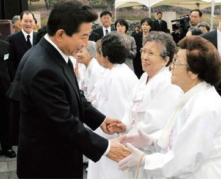

# 总统的道歉

<b>总统的道歉</b>

在我第一次担任民政首席着手进行的各项工作中，过去史整理工作也是一项非常重要的课题。经历了千辛万苦，《过去史整理基本法》才在国会通过，还成立了“为了真实与和解——过去史整理委员会”（简称“过去史委员会”）。在这个过程中，市民社会团体一直坚持不懈，他们的努力是这项工作能够取得成功的决定性因素。

虽然我们进行了长期的奋斗，可是由于大国家党的反对，推迟了立法，内容也被改得面目全非，但立法通过这件事本身还是具有重大意义的。我们根据特别法组织了“过去史委员会”。当然，光靠委员会一时的活动根本无法全方位地完成如此庞大的整理工作，于是我们研究出了解决办法：法律方面，最终整理由过去史委员会完成；政府方面，我们安排政府内部各个机构为过去史整理工作提供协助。

我们想让不同部门同时进行本部门的过去史整理工作，再把最终结果汇集到过去史委员会那里。事实证明，这是一个行之有效的办法。我们让最需要正视过去历史的国情院、检察系统、军队，分别设立各自的过去史委员会。内部的反对虽然造成了一定的困难，但还是都被说服了。从后期来看，这些部门机构自己整理的过去史工作都成果显著。

法院方面通过进行再审判决，以法院自己的方式整理过去的历史。根据过去史委员会的真相阐明决定，很多案件通过再审，纠正了过去的错误判决，这项工作现在仍在进行中。

还有一个机构最应该进行过去史整理工作，但却没有进行，那就是检察系统。当时检察系统要想与其他部门一起整理过去史，确实存在特殊困难。那些利用国家权力捏造案件，搞刑讯逼供等侵犯基本人权的案件，从程序上说是首先由国情院以及警方进行调查，再由检方起诉的。因此，只能是由国情院、警方先整理过去捏造案情的历史，然后由法院再审，宣布无罪，最后由检方在此基础上自己整理过去史。但是在参与政府任期内，进程没能走到那么远。最终，很多案件被证明纯属捏造，法院也宣布了无罪，国家承受了巨大的损害赔偿责任，而检察系统却没有做任何反省。

四三案件[注：四三案件：指1948年4月3日至1954年9月21日在济州岛爆发的民众抗争事件。当时民众不满于日本战败后，美军政体制对朝鲜半岛实行统治所引起的社会问题，于是爆发了该抗争，造成大量无辜平民死亡。据不完全统计，死亡人数为25000—30000人。]是一个典型的案例，整个政府都进行了道歉，连总统都亲自出面，解开了历史上一段令人无比痛心的心结。这件事虽然是过去史问题的一环，但在国民政府之前就展开讨论了。当事人及家属希望恢复自己的名誉。参与政府时期完成了该事件的综合报告书，仅此一项，在很大程度上就已经帮他们恢复名誉了。

但总统并不想就此止步，他把这看成是一块解决过去史问题的试金石，前后进行了两次道歉。第一次是由国务总理出面，参加纪念活动，代表政府正式进行道歉。总统觉得这还不够，于2003年和2006年两次前往济州岛，以国家元首的身份进行了道歉。家属们在总统面前，倾诉了几十年来不为人知、默默承受的苦楚，流下了热泪。

过去史委员会在五年内一共查明了8000余起事件的真相。调查对象包括抗日独立运动与朝鲜战争爆发前后平民的集体伤亡事件，海外同胞史，反民主、反人类行为导致的践踏人权行为，还有暴力、屠杀、死者死因不明，等等。还特别调查了朝鲜战争时期数千名左翼运动有关人士遭到屠杀的“国民保道联盟事件”，以及朝鲜战争前后未经法律程序、全国范围内大批民间人士死于军警之手的事实真相，等等。

左翼以及朝鲜人民军屠杀平民的案件也得以查明，这些被掩埋的历史事件终于真相大白——我们取得了巨大的成果。

  总统于2003年和2006年两次前往济州岛，以国家元首的身份进行了道歉。家属们在总统面前，倾诉了几十年来不为人知、默默承受的苦楚，流下了热泪。 

我一直都在关注过去史整理工作，我在这一过程中思考了很多。国家对无数个体确实做了很多恶，彻底毁掉了一个又一个人的人生。捏造案情让很多人在监狱中度过一生，他们进监狱的时候还是花样年华，出狱时已经白发苍苍。本人自不必说，就连家属的生活也都陷入了巨大的深渊。如果是间谍家属，别说是公职，连工作都找不到。同时还要承受来自周围人的指指点点，一个原本正常的家庭就此支离破散，而这一切错误的根源正是国家的恣意妄为。

就算是国家对此承认了错误，为受害者恢复了名誉，在金钱上做了补偿，可他们被夺走的生活和人生难道能找回来吗？最重要的是国家承认错误是否足够真诚，只有国家对错误进行真心诚意的道歉，为他们恢复名誉，加害者与被害者之间才能实现真正意义上的和解。也只有将过去的历史整理出来，翻过去，国民之间才能实现化解与和谐。为此，我们特地将主管机构的名称定为“为了真实与和解——过去史整理委员会”，同时，将追求“真实”与“和解”这两个难以并存的价值作为目标，到现在为止，不知道这个目标我们达成了多少。

我们所达到的程度虽然有限，但也是国家历史上的巨大进步，也算聊以慰平生了。也有很多国家像韩国这样，有着不堪回首的往事，这些曾经遭受过类似历史的国家都在从事这项工作，西班牙、南非、阿根廷都是如此。但像我们这样，如此成功地进行了过去史整理工作的国家则为数不多。遗憾的是，进入李明博政府时期，这项工作中断了。

《过去史整理法》规定了申诉时效。《过去不明死因调查法》《光州赔偿法》等类似的法律虽然规定了申诉时效，但后来通过对法律的修订，延长了时间，允许进行第2次、第3次追加申诉。过去史整理也应该给没来得及申诉的人提供追加申诉的机会，但随着政权的变化，这些工作后来也都终止了。
 

